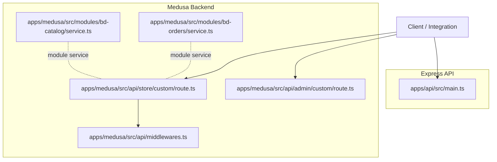
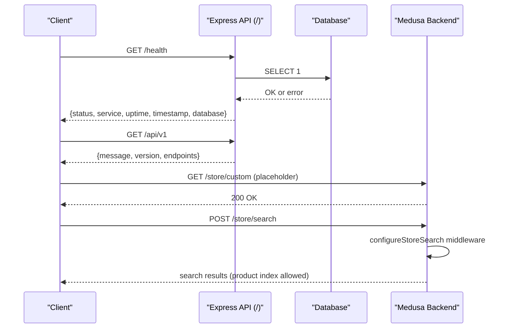
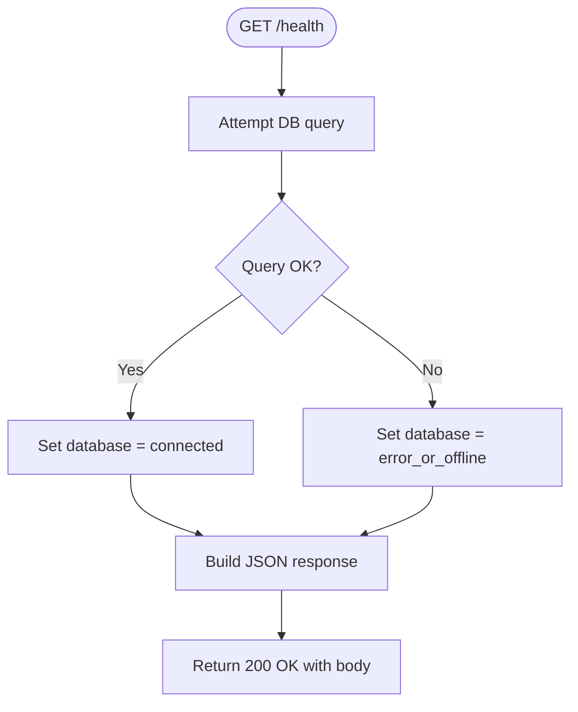
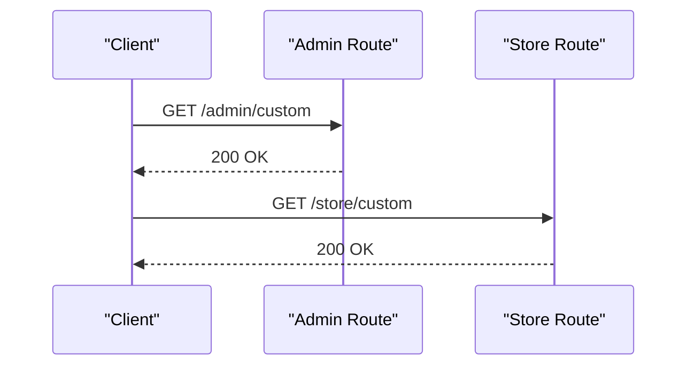
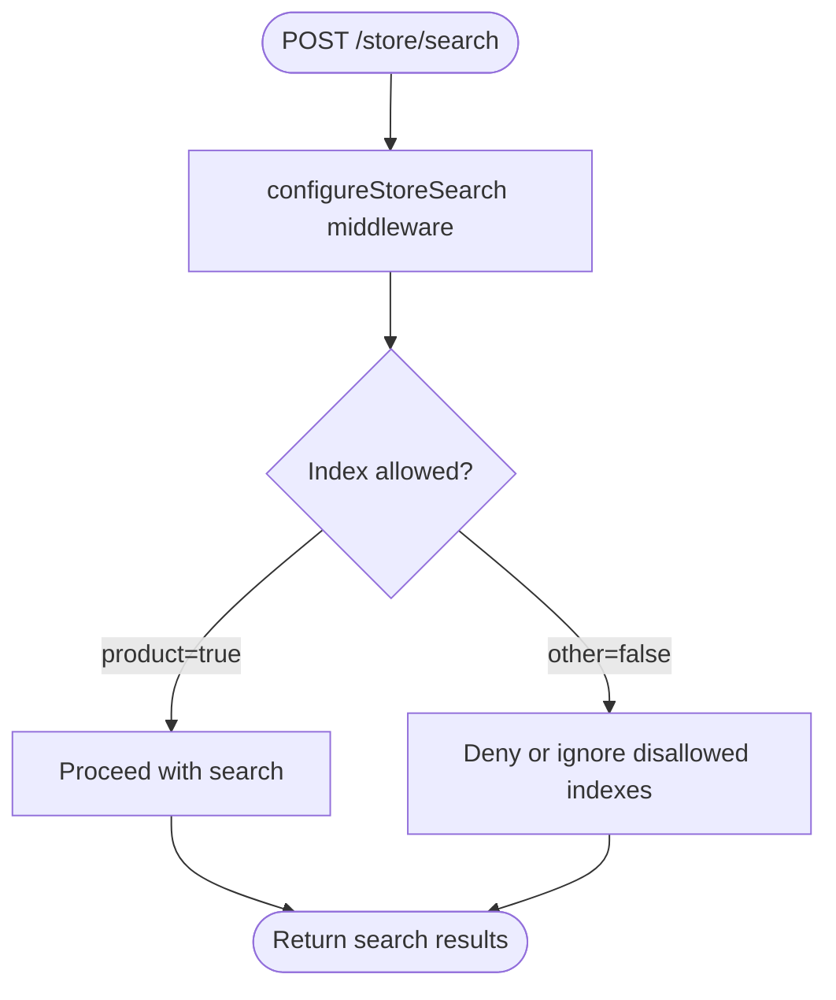
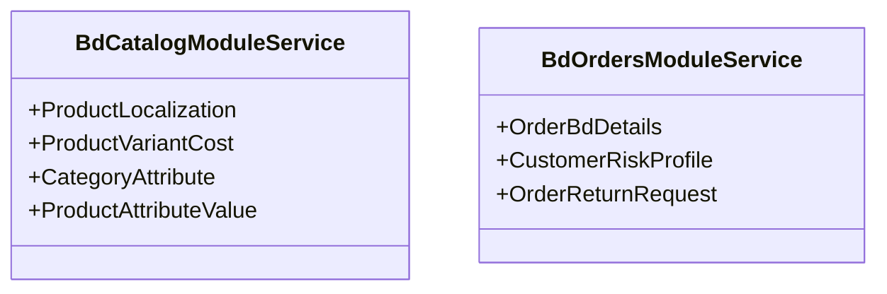
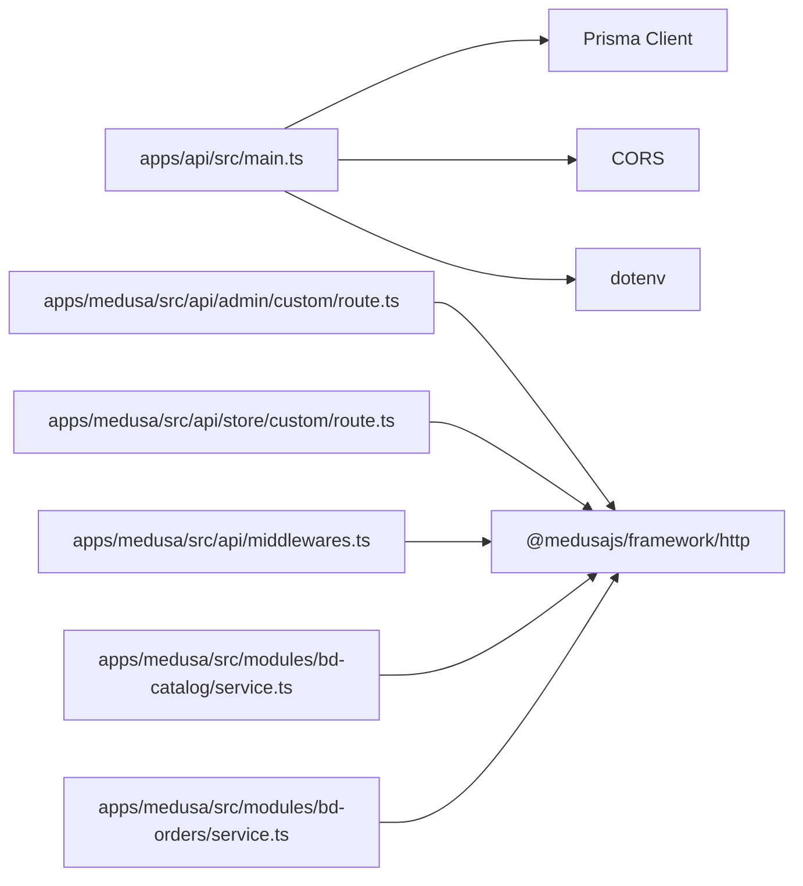

# API Endpoints

<cite>
**Referenced Files in This Document**
- [main.ts](file://apps/api/src/main.ts)
- [package.json (API app)](file://apps/api/package.json)
- [route.ts (Medusa admin custom)](file://apps/medusa/src/api/admin/custom/route.ts)
- [route.ts (Medusa store custom)](file://apps/medusa/src/api/store/custom/route.ts)
- [middlewares.ts (Medusa)](file://apps/medusa/src/api/middlewares.ts)
- [service.ts (BdCatalogModuleService)](file://apps/medusa/src/modules/bd-catalog/service.ts)
- [service.ts (BdOrdersModuleService)](file://apps/medusa/src/modules/bd-orders/service.ts)
- [architecture.md](file://docs/architecture.md)
</cite>

## Table of Contents
1. [Introduction](#introduction)
2. [Project Structure](#project-structure)
3. [Core Components](#core-components)
4. [Architecture Overview](#architecture-overview)
5. [Detailed Component Analysis](#detailed-component-analysis)
6. [Dependency Analysis](#dependency-analysis)
7. [Performance Considerations](#performance-considerations)
8. [Troubleshooting Guide](#troubleshooting-guide)
9. [Conclusion](#conclusion)

## Introduction
This document describes the exposed API endpoints for the BD Commerce Platform, focusing on:
- The health check endpoint
- The root API discovery endpoint
- Planned endpoints for categories, products, and orders
- Authentication requirements, rate limiting, versioning strategy, and documentation standards

The platform exposes two API surfaces:
- A lightweight Express-based API under `apps/api` for basic service health and discovery
- A MedusaJS v2 commerce backend under `apps/medusa` that provides store and admin routes, plus custom module services

## Project Structure
At a high level:
- `apps/api` is an Express application providing `/health` and `/api/v1`
- `apps/medusa` is a MedusaJS v2 application exposing `/store/*`, `/admin/*`, and custom route stubs
- Documentation in `docs/architecture.md` defines route namespaces, access control, and rate limits

**Diagram sources**
- [main.ts:12-54](file://apps/api/src/main.ts#L12-L54)
- [route.ts (Medusa admin custom):1-9](file://apps/medusa/src/api/admin/custom/route.ts#L1-L9)
- [route.ts (Medusa store custom):1-9](file://apps/medusa/src/api/store/custom/route.ts#L1-L9)
- [middlewares.ts (Medusa):1-20](file://apps/medusa/src/api/middlewares.ts#L1-L20)
- [service.ts (BdCatalogModuleService):1-15](file://apps/medusa/src/modules/bd-catalog/service.ts#L1-L15)
- [service.ts (BdOrdersModuleService):1-13](file://apps/medusa/src/modules/bd-orders/service.ts#L1-L13)

**Section sources**
- [main.ts:12-54](file://apps/api/src/main.ts#L12-L54)
- [architecture.md:305-334](file://docs/architecture.md#L305-L334)

## Core Components
- Health Check Endpoint (`GET /health`)
  - Returns service status, uptime, timestamp, and database connectivity state
- Root API Discovery Endpoint (`GET /api/v1`)
  - Returns API message, version, and available endpoint paths
- Medusa Custom Route Stubs
  - Admin and Store custom route placeholders returning HTTP 200
- Medusa Search Middleware
  - Configures allowed search indexes for `/store/search`
- Module Services
  - Catalog and Orders module services expose model-backed CRUD capabilities via Medusa’s framework

**Section sources**
- [main.ts:18-49](file://apps/api/src/main.ts#L18-L49)
- [route.ts (Medusa admin custom):1-9](file://apps/medusa/src/api/admin/custom/route.ts#L1-L9)
- [route.ts (Medusa store custom):1-9](file://apps/medusa/src/api/store/custom/route.ts#L1-L9)
- [middlewares.ts (Medusa):1-20](file://apps/medusa/src/api/middlewares.ts#L1-L20)
- [service.ts (BdCatalogModuleService):1-15](file://apps/medusa/src/modules/bd-catalog/service.ts#L1-L15)
- [service.ts (BdOrdersModuleService):1-13](file://apps/medusa/src/modules/bd-orders/service.ts#L1-L13)

## Architecture Overview
The API surface is split between:
- Express API: simple health and discovery endpoints
- Medusa Backend: full commerce APIs with store and admin routes, plus custom modules

**Diagram sources**
- [main.ts:18-49](file://apps/api/src/main.ts#L18-L49)
- [route.ts (Medusa store custom):1-9](file://apps/medusa/src/api/store/custom/route.ts#L1-L9)
- [middlewares.ts (Medusa):1-20](file://apps/medusa/src/api/middlewares.ts#L1-L20)

## Detailed Component Analysis

### Health Check Endpoint
- Method: `GET`
- Path: `/health`
- Purpose: Service health and readiness probe including database connectivity
- Authentication: None
- Rate Limiting: Not implemented at this layer
- Response Schema:
  - `status`: string — always `ok` when reachable
  - `service`: string — service identifier
  - `uptime`: number — process uptime in seconds
  - `timestamp`: string — ISO 8601 timestamp
  - `database`: string — one of:
    - `connected`
    - `disconnected`
    - `error_or_offline`
- Status Codes:
  - `200 OK` — endpoint reachable; database status included in body
- Example Request:
  - `GET /health`
- Example Response:
  - `{ "status": "ok", "service": "bd-commerce-api", "uptime": 1234.56, "timestamp": "2024-01-01T00:00:00.000Z", "database": "connected" }`
- Error Responses:
  - Non-2xx responses are not explicitly handled by this route; typical Express behavior applies if the server cannot respond

**Diagram sources**
- [main.ts:18-35](file://apps/api/src/main.ts#L18-L35)

**Section sources**
- [main.ts:18-35](file://apps/api/src/main.ts#L18-L35)

### Root API Discovery Endpoint
- Method: `GET`
- Path: `/api/v1`
- Purpose: Provide API metadata and list of available endpoints
- Authentication: None
- Rate Limiting: Not implemented at this layer
- Response Schema:
  - `message`: string — welcome message
  - `version`: string — API version
  - `endpoints`: object — map of resource names to paths
    - `health`: string
    - `categories`: string
    - `products`: string
    - `orders`: string
- Status Codes:
  - `200 OK`
- Example Request:
  - `GET /api/v1`
- Example Response:
  - `{ "message": "Welcome to BD Commerce Platform API", "version": "1.0.0", "endpoints": { "health": "/health", "categories": "/api/v1/categories", "products": "/api/v1/products", "orders": "/api/v1/orders" } }`

**Section sources**
- [main.ts:37-49](file://apps/api/src/main.ts#L37-L49)

### Planned Endpoints: Categories, Products, Orders
These endpoints are listed in the discovery response but are not yet implemented in the Express API. They are intended to be part of the public API surface under `/api/v1`.

- Base Path: `/api/v1`
- Resources:
  - Categories: `/api/v1/categories`
  - Products: `/api/v1/products`
  - Orders: `/api/v1/orders`

Expected Behavior and Schemas (planned):
- Categories
  - List: `GET /api/v1/categories`
    - Query params: pagination, filters (e.g., slug, parent_id)
    - Response: array of category objects
  - Get: `GET /api/v1/categories/:id`
    - Response: single category object
  - Create: `POST /api/v1/categories`
    - Body: category fields (name, slug, parent_id, etc.)
    - Response: created category object
  - Update: `PATCH /api/v1/categories/:id`
    - Body: partial category fields
    - Response: updated category object
  - Delete: `DELETE /api/v1/categories/:id`
    - Response: 204 No Content or confirmation object
- Products
  - List: `GET /api/v1/products`
    - Query params: pagination, filters (category, availability, attributes)
    - Response: array of product objects
  - Get: `GET /api/v1/products/:id`
    - Response: single product object
  - Create: `POST /api/v1/products`
    - Body: product fields (title, description, variants, pricing, attributes)
    - Response: created product object
  - Update: `PATCH /api/v1/products/:id`
    - Body: partial product fields
    - Response: updated product object
  - Delete: `DELETE /api/v1/products/:id`
    - Response: 204 No Content or confirmation object
- Orders
  - List: `GET /api/v1/orders`
    - Query params: pagination, filters (status, customer_id)
    - Response: array of order objects
  - Get: `GET /api/v1/orders/:id`
    - Response: single order object
  - Create: `POST /api/v1/orders`
    - Body: order fields (customer, items, shipping, payment)
    - Response: created order object
  - Update: `PATCH /api/v1/orders/:id`
    - Body: partial order fields (e.g., status transitions)
    - Response: updated order object
  - Cancel: `POST /api/v1/orders/:id/cancel`
    - Response: cancellation result
  - Refund: `POST /api/v1/orders/:id/refund`
    - Body: refund details
    - Response: refund result

Authentication Requirements (planned):
- Public read endpoints may be open
- Write endpoints should require authentication (JWT bearer token)
- Admin-only operations should enforce RBAC roles

Rate Limiting (planned):
- Apply per-IP or per-user rate limits based on route sensitivity
- Enforce stricter limits on write endpoints and sensitive operations

Status Codes (standard REST conventions):
- `200 OK` — successful retrieval/update
- `201 Created` — successful creation
- `204 No Content` — successful deletion
- `400 Bad Request` — invalid input
- `401 Unauthorized` — missing or invalid credentials
- `403 Forbidden` — insufficient permissions
- `404 Not Found` — resource not found
- `422 Unprocessable Entity` — validation errors
- `429 Too Many Requests` — rate limit exceeded
- `500 Internal Server Error` — unexpected server error

Note: These schemas and behaviors are planned and not yet implemented in the current codebase.

**Section sources**
- [main.ts:37-49](file://apps/api/src/main.ts#L37-L49)

### Medusa Custom Routes
- Admin Custom Route
  - Method: `GET`
  - Path: `/admin/custom`
  - Purpose: Placeholder route returning HTTP 200
  - Authentication: Depends on Medusa admin auth configuration
  - Response: Empty 200 OK
- Store Custom Route
  - Method: `GET`
  -Path: `/store/custom`
  - Purpose: Placeholder route returning HTTP 200
  - Authentication: Depends on Medusa store auth configuration
  - Response: Empty 200 OK

**Diagram sources**
- [route.ts (Medusa admin custom):1-9](file://apps/medusa/src/api/admin/custom/route.ts#L1-L9)
- [route.ts (Medusa store custom):1-9](file://apps/medusa/src/api/store/custom/route.ts#L1-L9)

**Section sources**
- [route.ts (Medusa admin custom):1-9](file://apps/medusa/src/api/admin/custom/route.ts#L1-L9)
- [route.ts (Medusa store custom):1-9](file://apps/medusa/src/api/store/custom/route.ts#L1-L9)

### Medusa Search Middleware
- Route: `POST /store/search`
- Middleware: `configureStoreSearch`
- Allowed Indexes:
  - `product`: enabled
- Purpose: Restrict search to allowed indexes and apply store search policies

**Diagram sources**
- [middlewares.ts (Medusa):1-20](file://apps/medusa/src/api/middlewares.ts#L1-L20)

**Section sources**
- [middlewares.ts (Medusa):1-20](file://apps/medusa/src/api/middlewares.ts#L1-L20)

### Module Services (Catalog and Orders)
- BdCatalogModuleService
  - Exposes models: ProductLocalization, ProductVariantCost, CategoryAttribute, ProductAttributeValue
  - Provides Medusa-backed CRUD capabilities for catalog-related data
- BdOrdersModuleService
  - Exposes models: OrderBdDetails, CustomerRiskProfile, OrderReturnRequest
  - Provides Medusa-backed CRUD capabilities for order-related data

**Diagram sources**
- [service.ts (BdCatalogModuleService):1-15](file://apps/medusa/src/modules/bd-catalog/service.ts#L1-L15)
- [service.ts (BdOrdersModuleService):1-13](file://apps/medusa/src/modules/bd-orders/service.ts#L1-L13)

**Section sources**
- [service.ts (BdCatalogModuleService):1-15](file://apps/medusa/src/modules/bd-catalog/service.ts#L1-L15)
- [service.ts (BdOrdersModuleService):1-13](file://apps/medusa/src/modules/bd-orders/service.ts#L1-L13)

## Dependency Analysis
- Express API Dependencies
  - Express server
  - CORS
  - Prisma client
  - Environment variables via dotenv
- Medusa Backend Dependencies
  - Medusa framework and SDK
  - Custom middlewares for store search
  - Module services for catalog and orders

**Diagram sources**
- [main.ts:1-16](file://apps/api/src/main.ts#L1-L16)
- [route.ts (Medusa admin custom):1-9](file://apps/medusa/src/api/admin/custom/route.ts#L1-L9)
- [route.ts (Medusa store custom):1-9](file://apps/medusa/src/api/store/custom/route.ts#L1-L9)
- [middlewares.ts (Medusa):1-20](file://apps/medusa/src/api/middlewares.ts#L1-L20)
- [service.ts (BdCatalogModuleService):1-15](file://apps/medusa/src/modules/bd-catalog/service.ts#L1-L15)
- [service.ts (BdOrdersModuleService):1-13](file://apps/medusa/src/modules/bd-orders/service.ts#L1-L13)

**Section sources**
- [package.json (API app):1-34](file://apps/api/package.json#L1-L34)
- [main.ts:1-16](file://apps/api/src/main.ts#L1-L16)

## Performance Considerations
- Health Check
  - Database ping adds minimal overhead; consider caching status briefly if needed
- API Discovery
  - Lightweight JSON response; no additional processing
- Medusa Search
  - Ensure Meilisearch is configured and indexed efficiently
  - Use pagination and filtering to reduce payload sizes
- Rate Limiting
  - Implement rate limiting at the gateway or application layer for sensitive endpoints
- Versioning
  - Keep API version in discovery response and URL path where applicable

[No sources needed since this section provides general guidance]

## Troubleshooting Guide
- Health Check Failing
  - Verify database connectivity and credentials
  - Check environment variables and Prisma connection
- API Discovery Missing Endpoints
  - Confirm that planned endpoints are implemented and registered
- Medusa Custom Routes Returning 200 Only
  - These are placeholders; implement business logic as needed
- Search Middleware Errors
  - Validate allowed indexes configuration
  - Ensure Meilisearch is running and accessible

**Section sources**
- [main.ts:18-35](file://apps/api/src/main.ts#L18-L35)
- [middlewares.ts (Medusa):1-20](file://apps/medusa/src/api/middlewares.ts#L1-L20)

## Conclusion
The current API surface includes:
- A functional health check endpoint
- A discovery endpoint listing planned resources
- Placeholder Medusa routes and middleware for future expansion

Planned endpoints for categories, products, and orders should follow standard REST conventions, include robust authentication and authorization, and implement rate limiting appropriate to their sensitivity. The Medusa backend provides a solid foundation for commerce functionality through its module services and middleware.

[No sources needed since this section summarizes without analyzing specific files]