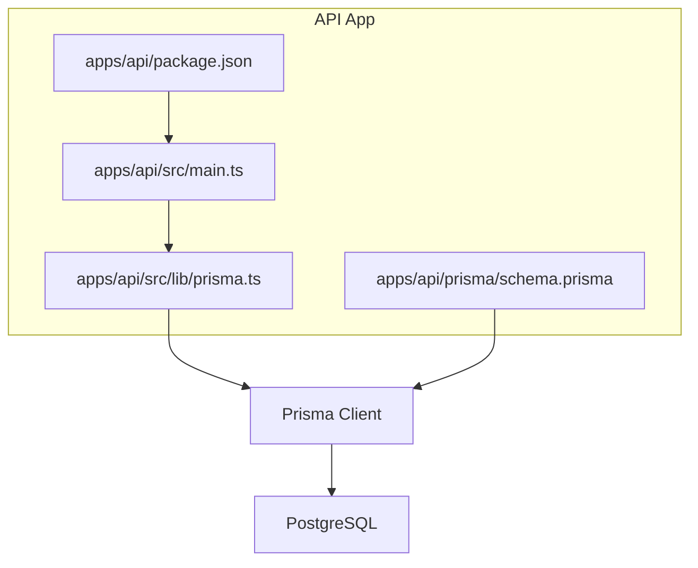
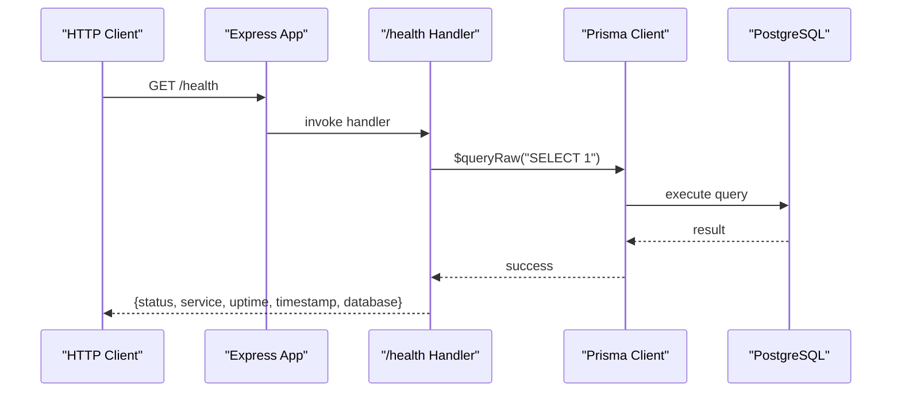
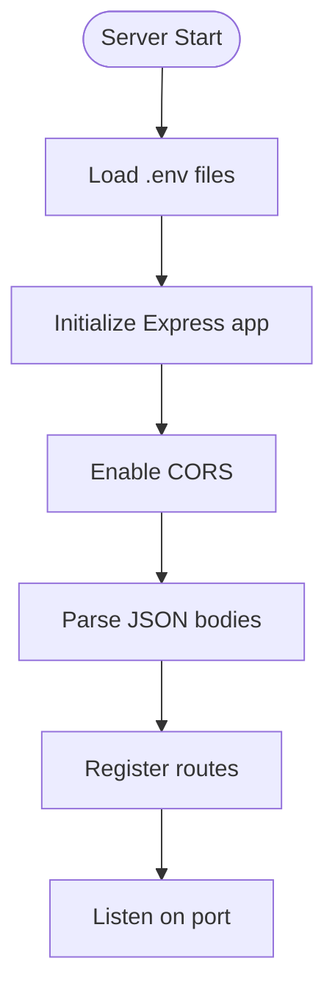
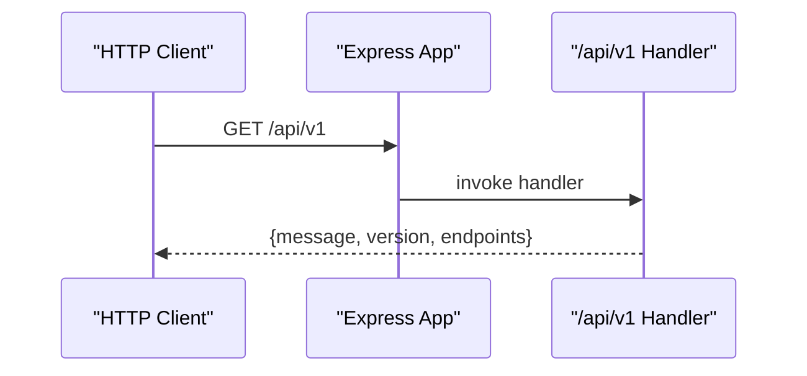
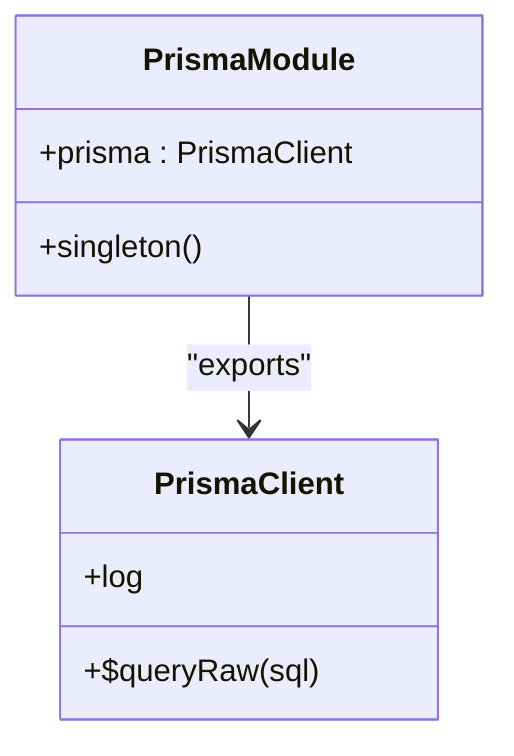
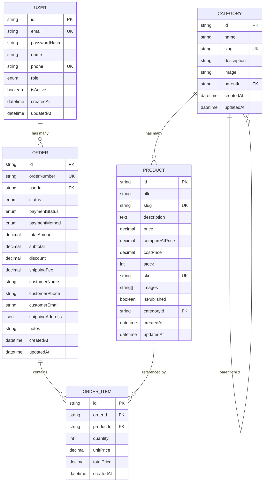
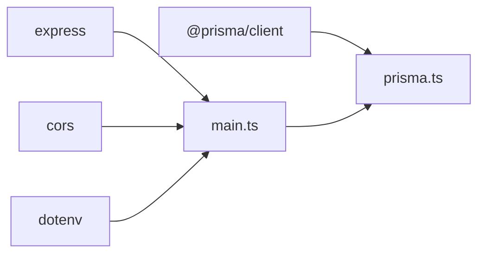

# API Layer (apps/api)

<cite>
**Referenced Files in This Document**
- [main.ts](file://apps/api/src/main.ts)
- [prisma.ts](file://apps/api/src/lib/prisma.ts)
- [schema.prisma](file://apps/api/prisma/schema.prisma)
- [package.json](file://apps/api/package.json)
</cite>

## Table of Contents
1. [Introduction](#introduction)
2. [Project Structure](#project-structure)
3. [Core Components](#core-components)
4. [Architecture Overview](#architecture-overview)
5. [Detailed Component Analysis](#detailed-component-analysis)
6. [Dependency Analysis](#dependency-analysis)
7. [Performance Considerations](#performance-considerations)
8. [Troubleshooting Guide](#troubleshooting-guide)
9. [Conclusion](#conclusion)
10. [Appendices](#appendices)

## Introduction
This document describes the Express.js API layer under apps/api. It covers server configuration, middleware setup, request/response handling patterns, Prisma ORM integration for database operations and connection pooling, authentication and authorization mechanisms, error handling strategies, logging implementation, API endpoint specifications, request/response schemas, database schema design, model relationships, migration strategies, security considerations, rate limiting, and performance optimization techniques.

The current codebase provides a minimal but complete foundation: an Express application with CORS and JSON parsing, a health check endpoint that validates database connectivity via Prisma, and a Prisma client configured to log queries in development. The data model is defined in Prisma’s schema file and includes users, categories, products, orders, and order items.

## Project Structure
The API module is organized into three primary areas:
- Application entry point and routes: apps/api/src/main.ts
- Database client initialization: apps/api/src/lib/prisma.ts
- Data model definition: apps/api/prisma/schema.prisma
- Module metadata and scripts: apps/api/package.json

**Diagram sources**
- [main.ts:1-55](file://apps/api/src/main.ts#L1-L55)
- [prisma.ts:1-14](file://apps/api/src/lib/prisma.ts#L1-L14)
- [schema.prisma:1-152](file://apps/api/prisma/schema.prisma#L1-L152)
- [package.json:1-34](file://apps/api/package.json#L1-L34)

**Section sources**
- [main.ts:1-55](file://apps/api/src/main.ts#L1-L55)
- [prisma.ts:1-14](file://apps/api/src/lib/prisma.ts#L1-L14)
- [schema.prisma:1-152](file://apps/api/prisma/schema.prisma#L1-L152)
- [package.json:1-34](file://apps/api/package.json#L1-L34)

## Core Components
- Express server bootstrap and routing:
  - Loads environment variables from the repository root .env and local .env.
  - Enables CORS and JSON body parsing.
  - Defines a health check endpoint that verifies database connectivity using Prisma.
  - Provides a basic API discovery route listing available endpoints.
- Prisma client:
  - Exports a singleton PrismaClient instance.
  - Configures query logging based on environment.
  - Reuses the same instance across modules in non-production environments.
- Data model:
  - Defines core entities: User, Category, Product, Order, OrderItem.
  - Includes enums for roles, order status, payment status, and payment method.
  - Establishes relations and indexes for efficient querying.

**Section sources**
- [main.ts:1-55](file://apps/api/src/main.ts#L1-L55)
- [prisma.ts:1-14](file://apps/api/src/lib/prisma.ts#L1-L14)
- [schema.prisma:1-152](file://apps/api/prisma/schema.prisma#L1-L152)

## Architecture Overview
The API layer follows a straightforward request lifecycle:
- Request enters Express.
- Global middleware (CORS, JSON parser) processes the request.
- Route handlers respond directly or interact with the database via Prisma.
- Responses are returned as JSON.

**Diagram sources**
- [main.ts:19-35](file://apps/api/src/main.ts#L19-L35)
- [prisma.ts:1-14](file://apps/api/src/lib/prisma.ts#L1-L14)

## Detailed Component Analysis

### Server Configuration and Middleware
- Environment loading:
  - Loads the repository root .env first, then the local .env.
- CORS:
  - Enabled globally to allow cross-origin requests.
- Body parsing:
  - JSON bodies parsed automatically.
- Port configuration:
  - Uses API_PORT or PORT environment variable; defaults to 4000.

**Diagram sources**
- [main.ts:1-17](file://apps/api/src/main.ts#L1-L17)
- [main.ts:51-54](file://apps/api/src/main.ts#L51-L54)

**Section sources**
- [main.ts:1-17](file://apps/api/src/main.ts#L1-L17)
- [main.ts:51-54](file://apps/api/src/main.ts#L51-L54)

### Request/Response Handling Patterns
- Health check:
  - Validates database connectivity by executing a simple query through Prisma.
  - Returns service status, uptime, timestamp, and database state.
- API discovery:
  - Returns versioning information and lists available endpoints.

**Diagram sources**
- [main.ts:38-49](file://apps/api/src/main.ts#L38-L49)

**Section sources**
- [main.ts:19-49](file://apps/api/src/main.ts#L19-L49)

### Prisma ORM Integration
- Client initialization:
  - Singleton pattern ensures one PrismaClient instance per process.
  - Query logging enabled in development for query, error, and warn levels; only errors in production.
- Connection pooling:
  - Managed by Prisma’s underlying PostgreSQL driver; no explicit pool configuration in this module.
- Schema-driven models:
  - All database entities and relations are defined in schema.prisma.

**Diagram sources**
- [prisma.ts:1-14](file://apps/api/src/lib/prisma.ts#L1-L14)

**Section sources**
- [prisma.ts:1-14](file://apps/api/src/lib/prisma.ts#L1-L14)

### Authentication and Authorization
- Current state:
  - No authentication middleware or authorization logic is implemented in the API layer.
- Recommended approach:
  - Introduce JWT-based session authentication for protected routes.
  - Add role-based access control using the Role enum (CUSTOMER, ADMIN, SELLER).
  - Apply middleware to validate tokens and attach user context to requests.

[No sources needed since this section proposes future enhancements not present in the code]

### Error Handling Strategies
- Current state:
  - No centralized error-handling middleware is present.
- Recommended approach:
  - Implement a global error-handling middleware to standardize error responses.
  - Validate inputs using Zod schemas before processing.
  - Log errors consistently and avoid leaking sensitive details.

[No sources needed since this section proposes future enhancements not present in the code]

### Logging Implementation
- Current state:
  - Prisma logs queries, errors, and warnings in development; only errors in production.
- Recommended approach:
  - Integrate structured logging (e.g., Pino) with correlation IDs.
  - Scrub sensitive data from logs.
  - Centralize logging across middleware and route handlers.

**Section sources**
- [prisma.ts:7-9](file://apps/api/src/lib/prisma.ts#L7-L9)

### API Endpoint Specifications
- GET /health
  - Purpose: Service health and database connectivity check.
  - Response fields:
    - status: string
    - service: string
    - uptime: number
    - timestamp: string (ISO date)
    - database: string ("connected", "disconnected", "error_or_offline")
- GET /api/v1
  - Purpose: API discovery and versioning.
  - Response fields:
    - message: string
    - version: string
    - endpoints: object mapping endpoint names to paths

**Section sources**
- [main.ts:19-49](file://apps/api/src/main.ts#L19-L49)

### Request/Response Schemas
- Health response:
  - status: string
  - service: string
  - uptime: number
  - timestamp: string
  - database: string
- API discovery response:
  - message: string
  - version: string
  - endpoints: object

[No sources needed since this section summarizes response structures already described above]

### Database Schema Design and Model Relationships
- Entities:
  - User: id, email, passwordHash, name, phone, role, isActive, timestamps; indexes on email and phone.
  - Category: hierarchical self-referencing relation via parentId; indexes on slug and parentId.
  - Product: belongs to Category; indexes on slug, categoryId, price, isPublished.
  - Order: references User; stores customer info and shipping address as JSON; indexes on orderNumber, userId, status, paymentStatus, createdAt.
  - OrderItem: links Order and Product; indexes on orderId and productId.
- Enums:
  - Role: CUSTOMER, ADMIN, SELLER
  - OrderStatus: PENDING, CONFIRMED, PROCESSING, SHIPPED, DELIVERED, CANCELLED
  - PaymentStatus: PENDING, PAID, FAILED, REFUNDED
  - PaymentMethod: COD, BKASH, NAGAD, SSLCOMMERZ, STRIPE

**Diagram sources**
- [schema.prisma:14-42](file://apps/api/prisma/schema.prisma#L14-L42)
- [schema.prisma:48-151](file://apps/api/prisma/schema.prisma#L48-L151)

**Section sources**
- [schema.prisma:14-42](file://apps/api/prisma/schema.prisma#L14-L42)
- [schema.prisma:48-151](file://apps/api/prisma/schema.prisma#L48-L151)

### Migration Strategies
- Development workflow:
  - Generate Prisma client and run migrations using provided npm scripts.
- Production workflow:
  - Apply migrations prior to deployment; ensure DATABASE_URL points to the target database.
- Tools:
  - prisma generate, prisma migrate dev, prisma studio, prisma db push.

**Section sources**
- [package.json:7-14](file://apps/api/package.json#L7-L14)

### Security Considerations
- CORS:
  - Currently open; restrict origins in production to trusted domains.
- Input validation:
  - Integrate Zod schemas for all incoming payloads.
- Secrets management:
  - Store DATABASE_URL and other secrets securely; avoid committing .env files.
- Authentication:
  - Implement JWT-based authentication and role-based authorization.
- Webhook security:
  - Validate signatures for external webhooks if added later.

[No sources needed since this section provides general guidance]

### Rate Limiting
- Current state:
  - No rate limiting middleware is implemented.
- Recommended approach:
  - Use Redis-backed token-bucket rate limiting for public endpoints.
  - Enforce stricter limits for sensitive operations like order placement.

[No sources needed since this section proposes future enhancements not present in the code]

### Performance Optimization Techniques
- Database indexing:
  - Leverage existing indexes on frequently queried fields (email, phone, slug, categoryId, price, isPublished, orderNumber, userId, status, paymentStatus, createdAt).
- Query optimization:
  - Use Prisma’s select/include to fetch only necessary fields.
- Connection pooling:
  - Rely on Prisma’s default pooling; tune pool size if needed based on workload.
- Caching:
  - Consider Redis for read-heavy endpoints (e.g., product catalogs).

**Section sources**
- [schema.prisma:60-62](file://apps/api/prisma/schema.prisma#L60-L62)
- [schema.prisma:78-80](file://apps/api/prisma/schema.prisma#L78-L80)
- [schema.prisma:101-105](file://apps/api/prisma/schema.prisma#L101-L105)
- [schema.prisma:129-134](file://apps/api/prisma/schema.prisma#L129-L134)
- [schema.prisma:148-149](file://apps/api/prisma/schema.prisma#L148-L149)

## Dependency Analysis
The API depends on Express for HTTP handling, CORS for cross-origin support, dotenv for environment configuration, and Prisma for database interactions. Additional dependencies like ioredis, meilisearch, and zod are declared but not yet used in the current code.

**Diagram sources**
- [package.json:16-24](file://apps/api/package.json#L16-L24)
- [main.ts:1-10](file://apps/api/src/main.ts#L1-L10)
- [prisma.ts:1-1](file://apps/api/src/lib/prisma.ts#L1-L1)

**Section sources**
- [package.json:16-24](file://apps/api/package.json#L16-L24)
- [main.ts:1-10](file://apps/api/src/main.ts#L1-L10)
- [prisma.ts:1-1](file://apps/api/src/lib/prisma.ts#L1-L1)

## Performance Considerations
- Enable query logging only in development to reduce overhead in production.
- Use selective field fetching and eager loading where appropriate.
- Monitor database query performance and adjust indexes accordingly.
- Consider adding caching layers for frequently accessed data.

[No sources needed since this section provides general guidance]

## Troubleshooting Guide
- Health check returns disconnected or error_or_offline:
  - Verify DATABASE_URL is correct and reachable.
  - Ensure the database server is running and accepts connections.
- Prisma query logs missing in development:
  - Confirm NODE_ENV is set to development so query logging is enabled.
- Unexpected CORS errors:
  - Check browser origin and server CORS configuration.

**Section sources**
- [main.ts:19-35](file://apps/api/src/main.ts#L19-L35)
- [prisma.ts:7-9](file://apps/api/src/lib/prisma.ts#L7-L9)

## Conclusion
The apps/api layer provides a solid foundation with Express, CORS, JSON parsing, a health check endpoint, and Prisma integration. To reach production readiness, implement authentication and authorization, input validation, centralized error handling, structured logging, rate limiting, and additional performance optimizations such as caching and query tuning. The database schema is well-structured with clear relationships and indexes, supporting scalable growth.

[No sources needed since this section summarizes without analyzing specific files]

## Appendices

### Environment Variables
- Required:
  - DATABASE_URL: PostgreSQL connection string.
- Optional:
  - API_PORT or PORT: Server listening port.
  - NODE_ENV: Controls Prisma logging verbosity.

[No sources needed since this section provides general guidance]

### Scripts Reference
- Build: compiles TypeScript.
- Start: runs compiled output.
- Dev: watches and runs TypeScript source.
- Prisma commands: generate client, run migrations, open Studio, push schema.

**Section sources**
- [package.json:7-14](file://apps/api/package.json#L7-L14)