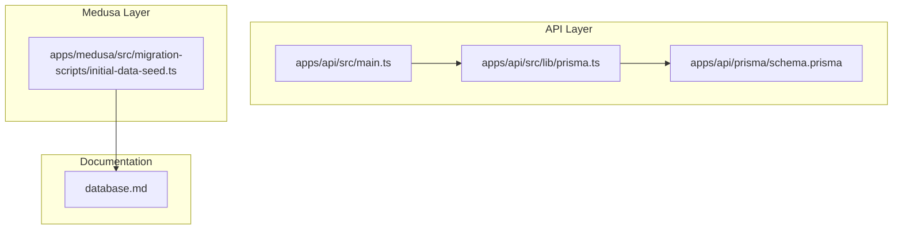
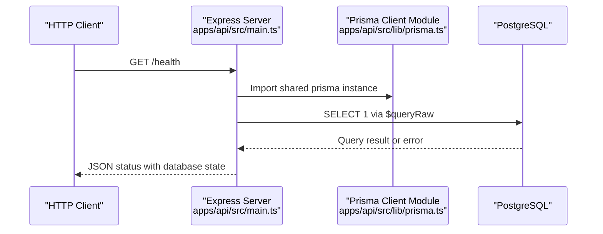
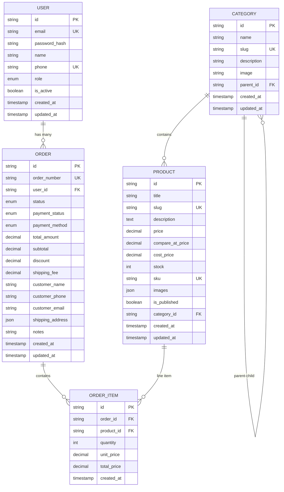
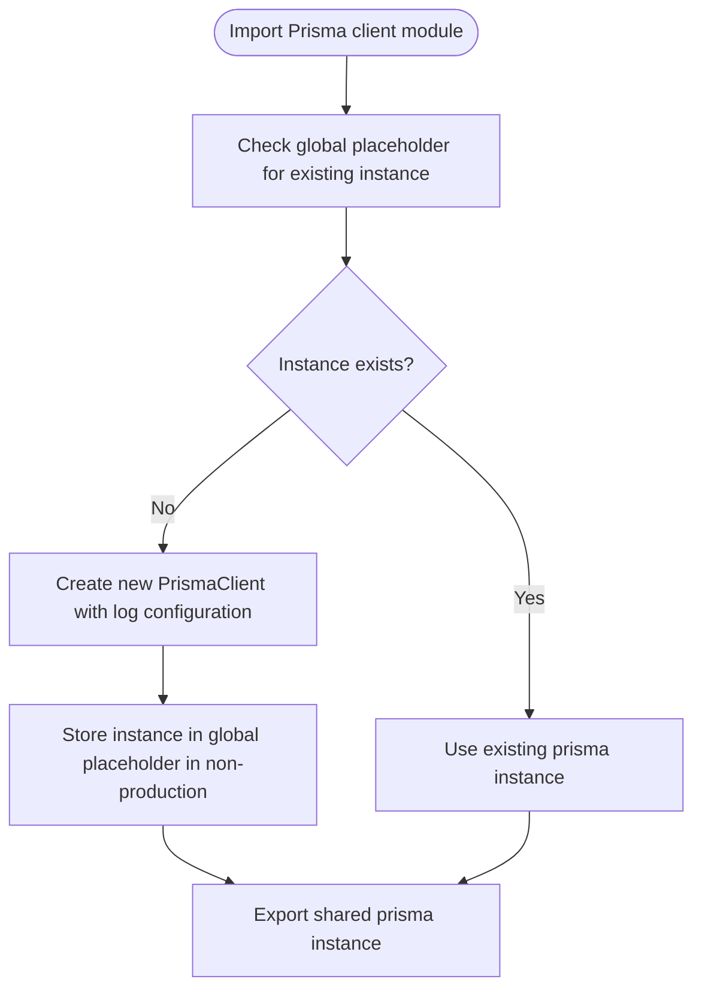
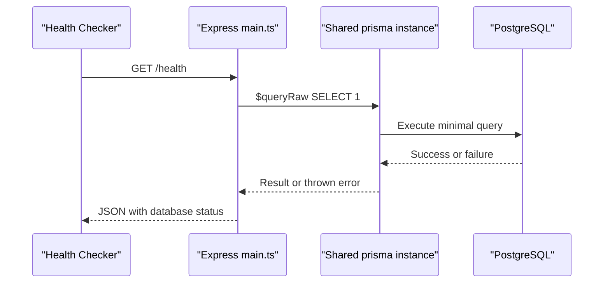
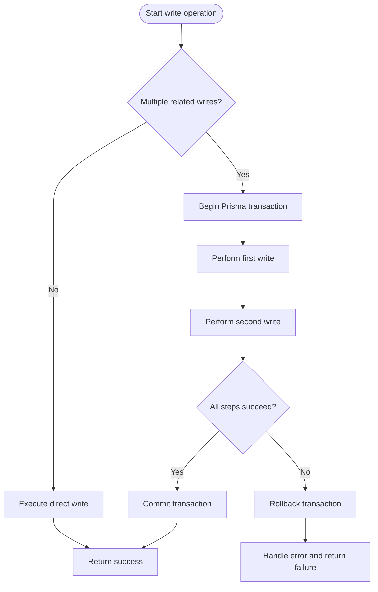
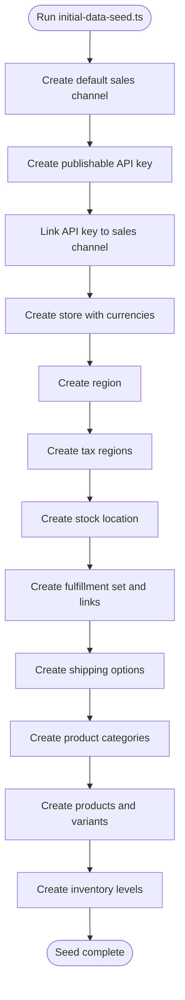
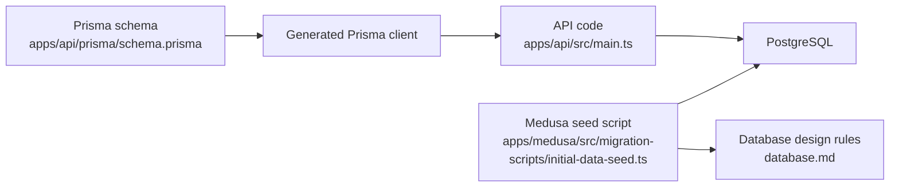

# Database Integration

<cite>
**Referenced Files in This Document**
- [schema.prisma](file://apps/api/prisma/schema.prisma)
- [prisma.ts](file://apps/api/src/lib/prisma.ts)
- [main.ts](file://apps/api/src/main.ts)
- [initial-data-seed.ts](file://apps/medusa/src/migration-scripts/initial-data-seed.ts)
- [database.md](file://database.md)
</cite>

## Table of Contents
1. [Introduction](#introduction)
2. [Project Structure](#project-structure)
3. [Core Components](#core-components)
4. [Architecture Overview](#architecture-overview)
5. [Detailed Component Analysis](#detailed-component-analysis)
6. [Dependency Analysis](#dependency-analysis)
7. [Performance Considerations](#performance-considerations)
8. [Troubleshooting Guide](#troubleshooting-guide)
9. [Conclusion](#conclusion)
10. [Appendices](#appendices)

## Introduction
This document explains how Prisma ORM is integrated into the BD Commerce Platform API, and how it relates to the broader Medusa-based database design. It covers:

- Database connection setup through environment variables.
- Client initialization and process-wide singleton behavior.
- Schema definition structure, data types, enums, indexes, and model relationships.
- Query execution patterns used by the API.
- Transaction handling guidance based on available code and project documentation.
- Error management strategies around health checks and logging configuration.
- Examples of common CRUD operations, complex queries, and performance optimization techniques.
- Database migrations and seeding strategies across the API and Medusa application layers.
- Connection troubleshooting for development and production environments.

The goal is to make this integration understandable for both developers new to Prisma and experienced engineers reviewing the system’s persistence layer.

## Project Structure
The Prisma-related code lives primarily under the `apps/api` package, while the broader database design and Medusa-specific seeding live at the repository root and under `apps/medusa`.

**Diagram sources**
- [main.ts:1-55](file://apps/api/src/main.ts#L1-L55)
- [prisma.ts:1-14](file://apps/api/src/lib/prisma.ts#L1-L14)
- [schema.prisma:1-152](file://apps/api/prisma/schema.prisma#L1-L152)
- [initial-data-seed.ts:1-842](file://apps/medusa/src/migration-scripts/initial-data-seed.ts#L1-L842)
- [database.md:1-200](file://database.md#L1-L200)

**Section sources**
- [main.ts:1-55](file://apps/api/src/main.ts#L1-L55)
- [prisma.ts:1-14](file://apps/api/src/lib/prisma.ts#L1-L14)
- [schema.prisma:1-152](file://apps/api/prisma/schema.prisma#L1-L152)
- [initial-data-seed.ts:1-842](file://apps/medusa/src/migration-scripts/initial-data-seed.ts#L1-L842)
- [database.md:1-200](file://database.md#L1-L200)

## Core Components
This section summarizes the core pieces that implement Prisma integration.

| Component | Responsibility | Key Behavior |
|---|---|---|
| Prisma schema | Defines PostgreSQL datasource, generator, enums, models, relations, indexes, and table mappings | Central source of truth for generated client types and migration generation |
| Prisma client module | Exports a single shared `PrismaClient` instance | Avoids multiple connections per request; configures query logging by environment |
| API entrypoint | Initializes Express, loads environment variables, exposes health check using Prisma | Demonstrates basic raw query usage and service readiness verification |
| Medusa seed script | Seeds native Medusa entities such as sales channels, stores, regions, fulfillment, shipping options, products, and inventory levels | Uses Medusa workflows rather than direct Prisma calls |
| Database design document | Establishes canonical rules for money representation, constraints, indexes, and Medusa-native vs custom tables | Guides migration order and boundary decisions |

**Section sources**
- [schema.prisma:1-152](file://apps/api/prisma/schema.prisma#L1-L152)
- [prisma.ts:1-14](file://apps/api/src/lib/prisma.ts#L1-L14)
- [main.ts:1-55](file://apps/api/src/main.ts#L1-L55)
- [initial-data-seed.ts:1-842](file://apps/medusa/src/migration-scripts/initial-data-seed.ts#L1-L842)
- [database.md:1-200](file://database.md#L1-L200)

## Architecture Overview
At runtime, the API server initializes the Prisma client once and reuses it across requests. The health endpoint validates connectivity by executing a minimal raw query. The schema defines the relational model for users, categories, products, orders, and order items.

**Diagram sources**
- [main.ts:18-35](file://apps/api/src/main.ts#L18-L35)
- [prisma.ts:1-14](file://apps/api/src/lib/prisma.ts#L1-L14)

## Detailed Component Analysis

### Prisma Schema Definition
The Prisma schema defines the PostgreSQL datasource, the Prisma client generator, domain enums, and core business models.

Key aspects:
- Datasource uses PostgreSQL and reads the connection URL from an environment variable.
- Generator produces TypeScript client types.
- Enums represent fixed domains such as roles, order lifecycle states, payment states, and payment methods.
- Models define primary keys, defaults, unique constraints, optional fields, timestamps, indexes, and table names.
- Relationships include one-to-many and self-referential hierarchies.

#### Data Types and Mapping
| Prisma Type | Database Mapping | Notes |
|---|---|---|
| `String` | Text-like column | Used for identifiers, emails, slugs, SKUs, titles |
| `Boolean` | Boolean column | Used for flags like active and published |
| `Int` | Integer column | Used for stock and quantity |
| `DateTime` | Timestamp column | Default creation time and update triggers |
| `Decimal` with precision | Numeric decimal column | Used for monetary values with explicit precision |
| `Json` | JSONB-like column | Used for flexible address structures |
| `String[]` | Array column | Used for image URLs |

#### Model Relationships
- User has many Orders.
- Category has a self-referencing parent-child hierarchy.
- Product belongs to a Category.
- Order has many OrderItems.
- OrderItem references both Order and Product.

**Diagram sources**
- [schema.prisma:48-151](file://apps/api/prisma/schema.prisma#L48-L151)

**Section sources**
- [schema.prisma:1-152](file://apps/api/prisma/schema.prisma#L1-L152)

### Prisma Client Initialization
The client module exports a shared Prisma client instance. It also configures logging differently depending on the environment.

Important behaviors:
- A global placeholder prevents creating multiple instances during hot reloads.
- In non-production environments, query, error, and warn logs are enabled.
- In production, only errors are logged.
- The exported instance is reused across modules.

**Diagram sources**
- [prisma.ts:1-14](file://apps/api/src/lib/prisma.ts#L1-L14)

**Section sources**
- [prisma.ts:1-14](file://apps/api/src/lib/prisma.ts#L1-L14)

### API Health Check and Query Execution Pattern
The API entrypoint demonstrates a simple readiness check using Prisma’s raw query capability.

Flow:
1. Load environment variables from the repository root `.env` and then the local `.env`.
2. Initialize Express middleware.
3. Define a `/health` endpoint.
4. Execute a minimal raw query against the database.
5. Return a JSON response indicating whether the database is connected, disconnected, or offline.

**Diagram sources**
- [main.ts:1-55](file://apps/api/src/main.ts#L1-L55)

**Section sources**
- [main.ts:1-55](file://apps/api/src/main.ts#L1-L55)

### Transactions and Error Management
The current API code does not show explicit transaction wrappers around write operations. However, Prisma supports transactions through its client API. Based on the available code and project documentation, the recommended approach is:

- Wrap related writes in a transaction when consistency matters, such as creating an order and its line items together.
- Handle errors at the service boundary and return meaningful responses.
- Use structured logging for database errors.
- Treat health check failures as operational signals rather than business errors.

[No diagram sources because this flow describes recommended transaction handling rather than a concrete implementation present in the analyzed files]

**Section sources**
- [main.ts:18-35](file://apps/api/src/main.ts#L18-L35)
- [database.md:1-200](file://database.md#L1-L200)

### CRUD Operations and Complex Queries
While the repository does not expose full CRUD controllers in the analyzed files, the Prisma schema and client pattern support standard operations:

- Create: Insert a new record into a mapped table.
- Read: Find by ID, unique field, or filtered list.
- Update: Modify fields and rely on timestamps where configured.
- Delete: Remove records respecting referential constraints.
- Relational queries: Join through defined relations, such as fetching an order with its items and product details.
- Aggregations: Sum totals, count items, or compute metrics using Prisma’s aggregation helpers.

Example patterns (described conceptually):
- Create a product with a category reference.
- Create an order with multiple order items.
- Fetch a product with its category and associated order items.
- Compute order totals by summing order item prices.

[No sources needed since these are conceptual examples derived from the schema and client pattern]

### Performance Optimization Techniques
Based on the schema and general Prisma best practices visible in the codebase:

- Use indexes on frequently filtered columns such as slug, category ID, order number, user ID, status, payment status, and creation date.
- Prefer specific field selection to reduce payload size.
- Use eager loading for related data when necessary to avoid N+1 queries.
- Cache read-heavy data where appropriate, keeping in mind that Redis is out of scope for durable business facts according to the database design document.
- Keep monetary calculations precise by using decimal types and avoiding floating-point arithmetic.

**Section sources**
- [schema.prisma:48-151](file://apps/api/prisma/schema.prisma#L48-L151)
- [database.md:88-124](file://database.md#L88-L124)

### Migrations and Seeding Strategies
The repository contains two relevant areas:

1. **Prisma schema**: Defines the API-layer database model. Migrations should be generated from this schema and applied to the PostgreSQL database.
2. **Medusa seed script**: Seeds native Medusa entities using framework workflows rather than direct Prisma calls.

The seed script creates:
- Sales channels and API keys.
- Stores with supported currencies.
- Regions and tax regions.
- Stock locations and fulfillment sets.
- Shipping options with pricing.
- Product categories, options, variants, and sample products.
- Inventory levels.

**Diagram sources**
- [initial-data-seed.ts:41-841](file://apps/medusa/src/migration-scripts/initial-data-seed.ts#L41-L841)

**Section sources**
- [initial-data-seed.ts:1-842](file://apps/medusa/src/migration-scripts/initial-data-seed.ts#L1-L842)
- [database.md:2450-2466](file://database.md#L2450-L2466)

## Dependency Analysis
The API layer depends on Prisma for type-safe database access, while the Medusa layer uses its own workflow-based seeding mechanism. The database design document provides authoritative rules that influence both layers.

**Diagram sources**
- [schema.prisma:1-152](file://apps/api/prisma/schema.prisma#L1-L152)
- [main.ts:1-55](file://apps/api/src/main.ts#L1-L55)
- [initial-data-seed.ts:1-842](file://apps/medusa/src/migration-scripts/initial-data-seed.ts#L1-L842)
- [database.md:1-200](file://database.md#L1-L200)

**Section sources**
- [schema.prisma:1-152](file://apps/api/prisma/schema.prisma#L1-L152)
- [main.ts:1-55](file://apps/api/src/main.ts#L1-L55)
- [initial-data-seed.ts:1-842](file://apps/medusa/src/migration-scripts/initial-data-seed.ts#L1-L842)
- [database.md:1-200](file://database.md#L1-L200)

## Performance Considerations
- **Connection reuse**: The shared Prisma client avoids per-request connection overhead.
- **Logging control**: Query logging is disabled in production except for errors, reducing noise and overhead.
- **Indexes**: The schema includes indexes on commonly queried fields such as slug, category ID, order number, user ID, status, and timestamps.
- **Monetary precision**: Decimal types prevent rounding errors in financial calculations.
- **Query shape**: Prefer targeted queries and avoid selecting unnecessary fields.
- **N+1 prevention**: Use relation loading strategically to minimize round trips.

[No sources needed since this section provides general guidance grounded in the observed configuration and schema]

## Troubleshooting Guide
Common issues and resolutions:

| Symptom | Likely Cause | Resolution |
|---|---|---|
| Health endpoint reports disconnected or offline | Missing or invalid `DATABASE_URL`, network issue, or database down | Verify environment variables, database availability, and connection string format |
| Too many open connections | Multiple Prisma client instances created per request or process | Ensure the shared client module is imported consistently and not recreated |
| Excessive query logs in production | Logging configuration too verbose | Confirm production environment disables query and warn logs |
| Migration conflicts | Schema drift between generated client and database | Regenerate migrations from the schema and apply them in order |
| Seed script fails | Medusa container or workflows unavailable | Run seed within the correct Medusa environment and ensure required modules are initialized |

Operational checks:
- Use the `/health` endpoint to verify database connectivity.
- Inspect Prisma error logs when queries fail.
- Validate environment variables before starting the API server.

**Section sources**
- [main.ts:18-35](file://apps/api/src/main.ts#L18-L35)
- [prisma.ts:7-11](file://apps/api/src/lib/prisma.ts#L7-L11)

## Conclusion
The Prisma integration in this repository provides a clear, type-safe foundation for the API layer. The schema defines a well-indexed relational model for e-commerce concepts such as users, categories, products, orders, and order items. The client module ensures efficient connection reuse and environment-aware logging. While the API currently demonstrates basic raw query usage, the schema and patterns support robust CRUD operations, relational queries, and transactional workflows. The Medusa seed script complements this by initializing native framework entities through documented workflows. For production readiness, focus on migration discipline, transaction boundaries, precise monetary handling, and careful query design.

[No sources needed since this section summarizes without analyzing specific files]

## Appendices

### Appendix A: Environment Variables
- `DATABASE_URL`: Required by the Prisma datasource to connect to PostgreSQL.
- `NODE_ENV`: Controls Prisma logging verbosity.
- `API_PORT` or `PORT`: Determines the API server port.

**Section sources**
- [schema.prisma:1-4](file://apps/api/prisma/schema.prisma#L1-L4)
- [prisma.ts:7-9](file://apps/api/src/lib/prisma.ts#L7-L9)
- [main.ts:1-13](file://apps/api/src/main.ts#L1-L13)

### Appendix B: Money Representation Guidance
The database design document establishes strict rules for representing money:
- Medusa core tables use major units as decimals.
- Custom tables use integer paisa.
- Conversion happens at module boundaries.
- No floating-point arithmetic for money.
- Rounding follows Bangladesh conventions with explicit last-line residue handling.

These rules should guide any future custom tables added alongside the Prisma schema.

**Section sources**
- [database.md:88-124](file://database.md#L88-L124)