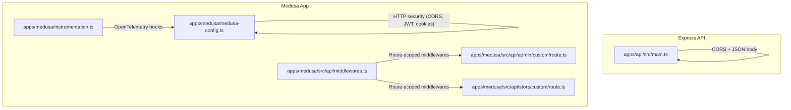
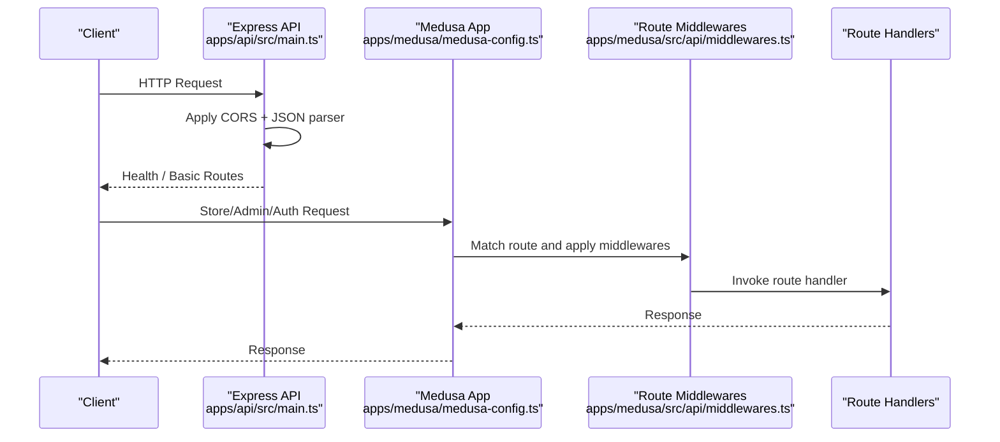
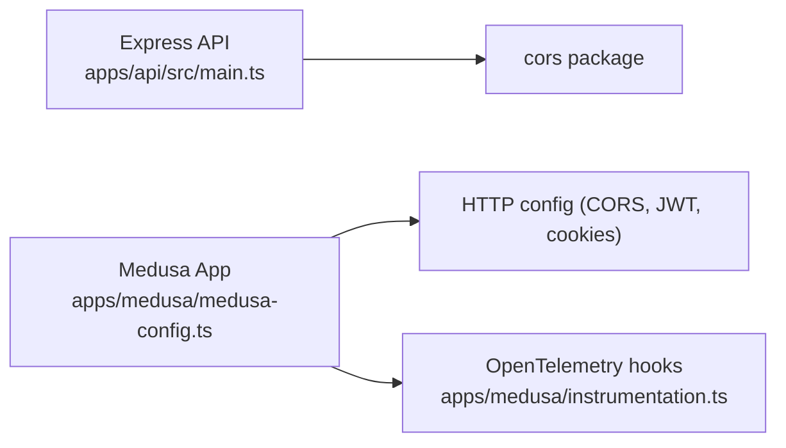

# Middleware & Security

<cite>
**Referenced Files in This Document**
- [apps/api/src/main.ts](file://apps/api/src/main.ts)
- [apps/medusa/src/api/middlewares.ts](file://apps/medusa/src/api/middlewares.ts)
- [apps/medusa/medusa-config.ts](file://apps/medusa/medusa-config.ts)
- [apps/medusa/instrumentation.ts](file://apps/medusa/instrumentation.ts)
- [apps/medusa/src/api/admin/custom/route.ts](file://apps/medusa/src/api/admin/custom/route.ts)
- [apps/medusa/src/api/store/custom/route.ts](file://apps/medusa/src/api/store/custom/route.ts)
</cite>

## Table of Contents
1. Introduction
2. Project Structure
3. Core Components
4. Architecture Overview
5. Detailed Component Analysis
6. Dependency Analysis
7. Performance Considerations
8. Troubleshooting Guide
9. Conclusion

## Introduction
This document explains middleware implementation and security measures across the platform’s Express API and Medusa storefront/admin APIs. It covers CORS configuration, request validation patterns, authentication/authorization approaches, security headers, input sanitization, protection against common vulnerabilities (XSS, CSRF), logging and error handling middleware, monitoring integration, and guidance for building custom middleware with best practices and compliance considerations.

## Project Structure
The project includes:
- An Express-based API service that configures CORS and JSON parsing at startup.
- A Medusa application that defines route-scoped middleware and HTTP security settings via configuration.
- Optional OpenTelemetry instrumentation setup for observability.

**Diagram sources**
- [apps/api/src/main.ts:1-55](file://apps/api/src/main.ts#L1-L55)
- [apps/medusa/medusa-config.ts:1-46](file://apps/medusa/medusa-config.ts#L1-L46)
- [apps/medusa/src/api/middlewares.ts:1-20](file://apps/medusa/src/api/middlewares.ts#L1-L20)
- [apps/medusa/src/api/admin/custom/route.ts:1-9](file://apps/medusa/src/api/admin/custom/route.ts#L1-L9)
- [apps/medusa/src/api/store/custom/route.ts:1-9](file://apps/medusa/src/api/store/custom/route.ts#L1-L9)
- [apps/medusa/instrumentation.ts:1-24](file://apps/medusa/instrumentation.ts#L1-L24)

**Section sources**
- [apps/api/src/main.ts:1-55](file://apps/api/src/main.ts#L1-L55)
- [apps/medusa/medusa-config.ts:1-46](file://apps/medusa/medusa-config.ts#L1-L46)
- [apps/medusa/src/api/middlewares.ts:1-20](file://apps/medusa/src/api/middlewares.ts#L1-L20)

## Core Components
- Express API bootstrap and global middleware:
  - Loads environment variables.
  - Enables CORS globally.
  - Parses JSON request bodies.
  - Provides health check and basic routes.
- Medusa HTTP security configuration:
  - Configures CORS for store, admin, and auth endpoints.
  - Sets JWT and cookie secrets.
- Medusa route-scoped middleware:
  - Applies framework-provided search indexing configuration to a specific route.
- Example route handlers:
  - Minimal GET endpoints under admin and store namespaces.

**Section sources**
- [apps/api/src/main.ts:1-55](file://apps/api/src/main.ts#L1-L55)
- [apps/medusa/medusa-config.ts:1-46](file://apps/medusa/medusa-config.ts#L1-L46)
- [apps/medusa/src/api/middlewares.ts:1-20](file://apps/medusa/src/api/middlewares.ts#L1-L20)
- [apps/medusa/src/api/admin/custom/route.ts:1-9](file://apps/medusa/src/api/admin/custom/route.ts#L1-L9)
- [apps/medusa/src/api/store/custom/route.ts:1-9](file://apps/medusa/src/api/store/custom/route.ts#L1-L9)

## Architecture Overview
The system uses two runtime layers:
- Express API layer: Global middleware sets up cross-origin access and request parsing.
- Medusa layer: Route-level middleware and configuration control HTTP security and feature toggles.

**Diagram sources**
- [apps/api/src/main.ts:1-55](file://apps/api/src/main.ts#L1-L55)
- [apps/medusa/medusa-config.ts:1-46](file://apps/medusa/medusa-config.ts#L1-L46)
- [apps/medusa/src/api/middlewares.ts:1-20](file://apps/medusa/src/api/middlewares.ts#L1-L20)

## Detailed Component Analysis

### CORS Configuration
- Express API:
  - Uses a CORS package to enable cross-origin requests globally.
- Medusa:
  - Exposes storeCors, adminCors, and authCors settings loaded from environment variables or defaults.
  - These values define allowed origins for different app surfaces.

Recommendations:
- Restrict CORS to known domains per environment.
- Avoid wildcard origins in production.
- Use separate origin lists for store, admin, and auth services.

**Section sources**
- [apps/api/src/main.ts:8-16](file://apps/api/src/main.ts#L8-L16)
- [apps/medusa/medusa-config.ts:11-17](file://apps/medusa/medusa-config.ts#L11-L17)

### Request Validation Middleware
- The Medusa route middleware file demonstrates applying framework-provided middleware to a specific route using a matcher and an array of middlewares.
- For robust validation, integrate schema validation (e.g., Zod or Joi) within route-scoped middleware to validate query, params, and body before reaching handlers.

Best practices:
- Validate early and fail fast.
- Return structured error responses with safe messages.
- Log validation failures without leaking sensitive data.

**Section sources**
- [apps/medusa/src/api/middlewares.ts:1-20](file://apps/medusa/src/api/middlewares.ts#L1-L20)

### Authentication and Authorization Patterns
- Medusa configuration exposes jwtSecret and cookieSecret for session/JWT handling.
- Typical pattern:
  - Authenticate via JWT or session cookie.
  - Attach user context to request scope.
  - Authorize based on roles/permissions in route handlers or dedicated authorization middleware.

Security notes:
- Rotate secrets regularly and manage them securely.
- Enforce token expiration and refresh strategies.
- Scope permissions per resource and action.

**Section sources**
- [apps/medusa/medusa-config.ts:11-17](file://apps/medusa/medusa-config.ts#L11-L17)

### Security Headers Implementation
- While not explicitly set in the provided files, it is recommended to add security headers such as:
  - Strict-Transport-Security
  - X-Content-Type-Options
  - X-Frame-Options
  - Content-Security-Policy
  - Referrer-Policy
  - Permissions-Policy
- Implement these in a global middleware for Express and/or via reverse proxy (e.g., Nginx).

[No sources needed since this section provides general guidance]

### Input Sanitization and Vulnerability Protection
- XSS:
  - Escape output in frontends; avoid rendering untrusted HTML server-side.
  - Use CSP to restrict script execution.
- CSRF:
  - Use SameSite cookies and CSRF tokens for state-changing requests.
  - Validate Origin/Referer where appropriate.
- Injection:
  - Parameterize database queries; use ORM safely.
  - Validate and sanitize all inputs.

[No sources needed since this section provides general guidance]

### Logging Middleware
- Add a logging middleware to capture:
  - Method, path, status, duration, user identity (if available).
  - Mask sensitive fields (passwords, tokens).
- Integrate with structured loggers and centralized log aggregation.

[No sources needed since this section provides general guidance]

### Error Handling Middleware
- Centralized error handler should:
  - Normalize errors into safe response payloads.
  - Include correlation IDs for tracing.
  - Avoid stack traces in production responses.
- Log full error details internally only.

[No sources needed since this section provides general guidance]

### Monitoring Integration
- Medusa includes optional OpenTelemetry instrumentation configuration.
- Enable HTTP, workflow, and query instrumentation when integrating with your telemetry backend.

**Section sources**
- [apps/medusa/instrumentation.ts:1-24](file://apps/medusa/instrumentation.ts#L1-L24)

### Custom Middleware Development Examples
- Medusa route-scoped middleware example:
  - Demonstrates defining a matcher and attaching middlewares to a route.
- Express global middleware example:
  - Shows enabling CORS and JSON parsing at application start.

Guidelines:
- Keep middlewares small and single-purpose.
- Compose multiple middlewares for cross-cutting concerns.
- Test each middleware independently.

**Section sources**
- [apps/medusa/src/api/middlewares.ts:1-20](file://apps/medusa/src/api/middlewares.ts#L1-L20)
- [apps/api/src/main.ts:8-16](file://apps/api/src/main.ts#L8-L16)

### Compliance Requirements
- Data protection:
  - Minimize collection and retention of personal data.
  - Provide mechanisms for consent and data deletion.
- Auditability:
  - Log access and changes to sensitive resources.
  - Maintain tamper-evident audit trails.
- Secure defaults:
  - Enforce HTTPS, secure cookies, and strict CORS.

[No sources needed since this section provides general guidance]

## Dependency Analysis
Key dependencies related to middleware and security:
- cors: Used by Express API for cross-origin support.
- Medusa HTTP configuration: Controls CORS and secrets for JWT/cookies.
- Optional OpenTelemetry: Observability hooks for HTTP and workflows.

**Diagram sources**
- [apps/api/src/main.ts:8-16](file://apps/api/src/main.ts#L8-L16)
- [apps/medusa/medusa-config.ts:11-17](file://apps/medusa/medusa-config.ts#L11-L17)
- [apps/medusa/instrumentation.ts:1-24](file://apps/medusa/instrumentation.ts#L1-L24)

**Section sources**
- [apps/api/src/main.ts:8-16](file://apps/api/src/main.ts#L8-L16)
- [apps/medusa/medusa-config.ts:11-17](file://apps/medusa/medusa-config.ts#L11-L17)
- [apps/medusa/instrumentation.ts:1-24](file://apps/medusa/instrumentation.ts#L1-L24)

## Performance Considerations
- Prefer route-scoped middleware to minimize overhead on unrelated endpoints.
- Cache validated results where safe.
- Avoid heavy computations in middleware; offload to background jobs.
- Use compression and efficient serialization for large payloads.

[No sources needed since this section provides general guidance]

## Troubleshooting Guide
Common issues and resolutions:
- CORS errors:
  - Verify configured origins match client domains.
  - Ensure preflight requests are handled.
- Invalid JSON bodies:
  - Confirm content-type and payload structure.
- Authentication failures:
  - Check secret configuration and token validity.
- High latency:
  - Profile middleware chains and database calls.

[No sources needed since this section provides general guidance]

## Conclusion
The platform leverages Express and Medusa to implement middleware-driven security and functionality. CORS is enabled at both layers with environment-driven configuration. Route-scoped middleware allows precise control over request processing. To harden the system, adopt comprehensive validation, security headers, input sanitization, CSRF protections, structured logging, centralized error handling, and observability via OpenTelemetry. Follow the best practices outlined above to maintain a secure, compliant, and performant API surface.