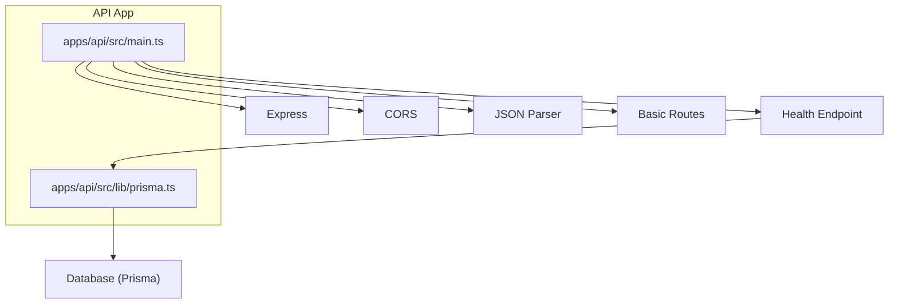
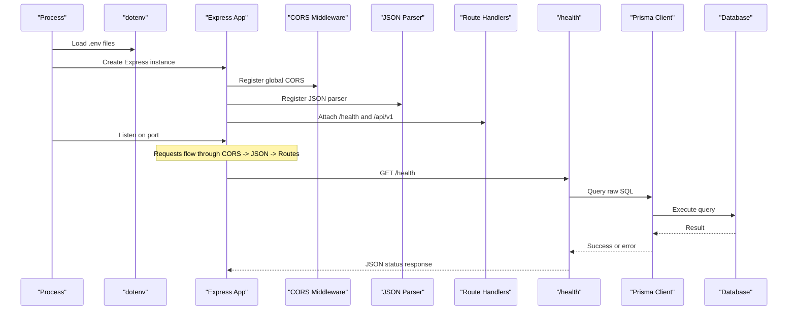
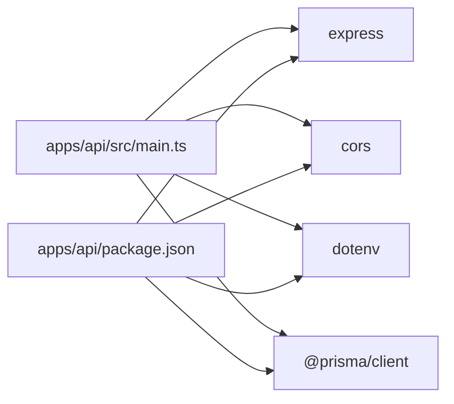

# Server Configuration

<cite>
**Referenced Files in This Document**
- [main.ts](file://apps/api/src/main.ts)
- [prisma.ts](file://apps/api/src/lib/prisma.ts)
- [package.json](file://apps/api/package.json)
</cite>

## Table of Contents
1. [Introduction](#introduction)
2. [Project Structure](#project-structure)
3. [Core Components](#core-components)
4. [Architecture Overview](#architecture-overview)
5. [Detailed Component Analysis](#detailed-component-analysis)
6. [Dependency Analysis](#dependency-analysis)
7. [Performance Considerations](#performance-considerations)
8. [Troubleshooting Guide](#troubleshooting-guide)
9. [Conclusion](#conclusion)

## Introduction
This document explains the Express.js server configuration for the BD Commerce Platform API. It covers how the server initializes, loads environment variables with dotenv, configures CORS and JSON body parsing, determines the listening port, registers middleware, and starts the application. It also provides guidance on security headers, request size limits, performance tuning, environment-specific settings, and deployment considerations.

## Project Structure
The API is a small Express application under apps/api. The entry point initializes the app, sets up core middleware, exposes health and basic routes, and starts the HTTP server. A Prisma client module is used to validate database connectivity during health checks.

**Diagram sources**
- [main.ts:1-55](file://apps/api/src/main.ts#L1-L55)
- [prisma.ts:1-14](file://apps/api/src/lib/prisma.ts#L1-L14)

**Section sources**
- [main.ts:1-55](file://apps/api/src/main.ts#L1-L55)
- [prisma.ts:1-14](file://apps/api/src/lib/prisma.ts#L1-L14)

## Core Components
- Environment loading: dotenv is used to load environment variables from a root .env file and then the default location.
- Express app creation: an Express instance is created and configured.
- Middleware:
  - CORS enabled globally.
  - JSON body parser enabled.
- Health endpoint: validates database connectivity via Prisma and returns service status.
- Basic routes: a versioned API index route listing available endpoints.
- Server startup: listens on a configurable port and logs startup information.

**Section sources**
- [main.ts:1-55](file://apps/api/src/main.ts#L1-L55)

## Architecture Overview
The server follows a straightforward request lifecycle:
1. Process starts and loads environment variables.
2. Express app is created.
3. Global middleware (CORS, JSON parser) are registered.
4. Route handlers are attached.
5. Server starts listening on the resolved port.

**Diagram sources**
- [main.ts:1-55](file://apps/api/src/main.ts#L1-L55)
- [prisma.ts:1-14](file://apps/api/src/lib/prisma.ts#L1-L14)

## Detailed Component Analysis

### Server Initialization and Startup Sequence
- Environment variables are loaded before importing other modules that might depend on them.
- The Express app is instantiated and immediately configured with global middleware.
- A health check endpoint performs a lightweight database probe using Prisma.
- A basic API index route enumerates available endpoints.
- The server calls listen with the resolved port and prints startup messages.

Key behaviors:
- Port resolution uses API_PORT first, then PORT, then defaults to 4000.
- CORS is enabled without restrictive options, allowing all origins by default.
- JSON body parsing is enabled with default limits.

**Section sources**
- [main.ts:1-55](file://apps/api/src/main.ts#L1-L55)

### Environment Variable Handling with dotenv
- dotenv.config is called twice:
  - First, it explicitly loads a .env file located at the repository root.
  - Second, it loads the default .env file if present.
- This ensures environment variables are available early in the process.

Operational notes:
- Ensure the root .env exists and contains required variables such as API_PORT, NODE_ENV, and database connection strings.
- For production, prefer injecting environment variables via your runtime (container, platform, or CI/CD) rather than relying on local .env files.

**Section sources**
- [main.ts:1-10](file://apps/api/src/main.ts#L1-L10)

### CORS Configuration
- CORS is enabled globally with no explicit options.
- Behavior:
  - All origins are allowed.
  - Default credentials and headers are permitted.
- Security implication:
  - In production, restrict allowed origins to known frontends and consider enabling credentials only when necessary.

Recommended production pattern:
- Configure CORS with an allowlist of trusted origins.
- Disable wildcard methods/headers unless required.
- Keep credentials off unless cross-origin cookies are needed.

**Section sources**
- [main.ts:8-16](file://apps/api/src/main.ts#L8-L16)

### JSON Body Parsing Setup
- express.json() is applied globally.
- Defaults:
  - Content-Type: application/json is parsed.
  - Default size limit applies; large payloads may be rejected.

Recommendations:
- Set explicit limits based on expected payload sizes.
- If you accept multipart/form-data, add a dedicated parser with appropriate limits.

**Section sources**
- [main.ts:8-16](file://apps/api/src/main.ts#L8-L16)

### Port Configuration Logic
- The server resolves the port using this precedence:
  1. API_PORT
  2. PORT
  3. Fallback to 4000
- This allows flexible configuration across environments and platforms.

Deployment tip:
- On platforms like Docker or cloud providers, set PORT according to platform conventions.
- Use API_PORT to override within the same environment if needed.

**Section sources**
- [main.ts:12-14](file://apps/api/src/main.ts#L12-L14)

### Middleware Registration Order
- Order of registration matters:
  1. CORS
  2. JSON parser
  3. Route handlers
- This order ensures cross-origin requests are handled before routing and that request bodies are parsed before route logic runs.

Best practice:
- Place global error-handling middleware last.
- Add logging/metrics middleware early for accurate request tracing.

**Section sources**
- [main.ts:8-16](file://apps/api/src/main.ts#L8-L16)

### Health Check and Database Connectivity
- The /health endpoint attempts a simple database query via Prisma.
- Response includes:
  - Service status
  - Uptime
  - Timestamp
  - Database status (connected, disconnected, or error_or_offline)

Implications:
- Useful for liveness probes in containerized deployments.
- Avoid exposing sensitive details in production responses.

**Section sources**
- [main.ts:18-35](file://apps/api/src/main.ts#L18-L35)
- [prisma.ts:1-14](file://apps/api/src/lib/prisma.ts#L1-L14)

### Basic API Routes
- The /api/v1 route returns a summary of available endpoints.
- Intended as a developer-friendly index for discovery.

**Section sources**
- [main.ts:37-49](file://apps/api/src/main.ts#L37-L49)

### Application Startup Sequence
- After registering middleware and routes, the server calls listen with the resolved port.
- Logs include the base URL and health endpoint address.

Startup checklist:
- Verify environment variables are loaded.
- Confirm database connectivity via /health.
- Validate CORS behavior against frontend domains.

**Section sources**
- [main.ts:51-55](file://apps/api/src/main.ts#L51-L55)

## Dependency Analysis
The API depends on:
- express: web framework
- cors: cross-origin resource sharing
- dotenv: environment variable loading
- @prisma/client: database client used in health checks
- zod: validation library (not used in current server setup)

**Diagram sources**
- [main.ts:1-10](file://apps/api/src/main.ts#L1-L10)
- [package.json:16-24](file://apps/api/package.json#L16-L24)

**Section sources**
- [package.json:16-24](file://apps/api/package.json#L16-L24)
- [main.ts:1-10](file://apps/api/src/main.ts#L1-L10)

## Performance Considerations
- Request size limits:
  - Adjust JSON body size limits to match expected payloads.
  - Consider separate limits for uploads if using multipart.
- Compression:
  - Enable compression for text-based responses to reduce bandwidth.
- Connection tuning:
  - Tune Node.js flags (e.g., --max-old-space-size) based on memory usage.
- Logging:
  - Use structured logging and sampling in production.
- Database:
  - Reuse Prisma client instances (already done) and tune connection pool settings as needed.

[No sources needed since this section provides general guidance]

## Troubleshooting Guide
Common issues and resolutions:
- CORS errors:
  - Symptom: Browser blocks requests due to origin mismatch.
  - Fix: Restrict CORS to trusted origins in production.
- Payload too large:
  - Symptom: 413 Request Entity Too Large.
  - Fix: Increase JSON body size limits or use streaming for large data.
- Port conflicts:
  - Symptom: Address already in use.
  - Fix: Ensure API_PORT or PORT is set correctly and not conflicting.
- Database offline:
  - Symptom: /health reports error_or_offline.
  - Fix: Verify database connection string and network access.

**Section sources**
- [main.ts:18-35](file://apps/api/src/main.ts#L18-L35)

## Conclusion
The API server is intentionally minimal and focused on quick initialization, clear middleware ordering, and operational visibility via a health endpoint. For production, tighten CORS, enforce explicit request size limits, add compression and structured logging, and secure environment variable management. These adjustments will improve security, reliability, and performance while keeping the configuration approachable.

[No sources needed since this section summarizes without analyzing specific files]