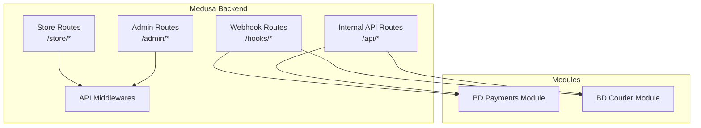
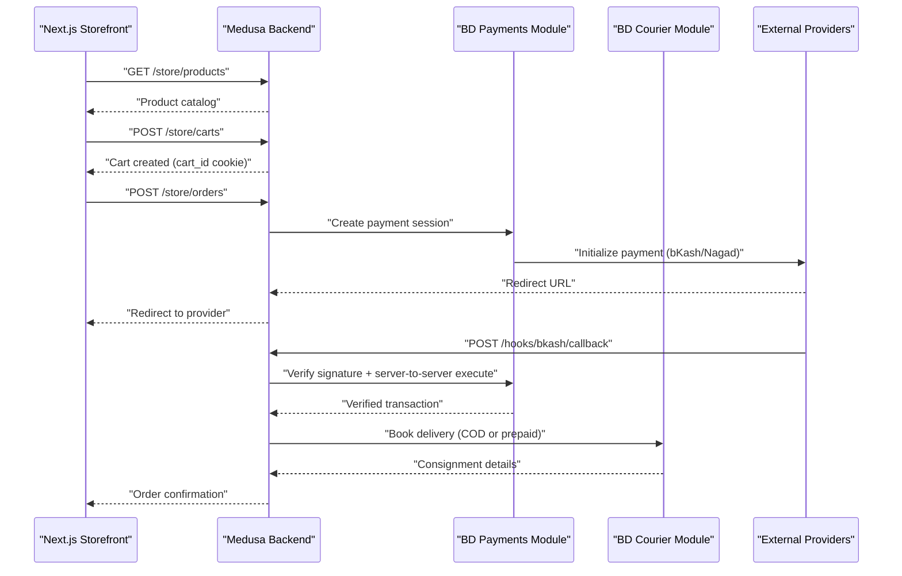
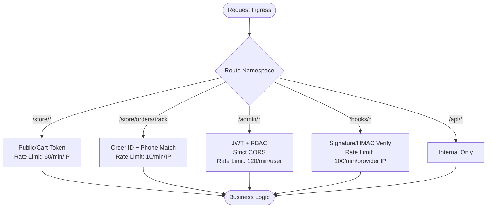
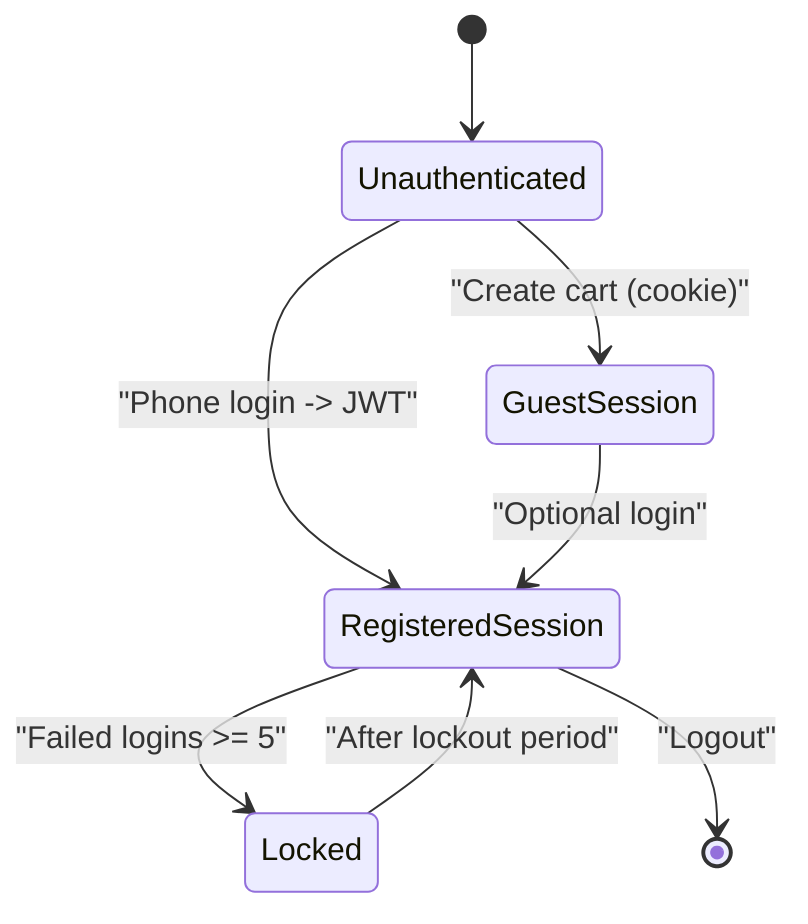
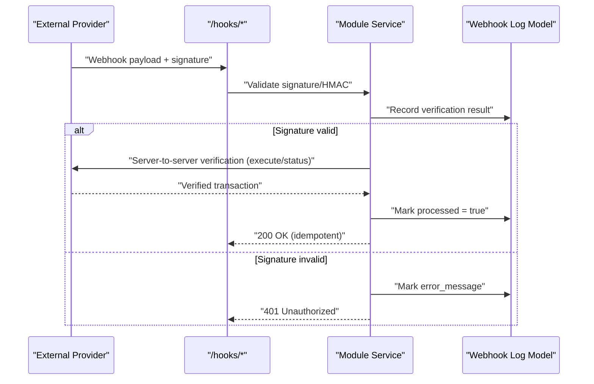
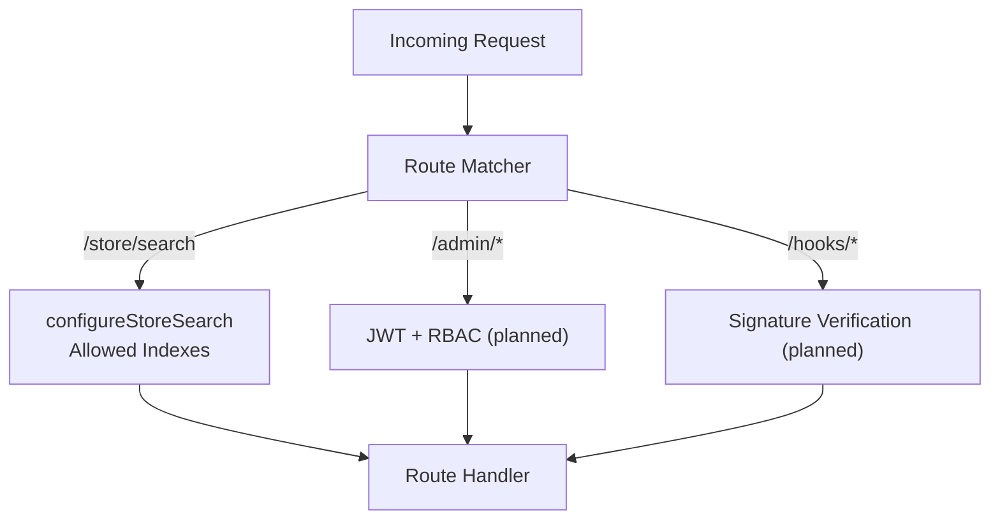
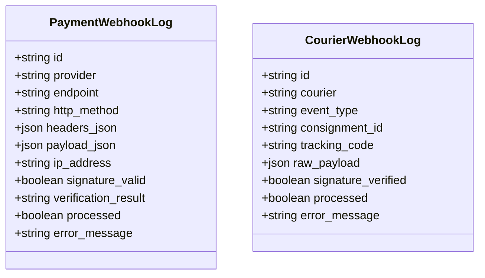
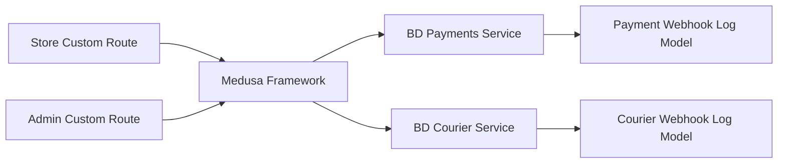

# API Communication & Security Architecture

<cite>
**Referenced Files in This Document**
- [technical-plan.md](file://technical-plan.md)
- [architecture.md](file://docs/architecture.md)
- [dfd.md](file://dfd.md)
- [prd.md](file://prd.md)
- [quality-checklist.md](file://quality-checklist.md)
- [middlewares.ts](file://apps/medusa/src/api/middlewares.ts)
- [admin_custom_route.ts](file://apps/medusa/src/api/admin/custom/route.ts)
- [store_custom_route.ts](file://apps/medusa/src/api/store/custom/route.ts)
- [bd_payments_index.ts](file://apps/medusa/src/modules/bd-payments/index.ts)
- [bd_payments_service.ts](file://apps/medusa/src/modules/bd-payments/service.ts)
- [payment_webhook_log_model.ts](file://apps/medusa/src/modules/bd-payments/models/payment-webhook-log.ts)
- [bd_courier_index.ts](file://apps/medusa/src/modules/bd-courier/index.ts)
- [bd_courier_service.ts](file://apps/medusa/src/modules/bd-courier/service.ts)
- [courier_webhook_log_model.ts](file://apps/medusa/src/modules/bd-courier/models/courier-webhook-log.ts)
</cite>

## Table of Contents
1. [Introduction](#introduction)
2. [Project Structure](#project-structure)
3. [Core Components](#core-components)
4. [Architecture Overview](#architecture-overview)
5. [Detailed Component Analysis](#detailed-component-analysis)
6. [Dependency Analysis](#dependency-analysis)
7. [Performance Considerations](#performance-considerations)
8. [Troubleshooting Guide](#troubleshooting-guide)
9. [Conclusion](#conclusion)

## Introduction
This document explains the API communication architecture and security patterns for the BD Commerce Platform. It focuses on route namespaces, access control, authentication methods, rate limiting, CORS policies, zero-trust webhook verification for external providers, and security middleware. The goal is to make the system understandable for both technical and non-technical readers while providing actionable diagrams and troubleshooting guidance.

## Project Structure
The platform uses a Medusa v2 backend with custom API routes and modules:
- Custom API routes under `/store/*` and `/admin/*` are scaffolded but currently minimal.
- Middleware configuration exists for store search endpoints.
- Domain modules encapsulate payment and courier integrations with dedicated webhook logging models.

**Diagram sources**
- [middlewares.ts:5-18](file://apps/medusa/src/api/middlewares.ts#L5-L18)
- [admin_custom_route.ts:1-9](file://apps/medusa/src/api/admin/custom/route.ts#L1-L9)
- [store_custom_route.ts:1-9](file://apps/medusa/src/api/store/custom/route.ts#L1-L9)
- [bd_payments_index.ts:1-9](file://apps/medusa/src/modules/bd-payments/index.ts#L1-L9)
- [bd_courier_index.ts:1-9](file://apps/medusa/src/modules/bd-courier/index.ts#L1-L9)

**Section sources**
- [middlewares.ts:1-20](file://apps/medusa/src/api/middlewares.ts#L1-L20)
- [admin_custom_route.ts:1-9](file://apps/medusa/src/api/admin/custom/route.ts#L1-L9)
- [store_custom_route.ts:1-9](file://apps/medusa/src/api/store/custom/route.ts#L1-L9)
- [bd_payments_index.ts:1-9](file://apps/medusa/src/modules/bd-payments/index.ts#L1-L9)
- [bd_courier_index.ts:1-9](file://apps/medusa/src/modules/bd-courier/index.ts#L1-L9)

## Core Components
- Route Namespaces:
  - `/store/*`: Public storefront APIs; rate-limited; supports cart token-based sessions.
  - `/admin/*`: Protected admin APIs; JWT session authentication; strict CORS.
  - `/hooks/*`: External provider webhooks; signature/HMAC verification; idempotent processing.
  - `/api/*`: Internal Next.js server-to-server calls; not exposed to browsers.
- Authentication:
  - Customer: Guest via cart cookie; optional phone-based login returning short-lived JWT.
  - Staff/Admin: Bearer JWT with RBAC role checks; forced password change on first login; account lockout after repeated failures.
- Authorization:
  - Role-based access for sensitive admin endpoints (e.g., audit logs).
- Rate Limiting:
  - Redis-backed token-bucket limiter per IP or user context.
- CORS:
  - Strict allowlist for trusted admin domains.
- Webhook Zero-Trust:
  - Never trust callback parameters directly; always perform server-to-server verification against provider APIs.

**Section sources**
- [technical-plan.md:670-688](file://technical-plan.md#L670-L688)
- [architecture.md:305-316](file://docs/architecture.md#L305-L316)
- [architecture.md:364-382](file://docs/architecture.md#L364-L382)
- [architecture.md:873-897](file://docs/architecture.md#L873-L897)

## Architecture Overview
The API boundary separates public storefront requests, protected admin operations, external webhook ingestion, and internal service calls. All external inputs are validated and verified before business logic execution.

**Diagram sources**
- [dfd.md:598-607](file://dfd.md#L598-L607)
- [prd.md:267-274](file://prd.md#L267-L274)
- [bd_payments_service.ts:1-11](file://apps/medusa/src/modules/bd-payments/service.ts#L1-L11)
- [bd_courier_service.ts:1-11](file://apps/medusa/src/modules/bd-courier/service.ts#L1-L11)

## Detailed Component Analysis

### Route Namespaces and Access Control
- `/store/*`:
  - Consumers: Next.js Storefront (RSC and client components).
  - Auth: Public by default; cart-bound via secure HTTP-only cookie; optional customer JWT.
  - Rate limit: 60 requests per minute per IP; stricter limits for checkout-sensitive endpoints.
- `/store/orders/track`:
  - Auth: Order ID plus exact 11-digit mobile phone match.
  - Rate limit: 10 requests per minute per IP; lockout after 3 consecutive failures.
- `/admin/*`:
  - Auth: Bearer JWT with RBAC role checks.
  - CORS: Restricted to trusted admin domain.
  - Rate limit: 120 requests per minute per staff user; tighter for sensitive endpoints like audit logs.
- `/hooks/*`:
  - Auth: Server-to-server signature/HMAC verification per provider.
  - Rate limit: 100 requests per minute per provider IP.
- `/api/*`:
  - Internal only; used by Next.js server-side code; no browser exposure.

**Diagram sources**
- [architecture.md:305-316](file://docs/architecture.md#L305-L316)
- [technical-plan.md:670-688](file://technical-plan.md#L670-L688)

**Section sources**
- [architecture.md:305-316](file://docs/architecture.md#L305-L316)
- [technical-plan.md:670-688](file://technical-plan.md#L670-L688)

### Authentication Methods
- Customer Authentication:
  - Guest flow: Cart bound to `cart_id` in an HTTP-only cookie.
  - Registered flow: Phone-based login returns a short-lived JWT stored in an HTTP-only cookie.
- Staff/Admin Authentication:
  - JWT bearer tokens with RBAC role checks.
  - Forced password change on first login.
  - Account-level lockout after 5 consecutive failed attempts (15-minute lockout).
  - Session invalidation on password change or role modification.

**Diagram sources**
- [architecture.md:364-382](file://docs/architecture.md#L364-L382)

**Section sources**
- [architecture.md:364-382](file://docs/architecture.md#L364-L382)

### Rate Limiting Strategies
- Redis-backed token-bucket limiter:
  - Storefront endpoints: 60 req/min per IP.
  - Order tracking: 10 req/min per IP; lockout after 3 failures.
  - Admin endpoints: 120 req/min per staff user; stricter for audit logs.
  - Webhooks: 100 req/min per provider IP.
- Anti-abuse measures:
  - SMS gateway rate limiting to prevent credit exhaustion.
  - Idempotency keys for state mutations.

**Section sources**
- [technical-plan.md:670-688](file://technical-plan.md#L670-L688)
- [architecture.md:873-897](file://docs/architecture.md#L873-L897)

### CORS Policies
- Admin APIs enforce strict CORS restricted to trusted admin domains.
- Storefront APIs allow broader origins but remain rate-limited.
- Webhook endpoints accept only expected provider headers and signatures.

**Section sources**
- [technical-plan.md:670-688](file://technical-plan.md#L670-L688)

### Zero-Trust Webhook Protocol
- bKash:
  - Callbacks must never trust query/body parameters alone.
  - Backend performs server-to-server execute call and validates status, currency, and amount.
- Nagad:
  - Callbacks include signed payloads; verify signature using Nagad public key.
  - Complete checkout request uses merchant private key from secure file path.
- Couriers:
  - Tracking webhooks require HMAC/header bearer signature verification.
  - All webhook events logged with signature verification results.

**Diagram sources**
- [prd.md:267-274](file://prd.md#L267-L274)
- [dfd.md:598-607](file://dfd.md#L598-L607)
- [payment_webhook_log_model.ts:1-18](file://apps/medusa/src/modules/bd-payments/models/payment-webhook-log.ts#L1-L18)
- [courier_webhook_log_model.ts:1-16](file://apps/medusa/src/modules/bd-courier/models/courier-webhook-log.ts#L1-L16)

**Section sources**
- [prd.md:267-274](file://prd.md#L267-L274)
- [dfd.md:598-607](file://dfd.md#L598-L607)
- [payment_webhook_log_model.ts:1-18](file://apps/medusa/src/modules/bd-payments/models/payment-webhook-log.ts#L1-L18)
- [courier_webhook_log_model.ts:1-16](file://apps/medusa/src/modules/bd-courier/models/courier-webhook-log.ts#L1-L16)

### Security Middleware Implementations
- Medusa middlewares define route-specific guards:
  - Example: Store search endpoint configured with allowed indexes.
- Custom routes:
  - Minimal GET handlers exist for `/admin/custom` and `/store/custom`.
- Future hardening:
  - Add JWT validation, RBAC checks, and input sanitization at middleware layer.

**Diagram sources**
- [middlewares.ts:5-18](file://apps/medusa/src/api/middlewares.ts#L5-L18)
- [admin_custom_route.ts:1-9](file://apps/medusa/src/api/admin/custom/route.ts#L1-L9)
- [store_custom_route.ts:1-9](file://apps/medusa/src/api/store/custom/route.ts#L1-L9)

**Section sources**
- [middlewares.ts:1-20](file://apps/medusa/src/api/middlewares.ts#L1-L20)
- [admin_custom_route.ts:1-9](file://apps/medusa/src/api/admin/custom/route.ts#L1-L9)
- [store_custom_route.ts:1-9](file://apps/medusa/src/api/store/custom/route.ts#L1-L9)

### Data Models for Webhook Logging
- Payment Webhook Log:
  - Tracks provider, endpoint, HTTP method, headers, payload, IP address, signature validity, verification result, processing status, and error messages.
- Courier Webhook Log:
  - Tracks courier name, event type, consignment/tracking identifiers, raw payload, signature verification status, processing status, and error messages.

**Diagram sources**
- [payment_webhook_log_model.ts:1-18](file://apps/medusa/src/modules/bd-payments/models/payment-webhook-log.ts#L1-L18)
- [courier_webhook_log_model.ts:1-16](file://apps/medusa/src/modules/bd-courier/models/courier-webhook-log.ts#L1-L16)

**Section sources**
- [payment_webhook_log_model.ts:1-18](file://apps/medusa/src/modules/bd-payments/models/payment-webhook-log.ts#L1-L18)
- [courier_webhook_log_model.ts:1-16](file://apps/medusa/src/modules/bd-courier/models/courier-webhook-log.ts#L1-L16)

## Dependency Analysis
The backend exposes minimal custom routes and relies on module services for domain logic. Webhook handling depends on logging models to record verification outcomes and processing states.

**Diagram sources**
- [store_custom_route.ts:1-9](file://apps/medusa/src/api/store/custom/route.ts#L1-L9)
- [admin_custom_route.ts:1-9](file://apps/medusa/src/api/admin/custom/route.ts#L1-L9)
- [bd_payments_service.ts:1-11](file://apps/medusa/src/modules/bd-payments/service.ts#L1-L11)
- [bd_courier_service.ts:1-11](file://apps/medusa/src/modules/bd-courier/service.ts#L1-L11)
- [payment_webhook_log_model.ts:1-18](file://apps/medusa/src/modules/bd-payments/models/payment-webhook-log.ts#L1-L18)
- [courier_webhook_log_model.ts:1-16](file://apps/medusa/src/modules/bd-courier/models/courier-webhook-log.ts#L1-L16)

**Section sources**
- [store_custom_route.ts:1-9](file://apps/medusa/src/api/store/custom/route.ts#L1-L9)
- [admin_custom_route.ts:1-9](file://apps/medusa/src/api/admin/custom/route.ts#L1-L9)
- [bd_payments_service.ts:1-11](file://apps/medusa/src/modules/bd-payments/service.ts#L1-L11)
- [bd_courier_service.ts:1-11](file://apps/medusa/src/modules/bd-courier/service.ts#L1-L11)
- [payment_webhook_log_model.ts:1-18](file://apps/medusa/src/modules/bd-payments/models/payment-webhook-log.ts#L1-L18)
- [courier_webhook_log_model.ts:1-16](file://apps/medusa/src/modules/bd-courier/models/courier-webhook-log.ts#L1-L16)

## Performance Considerations
- Use Redis-backed rate limiters to protect high-throughput endpoints.
- Apply idempotency keys to all state-changing requests to avoid duplicates.
- Keep Meilisearch documents stripped of sensitive fields (COGS, margins).
- Stream large responses (e.g., invoices) with authenticated streams.
- Monitor webhook processing latency and queue backlogs.

[No sources needed since this section provides general guidance]

## Troubleshooting Guide
Common authentication and authorization issues:
- Invalid or expired JWT:
  - Ensure JWT is present in Authorization header and not expired.
  - Check session invalidation triggers (password changes, role updates).
- Cart token missing or corrupted:
  - Verify HTTP-only cookie presence and correct `cart_id`.
- Webhook signature verification failures:
  - Confirm provider credentials and public/private key paths.
  - Inspect webhook logs for signature validity and error messages.
- Rate limit exceeded:
  - Review Redis rate limiter configuration and adjust thresholds if necessary.
- Duplicate callbacks:
  - Ensure idempotency checks based on provider transaction IDs.

Operational checks:
- Validate CORS settings for admin endpoints.
- Confirm input validation schemas (e.g., Bangladesh mobile phone regex).
- Audit logs should capture failed auth attempts and lockouts.

**Section sources**
- [quality-checklist.md:266-288](file://quality-checklist.md#L266-L288)
- [technical-plan.md:670-688](file://technical-plan.md#L670-L688)
- [architecture.md:364-382](file://docs/architecture.md#L364-L382)

## Conclusion
The BD Commerce Platform enforces a clear separation between public storefront APIs, protected admin operations, and external webhook ingestion. Authentication leverages JWT and cart tokens, while rate limiting and CORS policies provide robust perimeter defenses. Zero-trust webhook protocols ensure that external provider callbacks are strictly verified before any business logic executes. With structured logging and idempotent processing, the system maintains reliability and security across complex multi-provider workflows.

[No sources needed since this section summarizes without analyzing specific files]