# Authentication & Authorization

<cite>
**Referenced Files in This Document**
- [medusa-config.ts](file://apps/medusa/medusa-config.ts)
- [middlewares.ts](file://apps/medusa/src/api/middlewares.ts)
- [store-custom-route.ts](file://apps/medusa/src/api/store/custom/route.ts)
- [admin-custom-route.ts](file://apps/medusa/src/api/admin/custom/route.ts)
- [api-readme.md](file://apps/medusa/src/api/README.md)
- [architecture.md](file://docs/architecture.md)
- [technical-plan.md](file://technical-plan.md)
- [staff-role-permission.ts](file://apps/medusa/src/modules/bd-audit/models/staff-role-permission.ts)
- [audit-log.ts](file://apps/medusa/src/modules/bd-audit/models/audit-log.ts)
- [bd-audit-service.ts](file://apps/medusa/src/modules/bd-audit/service.ts)
</cite>

## Table of Contents
1. [Introduction](#introduction)
2. [Project Structure](#project-structure)
3. [Core Components](#core-components)
4. [Architecture Overview](#architecture-overview)
5. [Detailed Component Analysis](#detailed-component-analysis)
6. [Dependency Analysis](#dependency-analysis)
7. [Performance Considerations](#performance-considerations)
8. [Troubleshooting Guide](#troubleshooting-guide)
9. [Conclusion](#conclusion)

## Introduction
This document explains the authentication and authorization mechanisms used by the BD Commerce Platform backend, which is built on Medusa v2. It covers:
- JWT-based staff authentication and session behavior
- Cart token management for guest and registered customers
- Role-based access control (RBAC) for staff roles and permissions
- Middleware security patterns for store, admin, and webhook routes
- Route namespace policies under `/store/*`, `/admin/*`, and `/hooks/*`
- Custom middleware creation, token validation processes, session management, and permission checking
- Common flows for customers, staff members, and external integrations
- Troubleshooting guidance and security best practices

The platform uses Medusa’s HTTP router, environment-driven configuration, and a custom audit module to model staff roles and permissions. Public storefront endpoints are designed around cart tokens, while admin endpoints require bearer JWTs and RBAC checks. External providers such as bKash, Nagad, and courier services use signature or HMAC verification at `/hooks/*`.

## Project Structure
The authentication-related code is primarily located in:
- Medusa configuration for JWT and cookie secrets
- API middlewares for route-level security
- Store and Admin example route files
- Audit module models and service for RBAC data structures
- Architecture documentation describing route namespaces and security boundaries

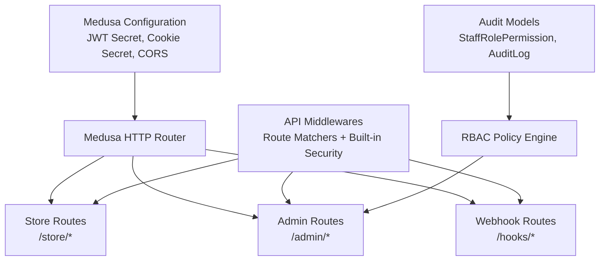

**Diagram sources**
- [medusa-config.ts:7-18](file://apps/medusa/medusa-config.ts#L7-L18)
- [middlewares.ts:1-20](file://apps/medusa/src/api/middlewares.ts#L1-L20)
- [staff-role-permission.ts:1-17](file://apps/medusa/src/modules/bd-audit/models/staff-role-permission.ts#L1-L17)
- [audit-log.ts:1-43](file://apps/medusa/src/modules/bd-audit/models/audit-log.ts#L1-L43)

**Section sources**
- [medusa-config.ts:7-18](file://apps/medusa/medusa-config.ts#L7-L18)
- [middlewares.ts:1-20](file://apps/medusa/src/api/middlewares.ts#L1-L20)
- [architecture.md:305-316](file://docs/architecture.md#L305-L316)

## Core Components
- JWT and Cookie Configuration
  - The backend loads environment variables and configures `jwtSecret` and `cookieSecret` under HTTP settings. These values secure staff JWT sessions and cookies.
- API Middlewares
  - Route-level middlewares are defined using `defineMiddlewares`. An example shows how to configure store search with allowed indexes, demonstrating the pattern for adding custom security logic per route.
- Storefront Example Route
  - A minimal GET handler under `/store/custom` illustrates public store endpoint structure.
- Admin Example Route
  - A minimal GET handler under `/admin/custom` illustrates protected admin endpoint structure.
- RBAC Data Model
  - Staff role and permission fields are modeled in the audit module, including role enumeration and boolean flags controlling sensitive operations like COGS visibility, COD confirmation, courier booking, refund processing, content management, and audit log viewing.
- Audit Log Model
  - Audit logs capture actor identity, role, entity type, action, old/new values, IP address, and reason, enabling security auditing and compliance.

**Section sources**
- [medusa-config.ts:7-18](file://apps/medusa/medusa-config.ts#L7-L18)
- [middlewares.ts:1-20](file://apps/medusa/src/api/middlewares.ts#L1-L20)
- [store-custom-route.ts:1-9](file://apps/medusa/src/api/store/custom/route.ts#L1-L9)
- [admin-custom-route.ts:1-9](file://apps/medusa/src/api/admin/custom/route.ts#L1-L9)
- [staff-role-permission.ts:1-17](file://apps/medusa/src/modules/bd-audit/models/staff-role-permission.ts#L1-L17)
- [audit-log.ts:1-43](file://apps/medusa/src/modules/bd-audit/models/audit-log.ts#L1-L43)

## Architecture Overview
The platform separates consumers and security requirements by route namespace:
- `/store/*`: Public storefront API, rate-limited, cart-token based, CORS-restricted to trusted storefront origins.
- `/admin/*`: Protected admin API requiring Bearer JWT and RBAC role checks; additional endpoints may restrict to specific roles (e.g., Owner or Finance).
- `/hooks/*`: Provider webhooks validated via server-to-server signatures or HMAC before processing payloads.

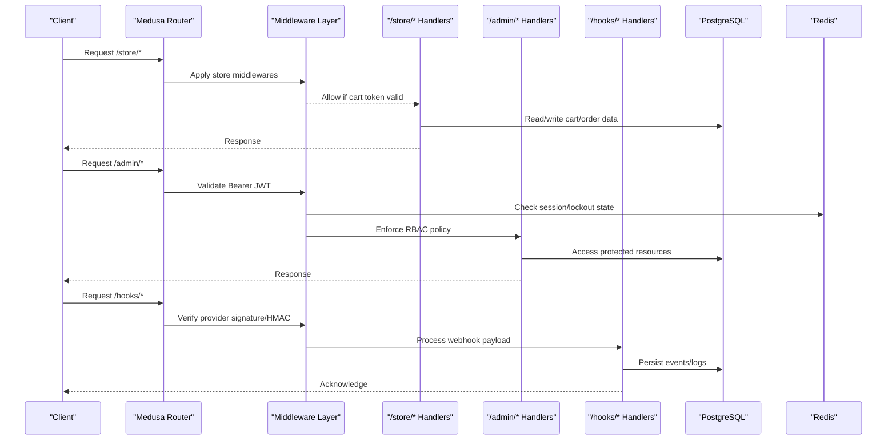

**Diagram sources**
- [architecture.md:305-316](file://docs/architecture.md#L305-L316)
- [technical-plan.md:670-674](file://technical-plan.md#L670-L674)

## Detailed Component Analysis

### JWT Token-Based Authentication
- JWT Secrets and Cookies
  - `jwtSecret` and `cookieSecret` are configured via environment variables in the Medusa configuration file. These secure staff JWT issuance and cookie signing.
- Session Behavior
  - Staff login returns short-lived JWTs stored in HTTP-only cookies. Account lockout and session invalidation are enforced through Redis-backed counters and token revocation strategies.
- First Login Password Change
  - New staff accounts can be provisioned with a flag forcing password change on first login. The admin authentication flow blocks all API access except the password-change endpoint until updated.

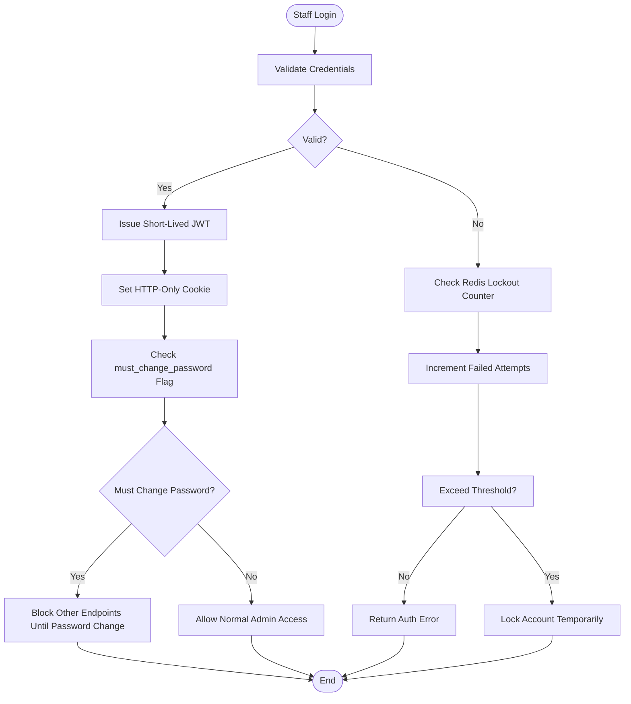

**Diagram sources**
- [medusa-config.ts:7-18](file://apps/medusa/medusa-config.ts#L7-L18)
- [architecture.md:364-382](file://docs/architecture.md#L364-L382)

**Section sources**
- [medusa-config.ts:7-18](file://apps/medusa/medusa-config.ts#L7-L18)
- [architecture.md:364-382](file://docs/architecture.md#L364-L382)

### Cart Token Management
- Guest Customers
  - Guest carts are bound to a secure HTTP-only cookie containing a cart identifier. Requests to `/store/carts/*` and checkout endpoints rely on this token for session continuity.
- Registered Customers
  - Optional phone-based login issues short-lived JWTs in HTTP-only cookies. Subsequent requests carry both cart context and authenticated user context where applicable.
- Order Tracking
  - Customer order tracking authenticates via a combination of Order ID and exact mobile phone number, preventing unauthorized tracking lookups.

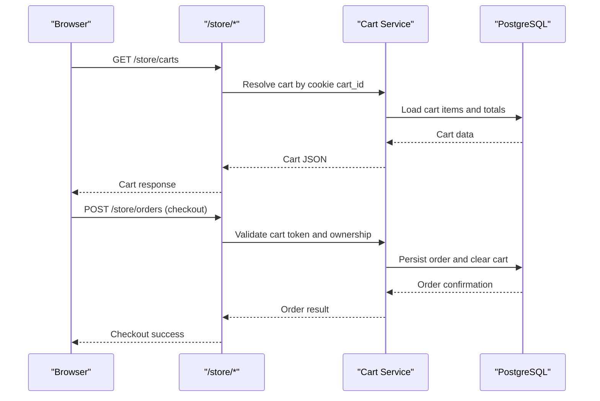

**Diagram sources**
- [architecture.md:305-316](file://docs/architecture.md#L305-L316)
- [architecture.md:318-334](file://docs/architecture.md#L318-L334)

**Section sources**
- [architecture.md:305-316](file://docs/architecture.md#L305-L316)
- [architecture.md:318-334](file://docs/architecture.md#L318-L334)

### Role-Based Access Control (RBAC)
- Roles and Permissions
  - The audit module defines a `staff_role_permission` model with roles: owner, manager, staff, call_center, warehouse, finance. Boolean flags control access to sensitive features such as COGS visibility, COD confirmation, courier booking, refund processing, content management, and audit log viewing.
- RBAC Enforcement
  - Admin endpoints enforce role checks after JWT validation. Some endpoints restrict access to specific roles (e.g., audit logs viewer restricted to Owner or Finance).
- Audit Trail
  - All auth/security-related actions are recorded in `audit_log`, capturing actor identity, role, entity type, action, and contextual metadata.

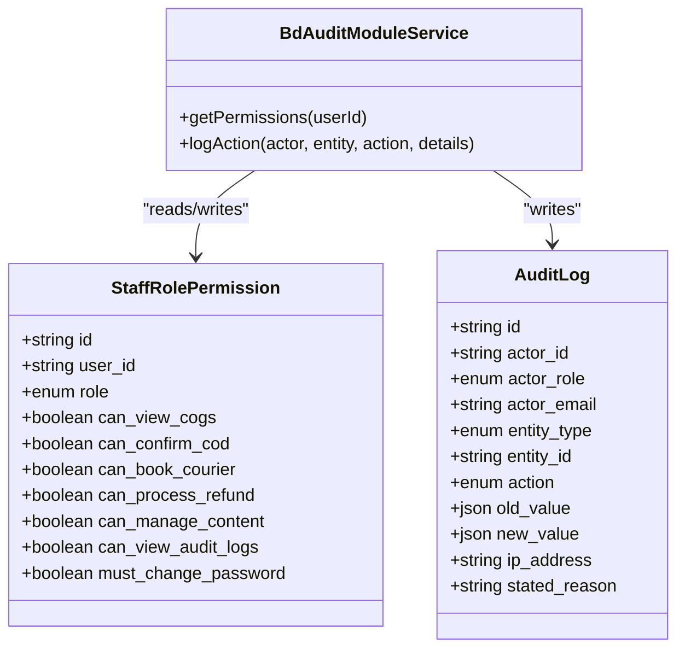

**Diagram sources**
- [staff-role-permission.ts:1-17](file://apps/medusa/src/modules/bd-audit/models/staff-role-permission.ts#L1-L17)
- [audit-log.ts:1-43](file://apps/medusa/src/modules/bd-audit/models/audit-log.ts#L1-L43)
- [bd-audit-service.ts:1-11](file://apps/medusa/src/modules/bd-audit/service.ts#L1-L11)

**Section sources**
- [staff-role-permission.ts:1-17](file://apps/medusa/src/modules/bd-audit/models/staff-role-permission.ts#L1-L17)
- [audit-log.ts:1-43](file://apps/medusa/src/modules/bd-audit/models/audit-log.ts#L1-L43)
- [bd-audit-service.ts:1-11](file://apps/medusa/src/modules/bd-audit/service.ts#L1-L11)
- [architecture.md:384-399](file://docs/architecture.md#L384-L399)

### Middleware Security Patterns
- Route-Level Middlewares
  - The platform uses `defineMiddlewares` to attach middlewares to specific route matchers. An example configures store search with allowed indexes, illustrating how to add custom security logic per route.
- Custom Middleware Creation
  - The API README demonstrates creating a logger middleware and attaching it to a matcher. This pattern applies to authentication, rate limiting, input validation, and audit logging.
- Store Search Security
  - The store search endpoint is secured by configuring allowed indexes, ensuring only permitted search targets are accessible.

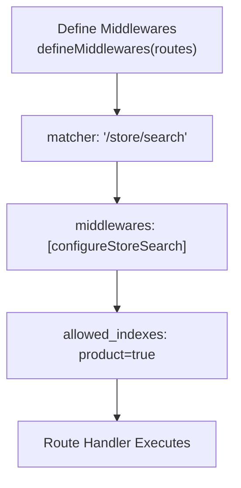

**Diagram sources**
- [middlewares.ts:1-20](file://apps/medusa/src/api/middlewares.ts#L1-L20)
- [api-readme.md:106-136](file://apps/medusa/src/api/README.md#L106-L136)

**Section sources**
- [middlewares.ts:1-20](file://apps/medusa/src/api/middlewares.ts#L1-L20)
- [api-readme.md:106-136](file://apps/medusa/src/api/README.md#L106-L136)

### Route Namespaces and Authentication Levels
- `/store/*`
  - Public storefront API. Requires cart token in cookie for cart mutations. Rate-limited per IP.
- `/admin/*`
  - Protected admin API. Requires Bearer JWT and RBAC role check. Additional endpoints may restrict to specific roles.
- `/hooks/*`
  - External provider webhooks. Require signature or HMAC verification before processing.

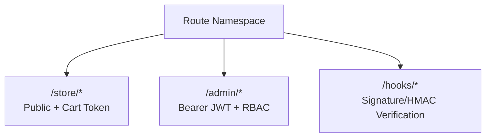

**Diagram sources**
- [architecture.md:305-316](file://docs/architecture.md#L305-L316)

**Section sources**
- [architecture.md:305-316](file://docs/architecture.md#L305-L316)

### Custom Middleware Examples
- Logger Middleware
  - Create a middleware function that logs incoming requests and calls `next()` to continue the pipeline. Attach it to a matcher using `defineMiddlewares`.
- Store Search Middleware
  - Configure store search with allowed indexes to restrict search scope and prevent abuse.

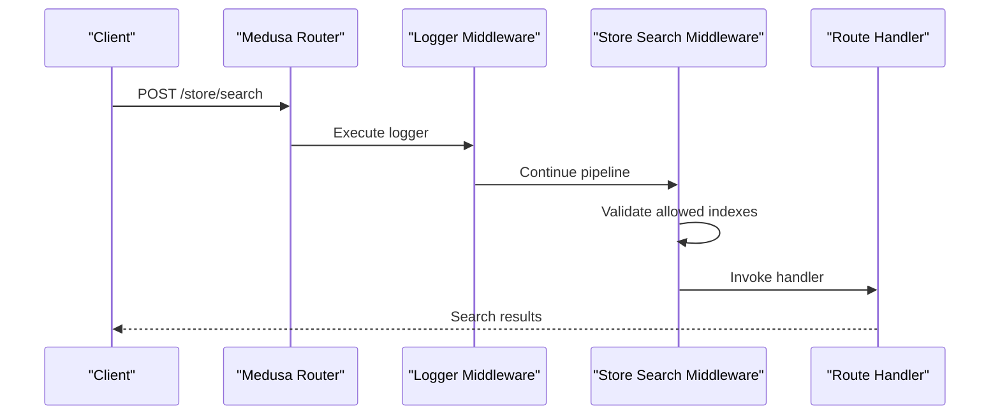

**Diagram sources**
- [api-readme.md:106-136](file://apps/medusa/src/api/README.md#L106-L136)
- [middlewares.ts:1-20](file://apps/medusa/src/api/middlewares.ts#L1-L20)

**Section sources**
- [api-readme.md:106-136](file://apps/medusa/src/api/README.md#L106-L136)
- [middlewares.ts:1-20](file://apps/medusa/src/api/middlewares.ts#L1-L20)

### Token Validation Processes
- JWT Validation
  - Admin requests include a Bearer token. The middleware layer validates the token against the configured secret and checks session state in Redis.
- Cart Token Validation
  - Storefront requests validate the cart token from the HTTP-only cookie to ensure cart integrity and ownership.
- Webhook Signature Validation
  - Hook handlers verify provider signatures or HMACs before processing payloads.

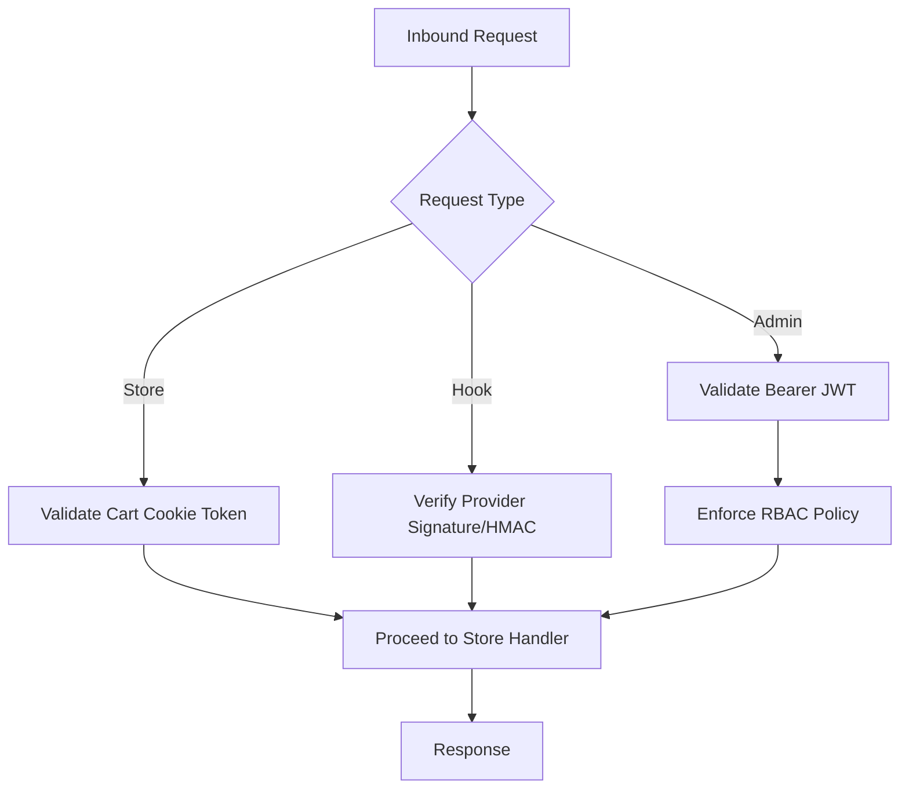

**Diagram sources**
- [architecture.md:305-316](file://docs/architecture.md#L305-L316)
- [technical-plan.md:670-674](file://technical-plan.md#L670-L674)

**Section sources**
- [architecture.md:305-316](file://docs/architecture.md#L305-L316)
- [technical-plan.md:670-674](file://technical-plan.md#L670-L674)

### Session Management
- JWT Sessions
  - Short-lived JWTs issued upon successful staff login, stored in HTTP-only cookies.
- Account Lockout
  - Redis tracks failed login attempts per email; exceeding threshold locks the account temporarily.
- Session Invalidation
  - Changing password or modifying roles/permissions invalidates active JWT/refresh sessions in Redis.

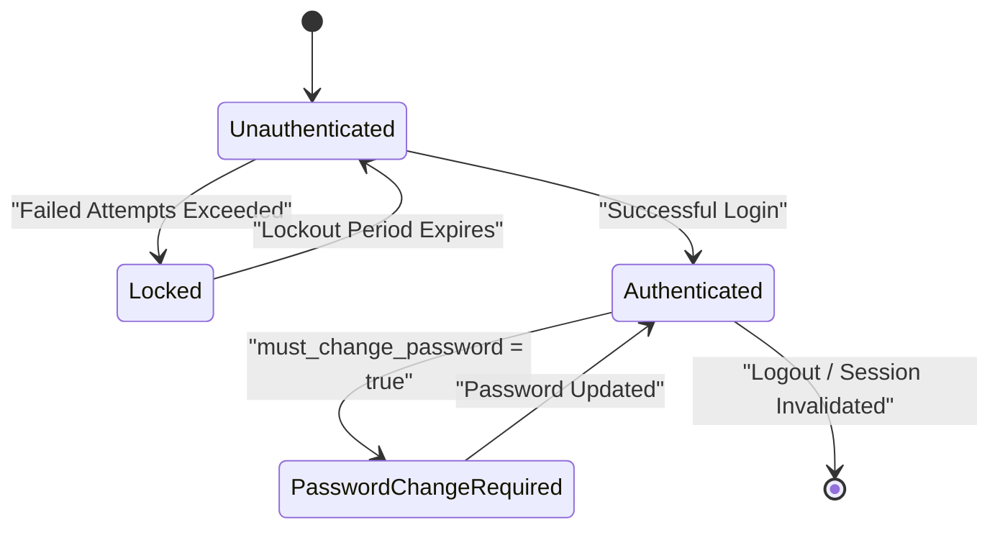

**Diagram sources**
- [architecture.md:364-382](file://docs/architecture.md#L364-L382)

**Section sources**
- [architecture.md:364-382](file://docs/architecture.md#L364-L382)

### Permission Checking
- RBAC Matrix
  - Features are gated by roles: owner, manager, staff, call_center, warehouse, finance. Sensitive operations like COGS visibility, COD confirmation, courier booking, refund processing, content management, and audit log viewing are controlled by boolean flags.
- Endpoint Restrictions
  - Certain endpoints (e.g., audit logs viewer) are restricted to specific roles such as Owner or Finance.

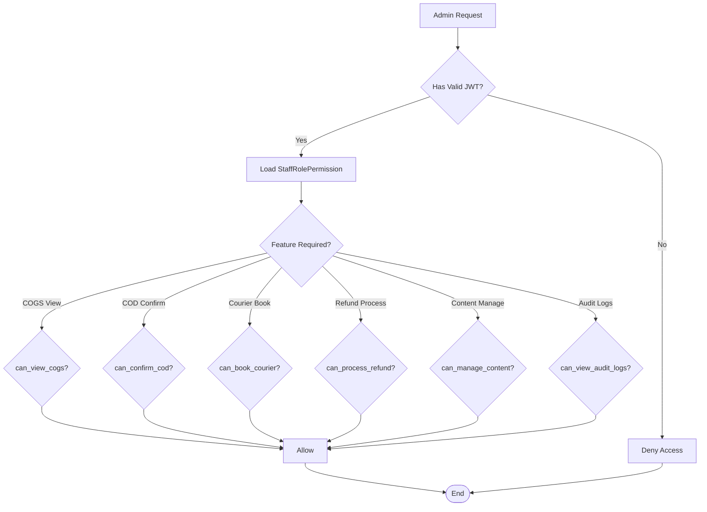

**Diagram sources**
- [staff-role-permission.ts:1-17](file://apps/medusa/src/modules/bd-audit/models/staff-role-permission.ts#L1-L17)
- [architecture.md:384-399](file://docs/architecture.md#L384-L399)

**Section sources**
- [staff-role-permission.ts:1-17](file://apps/medusa/src/modules/bd-audit/models/staff-role-permission.ts#L1-L17)
- [architecture.md:384-399](file://docs/architecture.md#L384-L399)

## Dependency Analysis
Authentication and authorization depend on:
- Medusa configuration for JWT and cookie secrets
- API middlewares for route-level security
- Audit module models and service for RBAC data and auditing
- Architecture documentation defining route namespaces and security boundaries

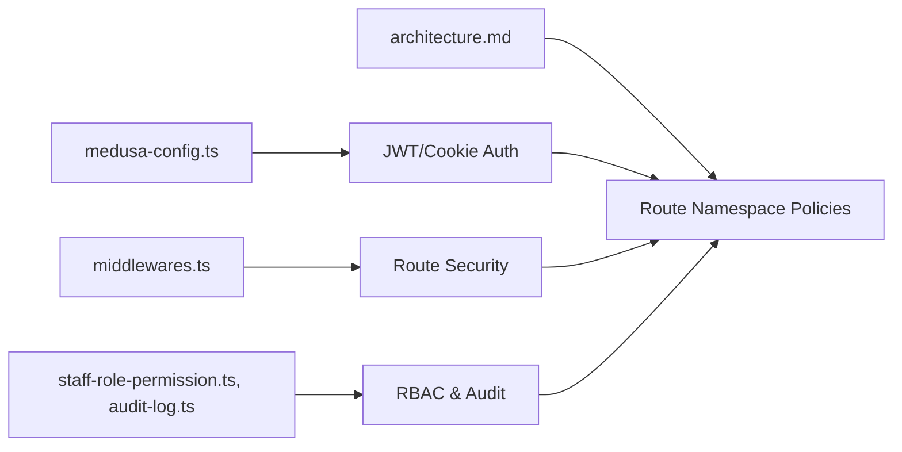

**Diagram sources**
- [medusa-config.ts:7-18](file://apps/medusa/medusa-config.ts#L7-L18)
- [middlewares.ts:1-20](file://apps/medusa/src/api/middlewares.ts#L1-L20)
- [staff-role-permission.ts:1-17](file://apps/medusa/src/modules/bd-audit/models/staff-role-permission.ts#L1-L17)
- [audit-log.ts:1-43](file://apps/medusa/src/modules/bd-audit/models/audit-log.ts#L1-L43)
- [architecture.md:305-316](file://docs/architecture.md#L305-L316)

**Section sources**
- [medusa-config.ts:7-18](file://apps/medusa/medusa-config.ts#L7-L18)
- [middlewares.ts:1-20](file://apps/medusa/src/api/middlewares.ts#L1-L20)
- [staff-role-permission.ts:1-17](file://apps/medusa/src/modules/bd-audit/models/staff-role-permission.ts#L1-L17)
- [audit-log.ts:1-43](file://apps/medusa/src/modules/bd-audit/models/audit-log.ts#L1-L43)
- [architecture.md:305-316](file://docs/architecture.md#L305-L316)

## Performance Considerations
- Rate Limiting
  - Public store endpoints are rate-limited per IP to mitigate abuse and protect checkout endpoints.
- Redis Backing
  - Redis is used for distributed locking, event bus, workflow queues, rate limit buckets, and account lockout counters.
- Input Validation
  - Zod schemas validate inputs across custom endpoints to sanitize and reduce attack surface.

[No sources needed since this section provides general guidance]

## Troubleshooting Guide
Common authentication failures and resolutions:
- Invalid or Expired JWT
  - Ensure `JWT_SECRET` is correctly set and consistent across deployments. Re-authenticate staff users if sessions are invalidated due to password changes or role updates.
- Cart Token Mismatch
  - Verify the HTTP-only cookie contains a valid cart ID. Clear stale cookies if necessary and reinitialize the cart.
- Account Lockout
  - Check Redis lockout counters for the user’s email. Wait for the lockout period to expire or reset counters after verifying legitimate activity.
- RBAC Denials
  - Confirm the staff member’s role and permission flags in `staff_role_permission`. Adjust permissions for the required feature area.
- Webhook Signature Failures
  - Verify provider secrets and HMAC algorithms. Ensure request headers and payloads match expected formats.

**Section sources**
- [architecture.md:364-382](file://docs/architecture.md#L364-L382)
- [technical-plan.md:670-674](file://technical-plan.md#L670-L674)

## Conclusion
The BD Commerce Platform implements robust authentication and authorization through:
- JWT-based staff authentication with strict session controls
- Cart token management for guest and registered customers
- RBAC modeling and enforcement via the audit module
- Middleware patterns for route-level security
- Clear separation of concerns across `/store/*`, `/admin/*`, and `/hooks/*`

Adhering to these patterns ensures secure, scalable, and auditable commerce operations tailored to customer, staff, and external integration needs.