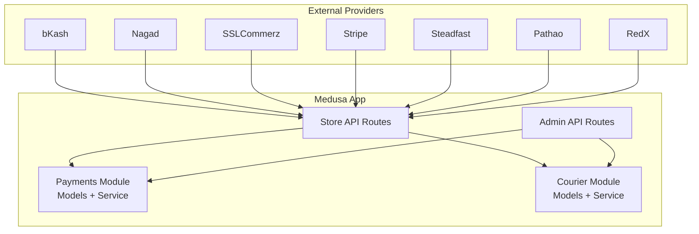
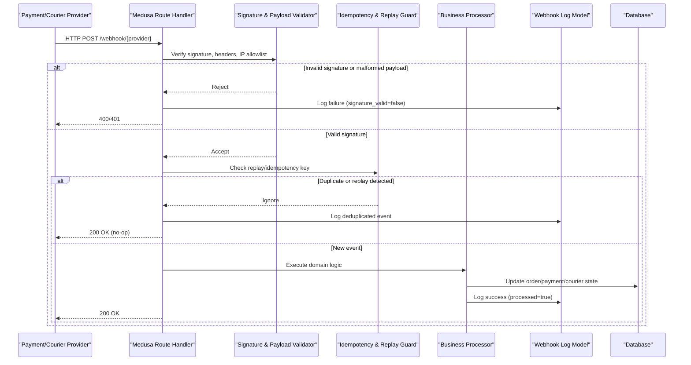
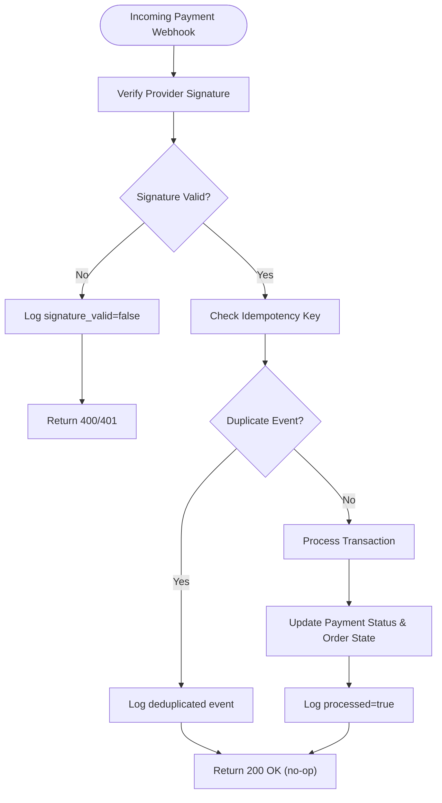
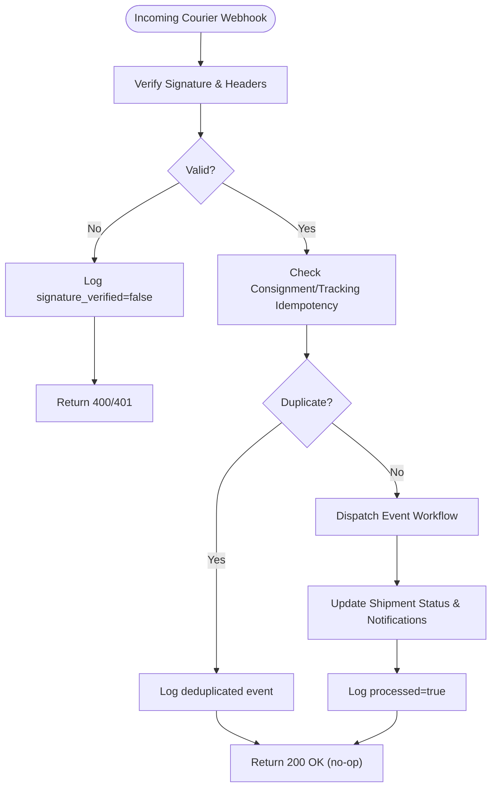
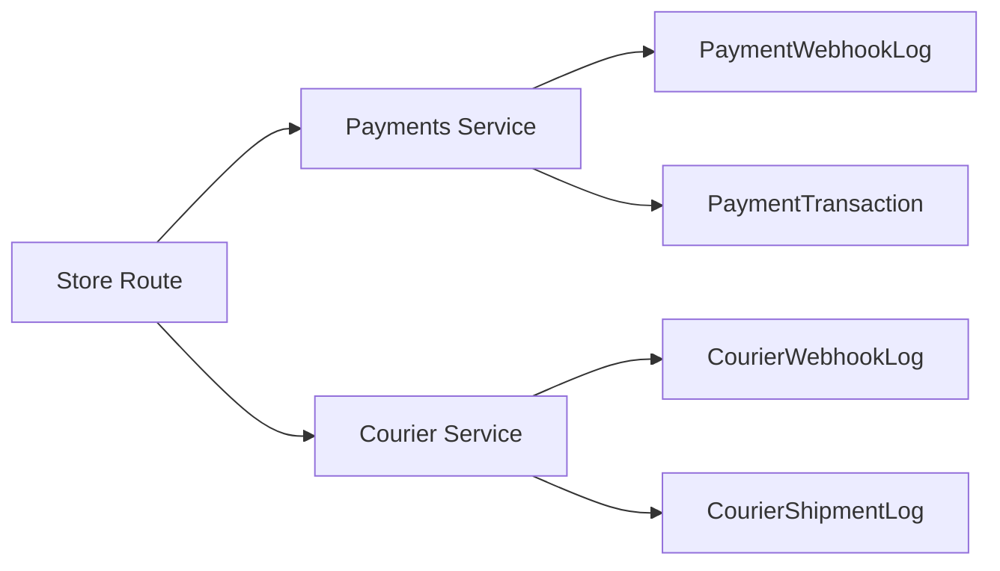

# Webhook Security & External Integrations

<cite>
**Referenced Files in This Document**
- [service.ts](file://apps/medusa/src/modules/bd-payments/service.ts)
- [payment-webhook-log.ts](file://apps/medusa/src/modules/bd-payments/models/payment-webhook-log.ts)
- [payment-transaction.ts](file://apps/medusa/src/modules/bd-payments/models/payment-transaction.ts)
- [service.ts](file://apps/medusa/src/modules/bd-courier/service.ts)
- [courier-webhook-log.ts](file://apps/medusa/src/modules/bd-courier/models/courier-webhook-log.ts)
- [courier-shipment-log.ts](file://apps/medusa/src/modules/bd-courier/models/courier-shipment-log.ts)
- [route.ts](file://apps/medusa/src/api/store/custom/route.ts)
- [route.ts](file://apps/medusa/src/api/admin/custom/route.ts)
- [prd.md](file://prd.md)
- [technical-plan.md](file://technical-plan.md)
- [dfd.md](file://dfd.md)
</cite>

## Table of Contents
1. [Introduction](#introduction)
2. [Project Structure](#project-structure)
3. [Core Components](#core-components)
4. [Architecture Overview](#architecture-overview)
5. [Detailed Component Analysis](#detailed-component-analysis)
6. [Dependency Analysis](#dependency-analysis)
7. [Performance Considerations](#performance-considerations)
8. [Troubleshooting Guide](#troubleshooting-guide)
9. [Conclusion](#conclusion)

## Introduction
This document defines the zero-trust webhook security model and external integration patterns for the BD Commerce Platform, focusing on payment providers (bKash, Nagad, SSLCommerz, Stripe) and courier services (Steadfast, Pathao, RedX). It explains signature verification, payload validation, replay attack prevention, secure endpoint configuration, handler design, error handling, retry strategies, monitoring, data sanitization, and audit logging. The guidance is grounded in the repository’s module structure, data models, and documented requirements.

## Project Structure
The platform uses Medusa modules to isolate concerns:
- Payment integrations are modeled under `bd-payments`, with transaction records and webhook audit logs.
- Courier integrations are modeled under `bd-courier`, with shipment logs and webhook audit logs.
- API route placeholders exist under `api/store/custom` and `api/admin/custom`.

**Diagram sources**
- [service.ts:5-8](file://apps/medusa/src/modules/bd-payments/service.ts#L5-L8)
- [service.ts:5-8](file://apps/medusa/src/modules/bd-courier/service.ts#L5-L8)
- [route.ts:3-8](file://apps/medusa/src/api/store/custom/route.ts#L3-L8)
- [route.ts:3-8](file://apps/medusa/src/api/admin/custom/route.ts#L3-L8)

**Section sources**
- [service.ts:1-11](file://apps/medusa/src/modules/bd-payments/service.ts#L1-L11)
- [service.ts:1-11](file://apps/medusa/src/modules/bd-courier/service.ts#L1-L11)
- [route.ts:1-9](file://apps/medusa/src/api/store/custom/route.ts#L1-L9)
- [route.ts:1-9](file://apps/medusa/src/api/admin/custom/route.ts#L1-L9)

## Core Components
- Payment module service exposes entities for payment transactions and webhook audit logs.
- Courier module service exposes entities for shipment logs and webhook audit logs.
- Models define structured fields for provider identity, request metadata, verification results, processing status, and errors.

Key responsibilities:
- Persist immutable audit trails for all incoming webhooks.
- Enforce strict signature verification before business logic execution.
- Ensure idempotent processing to prevent duplicate state changes.
- Provide observability via structured logs and metrics.

**Section sources**
- [service.ts:1-11](file://apps/medusa/src/modules/bd-payments/service.ts#L1-L11)
- [payment-webhook-log.ts:1-18](file://apps/medusa/src/modules/bd-payments/models/payment-webhook-log.ts#L1-L18)
- [payment-transaction.ts:1-18](file://apps/medusa/src/modules/bd-payments/models/payment-transaction.ts#L1-L18)
- [service.ts:1-11](file://apps/medusa/src/modules/bd-courier/service.ts#L1-L11)
- [courier-webhook-log.ts:1-16](file://apps/medusa/src/modules/bd-courier/models/courier-webhook-log.ts#L1-L16)
- [courier-shipment-log.ts:1-15](file://apps/medusa/src/modules/bd-courier/models/courier-shipment-log.ts#L1-L15)

## Architecture Overview
The zero-trust webhook architecture treats every inbound request as untrusted until proven otherwise.

**Diagram sources**
- [payment-webhook-log.ts:3-15](file://apps/medusa/src/modules/bd-payments/models/payment-webhook-log.ts#L3-L15)
- [courier-webhook-log.ts:3-13](file://apps/medusa/src/modules/bd-courier/models/courier-webhook-log.ts#L3-L13)
- [route.ts:3-8](file://apps/medusa/src/api/store/custom/route.ts#L3-L8)

## Detailed Component Analysis

### Payment Webhooks (bKash, Nagad, SSLCommerz, Stripe)
Design principles:
- Never trust redirect query parameters or body fields alone; always perform server-to-server verification.
- Use provider-specific signature algorithms and header conventions.
- Record full request context for audit and forensics while avoiding sensitive secrets in logs.

Data model highlights:
- `PaymentWebhookLog` captures provider name, endpoint, HTTP method, headers, payload, client IP, signature validity, verification notes, processing status, and error messages.
- `PaymentTransaction` tracks provider ID, transaction type, amounts, gateway identifiers, gateway status, and whether server-to-server verification was performed.

Security controls:
- Signature verification must be enforced before any state mutation.
- Idempotency keys derived from provider event IDs or unique request fingerprints prevent duplicate processing.
- Strict input validation and schema checks protect against malformed payloads.
- IP allowlisting and TLS termination at the edge reduce exposure.

Operational flow:

**Diagram sources**
- [payment-webhook-log.ts:3-15](file://apps/medusa/src/modules/bd-payments/models/payment-webhook-log.ts#L3-L15)
- [payment-transaction.ts:3-15](file://apps/medusa/src/modules/bd-payments/models/payment-transaction.ts#L3-L15)

Implementation references:
- Payment module service wires entities for persistence.
- Payment webhook log model provides fields for signature and processing outcomes.
- Payment transaction model supports tracking provider interactions and verification flags.

**Section sources**
- [service.ts:1-11](file://apps/medusa/src/modules/bd-payments/service.ts#L1-L11)
- [payment-webhook-log.ts:1-18](file://apps/medusa/src/modules/bd-payments/models/payment-webhook-log.ts#L1-L18)
- [payment-transaction.ts:1-18](file://apps/medusa/src/modules/bd-payments/models/payment-transaction.ts#L1-L18)
- [prd.md:267-274](file://prd.md#L267-L274)

### Courier Webhooks (Steadfast, Pathao, RedX)
Design principles:
- Distinguish between delivery_failed and rto_initiated events to trigger different workflows (e.g., re-attempt vs return-to-merchant).
- Map courier-specific fields consistently (consignment_id, tracking_code).
- Persist raw payloads for debugging and compliance while masking sensitive data.

Data model highlights:
- `CourierWebhookLog` stores courier identity, event type, consignment/tracking identifiers, raw payload, signature verification result, processing status, and error messages.
- `CourierShipmentLog` records outbound requests/responses and statuses for courier operations.

Operational flow:

**Diagram sources**
- [courier-webhook-log.ts:3-13](file://apps/medusa/src/modules/bd-courier/models/courier-webhook-log.ts#L3-L13)
- [courier-shipment-log.ts:3-12](file://apps/medusa/src/modules/bd-courier/models/courier-shipment-log.ts#L3-L12)

Implementation references:
- Courier module service wires entities for persistence.
- Courier webhook log model supports signature and processing outcomes.
- Courier shipment log model supports request/response auditing.

**Section sources**
- [service.ts:1-11](file://apps/medusa/src/modules/bd-courier/service.ts#L1-L11)
- [courier-webhook-log.ts:1-16](file://apps/medusa/src/modules/bd-courier/models/courier-webhook-log.ts#L1-L16)
- [courier-shipment-log.ts:1-15](file://apps/medusa/src/modules/bd-courier/models/courier-shipment-log.ts#L1-L15)
- [technical-plan.md:549-596](file://technical-plan.md#L549-L596)
- [dfd.md:298-303](file://dfd.md#L298-L303)

### Secure Endpoint Configuration
Guidelines:
- Expose dedicated webhook endpoints per provider category (payments vs couriers) under a controlled path prefix.
- Enforce TLS-only access and restrict source IPs where possible.
- Apply rate limiting and bot protection at the edge.
- Separate read-only admin routes for inspection and manual retries.

Current codebase state:
- Placeholder GET routes exist under store and admin APIs. These should be replaced with provider-specific POST handlers that implement the zero-trust workflow described above.

**Section sources**
- [route.ts:1-9](file://apps/medusa/src/api/store/custom/route.ts#L1-L9)
- [route.ts:1-9](file://apps/medusa/src/api/admin/custom/route.ts#L1-L9)

## Dependency Analysis
Module-level dependencies:
- Payment and courier services depend on their respective models for persistence.
- API routes depend on services and models to process and audit webhooks.

**Diagram sources**
- [service.ts:1-11](file://apps/medusa/src/modules/bd-payments/service.ts#L1-L11)
- [service.ts:1-11](file://apps/medusa/src/modules/bd-courier/service.ts#L1-L11)
- [payment-webhook-log.ts:1-18](file://apps/medusa/src/modules/bd-payments/models/payment-webhook-log.ts#L1-L18)
- [payment-transaction.ts:1-18](file://apps/medusa/src/modules/bd-payments/models/payment-transaction.ts#L1-L18)
- [courier-webhook-log.ts:1-16](file://apps/medusa/src/modules/bd-courier/models/courier-webhook-log.ts#L1-L16)
- [courier-shipment-log.ts:1-15](file://apps/medusa/src/modules/bd-courier/models/courier-shipment-log.ts#L1-L15)

**Section sources**
- [service.ts:1-11](file://apps/medusa/src/modules/bd-payments/service.ts#L1-L11)
- [service.ts:1-11](file://apps/medusa/src/modules/bd-courier/service.ts#L1-L11)

## Performance Considerations
- Keep webhook handlers synchronous and fast; offload heavy work to background jobs.
- Use database indexes on frequently queried fields (e.g., consignment_id, tracking_code, deleted_at) already present in migrations.
- Avoid logging large payloads by default; sample or truncate sensitive data.
- Implement short-circuit rejection for invalid signatures to minimize downstream costs.

[No sources needed since this section provides general guidance]

## Troubleshooting Guide
Common issues and resolutions:
- Signature mismatch:
  - Verify provider secret configuration and algorithm.
  - Inspect `signature_valid` and `verification_result` in webhook logs.
- Duplicate processing:
  - Confirm idempotency key derivation and storage.
  - Review deduplication logs and ensure consistent event IDs.
- Malformed payloads:
  - Validate JSON structure and required fields.
  - Capture `error_message` for diagnostics.
- Network timeouts:
  - Implement bounded retries with exponential backoff for non-idempotent follow-ups.
  - Track retry counts and failures in audit logs.

Observability:
- Monitor webhook ingestion rates, signature failure rates, and processing latency.
- Alert on spikes in failed verifications or high error-message volumes.

**Section sources**
- [payment-webhook-log.ts:3-15](file://apps/medusa/src/modules/bd-payments/models/payment-webhook-log.ts#L3-L15)
- [courier-webhook-log.ts:3-13](file://apps/medusa/src/modules/bd-courier/models/courier-webhook-log.ts#L3-L13)

## Conclusion
The BD Commerce Platform’s webhook security model enforces zero-trust verification, comprehensive audit logging, and idempotent processing across payment and courier integrations. By leveraging the existing module services and models, implementing robust signature checks, and following the outlined operational flows, the platform can securely integrate with bKash, Nagad, SSLCommerz, Stripe, Steadfast, Pathao, and RedX while maintaining strong observability and resilience.

[No sources needed since this section summarizes without analyzing specific files]