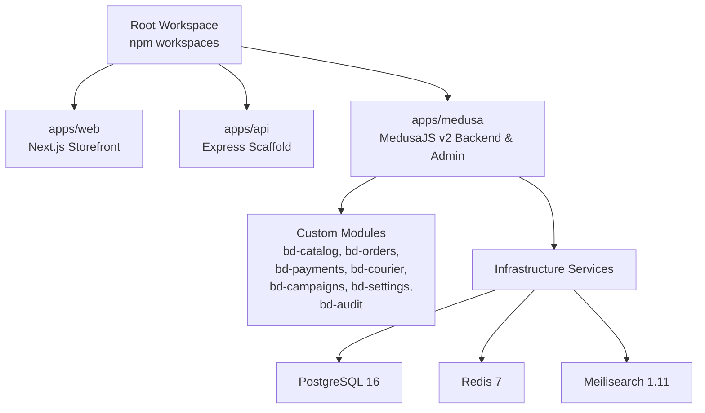
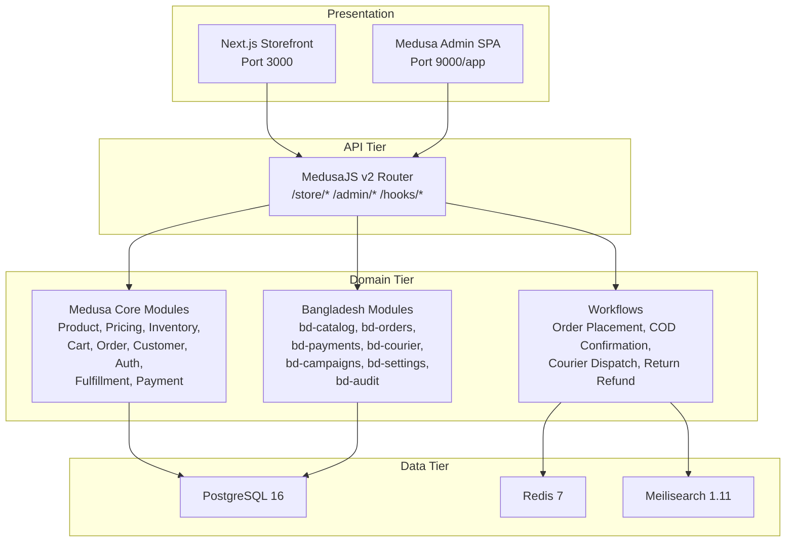
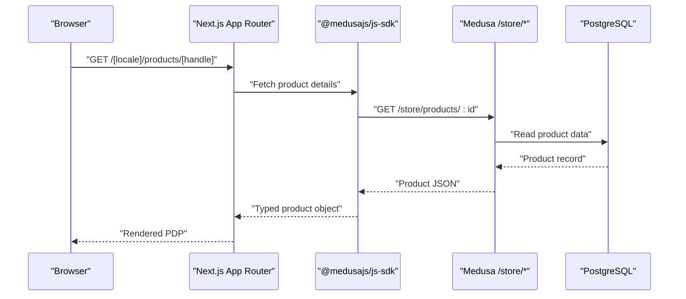
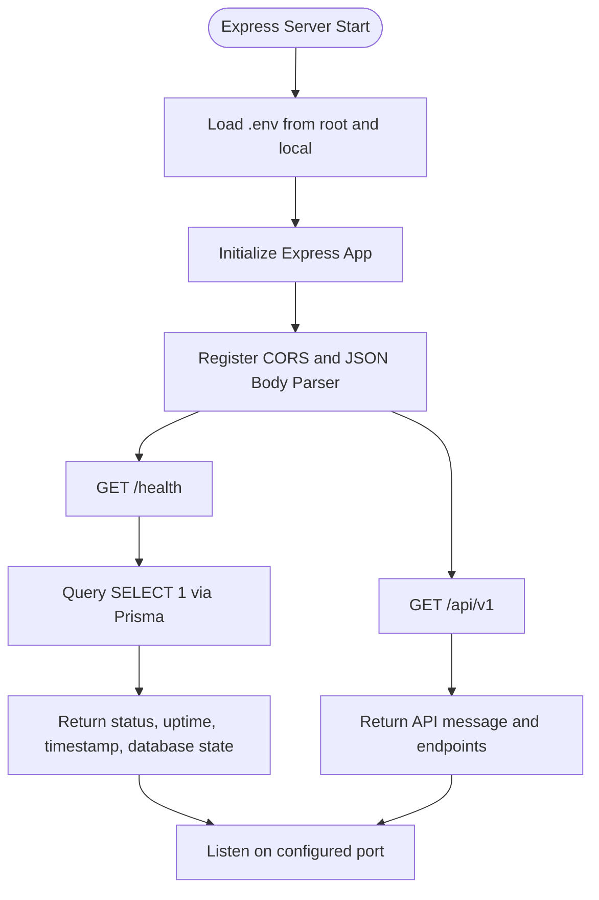
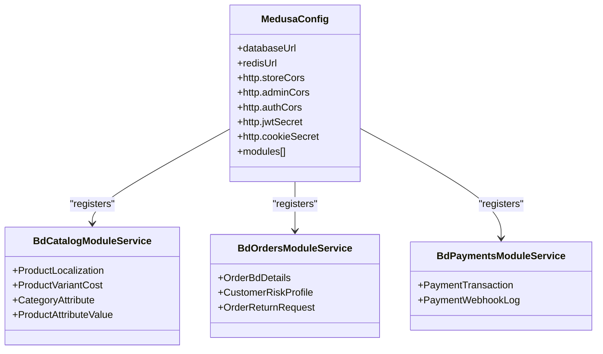
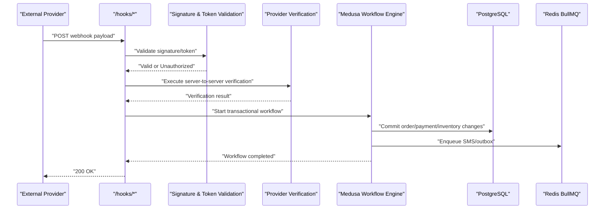
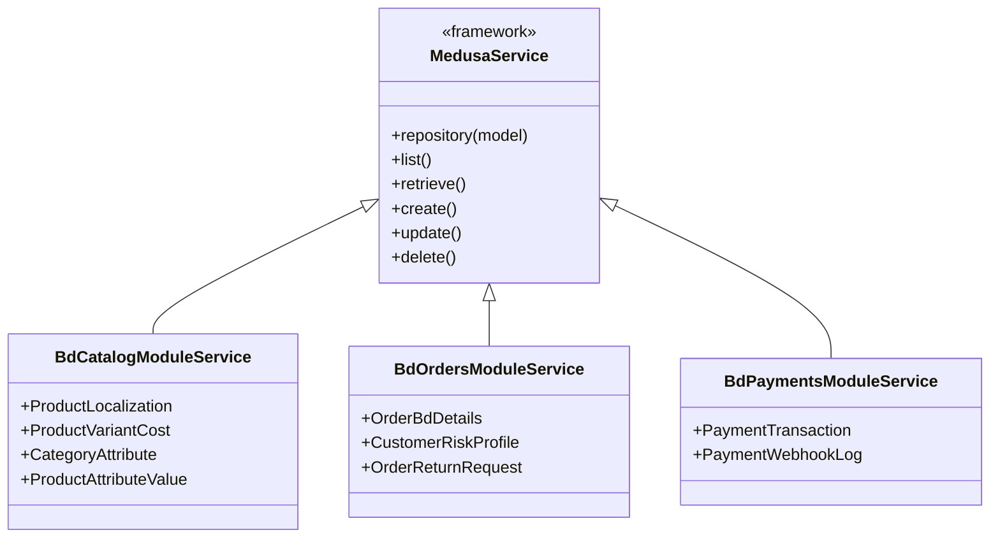
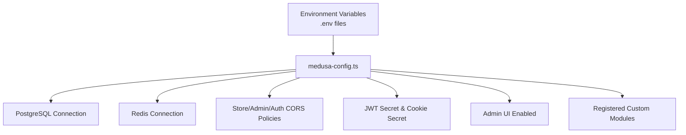
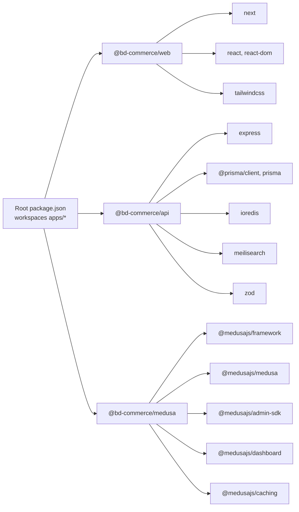

# Architecture Overview

<cite>
**Referenced Files in This Document**
- [package.json](file://package.json)
- [apps/web/package.json](file://apps/web/package.json)
- [apps/api/package.json](file://apps/api/package.json)
- [apps/medusa/package.json](file://apps/medusa/package.json)
- [apps/web/src/app/layout.tsx](file://apps/web/src/app/layout.tsx)
- [apps/web/src/app/page.tsx](file://apps/web/src/app/page.tsx)
- [apps/api/src/main.ts](file://apps/api/src/main.ts)
- [apps/medusa/medusa-config.ts](file://apps/medusa/medusa-config.ts)
- [apps/medusa/src/api/middlewares.ts](file://apps/medusa/src/api/middlewares.ts)
- [apps/medusa/src/modules/bd-catalog/service.ts](file://apps/medusa/src/modules/bd-catalog/service.ts)
- [apps/medusa/src/modules/bd-orders/service.ts](file://apps/medusa/src/modules/bd-orders/service.ts)
- [apps/medusa/src/modules/bd-payments/service.ts](file://apps/medusa/src/modules/bd-payments/service.ts)
- [docker-compose.yml](file://docker-compose.yml)
- [docs/architecture.md](file://docs/architecture.md)
- [docs/architecture-decision-medusa-v2.md](file://docs/architecture-decision-medusa-v2.md)
</cite>

## Table of Contents
1. [Introduction](#introduction)
2. [Project Structure](#project-structure)
3. [Core Components](#core-components)
4. [Architecture Overview](#architecture-overview)
5. [Detailed Component Analysis](#detailed-component-analysis)
6. [Dependency Analysis](#dependency-analysis)
7. [Performance Considerations](#performance-considerations)
8. [Troubleshooting Guide](#troubleshooting-guide)
9. [Conclusion](#conclusion)

## Introduction
This document describes the BD Commerce Platform as a modular monolith with microservices-inspired separation across three tiers:
- Frontend storefront built with Next.js.
- API layer represented by an Express scaffold that is being replaced by MedusaJS v2.
- Commerce engine built on MedusaJS v2, exposing store and admin APIs while hosting custom Bangladesh-specific modules.

The system follows repository pattern through Medusa module services, service-layer abstractions for business logic, event-driven workflows for multi-step operations, and configuration-driven features via environment variables and module registration. The architecture targets a single-vendor B2C platform optimized for Bangladesh market operations such as COD verification, local payment gateways, courier dispatch, Bangla localization, and campaign landing pages.

**Section sources**
- [docs/architecture.md:44-74](file://docs/architecture.md#L44-L74)
- [docs/architecture-decision-medusa-v2.md:1-34](file://docs/architecture-decision-medusa-v2.md#L1-L34)

## Project Structure
The repository is a npm workspaces monorepo under `apps/`:
- `apps/web` is the Next.js storefront.
- `apps/api` is the temporary Express + Prisma scaffold.
- `apps/medusa` is the MedusaJS v2 backend and embedded admin.
- Infrastructure services are defined in Docker Compose for PostgreSQL, Redis, and Meilisearch.

**Diagram sources**
- [package.json:6-25](file://package.json#L6-L25)
- [docker-compose.yml:1-77](file://docker-compose.yml#L1-L77)

**Section sources**
- [package.json:1-39](file://package.json#L1-L39)
- [apps/web/package.json:1-28](file://apps/web/package.json#L1-L28)
- [apps/api/package.json:1-34](file://apps/api/package.json#L1-L34)
- [apps/medusa/package.json:1-61](file://apps/medusa/package.json#L1-L61)
- [docker-compose.yml:1-77](file://docker-compose.yml#L1-L77)

## Core Components
- **Frontend (Next.js):** Provides server-side rendered pages, client-side cart and checkout interactions, and campaign landing pages. It communicates with the commerce backend using the Medusa JavaScript SDK.
- **API Layer (Express):** A minimal health-check and version endpoint scaffold currently used for development scaffolding. It will be phased out as MedusaJS v2 becomes the primary API surface.
- **Commerce Engine (MedusaJS v2):** Hosts core commerce primitives plus custom modules for catalog localization, orders, payments, couriers, campaigns, settings, and audit logging. It exposes `/store/*`, `/admin/*`, and webhook routes.

Key responsibilities:
- Storefront renders product, category, cart, checkout, tracking, and policy pages.
- Medusa manages carts, products, inventory, orders, payments, customers, and fulfillment.
- Custom modules encapsulate Bangladesh-specific operational requirements.

**Section sources**
- [docs/architecture.md:77-124](file://docs/architecture.md#L77-L124)
- [docs/architecture-decision-medusa-v2.md:36-48](file://docs/architecture-decision-medusa-v2.md#L36-L48)

## Architecture Overview
The platform uses a three-tier design with clear boundaries:
- Presentation tier: Next.js storefront at port 3000.
- API tier: MedusaJS HTTP router serving public store endpoints, protected admin endpoints, provider webhooks, and internal custom routes.
- Domain tier: Medusa core modules extended by Bangladesh custom modules orchestrated by workflows.
- Data tier: PostgreSQL for relational data, Redis for queues and distributed locks, Meilisearch for instant search.

**Diagram sources**
- [docs/architecture.md:77-124](file://docs/architecture.md#L77-L124)
- [apps/medusa/medusa-config.ts:7-45](file://apps/medusa/medusa-config.ts#L7-L45)

## Detailed Component Analysis

### Frontend Storefront (Next.js)
The storefront provides metadata, root layout, and a landing page that documents infrastructure services and architectural pillars. It is intended to call Medusa APIs through the JS SDK rather than directly accessing databases or external services.

**Diagram sources**
- [apps/web/src/app/layout.tsx:1-22](file://apps/web/src/app/layout.tsx#L1-L22)
- [apps/web/src/app/page.tsx:1-81](file://apps/web/src/app/page.tsx#L1-L81)
- [docs/architecture.md:318-334](file://docs/architecture.md#L318-L334)

**Section sources**
- [apps/web/src/app/layout.tsx:1-22](file://apps/web/src/app/layout.tsx#L1-L22)
- [apps/web/src/app/page.tsx:1-81](file://apps/web/src/app/page.tsx#L1-L81)
- [docs/architecture.md:738-764](file://docs/architecture.md#L738-L764)

### API Layer (Express Scaffold)
The current Express application loads environment variables, registers CORS and JSON parsing, and exposes a health check and basic version endpoint. It connects to PostgreSQL via Prisma but does not implement commerce workflows. This scaffold is transitional and will be replaced by MedusaJS v2.

**Diagram sources**
- [apps/api/src/main.ts:1-55](file://apps/api/src/main.ts#L1-L55)

**Section sources**
- [apps/api/src/main.ts:1-55](file://apps/api/src/main.ts#L1-L55)
- [apps/api/package.json:1-34](file://apps/api/package.json#L1-L34)
- [docs/architecture-decision-medusa-v2.md:36-48](file://docs/architecture-decision-medusa-v2.md#L36-L48)

### Commerce Engine (MedusaJS v2)
MedusaJS v2 is the authoritative commerce backend. Configuration loads environment variables, sets CORS policies, enables the admin UI, and registers custom modules. Search middleware configures allowed indexes for store search.

**Diagram sources**
- [apps/medusa/medusa-config.ts:1-46](file://apps/medusa/medusa-config.ts#L1-L46)
- [apps/medusa/src/modules/bd-catalog/service.ts:1-15](file://apps/medusa/src/modules/bd-catalog/service.ts#L1-L15)
- [apps/medusa/src/modules/bd-orders/service.ts:1-13](file://apps/medusa/src/modules/bd-orders/service.ts#L1-L13)
- [apps/medusa/src/modules/bd-payments/service.ts:1-11](file://apps/medusa/src/modules/bd-payments/service.ts#L1-L11)

**Section sources**
- [apps/medusa/medusa-config.ts:1-46](file://apps/medusa/medusa-config.ts#L1-L46)
- [apps/medusa/src/api/middlewares.ts:1-20](file://apps/medusa/src/api/middlewares.ts#L1-L20)
- [apps/medusa/src/modules/bd-catalog/service.ts:1-15](file://apps/medusa/src/modules/bd-catalog/service.ts#L1-L15)
- [apps/medusa/src/modules/bd-orders/service.ts:1-13](file://apps/medusa/src/modules/bd-orders/service.ts#L1-L13)
- [apps/medusa/src/modules/bd-payments/service.ts:1-11](file://apps/medusa/src/modules/bd-payments/service.ts#L1-L11)

### Event-Driven Workflows and Webhooks
The architecture defines zero-trust webhook ingestion, transactional workflows, and SMS outbox patterns. Webhooks validate signatures, perform provider verification, execute workflows, and return success responses.

**Diagram sources**
- [docs/architecture.md:336-355](file://docs/architecture.md#L336-L355)
- [docs/architecture.md:696-735](file://docs/architecture.md#L696-L735)

**Section sources**
- [docs/architecture.md:305-361](file://docs/architecture.md#L305-L361)
- [docs/architecture.md:467-508](file://docs/architecture.md#L467-L508)
- [docs/architecture.md:545-567](file://docs/architecture.md#L545-L567)
- [docs/architecture.md:696-735](file://docs/architecture.md#L696-L735)

### Repository Pattern and Service Abstraction
Medusa module services extend `MedusaService` and expose typed repositories for models. This enforces repository-style access to domain entities and keeps business logic in higher-level workflows and services.

**Diagram sources**
- [apps/medusa/src/modules/bd-catalog/service.ts:1-15](file://apps/medusa/src/modules/bd-catalog/service.ts#L1-L15)
- [apps/medusa/src/modules/bd-orders/service.ts:1-13](file://apps/medusa/src/modules/bd-orders/service.ts#L1-L13)
- [apps/medusa/src/modules/bd-payments/service.ts:1-11](file://apps/medusa/src/modules/bd-payments/service.ts#L1-L11)

**Section sources**
- [apps/medusa/src/modules/bd-catalog/service.ts:1-15](file://apps/medusa/src/modules/bd-catalog/service.ts#L1-L15)
- [apps/medusa/src/modules/bd-orders/service.ts:1-13](file://apps/medusa/src/modules/bd-orders/service.ts#L1-L13)
- [apps/medusa/src/modules/bd-payments/service.ts:1-11](file://apps/medusa/src/modules/bd-payments/service.ts#L1-L11)

### Configuration-Driven Features
Medusa configuration centralizes database URL, Redis URL, CORS policies, JWT secret, cookie secret, admin enablement, and module registration. Environment variables are loaded from the project root and module directory.

**Diagram sources**
- [apps/medusa/medusa-config.ts:1-46](file://apps/medusa/medusa-config.ts#L1-L46)

**Section sources**
- [apps/medusa/medusa-config.ts:1-46](file://apps/medusa/medusa-config.ts#L1-L46)

## Dependency Analysis
The monorepo orchestrates three applications and shared infrastructure:
- `apps/web` depends on Next.js, React, and Tailwind CSS.
- `apps/api` depends on Express, Prisma, Redis client, Meilisearch client, and Zod validation.
- `apps/medusa` depends on MedusaJS framework packages, admin SDK, dashboard, caching, CLI, draft-order, and test utilities.

**Diagram sources**
- [package.json:6-35](file://package.json#L6-L35)
- [apps/web/package.json:12-26](file://apps/web/package.json#L12-L26)
- [apps/api/package.json:16-32](file://apps/api/package.json#L16-L32)
- [apps/medusa/package.json:25-56](file://apps/medusa/package.json#L25-L56)

**Section sources**
- [package.json:1-39](file://package.json#L1-L39)
- [apps/web/package.json:1-28](file://apps/web/package.json#L1-L28)
- [apps/api/package.json:1-34](file://apps/api/package.json#L1-L34)
- [apps/medusa/package.json:1-61](file://apps/medusa/package.json#L1-L61)

## Performance Considerations
- **Search Performance:** Meilisearch provides sub-50ms typo-tolerant search for English and Banglish queries. Indexing is restricted to safe fields to avoid leaking confidential cost and margin data.
- **Concurrency Control:** Redis distributed locks protect low-stock variants during concurrent checkout. Inventory reservations occur atomically within workflows.
- **Rate Limiting:** Endpoint-specific thresholds prevent abuse on cart mutations, order placement, order tracking, authentication, and webhook ingestion.
- **Caching Strategy:** Redis stores workflow queues, session cache, rate limit buckets, stock locks, and SMS deduplication keys. Cart payloads can be cached to reduce database reads.
- **Rendering Strategy:** Next.js uses SSR and ISR for dynamic pages, CSR for real-time cart and checkout, and campaign landing pages with embedded checkout bound to unified cart sessions.

[No sources needed since this section provides general guidance]

## Troubleshooting Guide
- **Health Checks:** Use the Express health endpoint to verify API availability and database connectivity.
- **Medusa Configuration:** Validate environment variables for database URL, Redis URL, CORS policies, and secrets. Ensure admin UI is enabled and modules are registered.
- **Search Middleware:** Confirm that store search middleware allows only permitted indexes.
- **Docker Services:** Verify PostgreSQL, Redis, and Meilisearch containers are healthy and reachable on expected ports.

**Section sources**
- [apps/api/src/main.ts:18-35](file://apps/api/src/main.ts#L18-L35)
- [apps/medusa/medusa-config.ts:7-21](file://apps/medusa/medusa-config.ts#L7-L21)
- [apps/medusa/src/api/middlewares.ts:5-19](file://apps/medusa/src/api/middlewares.ts#L5-L19)
- [docker-compose.yml:14-64](file://docker-compose.yml#L14-L64)

## Conclusion
BD Commerce Platform adopts a modular monolith architecture with microservices-inspired boundaries. Next.js serves as the presentation layer, MedusaJS v2 provides the commerce engine and admin interface, and the temporary Express scaffold bridges early development. The system emphasizes repository-style data access, service-layer abstractions, event-driven workflows, and configuration-driven features. External integrations include local payment gateways, courier APIs, SMS providers, and search infrastructure. Scalability considerations center on Redis-backed concurrency control, rate limiting, caching, and efficient search indexing. Security focuses on zero-trust webhooks, RBAC, account lockouts, and audit logging.

[No sources needed since this section summarizes without analyzing specific files]