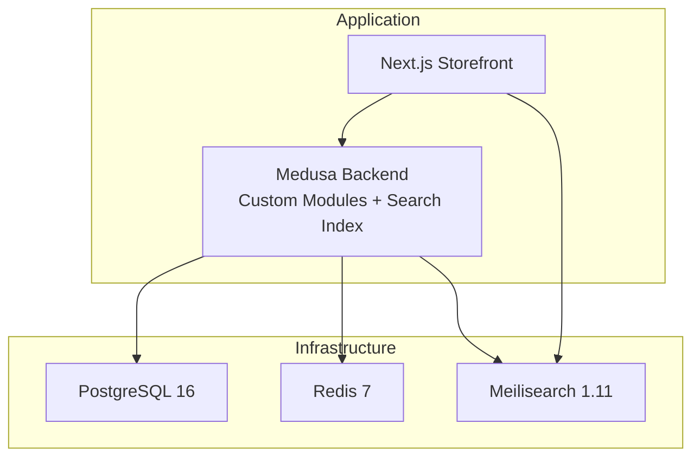
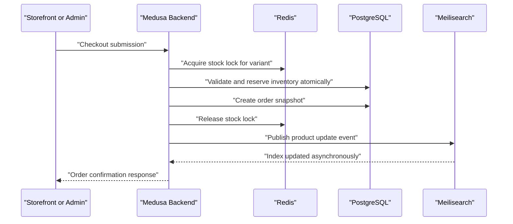
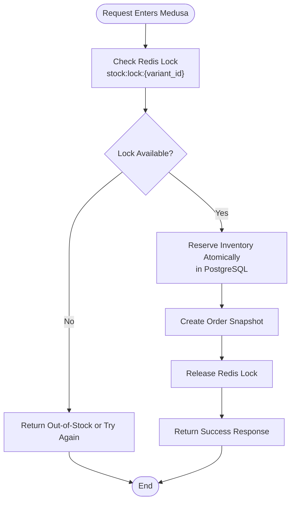
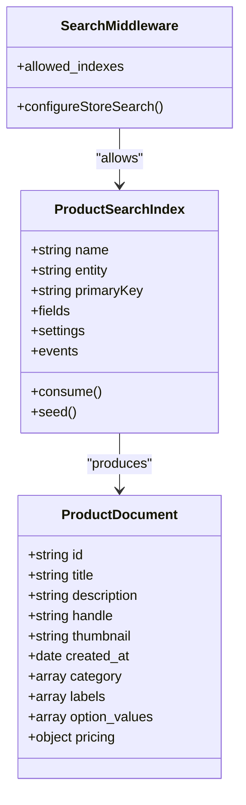
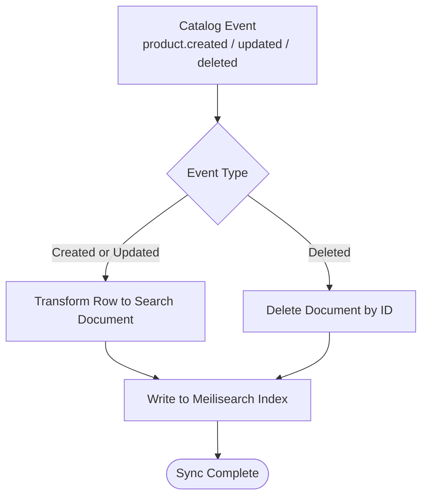
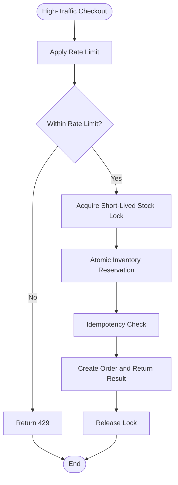
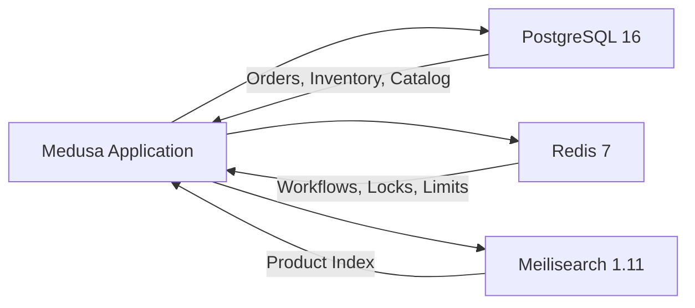

# Caching Strategy & Performance Optimization

<cite>
**Referenced Files in This Document**
- [architecture.md](file://docs/architecture.md)
- [product.ts](file://apps/medusa/src/search/product.ts)
- [middlewares.ts](file://apps/medusa/src/api/middlewares.ts)
- [docker-compose.yml](file://docker-compose.yml)
- [dfd-review.md](file://docs/dfd-review.md)
- [database.md](file://database.md)
</cite>

## Table of Contents
1. [Introduction](#introduction)
2. [Project Structure](#project-structure)
3. [Core Components](#core-components)
4. [Architecture Overview](#architecture-overview)
5. [Detailed Component Analysis](#detailed-component-analysis)
6. [Dependency Analysis](#dependency-analysis)
7. [Performance Considerations](#performance-considerations)
8. [Troubleshooting Guide](#troubleshooting-guide)
9. [Conclusion](#conclusion)

## Introduction
This document explains the caching strategy and performance optimization approach used by the BD Commerce Platform, with emphasis on Redis-based concurrency control, workflow queues, rate limiting, session caching, and Meilisearch integration for product search. It also covers data protection through field allowlists, sync strategies, high-traffic considerations, inventory reservation locking, concurrent checkout protection, cache invalidation, monitoring guidance, and performance tuning recommendations.

The platform uses:
- PostgreSQL as the primary relational store.
- Redis 7 for workflows, distributed locks, rate limits, account lockouts, cart session caching, and SMS deduplication.
- Meilisearch 1.11 for fast, typo-tolerant product search with a strict public-facing field allowlist that excludes confidential financial fields.

## Project Structure
At a high level, the relevant parts of the repository are:
- `apps/medusa`: Medusa v2 backend containing custom modules, API routes, search index configuration, and middleware.
- `apps/web`: Next.js storefront (not analyzed in detail here).
- `docs`: Authoritative architecture and design documentation.
- `docker-compose.yml`: Local orchestration for PostgreSQL, Redis, and Meilisearch.

**Diagram sources**
- [docker-compose.yml:1-77](file://docker-compose.yml#L1-L77)
- [architecture.md:51-64](file://docs/architecture.md#L51-L64)

**Section sources**
- [docker-compose.yml:1-77](file://docker-compose.yml#L1-L77)
- [architecture.md:51-64](file://docs/architecture.md#L51-L64)

## Core Components
The caching and performance system is centered around three areas:
1. **Redis-based concurrency and caching:** Workflow queues, distributed inventory locks, rate limiting, staff account lockout, cart session caching, and SMS deduplication.
2. **Meilisearch product search:** Index definition, filtering/sorting, allowed indexes via middleware, and synchronization events.
3. **High-traffic safeguards:** Atomic inventory reservations, short-lived distributed locks, idempotency, and soft-delete-safe index deletion.

Key responsibilities:
- Redis provides low-latency coordination and temporary state.
- PostgreSQL remains the authoritative source for orders, inventory, pricing, and audit records.
- Meilisearch provides fast search while being protected from leaking confidential business data.

**Section sources**
- [architecture.md:402-466](file://docs/architecture.md#L402-L466)
- [product.ts:43-68](file://apps/medusa/src/search/product.ts#L43-L68)
- [middlewares.ts:1-20](file://apps/medusa/src/api/middlewares.ts#L1-L20)

## Architecture Overview
The Redis and Meilisearch layers sit alongside PostgreSQL to support high-throughput commerce operations.

**Diagram sources**
- [architecture.md:402-421](file://docs/architecture.md#L402-L421)
- [product.ts:131-165](file://apps/medusa/src/search/product.ts#L131-L165)

## Detailed Component Analysis

### Redis Caching, Queues, Locks, and Rate Limiting
Redis is used for:
- **Workflow queue persistence:** BullMQ-backed Medusa Workflows use Redis keys under `bull:medusa-*`.
- **Distributed inventory locking:** A per-variant mutex `stock:lock:{variant_id}` protects concurrent checkout for low-stock items.
- **Staff security:** Account-level lockout key `auth:lockout:{user_email}` prevents brute-force login attempts.
- **Rate limiting:** Token-bucket style keys such as `ratelimit:{ip}:{endpoint}` and `ratelimit:track:{ip}` protect endpoints and phone-tracking lookups.
- **Session caching:** Cart payload caching under `cart:{cart_id}` reduces database reads.
- **SMS deduplication:** `sms:ratelimit:{order_id}:{event}` limits outbound messages per order and event type.

**Diagram sources**
- [architecture.md:402-421](file://docs/architecture.md#L402-L421)
- [database.md:2131-2146](file://database.md#L2131-L2146)

#### Redis Key Registry and Purpose
| Key Pattern | TTL | Role | Purpose |
|---|---|---|---|
| `bull:medusa-*` | Persistent | Workflow Queue | BullMQ job queue for Medusa Workflows |
| `stock:lock:{variant_id}` | 30s | Distributed Mutex | Atomic lock during concurrent checkout |
| `auth:lockout:{user_email}` | 15 min | Security | Staff account lockout after failed logins |
| `ratelimit:{ip}:{endpoint}` | 60s | Token Bucket | Endpoint abuse protection |
| `ratelimit:track:{ip}` | 60s | Phone Privacy | Rate limit on order tracking lookups |
| `cart:{cart_id}` | 24h | Session Cache | Cached cart payload to reduce DB reads |
| `sms:ratelimit:{order_id}:{event}` | 1h | Deduplication | Max 3 SMS per order per event type |

**Section sources**
- [architecture.md:402-432](file://docs/architecture.md#L402-L432)

#### Concurrency and Inventory Integrity
- Inventory is reserved atomically inside the order workflow, not when adding items to the cart.
- For low-stock variants, a Redis distributed mutex serializes stock evaluation so concurrent checkouts do not oversell.
- COD stock reservation behavior is documented; an optional scheduled expiry workflow exists but is disabled by default.

Important operational note:
- The review identifies a potential scope mismatch between the 30-second lock TTL and user checkout duration. The recommended resolution is to acquire the lock only at the instant of order submission and keep it short, while address entry performs optimistic stock validation without holding a distributed lock.

**Section sources**
- [architecture.md:416-421](file://docs/architecture.md#L416-L421)
- [dfd-review.md:89-97](file://docs/dfd-review.md#L89-L97)
- [database.md:2131-2146](file://database.md#L2131-L2146)

#### Rate Limiting Rules
| Endpoint | Threshold | Window | Breach Action |
|---|---|---|---|
| `/store/carts/*` | 60 req/min | Per IP | HTTP 429 Too Many Requests |
| `/store/orders` | 5 req/min | Per IP | HTTP 429 to prevent checkout spam |
| `/store/orders/track` | 10 req/min | Per IP | IP block or CAPTCHA after repeated failures |
| `/admin/auth` | 5 req/min | Per IP and User | Redis account lockout + audit alert |
| `/hooks/*` | 100 req/min | Per provider IP | HTTP 429 |

**Section sources**
- [architecture.md:423-432](file://docs/architecture.md#L423-L432)

### Meilisearch Integration for Product Search
The platform defines a dedicated product search index with explicit searchable, filterable, sortable, and retrievable fields. The public search route is restricted to the `product` index through Medusa middleware.

Key implementation details:
- The index declares fields such as `id`, `title`, `description`, `handle`, `thumbnail`, `created_at`, `category`, `labels`, and option values.
- Pricing fields are included through helper composition.
- Filtering and scoping use `status` and `sales_channel_ids`, which are marked as filterable but not returned in hits.
- Typo tolerance is enabled for Banglish search.
- Events trigger re-indexing for product, variant, option, tag, category, and sales-channel changes.
- Soft deletes remove documents directly using the product ID from the event payload.

**Diagram sources**
- [product.ts:43-68](file://apps/medusa/src/search/product.ts#L43-L68)
- [product.ts:150-165](file://apps/medusa/src/search/product.ts#L150-L165)
- [middlewares.ts:1-20](file://apps/medusa/src/api/middlewares.ts#L1-L20)

#### Index Configuration and Field Controls
- Primary key: `id`.
- Searchable attributes include title, description, SKU, category names, tags, and option values.
- Filterable attributes include category identifiers, status, stock flags, price, and dynamic attribute prefixes.
- Sortable attributes include price and creation time.
- Public search is scoped to the `product` index through middleware.

Data protection:
- A strict allowlist controls indexed fields.
- Confidential financial fields such as COGS, cost price, supplier information, and margin are excluded from the public search index.

**Section sources**
- [product.ts:43-68](file://apps/medusa/src/search/product.ts#L43-L68)
- [middlewares.ts:1-20](file://apps/medusa/src/api/middlewares.ts#L1-L20)
- [architecture.md:435-460](file://docs/architecture.md#L435-L460)

#### Sync Strategies and Event Handling
- The product index subscribes to multiple catalog-related events.
- Ingestion transforms core product rows into search documents, including pricing and option values.
- Deleted products cause direct document removal rather than re-fetching from the database, reducing race conditions.

**Diagram sources**
- [product.ts:105-118](file://apps/medusa/src/search/product.ts#L105-L118)
- [product.ts:131-165](file://apps/medusa/src/search/product.ts#L131-L165)
- [architecture.md:462-463](file://docs/architecture.md#L462-L463)

**Section sources**
- [product.ts:105-165](file://apps/medusa/src/search/product.ts#L105-L165)
- [architecture.md:462-463](file://docs/architecture.md#L462-L463)

### High-Traffic Scenarios and Concurrency Safeguards
For high-traffic scenarios, the platform relies on:
- Short-lived distributed locks around atomic inventory reservation.
- Idempotent order submission to avoid duplicate orders.
- Optimistic stock checks during address entry, avoiding long-held locks.
- Strict webhook verification and rate limiting for external providers.
- Audit logging for sensitive operations.

**Diagram sources**
- [architecture.md:416-432](file://docs/architecture.md#L416-L432)
- [database.md:2131-2146](file://database.md#L2131-L2146)

**Section sources**
- [architecture.md:416-432](file://docs/architecture.md#L416-L432)
- [database.md:2131-2146](file://database.md#L2131-L2146)

## Dependency Analysis
The infrastructure dependencies are explicitly defined in the Docker Compose configuration:
- PostgreSQL runs on port 5432 with persistent volume storage.
- Redis runs on port 6379 with optional password authentication and persistent volume storage.
- Meilisearch runs on port 7700 with master key configuration and persistent volume storage.

**Diagram sources**
- [docker-compose.yml:1-77](file://docker-compose.yml#L1-L77)

**Section sources**
- [docker-compose.yml:1-77](file://docker-compose.yml#L1-L77)

## Performance Considerations
Recommended practices derived from the repository’s architecture and reviews:

- **Keep distributed locks short:** Acquire `stock:lock:{variant_id}` only at order submission and release quickly after atomic inventory reservation. Do not hold the lock while users fill out address forms.
- **Use optimistic validation for browsing and address entry:** Validate available stock without blocking other buyers.
- **Rely on atomic inventory reservations:** Let the Medusa inventory module enforce consistency inside the order workflow.
- **Protect against double submissions:** Use idempotency keys for checkout mutations.
- **Scope public search safely:** Allow only the intended index through middleware and rely on the strict field allowlist to exclude confidential data.
- **Avoid unnecessary database reads:** Use Redis session caching for cart payloads where appropriate, while keeping order and inventory state authoritative in PostgreSQL.
- **Handle soft deletes efficiently:** Remove search documents directly by ID from event payloads instead of re-fetching entities.
- **Monitor Redis health and connectivity:** Ensure Redis is healthy, authenticated, and reachable by both application workers and workflow consumers.
- **Tune Meilisearch for search-only traffic:** Use a public search-only key for the storefront and restrict write access to internal synchronization services.

[No sources needed since this section provides general guidance]

## Troubleshooting Guide
Common issues and their likely causes:

- **Overselling or lost inventory under load:**
  - Likely cause: Lock held too long, or stock checked outside the atomic reservation boundary.
  - Resolution: Move lock acquisition to the exact moment of order submission and ensure inventory reservation happens inside the transaction.

- **Customer sees “Out of Stock” even when stock exists:**
  - Likely cause: Lock expired prematurely or was acquired too early.
  - Resolution: Confirm lock TTL and scope match the actual order submission flow.

- **Too many requests errors during checkout or tracking:**
  - Likely cause: Rate limits exceeded.
  - Resolution: Review client retry behavior, implement exponential backoff, and verify endpoint thresholds.

- **Search returns stale or missing products:**
  - Likely cause: Event missed or sync failure.
  - Resolution: Verify Meilisearch health, event subscription, and index ingestion logs.

- **Staff accounts locked unexpectedly:**
  - Likely cause: Repeated failed login attempts triggering Redis lockout.
  - Resolution: Investigate login attempts, clear lockout key if appropriate, and review audit logs.

**Section sources**
- [dfd-review.md:89-97](file://docs/dfd-review.md#L89-L97)
- [architecture.md:402-432](file://docs/architecture.md#L402-L432)

## Conclusion
The BD Commerce Platform’s performance model combines Redis for fast coordination and temporary state with PostgreSQL for durable commerce data and Meilisearch for responsive product search. Redis handles workflow queues, distributed inventory locks, rate limiting, account lockouts, cart session caching, and SMS deduplication. Meilisearch provides fast search while protecting confidential business data through a strict field allowlist and scoped middleware.

For production reliability, the most important rules are:
- Keep distributed locks short and tightly scoped to order submission.
- Perform atomic inventory reservations inside the order workflow.
- Protect public search with allowed indexes and stripped fields.
- Monitor Redis, Meilisearch, and PostgreSQL health.
- Use idempotency and audit logs to defend against duplicates and unauthorized changes.

[No sources needed since this section summarizes without analyzing specific files]