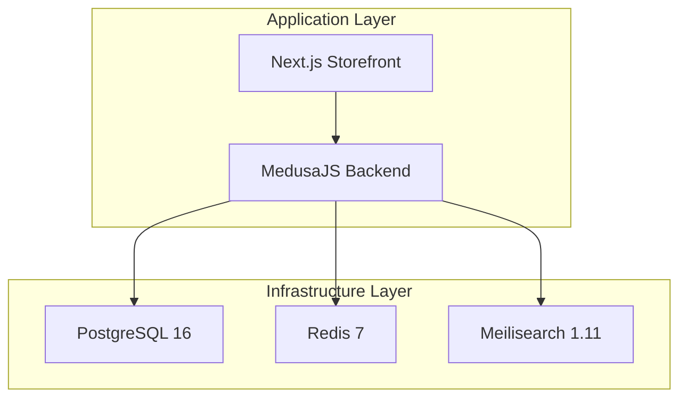
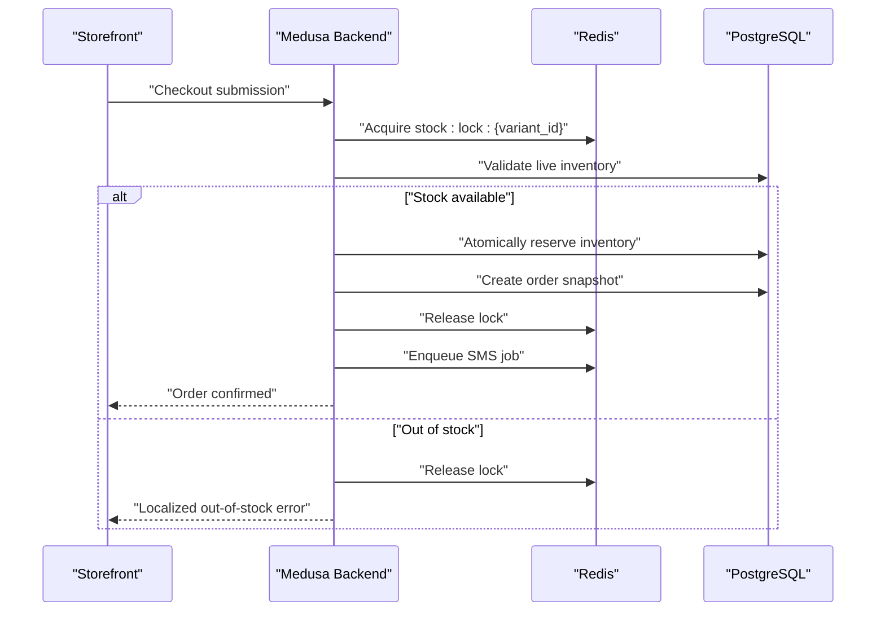
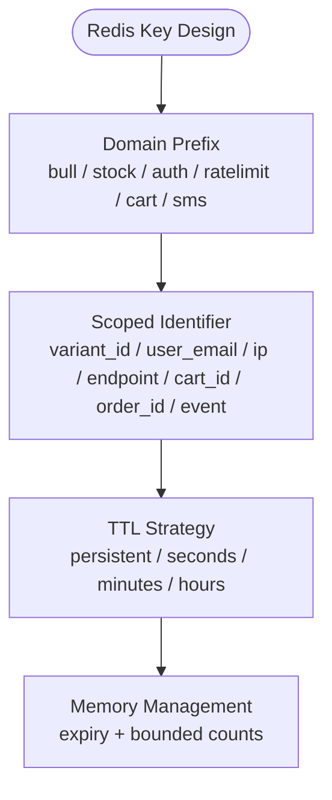
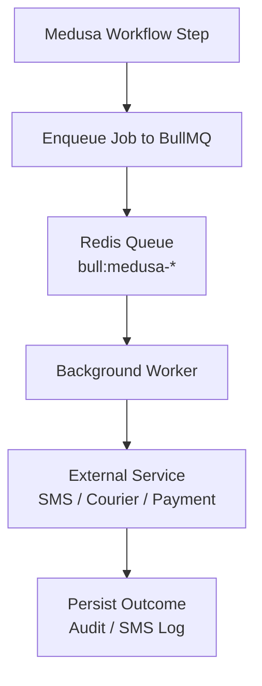
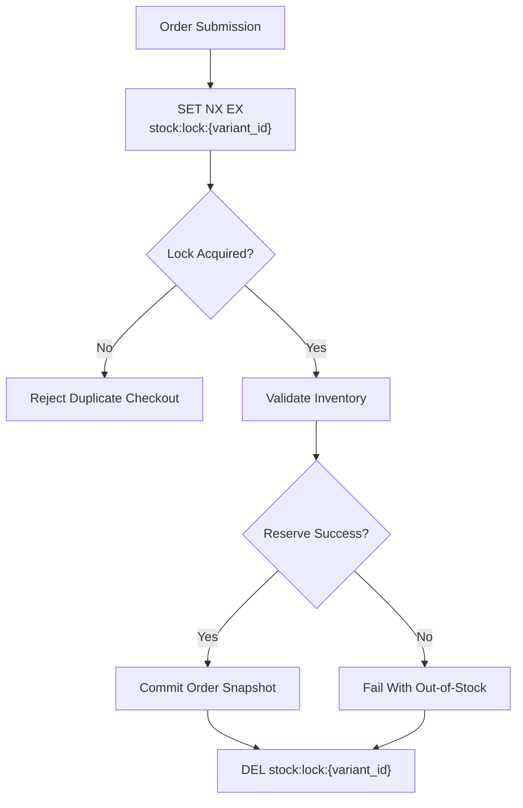
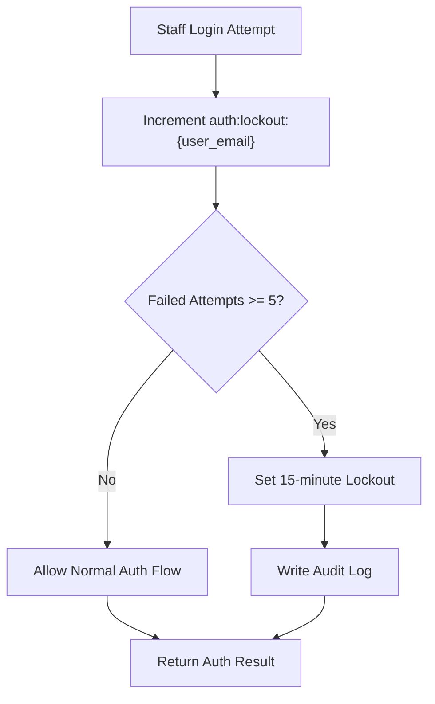
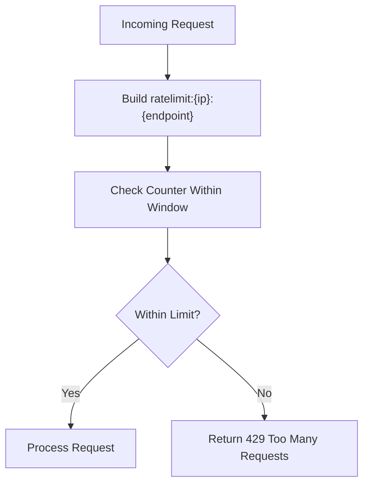
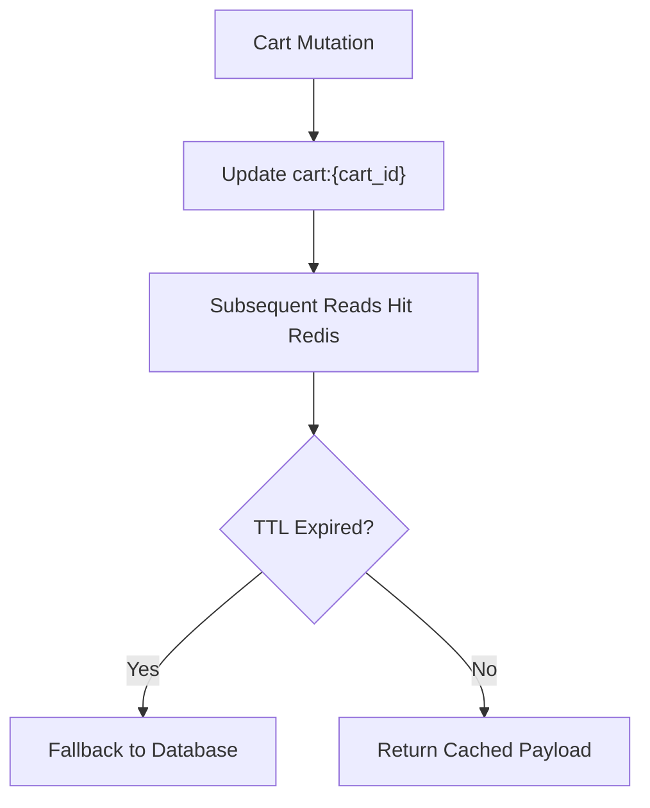
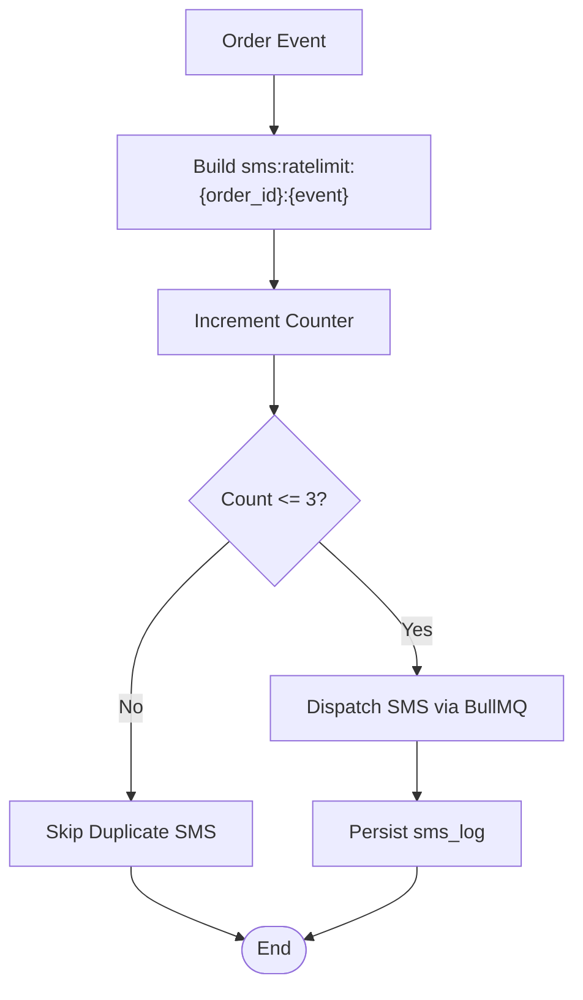
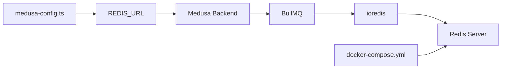

# Redis Caching Patterns & Concurrency Control

<cite>
**Referenced Files in This Document**   
- [architecture.md](file://docs/architecture.md)
- [dfd.md](file://dfd.md)
- [medusa-config.ts](file://apps/medusa/medusa-config.ts)
- [docker-compose.yml](file://docker-compose.yml)
- [package-lock.json](file://package-lock.json)
</cite>

## Table of Contents
1. [Introduction](#introduction)
2. [Project Structure](#project-structure)
3. [Core Components](#core-components)
4. [Architecture Overview](#architecture-overview)
5. [Detailed Component Analysis](#detailed-component-analysis)
6. [Dependency Analysis](#dependency-analysis)
7. [Performance Considerations](#performance-considerations)
8. [Troubleshooting Guide](#troubleshooting-guide)
9. [Conclusion](#conclusion)

## Introduction
This document explains how the BD Commerce Platform uses Redis for caching, distributed concurrency control, workflow queues, security lockouts, rate limiting, cart session caching, and SMS deduplication. It focuses on:
- Redis key patterns and naming conventions
- TTL strategies and memory management
- Concurrent checkout protection using distributed locks
- Atomic operations and lock acquisition/release patterns
- Error handling for Redis failures
- Monitoring approaches and common troubleshooting steps

The platform is a single-vendor e-commerce system built with MedusaJS v2, Next.js 15, PostgreSQL, Redis, and Meilisearch. Redis is used as the transient store for BullMQ workflows, stock locks, rate-limiting buckets, account lockout tracking, and session cache.

## Project Structure
Redis-related responsibilities are defined across architecture documentation, data flow diagrams, Medusa configuration, and Docker Compose:
- Architecture documentation defines the Redis key registry, concurrency rules, and rate-limiting policies.
- Data flow diagrams map Redis usage to checkout, order placement, SMS dispatch, and audit flows.
- Medusa configuration wires `REDIS_URL` into the backend.
- Docker Compose runs Redis 7 with optional password authentication and health checks.

**Diagram sources**
- [architecture.md:51-65](file://docs/architecture.md#L51-L65)
- [docker-compose.yml:1-44](file://docker-compose.yml#L1-L44)

**Section sources**
- [architecture.md:51-65](file://docs/architecture.md#L51-L65)
- [docker-compose.yml:22-44](file://docker-compose.yml#L22-L44)

## Core Components
The Redis subsystem supports six primary concerns:
- Workflow queues via BullMQ (`bull:medusa-*`)
- Distributed inventory locks (`stock:lock:{variant_id}`)
- Staff security lockouts (`auth:lockout:{user_email}`)
- Rate limiting (`ratelimit:{ip}:{endpoint}`, `ratelimit:track:{ip}`)
- Cart session caching (`cart:{cart_id}`)
- SMS deduplication (`sms:ratelimit:{order_id}:{event}`)

Key characteristics:
- Redis is configured through `REDIS_URL` in the Medusa backend.
- Docker Compose exposes Redis on port 6379 with optional password protection.
- BullMQ depends on ioredis; both are present in the dependency graph.

**Section sources**
- [architecture.md:402-432](file://docs/architecture.md#L402-L432)
- [dfd.md:75-83](file://dfd.md#L75-L83)
- [medusa-config.ts:7-18](file://apps/medusa/medusa-config.ts#L7-L18)
- [docker-compose.yml:22-44](file://docker-compose.yml#L22-L44)
- [package-lock.json:11191-11204](file://package-lock.json#L11191-L11204)
- [package-lock.json:13918-13938](file://package-lock.json#L13918-L13938)

## Architecture Overview
Redis acts as the coordination layer between concurrent processes:
- Checkout acquires short-lived distributed locks per variant.
- Order placement reserves inventory atomically inside Medusa’s inventory module.
- SMS dispatch is decoupled through BullMQ outbox queues.
- Security and abuse protections use Redis counters and expiry keys.

**Diagram sources**
- [architecture.md:416-418](file://docs/architecture.md#L416-L418)
- [dfd.md:331-394](file://dfd.md#L331-L394)

## Detailed Component Analysis

### Redis Key Registry and Naming Conventions
The platform documents a strict Redis key registry:

| Key Pattern | TTL | Role | Purpose |
|---|---|---|---|
| `bull:medusa-*` | Persistent | Workflow Queue | BullMQ job queue for Medusa Workflows |
| `stock:lock:{variant_id}` | 30s | Distributed Mutex | Atomic lock during concurrent checkout |
| `auth:lockout:{user_email}` | 15 min | Security | Staff account lockout after 5 failed logins |
| `ratelimit:{ip}:{endpoint}` | 60s | Token Bucket | Endpoint abuse protection |
| `ratelimit:track:{ip}` | 60s | Phone Privacy | Rate limit on order tracking lookups |
| `cart:{cart_id}` | 24h | Session Cache | Cached cart payload to reduce DB reads |
| `sms:ratelimit:{order_id}:{event}` | 1h | Deduplication | Max 3 SMS per order per event type |

Naming conventions:
- Domain prefix first (e.g., `bull`, `stock`, `auth`, `ratelimit`, `cart`, `sms`).
- Scoped identifiers follow (`{variant_id}`, `{user_email}`, `{ip}`, `{endpoint}`, `{cart_id}`, `{order_id}`, `{event}`).
- TTLs are explicit and purpose-driven: short for locks, medium for rate limits, long for sessions, persistent for queues.

**Diagram sources**
- [architecture.md:404-414](file://docs/architecture.md#L404-L414)

**Section sources**
- [architecture.md:404-414](file://docs/architecture.md#L404-L414)

### Workflow Queues: BullMQ (`bull:medusa-*`)
BullMQ provides durable background processing for Medusa workflows. The dependency graph shows BullMQ 5.x depending on ioredis, which connects to Redis.

Operational implications:
- Jobs are persisted in Redis until consumed.
- Workers process jobs asynchronously, decoupling slow external calls (SMS, courier APIs).
- Failed or retried jobs should be monitored because Redis is volatile unless explicitly backed up.

**Diagram sources**
- [package-lock.json:11191-11204](file://package-lock.json#L11191-L11204)
- [package-lock.json:13918-13938](file://package-lock.json#L13918-L13938)

**Section sources**
- [package-lock.json:11191-11204](file://package-lock.json#L11191-L11204)
- [package-lock.json:13918-13938](file://package-lock.json#L13918-L13938)

### Distributed Inventory Locks (`stock:lock:{variant_id}`)
Concurrent checkout protection prevents overselling by serializing stock evaluation for low-stock variants:
- Lock acquired strictly at order submission.
- Lock TTL is short to avoid deadlocks if a worker crashes.
- If inventory reaches zero, concurrent checkouts fail gracefully with localized messaging.

**Diagram sources**
- [architecture.md:416-418](file://docs/architecture.md#L416-L418)
- [dfd.md:362-371](file://dfd.md#L362-L371)

**Section sources**
- [architecture.md:416-418](file://docs/architecture.md#L416-L418)
- [dfd.md:362-371](file://dfd.md#L362-L371)

### Security Lockouts (`auth:lockout:{user_email}`)
Staff login security uses Redis to track consecutive failed attempts:
- After five failed attempts, the account is locked for 15 minutes across all IPs.
- Lockout events are recorded in the audit log.
- Session invalidation occurs when passwords change or roles are updated.

**Diagram sources**
- [architecture.md:375-380](file://docs/architecture.md#L375-L380)
- [architecture.md:409-410](file://docs/architecture.md#L409-L410)

**Section sources**
- [architecture.md:375-380](file://docs/architecture.md#L375-L380)
- [architecture.md:409-410](file://docs/architecture.md#L409-L410)

### Rate Limiting (`ratelimit:{ip}:{endpoint}`, `ratelimit:track:{ip}`)
Rate limiting protects endpoints from abuse:
- General endpoint rate limiting uses token-bucket style counters keyed by IP and endpoint.
- Order tracking lookups have stricter limits to protect phone privacy.
- Breaches return HTTP 429 responses.

**Diagram sources**
- [architecture.md:411-412](file://docs/architecture.md#L411-L412)
- [architecture.md:423-431](file://docs/architecture.md#L423-L431)

**Section sources**
- [architecture.md:411-412](file://docs/architecture.md#L411-L412)
- [architecture.md:423-431](file://docs/architecture.md#L423-L431)

### Cart Session Caching (`cart:{cart_id}`)
Cart payloads are cached to reduce database reads:
- Keys are scoped by cart ID.
- TTL is 24 hours, balancing freshness and performance.
- Cart mutations should invalidate or update the corresponding Redis entry.

**Diagram sources**
- [architecture.md:413-413](file://docs/architecture.md#L413-L413)

**Section sources**
- [architecture.md:413-413](file://docs/architecture.md#L413-L413)

### SMS Deduplication (`sms:ratelimit:{order_id}:{event}`)
SMS deduplication ensures no more than three messages per order per event type within one hour:
- The SMS outbox pattern decouples checkout from SMS gateway delivery.
- Redis tracks attempt counts and enforces hourly limits.
- All outbound SMS are logged with masked phone numbers.

**Diagram sources**
- [architecture.md:414-414](file://docs/architecture.md#L414-L414)
- [architecture.md:547-565](file://docs/architecture.md#L547-L565)

**Section sources**
- [architecture.md:414-414](file://docs/architecture.md#L414-L414)
- [architecture.md:547-565](file://docs/architecture.md#L547-L565)

## Dependency Analysis
Redis dependencies in this project include:
- Medusa backend configuration reading `REDIS_URL`.
- BullMQ for workflow queues.
- ioredis as the Redis client library.
- Docker Compose running Redis 7 with optional password authentication.

**Diagram sources**
- [medusa-config.ts:7-18](file://apps/medusa/medusa-config.ts#L7-L18)
- [package-lock.json:11191-11204](file://package-lock.json#L11191-L11204)
- [package-lock.json:13918-13938](file://package-lock.json#L13918-L13938)
- [docker-compose.yml:22-44](file://docker-compose.yml#L22-L44)

**Section sources**
- [medusa-config.ts:7-18](file://apps/medusa/medusa-config.ts#L7-L18)
- [package-lock.json:11191-11204](file://package-lock.json#L11191-L11204)
- [package-lock.json:13918-13938](file://package-lock.json#L13918-L13938)
- [docker-compose.yml:22-44](file://docker-compose.yml#L22-L44)

## Performance Considerations
- Use short TTLs for locks to prevent deadlocks under failure conditions.
- Keep rate-limit keys small and time-bound to avoid unbounded growth.
- Prefer atomic Redis commands where possible to reduce round trips.
- Monitor Redis memory usage and eviction policies; ensure sufficient capacity for queues and caches.
- Separate high-volume queues from sensitive lockout/rate-limit keys to reduce contention.

[No sources needed since this section provides general guidance]

## Troubleshooting Guide
Common Redis issues and recommended diagnostics:
- Connection timeouts:
  - Verify `REDIS_URL` is correctly set in environment variables.
  - Confirm Redis container is healthy via Docker healthcheck.
  - Check network connectivity and firewall rules.
- Authentication failures:
  - Ensure `REDIS_PASSWORD` is provided when required by Redis configuration.
  - Validate that the application passes credentials through `REDIS_URL`.
- Memory pressure:
  - Inspect Redis memory usage and key distribution.
  - Review TTL settings for long-lived keys like cart sessions.
  - Purge expired keys and consider Redis persistence strategy.
- Queue backlog:
  - Monitor BullMQ queue lengths and consumer lag.
  - Scale workers if jobs accumulate.
  - Investigate downstream service failures causing retries.

**Section sources**
- [medusa-config.ts:7-18](file://apps/medusa/medusa-config.ts#L7-L18)
- [docker-compose.yml:22-44](file://docker-compose.yml#L22-L44)

## Conclusion
The BD Commerce Platform uses Redis as a critical coordination layer for workflows, concurrency, security, rate limiting, session caching, and SMS deduplication. The documented key patterns, TTL strategies, and concurrency controls provide a clear foundation for reliable operation. Proper monitoring, error handling, and operational discipline around Redis will help maintain inventory integrity, protect against abuse, and keep the platform responsive under load.

[No sources needed since this section summarizes without analyzing specific files]