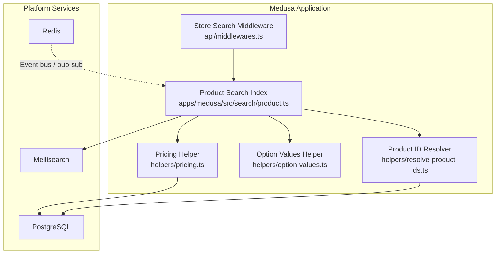
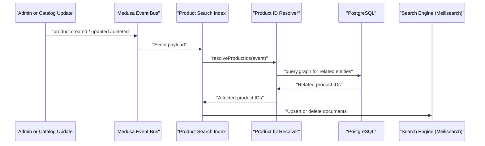
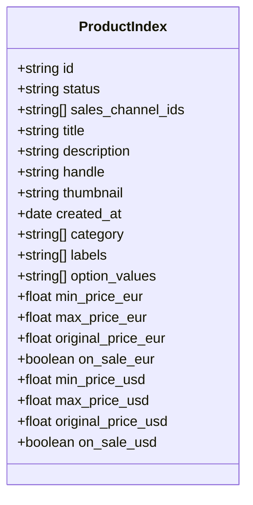
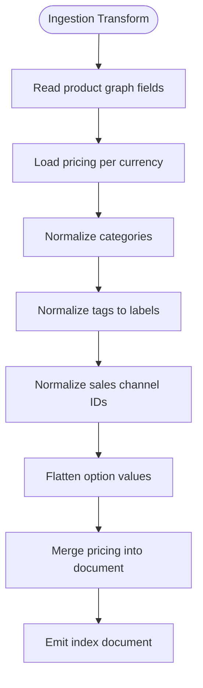
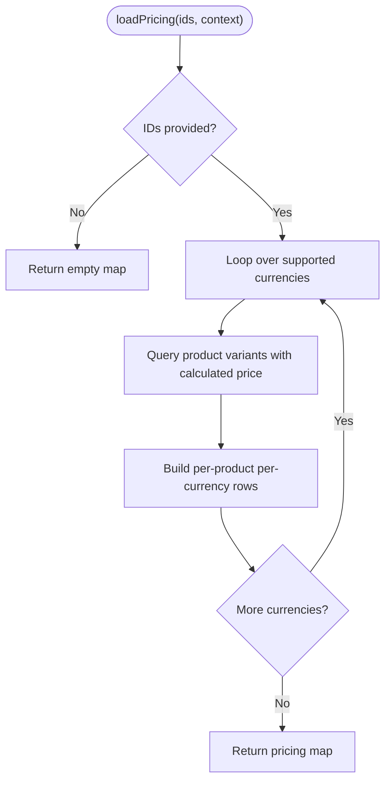
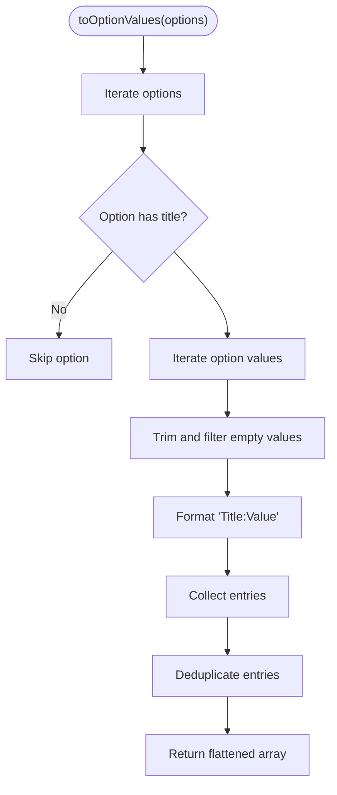
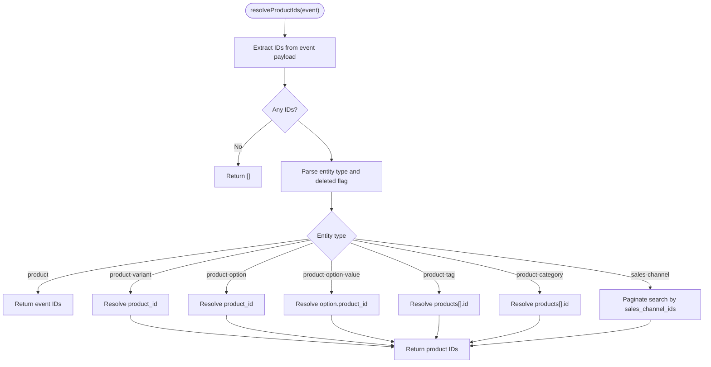
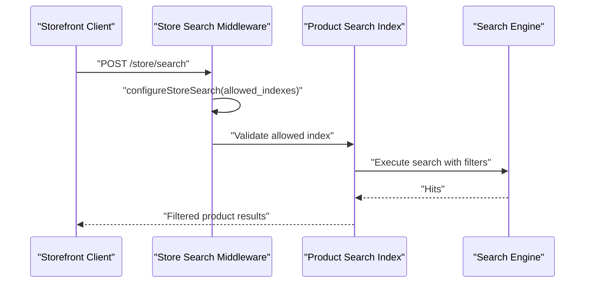
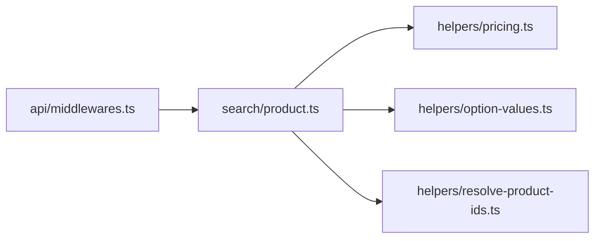

# Search Performance & Meilisearch Integration

<cite>
**Referenced Files in This Document**
- [product.ts](file://apps/medusa/src/search/product.ts)
- [pricing.ts](file://apps/medusa/src/search/helpers/pricing.ts)
- [option-values.ts](file://apps/medusa/src/search/helpers/option-values.ts)
- [resolve-product-ids.ts](file://apps/medusa/src/search/helpers/resolve-product-ids.ts)
- [middlewares.ts](file://apps/medusa/src/api/middlewares.ts)
- [docker-compose.yml](file://docker-compose.yml)
- [architecture-decision-medusa-v2.md](file://docs/architecture-decision-medusa-v2.md)
- [architecture.md](file://docs/architecture.md)
- [dfd.md](file://dfd.md)
</cite>

## Table of Contents
1. [Introduction](#introduction)
2. [Project Structure](#project-structure)
3. [Core Components](#core-components)
4. [Architecture Overview](#architecture-overview)
5. [Detailed Component Analysis](#detailed-component-analysis)
6. [Dependency Analysis](#dependency-analysis)
7. [Performance Considerations](#performance-considerations)
8. [Troubleshooting Guide](#troubleshooting-guide)
9. [Conclusion](#conclusion)
10. [Appendices](#appendices)

## Introduction
This document explains how the BD Commerce Platform indexes and searches products using Medusa’s search framework, which is designed to integrate with a search engine such as Meilisearch. The implementation focuses on:

- A product search index that defines fields, weights, filtering, faceting, sorting, and retrieval rules.
- Data protection through field allowlists and explicit retrievable flags.
- Event-driven synchronization between Medusa’s core catalog entities and the search index.
- Pricing resolution across multiple currencies for accurate filtering and faceting.
- Option value handling for scalable attribute-based search.
- Product ID resolution from related entity events.
- Query routing through a store search middleware that restricts allowed indexes and scopes results by sales channels and status.
- Operational guidance for index maintenance, reindexing, caching, and performance tuning for high-volume catalogs.

The repository also contains architectural documentation describing Meilisearch as part of the platform’s infrastructure and the intended data flow for search synchronization.

## Project Structure
The search-related code lives under the Medusa application workspace:

- `apps/medusa/src/search/product.ts` defines the product search index, its schema, ingestion source, event list, and graph-based consume and seed logic.
- `apps/medusa/src/search/helpers/` contains helper modules for pricing, option values, and product ID resolution.
- `apps/medusa/src/api/middlewares.ts` configures the `/store/search` route to allow only the product index and scope it appropriately.
- `docker-compose.yml` provisions PostgreSQL, Redis, and Meilisearch services used by the platform.
- Documentation files describe the broader architecture, including Meilisearch integration and search indexing strategy.

**Diagram sources**
- [product.ts:1-166](file://apps/medusa/src/search/product.ts#L1-L166)
- [pricing.ts:1-177](file://apps/medusa/src/search/helpers/pricing.ts#L1-L177)
- [option-values.ts:1-30](file://apps/medusa/src/search/helpers/option-values.ts#L1-L30)
- [resolve-product-ids.ts:1-142](file://apps/medusa/src/search/helpers/resolve-product-ids.ts#L1-L142)
- [middlewares.ts:1-19](file://apps/medusa/src/api/middlewares.ts#L1-L19)
- [docker-compose.yml:46-64](file://docker-compose.yml#L46-L64)

**Section sources**
- [product.ts:1-166](file://apps/medusa/src/search/product.ts#L1-L166)
- [middlewares.ts:1-19](file://apps/medusa/src/api/middlewares.ts#L1-L19)
- [docker-compose.yml:46-64](file://docker-compose.yml#L46-L64)

## Core Components
The search system is composed of four main components:

1. **Product Search Index Definition**
   - Defines searchable, filterable, sortable, facetable, and retrievable fields.
   - Includes title weighting, description text, handle, thumbnail, creation date, category, labels, and option values.
   - Spreads per-currency price fields into the index schema.
   - Uses typo tolerance settings.

2. **Ingestion Source and Document Builder**
   - Reads a controlled set of product graph fields.
   - Loads pricing for all product IDs in bulk.
   - Builds documents with normalized categories, labels, sales channel IDs, and flattened option values.
   - Integrates pricing data into each document.

3. **Event-Driven Sync Logic**
   - Subscribes to product, variant, option, tag, category, and sales-channel events.
   - Resolves affected product IDs from related entities.
   - Deletes documents when a product is deleted.

4. **Storefront Query Entry Point**
   - Exposes `/store/search`.
   - Restricts allowed indexes to `product`.
   - Uses index-defined filters such as `status` and `sales_channel_ids` to scope results.

**Section sources**
- [product.ts:43-68](file://apps/medusa/src/search/product.ts#L43-L68)
- [product.ts:70-118](file://apps/medusa/src/search/product.ts#L70-L118)
- [product.ts:131-165](file://apps/medusa/src/search/product.ts#L131-L165)
- [middlewares.ts:1-19](file://apps/medusa/src/api/middlewares.ts#L1-L19)

## Architecture Overview
The platform uses Medusa’s search framework to define an index and ingest product data. Meilisearch is provisioned as a service and referenced in project documentation as the intended search backend. The current codebase implements Medusa’s search index definition and ingestion pipeline; direct Meilisearch client configuration is not present in the analyzed files, but the operational design aligns with Meilisearch usage described in the repository’s architecture documentation.

**Diagram sources**
- [product.ts:131-165](file://apps/medusa/src/search/product.ts#L131-L165)
- [resolve-product-ids.ts:75-141](file://apps/medusa/src/search/helpers/resolve-product-ids.ts#L75-L141)
- [docker-compose.yml:46-64](file://docker-compose.yml#L46-L64)
- [architecture-decision-medusa-v2.md:45-46](file://docs/architecture-decision-medusa-v2.md#L45-L46)

**Section sources**
- [architecture-decision-medusa-v2.md:45-46](file://docs/architecture-decision-medusa-v2.md#L45-L46)
- [architecture.md:435-466](file://docs/architecture.md#L435-L466)
- [dfd.md:556-584](file://dfd.md#L556-L584)

## Detailed Component Analysis

### Product Search Index Schema and Field Allowlist
The product index defines a strict schema:

- **Identifiers and metadata**: `id`, `handle`, `thumbnail`, `created_at`.
- **Text search**: `title` with higher weight, `description` with lower weight.
- **Filtering and faceting**: `category`, `labels`, `option_values`, plus per-currency price fields.
- **Scoping fields**: `status` and `sales_channel_ids` are filterable but not returned to hits, preventing sensitive scoping data from leaking into search responses.
- **Typo tolerance**: Enabled for better user experience.

This design protects data by limiting what can be retrieved and filtered, while still enabling rich storefront search behavior.

**Diagram sources**
- [product.ts:43-68](file://apps/medusa/src/search/product.ts#L43-L68)
- [pricing.ts:54-80](file://apps/medusa/src/search/helpers/pricing.ts#L54-L80)

**Section sources**
- [product.ts:43-68](file://apps/medusa/src/search/product.ts#L43-L68)
- [product.ts:150-158](file://apps/medusa/src/search/product.ts#L150-L158)

### Ingestion Source and Document Transformation
The ingestion source reads a controlled set of product graph fields and transforms them into index documents:

- Categories are trimmed and filtered to non-empty names.
- Tags are trimmed and mapped to label strings.
- Sales channel IDs are trimmed and filtered.
- Option values are flattened into a single array of `"Title:Value"` entries.
- Pricing is loaded once per batch and merged into each document.

This approach reduces index complexity and keeps facet groups predictable.

**Diagram sources**
- [product.ts:105-118](file://apps/medusa/src/search/product.ts#L105-L118)
- [option-values.ts:11-29](file://apps/medusa/src/search/helpers/option-values.ts#L11-L29)
- [pricing.ts:148-176](file://apps/medusa/src/search/helpers/pricing.ts#L148-L176)

**Section sources**
- [product.ts:105-118](file://apps/medusa/src/search/product.ts#L105-L118)
- [option-values.ts:1-30](file://apps/medusa/src/search/helpers/option-values.ts#L1-L30)

### Pricing Resolution and Multi-Currency Fields
Pricing is resolved per currency using Medusa’s query context:

- Supported currencies are defined centrally.
- For each currency, the system queries variants’ calculated and original prices.
- It computes minimum, maximum, and original price fields.
- It marks whether a product is on sale based on cheapest variant comparison.
- Missing prices result in no price fields for that currency, allowing natural exclusion from price filters.

This design ensures consistent filtering and faceting across currencies without mixing unrelated variant prices.

**Diagram sources**
- [pricing.ts:148-176](file://apps/medusa/src/search/helpers/pricing.ts#L148-L176)
- [pricing.ts:89-142](file://apps/medusa/src/search/helpers/pricing.ts#L89-L142)

**Section sources**
- [pricing.ts:4-26](file://apps/medusa/src/search/helpers/pricing.ts#L4-L26)
- [pricing.ts:54-80](file://apps/medusa/src/search/helpers/pricing.ts#L54-L80)
- [pricing.ts:89-142](file://apps/medusa/src/search/helpers/pricing.ts#L89-L142)
- [pricing.ts:148-176](file://apps/medusa/src/search/helpers/pricing.ts#L148-L176)

### Option Value Handling
Option values are flattened into a simple string array:

- Each option contributes entries like `"Size:S"` or `"Color:Red"`.
- Empty titles or values are skipped.
- Duplicates are removed to avoid inflated facet counts.
- The storefront can split on the first colon to group facets by option name.

This keeps the index lightweight while preserving meaningful attribute search.

**Diagram sources**
- [option-values.ts:11-29](file://apps/medusa/src/search/helpers/option-values.ts#L11-L29)

**Section sources**
- [option-values.ts:1-30](file://apps/medusa/src/search/helpers/option-values.ts#L1-L30)

### Product ID Resolution from Events
The resolver maps events to affected product IDs:

- Direct product events return their IDs.
- Variant, option, option-value, tag, and category events resolve back to products via graph queries.
- Deleted related entities use soft-delete-aware queries so removals still trigger re-indexing.
- Sales channel deletions paginate through the search index to find linked products because links may no longer exist in the database after deletion.

**Diagram sources**
- [resolve-product-ids.ts:9-38](file://apps/medusa/src/search/helpers/resolve-product-ids.ts#L9-L38)
- [resolve-product-ids.ts:45-68](file://apps/medusa/src/search/helpers/resolve-product-ids.ts#L45-L68)
- [resolve-product-ids.ts:75-141](file://apps/medusa/src/search/helpers/resolve-product-ids.ts#L75-L141)

**Section sources**
- [resolve-product-ids.ts:1-142](file://apps/medusa/src/search/helpers/resolve-product-ids.ts#L1-L142)

### Storefront Search Query Routing
The `/store/search` endpoint is protected by a middleware that:

- Allows only the `product` index.
- Enables the index’s built-in filtering capabilities.
- Relies on index-defined fields like `status` and `sales_channel_ids` to scope results.

This prevents arbitrary index access and enforces security boundaries at the API layer.

**Diagram sources**
- [middlewares.ts:1-19](file://apps/medusa/src/api/middlewares.ts#L1-L19)
- [product.ts:43-68](file://apps/medusa/src/search/product.ts#L43-L68)

**Section sources**
- [middlewares.ts:1-19](file://apps/medusa/src/api/middlewares.ts#L1-L19)
- [product.ts:43-68](file://apps/medusa/src/search/product.ts#L43-L68)

## Dependency Analysis
The search module has clear internal dependencies:

- `product.ts` depends on helpers for pricing, option values, and product ID resolution.
- `pricing.ts` depends on Medusa’s query context and container to fetch priced variants.
- `resolve-product-ids.ts` depends on Medusa’s remote query function to traverse relationships.
- `middlewares.ts` depends on Medusa’s HTTP search configuration utilities.

**Diagram sources**
- [product.ts:1-11](file://apps/medusa/src/search/product.ts#L1-L11)
- [middlewares.ts:1-19](file://apps/medusa/src/api/middlewares.ts#L1-L19)

**Section sources**
- [product.ts:1-11](file://apps/medusa/src/search/product.ts#L1-L11)
- [middlewares.ts:1-19](file://apps/medusa/src/api/middlewares.ts#L1-L19)

## Performance Considerations
The following practices are implemented or recommended for high-volume product catalogs:

- **Controlled Graph Fields**: Only necessary fields are read during ingestion, reducing payload size and transformation cost.
- **Batched Pricing Queries**: Pricing is loaded per currency in parallel, minimizing round trips while keeping calculations per currency isolated.
- **Flat Option Values**: Flattening option values into a single array avoids nested structures and simplifies faceting.
- **Deduplication**: Option value deduplication prevents inflated facet cardinality.
- **Selective Retrieval**: Scoping fields like `status` and `sales_channel_ids` are filterable but not retrievable, reducing response size and exposure.
- **Event-Driven Updates**: Re-indexing is triggered by relevant catalog events rather than full scans.
- **Pagination for Sales Channel Deletions**: Large sales channel link sets are handled with pagination to avoid memory spikes.

Recommended additional optimizations:

- **Index Field Pruning**: Keep only fields needed for search, filtering, sorting, and faceting.
- **Facet Cardinality Limits**: Configure faceting limits to prevent expensive large-cardinality facets.
- **Query Caching**: Cache frequent storefront search queries using Redis where appropriate.
- **Background Reindexing**: Use background jobs for full reindex operations to avoid blocking request paths.
- **Typo Tolerance Tuning**: Adjust typo tolerance thresholds based on catalog language characteristics.
- **Sales Channel Scoping**: Ensure storefront requests include correct sales channel context to reduce result set size.

[No sources needed since this section provides general guidance]

## Troubleshooting Guide
Common issues and resolutions:

- **Missing Prices in Filters**
  - If a product lacks a price for a currency, no price fields are written for that currency, causing it to drop out of price filters and sorts.
  - Verify variant pricing exists for the target currency before expecting filter matches.

- **Soft-Delete Race Conditions**
  - Related entity deletions use soft-delete-aware queries to ensure products are still resolved for re-indexing.
  - Sales channel deletions paginate through the search index because links may no longer exist in the database.

- **Unauthorized Index Access**
  - The store search middleware restricts allowed indexes to `product`.
  - Requests attempting to access other indexes will be rejected by the middleware.

- **Stale Index Data**
  - Ensure catalog events are emitted for product, variant, option, tag, category, and sales channel changes.
  - Run a seed or full reindex if the index drifts from the database.

- **High Facet Cardinality**
  - Review option values and labels for excessive distinct values.
  - Consider grouping or limiting facets to maintain fast faceting performance.

**Section sources**
- [pricing.ts:89-142](file://apps/medusa/src/search/helpers/pricing.ts#L89-L142)
- [resolve-product-ids.ts:45-68](file://apps/medusa/src/search/helpers/resolve-product-ids.ts#L45-L68)
- [resolve-product-ids.ts:75-141](file://apps/medusa/src/search/helpers/resolve-product-ids.ts#L75-L141)
- [middlewares.ts:1-19](file://apps/medusa/src/api/middlewares.ts#L1-L19)

## Conclusion
The BD Commerce Platform’s search implementation centers on a well-scoped product index, careful field allowlists, multi-currency pricing resolution, and event-driven synchronization. The design balances performance and data protection by limiting retrievable fields, flattening complex option structures, and using controlled graph queries. While direct Meilisearch client configuration is not present in the analyzed files, the operational architecture and infrastructure provisioning align with Meilisearch integration as documented in the repository. For production-scale catalogs, focus on field pruning, facet limits, query caching, background reindexing, and robust event coverage to maintain fast, reliable search performance.

[No sources needed since this section summarizes without analyzing specific files]

## Appendices

### Index Maintenance and Reindexing Procedures
- **Seed-Based Reindexing**: Use the index’s seed function to rebuild the index from the database.
- **Event-Driven Updates**: Rely on catalog events to keep the index in sync with database changes.
- **Full Reindex Strategy**: Trigger a full reindex during deployments or major catalog migrations, preferably in a background job.
- **Validation**: Compare index document counts and sample fields against the database to verify consistency.

**Section sources**
- [product.ts:150-165](file://apps/medusa/src/search/product.ts#L150-L165)

### Relationship Between Medusa Catalog and Meilisearch Indexing
- Medusa’s search framework defines indexes and ingestion pipelines.
- Meilisearch is provisioned as a service and referenced in architecture documentation as the intended search backend.
- The current codebase implements Medusa’s index definition and event-driven ingestion; direct Meilisearch client wiring is outside the analyzed files.
- Architectural documentation describes the intended data flow, including allowlist filtering and document deletion strategies.

**Section sources**
- [architecture-decision-medusa-v2.md:45-46](file://docs/architecture-decision-medusa-v2.md#L45-L46)
- [architecture.md:435-466](file://docs/architecture.md#L435-L466)
- [dfd.md:556-584](file://dfd.md#L556-L584)