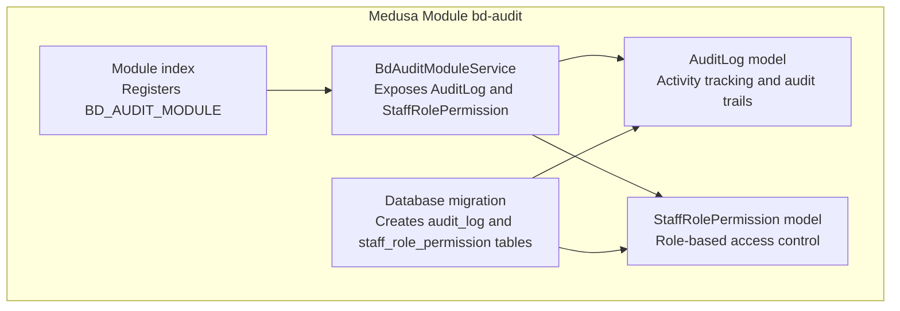
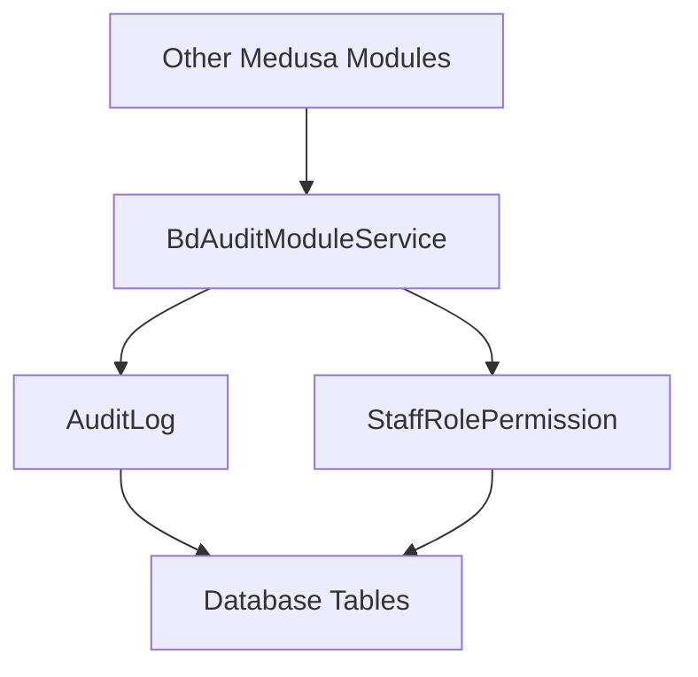
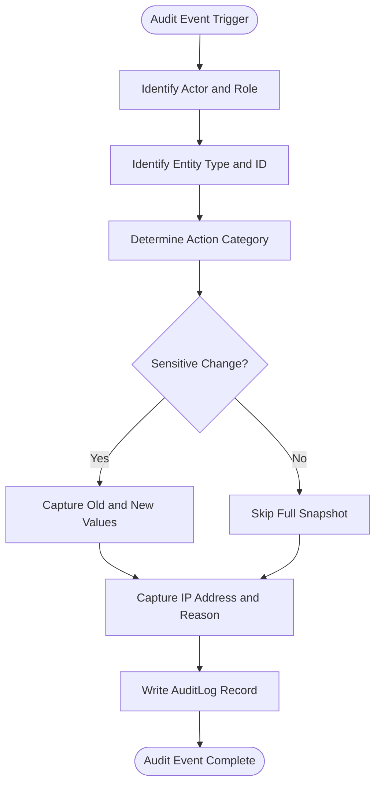
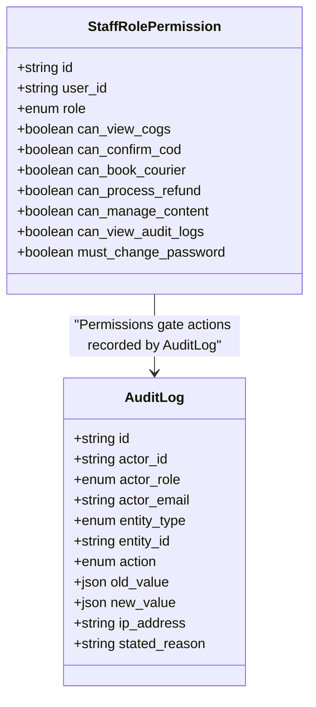
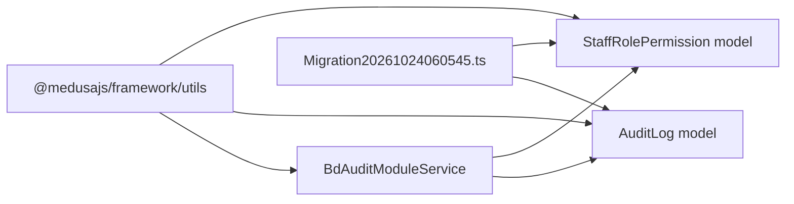

# Audit & Compliance Data Models

<cite>
**Referenced Files in This Document**
- [audit-log.ts](file://apps/medusa/src/modules/bd-audit/models/audit-log.ts)
- [staff-role-permission.ts](file://apps/medusa/src/modules/bd-audit/models/staff-role-permission.ts)
- [service.ts](file://apps/medusa/src/modules/bd-audit/service.ts)
- [index.ts](file://apps/medusa/src/modules/bd-audit/index.ts)
- [Migration20261024060545.ts](file://apps/medusa/src/modules/bd-audit/migrations/Migration20261024060545.ts)
- [.snapshot-bd-audit.json](file://apps/medusa/src/modules/bd-audit/migrations/.snapshot-bd-audit.json)
- [architecture.md](file://docs/architecture.md)
- [prompt.md](file://prompt.md)
</cite>

## Table of Contents
1. [Introduction](#introduction)
2. [Project Structure](#project-structure)
3. [Core Components](#core-components)
4. [Architecture Overview](#architecture-overview)
5. [Detailed Component Analysis](#detailed-component-analysis)
6. [Dependency Analysis](#dependency-analysis)
7. [Performance Considerations](#performance-considerations)
8. [Troubleshooting Guide](#troubleshooting-guide)
9. [Conclusion](#conclusion)

## Introduction
This document explains the audit and compliance data models for the platform, focusing on two core entities:

- **AuditLog**: A comprehensive activity-tracking model that records who performed what action against which business entity, including contextual details such as IP address and stated reason. It supports regulatory auditing, security investigations, and operational transparency.
- **StaffRolePermission**: A role-based access control (RBAC) model that stores per-user permissions and role flags used to enforce security policies, restrict sensitive operations, and maintain least-privilege access.

These models are part of the `bd-audit` Medusa module and provide the foundation for compliance reporting, security auditing, staff access management, and operational visibility across products, orders, inventory, payments, couriers, content, settings, and authentication events.

## Project Structure
The audit and compliance functionality is implemented inside a dedicated Medusa module under `apps/medusa/src/modules/bd-audit`. The relevant files include:

- Model definitions for `AuditLog` and `StaffRolePermission`
- A service class exposing both models through Medusa’s service layer
- Module registration
- Database migration and snapshot

**Diagram sources**
- [index.ts:1-9](file://apps/medusa/src/modules/bd-audit/index.ts#L1-L9)
- [service.ts:1-11](file://apps/medusa/src/modules/bd-audit/service.ts#L1-L11)
- [audit-log.ts:1-43](file://apps/medusa/src/modules/bd-audit/models/audit-log.ts#L1-L43)
- [staff-role-permission.ts:1-17](file://apps/medusa/src/modules/bd-audit/models/staff-role-permission.ts#L1-L17)
- [Migration20261024060545.ts:1-26](file://apps/medusa/src/modules/bd-audit/migrations/Migration20261024060545.ts#L1-L26)

**Section sources**
- [index.ts:1-9](file://apps/medusa/src/modules/bd-audit/index.ts#L1-L9)
- [service.ts:1-11](file://apps/medusa/src/modules/bd-audit/service.ts#L1-L11)
- [audit-log.ts:1-43](file://apps/medusa/src/modules/bd-audit/models/audit-log.ts#L1-L43)
- [staff-role-permission.ts:1-17](file://apps/medusa/src/modules/bd-audit/models/staff-role-permission.ts#L1-L17)
- [Migration20261024060545.ts:1-26](file://apps/medusa/src/modules/bd-audit/migrations/Migration20261024060545.ts#L1-L26)

## Core Components

### AuditLog
`AuditLog` captures immutable or append-only style audit events for system activities. It records:

- Who acted (`actor_id`, `actor_role`, `actor_email`)
- What was affected (`entity_type`, `entity_id`)
- What happened (`action`)
- Before-and-after state snapshots (`old_value`, `new_value`)
- Security context (`ip_address`)
- Optional human justification (`stated_reason`)

Supported entity types include product-related data, inventory, orders, returns/refunds, courier consignments, staff users, settings, content pages, and authentication/security events. Supported actions include create, update, delete, status transitions, refund recording, restocking, quarantine, consignment booking/cancellation, failed login, account lockout, and password reset.

This design enables:

- Regulatory compliance by preserving detailed change history
- Security auditing by capturing authentication failures and lockouts
- Operational transparency by linking changes to actors, roles, and reasons
- Forensic analysis using IP addresses and JSON snapshots

**Section sources**
- [audit-log.ts:3-40](file://apps/medusa/src/modules/bd-audit/models/audit-log.ts#L3-L40)
- [Migration20261024060545.ts:7-12](file://apps/medusa/src/modules/bd-audit/migrations/Migration20261024060545.ts#L7-L12)

### StaffRolePermission
`StaffRolePermission` stores per-user RBAC configuration. Each user has one permission record identified by `user_id`. It includes:

- Role assignment (`role`)
- Feature-level boolean permissions such as viewing COGS, confirming COD, booking couriers, processing refunds, managing content, and viewing audit logs
- Security policy flag `must_change_password`

The default role is `staff`, and most feature permissions default to disabled, supporting a least-privilege baseline.

This model supports:

- Fine-grained access control beyond coarse roles
- Security enforcement for sensitive operations like refunds, COGS visibility, and audit log access
- Password policy enforcement via the mandatory-change flag
- Alignment with the broader RBAC matrix defined in project documentation

**Section sources**
- [staff-role-permission.ts:3-14](file://apps/medusa/src/modules/bd-audit/models/staff-role-permission.ts#L3-L14)
- [Migration20261024060545.ts:14-16](file://apps/medusa/src/modules/bd-audit/migrations/Migration20261024060545.ts#L14-L16)
- [architecture.md:384-399](file://docs/architecture.md#L384-L399)

### BdAuditModuleService and Module Registration
`BdAuditModuleService` extends Medusa’s service base and exposes both `AuditLog` and `StaffRolePermission`. The module index registers the `BD_AUDIT_MODULE` with this service, making the models available through Medusa’s dependency injection and service layer.

This structure keeps audit and compliance logic encapsulated within a single module while allowing other modules to consume these models through standard Medusa services.

**Section sources**
- [service.ts:1-11](file://apps/medusa/src/modules/bd-audit/service.ts#L1-L11)
- [index.ts:1-9](file://apps/medusa/src/modules/bd-audit/index.ts#L1-L9)

## Architecture Overview
The audit and compliance architecture follows a Medusa module pattern:

- Models define database schema and constraints
- Migration ensures consistent database state
- Service exposes models to the application
- Other modules can write audit events and read permission metadata through the service

**Diagram sources**
- [service.ts:1-11](file://apps/medusa/src/modules/bd-audit/service.ts#L1-L11)
- [audit-log.ts:1-43](file://apps/medusa/src/modules/bd-audit/models/audit-log.ts#L1-L43)
- [staff-role-permission.ts:1-17](file://apps/medusa/src/modules/bd-audit/models/staff-role-permission.ts#L1-L17)
- [Migration20261024060545.ts:1-26](file://apps/medusa/src/modules/bd-audit/migrations/Migration20261024060545.ts#L1-L26)

## Detailed Component Analysis

### AuditLog Data Model
`AuditLog` is designed for high-volume, queryable audit trails. Its fields support filtering and reporting by actor, entity, and action.

#### Entity Definition
| Field | Type / Constraint | Purpose |
|---|---|---|
| `id` | Primary key | Unique audit event identifier |
| `actor_id` | Indexed text | Identifier of the user or system actor |
| `actor_role` | Enum | Role of the actor at time of action |
| `actor_email` | Nullable text | Human-readable identity when available |
| `entity_type` | Indexed enum | Business domain of the affected resource |
| `entity_id` | Indexed text | Identifier of the affected resource |
| `action` | Indexed enum | Type of operation or security event |
| `old_value` | Nullable JSON | State before the change |
| `new_value` | Nullable JSON | State after the change |
| `ip_address` | Nullable text | Network context for security auditing |
| `stated_reason` | Nullable text | Optional justification for sensitive actions |

#### Key Design Characteristics
- **Actor-centric auditing**: Every event identifies who performed it and their role.
- **Entity-centric tracing**: Events are grouped by entity type and ID for impact analysis.
- **Action taxonomy**: Actions cover business operations and security-sensitive events.
- **State diffing**: JSON snapshots enable before/after comparisons without storing full history tables.
- **Security context**: IP address and optional reason improve forensic capability.
- **Soft deletion support**: The migration adds a `deleted_at` column and indexes filtered by soft-delete semantics.

#### Audit Trail Patterns
Recommended patterns for using `AuditLog`:

1. **Create/update/delete trails**: Record old and new values for critical entities such as orders, inventory, pricing, and settings.
2. **Status transition trails**: Capture order, return, and consignment lifecycle changes.
3. **Financial controls**: Log refund recording and related financial adjustments.
4. **Operational controls**: Log restocking, quarantine, courier booking, and cancellation.
5. **Security events**: Log failed login, account lockout, and password reset attempts.
6. **Compliance justification**: Require `stated_reason` for high-risk actions such as refunds, settings changes, or staff permission updates.

**Diagram sources**
- [audit-log.ts:3-40](file://apps/medusa/src/modules/bd-audit/models/audit-log.ts#L3-L40)
- [Migration20261024060545.ts:7-12](file://apps/medusa/src/modules/bd-audit/migrations/Migration20261024060545.ts#L7-L12)

**Section sources**
- [audit-log.ts:3-40](file://apps/medusa/src/modules/bd-audit/models/audit-log.ts#L3-L40)
- [Migration20261024060545.ts:7-12](file://apps/medusa/src/modules/bd-audit/migrations/Migration20261024060545.ts#L7-L12)

### StaffRolePermission Data Model
`StaffRolePermission` provides per-user permission configuration aligned with operational roles.

#### Entity Definition
| Field | Type / Default | Purpose |
|---|---|---|
| `id` | Primary key | Unique permission record identifier |
| `user_id` | Unique text | Links permissions to a specific staff user |
| `role` | Enum, default `staff` | Coarse-grained role assignment |
| `can_view_cogs` | Boolean, default false | Controls access to cost-of-goods information |
| `can_confirm_cod` | Boolean, default false | Controls confirmation of cash-on-delivery orders |
| `can_book_courier` | Boolean, default false | Controls courier booking operations |
| `can_process_refund` | Boolean, default false | Controls refund processing authority |
| `can_manage_content` | Boolean, default false | Controls content page management |
| `can_view_audit_logs` | Boolean, default false | Controls access to audit log viewer |
| `must_change_password` | Boolean, default true | Enforces initial password change policy |

#### Permission Hierarchy and Policy Alignment
The model supports a flexible permission hierarchy:

- **Owner**: Typically full business access, including finance and system configuration.
- **Manager**: Daily operations such as orders, catalog, inventory, and marketing; restricted from highly sensitive areas unless explicitly granted.
- **Finance**: Access to COGS, refunds, and financial reporting where permitted.
- **Warehouse**: Operational logistics such as courier booking and receiving.
- **Call Center**: Order confirmation and customer-facing workflows.
- **Staff**: Minimal operational access by default.

The RBAC matrix in the project architecture documents expected access patterns for features such as catalog, pricing, COGS, orders, courier dispatch, returns/refunds, audit logs, content, invoices, and system settings.

**Diagram sources**
- [staff-role-permission.ts:3-14](file://apps/medusa/src/modules/bd-audit/models/staff-role-permission.ts#L3-L14)
- [audit-log.ts:3-40](file://apps/medusa/src/modules/bd-audit/models/audit-log.ts#L3-L40)

**Section sources**
- [staff-role-permission.ts:3-14](file://apps/medusa/src/modules/bd-audit/models/staff-role-permission.ts#L3-L14)
- [Migration20261024060545.ts:14-16](file://apps/medusa/src/modules/bd-audit/migrations/Migration20261024060545.ts#L14-L16)
- [architecture.md:384-399](file://docs/architecture.md#L384-L399)

### Compliance and Security Implications
The two models together support several compliance and security requirements:

- **Regulatory compliance**: Audit trails preserve who changed what and why, enabling audits and investigations.
- **Security auditing**: Authentication failures, lockouts, and password resets are captured as security events.
- **Least privilege access**: Permissions default to restrictive values and require explicit grants.
- **Dual-control readiness**: Sensitive financial actions such as refunds can be gated by permissions and justified through audit reasons.
- **Password policy enforcement**: The mandatory password change flag supports secure onboarding and credential rotation.
- **Reporting foundation**: Indexed fields and structured enums make compliance reports efficient to generate.

The project’s prompt documentation also outlines broader RBAC expectations, including server-enforced authorization, session invalidation on role changes, rate limiting, and avoiding UI-only restrictions.

**Section sources**
- [audit-log.ts:22-39](file://apps/medusa/src/modules/bd-audit/models/audit-log.ts#L22-L39)
- [staff-role-permission.ts:6-13](file://apps/medusa/src/modules/bd-audit/models/staff-role-permission.ts#L6-L13)
- [prompt.md:550-598](file://prompt.md#L550-L598)

## Dependency Analysis
The `bd-audit` module depends on Medusa’s framework utilities for modeling and service generation. The service aggregates both models, and the migration defines the actual database schema.

**Diagram sources**
- [service.ts:1-11](file://apps/medusa/src/modules/bd-audit/service.ts#L1-L11)
- [audit-log.ts:1-43](file://apps/medusa/src/modules/bd-audit/models/audit-log.ts#L1-L43)
- [staff-role-permission.ts:1-17](file://apps/medusa/src/modules/bd-audit/models/staff-role-permission.ts#L1-L17)
- [Migration20261024060545.ts:1-26](file://apps/medusa/src/modules/bd-audit/migrations/Migration20261024060545.ts#L1-L26)

**Section sources**
- [service.ts:1-11](file://apps/medusa/src/modules/bd-audit/service.ts#L1-L11)
- [Migration20261024060545.ts:1-26](file://apps/medusa/src/modules/bd-audit/migrations/Migration20261024060545.ts#L1-L26)

## Performance Considerations
The audit model uses indexed columns for frequently queried attributes:

- `actor_id`
- `entity_type`
- `entity_id`
- `action`
- `deleted_at`

These indexes support common compliance queries such as:

- All actions by a specific actor
- Changes to a specific entity
- Actions by type for reporting
- Soft-deleted audit records

Recommendations:

- Avoid logging extremely large JSON payloads in `old_value` and `new_value`; store only necessary diffs.
- Use targeted audit writers rather than logging every minor field change.
- Partition or archive historical audit logs if volume grows significantly.
- Ensure audit writes do not block critical business transactions; consider asynchronous logging where appropriate.

**Section sources**
- [audit-log.ts:5-39](file://apps/medusa/src/modules/bd-audit/models/audit-log.ts#L5-L39)
- [Migration20261024060545.ts:8-12](file://apps/medusa/src/modules/bd-audit/migrations/Migration20261024060545.ts#L8-L12)

## Troubleshooting Guide

### Common Issues and Resolutions

| Issue | Likely Cause | Resolution |
|---|---|---|
| Audit events missing | Audit writer not invoked for the operation | Ensure the relevant workflow calls the audit service for create, update, delete, status transitions, and security events. |
| Cannot view audit logs | Missing `can_view_audit_logs` permission | Grant the permission in `StaffRolePermission` for the required role or user. |
| Refund action blocked | Missing `can_process_refund` permission | Enable the permission according to the RBAC matrix and compliance policy. |
| User cannot access COGS data | `can_view_cogs` is false | Grant COGS visibility only to authorized roles such as owner or finance. |
| Migration fails due to unique constraint | Previous schema had a different unique constraint setup | Run the provided migration, which drops the prior unique constraint and recreates the table structure. |
| Audit queries are slow | Missing or insufficient indexes | Verify that actor, entity, action, and deleted-at indexes exist as defined in the migration. |

**Section sources**
- [staff-role-permission.ts:6-13](file://apps/medusa/src/modules/bd-audit/models/staff-role-permission.ts#L6-L13)
- [Migration20261024060545.ts:6-16](file://apps/medusa/src/modules/bd-audit/migrations/Migration20261024060545.ts#L6-L16)

## Conclusion
The `AuditLog` and `StaffRolePermission` models form the foundation of the platform’s audit and compliance capabilities. `AuditLog` provides detailed, queryable audit trails for business and security events, while `StaffRolePermission` enforces least-privilege access and aligns with the documented RBAC matrix. Together, they support regulatory compliance, security auditing, staff access control, and operational transparency. Proper usage requires intentional audit writing, explicit permission grants, and careful handling of sensitive data in audit snapshots.