# Business-Specific Data Models

<cite>
**Referenced Files in This Document**
- [product-localization.ts](file://apps/medusa/src/modules/bd-catalog/models/product-localization.ts)
- [product-variant-cost.ts](file://apps/medusa/src/modules/bd-catalog/models/product-variant-cost.ts)
- [order-bd-details.ts](file://apps/medusa/src/modules/bd-orders/models/order-bd-details.ts)
- [customer-risk-profile.ts](file://apps/medusa/src/modules/bd-orders/models/customer-risk-profile.ts)
- [order-return-request.ts](file://apps/medusa/src/modules/bd-orders/models/order-return-request.ts)
- [payment-transaction.ts](file://apps/medusa/src/modules/bd-payments/models/payment-transaction.ts)
- [courier-shipment-log.ts](file://apps/medusa/src/modules/bd-courier/models/courier-shipment-log.ts)
- [delivery-zone-config.ts](file://apps/medusa/src/modules/bd-settings/models/delivery-zone-config.ts)
- [vat-config.ts](file://apps/medusa/src/modules/bd-settings/models/vat-config.ts)
- [audit-log.ts](file://apps/medusa/src/modules/bd-audit/models/audit-log.ts)
- [staff-role-permission.ts](file://apps/medusa/src/modules/bd-audit/models/staff-role-permission.ts)
- [product-localization.ts](file://apps/medusa/src/links/product-localization.ts)
- [product-variant-cost.ts](file://apps/medusa/src/links/product-variant-cost.ts)
- [order-bd-details.ts](file://apps/medusa/src/links/order-bd-details.ts)
- [order-return-request.ts](file://apps/medusa/src/links/order-return-request.ts)
- [index.ts](file://apps/medusa/src/modules/bd-catalog/index.ts)
- [index.ts](file://apps/medusa/src/modules/bd-orders/index.ts)
- [index.ts](file://apps/medusa/src/modules/bd-payments/index.ts)
- [index.ts](file://apps/medusa/src/modules/bd-courier/index.ts)
- [index.ts](file://apps/medusa/src/modules/bd-settings/index.ts)
- [index.ts](file://apps/medusa/src/modules/bd-audit/index.ts)
</cite>

## Table of Contents
1. [Introduction](#introduction)
2. [Project Structure](#project-structure)
3. [Core Components](#core-components)
4. [Architecture Overview](#architecture-overview)
5. [Detailed Component Analysis](#detailed-component-analysis)
6. [Dependency Analysis](#dependency-analysis)
7. [Performance Considerations](#performance-considerations)
8. [Troubleshooting Guide](#troubleshooting-guide)
9. [Conclusion](#conclusion)

## Introduction
This document explains Bangladesh-specific business data models implemented as Medusa modules and links. It covers custom entities that extend Medusa’s core product, order, payment, courier, settings, and audit capabilities to support:
- Local payment methods (bKash, Nagad) alongside Cash on Delivery
- Delivery zones across 64 districts with zone-based shipping rules
- Multi-language content for products (English and Bengali)
- Compliance and operational controls including VAT configuration, audit logging, and staff role permissions

The models are organized into feature modules (catalog, orders, payments, courier, settings, audit) and linked to Medusa core tables via link files.

## Project Structure
The relevant code is organized by domain modules under apps/medusa/src/modules, with model definitions per module and link files under apps/medusa/src/links that connect Medusa core entities to the custom models.

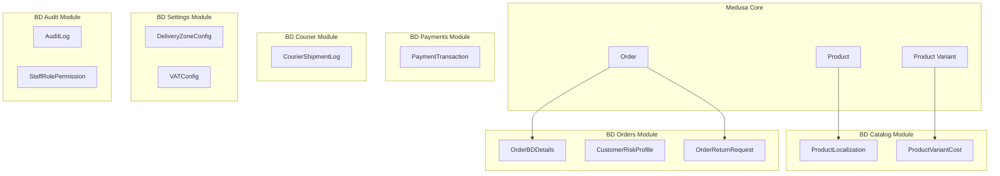

**Diagram sources**
- [product-localization.ts](file://apps/medusa/src/modules/bd-catalog/models/product-localization.ts)
- [product-variant-cost.ts](file://apps/medusa/src/modules/bd-catalog/models/product-variant-cost.ts)
- [order-bd-details.ts](file://apps/medusa/src/modules/bd-orders/models/order-bd-details.ts)
- [customer-risk-profile.ts](file://apps/medusa/src/modules/bd-orders/models/customer-risk-profile.ts)
- [order-return-request.ts](file://apps/medusa/src/modules/bd-orders/models/order-return-request.ts)
- [payment-transaction.ts](file://apps/medusa/src/modules/bd-payments/models/payment-transaction.ts)
- [courier-shipment-log.ts](file://apps/medusa/src/modules/bd-courier/models/courier-shipment-log.ts)
- [delivery-zone-config.ts](file://apps/medusa/src/modules/bd-settings/models/delivery-zone-config.ts)
- [vat-config.ts](file://apps/medusa/src/modules/bd-settings/models/vat-config.ts)
- [audit-log.ts](file://apps/medusa/src/modules/bd-audit/models/audit-log.ts)
- [staff-role-permission.ts](file://apps/medusa/src/modules/bd-audit/models/staff-role-permission.ts)
- [product-localization.ts](file://apps/medusa/src/links/product-localization.ts)
- [product-variant-cost.ts](file://apps/medusa/src/links/product-variant-cost.ts)
- [order-bd-details.ts](file://apps/medusa/src/links/order-bd-details.ts)
- [order-return-request.ts](file://apps/medusa/src/links/order-return-request.ts)

**Section sources**
- [index.ts](file://apps/medusa/src/modules/bd-catalog/index.ts)
- [index.ts](file://apps/medusa/src/modules/bd-orders/index.ts)
- [index.ts](file://apps/medusa/src/modules/bd-payments/index.ts)
- [index.ts](file://apps/medusa/src/modules/bd-courier/index.ts)
- [index.ts](file://apps/medusa/src/modules/bd-settings/index.ts)
- [index.ts](file://apps/medusa/src/modules/bd-audit/index.ts)

## Core Components
This section summarizes each custom entity and its business purpose within the Bangladesh commerce context.

- ProductLocalization
  - Purpose: Stores Bengali product content (title, subtitle, description, excerpt, material, care instructions, origin country, handle, meta fields) and a bilingual completeness flag.
  - Integration: Linked to Medusa Product via link file.

- ProductVariantCost
  - Purpose: Tracks cost-of-goods, packaging cost, estimated shipping cost, supplier details, and minimum margin percent per variant.
  - Integration: Linked to Medusa Product Variant via link file.

- OrderBDDetails
  - Purpose: Captures Bangladesh-specific order fulfillment metadata including administrative divisions, delivery zone, COD lifecycle, courier provider and tracking, delivery fees, COGS totals, and marketing attribution.
  - Integration: Linked to Medusa Order via link file.

- CustomerRiskProfile
  - Purpose: Aggregates customer risk signals such as order counts, RTO rate, delivery success rate, fraud flags, and notes.

- OrderReturnRequest
  - Purpose: Manages return workflows with status, reason, condition, refund method (including bKash/Nagad), target account, amount, and audit fields.
  - Integration: Linked to Medusa Order via link file.

- PaymentTransaction
  - Purpose: Records gateway interactions for local providers (bKash, Nagad) and COD, including transaction type, amounts, currency, gateway IDs/statuses, server-to-server verification flag, and raw response payload.

- CourierShipmentLog
  - Purpose: Logs courier API calls and responses for shipment operations, including action, payloads, status codes, and errors.

- DeliveryZoneConfig
  - Purpose: Defines delivery zones (inside Dhaka, Dhaka suburbs, outside Dhaka) with flat rates, free shipping thresholds, delivery windows, active flags, and coverage districts JSON.

- VATConfig
  - Purpose: Centralizes VAT enablement, rate, registration number, invoice display preference, and pricing behavior (prices include VAT).

- AuditLog
  - Purpose: Immutable log of actor actions across entities (products, variants, inventory, orders, returns, couriers, staff, settings, content, auth/security), capturing old/new values, IP, and reasons.

- StaffRolePermission
  - Purpose: Role-based access control for staff users, controlling visibility and actions like viewing COGS, confirming COD, booking courier, processing refunds, managing content, and viewing audit logs.

**Section sources**
- [product-localization.ts](file://apps/medusa/src/modules/bd-catalog/models/product-localization.ts)
- [product-variant-cost.ts](file://apps/medusa/src/modules/bd-catalog/models/product-variant-cost.ts)
- [order-bd-details.ts](file://apps/medusa/src/modules/bd-orders/models/order-bd-details.ts)
- [customer-risk-profile.ts](file://apps/medusa/src/modules/bd-orders/models/customer-risk-profile.ts)
- [order-return-request.ts](file://apps/medusa/src/modules/bd-orders/models/order-return-request.ts)
- [payment-transaction.ts](file://apps/medusa/src/modules/bd-payments/models/payment-transaction.ts)
- [courier-shipment-log.ts](file://apps/medusa/src/modules/bd-courier/models/courier-shipment-log.ts)
- [delivery-zone-config.ts](file://apps/medusa/src/modules/bd-settings/models/delivery-zone-config.ts)
- [vat-config.ts](file://apps/medusa/src/modules/bd-settings/models/vat-config.ts)
- [audit-log.ts](file://apps/medusa/src/modules/bd-audit/models/audit-log.ts)
- [staff-role-permission.ts](file://apps/medusa/src/modules/bd-audit/models/staff-role-permission.ts)

## Architecture Overview
The architecture extends Medusa core through modular services and explicit links. Custom models live in their respective modules and are connected to core entities using link files.

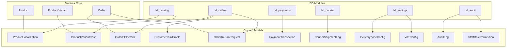

**Diagram sources**
- [product-localization.ts](file://apps/medusa/src/links/product-localization.ts)
- [product-variant-cost.ts](file://apps/medusa/src/links/product-variant-cost.ts)
- [order-bd-details.ts](file://apps/medusa/src/links/order-bd-details.ts)
- [order-return-request.ts](file://apps/medusa/src/links/order-return-request.ts)
- [index.ts](file://apps/medusa/src/modules/bd-catalog/index.ts)
- [index.ts](file://apps/medusa/src/modules/bd-orders/index.ts)
- [index.ts](file://apps/medusa/src/modules/bd-payments/index.ts)
- [index.ts](file://apps/medusa/src/modules/bd-courier/index.ts)
- [index.ts](file://apps/medusa/src/modules/bd-settings/index.ts)
- [index.ts](file://apps/medusa/src/modules/bd-audit/index.ts)

## Detailed Component Analysis

### ProductLocalization
- Extends product catalog with Bengali content fields and bilingual completeness tracking.
- Supports searchability on key fields to improve storefront filtering and discovery.
- Linked to Medusa Product to keep localized content aligned with canonical product records.

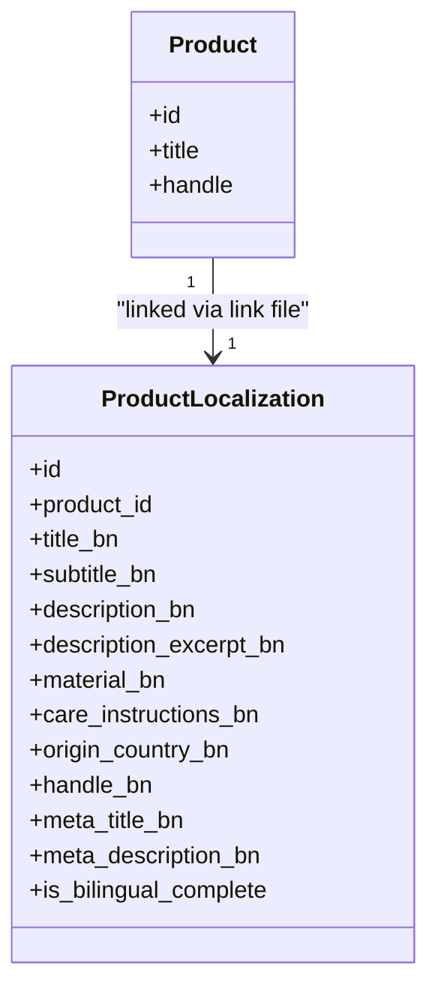

**Diagram sources**
- [product-localization.ts](file://apps/medusa/src/modules/bd-catalog/models/product-localization.ts)
- [product-localization.ts](file://apps/medusa/src/links/product-localization.ts)

**Section sources**
- [product-localization.ts](file://apps/medusa/src/modules/bd-catalog/models/product-localization.ts)
- [product-localization.ts](file://apps/medusa/src/links/product-localization.ts)

### ProductVariantCost
- Associates cost and margin data with product variants to support profitability analysis and pricing guardrails.
- Includes supplier identifiers and estimated logistics costs to aid in COGS calculation.

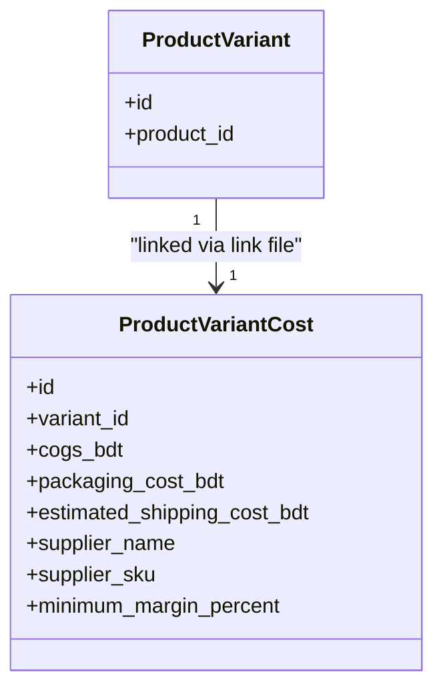

**Diagram sources**
- [product-variant-cost.ts](file://apps/medusa/src/modules/bd-catalog/models/product-variant-cost.ts)
- [product-variant-cost.ts](file://apps/medusa/src/links/product-variant-cost.ts)

**Section sources**
- [product-variant-cost.ts](file://apps/medusa/src/modules/bd-catalog/models/product-variant-cost.ts)
- [product-variant-cost.ts](file://apps/medusa/src/links/product-variant-cost.ts)

### OrderBDDetails
- Captures Bangladesh-specific fulfillment details: division/district/thana, area/street, delivery zone, COD workflow states, call attempts, courier provider and tracking, delivery fees, COGS totals, and marketing UTM fields.
- Enables operational dashboards for COD confirmation, dispatch, transit, delivery, RTO handling, and settlement.

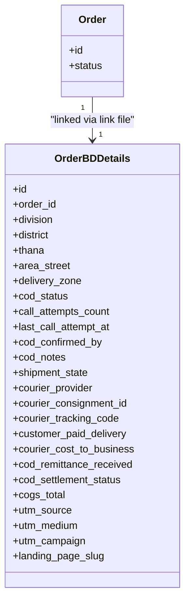

**Diagram sources**
- [order-bd-details.ts](file://apps/medusa/src/modules/bd-orders/models/order-bd-details.ts)
- [order-bd-details.ts](file://apps/medusa/src/links/order-bd-details.ts)

**Section sources**
- [order-bd-details.ts](file://apps/medusa/src/modules/bd-orders/models/order-bd-details.ts)
- [order-bd-details.ts](file://apps/medusa/src/links/order-bd-details.ts)

### CustomerRiskProfile
- Tracks customer-level risk metrics: total orders placed/delivered/RTO/canceled, delivery success rate, fraud flags, and notes.
- Supports proactive risk management and manual review workflows.

```mermaid
class ClassDiagram
class CustomerRiskProfile {
+id
+phone_number
+customer_name
+total_orders_placed
+total_orders_delivered
+total_rto_orders
+total_canceled_orders
+delivery_success_rate
+is_flagged_fraud
+flag_reason
+notes
+last_order_at
}
```

**Diagram sources**
- [customer-risk-profile.ts](file://apps/medusa/src/modules/bd-orders/models/customer-risk-profile.ts)

**Section sources**
- [customer-risk-profile.ts](file://apps/medusa/src/modules/bd-orders/models/customer-risk-profile.ts)

### OrderReturnRequest
- Manages return lifecycle from pending review to completion, including reason, item condition, refund method (bKash/Nagad/bank/store credit), target account, amount, and audit fields.
- Linked to Order to associate returns with original transactions.

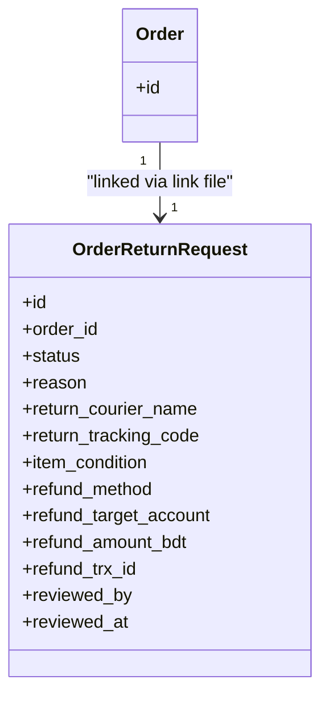

**Diagram sources**
- [order-return-request.ts](file://apps/medusa/src/modules/bd-orders/models/order-return-request.ts)
- [order-return-request.ts](file://apps/medusa/src/links/order-return-request.ts)

**Section sources**
- [order-return-request.ts](file://apps/medusa/src/modules/bd-orders/models/order-return-request.ts)
- [order-return-request.ts](file://apps/medusa/src/links/order-return-request.ts)

### PaymentTransaction
- Records all payment interactions for COD, bKash, and Nagad, including authorization, capture, refund, and status queries.
- Stores gateway transaction IDs, statuses, raw responses, and server-to-server verification flags for reconciliation.

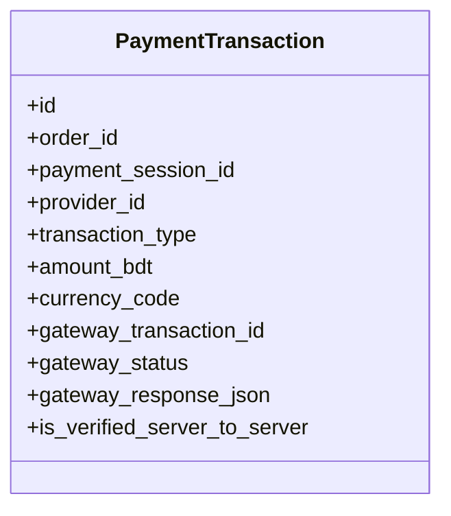

**Diagram sources**
- [payment-transaction.ts](file://apps/medusa/src/modules/bd-payments/models/payment-transaction.ts)

**Section sources**
- [payment-transaction.ts](file://apps/medusa/src/modules/bd-payments/models/payment-transaction.ts)

### CourierShipmentLog
- Persists courier API requests/responses for shipment creation and tracking updates, enabling troubleshooting and SLA monitoring.

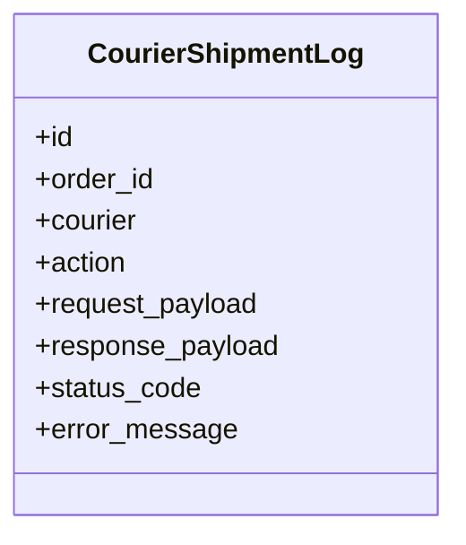

**Diagram sources**
- [courier-shipment-log.ts](file://apps/medusa/src/modules/bd-courier/models/courier-shipment-log.ts)

**Section sources**
- [courier-shipment-log.ts](file://apps/medusa/src/modules/bd-courier/models/courier-shipment-log.ts)

### DeliveryZoneConfig
- Configures delivery zones with flat rates, free shipping thresholds, delivery windows, active flags, and coverage districts JSON.
- Supports zone-based shipping logic across Bangladesh’s 64 districts.

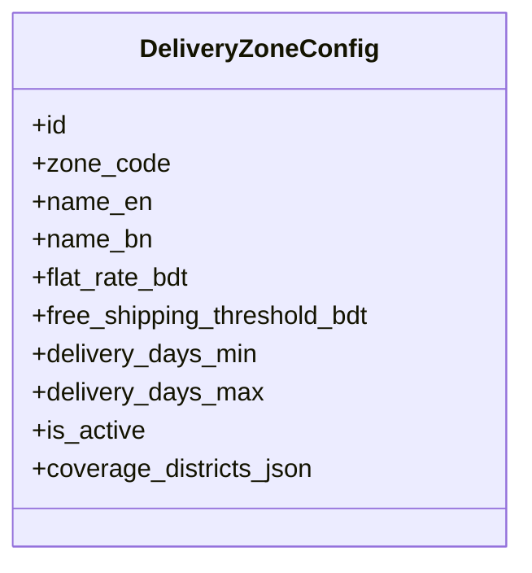

**Diagram sources**
- [delivery-zone-config.ts](file://apps/medusa/src/modules/bd-settings/models/delivery-zone-config.ts)

**Section sources**
- [delivery-zone-config.ts](file://apps/medusa/src/modules/bd-settings/models/delivery-zone-config.ts)

### VATConfig
- Centralizes VAT policy: enablement, rate, registration number, invoice display, and whether prices include VAT.

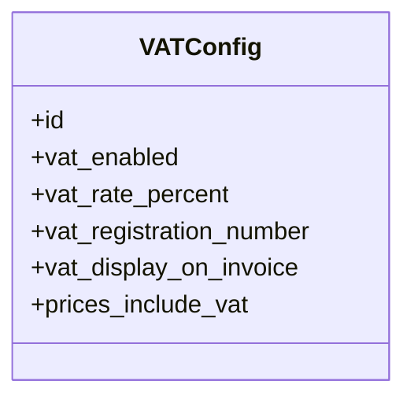

**Diagram sources**
- [vat-config.ts](file://apps/medusa/src/modules/bd-settings/models/vat-config.ts)

**Section sources**
- [vat-config.ts](file://apps/medusa/src/modules/bd-settings/models/vat-config.ts)

### AuditLog
- Immutable record of system and user actions across critical entities, supporting compliance and internal investigations.

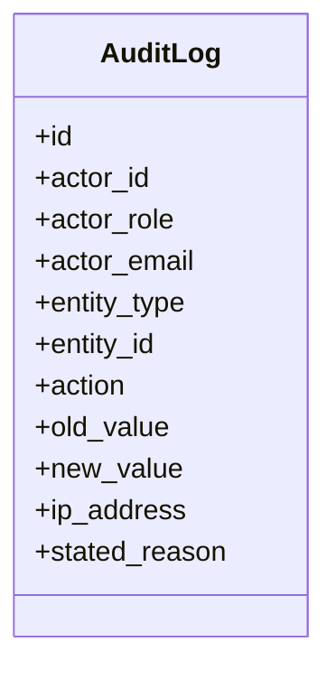

**Diagram sources**
- [audit-log.ts](file://apps/medusa/src/modules/bd-audit/models/audit-log.ts)

**Section sources**
- [audit-log.ts](file://apps/medusa/src/modules/bd-audit/models/audit-log.ts)

### StaffRolePermission
- Role-based permissions for staff users to restrict sensitive operations such as COGS visibility, COD confirmation, courier booking, refunds, content management, and audit log access.

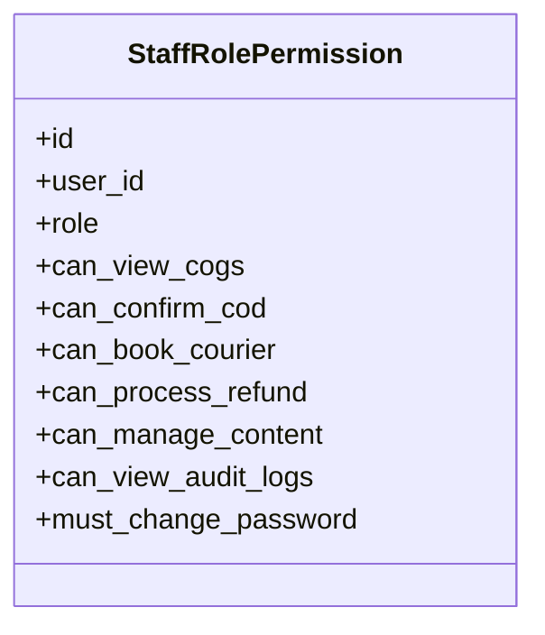

**Diagram sources**
- [staff-role-permission.ts](file://apps/medusa/src/modules/bd-audit/models/staff-role-permission.ts)

**Section sources**
- [staff-role-permission.ts](file://apps/medusa/src/modules/bd-audit/models/staff-role-permission.ts)

## Dependency Analysis
Links between Medusa core entities and BD custom models are declared explicitly. The following diagram shows these relationships.

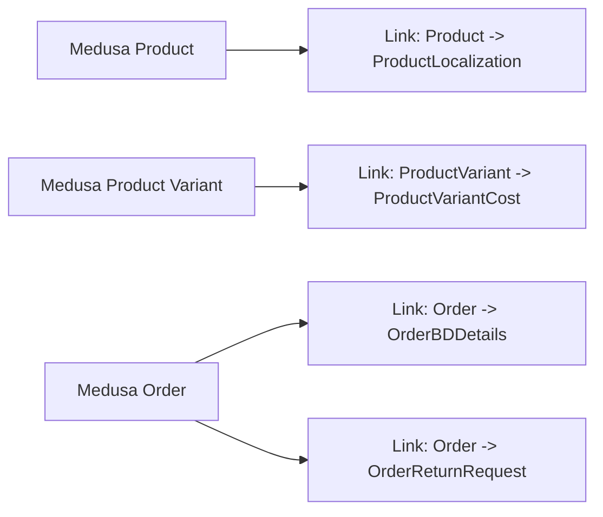

**Diagram sources**
- [product-localization.ts](file://apps/medusa/src/links/product-localization.ts)
- [product-variant-cost.ts](file://apps/medusa/src/links/product-variant-cost.ts)
- [order-bd-details.ts](file://apps/medusa/src/links/order-bd-details.ts)
- [order-return-request.ts](file://apps/medusa/src/links/order-return-request.ts)

Module registration files expose service entry points for each domain module.

**Section sources**
- [index.ts](file://apps/medusa/src/modules/bd-catalog/index.ts)
- [index.ts](file://apps/medusa/src/modules/bd-orders/index.ts)
- [index.ts](file://apps/medusa/src/modules/bd-payments/index.ts)
- [index.ts](file://apps/medusa/src/modules/bd-courier/index.ts)
- [index.ts](file://apps/medusa/src/modules/bd-settings/index.ts)
- [index.ts](file://apps/medusa/src/modules/bd-audit/index.ts)

## Performance Considerations
- Indexing: Several models define indexes on frequently queried fields (e.g., order_id, courier_tracking_code, actor_id, entity_type, entity_id) to optimize lookups and reporting.
- Searchability: ProductLocalization marks certain text fields as searchable to accelerate storefront queries.
- JSON Payloads: CourierShipmentLog and PaymentTransaction store request/response payloads; consider archiving or truncating large payloads over time.
- Big Numbers: Financial fields use big-number types to avoid precision issues; ensure calculations are performed with appropriate libraries.
- Enumerations: Use enums for constrained fields (zones, statuses, roles) to reduce storage and improve query performance.

[No sources needed since this section provides general guidance]

## Troubleshooting Guide
- Missing Links
  - Symptom: Related BD entities do not appear when querying Medusa core objects.
  - Action: Verify link files exist and correctly map core entities to BD models.

- Inconsistent Zones
  - Symptom: Shipping rates or delivery days do not match expectations.
  - Action: Check DeliveryZoneConfig entries for active flags, thresholds, and coverage districts JSON.

- Payment Reconciliation Failures
  - Symptom: Gateway status does not match internal state.
  - Action: Inspect PaymentTransaction gateway_status and gateway_response_json; ensure server-to-server verification is enabled where applicable.

- Courier Tracking Gaps
  - Symptom: Tracking events missing or stale.
  - Action: Review CourierShipmentLog for failed requests, status codes, and error messages.

- Audit Trail Gaps
  - Symptom: Unable to trace changes to sensitive entities.
  - Action: Ensure AuditLog is written for create/update/delete/status transitions and refund/restock operations.

- Access Control Issues
  - Symptom: Staff cannot perform expected actions.
  - Action: Validate StaffRolePermission flags for the user’s role and confirm must_change_password if enforced.

**Section sources**
- [payment-transaction.ts](file://apps/medusa/src/modules/bd-payments/models/payment-transaction.ts)
- [courier-shipment-log.ts](file://apps/medusa/src/modules/bd-courier/models/courier-shipment-log.ts)
- [delivery-zone-config.ts](file://apps/medusa/src/modules/bd-settings/models/delivery-zone-config.ts)
- [audit-log.ts](file://apps/medusa/src/modules/bd-audit/models/audit-log.ts)
- [staff-role-permission.ts](file://apps/medusa/src/modules/bd-audit/models/staff-role-permission.ts)

## Conclusion
These Bangladesh-specific data models extend Medusa’s core capabilities to support local payment methods, district-based delivery zones, multi-language product content, and robust compliance and operational controls. By organizing models into focused modules and linking them to Medusa core entities, the platform remains modular, maintainable, and scalable while meeting local business requirements.

[No sources needed since this section summarizes without analyzing specific files]