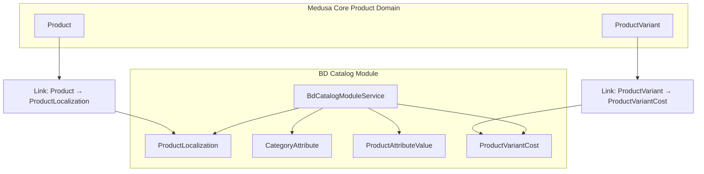
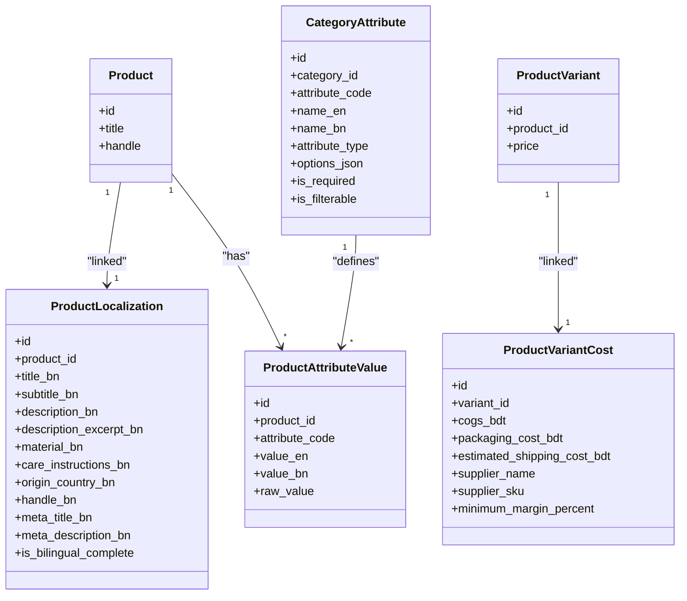
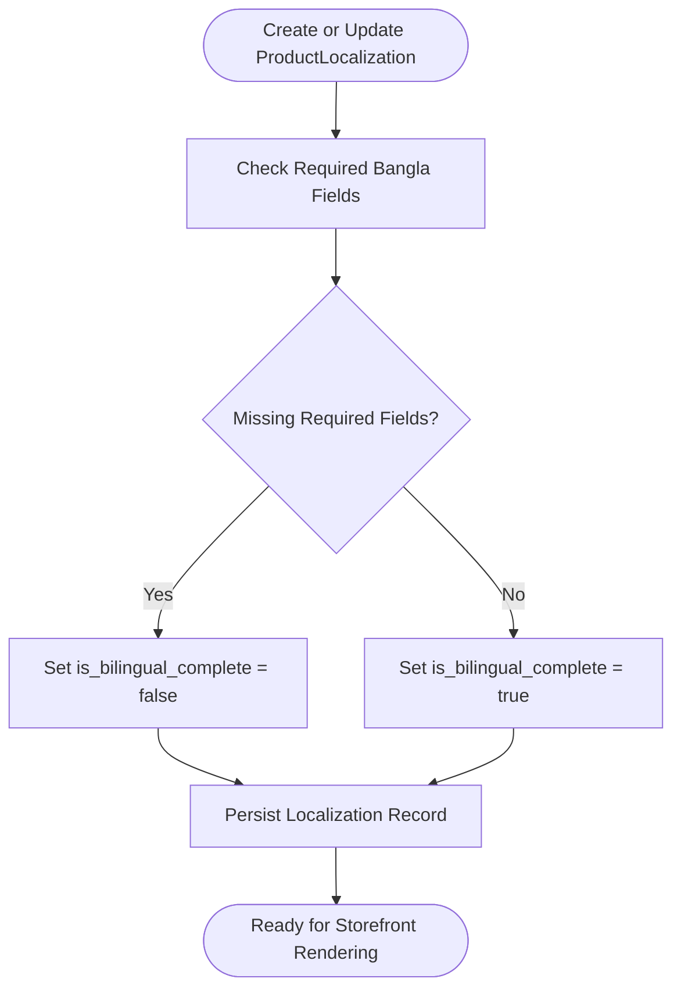
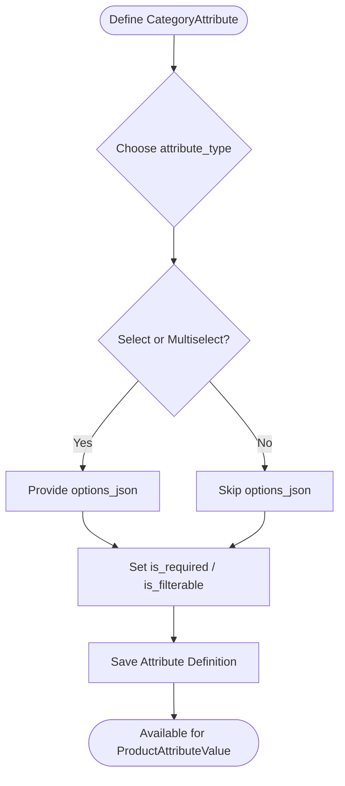
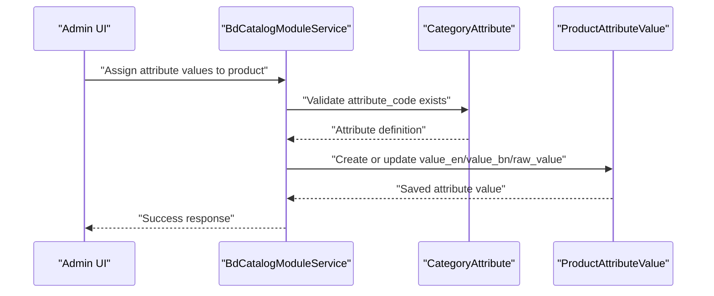
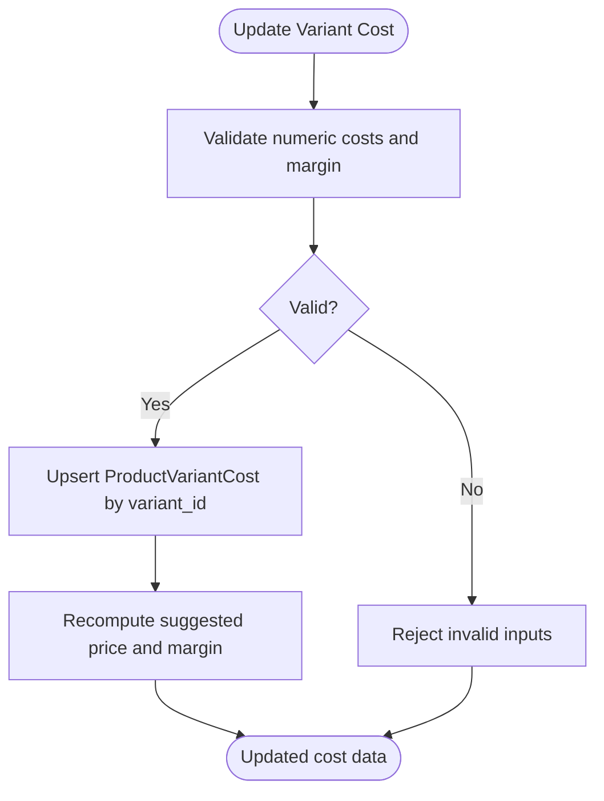
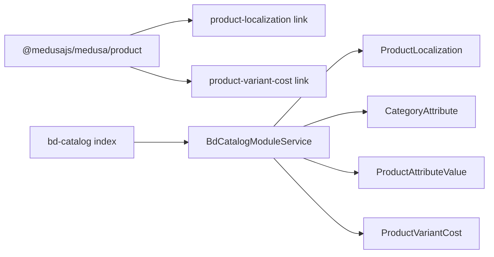

# Catalog Data Models

<cite>
**Referenced Files in This Document**
- [product-localization.ts](file://apps/medusa/src/modules/bd-catalog/models/product-localization.ts)
- [category-attribute.ts](file://apps/medusa/src/modules/bd-catalog/models/category-attribute.ts)
- [product-attribute-value.ts](file://apps/medusa/src/modules/bd-catalog/models/product-attribute-value.ts)
- [product-variant-cost.ts](file://apps/medusa/src/modules/bd-catalog/models/product-variant-cost.ts)
- [service.ts](file://apps/medusa/src/modules/bd-catalog/service.ts)
- [index.ts](file://apps/medusa/src/modules/bd-catalog/index.ts)
- [product-localization.ts](file://apps/medusa/src/links/product-localization.ts)
- [product-variant-cost.ts](file://apps/medusa/src/links/product-variant-cost.ts)
- [Migration20261024060539.ts](file://apps/medusa/src/modules/bd-catalog/migrations/Migration20261024060539.ts)
- [data-models.md](file://docs/data-models.md)
</cite>

## Table of Contents
1. [Introduction](#introduction)
2. [Project Structure](#project-structure)
3. [Core Components](#core-components)
4. [Architecture Overview](#architecture-overview)
5. [Detailed Component Analysis](#detailed-component-analysis)
6. [Dependency Analysis](#dependency-analysis)
7. [Performance Considerations](#performance-considerations)
8. [Troubleshooting Guide](#troubleshooting-guide)
9. [Conclusion](#conclusion)

## Introduction
This document explains the Bangladesh e-commerce catalog data models that extend Medusa’s core product system. The focus is on:
- Bilingual product content through `ProductLocalization`
- Attribute-based categorization through `CategoryAttribute` and `ProductAttributeValue`
- Cost accounting per variant through `ProductVariantCost`

These models support local market requirements such as Bangla storefront content, structured category attributes for filtering, and merchant-facing cost tracking for pricing and margin analysis.

## Project Structure
The relevant implementation lives under the Medusa application module `bd-catalog`. It defines four entities, exposes them through a service, registers the module, and links selected entities to Medusa’s core product domain.

**Diagram sources**
- [service.ts:7-12](file://apps/medusa/src/modules/bd-catalog/service.ts#L7-L12)
- [product-localization.ts:5-8](file://apps/medusa/src/links/product-localization.ts#L5-L8)
- [product-variant-cost.ts:5-8](file://apps/medusa/src/links/product-variant-cost.ts#L5-L8)

**Section sources**
- [index.ts:4-8](file://apps/medusa/src/modules/bd-catalog/index.ts#L4-L8)
- [service.ts:1-14](file://apps/medusa/src/modules/bd-catalog/service.ts#L1-L14)

## Core Components
The `bd-catalog` module provides:
- A single service exposing CRUD operations for all four entities.
- Links connecting localization and cost data to Medusa’s product and variant records.
- Database migrations creating tables, indexes, constraints, and default values.

Key responsibilities:
- `ProductLocalization`: Stores Bangla fields for product titles, descriptions, SEO metadata, material, care instructions, origin, handle, and bilingual completeness.
- `CategoryAttribute`: Defines reusable, multilingual attribute definitions per category with input type and validation flags.
- `ProductAttributeValue`: Stores per-product attribute values in English and Bangla, plus a normalized raw value for search/facets.
- `ProductVariantCost`: Tracks COGS, packaging, shipping estimates, supplier details, and minimum margin percentage per variant.

**Section sources**
- [product-localization.ts:3-17](file://apps/medusa/src/modules/bd-catalog/models/product-localization.ts#L3-L17)
- [category-attribute.ts:3-13](file://apps/medusa/src/modules/bd-catalog/models/category-attribute.ts#L3-L13)
- [product-attribute-value.ts:3-10](file://apps/medusa/src/modules/bd-catalog/models/product-attribute-value.ts#L3-L10)
- [product-variant-cost.ts:3-12](file://apps/medusa/src/modules/bd-catalog/models/product-variant-cost.ts#L3-L12)
- [service.ts:7-12](file://apps/medusa/src/modules/bd-catalog/service.ts#L7-L12)

## Architecture Overview
The catalog models extend Medusa by attaching localized content and cost data to existing product entities without modifying core tables. Links are used to express relationships so queries can resolve related records across domains.

**Diagram sources**
- [product-localization.ts:3-17](file://apps/medusa/src/modules/bd-catalog/models/product-localization.ts#L3-L17)
- [category-attribute.ts:3-13](file://apps/medusa/src/modules/bd-catalog/models/category-attribute.ts#L3-L13)
- [product-attribute-value.ts:3-10](file://apps/medusa/src/modules/bd-catalog/models/product-attribute-value.ts#L3-L10)
- [product-variant-cost.ts:3-12](file://apps/medusa/src/modules/bd-catalog/models/product-variant-cost.ts#L3-L12)
- [product-localization.ts:5-8](file://apps/medusa/src/links/product-localization.ts#L5-L8)
- [product-variant-cost.ts:5-8](file://apps/medusa/src/links/product-variant-cost.ts#L5-L8)

## Detailed Component Analysis

### ProductLocalization
Purpose:
- Provides full Bangla content for products, including title, subtitle, description, excerpt, material, care instructions, origin country, slug-like handle, and SEO metadata.
- Includes a completion flag to indicate whether bilingual content is ready for publication.

Field definitions and behavior:
- `id`: Primary key identifier.
- `product_id`: Indexes lookup by Medusa product ID.
- `title_bn`, `subtitle_bn`, `description_bn`, `description_excerpt_bn`, `material_bn`, `care_instructions_bn`, `origin_country_bn`, `handle_bn`, `meta_title_bn`, `meta_description_bn`: Optional Bangla text fields; some are searchable.
- `origin_country_bn`: Defaults to a Bangla value representing Bangladesh.
- `is_bilingual_complete`: Boolean flag indicating translation readiness.

Relationships:
- Linked to Medusa `Product` via a link definition, enabling resolved queries from product to localization.

Validation rules:
- Most fields are nullable, allowing partial translations.
- Searchable fields enable full-text search over Bangla content.
- Completion flag should be set after verifying required Bangla fields.

Usage patterns:
- Create or update localization when editing product content in Bangla.
- Use the completion flag to gate publishing until bilingual content is complete.
- Render Bangla fields in storefronts when locale is Bengali.

**Diagram sources**
- [product-localization.ts:3-17](file://apps/medusa/src/modules/bd-catalog/models/product-localization.ts#L3-L17)
- [product-localization.ts:5-8](file://apps/medusa/src/links/product-localization.ts#L5-L8)

**Section sources**
- [product-localization.ts:3-17](file://apps/medusa/src/modules/bd-catalog/models/product-localization.ts#L3-L17)
- [product-localization.ts:5-8](file://apps/medusa/src/links/product-localization.ts#L5-L8)
- [data-models.md:74-95](file://docs/data-models.md#L74-L95)

### CategoryAttribute
Purpose:
- Defines reusable, multilingual attribute definitions for categories (for example, fabric, sleeve length, occasion).
- Controls input type, permitted options, requirement, and filterability.

Field definitions and behavior:
- `id`: Primary key identifier.
- `category_id`: Associates the attribute with a Medusa category.
- `attribute_code`: Stable code used to match attribute values.
- `name_en`, `name_bn`: Display labels in English and Bangla.
- `attribute_type`: Enumerated input type: select, multiselect, text, boolean.
- `options_json`: JSON list of permitted values for select-type attributes.
- `is_required`: Whether the attribute must be provided during product creation.
- `is_filterable`: Whether the attribute participates in faceted search.

Validation rules:
- `attribute_type` is constrained to the defined enum.
- Options are optional but expected for select-type attributes.
- Requirement and filterability flags control UI and indexing behavior.

Usage patterns:
- Define attributes once per category.
- Enforce required attributes during product creation workflows.
- Expose filterable attributes in storefront filters and search facets.

**Diagram sources**
- [category-attribute.ts:3-13](file://apps/medusa/src/modules/bd-catalog/models/category-attribute.ts#L3-L13)

**Section sources**
- [category-attribute.ts:3-13](file://apps/medusa/src/modules/bd-catalog/models/category-attribute.ts#L3-L13)
- [data-models.md:97-116](file://docs/data-models.md#L97-L116)

### ProductAttributeValue
Purpose:
- Stores per-product attribute values, supporting both English and Bangla values and a normalized raw value for search matching.

Field definitions and behavior:
- `id`: Primary key identifier.
- `product_id`: Associates the value with a Medusa product.
- `attribute_code`: Matches the corresponding `CategoryAttribute.attribute_code`.
- `value_en`: English display value.
- `value_bn`: Optional Bangla display value.
- `raw_value`: Optional normalized slug used for faceted search and filtering.

Validation rules:
- `value_en` is required; `value_bn` and `raw_value` are optional.
- `attribute_code` must correspond to an active category attribute.

Usage patterns:
- Create one record per attribute per product.
- Keep `raw_value` consistent with frontend facet keys.
- Use Bangla values for localized storefront rendering.

**Diagram sources**
- [product-attribute-value.ts:3-10](file://apps/medusa/src/modules/bd-catalog/models/product-attribute-value.ts#L3-L10)
- [category-attribute.ts:3-13](file://apps/medusa/src/modules/bd-catalog/models/category-attribute.ts#L3-L13)
- [service.ts:7-12](file://apps/medusa/src/modules/bd-catalog/service.ts#L7-L12)

**Section sources**
- [product-attribute-value.ts:3-10](file://apps/medusa/src/modules/bd-catalog/models/product-attribute-value.ts#L3-L10)
- [data-models.md:117-129](file://docs/data-models.md#L117-L129)

### ProductVariantCost
Purpose:
- Tracks variant-level costs for financial reporting, pricing decisions, and margin analysis.
- Intended for internal use only and should not be exposed publicly.

Field definitions and behavior:
- `id`: Primary key identifier.
- `variant_id`: Unique association to a Medusa product variant.
- `cogs_bdt`: Cost of goods sold per unit in BDT paisa.
- `packaging_cost_bdt`: Packaging materials cost in BDT paisa.
- `estimated_shipping_cost_bdt`: Estimated delivery cost in BDT paisa.
- `supplier_name`: Optional vendor or factory name.
- `supplier_sku`: Optional manufacturer SKU or barcode.
- `minimum_margin_percent`: Target gross margin percentage.

Validation rules:
- `variant_id` is unique per cost record.
- Numeric cost fields default to zero.
- Margin percentage defaults to a safe baseline.

Usage patterns:
- Maintain one cost record per variant.
- Use costs to compute contribution margins and recommended prices.
- Restrict access to finance and owner roles.

**Diagram sources**
- [product-variant-cost.ts:3-12](file://apps/medusa/src/modules/bd-catalog/models/product-variant-cost.ts#L3-L12)
- [product-variant-cost.ts:5-8](file://apps/medusa/src/links/product-variant-cost.ts#L5-L8)

**Section sources**
- [product-variant-cost.ts:3-12](file://apps/medusa/src/modules/bd-catalog/models/product-variant-cost.ts#L3-L12)
- [product-variant-cost.ts:5-8](file://apps/medusa/src/links/product-variant-cost.ts#L5-L8)
- [data-models.md:131-149](file://docs/data-models.md#L131-L149)

## Dependency Analysis
The module depends on Medusa’s product domain for linking and uses its query engine through the service layer.

**Diagram sources**
- [product-localization.ts:1-8](file://apps/medusa/src/links/product-localization.ts#L1-L8)
- [product-variant-cost.ts:1-8](file://apps/medusa/src/links/product-variant-cost.ts#L1-L8)
- [index.ts:4-8](file://apps/medusa/src/modules/bd-catalog/index.ts#L4-L8)
- [service.ts:1-14](file://apps/medusa/src/modules/bd-catalog/service.ts#L1-L14)

Coupling and cohesion:
- Cohesion is high within the module because all four models share the same service.
- Coupling to Medusa is limited to explicit links and the product module import.
- No circular dependencies are introduced by the links.

External integration points:
- Medusa product and product variant entities.
- Database schema created by migrations.
- Optional search indexing for Bangla fields and filterable attributes.

**Section sources**
- [product-localization.ts:1-8](file://apps/medusa/src/links/product-localization.ts#L1-L8)
- [product-variant-cost.ts:1-8](file://apps/medusa/src/links/product-variant-cost.ts#L1-L8)
- [index.ts:4-8](file://apps/medusa/src/modules/bd-catalog/index.ts#L4-L8)
- [service.ts:1-14](file://apps/medusa/src/modules/bd-catalog/service.ts#L1-L14)

## Performance Considerations
- Indexing:
  - `product_localization.product_id` supports fast joins from products to localization.
  - `category_attribute.category_id` and `attribute_code` support efficient lookups and filtering.
  - `product_attribute_value.product_id` and `attribute_code` support per-product attribute retrieval.
  - `product_variant_cost.variant_id` has a unique constraint ensuring one cost record per variant.
- Searchability:
  - Bangla title and description fields are marked searchable, improving storefront search performance.
- Numeric precision:
  - Cost fields use big number types to avoid floating-point rounding issues in financial calculations.
- Data volume:
  - Attribute values are stored per product; ensure attribute definitions remain stable to minimize migration churn.

[No sources needed since this section provides general guidance]

## Troubleshooting Guide
Common issues and resolutions:
- Missing Bangla content:
  - Symptom: Storefront shows empty Bangla fields.
  - Resolution: Populate required Bangla fields and set `is_bilingual_complete` to true.
- Inconsistent attribute codes:
  - Symptom: Frontend filters do not match product attributes.
  - Resolution: Ensure `ProductAttributeValue.attribute_code` matches `CategoryAttribute.attribute_code` and keep `raw_value` consistent.
- Duplicate cost records:
  - Symptom: Errors when updating variant costs.
  - Resolution: Verify uniqueness of `variant_id`; upsert instead of insert if the record already exists.
- Partial localization:
  - Symptom: Products published before Bangla content is complete.
  - Resolution: Gate publishing based on `is_bilingual_complete` and validate required fields.

Operational checks:
- Confirm migrations have run successfully and tables exist.
- Validate that links are registered so related queries resolve correctly.
- Restrict access to cost data to authorized roles.

**Section sources**
- [Migration20261024060539.ts:5-24](file://apps/medusa/src/modules/bd-catalog/migrations/Migration20261024060539.ts#L5-L24)
- [product-localization.ts:3-17](file://apps/medusa/src/modules/bd-catalog/models/product-localization.ts#L3-L17)
- [product-variant-cost.ts:3-12](file://apps/medusa/src/modules/bd-catalog/models/product-variant-cost.ts#L3-L12)

## Conclusion
The `bd-catalog` module extends Medusa’s product system with:
- Full Bangla localization for product content and SEO metadata.
- Structured, multilingual category attributes and per-product attribute values.
- Variant-level cost tracking for accurate pricing and margin analysis.

These models provide a solid foundation for bilingual commerce, attribute-driven catalogs, and local market cost accounting while remaining compatible with Medusa’s core product domain.