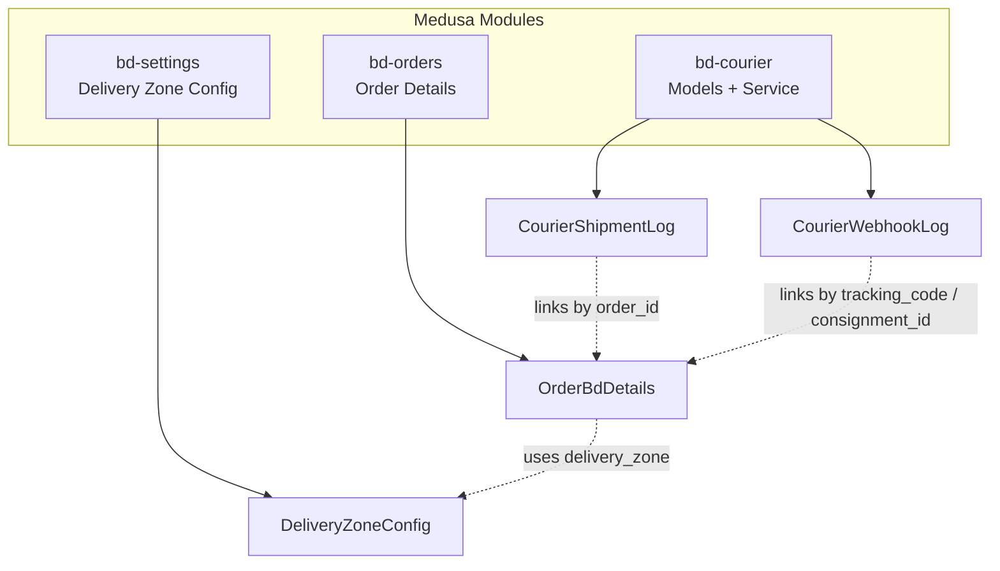
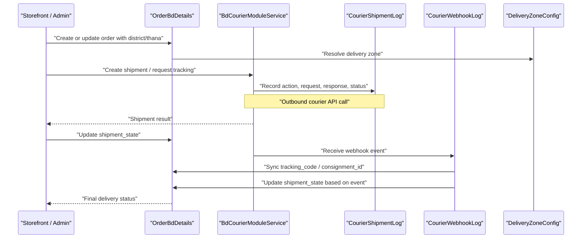
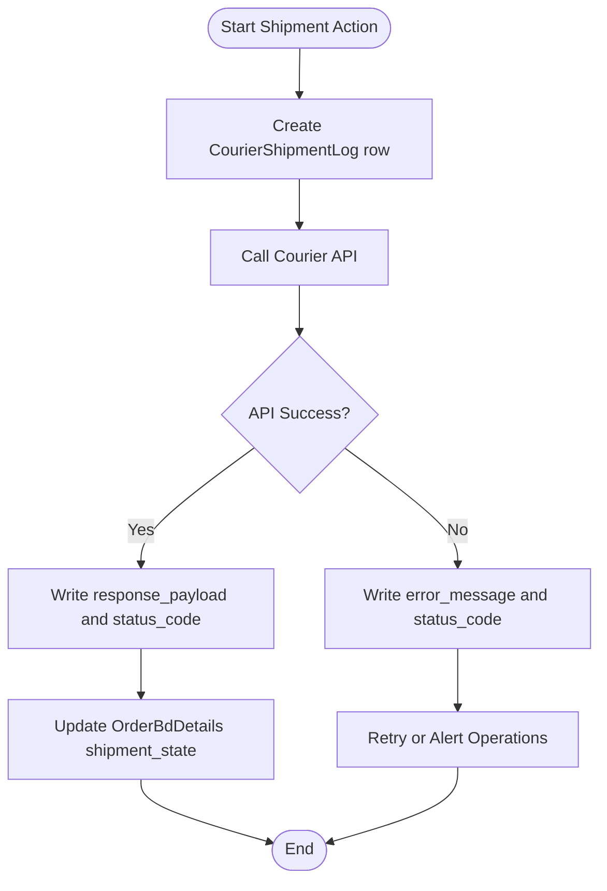
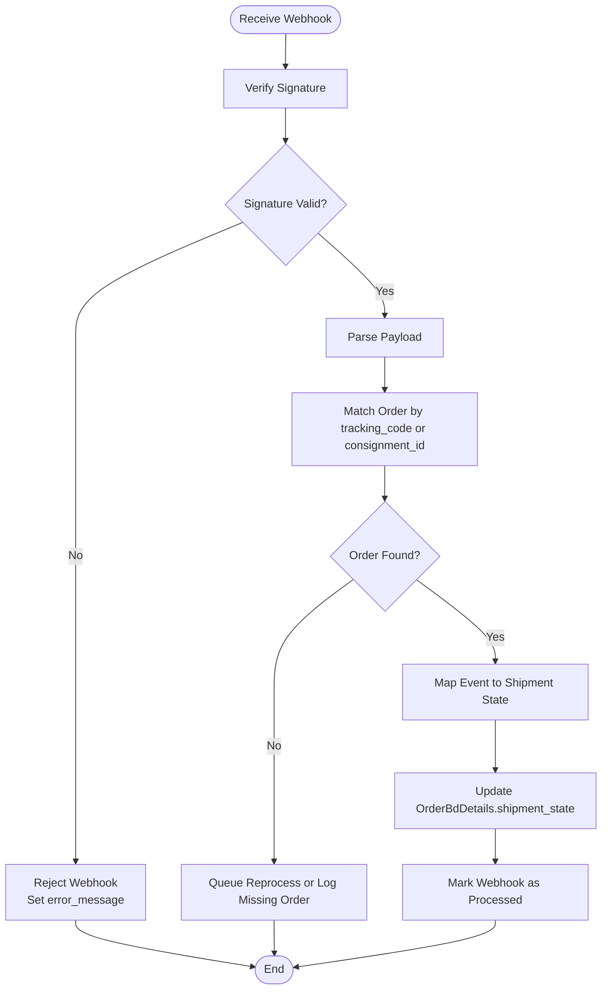
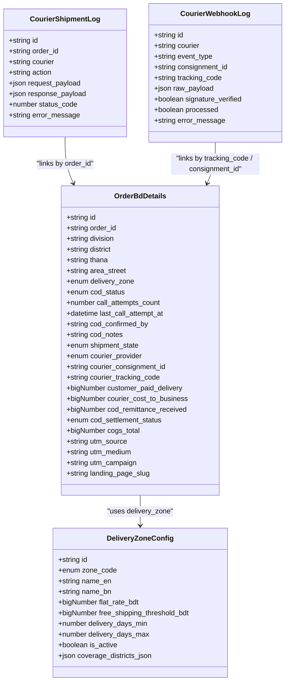
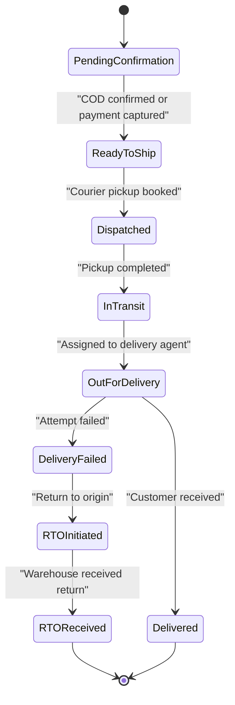
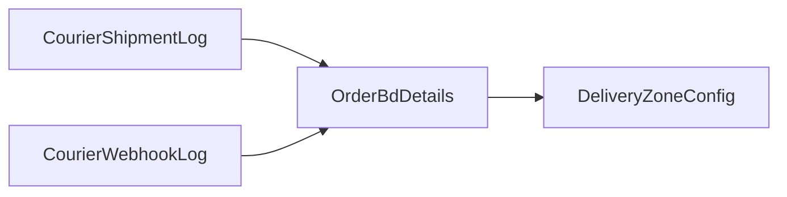

# Courier & Logistics Data Models

<cite>
**Referenced Files in This Document**
- [courier-shipment-log.ts](file://apps/medusa/src/modules/bd-courier/models/courier-shipment-log.ts)
- [courier-webhook-log.ts](file://apps/medusa/src/modules/bd-courier/models/courier-webhook-log.ts)
- [service.ts](file://apps/medusa/src/modules/bd-courier/service.ts)
- [Migration20261024060541.ts](file://apps/medusa/src/modules/bd-courier/migrations/Migration20261024060541.ts)
- [order-bd-details.ts](file://apps/medusa/src/modules/bd-orders/models/order-bd-details.ts)
- [Migration20261024060540.ts](file://apps/medusa/src/modules/bd-orders/migrations/Migration20261024060540.ts)
- [delivery-zone-config.ts](file://apps/medusa/src/modules/bd-settings/models/delivery-zone-config.ts)
- [database.md](file://database.md)
</cite>

## Table of Contents
1. [Introduction](#introduction)
2. [Project Structure](#project-structure)
3. [Core Components](#core-components)
4. [Architecture Overview](#architecture-overview)
5. [Detailed Component Analysis](#detailed-component-analysis)
6. [Dependency Analysis](#dependency-analysis)
7. [Performance Considerations](#performance-considerations)
8. [Troubleshooting Guide](#troubleshooting-guide)
9. [Conclusion](#conclusion)

## Introduction
This document explains the courier and logistics data models that support delivery operations across Bangladesh’s 64 districts. It focuses on two core entities:

- `CourierShipmentLog`: records outbound shipment actions, API requests, responses, status codes, and errors for courier integrations such as Steadfast, Pathao, and RedX.
- `CourierWebhookLog`: records inbound webhook events from courier services, including signature verification, processing state, and raw payloads.

These models work with order details and delivery zone configuration to manage delivery zones, track shipment progress, handle delivery confirmations, and synchronize courier statuses with internal order states.

## Project Structure
The courier and logistics domain is implemented as a Medusa module under `apps/medusa/src/modules/bd-courier`. The relevant files are:

- Model definitions for shipment logs and webhook logs
- A service class exposing both models through the Medusa service layer
- Database migrations defining table schemas and indexes
- Related models in orders and settings modules that provide context for district-based routing, delivery zones, and shipment state

**Diagram sources**
- [service.ts:5-8](file://apps/medusa/src/modules/bd-courier/service.ts#L5-L8)
- [courier-shipment-log.ts:3-12](file://apps/medusa/src/modules/bd-courier/models/courier-shipment-log.ts#L3-L12)
- [courier-webhook-log.ts:3-13](file://apps/medusa/src/modules/bd-courier/models/courier-webhook-log.ts#L3-L13)
- [order-bd-details.ts:3-39](file://apps/medusa/src/modules/bd-orders/models/order-bd-details.ts#L3-L39)
- [delivery-zone-config.ts:3-14](file://apps/medusa/src/modules/bd-settings/models/delivery-zone-config.ts#L3-L14)

**Section sources**
- [service.ts:1-11](file://apps/medusa/src/modules/bd-courier/service.ts#L1-L11)
- [courier-shipment-log.ts:1-15](file://apps/medusa/src/modules/bd-courier/models/courier-shipment-log.ts#L1-L15)
- [courier-webhook-log.ts:1-16](file://apps/medusa/src/modules/bd-courier/models/courier-webhook-log.ts#L1-L16)
- [order-bd-details.ts:1-42](file://apps/medusa/src/modules/bd-orders/models/order-bd-details.ts#L1-L42)
- [delivery-zone-config.ts:1-17](file://apps/medusa/src/modules/bd-settings/models/delivery-zone-config.ts#L1-L17)

## Core Components
This section documents the primary data models used for courier and logistics operations.

### CourierShipmentLog
`CourierShipmentLog` captures each outbound interaction with a courier provider during shipment creation or updates. It includes:

- Primary key identifier
- Order reference
- Courier provider name
- Action describing the operation
- Request and response payloads
- HTTP-like status code
- Optional error message

This model enables auditability and troubleshooting of courier API calls, especially when integrating multiple providers such as Steadfast, Pathao, and RedX.

**Section sources**
- [courier-shipment-log.ts:3-12](file://apps/medusa/src/modules/bd-courier/models/courier-shipment-log.ts#L3-L12)
- [Migration20261024060541.ts:6-8](file://apps/medusa/src/modules/bd-courier/migrations/Migration20261024060541.ts#L6-L8)

### CourierWebhookLog
`CourierWebhookLog` stores inbound webhook events from courier services. It includes:

- Primary key identifier
- Courier provider name
- Event type
- Consignment identifier
- Tracking code
- Raw payload
- Signature verification flag
- Processing flag
- Optional error message

This model supports secure webhook handling, idempotent processing, and reconciliation between courier events and internal order states.

**Section sources**
- [courier-webhook-log.ts:3-13](file://apps/medusa/src/modules/bd-courier/models/courier-webhook-log.ts#L3-L13)
- [Migration20261024060541.ts:10-13](file://apps/medusa/src/modules/bd-courier/migrations/Migration20261024060541.ts#L10-L13)

### BdCourierModuleService
The service class exposes both `CourierShipmentLog` and `CourierWebhookLog` through the Medusa service layer. This allows other modules to create, query, and update these entities consistently.

**Section sources**
- [service.ts:5-8](file://apps/medusa/src/modules/bd-courier/service.ts#L5-L8)

## Architecture Overview
The courier and logistics architecture connects three layers:

1. **Orders Layer**: `OrderBdDetails` holds Bangladesh-specific order attributes, including division, district, thana, delivery zone, COD status, and shipment state.
2. **Courier Layer**: `CourierShipmentLog` and `CourierWebhookLog` record outbound and inbound courier interactions.
3. **Settings Layer**: `DeliveryZoneConfig` defines delivery zones, rates, SLAs, and coverage mapping.

**Diagram sources**
- [order-bd-details.ts:16-29](file://apps/medusa/src/modules/bd-orders/models/order-bd-details.ts#L16-L29)
- [courier-shipment-log.ts:3-12](file://apps/medusa/src/modules/bd-courier/models/courier-shipment-log.ts#L3-L12)
- [courier-webhook-log.ts:3-13](file://apps/medusa/src/modules/bd-courier/models/courier-webhook-log.ts#L3-L13)
- [delivery-zone-config.ts:3-14](file://apps/medusa/src/modules/bd-settings/models/delivery-zone-config.ts#L3-L14)

## Detailed Component Analysis

### CourierShipmentLog: Delivery Tracking and Shipment Status
`CourierShipmentLog` is an append-only style log for courier interactions. Each row represents one action against a courier provider.

Key responsibilities:
- Record outbound shipment actions (e.g., booking, dispatching, updating tracking).
- Capture request and response payloads for debugging and analytics.
- Store status codes and error messages for failed API calls.
- Link back to the original order via `order_id`.

Complexity considerations:
- Indexes exist on `order_id` and soft-delete fields to optimize queries for order history and cleanup.
- JSON payloads allow flexible courier response structures without schema changes.

Operational patterns:
- When creating a shipment, write a log entry before calling the courier API.
- On success, store response payload and status code.
- On failure, store error message and status code for retry or alerting logic.

**Diagram sources**
- [courier-shipment-log.ts:3-12](file://apps/medusa/src/modules/bd-courier/models/courier-shipment-log.ts#L3-L12)
- [order-bd-details.ts:16-29](file://apps/medusa/src/modules/bd-orders/models/order-bd-details.ts#L16-L29)
- [Migration20261024060541.ts:6-8](file://apps/medusa/src/modules/bd-courier/migrations/Migration20261024060541.ts#L6-L8)

**Section sources**
- [courier-shipment-log.ts:3-12](file://apps/medusa/src/modules/bd-courier/models/courier-shipment-log.ts#L3-L12)
- [Migration20261024060541.ts:6-8](file://apps/medusa/src/modules/bd-courier/migrations/Migration20261024060541.ts#L6-L8)

### CourierWebhookLog: Webhook Events from Courier Services
`CourierWebhookLog` is designed to receive and process webhook events from courier services like Steadfast, Pathao, and RedX.

Key responsibilities:
- Store incoming webhook metadata: courier, event type, consignment ID, tracking code.
- Preserve raw payload for audit and reprocessing.
- Track signature verification to ensure webhook authenticity.
- Track processing state to support idempotency and retries.
- Record error messages for failed processing.

Processing flow:
1. Receive webhook from courier.
2. Verify signature if applicable.
3. Validate required identifiers (`consignment_id`, `tracking_code`).
4. Persist raw payload and flags.
5. Match webhook to order using tracking code or consignment ID.
6. Update `OrderBdDetails.shipment_state` according to event semantics.
7. Mark webhook as processed or leave it pending for retry.

**Diagram sources**
- [courier-webhook-log.ts:3-13](file://apps/medusa/src/modules/bd-courier/models/courier-webhook-log.ts#L3-L13)
- [order-bd-details.ts:16-29](file://apps/medusa/src/modules/bd-orders/models/order-bd-details.ts#L16-L29)
- [Migration20261024060541.ts:10-13](file://apps/medusa/src/modules/bd-courier/migrations/Migration20261024060541.ts#L10-L13)

**Section sources**
- [courier-webhook-log.ts:3-13](file://apps/medusa/src/modules/bd-courier/models/courier-webhook-log.ts#L3-L13)
- [Migration20261024060541.ts:10-13](file://apps/medusa/src/modules/bd-courier/migrations/Migration20261024060541.ts#L10-L13)

### Relationship with Orders and Delivery Zones
`OrderBdDetails` provides the operational context for courier logistics:

- Administrative geography: division, district, thana, area/street.
- Delivery zone: `inside_dhaka`, `dhaka_suburbs`, `outside_dhaka`.
- Shipment state: lifecycle states such as `pending_confirmation`, `ready_to_ship`, `dispatched`, `in_transit`, `out_for_delivery`, `delivery_failed`, `rto_initiated`, `rto_received`, `delivered`.
- Courier provider and identifiers: `courier_provider`, `courier_consignment_id`, `courier_tracking_code`.
- Financials: customer-paid delivery charge, courier cost to business, COD remittance, COGS.

`DeliveryZoneConfig` defines:
- Zone code and bilingual names.
- Flat-rate shipping charges and free shipping thresholds.
- Delivery SLA ranges.
- Coverage mapping via JSON containing districts or thanas.

Bangladesh administrative rules:
- Hierarchy: Division → District (64) → Thana/Upazila → Area/Street.
- Address validation uses canonical codes rather than free-text matching.
- Courier area mapping binds to administrative codes for reliable integration with Steadfast, Pathao, and RedX.

**Diagram sources**
- [order-bd-details.ts:3-39](file://apps/medusa/src/modules/bd-orders/models/order-bd-details.ts#L3-L39)
- [delivery-zone-config.ts:3-14](file://apps/medusa/src/modules/bd-settings/models/delivery-zone-config.ts#L3-L14)
- [courier-shipment-log.ts:3-12](file://apps/medusa/src/modules/bd-courier/models/courier-shipment-log.ts#L3-L12)
- [courier-webhook-log.ts:3-13](file://apps/medusa/src/modules/bd-courier/models/courier-webhook-log.ts#L3-L13)

**Section sources**
- [order-bd-details.ts:3-39](file://apps/medusa/src/modules/bd-orders/models/order-bd-details.ts#L3-L39)
- [delivery-zone-config.ts:3-14](file://apps/medusa/src/modules/bd-settings/models/delivery-zone-config.ts#L3-L14)
- [database.md:2196-2215](file://database.md#L2196-L2215)

### Status Synchronization Patterns
Status synchronization occurs along two axes:

1. **Outbound synchronization**: When the system creates or updates shipments via courier APIs, `CourierShipmentLog` records the action and response. If successful, `OrderBdDetails.shipment_state` is updated accordingly.
2. **Inbound synchronization**: When couriers send webhooks, `CourierWebhookLog` captures the event. After signature verification and order matching, the system maps the event to the appropriate `shipment_state`.

Important constraints:
- Shipment state values are explicit and enumerated, preventing ambiguous status transitions.
- Webhook processing must be idempotent; duplicate events should not cause inconsistent state.
- Error handling should preserve raw payloads and error messages for later inspection.

**Diagram sources**
- [order-bd-details.ts:16-26](file://apps/medusa/src/modules/bd-orders/models/order-bd-details.ts#L16-L26)

**Section sources**
- [order-bd-details.ts:16-26](file://apps/medusa/src/modules/bd-orders/models/order-bd-details.ts#L16-L26)

## Dependency Analysis
The courier and logistics models have clear dependency relationships:

- `CourierShipmentLog` depends on `OrderBdDetails.order_id` to associate shipment actions with orders.
- `CourierWebhookLog` depends on `OrderBdDetails.courier_tracking_code` or `courier_consignment_id` to reconcile webhook events with orders.
- `OrderBdDetails.delivery_zone` references `DeliveryZoneConfig.zone_code` conceptually, enabling rate and SLA resolution.
- The service layer centralizes access to both log models, promoting consistent querying and mutation patterns.

**Diagram sources**
- [order-bd-details.ts:3-39](file://apps/medusa/src/modules/bd-orders/models/order-bd-details.ts#L3-L39)
- [delivery-zone-config.ts:3-14](file://apps/medusa/src/modules/bd-settings/models/delivery-zone-config.ts#L3-L14)
- [courier-shipment-log.ts:3-12](file://apps/medusa/src/modules/bd-courier/models/courier-shipment-log.ts#L3-L12)
- [courier-webhook-log.ts:3-13](file://apps/medusa/src/modules/bd-courier/models/courier-webhook-log.ts#L3-L13)

**Section sources**
- [service.ts:5-8](file://apps/medusa/src/modules/bd-courier/service.ts#L5-L8)
- [order-bd-details.ts:3-39](file://apps/medusa/src/modules/bd-orders/models/order-bd-details.ts#L3-L39)
- [delivery-zone-config.ts:3-14](file://apps/medusa/src/modules/bd-settings/models/delivery-zone-config.ts#L3-L14)
- [courier-shipment-log.ts:3-12](file://apps/medusa/src/modules/bd-courier/models/courier-shipment-log.ts#L3-L12)
- [courier-webhook-log.ts:3-13](file://apps/medusa/src/modules/bd-courier/models/courier-webhook-log.ts#L3-L13)

## Performance Considerations
- Use indexed fields for frequent lookups:
  - `CourierShipmentLog.order_id` for order history queries.
  - `CourierWebhookLog.consignment_id` and `CourierWebhookLog.tracking_code` for webhook reconciliation.
- Keep webhook payloads compact where possible; still retain raw JSON for auditability.
- Avoid heavy synchronous processing inside webhook handlers; prefer background jobs for state updates and notifications.
- Batch updates to `OrderBdDetails.shipment_state` when processing high-volume webhook bursts.
- Monitor soft-delete index usage for cleanup jobs that archive old logs.

[No sources needed since this section provides general guidance]

## Troubleshooting Guide
Common issues and how to investigate them:

- **Missing tracking code**:
  - Check `OrderBdDetails.courier_tracking_code` and `CourierWebhookLog.tracking_code`.
  - Ensure webhook mapping logic matches courier-provided identifiers.
- **Signature verification failures**:
  - Inspect `CourierWebhookLog.signature_verified` and `error_message`.
  - Validate webhook secret configuration and payload integrity.
- **Stuck shipment state**:
  - Review `CourierShipmentLog.action`, `status_code`, and `error_message`.
  - Confirm whether outbound API calls succeeded and whether order state was updated.
- **Incorrect delivery zone**:
  - Verify `OrderBdDetails.delivery_zone` against `DeliveryZoneConfig.zone_code`.
  - Confirm district/thana mapping aligns with Bangladesh administrative hierarchy.

**Section sources**
- [courier-webhook-log.ts:3-13](file://apps/medusa/src/modules/bd-courier/models/courier-webhook-log.ts#L3-L13)
- [courier-shipment-log.ts:3-12](file://apps/medusa/src/modules/bd-courier/models/courier-shipment-log.ts#L3-L12)
- [order-bd-details.ts:3-39](file://apps/medusa/src/modules/bd-orders/models/order-bd-details.ts#L3-L39)
- [delivery-zone-config.ts:3-14](file://apps/medusa/src/modules/bd-settings/models/delivery-zone-config.ts#L3-L14)

## Conclusion
The courier and logistics data models provide a robust foundation for managing deliveries across Bangladesh’s 64 districts. `CourierShipmentLog` ensures every outbound courier interaction is auditable, while `CourierWebhookLog` enables secure, idempotent processing of inbound courier events. Together with `OrderBdDetails` and `DeliveryZoneConfig`, they support accurate delivery zone routing, shipment progress tracking, delivery confirmation handling, and status synchronization across multiple courier providers.

[No sources needed since this section summarizes without analyzing specific files]