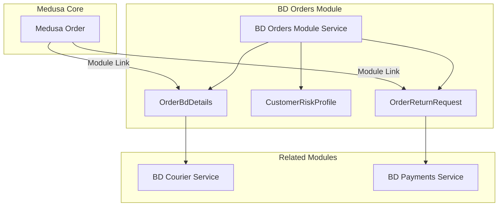
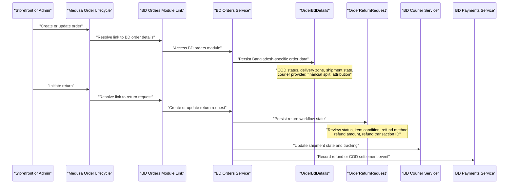
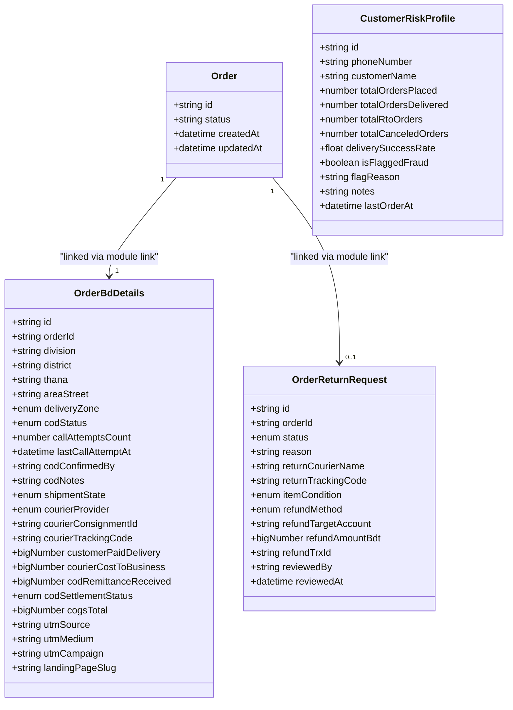
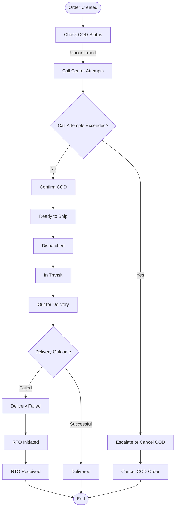
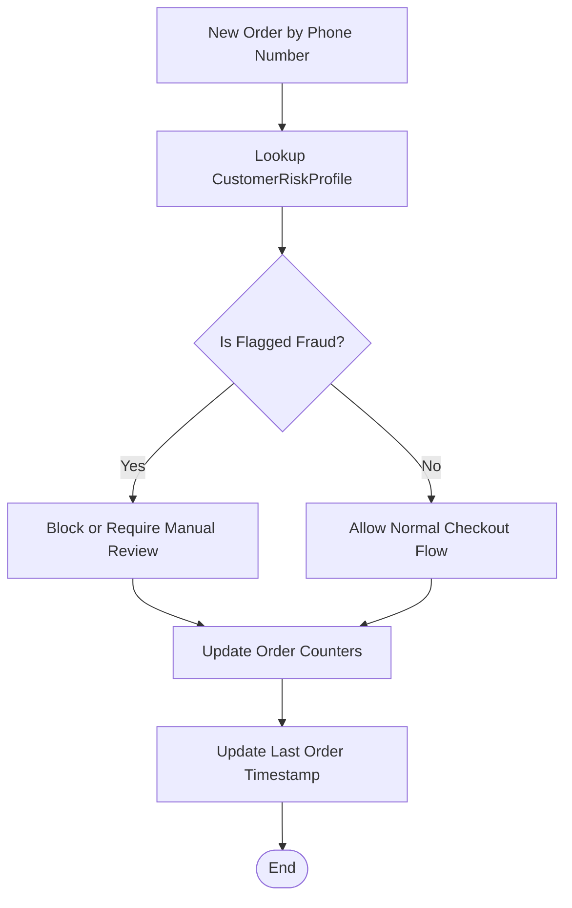
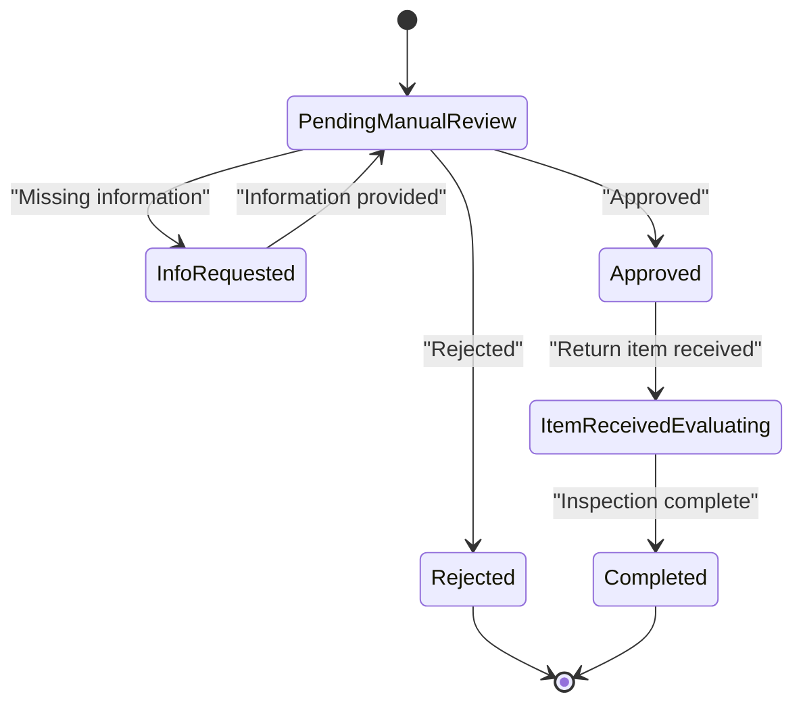
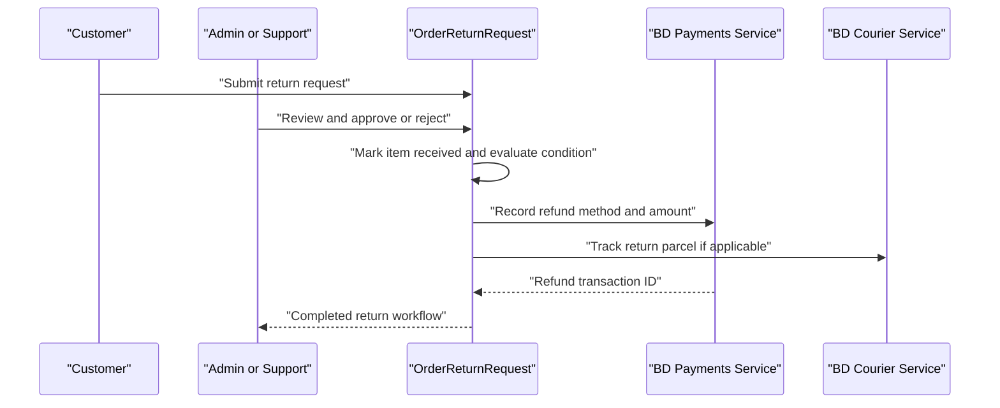
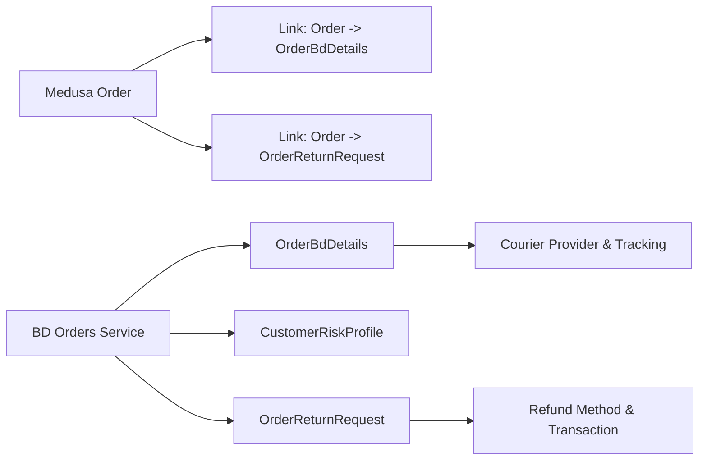

# Order Management Data Models

<cite>
**Referenced Files in This Document**
- [order-bd-details.ts](file://apps/medusa/src/modules/bd-orders/models/order-bd-details.ts)
- [customer-risk-profile.ts](file://apps/medusa/src/modules/bd-orders/models/customer-risk-profile.ts)
- [order-return-request.ts](file://apps/medusa/src/modules/bd-orders/models/order-return-request.ts)
- [service.ts](file://apps/medusa/src/modules/bd-orders/service.ts)
- [index.ts](file://apps/medusa/src/modules/bd-orders/index.ts)
- [order-bd-details.ts](file://apps/medusa/src/links/order-bd-details.ts)
- [order-return-request.ts](file://apps/medusa/src/links/order-return-request.ts)
- [service.ts](file://apps/medusa/src/modules/bd-courier/service.ts)
- [service.ts](file://apps/medusa/src/modules/bd-payments/service.ts)
- [data-models.md](file://docs/data-models.md)
</cite>

## Table of Contents
1. [Introduction](#introduction)
2. [Project Structure](#project-structure)
3. [Core Components](#core-components)
4. [Architecture Overview](#architecture-overview)
5. [Detailed Component Analysis](#detailed-component-analysis)
6. [Dependency Analysis](#dependency-analysis)
7. [Performance Considerations](#performance-considerations)
8. [Troubleshooting Guide](#troubleshooting-guide)
9. [Conclusion](#conclusion)

## Introduction
This document explains the Bangladesh-specific order management data models used to extend Medusa’s core order lifecycle with local compliance, fraud prevention, and return processing capabilities. The three primary entities are:

- **OrderBdDetails**: Extended order information for Bangladesh delivery zones, COD verification, courier dispatch, settlement tracking, and marketing attribution.
- **CustomerRiskProfile**: Customer-level risk profile keyed by phone number, supporting fraud flags, delivery success metrics, and call-center notes.
- **OrderReturnRequest**: Return request workflow covering review, approval, item inspection, refund method, and refund transaction tracking.

These models integrate with Medusa’s `Order` through module links, allowing the platform to keep core commerce logic intact while adding localized operational workflows.

## Project Structure
The relevant implementation is organized under the Medusa application:

- Custom models live in `apps/medusa/src/modules/bd-orders/models`.
- The BD orders module registers a service exposing all three models.
- Module links connect Medusa’s core `Order` entity to `OrderBdDetails` and `OrderReturnRequest`.
- Related modules (`bd-courier`, `bd-payments`) provide integration points for logistics and payment reconciliation.

**Diagram sources**
- [order-bd-details.ts:1-9](file://apps/medusa/src/links/order-bd-details.ts#L1-L9)
- [order-return-request.ts:1-9](file://apps/medusa/src/links/order-return-request.ts#L1-L9)
- [service.ts:1-13](file://apps/medusa/src/modules/bd-orders/service.ts#L1-L13)
- [service.ts:1-11](file://apps/medusa/src/modules/bd-courier/service.ts#L1-L11)
- [service.ts:1-11](file://apps/medusa/src/modules/bd-payments/service.ts#L1-L11)

**Section sources**
- [index.ts:1-9](file://apps/medusa/src/modules/bd-orders/index.ts#L1-L9)
- [service.ts:1-13](file://apps/medusa/src/modules/bd-orders/service.ts#L1-L13)
- [order-bd-details.ts:1-9](file://apps/medusa/src/links/order-bd-details.ts#L1-L9)
- [order-return-request.ts:1-9](file://apps/medusa/src/links/order-return-request.ts#L1-L9)

## Core Components
This section summarizes the three core entities and their business purpose.

### OrderBdDetails
`OrderBdDetails` extends a Medusa `Order` with Bangladesh-specific operational fields:

- **Address and zone context**: division, district, thana, area/street, and resolved delivery zone.
- **COD workflow**: status, call attempts, last call timestamp, staff confirmation, and agent notes.
- **Shipment lifecycle**: state progression from pending confirmation through delivery or RTO handling.
- **Courier integration**: provider selection, consignment ID, and public tracking code.
- **Financial split**: customer-paid delivery charge, courier cost to business, COD remittance received, and COGS snapshot.
- **Settlement tracking**: COD remittance reconciliation status.
- **Marketing attribution**: UTM source, medium, campaign, and landing page slug.

Key design characteristics:

- Monetary values use `bigNumber`, representing BDT paisa (1 BDT = 100 paisa).
- Enumerated statuses constrain valid transitions and support reporting dashboards.
- Tracking codes are indexed for fast lookup by customers and support centers.

**Section sources**
- [order-bd-details.ts:1-42](file://apps/medusa/src/modules/bd-orders/models/order-bd-details.ts#L1-L42)
- [data-models.md:193-225](file://docs/data-models.md#L193-L225)

### CustomerRiskProfile
`CustomerRiskProfile` tracks customer-level risk signals based on phone number:

- **Identity anchor**: normalized phone number as unique key.
- **Order history counters**: total placed, delivered, returned-to-origin, and canceled orders.
- **Delivery success rate**: ratio metric for delivery reliability.
- **Fraud controls**: boolean flag and reason field for high-risk blacklisting.
- **Operational notes**: call center remarks and last order timestamp.

Business rules implied by the model:

- Phone-number uniqueness supports deduplication across orders.
- Fraud flagging can gate risky orders during checkout or COD confirmation.
- Delivery success rate helps prioritize call-center attention and courier routing decisions.

**Section sources**
- [customer-risk-profile.ts:1-19](file://apps/medusa/src/modules/bd-orders/models/customer-risk-profile.ts#L1-L19)
- [data-models.md:171-190](file://docs/data-models.md#L171-L190)

### OrderReturnRequest
`OrderReturnRequest` manages the return process for an order:

- **Workflow states**: none, pending manual review, approved, rejected, info requested, item received evaluating, completed.
- **Reason capture**: free-text reason for returns.
- **Return logistics**: optional return courier name and tracking code.
- **Item condition**: uninspected, sellable, damaged, not restockable.
- **Refund configuration**: refund method (bkash, nagad, bank, store credit), target account, amount in BDT paisa, and external refund transaction ID.
- **Review metadata**: reviewer identifier and review timestamp.

This model supports both automated and manual return handling, including partial settlements and multi-channel refunds common in Bangladesh e-commerce.

**Section sources**
- [order-return-request.ts:1-28](file://apps/medusa/src/modules/bd-orders/models/order-return-request.ts#L1-L28)
- [data-models.md:242-277](file://docs/data-models.md#L242-L277)

## Architecture Overview
The BD orders module integrates with Medusa’s order lifecycle through module links rather than direct foreign-key coupling. This keeps core commerce behavior stable while enabling localized extensions.

**Diagram sources**
- [order-bd-details.ts:1-9](file://apps/medusa/src/links/order-bd-details.ts#L1-L9)
- [order-return-request.ts:1-9](file://apps/medusa/src/links/order-return-request.ts#L1-L9)
- [service.ts:1-13](file://apps/medusa/src/modules/bd-orders/service.ts#L1-L13)
- [service.ts:1-11](file://apps/medusa/src/modules/bd-courier/service.ts#L1-L11)
- [service.ts:1-11](file://apps/medusa/src/modules/bd-payments/service.ts#L1-L11)

## Detailed Component Analysis

### OrderBdDetails Analysis
`OrderBdDetails` is the central operational record for each order in the Bangladesh context. It captures address hierarchy, COD verification, courier dispatch, financial reconciliation, and marketing attribution.

#### Entity Relationship Model

**Diagram sources**
- [order-bd-details.ts:1-42](file://apps/medusa/src/modules/bd-orders/models/order-bd-details.ts#L1-L42)
- [customer-risk-profile.ts:1-19](file://apps/medusa/src/modules/bd-orders/models/customer-risk-profile.ts#L1-L19)
- [order-return-request.ts:1-28](file://apps/medusa/src/modules/bd-orders/models/order-return-request.ts#L1-L28)
- [order-bd-details.ts:1-9](file://apps/medusa/src/links/order-bd-details.ts#L1-L9)
- [order-return-request.ts:1-9](file://apps/medusa/src/links/order-return-request.ts#L1-L9)

#### Business Rules and Status Workflows
- **COD verification flow**:
  - Starts as unconfirmed.
  - Call attempts increase until confirmed, escalated, or canceled.
  - Staff confirmation records who verified the order and any conversation notes.
- **Shipment state flow**:
  - Begins at pending confirmation.
  - Progresses through ready to ship, dispatched, in transit, out for delivery.
  - Terminal outcomes include delivery failed, RTO initiated, RTO received, or delivered.
- **Financial reconciliation**:
  - Tracks what the customer paid for delivery, what the courier charged the business, and how much COD cash was remitted.
  - Settlement status moves from pending through partially remitted to settled or disputed.
- **Attribution tracking**:
  - Captures UTM parameters and landing page slug for campaign performance analysis.

**Diagram sources**
- [order-bd-details.ts:1-42](file://apps/medusa/src/modules/bd-orders/models/order-bd-details.ts#L1-L42)

**Section sources**
- [order-bd-details.ts:1-42](file://apps/medusa/src/modules/bd-orders/models/order-bd-details.ts#L1-L42)
- [data-models.md:193-225](file://docs/data-models.md#L193-L225)

### CustomerRiskProfile Analysis
`CustomerRiskProfile` provides a phone-number-based risk view that complements order-level data.

#### Risk Assessment Logic
- **Fraud flagging**:
  - When `is_flagged_fraud` is true, operations such as COD confirmation should be blocked or require higher authorization.
- **Delivery reliability scoring**:
  - `delivery_success_rate` helps identify repeat offenders or unreliable delivery patterns.
- **Operational visibility**:
  - `notes` and `flag_reason` allow call center agents and managers to explain decisions.

**Diagram sources**
- [customer-risk-profile.ts:1-19](file://apps/medusa/src/modules/bd-orders/models/customer-risk-profile.ts#L1-L19)

**Section sources**
- [customer-risk-profile.ts:1-19](file://apps/medusa/src/modules/bd-orders/models/customer-risk-profile.ts#L1-L19)
- [data-models.md:171-190](file://docs/data-models.md#L171-L190)

### OrderReturnRequest Analysis
`OrderReturnRequest` implements a structured return workflow aligned with Bangladesh payment methods and courier practices.

#### Return Workflow States

**Diagram sources**
- [order-return-request.ts:1-28](file://apps/medusa/src/modules/bd-orders/models/order-return-request.ts#L1-L28)

#### Integration with Refunds and Returns Logistics
- **Return courier tracking**:
  - Optional return courier name and tracking code enable reverse logistics visibility.
- **Refund methods**:
  - Supports bkash, nagad, bank transfer, and store credit.
- **Refund accounting**:
  - Amount stored in BDT paisa; external refund transaction ID links to payment system records.
- **Review governance**:
  - Reviewer identity and timestamp provide auditability for finance and compliance.

**Diagram sources**
- [order-return-request.ts:1-28](file://apps/medusa/src/modules/bd-orders/models/order-return-request.ts#L1-L28)
- [service.ts:1-11](file://apps/medusa/src/modules/bd-payments/service.ts#L1-L11)
- [service.ts:1-11](file://apps/medusa/src/modules/bd-courier/service.ts#L1-L11)

**Section sources**
- [order-return-request.ts:1-28](file://apps/medusa/src/modules/bd-orders/models/order-return-request.ts#L1-L28)
- [data-models.md:242-277](file://docs/data-models.md#L242-L277)

## Dependency Analysis
The BD orders module depends on Medusa’s core order module through explicit links. Related modules provide integration boundaries for courier and payment systems.

**Diagram sources**
- [order-bd-details.ts:1-9](file://apps/medusa/src/links/order-bd-details.ts#L1-L9)
- [order-return-request.ts:1-9](file://apps/medusa/src/links/order-return-request.ts#L1-L9)
- [service.ts:1-13](file://apps/medusa/src/modules/bd-orders/service.ts#L1-L13)

### Coupling and Cohesion
- **Low coupling to core commerce**: Links avoid direct database foreign keys to Medusa core tables.
- **High cohesion within BD orders**: All Bangladesh-specific order concerns are grouped in one module.
- **Clear integration boundaries**: Courier and payment concerns are delegated to their respective modules.

### External Dependencies
- **Courier providers**: steadfast, pathao, redx, or manual fulfillment.
- **Payment providers**: bkash, nagad, bank transfers, and store credit.
- **Audit and compliance**: Financial splits, COD settlement, and refund transactions support reconciliation and dispute handling.

**Section sources**
- [order-bd-details.ts:1-42](file://apps/medusa/src/modules/bd-orders/models/order-bd-details.ts#L1-L42)
- [order-return-request.ts:1-28](file://apps/medusa/src/modules/bd-orders/models/order-return-request.ts#L1-L28)
- [service.ts:1-13](file://apps/medusa/src/modules/bd-orders/service.ts#L1-L13)
- [service.ts:1-11](file://apps/medusa/src/modules/bd-courier/service.ts#L1-L11)
- [service.ts:1-11](file://apps/medusa/src/modules/bd-payments/service.ts#L1-L11)

## Performance Considerations
- **Indexing strategy**:
  - `courier_tracking_code` is indexed for fast customer-facing lookups.
  - `order_id` in `OrderReturnRequest` is indexed to support order-centric queries.
- **Monetary precision**:
  - Using `bigNumber` avoids floating-point rounding errors in BDT paisa calculations.
- **Enum constraints**:
  - Enums reduce invalid state transitions and simplify reporting queries.
- **Query optimization recommendations**:
  - Filter by `shipment_state` and `cod_status` for operational dashboards.
  - Use phone-number lookups for risk checks instead of scanning full order tables.
  - Cache frequently accessed delivery zone configurations separately from order data.

[No sources needed since this section provides general guidance]

## Troubleshooting Guide
Common issues and resolution strategies:

- **COD never confirmed**:
  - Check `call_attempts_count` and `last_call_attempt_at`.
  - Verify whether `cod_status` moved to escalated or canceled.
  - Review `cod_confirmed_by` and `cod_notes` for agent actions.
- **Courier tracking not visible**:
  - Ensure `courier_provider` and `courier_consignment_id` are set before publishing tracking.
  - Validate `courier_tracking_code` indexing and upstream courier API responses.
- **COD settlement mismatch**:
  - Compare `customer_paid_delivery`, `courier_cost_to_business`, and `cod_remittance_received`.
  - Investigate `cod_settlement_status` for partially remitted or disputed cases.
- **Return refund not reflected**:
  - Confirm `refund_method`, `refund_amount_bdt`, and `refund_trx_id`.
  - Cross-check with payment webhook logs and refund transaction records.
- **Fraud flag blocking legitimate customers**:
  - Review `is_flagged_fraud` and `flag_reason`.
  - Update `notes` after manual verification and adjust risk counters accordingly.

**Section sources**
- [order-bd-details.ts:1-42](file://apps/medusa/src/modules/bd-orders/models/order-bd-details.ts#L1-L42)
- [customer-risk-profile.ts:1-19](file://apps/medusa/src/modules/bd-orders/models/customer-risk-profile.ts#L1-L19)
- [order-return-request.ts:1-28](file://apps/medusa/src/modules/bd-orders/models/order-return-request.ts#L1-L28)

## Conclusion
The Bangladesh commerce platform extends Medusa’s order lifecycle with three focused entities:

- `OrderBdDetails` localizes order operations for delivery zones, COD verification, courier dispatch, financial splits, and attribution.
- `CustomerRiskProfile` centralizes phone-number-based risk assessment and fraud prevention.
- `OrderReturnRequest` standardizes return workflows, item inspection, and refund processing.

Through Medusa module links, these models remain decoupled from core commerce tables while integrating cleanly with courier and payment modules. This architecture supports local compliance, fraud mitigation, and robust return management tailored to Bangladesh e-commerce operations.