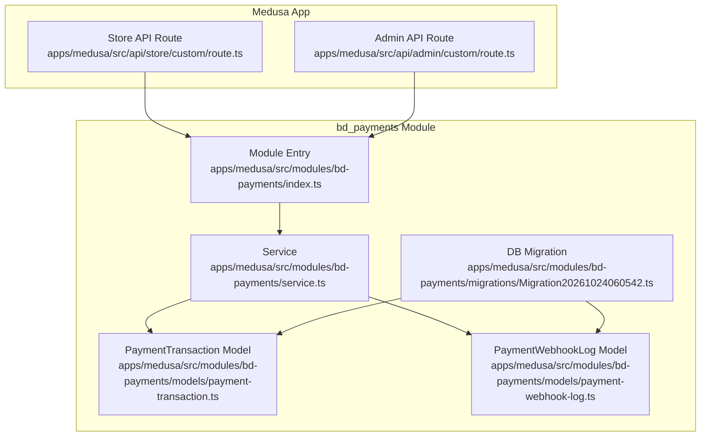
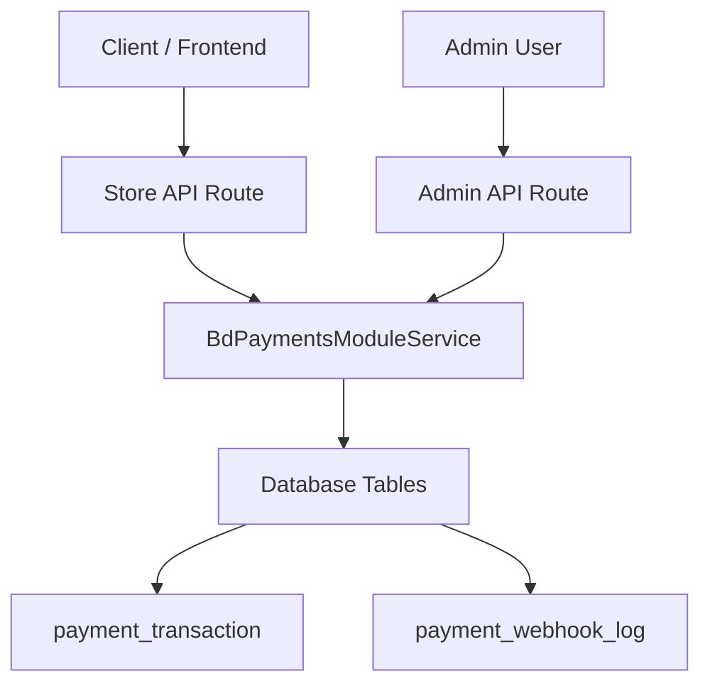
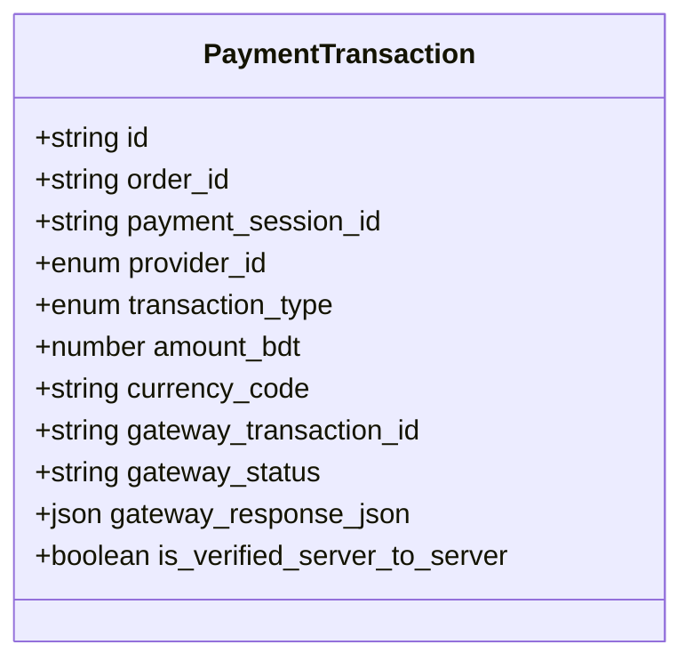
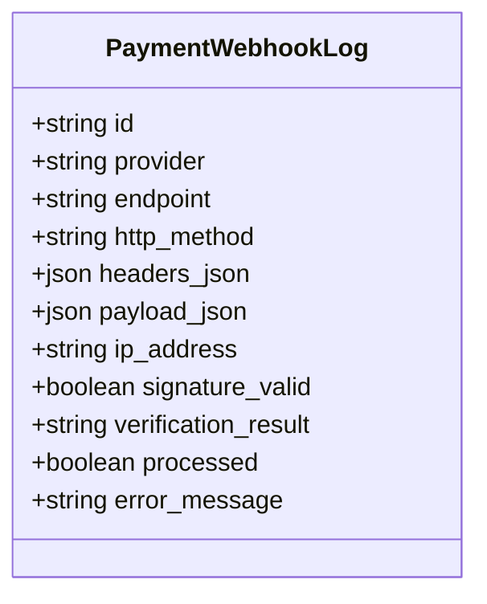
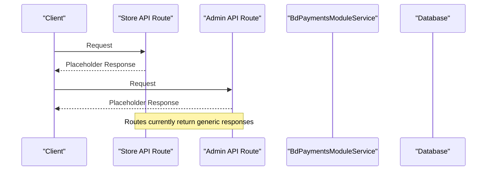
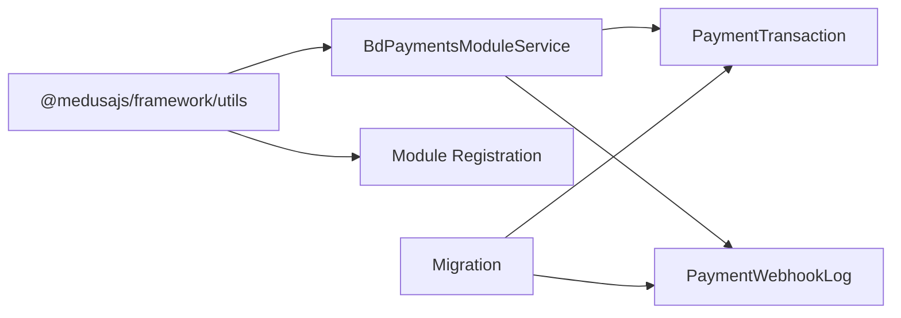

# Payment Processing Data Models

<cite>
**Referenced Files in This Document**   
- [payment-transaction.ts](file://apps/medusa/src/modules/bd-payments/models/payment-transaction.ts)
- [payment-webhook-log.ts](file://apps/medusa/src/modules/bd-payments/models/payment-webhook-log.ts)
- [service.ts](file://apps/medusa/src/modules/bd-payments/service.ts)
- [index.ts](file://apps/medusa/src/modules/bd-payments/index.ts)
- [Migration20261024060542.ts](file://apps/medusa/src/modules/bd-payments/migrations/Migration20261024060542.ts)
- [store route.ts](file://apps/medusa/src/api/store/custom/route.ts)
- [admin route.ts](file://apps/medusa/src/api/admin/custom/route.ts)
</cite>

## Table of Contents
1. [Introduction](#introduction)
2. [Project Structure](#project-structure)
3. [Core Components](#core-components)
4. [Architecture Overview](#architecture-overview)
5. [Detailed Component Analysis](#detailed-component-analysis)
6. [Dependency Analysis](#dependency-analysis)
7. [Performance Considerations](#performance-considerations)
8. [Security and Audit Considerations](#security-and-audit-considerations)
9. [Integration with Medusa Payments](#integration-with-medusa-payments)
10. [Troubleshooting Guide](#troubleshooting-guide)
11. [Conclusion](#conclusion)

## Introduction
This document describes the data models that support payment processing for Bangladesh payment methods, including bKash, Nagad, Cash on Delivery (COD), and SSLCommerz. It focuses on two core entities:

- PaymentTransaction: records of payment lifecycle events such as authorization, capture, refund, and status queries across providers.
- PaymentWebhookLog: durable audit trail of webhook events received from payment providers, including signature verification and processing outcomes.

The models are implemented within a Medusa v2 custom module named bd_payments. They provide a provider-agnostic foundation for multi-provider payments, state tracking, webhook reconciliation, and financial reporting.

## Project Structure
The payment-related code is organized under a Medusa module:

- apps/medusa/src/modules/bd-payments
  - models/payment-transaction.ts
  - models/payment-webhook-log.ts
  - service.ts
  - index.ts
  - migrations/Migration20261024060542.ts

API route placeholders exist for store and admin endpoints but do not yet implement payment-specific logic.

**Diagram sources**
- [index.ts:1-9](file://apps/medusa/src/modules/bd-payments/index.ts#L1-L9)
- [service.ts:1-11](file://apps/medusa/src/modules/bd-payments/service.ts#L1-L11)
- [payment-transaction.ts:1-18](file://apps/medusa/src/modules/bd-payments/models/payment-transaction.ts#L1-L18)
- [payment-webhook-log.ts:1-18](file://apps/medusa/src/modules/bd-payments/models/payment-webhook-log.ts#L1-L18)
- [Migration20261024060542.ts:1-23](file://apps/medusa/src/modules/bd-payments/migrations/Migration20261024060542.ts#L1-L23)
- [store route.ts:1-9](file://apps/medusa/src/api/store/custom/route.ts#L1-L9)
- [admin route.ts:1-9](file://apps/medusa/src/api/admin/custom/route.ts#L1-L9)

**Section sources**
- [index.ts:1-9](file://apps/medusa/src/modules/bd-payments/index.ts#L1-L9)
- [service.ts:1-11](file://apps/medusa/src/modules/bd-payments/service.ts#L1-L11)
- [Migration20261024060542.ts:1-23](file://apps/medusa/src/modules/bd-payments/migrations/Migration20261024060542.ts#L1-L23)

## Core Components
This section documents the two primary data models and their roles in multi-provider payment processing.

### PaymentTransaction
Purpose:
- Records each payment action against an order or payment session.
- Tracks provider-specific identifiers and responses.
- Supports multiple transaction types: authorization, capture, refund, and status query.
- Captures amounts in BDT and includes gateway-level status and raw response payloads.

Key fields and semantics:
- id: Primary key for the transaction record.
- order_id: Optional link to the Medusa order.
- payment_session_id: Optional link to the Medusa payment session.
- provider_id: Enumerated provider identifier supporting COD, bKash, and Nagad.
- transaction_type: Enumerated type indicating the operation performed.
- amount_bdt: Numeric amount in Bangladeshi Taka.
- currency_code: Defaulted to BDT; can be extended if needed.
- gateway_transaction_id: Provider-side transaction reference.
- gateway_status: Human-readable status returned by the provider.
- gateway_response_json: Full provider response payload for audit and debugging.
- is_verified_server_to_server: Boolean flag indicating whether server-to-server verification was completed.

Notes:
- The migration also defines a raw_amount_bdt JSONB column for provider-specific amount representations, which complements the normalized amount_bdt field.

**Section sources**
- [payment-transaction.ts:1-18](file://apps/medusa/src/modules/bd-payments/models/payment-transaction.ts#L1-L18)
- [Migration20261024060542.ts:5-10](file://apps/medusa/src/modules/bd-payments/migrations/Migration20261024060542.ts#L5-L10)

### PaymentWebhookLog
Purpose:
- Durable audit log of webhook events from payment providers.
- Stores HTTP metadata, headers, payload, IP address, signature validation result, processing outcome, and error messages.

Key fields and semantics:
- id: Primary key for the webhook log entry.
- provider: Provider name or identifier.
- endpoint: Webhook endpoint path.
- http_method: HTTP method used by the provider.
- headers_json: Serialized request headers for inspection.
- payload_json: Serialized request body/payload for replay and analysis.
- ip_address: Client IP address for security and tracing.
- signature_valid: Boolean indicating whether signature verification passed.
- verification_result: Textual result or reason for verification failure.
- processed: Boolean indicating whether business logic has been applied.
- error_message: Error details when processing fails.

**Section sources**
- [payment-webhook-log.ts:1-18](file://apps/medusa/src/modules/bd-payments/models/payment-webhook-log.ts#L1-L18)
- [Migration20261024060542.ts:12-13](file://apps/medusa/src/modules/bd-payments/migrations/Migration20261024060542.ts#L12-L13)

## Architecture Overview
The bd_payments module exposes a Medusa service that manages both PaymentTransaction and PaymentWebhookLog entities. API routes are scaffolded but currently return generic responses. The architecture supports future integration points for:

- Creating and managing payment transactions per provider.
- Receiving and verifying webhooks from providers.
- Reconciling provider statuses with internal states.
- Reporting and auditing financial events.

**Diagram sources**
- [store route.ts:1-9](file://apps/medusa/src/api/store/custom/route.ts#L1-L9)
- [admin route.ts:1-9](file://apps/medusa/src/api/admin/custom/route.ts#L1-L9)
- [service.ts:1-11](file://apps/medusa/src/modules/bd-payments/service.ts#L1-L11)
- [Migration20261024060542.ts:5-13](file://apps/medusa/src/modules/bd-payments/migrations/Migration20261024060542.ts#L5-L13)

## Detailed Component Analysis

### PaymentTransaction Entity
This entity captures the full lifecycle of a payment event. It is designed to be provider-agnostic while still retaining provider-specific context.

**Diagram sources**
- [payment-transaction.ts:1-18](file://apps/medusa/src/modules/bd-payments/models/payment-transaction.ts#L1-L18)

Data flow patterns:
- Authorization: Create a transaction with transaction_type = authorization, set gateway_status based on provider response, and persist gateway_response_json for audit.
- Capture: Create a capture transaction referencing the original authorization via order_id and payment_session_id, update gateway_status accordingly.
- Refund: Create a refund transaction with negative or zero-amount semantics depending on provider behavior; preserve full response.
- Status Query: Create a status_query transaction to reconcile provider status with internal state.

State management considerations:
- Use gateway_status to reflect provider-reported state.
- Use is_verified_server_to_server to mark when server-to-server verification is complete.
- Maintain chronological ordering via created_at timestamps (provided by ORM layer).

Complexity and performance:
- Queries typically filter by order_id, payment_session_id, or gateway_transaction_id; indexes are defined in the migration to optimize these lookups.
- Large JSON payloads should be handled carefully to avoid bloating database rows.

Error handling:
- Record errors in gateway_response_json and optionally surface them through application logs.
- Use is_verified_server_to_server to gate downstream actions until verification succeeds.

**Section sources**
- [payment-transaction.ts:1-18](file://apps/medusa/src/modules/bd-payments/models/payment-transaction.ts#L1-L18)
- [Migration20261024060542.ts:5-10](file://apps/medusa/src/modules/bd-payments/migrations/Migration20261024060542.ts#L5-L10)

### PaymentWebhookLog Entity
This entity provides a comprehensive audit trail for webhook events.

**Diagram sources**
- [payment-webhook-log.ts:1-18](file://apps/medusa/src/modules/bd-payments/models/payment-webhook-log.ts#L1-L18)

Processing workflow:
- Ingest webhook request and create a PaymentWebhookLog entry with headers_json, payload_json, and ip_address.
- Validate signature using provider-specific algorithm; set signature_valid and verification_result.
- If valid, process business logic and set processed = true; otherwise, set processed = false and populate error_message.
- Link to PaymentTransaction where applicable via order_id or payment_session_id during processing.

Reconciliation:
- Use PaymentWebhookLog entries to identify missed or failed webhooks.
- Compare gateway_status from PaymentTransaction with provider-reported status to detect drift.

Security considerations:
- Never trust payload without signature verification.
- Log minimal sensitive data; mask secrets in headers_json and payload_json if necessary.

**Section sources**
- [payment-webhook-log.ts:1-18](file://apps/medusa/src/modules/bd-payments/models/payment-webhook-log.ts#L1-L18)
- [Migration20261024060542.ts:12-13](file://apps/medusa/src/modules/bd-payments/migrations/Migration20261024060542.ts#L12-L13)

### Module Service and Entry Point
The module service exposes CRUD operations for both entities through Medusa’s service pattern. The module entry point registers the service under the bd_payments namespace.

**Diagram sources**
- [store route.ts:1-9](file://apps/medusa/src/api/store/custom/route.ts#L1-L9)
- [admin route.ts:1-9](file://apps/medusa/src/api/admin/custom/route.ts#L1-L9)
- [service.ts:1-11](file://apps/medusa/src/modules/bd-payments/service.ts#L1-L11)

**Section sources**
- [service.ts:1-11](file://apps/medusa/src/modules/bd-payments/service.ts#L1-L11)
- [index.ts:1-9](file://apps/medusa/src/modules/bd-payments/index.ts#L1-L9)

## Dependency Analysis
The bd_payments module depends on Medusa’s framework utilities and exposes a service that operates on two persistent entities. The migration defines the underlying schema and indexes.

**Diagram sources**
- [service.ts:1-11](file://apps/medusa/src/modules/bd-payments/service.ts#L1-L11)
- [index.ts:1-9](file://apps/medusa/src/modules/bd-payments/index.ts#L1-L9)
- [Migration20261024060542.ts:1-23](file://apps/medusa/src/modules/bd-payments/migrations/Migration20261024060542.ts#L1-L23)

**Section sources**
- [service.ts:1-11](file://apps/medusa/src/modules/bd-payments/service.ts#L1-L11)
- [index.ts:1-9](file://apps/medusa/src/modules/bd-payments/index.ts#L1-L9)
- [Migration20261024060542.ts:1-23](file://apps/medusa/src/modules/bd-payments/migrations/Migration20261024060542.ts#L1-L23)

## Performance Considerations
- Indexing: The migration creates indexes on order_id, payment_session_id, gateway_transaction_id, and deleted_at for both tables to optimize common queries and soft deletes.
- JSON payloads: Storing full provider responses is useful for audit but can grow large; consider archiving or truncating old payloads.
- Amount normalization: Use amount_bdt for consistent reporting while preserving raw_amount_bdt for provider-specific precision.
- Concurrency: Ensure idempotent processing of webhooks and transactions to prevent duplicate charges or refunds.

[No sources needed since this section provides general guidance]

## Security and Audit Considerations
- Signature verification: Always validate webhook signatures before processing; record results in signature_valid and verification_result.
- Server-to-server verification: Mark transactions as verified only after successful server-to-server checks; use is_verified_server_to_server to gate downstream actions.
- Sensitive data: Mask secrets in headers_json and payload_json; avoid logging tokens or card numbers.
- Audit trail: Retain PaymentWebhookLog entries for compliance and dispute resolution.
- Access control: Restrict admin endpoints to authorized users; enforce least privilege for payment operations.

**Section sources**
- [payment-webhook-log.ts:1-18](file://apps/medusa/src/modules/bd-payments/models/payment-webhook-log.ts#L1-L18)
- [payment-transaction.ts:1-18](file://apps/medusa/src/modules/bd-payments/models/payment-transaction.ts#L1-L18)

## Integration with Medusa Payments
Current state:
- The bd_payments module is registered and exposes a service for PaymentTransaction and PaymentWebhookLog.
- Store and admin API routes are placeholders and do not yet interact with the payment models.

Recommended integration steps:
- Extend store/admin routes to call BdPaymentsModuleService for creating transactions and handling webhooks.
- Map Medusa payment sessions to payment_session_id in PaymentTransaction.
- Implement provider-specific handlers for bKash, Nagad, COD, and SSLCommerz, normalizing responses into PaymentTransaction records.
- Implement webhook ingestion endpoints that write to PaymentWebhookLog, perform signature verification, and trigger reconciliation workflows.

[No sources needed since this section provides general guidance]

## Troubleshooting Guide
Common issues and resolutions:
- Missing webhook events: Check PaymentWebhookLog for unprocessed entries; verify signature_valid and error_message.
- State drift: Compare gateway_status in PaymentTransaction with provider-reported status; re-run status_query transactions to reconcile.
- Duplicate charges: Ensure idempotency keys are used; check for duplicate PaymentTransaction entries with the same order_id and transaction_type.
- Amount mismatches: Inspect raw_amount_bdt and amount_bdt; ensure conversion logic is correct for each provider.
- Verification failures: Review verification_result in PaymentWebhookLog; confirm shared secrets and signing algorithms.

Operational tips:
- Use indexes on order_id, payment_session_id, and gateway_transaction_id to quickly locate related records.
- Monitor is_verified_server_to_server flags to ensure critical transactions are fully verified before fulfillment.

**Section sources**
- [payment-webhook-log.ts:1-18](file://apps/medusa/src/modules/bd-payments/models/payment-webhook-log.ts#L1-L18)
- [payment-transaction.ts:1-18](file://apps/medusa/src/modules/bd-payments/models/payment-transaction.ts#L1-L18)
- [Migration20261024060542.ts:5-13](file://apps/medusa/src/modules/bd-payments/migrations/Migration20261024060542.ts#L5-L13)

## Conclusion
The bd_payments module establishes a solid foundation for multi-provider payment processing in Bangladesh. PaymentTransaction provides a structured, auditable record of payment lifecycle events, while PaymentWebhookLog ensures robust webhook verification and reconciliation. With the current service and schema in place, extending the API routes to integrate with Medusa’s payment system will enable end-to-end processing for bKash, Nagad, COD, and SSLCommerz. Emphasizing signature verification, server-to-server checks, and careful handling of JSON payloads will strengthen security, auditability, and reliability.