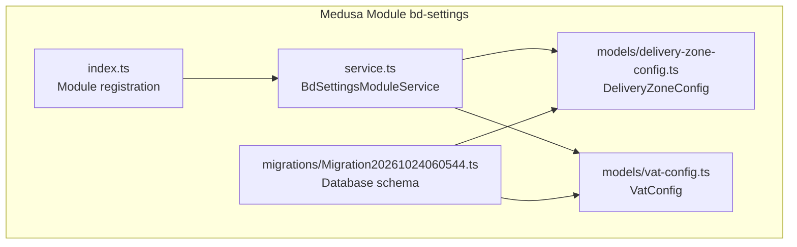
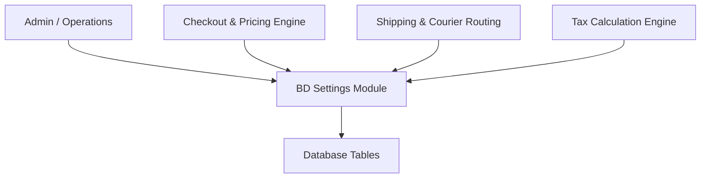
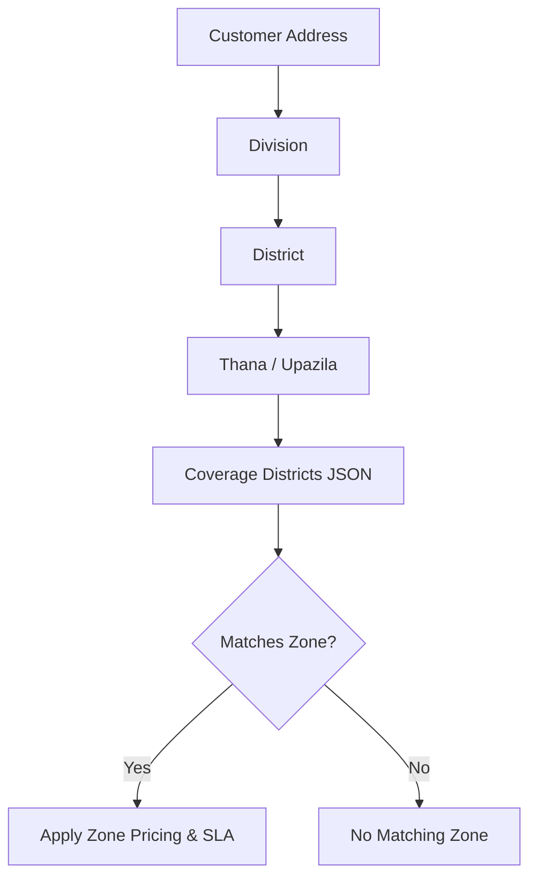
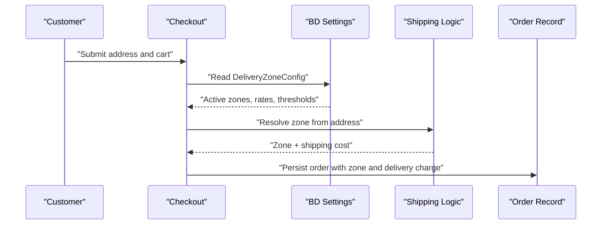
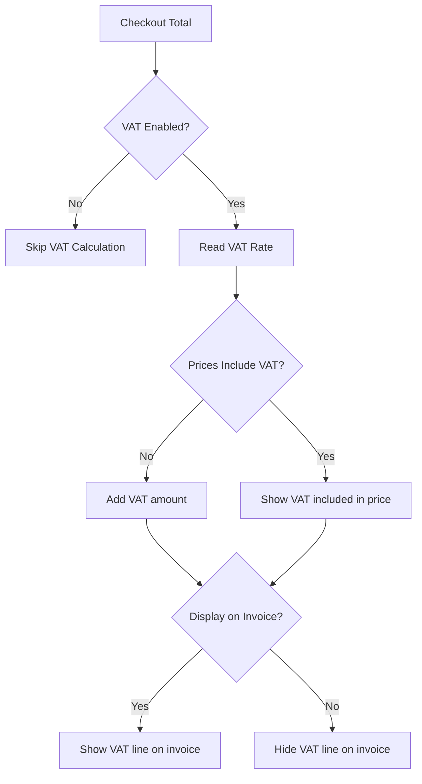
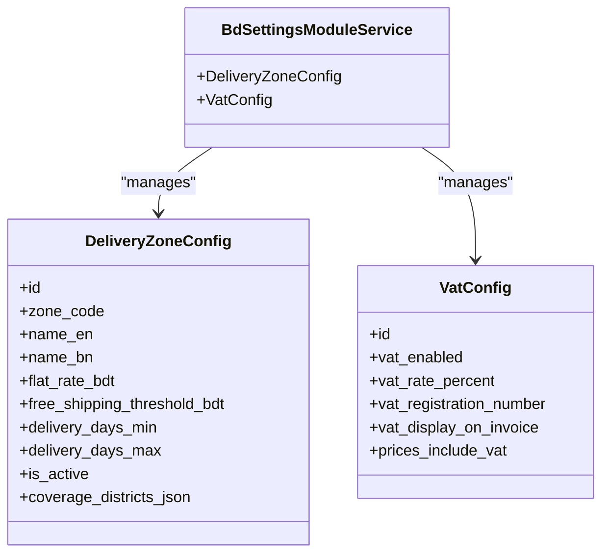
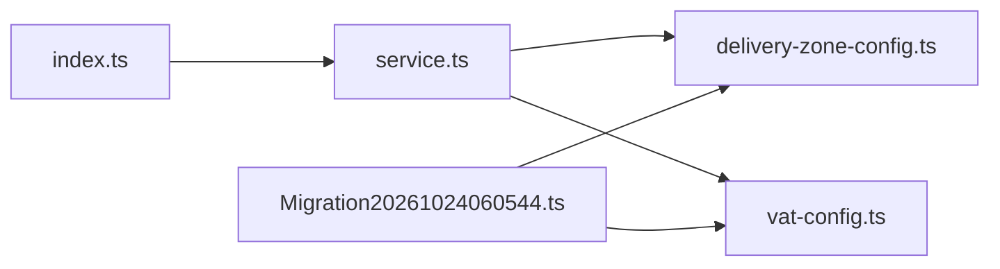

# System Settings Data Models

<cite>
**Referenced Files in This Document**
- [delivery-zone-config.ts](file://apps/medusa/src/modules/bd-settings/models/delivery-zone-config.ts)
- [vat-config.ts](file://apps/medusa/src/modules/bd-settings/models/vat-config.ts)
- [service.ts](file://apps/medusa/src/modules/bd-settings/service.ts)
- [index.ts](file://apps/medusa/src/modules/bd-settings/index.ts)
- [Migration20261024060544.ts](file://apps/medusa/src/modules/bd-settings/migrations/Migration20261024060544.ts)
- [data-models.md](file://docs/data-models.md)
- [prd.md](file://prd.md)
- [agent.md](file://agent.md)
</cite>

## Table of Contents
1. [Introduction](#introduction)
2. [Project Structure](#project-structure)
3. [Core Components](#core-components)
4. [Architecture Overview](#architecture-overview)
5. [Detailed Component Analysis](#detailed-component-analysis)
6. [Dependency Analysis](#dependency-analysis)
7. [Performance Considerations](#performance-considerations)
8. [Troubleshooting Guide](#troubleshooting-guide)
9. [Conclusion](#conclusion)

## Introduction
This document describes the system configuration data models that power Bangladesh-specific delivery and tax behavior:

- `DeliveryZoneConfig` defines delivery zones, pricing, service-level expectations, and geographic coverage for Bangladesh districts. It supports geographic delivery restrictions, zone-based flat-rate shipping, free-shipping thresholds, and courier routing inputs.
- `VatConfig` manages VAT enablement, rate configuration, registration display, invoice presentation rules, and whether prices include VAT. It is designed to keep tax compliance settings explicit and configurable without assuming VAT applies by default.

These models are part of the `bd-settings` Medusa module and provide a centralized place for operational settings that influence checkout, shipping selection, invoicing, and reporting.

## Project Structure
The relevant code lives under the Medusa application module `apps/medusa/src/modules/bd-settings`:

**Diagram sources**
- [index.ts:1-9](file://apps/medusa/src/modules/bd-settings/index.ts#L1-L9)
- [service.ts:1-11](file://apps/medusa/src/modules/bd-settings/service.ts#L1-L11)
- [delivery-zone-config.ts:1-17](file://apps/medusa/src/modules/bd-settings/models/delivery-zone-config.ts#L1-L17)
- [vat-config.ts:1-13](file://apps/medusa/src/modules/bd-settings/models/vat-config.ts#L1-L13)
- [Migration20261024060544.ts:1-22](file://apps/medusa/src/modules/bd-settings/migrations/Migration20261024060544.ts#L1-L22)

**Section sources**
- [index.ts:1-9](file://apps/medusa/src/modules/bd-settings/index.ts#L1-L9)
- [service.ts:1-11](file://apps/medusa/src/modules/bd-settings/service.ts#L1-L11)

## Core Components
The `bd-settings` module exposes two primary configuration entities through a single Medusa service:

| Entity | Purpose | Key Behaviors |
|---|---|---|
| `DeliveryZoneConfig` | Delivery area definitions and pricing for Bangladesh districts | Zone codes, bilingual names, flat shipping rates, free-shipping thresholds, SLA ranges, active flag, and JSON district coverage |
| `VatConfig` | VAT rate management and tax calculation configuration | Enable/disable VAT, rate percentage, registration number, invoice display control, and price-inclusive-VAT setting |

Both entities are soft-deletable via `deleted_at`, have timestamps, and are managed through the generated Medusa service methods.

**Section sources**
- [delivery-zone-config.ts:1-17](file://apps/medusa/src/modules/bd-settings/models/delivery-zone-config.ts#L1-L17)
- [vat-config.ts:1-13](file://apps/medusa/src/modules/bd-settings/models/vat-config.ts#L1-L13)
- [service.ts:1-11](file://apps/medusa/src/modules/bd-settings/service.ts#L1-L11)

## Architecture Overview
At runtime, other modules (orders, shipping, payments, admin UI) read these settings to:

- Restrict or guide delivery based on customer address hierarchy (division → district → thana).
- Select a delivery zone and compute shipping charges using configured flat rates and free-shipping thresholds.
- Apply VAT only when enabled, using the configured rate and display rules.
- Preserve historical order values while allowing future configuration changes.

[No sources needed since this diagram shows conceptual workflow, not actual code structure]

## Detailed Component Analysis

### DeliveryZoneConfig
`DeliveryZoneConfig` represents a delivery zone with pricing, SLA, and geographic coverage.

#### Data Model

| Field | Type / Constraint | Meaning |
|---|---|---|
| `id` | Primary key | Unique zone identifier |
| `zone_code` | Enum, unique | One of `inside_dhaka`, `dhaka_suburbs`, `outside_dhaka` |
| `name_en` | Text | English zone label |
| `name_bn` | Text | Bangla zone label |
| `flat_rate_bdt` | Big number, default value | Flat shipping charge in BDT paisa |
| `free_shipping_threshold_bdt` | Big number, default value | Subtotal threshold for zero shipping charge |
| `delivery_days_min` | Number, default value | Minimum business days for delivery SLA |
| `delivery_days_max` | Number, default value | Maximum business days for delivery SLA |
| `is_active` | Boolean, default true | Whether the zone is available |
| `coverage_districts_json` | JSON, nullable | District/thana list used for zone matching |

#### Validation Rules
- `zone_code` must be one of the three allowed values.
- `zone_code` is unique across active records.
- Numeric fields use defaults suitable for BDT paisa representation.
- `coverage_districts_json` is optional but should contain structured district/thana identifiers rather than free text.

#### Hierarchical Zone Structure
The model supports a simple zone hierarchy:

**Diagram sources**
- [delivery-zone-config.ts:3-14](file://apps/medusa/src/modules/bd-settings/models/delivery-zone-config.ts#L3-L14)
- [Migration20261024060544.ts:5-10](file://apps/medusa/src/modules/bd-settings/migrations/Migration20261024060544.ts#L5-L10)

#### Integration Points
- **Address resolution:** The system uses the 4-tier administrative hierarchy (division, district, thana, area/street) to resolve a delivery zone.
- **Courier routing:** Delivery zone information feeds into courier integrations such as Pathao, Steadfast, and RedX.
- **Order details:** Orders store resolved delivery zone and financial fields for delivery charges paid by customers and courier costs charged to the business.
- **Free shipping logic:** If the cart subtotal meets or exceeds the configured threshold, the zone’s shipping charge can be reduced to zero.

**Diagram sources**
- [delivery-zone-config.ts:3-14](file://apps/medusa/src/modules/bd-settings/models/delivery-zone-config.ts#L3-L14)
- [data-models.md:151-168](file://docs/data-models.md#L151-L168)

**Section sources**
- [delivery-zone-config.ts:1-17](file://apps/medusa/src/modules/bd-settings/models/delivery-zone-config.ts#L1-L17)
- [Migration20261024060544.ts:5-10](file://apps/medusa/src/modules/bd-settings/migrations/Migration20261024060544.ts#L5-L10)
- [data-models.md:151-168](file://docs/data-models.md#L151-L168)
- [agent.md:108-117](file://agent.md#L108-L117)

### VatConfig
`VatConfig` centralizes VAT-related configuration for tax compliance and invoice presentation.

#### Data Model

| Field | Type / Constraint | Meaning |
|---|---|---|
| `id` | Primary key | Unique VAT configuration record |
| `vat_enabled` | Boolean, default false | Whether VAT is currently enabled |
| `vat_rate_percent` | Float, default 0.0 | VAT rate percentage |
| `vat_registration_number` | Text, nullable | Business VAT registration number |
| `vat_display_on_invoice` | Boolean, default false | Whether VAT appears on invoices |
| `prices_include_vat` | Boolean, default false | Whether displayed prices include VAT |

#### Validation Rules
- `vat_enabled` controls whether VAT calculations apply; it defaults to disabled.
- `vat_rate_percent` should represent a valid percentage value.
- `vat_registration_number` is optional and public-facing; it is not treated as a secret.
- Display flags (`vat_display_on_invoice`, `prices_include_vat`) control how VAT is presented to customers and auditors.

#### Compliance Behavior
- VAT is not assumed to apply until explicitly enabled.
- Configuration changes affect new orders and invoices; historical snapshots remain stable.
- Registration status and legal notes may be managed alongside this model in broader system design, while this model stores the core rate and display settings.

**Diagram sources**
- [vat-config.ts:3-10](file://apps/medusa/src/modules/bd-settings/models/vat-config.ts#L3-L10)
- [Migration20261024060544.ts:11-12](file://apps/medusa/src/modules/bd-settings/migrations/Migration20261024060544.ts#L11-L12)

**Section sources**
- [vat-config.ts:1-13](file://apps/medusa/src/modules/bd-settings/models/vat-config.ts#L1-L13)
- [Migration20261024060544.ts:11-12](file://apps/medusa/src/modules/bd-settings/migrations/Migration20261024060544.ts#L11-L12)
- [prd.md:392-398](file://prd.md#L392-L398)

### Module Service and Registration
The `BdSettingsModuleService` extends Medusa’s service base and registers both models. The module index exports the module name and registers the service.

**Diagram sources**
- [service.ts:1-11](file://apps/medusa/src/modules/bd-settings/service.ts#L1-L11)
- [delivery-zone-config.ts:1-17](file://apps/medusa/src/modules/bd-settings/models/delivery-zone-config.ts#L1-L17)
- [vat-config.ts:1-13](file://apps/medusa/src/modules/bd-settings/models/vat-config.ts#L1-L13)

**Section sources**
- [service.ts:1-11](file://apps/medusa/src/modules/bd-settings/service.ts#L1-L11)
- [index.ts:1-9](file://apps/medusa/src/modules/bd-settings/index.ts#L1-L9)

## Dependency Analysis
The `bd-settings` module has minimal internal coupling:

- `index.ts` registers the module and service.
- `service.ts` imports both model files and exposes them through the generated service.
- The migration file defines database tables and constraints corresponding to the models.
- Other modules depend on the service to read configuration; they do not import model definitions directly.

**Diagram sources**
- [index.ts:1-9](file://apps/medusa/src/modules/bd-settings/index.ts#L1-L9)
- [service.ts:1-11](file://apps/medusa/src/modules/bd-settings/service.ts#L1-L11)
- [delivery-zone-config.ts:1-17](file://apps/medusa/src/modules/bd-settings/models/delivery-zone-config.ts#L1-L17)
- [vat-config.ts:1-13](file://apps/medusa/src/modules/bd-settings/models/vat-config.ts#L1-L13)
- [Migration20261024060544.ts:1-22](file://apps/medusa/src/modules/bd-settings/migrations/Migration20261024060544.ts#L1-L22)

**Section sources**
- [index.ts:1-9](file://apps/medusa/src/modules/bd-settings/index.ts#L1-L9)
- [service.ts:1-11](file://apps/medusa/src/modules/bd-settings/service.ts#L1-L11)
- [Migration20261024060544.ts:1-22](file://apps/medusa/src/modules/bd-settings/migrations/Migration20261024060544.ts#L1-L22)

## Performance Considerations
- Both tables include soft-delete indexes, which support efficient queries filtering out deleted records.
- `zone_code` uniqueness ensures fast lookup for standard zones.
- JSON coverage data allows flexible district/thana matching without adding many relational tables.
- VAT configuration is lightweight and read-only during normal checkout flows, minimizing overhead.

[No sources needed since this section provides general guidance]

## Troubleshooting Guide

### Delivery Zone Issues
- **No matching zone:** Ensure `coverage_districts_json` contains valid district/thana identifiers aligned with the 4-tier address hierarchy.
- **Unexpected shipping cost:** Verify `flat_rate_bdt` and `free_shipping_threshold_bdt` values and confirm the cart subtotal relative to the threshold.
- **Inactive zone:** Check `is_active`; inactive zones should not be offered during checkout.
- **Duplicate zone code:** The migration enforces uniqueness for `zone_code`; duplicate inserts will fail.

**Section sources**
- [delivery-zone-config.ts:3-14](file://apps/medusa/src/modules/bd-settings/models/delivery-zone-config.ts#L3-L14)
- [Migration20261024060544.ts:5-10](file://apps/medusa/src/modules/bd-settings/migrations/Migration20261024060544.ts#L5-L10)

### VAT Configuration Issues
- **VAT not applied:** Confirm `vat_enabled` is true.
- **Wrong rate:** Validate `vat_rate_percent`.
- **Invoice missing VAT line:** Check `vat_display_on_invoice`.
- **Price confusion:** Review `prices_include_vat` to understand whether displayed prices already include VAT.

**Section sources**
- [vat-config.ts:3-10](file://apps/medusa/src/modules/bd-settings/models/vat-config.ts#L3-L10)
- [Migration20261024060544.ts:11-12](file://apps/medusa/src/modules/bd-settings/migrations/Migration20261024060544.ts#L11-L12)

## Conclusion
`DeliveryZoneConfig` and `VatConfig` provide the foundational configuration for Bangladesh-specific delivery and tax behavior. Together, they enable:

- Geographic delivery restrictions through district/thana coverage mapping.
- Zone-based pricing with configurable flat rates and free-shipping thresholds.
- Clear VAT enablement, rate management, and invoice display rules.
- Stable historical order values while allowing future configuration updates.

For robust operations, administrators should maintain accurate zone coverage, reasonable pricing thresholds, and explicit VAT settings aligned with business obligations.