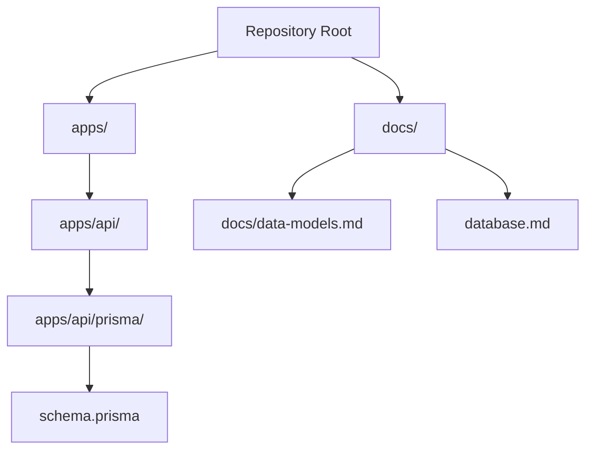
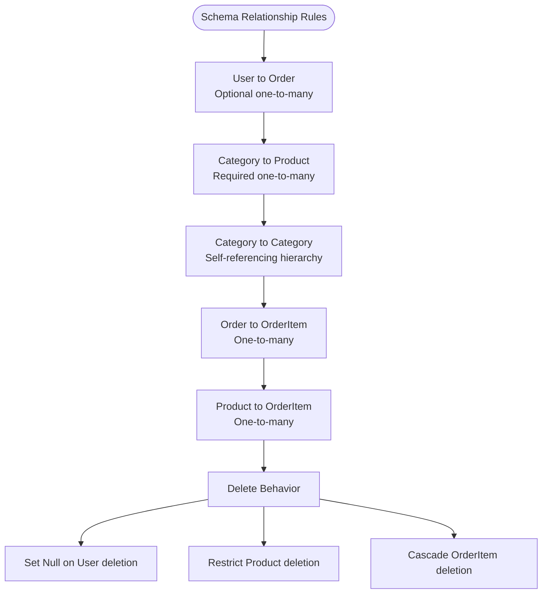
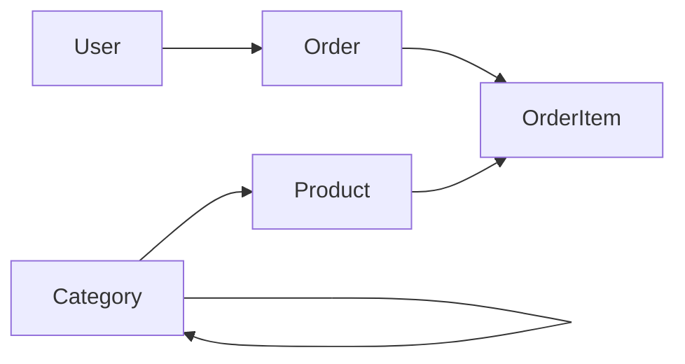

# Core Schema Design

<cite>
**Referenced Files in This Document**   
- [schema.prisma](file://apps/api/prisma/schema.prisma)
- [data-models.md](file://docs/data-models.md)
- [database.md](file://database.md)
</cite>

## Table of Contents
1. [Introduction](#introduction)
2. [Project Structure](#project-structure)
3. [Core Components](#core-components)
4. [Architecture Overview](#architecture-overview)
5. [Detailed Component Analysis](#detailed-component-analysis)
6. [Dependency Analysis](#dependency-analysis)
7. [Performance Considerations](#performance-considerations)
8. [Troubleshooting Guide](#troubleshooting-guide)
9. [Conclusion](#conclusion)
10. [Appendices](#appendices)

## Introduction
This document explains the core Prisma schema design used by the API application. It focuses on the fundamental entities User, Category, Product, Order, and OrderItem; their fields, data types, constraints, indexes, database table mappings, relationships, enum business logic, and common Prisma Client access patterns.

The canonical Medusa v2 database specification is intentionally separate from this Prisma schema. The Medusa-native model uses Medusa DML, module links, and a different money strategy. This document does not claim that the Prisma models are the same as the canonical Medusa custom tables; it documents only what is defined in `apps/api/prisma/schema.prisma`.

## Project Structure
The relevant schema definition lives under the API application:



**Diagram sources**
- [schema.prisma:1-8](file://apps/api/prisma/schema.prisma#L1-L8)
- [data-models.md:1-25](file://docs/data-models.md#L1-L25)
- [database.md:1-12](file://database.md#L1-L12)

**Section sources**
- [schema.prisma:1-8](file://apps/api/prisma/schema.prisma#L1-L8)
- [data-models.md:1-25](file://docs/data-models.md#L1-L25)
- [database.md:1-12](file://database.md#L1-L12)

## Core Components
The Prisma schema defines one PostgreSQL datasource, one generator, four enums, and five domain models.

| Area | Definition | Purpose |
|---|---|---|
| Datasource | PostgreSQL with URL from environment variable | Connects Prisma to the runtime database |
| Generator | Prisma Client JavaScript | Generates typed client for Node.js/TypeScript |
| Enums | Role, OrderStatus, PaymentStatus, PaymentMethod | Constrain role, order lifecycle, payment state, and payment provider |
| Models | User, Category, Product, Order, OrderItem | Represent customers/staff, catalog hierarchy, products, orders, and line items |

Key implementation facts:

- All primary keys use CUID-style identifiers.
- Most timestamps default to current time or update automatically.
- Slug-like columns such as category slug, product slug, and order number are unique.
- Monetary values use Prisma Decimal with precision `(12, 2)`.
- Shipping address is stored as JSON rather than a normalized address model.
- Category hierarchy is self-referencing through `parentId` and a named relation.
- Order-to-product association is many-to-many through OrderItem.

**Section sources**
- [schema.prisma:1-8](file://apps/api/prisma/schema.prisma#L1-L8)
- [schema.prisma:14-42](file://apps/api/prisma/schema.prisma#L14-L42)
- [schema.prisma:48-151](file://apps/api/prisma/schema.prisma#L48-L151)

## Architecture Overview
At a high level, the Prisma schema models a single-merchant e-commerce flow:

- A user can place zero or more orders.
- A category organizes products hierarchically.
- A product belongs to exactly one category.
- An order contains one or more order items.
- Each order item references one product and one order.

```mermaid
erDiagram
USER {
string id PK
string email UK
string passwordHash
string name
string phone UK
enum role
boolean isActive
datetime createdAt
datetime updatedAt
}
CATEGORY {
string id PK
string name
string slug UK
string description
string image
string parentId
datetime createdAt
datetime updatedAt
}
PRODUCT {
string id PK
string title
string slug UK
text description
decimal price
decimal compareAtPrice
decimal costPrice
int stock
string sku UK
json images
boolean isPublished
string categoryId FK
datetime createdAt
datetime updatedAt
}
ORDER {
string id PK
string orderNumber UK
string userId FK
enum status
enum paymentStatus
enum paymentMethod
decimal totalAmount
decimal subtotal
decimal discount
decimal shippingFee
string customerName
string customerPhone
string customerEmail
json shippingAddress
string notes
datetime createdAt
datetime updatedAt
}
ORDER_ITEM {
string id PK
string orderId FK
string productId FK
int quantity
decimal unitPrice
decimal totalPrice
datetime createdAt
}
USER ||--o{ ORDER : "places"
CATEGORY ||--o{ PRODUCT : "contains"
CATEGORY ||o--o| CATEGORY : "parent-child"
ORDER ||--o{ ORDER_ITEM : "has"
PRODUCT ||--o{ ORDER_ITEM : "appears_in"
```

**Diagram sources**
- [schema.prisma:48-63](file://apps/api/prisma/schema.prisma#L48-L63)
- [schema.prisma:65-81](file://apps/api/prisma/schema.prisma#L65-L81)
- [schema.prisma:83-106](file://apps/api/prisma/schema.prisma#L83-L106)
- [schema.prisma:108-135](file://apps/api/prisma/schema.prisma#L108-L135)
- [schema.prisma:137-151](file://apps/api/prisma/schema.prisma#L137-L151)

## Detailed Component Analysis

### Enum Types and Business Logic

#### Role
- Values: CUSTOMER, ADMIN, SELLER.
- Default: CUSTOMER.
- Business meaning: distinguishes end users, administrative staff, and sellers.
- Indexing: no explicit index on the column itself; uniqueness is not enforced at the database level beyond the enum constraint.

#### OrderStatus
- Values: PENDING, CONFIRMED, PROCESSING, SHIPPED, DELIVERED, CANCELLED.
- Default: PENDING.
- Business meaning: represents the order lifecycle from placement through delivery or cancellation.
- Indexing: an index exists on the orders table for status, supporting filtering and dashboard queries.

#### PaymentStatus
- Values: PENDING, PAID, FAILED, REFUNDED.
- Default: PENDING.
- Business meaning: tracks whether payment has been attempted, succeeded, failed, or refunded.
- Indexing: an index exists on the orders table for payment status.

#### PaymentMethod
- Values: COD, BKASH, NAGAD, SSLCOMMERZ, STRIPE.
- Default: COD.
- Business meaning: records the selected payment provider or method for an order.

Important distinction: these enums belong to the Prisma schema. They are not the same as the Medusa-native order and payment statuses documented in the canonical database specification.

**Section sources**
- [schema.prisma:14-42](file://apps/api/prisma/schema.prisma#L14-L42)
- [schema.prisma:108-135](file://apps/api/prisma/schema.prisma#L108-L135)
- [database.md:125-168](file://database.md#L125-L168)

### User Model
| Field | Type | Constraints | Meaning |
|---|---|---|---|
| id | String | Primary key, auto-generated | Unique user identifier |
| email | String | Unique | Login identity and contact |
| passwordHash | String | Required | Stored credential hash |
| name | String? | Nullable | Optional display name |
| phone | String? | Unique | Optional phone number |
| role | Role | Default CUSTOMER | Account role |
| isActive | Boolean | Default true | Account activation flag |
| orders | Relation | One-to-many with Order | Orders placed by the user |
| createdAt | DateTime | Default now() | Creation timestamp |
| updatedAt | DateTime | Auto-update | Last modification timestamp |

Database mapping:
- Table: users
- Explicit indexes: email, phone
- Implicit primary key index on id

Relationships:
- One User can have many Order records.
- Deleting a user does not cascade delete orders because the Order side allows null userId.

Common access patterns:
- Find a user by email.
- Find a user by phone.
- Load a user with their orders.
- Filter active users by role.

**Section sources**
- [schema.prisma:48-63](file://apps/api/prisma/schema.prisma#L48-L63)

### Category Model
| Field | Type | Constraints | Meaning |
|---|---|---|---|
| id | String | Primary key, auto-generated | Unique category identifier |
| name | String | Required | Human-readable category name |
| slug | String | Unique | URL-safe identifier |
| description | String? | Nullable | Optional description |
| image | String? | Nullable | Optional image reference |
| parentId | String? | Nullable | Self-referencing parent category |
| parent | Category? | Named relation | Parent category |
| children | Category[] | Named relation | Child categories |
| products | Product[] | One-to-many | Products assigned to this category |
| createdAt | DateTime | Default now() | Creation timestamp |
| updatedAt | DateTime | Auto-update | Last modification timestamp |

Database mapping:
- Table: categories
- Explicit indexes: slug, parentId
- Implicit primary key index on id

Hierarchical structure:
- Categories form a tree through the self-referencing parent-child relationship.
- Deleting a parent category sets child parentId to null instead of cascading deletes.
- Children are accessed through the named relation CategoryHierarchy.

Common access patterns:
- Find a category by slug.
- Load a category with its children.
- Load a category with its parent.
- List all top-level categories where parentId is null.
- Find products under a category.

**Section sources**
- [schema.prisma:65-81](file://apps/api/prisma/schema.prisma#L65-L81)

### Product Model
| Field | Type | Constraints | Meaning |
|---|---|---|---|
| id | String | Primary key, auto-generated | Unique product identifier |
| title | String | Required | Product title |
| slug | String | Unique | URL-safe product handle |
| description | String | Text type | Long-form product description |
| price | Decimal | Precision 12,2 | Selling price |
| compareAtPrice | Decimal? | Precision 12,2, nullable | Original or comparison price |
| costPrice | Decimal? | Precision 12,2, nullable | Merchant cost basis |
| stock | Int | Default 0 | Available inventory count |
| sku | String | Unique | Stock keeping unit |
| images | String[] | Array, default empty list | Image references |
| isPublished | Boolean | Default true | Storefront visibility flag |
| categoryId | String | Required foreign key | Category assignment |
| category | Category | Required relation | Parent category |
| orderItems | OrderItem[] | One-to-many | Line items referencing this product |
| createdAt | DateTime | Default now() | Creation timestamp |
| updatedAt | DateTime | Auto-update | Last modification timestamp |

Database mapping:
- Table: products
- Explicit indexes: slug, categoryId, price, isPublished
- Implicit primary key index on id

Relationships:
- Many Product records belong to one Category.
- Deleting a category is restricted if products still reference it.
- Many OrderItem records can reference one Product.

Common access patterns:
- Find a product by slug.
- Find a product by SKU.
- List published products by category.
- Search products by price range.
- Load a product with its category.
- Load a product with its order items.

**Section sources**
- [schema.prisma:83-106](file://apps/api/prisma/schema.prisma#L83-L106)

### Order Model
| Field | Type | Constraints | Meaning |
|---|---|---|---|
| id | String | Primary key, auto-generated | Unique order identifier |
| orderNumber | String | Unique | Human-readable order reference |
| userId | String? | Nullable foreign key | Optional associated user |
| user | User? | Optional relation | Placing user |
| status | OrderStatus | Default PENDING | Order lifecycle state |
| paymentStatus | PaymentStatus | Default PENDING | Payment lifecycle state |
| paymentMethod | PaymentMethod | Default COD | Selected payment method |
| totalAmount | Decimal | Precision 12,2 | Final order total |
| subtotal | Decimal | Precision 12,2 | Pre-discount subtotal |
| discount | Decimal | Precision 12,2, default 0 | Applied discount amount |
| shippingFee | Decimal | Precision 12,2, default 0 | Delivery charge |
| customerName | String | Required | Recipient name |
| customerPhone | String | Required | Recipient phone |
| customerEmail | String? | Nullable | Recipient email |
| shippingAddress | Json | Required JSON | Address snapshot |
| orderItems | OrderItem[] | One-to-many | Ordered line items |
| notes | String? | Nullable | Internal or customer note |
| createdAt | DateTime | Default now() | Creation timestamp |
| updatedAt | DateTime | Auto-update | Last modification timestamp |

Database mapping:
- Table: orders
- Explicit indexes: orderNumber, userId, status, paymentStatus, createdAt
- Implicit primary key index on id

Relationships:
- One Order can belong to one optional User.
- One Order can contain many OrderItem records.
- Deleting an order cascades its order items.

Common access patterns:
- Find an order by orderNumber.
- Find orders by user.
- Filter orders by status or payment status.
- Load an order with its order items.
- Load an order with its user when present.

**Section sources**
- [schema.prisma:108-135](file://apps/api/prisma/schema.prisma#L108-L135)

### OrderItem Model
| Field | Type | Constraints | Meaning |
|---|---|---|---|
| id | String | Primary key, auto-generated | Unique line-item identifier |
| orderId | String | Required foreign key | Associated order |
| order | Order | Required relation | Parent order |
| productId | String | Required foreign key | Associated product |
| product | Product | Required relation | Ordered product |
| quantity | Int | Required | Number of units |
| unitPrice | Decimal | Precision 12,2 | Price per unit at purchase time |
| totalPrice | Decimal | Precision 12,2 | Quantity times unit price |
| createdAt | DateTime | Default now() | Creation timestamp |

Database mapping:
- Table: order_items
- Explicit indexes: orderId, productId
- Implicit primary key index on id

Relationships:
- Many OrderItem records belong to one Order.
- Deleting an order removes its order items.
- Many OrderItem records can reference one Product.
- Deleting a product is restricted while order items still reference it.

Common access patterns:
- Find order items by order.
- Find order items by product.
- Load an order item with its order and product.
- Compute order totals from order items.

**Section sources**
- [schema.prisma:137-151](file://apps/api/prisma/schema.prisma#L137-L151)

### Relationships and Referential Integrity



**Diagram sources**
- [schema.prisma:48-63](file://apps/api/prisma/schema.prisma#L48-L63)
- [schema.prisma:65-81](file://apps/api/prisma/schema.prisma#L65-L81)
- [schema.prisma:83-106](file://apps/api/prisma/schema.prisma#L83-L106)
- [schema.prisma:108-135](file://apps/api/prisma/schema.prisma#L108-L135)
- [schema.prisma:137-151](file://apps/api/prisma/schema.prisma#L137-L151)

**Section sources**
- [schema.prisma:48-151](file://apps/api/prisma/schema.prisma#L48-L151)

### Database Table Mappings, Indexes, and Constraints

| Prisma Model | Database Table | Primary Key | Unique Constraints | Explicit Indexes | Notes |
|---|---|---|---|---|---|
| User | users | id | email, phone | email, phone | Role defaults to CUSTOMER |
| Category | categories | id | slug | slug, parentId | Self-referencing hierarchy |
| Product | products | id | slug, sku | slug, categoryId, price, isPublished | Decimal prices with precision 12,2 |
| Order | orders | id | orderNumber | orderNumber, userId, status, paymentStatus, createdAt | JSON shipping address |
| OrderItem | order_items | id | none | orderId, productId | Links Order and Product |

Constraint summary:
- Primary keys are generated using CUID-style IDs.
- Unique constraints protect business identifiers such as email, phone, slug, SKU, and order number.
- Foreign key behavior:
  - Order.userId is nullable; deleting a user sets the reference to null.
  - Product.categoryId is required; deleting a category is restricted if products exist.
  - OrderItem.orderId is required; deleting an order cascades to order items.
  - OrderItem.productId is required; deleting a product is restricted if order items exist.

**Section sources**
- [schema.prisma:48-151](file://apps/api/prisma/schema.prisma#L48-L151)

### Common Prisma Client Queries and Access Patterns

Below are representative query patterns without including code content. Use the generated Prisma Client methods corresponding to these operations.

#### Find by Identifier
- Find User by email.
- Find Category by slug.
- Find Product by slug or SKU.
- Find Order by orderNumber.

#### Hierarchical Category Queries
- Load a category with its children.
- Load a category with its parent.
- Load a category with its products.
- Traverse multiple levels by repeatedly loading children.

#### Product Catalog Queries
- List published products.
- Filter products by category.
- Filter products by price range.
- Load a product with its category.
- Load a product with its order items.

#### Order and Order Item Queries
- Find orders by user.
- Filter orders by status or payment status.
- Load an order with its order items.
- Load an order item with its order and product.
- Compute order totals from order items.

#### Join Examples
- User → Orders → OrderItems → Product → Category.
- Category → Products → OrderItems → Orders.

These patterns map directly to Prisma relations declared in the schema.

**Section sources**
- [schema.prisma:48-151](file://apps/api/prisma/schema.prisma#L48-L151)

## Dependency Analysis
The Prisma schema has clear internal dependencies:

- User is referenced by Order.
- Category is referenced by Product and by itself.
- Product is referenced by OrderItem.
- Order is referenced by OrderItem.
- OrderItem depends on both Order and Product.



**Diagram sources**
- [schema.prisma:48-63](file://apps/api/prisma/schema.prisma#L48-L63)
- [schema.prisma:65-81](file://apps/api/prisma/schema.prisma#L65-L81)
- [schema.prisma:83-106](file://apps/api/prisma/schema.prisma#L83-L106)
- [schema.prisma:108-135](file://apps/api/prisma/schema.prisma#L108-L135)
- [schema.prisma:137-151](file://apps/api/prisma/schema.prisma#L137-L151)

**Section sources**
- [schema.prisma:48-151](file://apps/api/prisma/schema.prisma#L48-L151)

## Performance Considerations
Indexes defined in the schema support typical read-heavy e-commerce workloads:

- Email and phone indexes on users improve authentication and lookup performance.
- Slug indexes on categories and products improve storefront routing.
- Category and product indexes support catalog browsing and filtering.
- Order indexes on orderNumber, userId, status, paymentStatus, and createdAt support admin dashboards, reporting, and customer order lookups.
- OrderItem indexes on orderId and productId support order detail rendering and product sales analysis.

Recommendations aligned with the schema:
- Keep slug-based routes indexed; they are already indexed.
- Avoid scanning large JSON shippingAddress columns without filters.
- Prefer querying by indexed foreign keys such as userId, categoryId, and orderId.
- Monitor order growth; order_number, status, and payment_status are already indexed, but heavy analytical queries may benefit from additional composite indexes depending on workload.

[No sources needed since this section provides general guidance]

## Troubleshooting Guide

### Cannot Create a Category Child Under a Deleted Parent
- Cause: The parent category was deleted, which set child parentId to null.
- Resolution: Reassign the child to another parent or remove it.

**Section sources**
- [schema.prisma:65-81](file://apps/api/prisma/schema.prisma#L65-L81)

### Cannot Delete a Category With Products
- Cause: Product.categoryId has onDelete Restrict.
- Resolution: Move or delete the products first.

**Section sources**
- [schema.prisma:83-106](file://apps/api/prisma/schema.prisma#L83-L106)

### Cannot Delete a Product With Order Items
- Cause: OrderItem.productId has onDelete Restrict.
- Resolution: Remove or reassign order items before deleting the product.

**Section sources**
- [schema.prisma:137-151](file://apps/api/prisma/schema.prisma#L137-L151)

### Duplicate Email, Phone, Slug, SKU, or Order Number
- Cause: Unique constraints on email, phone, slug, sku, and orderNumber.
- Resolution: Ensure generated slugs and order numbers are unique; normalize phone values before insertion.

**Section sources**
- [schema.prisma:48-63](file://apps/api/prisma/schema.prisma#L48-L63)
- [schema.prisma:65-81](file://apps/api/prisma/schema.prisma#L65-L81)
- [schema.prisma:83-106](file://apps/api/prisma/schema.prisma#L83-L106)
- [schema.prisma:108-135](file://apps/api/prisma/schema.prisma#L108-L135)

### Money Precision Issues
- Cause: Monetary fields use Decimal with precision 12,2.
- Resolution: Round amounts before writing; avoid floating-point arithmetic.

**Section sources**
- [schema.prisma:83-106](file://apps/api/prisma/schema.prisma#L83-L106)
- [schema.prisma:108-135](file://apps/api/prisma/schema.prisma#L108-L135)
- [schema.prisma:137-151](file://apps/api/prisma/schema.prisma#L137-L151)

### Confusion Between Prisma Enums and Medusa Native Statuses
- Cause: The Prisma schema defines its own OrderStatus and PaymentStatus enums, while the canonical Medusa database specification describes native Medusa statuses separately.
- Resolution: Treat Prisma enums as local order/payment state for this Prisma-backed API layer. Do not assume they are identical to Medusa-native order or payment statuses.

**Section sources**
- [schema.prisma:14-42](file://apps/api/prisma/schema.prisma#L14-L42)
- [database.md:125-168](file://database.md#L125-L168)

## Conclusion
The Prisma schema provides a straightforward e-commerce data model centered on Users, hierarchical Categories, Products, Orders, and OrderItems. It emphasizes simple relationships, clear indexes, and explicit referential integrity. For production systems built on Medusa v2, this Prisma schema should be understood as a distinct persistence layer from the canonical Medusa DML model described in the database specification. When extending the system, keep enum definitions, money handling, and entity ownership consistent with the intended runtime architecture.

[No sources needed since this section summarizes without analyzing specific files]

## Appendices

### Appendix A: Entity Field Summary

| Entity | Important Fields | Key Relationships |
|---|---|---|
| User | id, email, phone, role, isActive | Orders |
| Category | id, name, slug, parentId | Parent, children, products |
| Product | id, title, slug, price, sku, categoryId | Category, orderItems |
| Order | id, orderNumber, userId, status, paymentStatus, paymentMethod, totals | User, orderItems |
| OrderItem | id, orderId, productId, quantity, unitPrice, totalPrice | Order, Product |

**Section sources**
- [schema.prisma:48-151](file://apps/api/prisma/schema.prisma#L48-L151)

### Appendix B: Canonical Documentation Context
The repository also contains broader documentation about the Medusa-native database design. That canonical specification defines different modules, tables, and money conventions than this Prisma schema. Developers should not treat the two as interchangeable.

**Section sources**
- [data-models.md:1-25](file://docs/data-models.md#L1-L25)
- [database.md:1-12](file://database.md#L1-L12)
- [database.md:172-301](file://database.md#L172-L301)