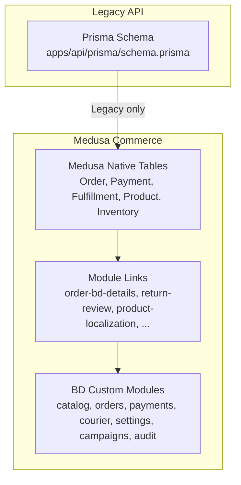
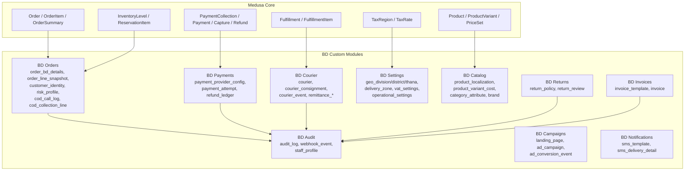
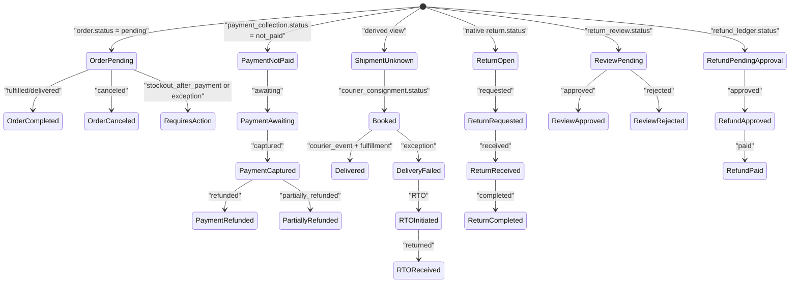
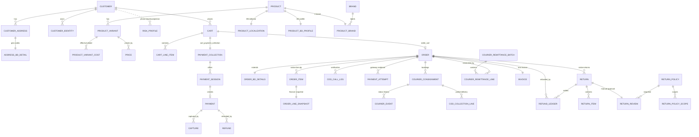
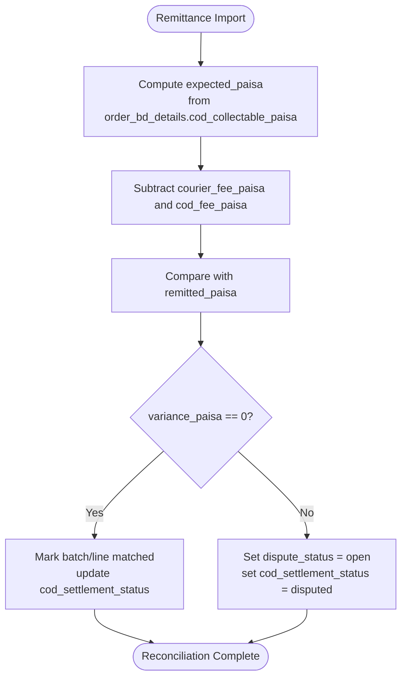
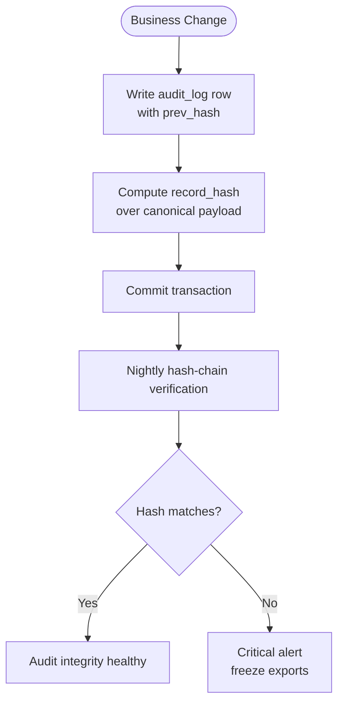
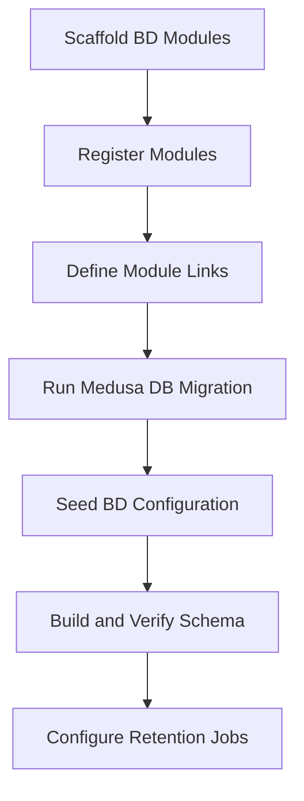
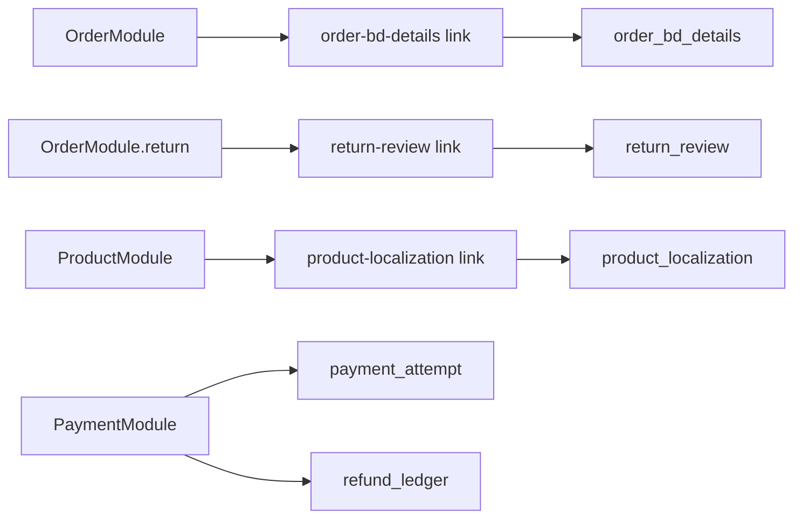

# Data Architecture & Database Design

<cite>
**Referenced Files in This Document**   
- [database.md](file://database.md)
- [data-models.md](file://docs/data-models.md)
- [order-bd-details.ts](file://apps/medusa/src/modules/bd-orders/models/order-bd-details.ts)
- [payment-transaction.ts](file://apps/medusa/src/modules/bd-payments/models/payment-transaction.ts)
- [courier-shipment-log.ts](file://apps/medusa/src/modules/bd-courier/models/courier-shipment-log.ts)
- [audit-log.ts](file://apps/medusa/src/modules/bd-audit/models/audit-log.ts)
- [schema.prisma](file://apps/api/prisma/schema.prisma)
- [architecture.md](file://docs/architecture.md)
</cite>

## Table of Contents
1. [Introduction](#introduction)
2. [Project Structure](#project-structure)
3. [Core Components](#core-components)
4. [Architecture Overview](#architecture-overview)
5. [Detailed Component Analysis](#detailed-component-analysis)
6. [Dependency Analysis](#dependency-analysis)
7. [Performance Considerations](#performance-considerations)
8. [Troubleshooting Guide](#troubleshooting-guide)
9. [Conclusion](#conclusion)

## Introduction
This document describes the data architecture and database design for the BD Commerce Platform, a Bangladesh single-vendor e-commerce system built on MedusaJS v2 with PostgreSQL 16. It explains how native Medusa commerce tables are extended by Bangladesh-specific modules, how four independent status dimensions are modeled, how financial reconciliation is captured, what audit logging guarantees exist, and how money is represented as integer paisa in custom tables while Medusa core uses major-unit BDT decimals. It also covers migration strategy, performance optimization, and data protection measures for sensitive information.

The canonical source of truth for persistence decisions is `database.md` v2.0; earlier drafts and conceptual diagrams are superseded where they conflict with verified Medusa behaviour or this canonical specification.

**Section sources**
- [database.md:15-86](file://database.md#L15-L86)
- [database.md:88-123](file://database.md#L88-L123)

## Project Structure
The platform separates legacy API concerns from the authoritative Medusa commerce layer:

- Legacy Prisma schema under `apps/api/prisma/schema.prisma` defines basic `users`, `products`, `categories`, `orders`, and `order_items`. These tables must not be altered or dropped by new commerce features.
- The Medusa application lives under `apps/medusa`, with custom business domains implemented as isolated modules (`bd-catalog`, `bd-orders`, `bd-payments`, `bd-courier`, `bd-settings`, `bd-campaigns`, `bd-audit`, plus returns, notifications, invoices).
- Custom models use Medusa DML (`model.define`) rather than raw SQL, and relationships to Medusa core entities are expressed through module links instead of direct foreign keys.

**Diagram sources**
- [schema.prisma:1-152](file://apps/api/prisma/schema.prisma#L1-L152)
- [database.md:172-301](file://database.md#L172-L301)
- [database.md:1525-1541](file://database.md#L1525-L1541)

**Section sources**
- [schema.prisma:1-152](file://apps/api/prisma/schema.prisma#L1-L152)
- [agent.md:79-85](file://agent.md#L79-L85)
- [database.md:172-301](file://database.md#L172-L301)

## Core Components
The database model has two layers:

1. **Medusa-native tables**: order identity, line items, payment collections, payments, captures, refunds, fulfillment, inventory, tax, promotion, translation, notification, RBAC, and platform configuration. These are authoritative and must not be duplicated.
2. **Bangladesh custom tables**: 51 tables across 10 modules that extend Medusa with BD geography, COD verification, courier logistics, provider configuration, refund ledger, delivery zones, VAT display configuration, campaign content, SMS templates, invoices, audit logs, webhook events, and staff profiles.

Key conventions:

- Money in Medusa core tables is stored as major-unit BDT decimals via `model.bigNumber()`.
- Money in custom BD tables is stored as integer paisa in columns named `*_paisa`, validated by integer and non-negative checks.
- Extension tables use unique `<entity>_id` columns plus Medusa module links; no direct cross-module foreign keys to Medusa core tables.
- Financial snapshots (line prices, COGS, address, policy, VAT) are write-once at the moment they become legally or operationally relevant.
- Audit log rows are append-only and hash-chained at the database level.

**Section sources**
- [database.md:88-123](file://database.md#L88-L123)
- [database.md:172-301](file://database.md#L172-L301)
- [database.md:370-387](file://database.md#L370-L387)
- [database.md:1352-1389](file://database.md#L1352-L1389)

## Architecture Overview
At a high level, the data architecture preserves Medusa’s commerce facts and adds BD-specific state, finance, logistics, and compliance records without forking core models.

**Diagram sources**
- [database.md:172-301](file://database.md#L172-L301)
- [database.md:389-407](file://database.md#L389-L407)
- [database.md:1439-1463](file://database.md#L1439-L1463)

## Detailed Component Analysis

### Four-Status Separation Model
The platform deliberately separates four independent status dimensions so that each lifecycle can evolve independently:

| Dimension | Authoritative Source | Purpose |
|---|---|---|
| Order status | Native `order.status` | Business order lifecycle: pending, completed, draft, archived, canceled, requires_action |
| Payment status | Native `payment_collection.status`, `payment_session.status`, `refund.status` | Payment lifecycle: not_paid, awaiting, authorized, captured, refunded, canceled, requires_action, etc. |
| Shipment state | Read-only view `v_order_shipment_state` composed from native `order.fulfillment_status`, active `courier_consignment.status`, latest `courier_event`, and exception codes | Operational shipment lifecycle without duplicating state |
| Return/refund status | Native `return.status` plus custom `return_review.status` and `refund_ledger.status` | Physical return lifecycle vs manual approval lifecycle vs business refund lifecycle |

The old implementation draft defined a local `shipment_state` enum on `order_bd_details`; the canonical design removes it and derives shipment state through a read-only view. This prevents a second writer from diverging from native fulfillment state.

**Diagram sources**
- [database.md:125-167](file://database.md#L125-L167)
- [database.md:343-365](file://database.md#L343-L365)
- [database.md:1646-1656](file://database.md#L1646-L1656)
- [database.md:779-779](file://database.md#L779-L779)

**Section sources**
- [database.md:125-167](file://database.md#L125-L167)
- [database.md:343-365](file://database.md#L343-L365)
- [database.md:1646-1656](file://database.md#L1646-L1656)
- [database.md:779-779](file://database.md#L779-L779)

### Medusa Core Tables vs Bangladesh Custom Tables
Medusa core owns commerce facts such as orders, lines, payments, fulfillment, inventory, tax, promotions, translations, notifications, and RBAC. Custom BD tables extend these facts with Bangladesh-specific operational, financial, and compliance context.

| Category | Medusa Core Ownership | BD Custom Extension |
|---|---|---|
| Order | `order`, `order_item`, `order_line_item`, `order_summary`, `order_address`, `order_transaction`, `order_change` | `order_bd_details`, `order_line_snapshot`, `cod_call_log`, `cod_collection_line` |
| Payment | `payment_collection`, `payment_session`, `payment`, `capture`, `refund`, `refund_reason` | `payment_provider_config`, `payment_attempt`, `refund_ledger` |
| Fulfillment | `fulfillment`, `fulfillment_item`, `fulfillment_label`, shipping options/zones | `courier`, `courier_consignment`, `courier_event`, `courier_remittance_batch/line` |
| Catalog | `product`, `product_variant`, `price_set`, categories, options | `product_localization`, `product_bd_profile`, `brand`, `product_brand`, `category_attribute*`, `product_attribute_value`, `product_variant_cost` |
| Geography/Tax | `tax_region`, `tax_rate`, `region`, `store`, `currency` | `geo_division`, `geo_district`, `geo_thana`, `delivery_zone`, `vat_settings`, `operational_settings` |
| Admin/Security | `user`, `auth_identity`, `rbac_role`, `rbac_policy`, `user_rbac_role` | `staff_profile`, `audit_log`, `webhook_event` |
| Marketing/Content | `promotion`, `promotion_campaign` | `landing_page`, `landing_page_version`, `landing_page_offer`, `ad_campaign`, `ad_conversion_event`, `homepage_section`, `content_page`, `media_asset` |
| Compliance | Native notification, translation | `sms_template`, `sms_delivery_detail`, `invoice_template`, `invoice` |

**Section sources**
- [database.md:174-244](file://database.md#L174-L244)
- [database.md:245-301](file://database.md#L245-L301)
- [database.md:1439-1463](file://database.md#L1439-L1463)

### Entity Relationships
The entity relationship model emphasizes one-writer-per-fact, link-based associations, and snapshot tables for historical values.

**Diagram sources**
- [database.md:1543-1587](file://database.md#L1543-L1587)

**Section sources**
- [database.md:1467-1541](file://database.md#L1467-L1541)
- [database.md:1543-1587](file://database.md#L1543-L1587)

### Financial Reconciliation Fields
Financial reconciliation is central to BD commerce because COD, courier fees, payment gateway MDR, packaging costs, and actual courier invoicing often differ from what was quoted or collected.

Key reconciliation fields:

| Area | Field(s) | Meaning |
|---|---|---|
| Customer delivery charge | `order_bd_details.customer_paid_delivery_paisa` | Snapshot of native shipping total at placement |
| Courier cost | `order_bd_details.courier_cost_paisa` | Actual courier invoice amount |
| COD handling fee | `order_bd_details.cod_handling_fee_paisa` | Courier COD fee |
| Payment gateway fee | `order_bd_details.payment_fee_paisa` | bKash/Nagad MDR |
| Packaging cost | `order_bd_details.packaging_cost_paisa` | Actual packaging expense |
| RTO shipping cost | `order_bd_details.rto_shipping_cost_paisa` | Cost when an order returns to origin |
| COD collectable | `order_bd_details.cod_collectable_paisa` | Amount expected from customer at delivery |
| COD collection | `order_bd_details.cod_collected_paisa` | Courier-reported collection |
| COD settlement | `order_bd_details.cod_settlement_status` | Pending, partially remitted, settled, disputed, waived |
| Remittance batch | `courier_remittance_batch.*` | Batch-level gross, fees, adjustment, net remitted |
| Remittance line | `courier_remittance_line.*` | Expected vs remitted per order, variance, dispute status |
| Line COGS | `order_line_snapshot.cogs_unit_paisa`, `cogs_total_paisa` | Historical COGS snapshot per line |
| Variant COGS | `product_variant_cost.cogs_paisa` | Effective-dated COGS used at order time |

Reconciliation rules:

- Variance is never silently absorbed into revenue.
- COD revenue is recognised only when supported by remittance evidence or documented write-off.
- Refund amounts are positive magnitudes; direction is carried by `refund_type`.
- All paisa fields are non-negative integers.
- Discrepancies between snapshot sums and native totals are blocking errors during placement.

**Diagram sources**
- [database.md:2272-2299](file://database.md#L2272-L2299)
- [database.md:875-910](file://database.md#L875-L910)
- [database.md:626-635](file://database.md#L626-L635)

**Section sources**
- [database.md:626-635](file://database.md#L626-L635)
- [database.md:875-910](file://database.md#L875-L910)
- [database.md:2272-2299](file://database.md#L2272-L2299)
- [database.md:2412-2418](file://database.md#L2412-L2418)

### Audit Logging Requirements
Audit logging is both an application convention and a database guarantee:

- `audit_log` is append-only.
- `UPDATE` and `DELETE` are rejected by a trigger.
- Rows cannot be soft-deleted.
- Each row carries a sequence number, occurrence timestamp, actor metadata, entity reference, action, redacted before/after values, correlation identifiers, and a SHA-256 chain hash.
- A nightly job recomputes hashes for recent rows and alerts on mismatch.
- Invoice immutability is enforced separately, allowing only the void transition.

**Diagram sources**
- [database.md:1352-1389](file://database.md#L1352-L1389)
- [database.md:1933-1965](file://database.md#L1933-L1965)

**Section sources**
- [database.md:1352-1389](file://database.md#L1352-L1389)
- [database.md:1933-1990](file://database.md#L1933-L1990)

### Data Conventions: BigInt Paisa Storage
The repository contains conflicting terminology around money storage:

- The canonical database design states that Medusa core tables store major-unit BDT decimals via `model.bigNumber()`, while custom BD tables store integer paisa in `*_paisa` columns.
- The older draft document claims all currency amounts are stored in BDT paisa using `model.bigNumber()` and calls it “bigint paisa.”
- The installed Medusa DML documentation clarifies that `model.bigNumber()` produces a `numeric` column plus a `raw_<column>` JSONB column, not a PostgreSQL `bigint`.
- The legacy Prisma schema uses `Decimal(12,2)` for monetary fields, which is separate from the Medusa DML model.

Correct convention:

| Layer | Representation | Database Type | Example |
|---|---|---|---|
| Medusa core amount columns | Major units BDT | `numeric` via `model.bigNumber()` | `2500` |
| Custom BD paisa columns | Integer paisa | `numeric` with integer CHECK | `250000` |
| Legacy Prisma schema | Decimal BDT | `Decimal(12,2)` | `2500.00` |

Hard rules:

- Never write paisa into a Medusa core amount column.
- Never write major units into a `_paisa` column.
- Conversion happens only at the module service boundary.
- All `_paisa` columns are non-negative integers.
- Floating point is reserved for percentages and ratios, not money.

**Section sources**
- [database.md:88-123](file://database.md#L88-L123)
- [data-models.md:33-38](file://docs/data-models.md#L33-L38)
- [schema.prisma:83-151](file://apps/api/prisma/schema.prisma#L83-L151)

### Migration Strategies
Migration strategy follows Medusa v2 module boundaries and avoids altering core tables:

1. Scaffold custom modules under `apps/medusa/src/modules/`.
2. Register modules in Medusa configuration.
3. Define module links for associations with Medusa core entities.
4. Run Medusa migrations to create custom tables and sync links.
5. Seed initial BD data such as delivery zones, VAT configuration, roles, and native platform rows.
6. Verify schema integrity after build and migration.

Additional canonical requirements include:

- No hand-created auto-generated link tables.
- Index creation in production uses concurrent index creation outside transactions.
- Unique constraints enforce business rules, not just application logic.
- Soft-delete uniqueness allows recreation of soft-deleted rows except for financial facts.
- Retention jobs hard-delete webhook and event rows by age; other tables are retained indefinitely or for legal periods.

**Diagram sources**
- [data-models.md:377-385](file://docs/data-models.md#L377-L385)
- [database.md:1660-1670](file://database.md#L1660-L1670)
- [database.md:2007-2030](file://database.md#L2007-L2030)

**Section sources**
- [data-models.md:377-385](file://docs/data-models.md#L377-L385)
- [database.md:1660-1670](file://database.md#L1660-L1670)
- [database.md:2007-2030](file://database.md#L2007-L2030)

### Performance Optimization Techniques
Performance is addressed through indexing, deduplication, derived views, and careful JSON usage:

- Every DML index is partial by default (`WHERE deleted_at IS NULL`).
- Composite indexes cover operational queues: COD queue, courier manifest, return review queue, refund finance queue, webhook processing queue, risk evaluation queue, zone resolution, variant cost history, and invoice serialisation.
- Deduplication keys prevent double orders, duplicate webhooks, duplicate payment attempts, duplicate refunds, duplicate consignment bookings, duplicate SMS sends, duplicate invoices, and duplicate Meta conversion events.
- JSONB is indexed only when queried; financial data is kept as real columns, not JSON.
- Views provide derived state without creating a second writer.
- Redis is used for ephemeral state such as queues, stock locks, rate limits, and cart cache; durable business facts live only in PostgreSQL.

**Section sources**
- [database.md:1660-1782](file://database.md#L1660-L1782)
- [database.md:1783-1828](file://database.md#L1783-L1828)
- [database.md:1646-1656](file://database.md#L1646-L1656)
- [database.md:72-75](file://database.md#L72-L75)

### Data Protection Measures for Sensitive Information
Sensitive data protection combines classification, access control, encryption, masking, retention, and redaction:

| Measure | Implementation |
|---|---|
| Data classification | Public, internal, sensitive, restricted |
| Database roles | Application, audit writer, readonly reporting, finance, ops |
| Encryption | AES-256-GCM envelope encryption for refund account fields; secrets manager for provider credentials |
| Secrets policy | Provider keys, SMS tokens, courier tokens, Meta CAPI token, JWT/cookie secrets, DB credentials are not stored in plain text in PostgreSQL |
| Webhook redaction | Only allowlisted headers and field-level redacted payloads are persisted |
| Masking | Phones, emails, addresses, refund accounts, IP addresses, COGS, supplier names are masked in lists, exports, and logs |
| Retention | Legal and operational retention policies with scheduled purge and anonymisation jobs |
| Audit logging | Append-only, hash-chained, role-restricted, export-audited |

**Section sources**
- [database.md:1842-1931](file://database.md#L1842-L1931)
- [database.md:1933-2085](file://database.md#L1933-L2085)

## Dependency Analysis
Custom modules depend on Medusa core through module links rather than direct foreign keys. This reduces coupling while preserving referential intent.

**Diagram sources**
- [database.md:1525-1541](file://database.md#L1525-L1541)

**Section sources**
- [database.md:1525-1541](file://database.md#L1525-L1541)

## Performance Considerations
Beyond indexing and deduplication, the design avoids common performance pitfalls:

- No GIN indexes on rarely filtered JSONB audit or landing page fields.
- No indexes on free-text notes or low-cardinality booleans alone.
- No indexes on encrypted columns because ciphertext is nondeterministic.
- No indexes on masked recipient columns; hashed recipients are used for dedupe/reporting.
- Views replace computed state to avoid redundant writes.
- Redis handles short-lived operational state, keeping PostgreSQL focused on durable facts.
- Large append-heavy tables like audit logs use BRIN indexes and monthly partitioning thresholds.

[No sources needed since this section provides general guidance]

## Troubleshooting Guide
Common data issues and their diagnostic paths:

| Symptom | Likely Cause | Diagnostic Action |
|---|---|---|
| Duplicate order placed | Missing idempotency key or checkout race | Check `checkout_idempotency_key` uniqueness and workflow dedupe |
| Payment captured but stock exhausted | Stock check after capture | Set `order_exception_code = stockout_after_payment`; create pending refund |
| Courier webhook processed twice | Provider retry | Use `(consignment, event_type, occurred_at, payload_sha256)` dedupe |
| COD amount mismatch | Stored collectable differs from recomputed value | Block booking; do not send wrong amount to courier |
| Remittance shortfall | Courier variance | Open dispute; set `cod_settlement_status = disputed` |
| Audit log tampering suspicion | Hash-chain mismatch | Run nightly verification; freeze exports |
| Invoice regeneration attempt | Immutable invoice update | Reject unless void transition |
| Phone enumeration risk | Tracking lookup without safeguards | Require phone + order reference; rate limit tracking |
| Secret leaked in logs/webhooks | Redaction failure | Scan logs and webhook payloads; enforce allowlist |

**Section sources**
- [database.md:2168-2193](file://database.md#L2168-L2193)
- [database.md:2180-2193](file://database.md#L2180-L2193)
- [database.md:2078-2085](file://database.md#L2078-L2085)

## Conclusion
The BD Commerce Platform’s data architecture preserves Medusa’s commerce facts while adding robust Bangladesh-specific extensions. Its strongest design choices are:

- Clear separation of Medusa core tables and BD custom tables.
- Four independent status dimensions for order, payment, shipment, and return/refund.
- Integer paisa storage in custom tables with strict rounding and non-negative rules.
- Financial snapshots and reconciliation tables that make COD, courier, payment, and refund flows auditable.
- Database-enforced append-only audit logging with hash chaining.
- Careful indexing, deduplication, and derived views to support operational workloads.
- Strong data protection through classification, encryption, masking, retention, and redaction.

Future changes should follow the canonical authority order: installed Medusa facts first, then this database specification, then the PRD, then data flows and architecture documents. Any schema change must update the canonical database document before migration.

[No sources needed since this section summarizes without analyzing specific files]