# Entity Relationships & Data Flow

<cite>
**Referenced Files in This Document**   
- [order-bd-details.ts](file://apps/medusa/src/modules/bd-orders/models/order-bd-details.ts)
- [payment-transaction.ts](file://apps/medusa/src/modules/bd-payments/models/payment-transaction.ts)
- [courier-shipment-log.ts](file://apps/medusa/src/modules/bd-courier/models/courier-shipment-log.ts)
- [audit-log.ts](file://apps/medusa/src/modules/bd-audit/models/audit-log.ts)
- [order-return-request.ts](file://apps/medusa/src/modules/bd-orders/models/order-return-request.ts)
- [service.ts (bd-orders)](file://apps/medusa/src/modules/bd-orders/service.ts)
- [service.ts (bd-payments)](file://apps/medusa/src/modules/bd-payments/service.ts)
- [service.ts (bd-courier)](file://apps/medusa/src/modules/bd-courier/service.ts)
- [service.ts (bd-audit)](file://apps/medusa/src/modules/bd-audit/service.ts)
- [order-bd-details link](file://apps/medusa/src/links/order-bd-details.ts)
- [order-return-request link](file://apps/medusa/src/links/order-return-request.ts)
- [data-models.md](file://docs/data-models.md)
- [database.md](file://database.md)
- [dfd.md](file://dfd.md)
</cite>

## Table of Contents
1. [Introduction](#introduction)
2. [Project Structure and Module Ownership](#project-structure-and-module-ownership)
3. [Four-Status Separation Model](#four-status-separation-model)
4. [Entity Relationship Overview](#entity-relationship-overview)
5. [Core Custom Entities](#core-custom-entities)
6. [Data Transformation and Paisa Money Convention](#data-transformation-and-paisa-money-convention)
7. [Financial Reconciliation Fields](#financial-reconciliation-fields)
8. [Audit Logging Requirements](#audit-logging-requirements)
9. [Data Migration Strategy Between Medusa Core and Custom Modules](#data-migration-strategy-between-medusa-core-and-custom-modules)
10. [Transaction Boundaries and Referential Integrity](#transaction-boundaries-and-referential-integrity)
11. [End-to-End Data Flow Patterns](#end-to-end-data-flow-patterns)
12. [Performance and Operational Considerations](#performance-and-operational-considerations)
13. [Troubleshooting Guide](#troubleshooting-guide)
14. [Conclusion](#conclusion)

## Introduction
This document explains the entity relationships and data flow patterns that underpin the BD Commerce Platform’s order, payment, shipment, and return/refund lifecycle. It focuses on how four independent status dimensions are separated, how financial amounts are represented, how audit logging is structured, and how custom modules extend Medusa core without duplicating authoritative commerce facts.

The platform uses:
- Medusa v2 as the commerce core for orders, payments, fulfillment, returns, inventory, and pricing.
- Custom Bangladesh-specific modules for address geography, COD verification, courier logistics, payment gateway audit trails, returns review, settings, campaigns, and audit logging.
- PostgreSQL as the relational store, with module links connecting Medusa core entities to custom extension tables.

## Project Structure and Module Ownership
The repository organizes business domains into isolated Medusa modules under `apps/medusa/src/modules/`. Each module defines its own DML models and a service class that exposes CRUD operations through the Medusa framework.

Current relevant modules and responsibilities:
- `bd-orders`: Order extension details, customer risk profile, and return request model.
- `bd-payments`: Payment transaction audit records and webhook logs.
- `bd-courier`: Courier shipment logs and webhook logs.
- `bd-audit`: Audit log and staff role permission model.
- Links connect Medusa core `Order` to custom `order_bd_details` and `order_return_request`.

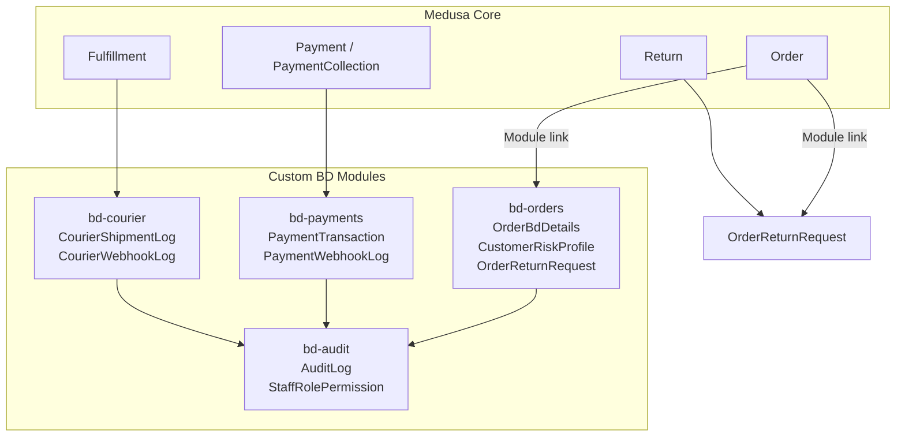

**Diagram sources**
- [order-bd-details.ts:3-39](file://apps/medusa/src/modules/bd-orders/models/order-bd-details.ts#L3-L39)
- [payment-transaction.ts:3-15](file://apps/medusa/src/modules/bd-payments/models/payment-transaction.ts#L3-L15)
- [courier-shipment-log.ts:3-12](file://apps/medusa/src/modules/bd-courier/models/courier-shipment-log.ts#L3-L12)
- [audit-log.ts:3-40](file://apps/medusa/src/modules/bd-audit/models/audit-log.ts#L3-L40)
- [order-return-request.ts:3-25](file://apps/medusa/src/modules/bd-orders/models/order-return-request.ts#L3-L25)
- [order-bd-details link:5-8](file://apps/medusa/src/links/order-bd-details.ts#L5-L8)
- [order-return-request link:5-8](file://apps/medusa/src/links/order-return-request.ts#L5-L8)

**Section sources**
- [service.ts (bd-orders):6-10](file://apps/medusa/src/modules/bd-orders/service.ts#L6-L10)
- [service.ts (bd-payments):5-8](file://apps/medusa/src/modules/bd-payments/service.ts#L5-L8)
- [service.ts (bd-courier):5-8](file://apps/medusa/src/modules/bd-courier/service.ts#L5-L8)
- [service.ts (bd-audit):5-8](file://apps/medusa/src/modules/bd-audit/service.ts#L5-L8)
- [order-bd-details link:1-9](file://apps/medusa/src/links/order-bd-details.ts#L1-L9)
- [order-return-request link:1-9](file://apps/medusa/src/links/order-return-request.ts#L1-L9)

## Four-Status Separation Model
The platform deliberately separates four status dimensions so that no single table owns all lifecycle state:

| Dimension | Authoritative Source | Purpose |
|---|---|---|
| Order status | Medusa core `order.status` | High-level commercial order state such as pending, completed, canceled, or requires action. |
| Payment status | Medusa core `payment_collection.status`, `payment_session.status`, and native payment rows | Whether payment is not paid, awaiting, authorized, captured, partially refunded, refunded, or canceled. |
| Shipment state | Custom `order_bd_details.shipment_state` plus courier consignment/event data | Bangladesh operational delivery progression from pending confirmation through dispatched, delivered, failed, RTO initiated, and RTO received. |
| Return/refund status | Native `return.status` plus custom return review or return request status | Physical return lifecycle versus manual approval, inspection, and refund recording. |

This separation prevents one workflow from accidentally overwriting another domain’s state. For example, a courier webhook may update shipment state but should not directly rewrite Medusa order status unless the fulfillment lifecycle has reached completion.

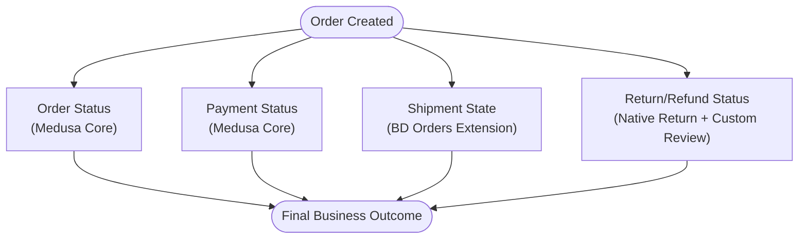

**Diagram sources**
- [order-bd-details.ts:16-33](file://apps/medusa/src/modules/bd-orders/models/order-bd-details.ts#L16-L33)
- [order-return-request.ts:6-24](file://apps/medusa/src/modules/bd-orders/models/order-return-request.ts#L6-L24)
- [database.md:125-168](file://database.md#L125-L168)
- [dfd.md:762-800](file://dfd.md#L762-L800)

**Section sources**
- [database.md:125-168](file://database.md#L125-L168)
- [dfd.md:762-800](file://dfd.md#L762-L800)

## Entity Relationship Overview
At the current implementation level, the most important relationships are:

- `OrderBdDetails` extends a Medusa `Order` via a unique `order_id` column and a module link.
- `OrderReturnRequest` extends a Medusa `Order` via a unique `order_id` column and a module link.
- `PaymentTransaction` references an optional `order_id` and stores gateway-facing transaction audit data.
- `CourierShipmentLog` references an `order_id` and stores outbound/inbound courier API payloads.
- `AuditLog` is cross-cutting and references any affected entity by type and ID.

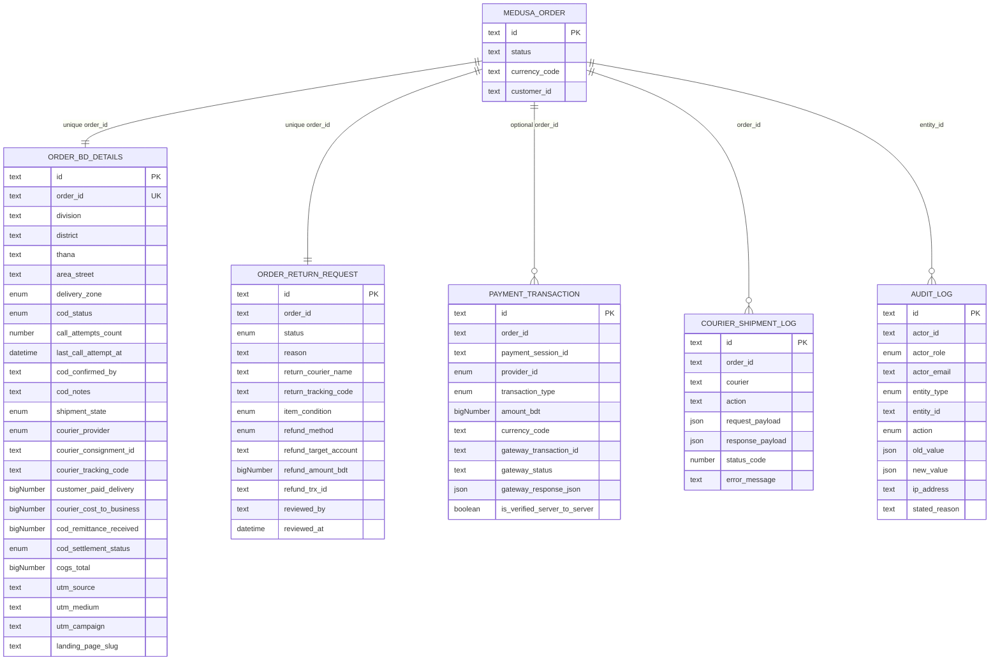

**Diagram sources**
- [order-bd-details.ts:3-39](file://apps/medusa/src/modules/bd-orders/models/order-bd-details.ts#L3-L39)
- [order-return-request.ts:3-25](file://apps/medusa/src/modules/bd-orders/models/order-return-request.ts#L3-L25)
- [payment-transaction.ts:3-15](file://apps/medusa/src/modules/bd-payments/models/payment-transaction.ts#L3-L15)
- [courier-shipment-log.ts:3-12](file://apps/medusa/src/modules/bd-courier/models/courier-shipment-log.ts#L3-L12)
- [audit-log.ts:3-40](file://apps/medusa/src/modules/bd-audit/models/audit-log.ts#L3-L40)

**Section sources**
- [order-bd-details.ts:3-39](file://apps/medusa/src/modules/bd-orders/models/order-bd-details.ts#L3-L39)
- [order-return-request.ts:3-25](file://apps/medusa/src/modules/bd-orders/models/order-return-request.ts#L3-L25)
- [payment-transaction.ts:3-15](file://apps/medusa/src/modules/bd-payments/models/payment-transaction.ts#L3-L15)
- [courier-shipment-log.ts:3-12](file://apps/medusa/src/modules/bd-courier/models/courier-shipment-log.ts#L3-L12)
- [audit-log.ts:3-40](file://apps/medusa/src/modules/bd-audit/models/audit-log.ts#L3-L40)

## Core Custom Entities

### OrderBD Details
`OrderBdDetails` is the primary Bangladesh extension for an order. It captures:
- Geographic hierarchy: division, district, thana, area/street.
- Delivery zone classification.
- COD verification state and call-center metadata.
- Shipment state and courier selection.
- Financial split fields for delivery charges, courier cost, COD remittance, COGS snapshot, and settlement status.
- Marketing attribution fields like UTM parameters and landing page slug.

Key design notes:
- `order_id` is unique, making this a 1:1 extension per order.
- `shipment_state` is an explicit operational enum rather than relying solely on Medusa fulfillment status.
- Monetary fields use `bigNumber`, which maps to PostgreSQL numeric columns; the canonical database specification clarifies that integer paisa storage must be enforced by checks and naming conventions.

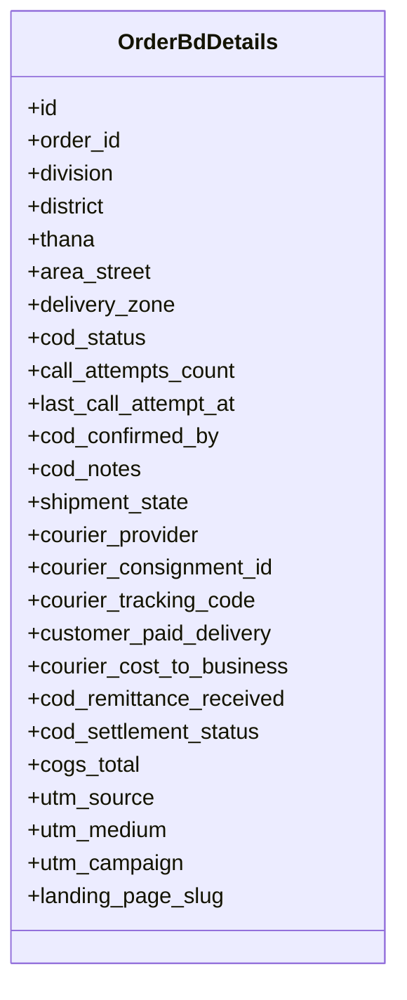

**Diagram sources**
- [order-bd-details.ts:3-39](file://apps/medusa/src/modules/bd-orders/models/order-bd-details.ts#L3-L39)

**Section sources**
- [order-bd-details.ts:3-39](file://apps/medusa/src/modules/bd-orders/models/order-bd-details.ts#L3-L39)
- [data-models.md:195-225](file://docs/data-models.md#L195-L225)
- [database.md:608-650](file://database.md#L608-L650)

### PaymentTransaction
`PaymentTransaction` records gateway-facing payment events. It includes:
- Optional linkage to an order.
- Payment session reference.
- Provider identifier.
- Transaction type: authorization, capture, refund, or status query.
- Amount, currency, gateway transaction ID, gateway status, raw JSON response, and server-to-server verification flag.

Important constraint:
- The current model does not include a non-null unique index on `gateway_transaction_id`; this matters for idempotent webhook processing and duplicate detection.

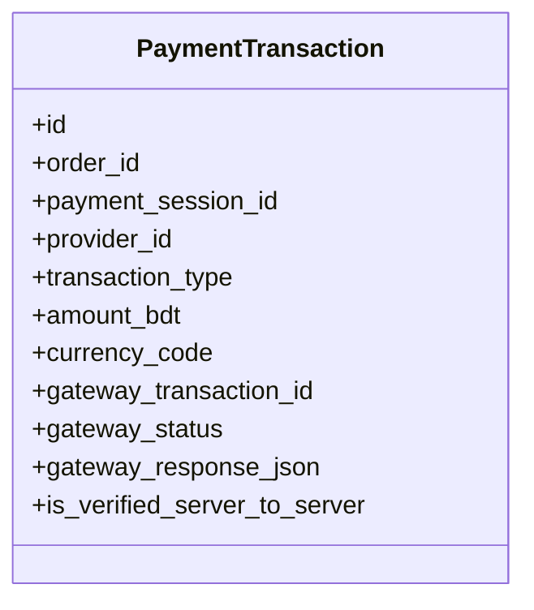

**Diagram sources**
- [payment-transaction.ts:3-15](file://apps/medusa/src/modules/bd-payments/models/payment-transaction.ts#L3-L15)

**Section sources**
- [payment-transaction.ts:3-15](file://apps/medusa/src/modules/bd-payments/models/payment-transaction.ts#L3-L15)
- [data-models.md:244-259](file://docs/data-models.md#L244-L259)

### CourierShipmentLog
`CourierShipmentLog` is an audit trail for courier API interactions. It stores:
- Order reference.
- Courier name.
- Action description.
- Request and response payloads.
- HTTP status code and error message.

This model supports debugging, reconciliation, and dispute resolution when courier APIs behave inconsistently.

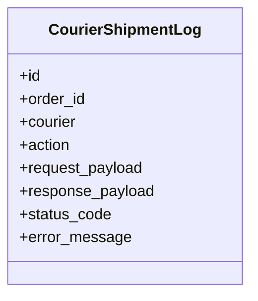

**Diagram sources**
- [courier-shipment-log.ts:3-12](file://apps/medusa/src/modules/bd-courier/models/courier-shipment-log.ts#L3-L12)

**Section sources**
- [courier-shipment-log.ts:3-12](file://apps/medusa/src/modules/bd-courier/models/courier-shipment-log.ts#L3-L12)
- [data-models.md:226-239](file://docs/data-models.md#L226-L239)

### AuditLog
`AuditLog` is the append-only security and operations ledger. It captures:
- Actor identity and role.
- Affected entity type and ID.
- Action taken.
- Old and new values as JSON.
- Client IP address and stated reason.

This table is central to compliance, finance audits, and operational forensics.

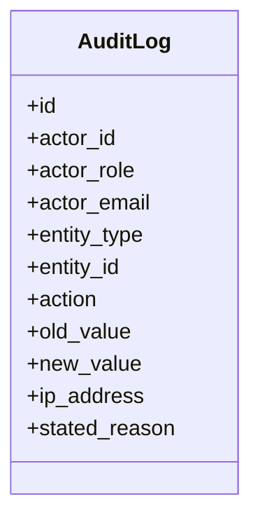

**Diagram sources**
- [audit-log.ts:3-40](file://apps/medusa/src/modules/bd-audit/models/audit-log.ts#L3-L40)

**Section sources**
- [audit-log.ts:3-40](file://apps/medusa/src/modules/bd-audit/models/audit-log.ts#L3-L40)
- [data-models.md:321-337](file://docs/data-models.md#L321-L337)

### OrderReturnRequest
`OrderReturnRequest` represents a return request linked to an order. It includes:
- Return status.
- Reason.
- Return courier and tracking code.
- Item condition after inspection.
- Refund method, target account, amount, and external transaction ID.
- Review metadata.

Note: The canonical database specification treats the native Medusa `return` as authoritative for the physical return lifecycle and recommends a separate review extension rather than a parallel return entity. The current DML model still exists here, so downstream services must coordinate carefully with native returns.

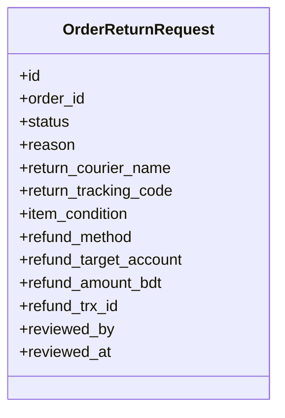

**Diagram sources**
- [order-return-request.ts:3-25](file://apps/medusa/src/modules/bd-orders/models/order-return-request.ts#L3-L25)

**Section sources**
- [order-return-request.ts:3-25](file://apps/medusa/src/modules/bd-orders/models/order-return-request.ts#L3-L25)
- [data-models.md:303-327](file://docs/data-models.md#L303-L327)
- [database.md:303-327](file://database.md#L303-L327)

## Data Transformation and Paisa Money Convention
The repository contains two related but distinct money conventions:

1. **Implementation-level model convention:**
   - Many custom fields use `model.bigNumber()`.
   - Field names such as `amount_bdt`, `customer_paid_delivery`, `courier_cost_to_business`, `cod_remittance_received`, `cogs_total`, and `refund_amount_bdt` suggest BDT major units.

2. **Canonical documentation convention:**
   - The canonical database specification states that Medusa core amounts are stored in major units (decimal BDT).
   - Custom BD tables should store integer paisa using `model.bigNumber()` with integer checks and `_paisa` suffixes.
   - Conversion between major units and paisa happens at module boundaries through dedicated helpers.

For this platform, the safest rule is:
- Treat Medusa core monetary fields as major-unit BDT.
- Treat custom BD monetary fields as potentially paisa if they represent internal accounting snapshots.
- Never assume both sides are the same unit without explicit conversion.
- Prefer renaming ambiguous fields to `_paisa` where they represent integer paisa, following the canonical guidance.

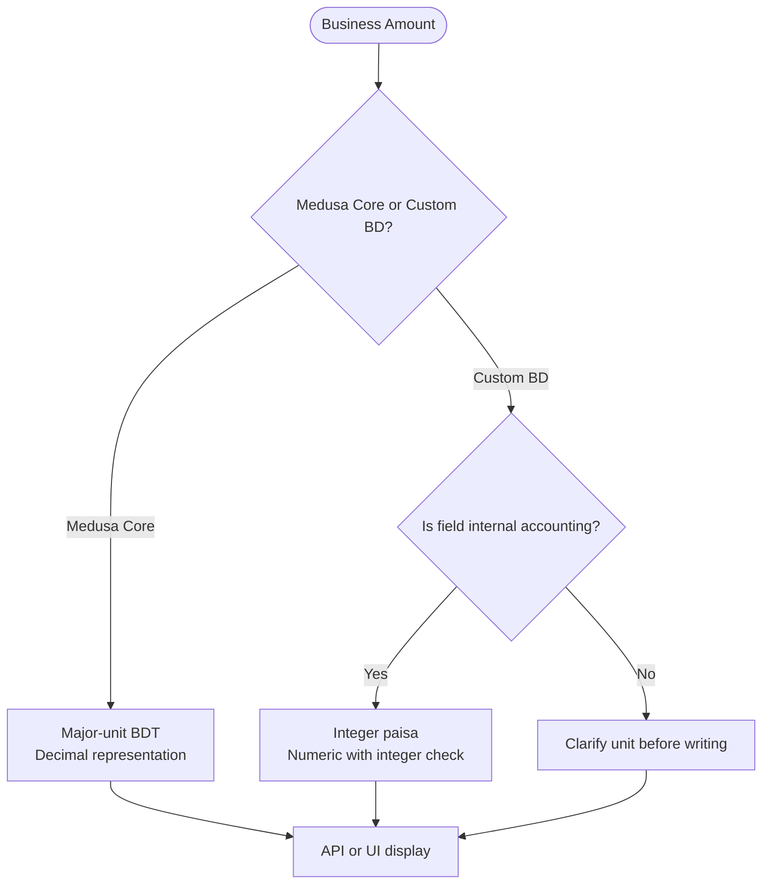

**Diagram sources**
- [payment-transaction.ts:9-10](file://apps/medusa/src/modules/bd-payments/models/payment-transaction.ts#L9-L10)
- [order-bd-details.ts:30-34](file://apps/medusa/src/modules/bd-orders/models/order-bd-details.ts#L30-L34)
- [order-return-request.ts:21](file://apps/medusa/src/modules/bd-orders/models/order-return-request.ts#L21)
- [database.md:88-124](file://database.md#L88-L124)

**Section sources**
- [database.md:88-124](file://database.md#L88-L124)
- [payment-transaction.ts:9-10](file://apps/medusa/src/modules/bd-payments/models/payment-transaction.ts#L9-L10)
- [order-bd-details.ts:30-34](file://apps/medusa/src/modules/bd-orders/models/order-bd-details.ts#L30-L34)
- [order-return-request.ts:21](file://apps/medusa/src/modules/bd-orders/models/order-return-request.ts#L21)

## Financial Reconciliation Fields
Financial reconciliation spans three layers:

| Layer | Fields | Reconciliation Role |
|---|---|---|
| Order extension | `customer_paid_delivery`, `courier_cost_to_business`, `cod_remittance_received`, `cod_settlement_status`, `cogs_total` | Tracks what the customer paid for delivery, what the courier charged, what cash was remitted, and whether settlement is pending, partial, settled, disputed, or waived. |
| Payment audit | `amount_bdt`, `gateway_transaction_id`, `gateway_status`, `gateway_response_json`, `is_verified_server_to_server` | Provides gateway-side evidence for capture, refund, and verification. |
| Courier audit | `request_payload`, `response_payload`, `status_code`, `error_message` | Provides evidence for booking, cancellation, tracking, and webhook failures. |

Reconciliation rules:
- Do not treat `cod_remittance_received` as authoritative without comparing it against courier remittance batches and actual bank/wallet payouts.
- Use `gateway_response_json` only as supporting evidence; business state should be derived from verified server-to-server queries.
- Keep `cogs_total` as a snapshot or derived value rather than allowing ad-hoc edits.

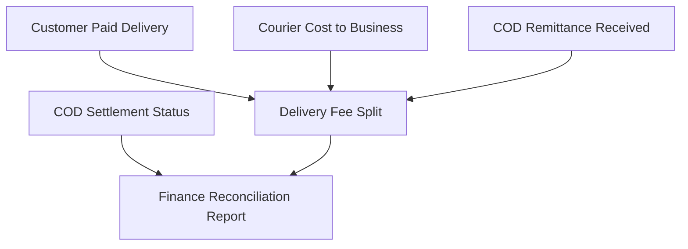

**Diagram sources**
- [order-bd-details.ts:30-33](file://apps/medusa/src/modules/bd-orders/models/order-bd-details.ts#L30-L33)
- [payment-transaction.ts:9-14](file://apps/medusa/src/modules/bd-payments/models/payment-transaction.ts#L9-L14)
- [courier-shipment-log.ts:8-11](file://apps/medusa/src/modules/bd-courier/models/courier-shipment-log.ts#L8-L11)

**Section sources**
- [order-bd-details.ts:30-33](file://apps/medusa/src/modules/bd-orders/models/order-bd-details.ts#L30-L33)
- [payment-transaction.ts:9-14](file://apps/medusa/src/modules/bd-payments/models/payment-transaction.ts#L9-L14)
- [courier-shipment-log.ts:8-11](file://apps/medusa/src/modules/bd-courier/models/courier-shipment-log.ts#L8-L11)
- [data-models.md:195-225](file://docs/data-models.md#L195-L225)

## Audit Logging Requirements
Every sensitive operation should write to `AuditLog`. Required fields include:
- `actor_id`: Staff user ID, system, or customer context.
- `actor_role`: Role at time of action.
- `entity_type`: Type of affected entity.
- `entity_id`: Primary key of affected record.
- `action`: Create, update, delete, status transition, refund recorded, restocked, quarantined, consignment booked/canceled, authentication failure, lockout, or password reset.
- `old_value` and `new_value`: Before and after state as JSON.
- `ip_address`: Client IP for security context.
- `stated_reason`: Human-entered rationale for sensitive changes.

Best practices:
- Make audit entries immutable.
- Avoid storing secrets in `old_value` or `new_value`.
- Mask PII where possible.
- Include enough context to reconstruct the decision path during disputes or finance audits.

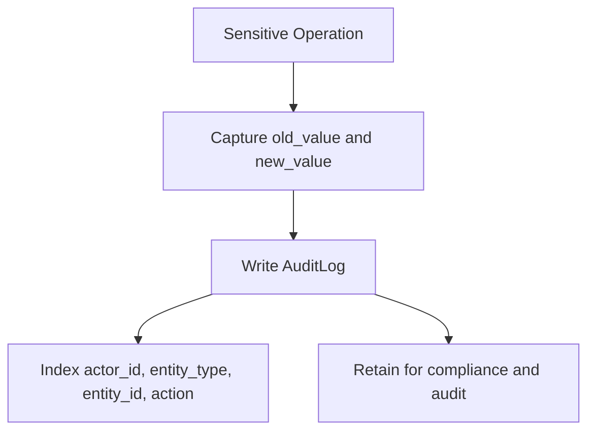

**Diagram sources**
- [audit-log.ts:3-40](file://apps/medusa/src/modules/bd-audit/models/audit-log.ts#L3-L40)

**Section sources**
- [audit-log.ts:3-40](file://apps/medusa/src/modules/bd-audit/models/audit-log.ts#L3-L40)
- [data-models.md:321-337](file://docs/data-models.md#L321-L337)

## Data Migration Strategy Between Medusa Core and Custom Modules
The repository demonstrates a clear pattern:

1. **Do not duplicate Medusa core facts.**
   - Order status, payment status, fulfillment status, return status, prices, quantities, and shipping amounts belong to Medusa core.
   - Custom modules add Bangladesh-specific context through extension tables.

2. **Use module links for associations.**
   - `order-bd-details.ts` links Medusa `Order` to `order_bd_details`.
   - `order-return-request.ts` links Medusa `Order` to `order_return_request`.

3. **Preserve historical snapshots.**
   - Financial and address facts should be copied at placement time rather than recomputed later.
   - If a field is a snapshot, document it explicitly and avoid hand-editing it.

4. **Align DML models with canonical documentation.**
   - The current DML models are a subset of the canonical database specification.
   - When migrating, rename ambiguous money fields to `_paisa`, add integer checks, and ensure indexes support reconciliation queries.

5. **Migration phases:**
   - Scaffold modules and models.
   - Register modules in Medusa configuration.
   - Define module links.
   - Run migrations.
   - Seed initial configuration data.
   - Verify schema integrity.

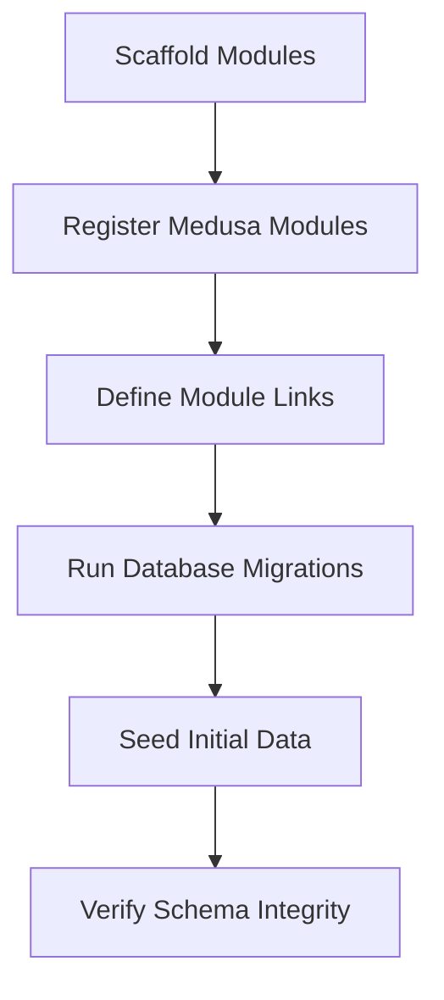

**Diagram sources**
- [order-bd-details link:5-8](file://apps/medusa/src/links/order-bd-details.ts#L5-L8)
- [order-return-request link:5-8](file://apps/medusa/src/links/order-return-request.ts#L5-L8)
- [data-models.md:377-385](file://docs/data-models.md#L377-L385)

**Section sources**
- [order-bd-details link:1-9](file://apps/medusa/src/links/order-bd-details.ts#L1-L9)
- [order-return-request link:1-9](file://apps/medusa/src/links/order-return-request.ts#L1-L9)
- [data-models.md:377-385](file://docs/data-models.md#L377-L385)
- [database.md:328-342](file://database.md#L328-L342)

## Transaction Boundaries and Referential Integrity
Transaction boundaries should follow these rules:

- **Order creation:** Atomic insertion of Medusa core order data plus the corresponding `order_bd_details` extension.
- **Payment verification:** Server-to-server verification before creating or finalizing an order.
- **Courier booking:** Persist courier API request/response together with order linkage.
- **Return/refund:** Coordinate native return state with custom return review/request state and audit entries.
- **Audit logging:** Write audit entries within the same logical transaction boundary as the business change whenever possible.

Referential integrity constraints:
- Custom modules do not create direct foreign keys to Medusa core tables.
- Associations use unique columns plus module links.
- Within a custom module, foreign keys are allowed when both tables are module-owned and lifecycle-coupled.
- Idempotency is critical for payment webhooks and courier callbacks.

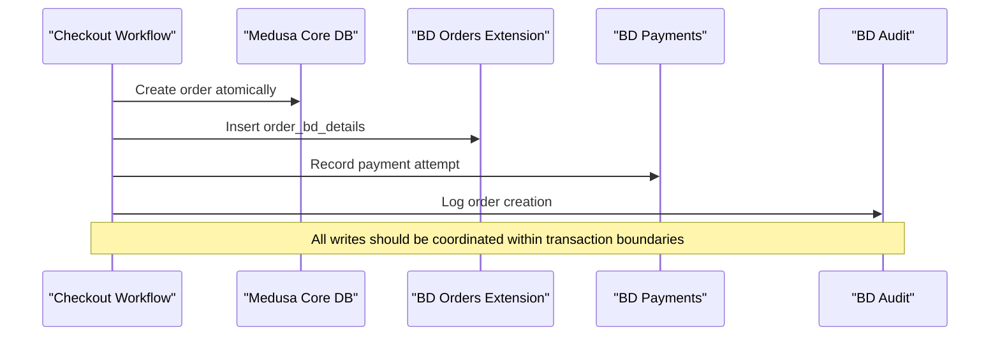

**Diagram sources**
- [order-bd-details.ts:3-39](file://apps/medusa/src/modules/bd-orders/models/order-bd-details.ts#L3-L39)
- [payment-transaction.ts:3-15](file://apps/medusa/src/modules/bd-payments/models/payment-transaction.ts#L3-L15)
- [audit-log.ts:3-40](file://apps/medusa/src/modules/bd-audit/models/audit-log.ts#L3-L40)
- [database.md:370-387](file://database.md#L370-L387)

**Section sources**
- [database.md:370-387](file://database.md#L370-L387)
- [dfd.md:614-635](file://dfd.md#L614-L635)

## End-to-End Data Flow Patterns

### Order Placement and COD Verification
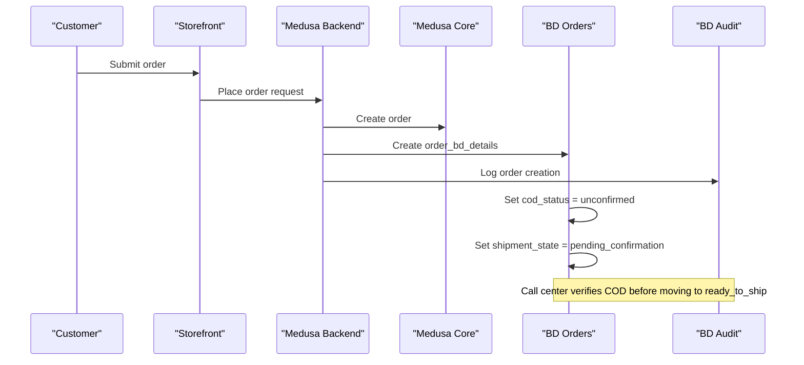

**Diagram sources**
- [order-bd-details.ts:11-26](file://apps/medusa/src/modules/bd-orders/models/order-bd-details.ts#L11-L26)
- [audit-log.ts:22-35](file://apps/medusa/src/modules/bd-audit/models/audit-log.ts#L22-L35)
- [dfd.md:396-443](file://dfd.md#L396-L443)

### Payment Callback and Verification
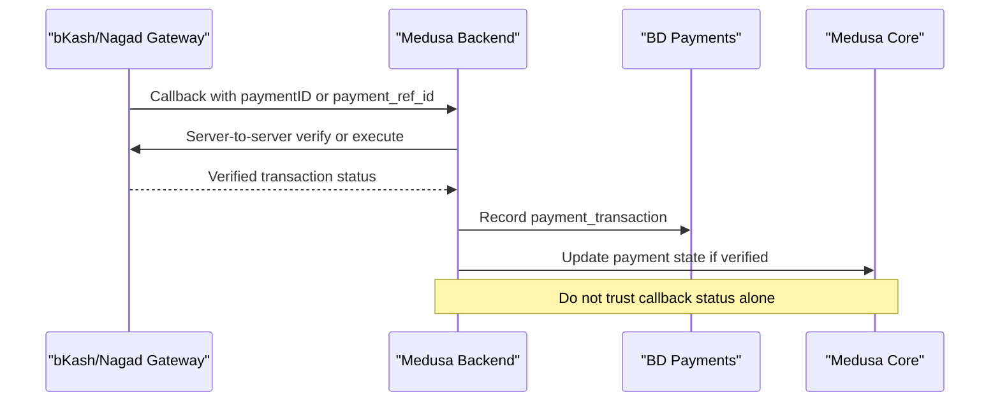

**Diagram sources**
- [payment-transaction.ts:3-15](file://apps/medusa/src/modules/bd-payments/models/payment-transaction.ts#L3-L15)
- [dfd.md:331-394](file://dfd.md#L331-L394)

### Courier Booking and Webhook Processing
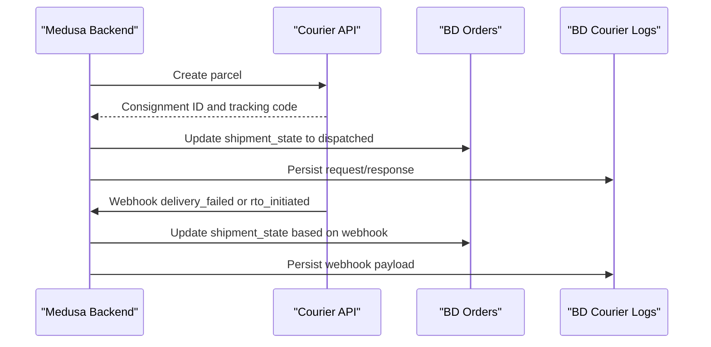

**Diagram sources**
- [courier-shipment-log.ts:3-12](file://apps/medusa/src/modules/bd-courier/models/courier-shipment-log.ts#L3-L12)
- [order-bd-details.ts:16-33](file://apps/medusa/src/modules/bd-orders/models/order-bd-details.ts#L16-L33)
- [dfd.md:445-502](file://dfd.md#L445-L502)

### Return Inspection and Manual Refund
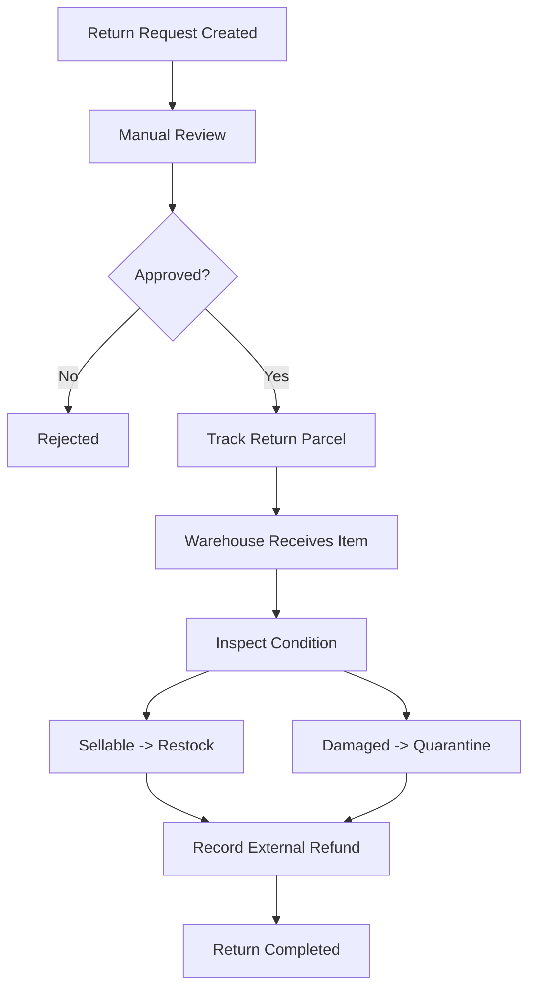

**Diagram sources**
- [order-return-request.ts:6-24](file://apps/medusa/src/modules/bd-orders/models/order-return-request.ts#L6-L24)
- [dfd.md:504-554](file://dfd.md#L504-L554)

## Performance and Operational Considerations
- **Indexes:** Ensure frequently queried fields such as `order_id`, `courier_tracking_code`, `gateway_transaction_id`, `entity_id`, and `actor_id` are indexed where needed.
- **JSON payloads:** `gateway_response_json`, `request_payload`, `response_payload`, `old_value`, and `new_value` can grow large; consider retention policies and archival strategies.
- **Money precision:** Avoid floating-point arithmetic for financial calculations. Use integer paisa with documented rounding rules.
- **Idempotency:** Payment and courier webhooks must handle duplicates safely.
- **Audit volume:** Audit logs are append-only and can grow quickly; plan indexing, partitioning, and retention accordingly.

[No sources needed since this section provides general guidance]

## Troubleshooting Guide

### Symptom: Duplicate Payment Transactions
**Likely causes:**
- Callback retries without idempotency checks.
- Missing unique constraint on `gateway_transaction_id`.
- Browser redirect dropped and background poller recreating work.

**Resolution steps:**
- Deduplicate by `gateway_transaction_id` and `order_id`.
- Enforce idempotency at the service layer.
- Add appropriate unique constraints if required by business policy.

**Section sources**
- [payment-transaction.ts:3-15](file://apps/medusa/src/modules/bd-payments/models/payment-transaction.ts#L3-L15)
- [dfd.md:331-394](file://dfd.md#L331-L394)

### Symptom: Shipment State Does Not Match Courier Status
**Likely causes:**
- Webhook not processed.
- Webhook signature verification failed.
- Service updated wrong status dimension.

**Resolution steps:**
- Inspect `CourierShipmentLog.request_payload` and `response_payload`.
- Check `status_code` and `error_message`.
- Confirm that only shipment state changed, not Medusa order status.

**Section sources**
- [courier-shipment-log.ts:3-12](file://apps/medusa/src/modules/bd-courier/models/courier-shipment-log.ts#L3-L12)
- [order-bd-details.ts:16-33](file://apps/medusa/src/modules/bd-orders/models/order-bd-details.ts#L16-L33)
- [dfd.md:445-502](file://dfd.md#L445-L502)

### Symptom: COD Settlement Discrepancy
**Likely causes:**
- Partial delivery collected.
- Courier fee deducted.
- Remittance batch mismatch.
- Settlement status not updated.

**Resolution steps:**
- Compare `customer_paid_delivery`, `courier_cost_to_business`, and `cod_remittance_received`.
- Check `cod_settlement_status`.
- Reconcile against courier remittance batches and bank/wallet statements.

**Section sources**
- [order-bd-details.ts:30-33](file://apps/medusa/src/modules/bd-orders/models/order-bd-details.ts#L30-L33)
- [data-models.md:195-225](file://docs/data-models.md#L195-L225)

### Symptom: Audit Log Missing Sensitive Changes
**Likely causes:**
- Workflow did not call audit logger.
- Audit entry written outside transaction boundary.
- PII masking removed necessary context.

**Resolution steps:**
- Trace the workflow that performs the change.
- Verify audit entry exists with correct `entity_type`, `entity_id`, and `action`.
- Ensure sensitive fields are masked but sufficient context remains.

**Section sources**
- [audit-log.ts:3-40](file://apps/medusa/src/modules/bd-audit/models/audit-log.ts#L3-L40)

## Conclusion
The BD Commerce Platform separates order, payment, shipment, and return/refund status across Medusa core and custom modules to preserve clarity, auditability, and extensibility. The most important implementation rules are:

- Keep Medusa core facts authoritative; extend them with custom tables.
- Separate status dimensions so each workflow updates only its owned state.
- Represent money consistently, preferably using integer paisa for custom accounting fields.
- Record every sensitive change in `AuditLog`.
- Use module links instead of direct foreign keys to Medusa core tables.
- Design transactions and idempotency around payment and courier webhooks.
- Align DML models with the canonical database specification during migration.

These patterns make the platform easier to audit, reconcile, and evolve while keeping Medusa core intact.