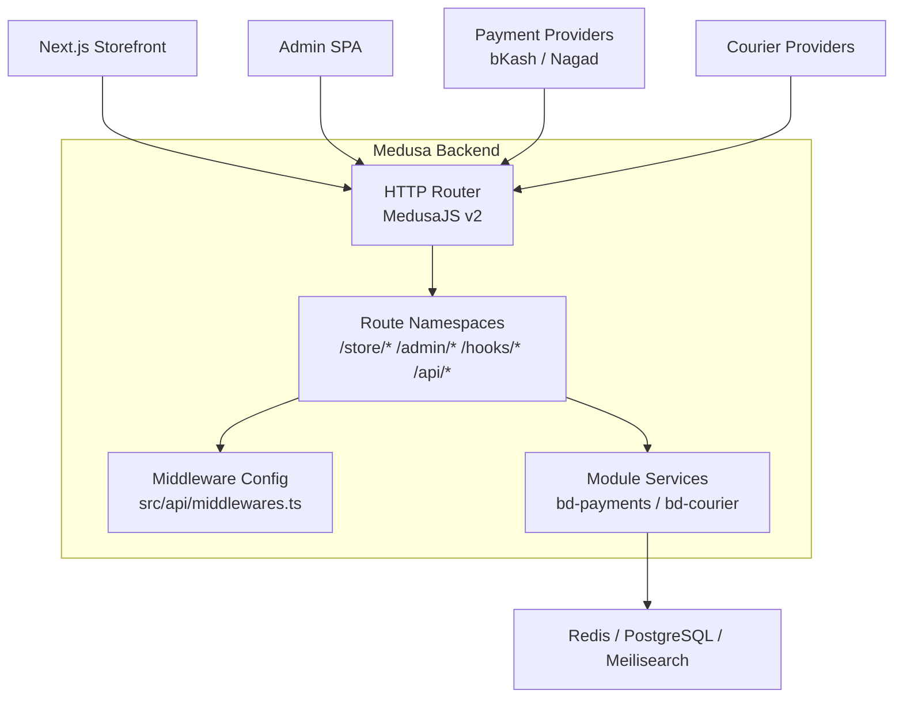
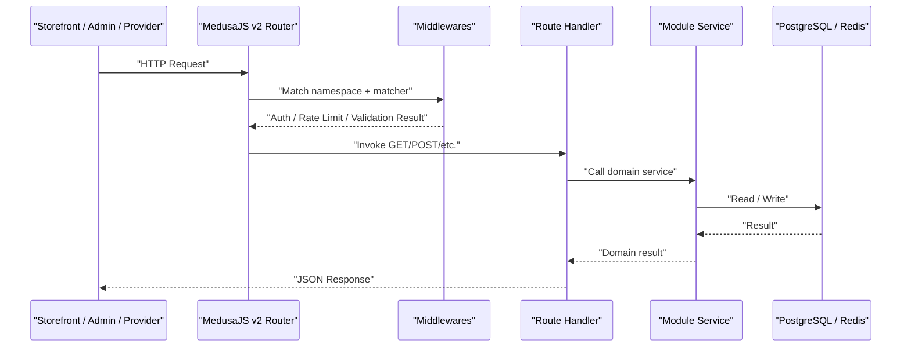
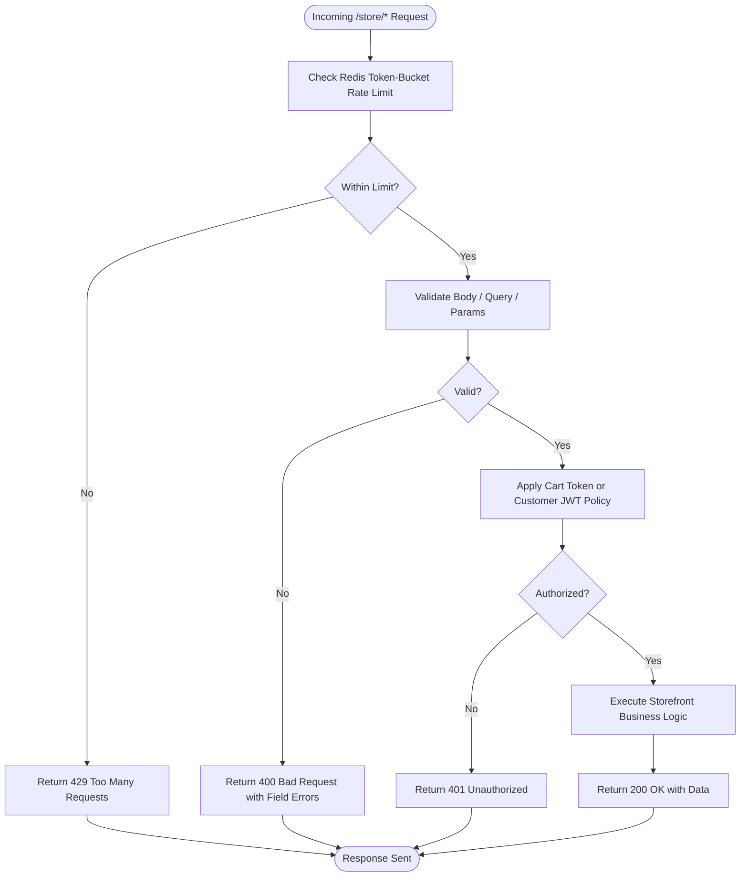
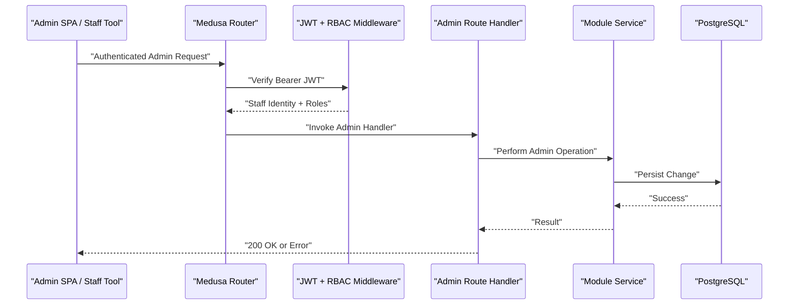
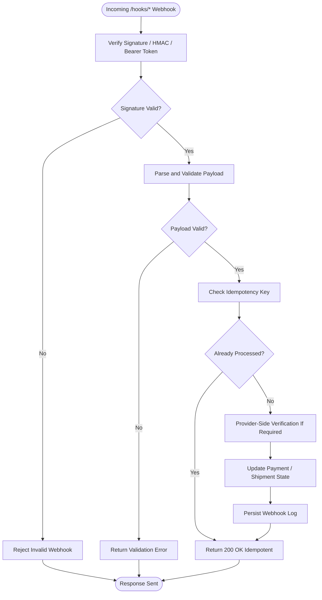
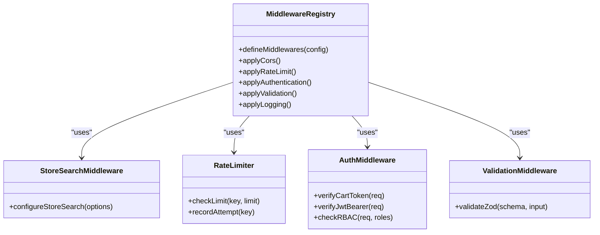
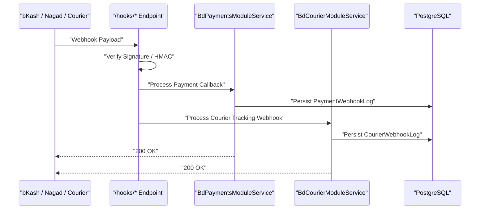
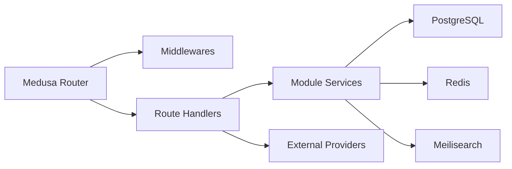

# API Gateway & Router Layer

<cite>
**Referenced Files in This Document**
- [medusa-config.ts](file://apps/medusa/medusa-config.ts)
- [middlewares.ts](file://apps/medusa/src/api/middlewares.ts)
- [route.ts (store/custom)](file://apps/medusa/src/api/store/custom/route.ts)
- [route.ts (admin/custom)](file://apps/medusa/src/api/admin/custom/route.ts)
- [README.md (Custom API Routes)](file://apps/medusa/src/api/README.md)
- [architecture.md](file://docs/architecture.md)
- [technical-plan.md](file://technical-plan.md)
- [dfd.md](file://dfd.md)
- [service.ts (bd-payments)](file://apps/medusa/src/modules/bd-payments/service.ts)
- [service.ts (bd-courier)](file://apps/medusa/src/modules/bd-courier/service.ts)
</cite>

## Table of Contents
1. [Introduction](#introduction)
2. [Project Structure](#project-structure)
3. [Core Components](#core-components)
4. [Architecture Overview](#architecture-overview)
5. [Detailed Component Analysis](#detailed-component-analysis)
6. [Dependency Analysis](#dependency-analysis)
7. [Performance Considerations](#performance-considerations)
8. [Troubleshooting Guide](#troubleshooting-guide)
9. [Conclusion](#conclusion)

## Introduction
This document describes the API Gateway and Router Layer built on MedusaJS v2 for the Bangladesh e-commerce platform. It explains how the four route namespaces are organized, what security and validation rules apply to each namespace, and how webhooks for payment providers and couriers are processed. It also documents rate limiting strategies, authentication middleware patterns, request validation expectations, error handling approaches, performance optimization techniques, and monitoring guidance suitable for high-traffic e-commerce workloads.

The implementation currently exposes:
- `/store/*` as the public storefront API surface.
- `/admin/*` as the protected admin API surface.
- `/hooks/*` as the provider webhook ingestion surface.
- `/api/*` as internal custom endpoints used by the Next.js storefront.

At this stage, the repository contains minimal route handlers and a single configured middleware entry point. The broader security, rate limiting, and webhook processing behavior is defined in architectural and technical planning documents and will be implemented through Medusa’s HTTP router, middlewares, modules, and Redis-backed services.

## Project Structure
The API layer lives under `apps/medusa/src/api`. Route handlers are file-based: each endpoint exports HTTP method handlers such as `GET`, `POST`, etc., from a `route.ts` file. Middleware configuration is centralized in `src/api/middlewares.ts`.

**Diagram sources**
- [middlewares.ts:1-19](file://apps/medusa/src/api/middlewares.ts#L1-L19)
- [route.ts (store/custom):1-9](file://apps/medusa/src/api/store/custom/route.ts#L1-L9)
- [route.ts (admin/custom):1-9](file://apps/medusa/src/api/admin/custom/route.ts#L1-L9)
- [service.ts (bd-payments):1-11](file://apps/medusa/src/modules/bd-payments/service.ts#L1-L11)
- [service.ts (bd-courier):1-11](file://apps/medusa/src/modules/bd-courier/service.ts#L1-L11)

**Section sources**
- [middlewares.ts:1-19](file://apps/medusa/src/api/middlewares.ts#L1-L19)
- [README.md (Custom API Routes):1-136](file://apps/medusa/src/api/README.md#L1-L136)

## Core Components
The API Gateway and Router Layer consists of:

| Component | Responsibility | Current State |
|---|---|---|
| HTTP Router | Maps URL paths to handler functions using MedusaJS v2 file-based routing. | Minimal default handlers exist under `/store/custom` and `/admin/custom`. |
| Middleware Registry | Applies cross-cutting concerns such as search configuration, rate limiting, authentication, validation, and logging. | Currently registers store search configuration for `/store/search`. |
| Route Namespaces | Segregates public storefront, admin, webhook, and internal API traffic. | Defined by architecture and technical plan; handlers are scaffolded. |
| Module Services | Encapsulate domain logic for payments, courier tracking, orders, settings, catalog, campaigns, and audit. | Service classes expose database models via MedusaService. |
| Configuration | Defines CORS, JWT secrets, cookie secrets, module loading, and environment variables. | Loaded from `medusa-config.ts`. |

Key observations:
- The current codebase provides a clean foundation but does not yet implement full rate limiting, RBAC, or webhook signature verification directly in the router files shown.
- The architectural design specifies these behaviors, so future route handlers should follow those contracts.

**Section sources**
- [medusa-config.ts:1-46](file://apps/medusa/medusa-config.ts#L1-L46)
- [middlewares.ts:1-19](file://apps/medusa/src/api/middlewares.ts#L1-L19)
- [route.ts (store/custom):1-9](file://apps/medusa/src/api/store/custom/route.ts#L1-L9)
- [route.ts (admin/custom):1-9](file://apps/medusa/src/api/admin/custom/route.ts#L1-L9)
- [service.ts (bd-payments):1-11](file://apps/medusa/src/modules/bd-payments/service.ts#L1-L11)
- [service.ts (bd-courier):1-11](file://apps/medusa/src/modules/bd-courier/service.ts#L1-L11)

## Architecture Overview
The system separates public storefront requests, admin operations, external provider callbacks, and internal API calls into distinct namespaces. Each namespace has different trust boundaries, authentication requirements, and rate limits.

**Diagram sources**
- [architecture.md:305-334](file://docs/architecture.md#L305-L334)
- [technical-plan.md:670-688](file://technical-plan.md#L670-L688)

### Route Namespace Contract
| Namespace | Consumer | Authentication | Rate Limiting | Primary Use |
|---|---|---|---|---|
| `/store/*` | Next.js Storefront browser and server components | Public by default; cart token in secure cookie for cart mutations; optional customer JWT for registered users | 60 req/min per IP; stricter limits for checkout completion | Catalog browsing, cart management, order creation, order tracking |
| `/admin/*` | Medusa Admin SPA and staff tools | Bearer JWT with RBAC role checks | 120 req/min per staff user; stricter for sensitive endpoints like audit logs | Order management, courier dispatch, reports, settings, CMS |
| `/hooks/*` | bKash, Nagad, courier providers | Server-to-server signature or HMAC verification | 100 req/min per provider IP | Payment callback verification, courier tracking updates |
| `/api/*` | Next.js internal routes | Internal only; trusted server context | Controlled by Next.js and backend policies | Custom storefront endpoints that call Medusa services internally |

**Section sources**
- [architecture.md:305-334](file://docs/architecture.md#L305-L334)
- [technical-plan.md:670-688](file://technical-plan.md#L670-L688)

## Detailed Component Analysis

### Storefront API Namespace `/store/*`
The `/store/*` namespace is the public-facing API surface. It serves the Next.js storefront and may be called from browsers or server-side rendering contexts.

Security and access model:
- Public endpoints allow unauthenticated access where appropriate, such as product browsing and search.
- Cart mutations use a cart token stored in an HTTP-only cookie.
- Registered customers may authenticate with a short-lived JWT stored in an HTTP-only cookie.
- Sensitive endpoints such as order tracking require additional proof, such as matching an order ID with a verified phone number pattern.

Rate limiting:
- General public endpoints are limited to approximately 60 requests per minute per IP.
- Checkout completion attempts are more strictly limited to prevent bot abuse.

Request validation:
- Input validation should use Zod schemas for all custom endpoints.
- Bangladesh mobile phone numbers should be validated against the expected national format.

Error handling:
- Validation errors should return structured JSON with clear field-level messages.
- Security failures should avoid leaking details about authentication state.
- Idempotency headers should be respected for state-changing requests.

**Diagram sources**
- [technical-plan.md:670-688](file://technical-plan.md#L670-L688)
- [dfd.md:588-610](file://dfd.md#L588-L610)

**Section sources**
- [architecture.md:305-334](file://docs/architecture.md#L305-L334)
- [technical-plan.md:670-688](file://technical-plan.md#L670-L688)
- [dfd.md:588-610](file://dfd.md#L588-L610)

### Admin API Namespace `/admin/*`
The `/admin/*` namespace protects administrative operations. Access requires a valid Bearer JWT and role-based authorization checks.

Security and access model:
- All admin endpoints require JWT authentication.
- Role checks enforce RBAC, restricting sensitive operations such as audit log access to authorized roles.
- Account lockout protection tracks failed login attempts and can temporarily block accounts.

Rate limiting:
- Admin endpoints are generally allowed higher throughput than public storefront endpoints, but still rate-limited per staff user.
- Audit-related endpoints have stricter limits.

Request validation:
- Admin payloads must be validated before mutating business data.
- Sensitive fields such as passwords and tokens must never be logged.

Error handling:
- Authorization failures should return consistent 401/403 responses without exposing internal policy details.
- Validation failures should include actionable error messages.

**Diagram sources**
- [architecture.md:305-334](file://docs/architecture.md#L305-L334)
- [technical-plan.md:670-688](file://technical-plan.md#L670-L688)

**Section sources**
- [architecture.md:305-334](file://docs/architecture.md#L305-L334)
- [technical-plan.md:670-688](file://technical-plan.md#L670-L688)

### Webhook Namespace `/hooks/*`
The `/hooks/*` namespace receives asynchronous callbacks from payment providers and courier services. These endpoints must never trust incoming parameters blindly.

Security and access model:
- bKash and Nagad callbacks must perform server-to-server verification rather than trusting redirect query parameters.
- Courier tracking webhooks must verify HMAC signatures or bearer tokens according to provider documentation.
- All webhook payloads must be logged securely without including sensitive credentials.

Idempotency:
- Duplicate callbacks must be handled idempotently so that repeated provider retries do not create duplicate payments or orders.

Processing workflow:
1. Receive webhook payload.
2. Verify provider signature or token.
3. Validate required fields.
4. Deduplicate by provider transaction ID or reference ID.
5. Execute provider-specific verification if required.
6. Update payment or shipment status.
7. Persist webhook log for auditability.

**Diagram sources**
- [prd.md:267-274](file://prd.md#L267-L274)
- [dfd.md:588-610](file://dfd.md#L588-L610)

**Section sources**
- [prd.md:267-274](file://prd.md#L267-L274)
- [dfd.md:588-610](file://dfd.md#L588-L610)

### Internal API Namespace `/api/*`
The `/api/*` namespace is intended for internal endpoints consumed by the Next.js application. These endpoints are not exposed publicly and should rely on server-side trust boundaries.

Design guidance:
- Prefer calling Medusa services directly from server-side code when possible.
- If HTTP calls are necessary, restrict `/api/*` to internal network access.
- Apply input validation and structured error responses consistently.

**Section sources**
- [architecture.md:305-334](file://docs/architecture.md#L305-L334)

### Example Route Handlers
The repository includes minimal example handlers under `/store/custom` and `/admin/custom`. These demonstrate the MedusaJS v2 file-based routing contract: exporting HTTP method handlers that receive `MedusaRequest` and `MedusaResponse`.

Recommended handler structure:
- Validate inputs early.
- Apply namespace-specific middleware.
- Delegate business logic to module services.
- Return structured JSON responses.
- Handle errors centrally.

**Section sources**
- [route.ts (store/custom):1-9](file://apps/medusa/src/api/store/custom/route.ts#L1-L9)
- [route.ts (admin/custom):1-9](file://apps/medusa/src/api/admin/custom/route.ts#L1-L9)
- [README.md (Custom API Routes):1-136](file://apps/medusa/src/api/README.md#L1-L136)

### Security Middleware Implementation
The current middleware configuration demonstrates how to attach middleware to specific matchers. For the API Gateway, middleware should cover:

- CORS configuration per namespace.
- Rate limiting using Redis token buckets.
- Authentication for `/admin/*` and selected `/store/*` endpoints.
- Request validation using Zod schemas.
- Structured logging with correlation IDs.
- Webhook signature verification for `/hooks/*`.

**Diagram sources**
- [middlewares.ts:1-19](file://apps/medusa/src/api/middlewares.ts#L1-L19)
- [technical-plan.md:670-688](file://technical-plan.md#L670-L688)

**Section sources**
- [middlewares.ts:1-19](file://apps/medusa/src/api/middlewares.ts#L1-L19)
- [technical-plan.md:670-688](file://technical-plan.md#L670-L688)

### Webhook Processing Workflow
Webhook processing is central to payment and logistics reliability. The platform uses dedicated module services and database models to persist webhook logs and transactions.

**Diagram sources**
- [service.ts (bd-payments):1-11](file://apps/medusa/src/modules/bd-payments/service.ts#L1-L11)
- [service.ts (bd-courier):1-11](file://apps/medusa/src/modules/bd-courier/service.ts#L1-L11)
- [dfd.md:588-610](file://dfd.md#L588-L610)

**Section sources**
- [service.ts (bd-payments):1-11](file://apps/medusa/src/modules/bd-payments/service.ts#L1-L11)
- [service.ts (bd-courier):1-11](file://apps/medusa/src/modules/bd-courier/service.ts#L1-L11)
- [dfd.md:588-610](file://dfd.md#L588-L610)

## Dependency Analysis
The API Gateway depends on several layers:

- MedusaJS v2 HTTP router and middleware system.
- Environment-driven configuration for CORS, JWT, and cookies.
- Module services for domain operations.
- External stores: PostgreSQL, Redis, Meilisearch, and object storage.
- External providers: bKash, Nagad, courier APIs, SMS gateway, Meta Conversions API.

**Diagram sources**
- [medusa-config.ts:1-46](file://apps/medusa/medusa-config.ts#L1-L46)
- [middlewares.ts:1-19](file://apps/medusa/src/api/middlewares.ts#L1-L19)
- [service.ts (bd-payments):1-11](file://apps/medusa/src/modules/bd-payments/service.ts#L1-L11)
- [service.ts (bd-courier):1-11](file://apps/medusa/src/modules/bd-courier/service.ts#L1-L11)

**Section sources**
- [medusa-config.ts:1-46](file://apps/medusa/medusa-config.ts#L1-L46)
- [technical-plan.md:59-112](file://technical-plan.md#L59-L112)

## Performance Considerations
For high-traffic e-commerce scenarios, the API Gateway and Router Layer should emphasize low-latency routing, efficient middleware chains, and safe scaling.

Recommendations:
- Keep middleware chains short and fast. Perform expensive operations asynchronously where possible.
- Use Redis for rate limiting, session caching, stock locks, and idempotency keys.
- Cache read-heavy storefront data such as product catalogs and localized content.
- Use Meilisearch for fast product search instead of heavy database queries.
- Avoid synchronous external provider calls in the request path; prefer background workflows and queues.
- Monitor p95 and p99 latency for critical endpoints such as cart completion and checkout submission.
- Use structured logging with correlation IDs and avoid logging sensitive data.
- Partition or archive high-volume append-only tables such as audit logs and webhook logs.

[No sources needed since this section provides general guidance]

## Troubleshooting Guide
Common issues and diagnostic steps:

| Symptom | Likely Cause | Diagnostic Action | Resolution |
|---|---|---|---|
| Storefront requests blocked by CORS | Misconfigured `storeCors` or `authCors` | Inspect `medusa-config.ts` CORS values and browser network tab | Align CORS origins with deployed frontend domains |
| Admin requests rejected | Missing or invalid JWT | Check Authorization header and JWT secret configuration | Ensure Admin SPA sends valid Bearer token and secrets are set |
| Webhook returns 401 or 403 | Invalid signature or HMAC | Inspect webhook logs and provider documentation | Implement strict signature verification and test with provider sandbox |
| Checkout completion rate limited unexpectedly | Excessive rapid requests | Check Redis rate-limit counters and client retry behavior | Debounce client retries and adjust limits if legitimate |
| Duplicate payment or order created | Non-idempotent webhook handler | Inspect `payment_webhook_log` and deduplication keys | Enforce idempotency by provider transaction ID |
| Slow search or catalog queries | Missing indexes or heavy DB load | Analyze query plans and Meilisearch usage | Add indexes, use search index, and cache results |

**Section sources**
- [medusa-config.ts:1-46](file://apps/medusa/medusa-config.ts#L1-L46)
- [quality-checklist.md:618-625](file://quality-checklist.md#L618-L625)

## Conclusion
The API Gateway and Router Layer for this MedusaJS v2 platform is designed around four clear namespaces: `/store/*`, `/admin/*`, `/hooks/*`, and `/api/*`. The current codebase provides a minimal but extensible foundation. The architectural and technical planning documents define the intended security, rate limiting, validation, and webhook processing behavior. Future development should implement these policies through Medusa’s middleware system, route handlers, module services, and Redis-backed infrastructure while maintaining strong observability and idempotency guarantees for high-traffic e-commerce operations.

[No sources needed since this section summarizes without analyzing specific files]