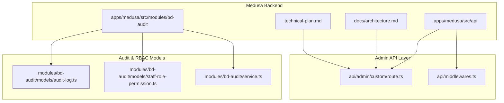
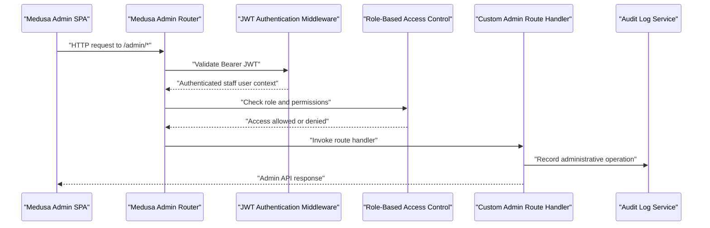
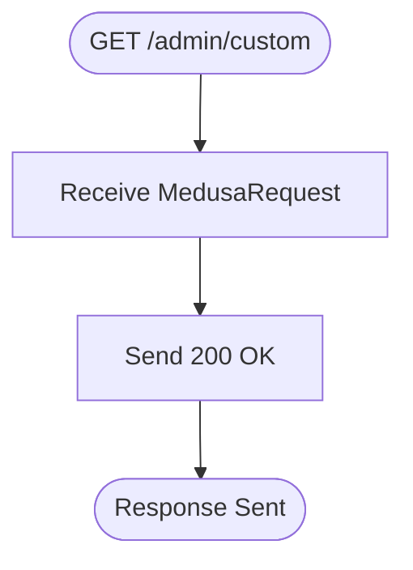
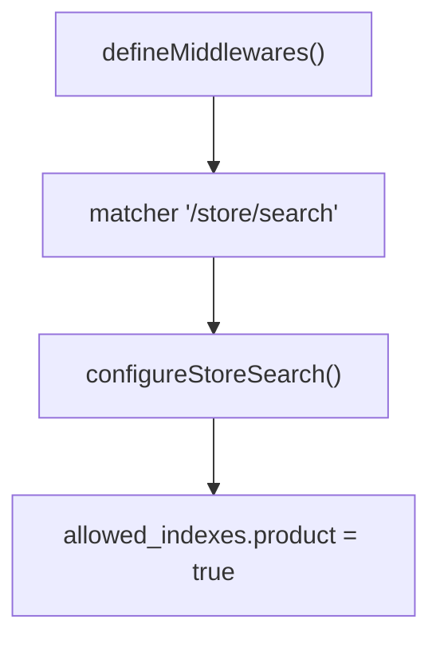
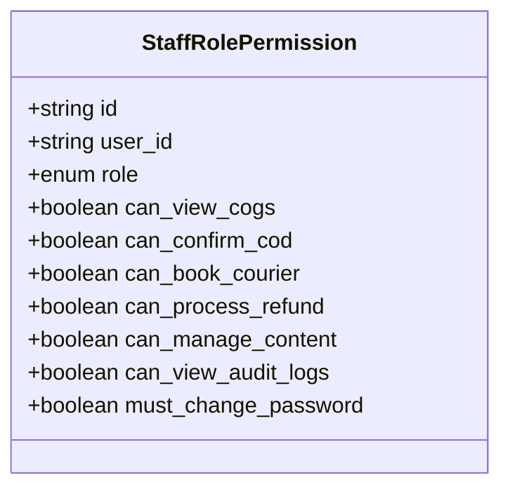
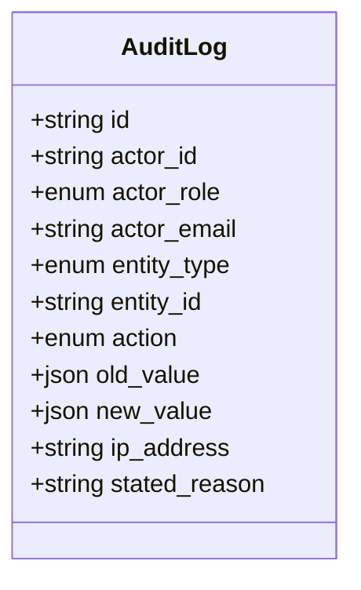
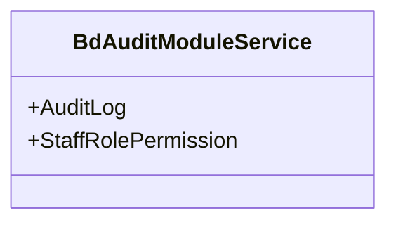
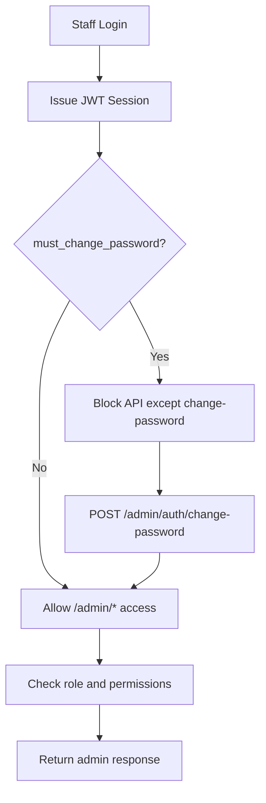
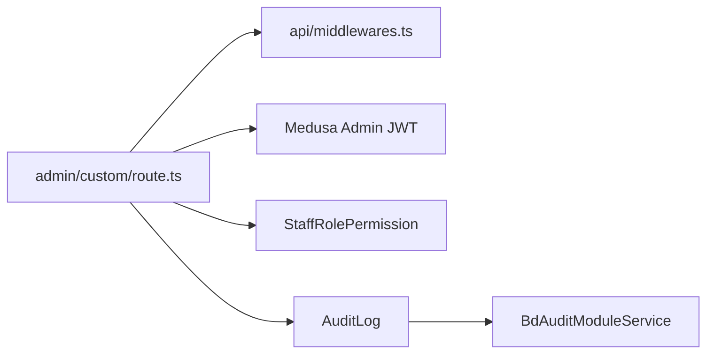

# Admin API Routes (/admin/*)

<cite>
**Referenced Files in This Document**
- [route.ts](file://apps/medusa/src/api/admin/custom/route.ts)
- [middlewares.ts](file://apps/medusa/src/api/middlewares.ts)
- [service.ts](file://apps/medusa/src/modules/bd-audit/service.ts)
- [audit-log.ts](file://apps/medusa/src/modules/bd-audit/models/audit-log.ts)
- [staff-role-permission.ts](file://apps/medusa/src/modules/bd-audit/models/staff-role-permission.ts)
- [architecture.md](file://docs/architecture.md)
- [technical-plan.md](file://technical-plan.md)
</cite>

## Table of Contents
1. [Introduction](#introduction)
2. [Project Structure](#project-structure)
3. [Core Components](#core-components)
4. [Architecture Overview](#architecture-overview)
5. [Detailed Component Analysis](#detailed-component-analysis)
6. [Dependency Analysis](#dependency-analysis)
7. [Performance Considerations](#performance-considerations)
8. [Troubleshooting Guide](#troubleshooting-guide)
9. [Conclusion](#conclusion)

## Introduction
This document explains the Admin API routes under the `/admin/*` namespace in this Medusa v2 project. It focuses on:

- The protected administrative endpoints that require Bearer JWT authentication.
- Role-based access control (RBAC) for operational management interfaces.
- The custom admin route implementation currently present in the repository.
- Authorization patterns, security measures, and integration with Medusa’s admin system.
- Best practices for secure admin API development and monitoring administrative operations.

The current codebase provides a minimal custom admin route and strong architectural documentation describing how `/admin/*` should be secured using Medusa’s built-in JWT session authentication, RBAC roles, rate limiting, audit logging, and staff account protections.

## Project Structure
The relevant parts of the repository for admin API routes are located under `apps/medusa/src/api` and `apps/medusa/src/modules`.

**Diagram sources**
- [route.ts:1-9](file://apps/medusa/src/api/admin/custom/route.ts#L1-L9)
- [middlewares.ts:1-20](file://apps/medusa/src/api/middlewares.ts#L1-L20)
- [audit-log.ts:1-43](file://apps/medusa/src/modules/bd-audit/models/audit-log.ts#L1-L43)
- [staff-role-permission.ts:1-17](file://apps/medusa/src/modules/bd-audit/models/staff-role-permission.ts#L1-L17)
- [service.ts:1-11](file://apps/medusa/src/modules/bd-audit/service.ts#L1-L11)
- [architecture.md:305-316](file://docs/architecture.md#L305-L316)
- [technical-plan.md:670-674](file://technical-plan.md#L670-L674)

**Section sources**
- [route.ts:1-9](file://apps/medusa/src/api/admin/custom/route.ts#L1-L9)
- [middlewares.ts:1-20](file://apps/medusa/src/api/middlewares.ts#L1-L20)
- [audit-log.ts:1-43](file://apps/medusa/src/modules/bd-audit/models/audit-log.ts#L1-L43)
- [staff-role-permission.ts:1-17](file://apps/medusa/src/modules/bd-audit/models/staff-role-permission.ts#L1-L17)
- [service.ts:1-11](file://apps/medusa/src/modules/bd-audit/service.ts#L1-L11)
- [architecture.md:305-316](file://docs/architecture.md#L305-L316)
- [technical-plan.md:670-674](file://technical-plan.md#L670-L674)

## Core Components
The admin API surface is composed of:

| Component | Responsibility | Current State |
|---|---|---|
| Custom admin route | Defines an HTTP handler under `/admin/custom` | Minimal placeholder returning success status |
| Global middlewares | Applies shared middleware to selected routes | Currently configured for store search; admin middlewares can be added here |
| Audit module service | Exposes services for audit logs and staff permissions | Thin wrapper around models |
| Audit log model | Records actor, role, entity, action, values, IP, and reason | Enumerated entity types and actions |
| Staff role permission model | Stores per-user role and fine-grained permission flags | Supports owner, manager, staff, call_center, warehouse, finance |

Key observations:

- The custom admin route currently exports only a GET handler and returns a basic success response.
- There is no explicit custom authorization logic inside the route itself; it relies on Medusa’s default admin authentication and RBAC behavior.
- The global middlewares file currently configures store search middleware and does not yet include admin-specific middleware.
- The audit module provides the data model foundation for tracking administrative operations and staff permissions.

**Section sources**
- [route.ts:1-9](file://apps/medusa/src/api/admin/custom/route.ts#L1-L9)
- [middlewares.ts:1-20](file://apps/medusa/src/api/middlewares.ts#L1-L20)
- [service.ts:1-11](file://apps/medusa/src/modules/bd-audit/service.ts#L1-L11)
- [audit-log.ts:1-43](file://apps/medusa/src/modules/bd-audit/models/audit-log.ts#L1-L43)
- [staff-role-permission.ts:1-17](file://apps/medusa/src/modules/bd-audit/models/staff-role-permission.ts#L1-L17)

## Architecture Overview
The `/admin/*` namespace is intended for the Medusa Admin SPA and requires:

- Bearer JWT authentication.
- RBAC role checks.
- Rate limiting per staff user.
- Audit logging for sensitive administrative operations.

**Diagram sources**
- [architecture.md:305-316](file://docs/architecture.md#L305-L316)
- [architecture.md:364-382](file://docs/architecture.md#L364-L382)
- [audit-log.ts:1-43](file://apps/medusa/src/modules/bd-audit/models/audit-log.ts#L1-L43)
- [staff-role-permission.ts:1-17](file://apps/medusa/src/modules/bd-audit/models/staff-role-permission.ts#L1-L17)

### Route Namespaces and Access Control
The architecture documentation defines clear boundaries for admin routes:

| Route Prefix | Consumer | Auth Requirement | Rate Limit |
|---|---|---|---|
| `/store/*` | Next.js Storefront | Public or cart token | 60 req/min per IP |
| `/admin/*` | Medusa Admin SPA | Bearer JWT + RBAC Role Check | 120 req/min per staff user |
| `/admin/audit-logs` | Admin Security / Finance | Bearer JWT + Role: Owner / Finance | 30 req/min |
| `/hooks/*` | Payment and courier providers | Signature verification | 100 req/min per provider IP |

**Section sources**
- [architecture.md:305-316](file://docs/architecture.md#L305-L316)

## Detailed Component Analysis

### Custom Admin Route: `/admin/custom`
The custom admin route is defined under `apps/medusa/src/api/admin/custom/route.ts`. It currently implements a simple GET handler that returns a successful status response.

**Diagram sources**
- [route.ts:1-9](file://apps/medusa/src/api/admin/custom/route.ts#L1-L9)

Security characteristics:

- The route uses Medusa’s typed request and response objects.
- No explicit input validation or business logic is implemented.
- No explicit RBAC check is performed inside the handler; authorization is expected to be enforced by Medusa’s admin middleware pipeline.
- No audit logging is recorded by this route.

Recommended extension pattern:

- Add input validation using Zod schemas.
- Add role-based permission checks before processing sensitive operations.
- Record audit events for create, update, delete, and status transition actions.
- Return structured JSON responses instead of plain status codes.

**Section sources**
- [route.ts:1-9](file://apps/medusa/src/api/admin/custom/route.ts#L1-L9)

### Global Middlewares Configuration
The global middlewares file currently configures middleware for the store search endpoint. It demonstrates how to attach middleware to specific route matchers.

**Diagram sources**
- [middlewares.ts:1-20](file://apps/medusa/src/api/middlewares.ts#L1-L20)

For admin APIs, this file is the appropriate place to add:

- Admin-specific logging middleware.
- Request correlation ID injection.
- Sensitive field scrubbing.
- Additional RBAC enforcement where needed.
- Endpoint-level rate limiting beyond Medusa defaults.

**Section sources**
- [middlewares.ts:1-20](file://apps/medusa/src/api/middlewares.ts#L1-L20)

### Audit Module: Staff Roles and Permissions
The `bd-audit` module provides the foundational models for administrative accountability and permission control.

#### Staff Role Permission Model
The staff role permission model stores:

- A unique identifier.
- The associated Medusa user ID.
- An operational role such as owner, manager, staff, call_center, warehouse, or finance.
- Fine-grained boolean permissions including COGS visibility, COD confirmation, courier booking, refund processing, content management, audit log viewing, and forced password change behavior.

**Diagram sources**
- [staff-role-permission.ts:1-17](file://apps/medusa/src/modules/bd-audit/models/staff-role-permission.ts#L1-L17)

#### Audit Log Model
The audit log model records administrative actions with:

- Actor identity and role.
- Optional actor email.
- Entity type and entity ID.
- Action type.
- Old and new values as JSON.
- IP address.
- Stated reason.

**Diagram sources**
- [audit-log.ts:1-43](file://apps/medusa/src/modules/bd-audit/models/audit-log.ts#L1-L43)

#### Audit Module Service
The audit module service is a thin wrapper exposing both `AuditLog` and `StaffRolePermission` through Medusa’s service layer.

**Diagram sources**
- [service.ts:1-11](file://apps/medusa/src/modules/bd-audit/service.ts#L1-L11)

**Section sources**
- [staff-role-permission.ts:1-17](file://apps/medusa/src/modules/bd-audit/models/staff-role-permission.ts#L1-L17)
- [audit-log.ts:1-43](file://apps/medusa/src/modules/bd-audit/models/audit-log.ts#L1-L43)
- [service.ts:1-11](file://apps/medusa/src/modules/bd-audit/service.ts#L1-L11)

### Authorization Patterns and Security Measures
The project’s architecture documents define the expected security posture for admin APIs:

- **Bearer JWT authentication:** Admin requests must carry a valid JWT issued by Medusa.
- **RBAC role checks:** Access to admin endpoints is controlled by staff roles and permission flags.
- **Forced password change on first login:** New staff accounts may be blocked from normal API access until they change their password.
- **Account lockout defense:** Repeated failed login attempts trigger Redis-backed lockouts and audit logging.
- **Session invalidation:** Password changes or role/permission updates invalidate active sessions.
- **Privileged account protections:** Owner and manager accounts may require additional security controls such as 2FA where supported.

**Diagram sources**
- [architecture.md:364-382](file://docs/architecture.md#L364-L382)
- [staff-role-permission.ts:1-17](file://apps/medusa/src/modules/bd-audit/models/staff-role-permission.ts#L1-L17)

**Section sources**
- [architecture.md:364-382](file://docs/architecture.md#L364-L382)

### Integration with Medusa’s Admin System
The technical plan states that the admin architecture uses an embedded Medusa v2 Admin with UI widgets rather than building a completely separate admin application. This means:

- The backend exposes `/admin/*` routes consumed by the Medusa Admin SPA.
- Custom admin features extend the existing admin experience.
- Security, authentication, and RBAC are primarily handled by Medusa’s admin middleware pipeline.
- Custom modules like `bd-audit` integrate into the Medusa ecosystem via models and services.

**Section sources**
- [technical-plan.md:715-720](file://technical-plan.md#L715-L720)

## Dependency Analysis
The admin API depends on several layers:

1. **Route layer:** File-based routing under `src/api/admin`.
2. **Middleware layer:** Global middlewares for cross-cutting concerns.
3. **Authentication layer:** Medusa’s JWT-based admin authentication.
4. **Authorization layer:** RBAC based on staff roles and permission flags.
5. **Audit layer:** Persistent logging of administrative actions.

**Diagram sources**
- [route.ts:1-9](file://apps/medusa/src/api/admin/custom/route.ts#L1-L9)
- [middlewares.ts:1-20](file://apps/medusa/src/api/middlewares.ts#L1-L20)
- [staff-role-permission.ts:1-17](file://apps/medusa/src/modules/bd-audit/models/staff-role-permission.ts#L1-L17)
- [audit-log.ts:1-43](file://apps/medusa/src/modules/bd-audit/models/audit-log.ts#L1-L43)
- [service.ts:1-11](file://apps/medusa/src/modules/bd-audit/service.ts#L1-L11)

**Section sources**
- [route.ts:1-9](file://apps/medusa/src/api/admin/custom/route.ts#L1-L9)
- [middlewares.ts:1-20](file://apps/medusa/src/api/middlewares.ts#L1-L20)
- [staff-role-permission.ts:1-17](file://apps/medusa/src/modules/bd-audit/models/staff-role-permission.ts#L1-L17)
- [audit-log.ts:1-43](file://apps/medusa/src/modules/bd-audit/models/audit-log.ts#L1-L43)
- [service.ts:1-11](file://apps/medusa/src/modules/bd-audit/service.ts#L1-L11)

## Performance Considerations
Administrative APIs should balance usability with security and observability:

- **Rate limiting:** Admin endpoints should enforce stricter limits than public endpoints. The architecture specifies 120 req/min per staff user for `/admin/*`, with tighter limits for sensitive endpoints such as `/admin/audit-logs`.
- **Structured logging:** Use correlation IDs and avoid logging sensitive data such as passwords, payment tokens, or full customer secrets.
- **Minimal payload exposure:** Admin responses should return only the data required by the admin UI or downstream workflow.
- **Database query efficiency:** Avoid N+1 queries when listing orders, products, or audit logs; use batched reads and pagination.
- **Audit log volume:** Audit logs can grow quickly; consider retention policies, archival strategies, and read-only access controls.

[No sources needed since this section provides general guidance]

## Troubleshooting Guide

### Common Admin API Issues
| Symptom | Likely Cause | Resolution |
|---|---|---|
| 401 Unauthorized on `/admin/*` | Missing or invalid Bearer JWT | Verify Medusa admin session and token issuance |
| 403 Forbidden after valid JWT | Insufficient role or permission flag | Review `StaffRolePermission.role` and permission booleans |
| New staff cannot access admin APIs | Forced password change required | Complete password change flow before accessing other endpoints |
| Audit logs missing | Audit logging not invoked in handler | Ensure handlers record audit events for state-changing operations |
| Excessive admin API load | Missing rate limiting or broad matcher | Add endpoint-specific rate limiting and narrow route matchers |

### Monitoring Administrative Operations
Recommended monitoring signals:

- Failed authentication attempts.
- Account lockout triggers.
- Sensitive permission changes.
- Refund, courier booking, and inventory modification events.
- High-frequency admin requests indicating potential abuse.

These signals should map to the `AuditLog` fields such as `actor_role`, `entity_type`, `action`, `ip_address`, and `stated_reason`.

**Section sources**
- [audit-log.ts:1-43](file://apps/medusa/src/modules/bd-audit/models/audit-log.ts#L1-L43)
- [staff-role-permission.ts:1-17](file://apps/medusa/src/modules/bd-audit/models/staff-role-permission.ts#L1-L17)
- [architecture.md:364-382](file://docs/architecture.md#L364-L382)

## Conclusion
The `/admin/*` namespace in this project follows Medusa’s standard admin API model:

- Protected by Bearer JWT authentication.
- Controlled by RBAC roles and fine-grained permission flags.
- Designed to integrate with the Medusa Admin SPA.
- Supported by an audit module that captures administrative actions and staff permissions.

The current custom admin route is a minimal placeholder. Production-ready admin endpoints should add input validation, explicit permission checks, structured audit logging, and strict error handling while relying on Medusa’s built-in authentication and RBAC infrastructure.

[No sources needed since this section summarizes without analyzing specific files]