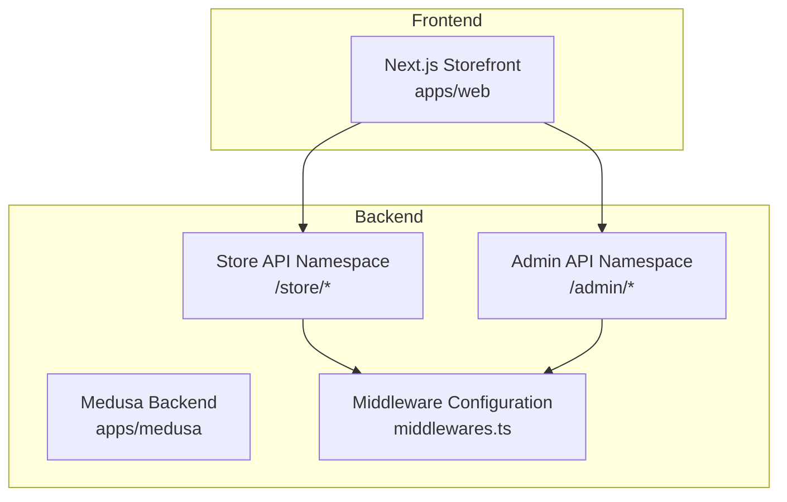
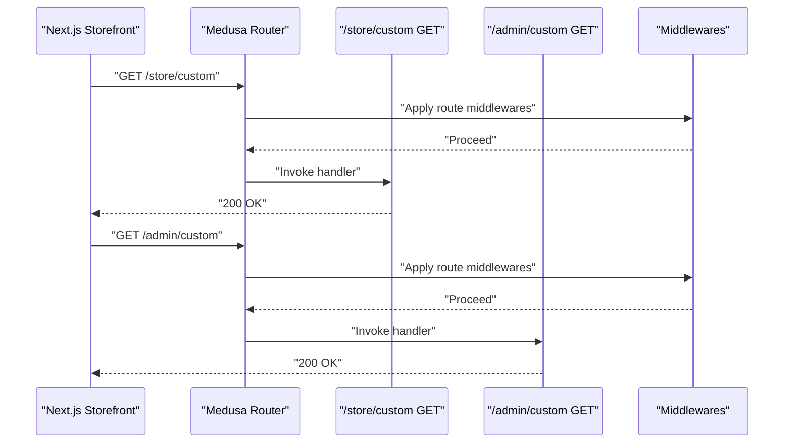
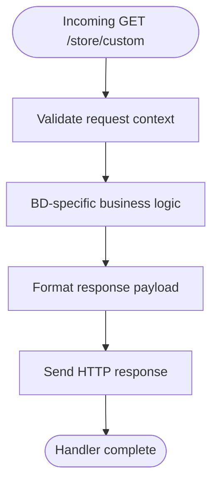
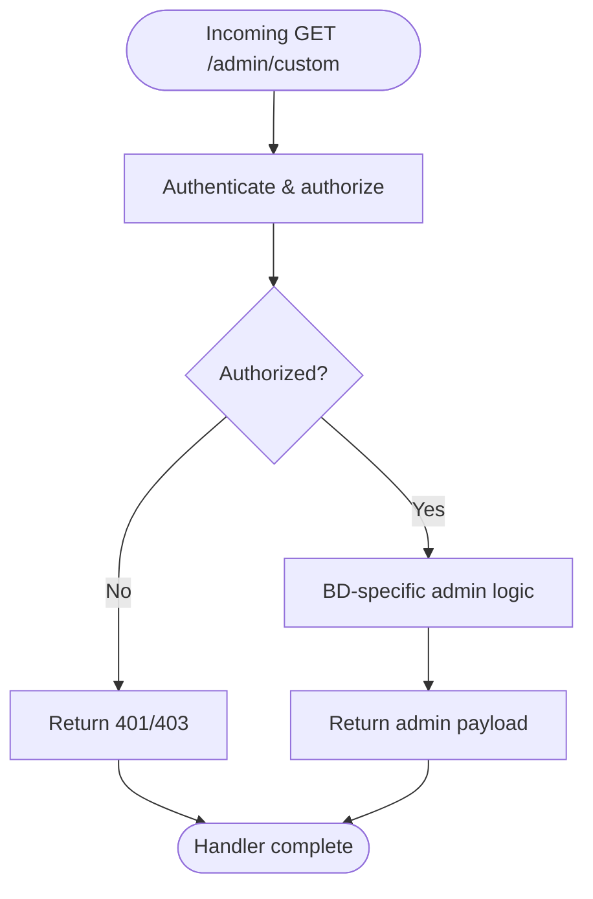
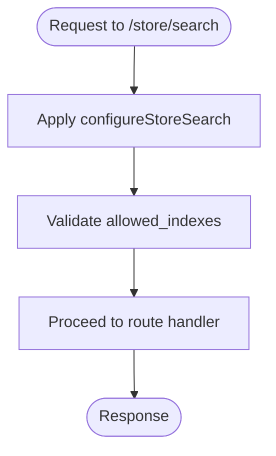
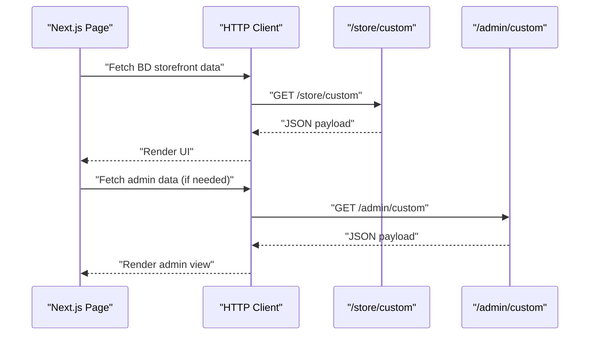
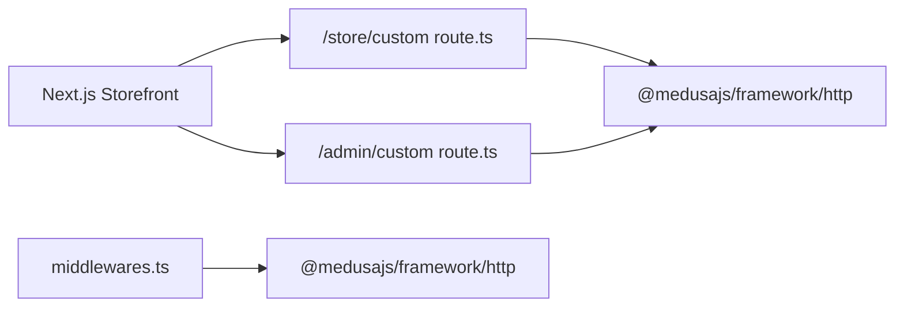

# Custom API Routes (/api/*)

<cite>
**Referenced Files in This Document**
- [route.ts](file://apps/medusa/src/api/store/custom/route.ts)
- [route.ts](file://apps/medusa/src/api/admin/custom/route.ts)
- [middlewares.ts](file://apps/medusa/src/api/middlewares.ts)
- [layout.tsx](file://apps/web/src/app/layout.tsx)
- [page.tsx](file://apps/web/src/app/page.tsx)
- [agent.md](file://agent.md)
</cite>

## Table of Contents
1. [Introduction](#introduction)
2. [Project Structure](#project-structure)
3. [Core Components](#core-components)
4. [Architecture Overview](#architecture-overview)
5. [Detailed Component Analysis](#detailed-component-analysis)
6. [Dependency Analysis](#dependency-analysis)
7. [Performance Considerations](#performance-considerations)
8. [Troubleshooting Guide](#troubleshooting-guide)
9. [Conclusion](#conclusion)

## Introduction
This document explains the custom API routes under the `/api/*` namespace for Bangladesh-specific storefront functionality. It covers:
- The purpose and scope of the custom endpoints under `/store/custom` and `/admin/custom`.
- How these routes extend the core Medusa API without modifying its internals.
- Middleware configuration for store search behavior.
- Request processing flows, response formatting standards, and integration patterns with the Next.js storefront.
- Examples of how to implement new custom routes that align with local market requirements such as payment providers, courier integrations, and regional settings.

The goal is to provide a clear, practical guide for extending Medusa’s headless commerce capabilities while keeping the frontend decoupled and type-safe.

## Project Structure
The relevant code for custom API routes lives under `apps/medusa/src/api`, with separate namespaces for storefront (`/store`) and admin (`/admin`). A shared middleware file configures route-level middlewares. The Next.js storefront lives under `apps/web` and communicates with the backend through HTTP APIs.

**Diagram sources**
- [middlewares.ts:1-20](file://apps/medusa/src/api/middlewares.ts#L1-L20)
- [route.ts:1-9](file://apps/medusa/src/api/store/custom/route.ts#L1-L9)
- [route.ts:1-9](file://apps/medusa/src/api/admin/custom/route.ts#L1-L9)

**Section sources**
- [agent.md:149-222](file://agent.md#L149-L222)

## Core Components
- Storefront custom endpoint: `/store/custom`
  - Purpose: Public-facing extension point for storefront features (e.g., BD-specific catalog enrichment, localized pricing hints).
  - Current implementation: Minimal GET handler returning a success status.
- Admin custom endpoint: `/admin/custom`
  - Purpose: Protected extension point for administrative operations (e.g., BD-specific order details, courier manifests).
  - Current implementation: Minimal GET handler returning a success status.
- Middleware configuration: `middlewares.ts`
  - Purpose: Configures route-level middlewares for the store API, including search index restrictions.
  - Current implementation: Applies `configureStoreSearch` to `/store/search` with allowed indexes.

These components follow Medusa v2 conventions:
- Route handlers are exported functions receiving `MedusaRequest` and `MedusaResponse`.
- Middlewares are defined using `defineMiddlewares` and applied per-route.

**Section sources**
- [route.ts:1-9](file://apps/medusa/src/api/store/custom/route.ts#L1-L9)
- [route.ts:1-9](file://apps/medusa/src/api/admin/custom/route.ts#L1-L9)
- [middlewares.ts:1-20](file://apps/medusa/src/api/middlewares.ts#L1-L20)

## Architecture Overview
The custom routes integrate into Medusa’s routing layer and can be consumed by the Next.js storefront. The storefront uses standard HTTP calls to reach `/store/*` endpoints, while admin-only endpoints require authentication.

**Diagram sources**
- [route.ts:1-9](file://apps/medusa/src/api/store/custom/route.ts#L1-L9)
- [route.ts:1-9](file://apps/medusa/src/api/admin/custom/route.ts#L1-L9)
- [middlewares.ts:1-20](file://apps/medusa/src/api/middlewares.ts#L1-L20)

## Detailed Component Analysis

### Storefront Custom Endpoint: `/store/custom`
- Role: Public extension point for storefront logic tailored to Bangladesh (e.g., localized product attributes, delivery zone checks).
- Implementation pattern:
  - Export an async function named `GET` from `route.ts`.
  - Accept `MedusaRequest` and `MedusaResponse`.
  - Return a simple success response; future implementations should return structured JSON payloads aligned with frontend expectations.
- Integration notes:
  - Frontend can call this endpoint directly via fetch or a typed SDK client.
  - Keep responses consistent with Medusa’s error handling and status codes.

**Diagram sources**
- [route.ts:1-9](file://apps/medusa/src/api/store/custom/route.ts#L1-L9)

**Section sources**
- [route.ts:1-9](file://apps/medusa/src/api/store/custom/route.ts#L1-L9)

### Admin Custom Endpoint: `/admin/custom`
- Role: Protected extension point for administrative tasks (e.g., BD order details, courier manifest generation).
- Implementation pattern:
  - Export an async function named `GET` from `route.ts`.
  - Use Medusa’s auth middleware implicitly enforced on `/admin/*`.
  - Return structured data for admin UI consumption.
- Security considerations:
  - Ensure only authenticated staff users can access admin endpoints.
  - Validate permissions based on staff roles where necessary.

**Diagram sources**
- [route.ts:1-9](file://apps/medusa/src/api/admin/custom/route.ts#L1-L9)

**Section sources**
- [route.ts:1-9](file://apps/medusa/src/api/admin/custom/route.ts#L1-L9)

### Middleware Configuration: `middlewares.ts`
- Role: Centralizes route-level middleware configuration for the store API.
- Current behavior:
  - Applies `configureStoreSearch` to `/store/search`.
  - Restricts allowed search indexes to `product`.
- Extensibility:
  - Add additional routes and middlewares here for validation, rate limiting, or locale resolution.
  - Keep middleware logic focused and composable.

**Diagram sources**
- [middlewares.ts:1-20](file://apps/medusa/src/api/middlewares.ts#L1-L20)

**Section sources**
- [middlewares.ts:1-20](file://apps/medusa/src/api/middlewares.ts#L1-L20)

### Frontend Integration Patterns
- The Next.js storefront communicates with the backend over HTTP.
- The landing page describes infrastructure services and ports, indicating the separation between frontend and backend.
- Recommended patterns:
  - Use environment variables for base URLs.
  - Implement typed clients for `/store/*` and `/admin/*` endpoints.
  - Handle errors consistently with user-friendly messages.

**Diagram sources**
- [layout.tsx:1-22](file://apps/web/src/app/layout.tsx#L1-L22)
- [page.tsx:1-81](file://apps/web/src/app/page.tsx#L1-L81)

**Section sources**
- [layout.tsx:1-22](file://apps/web/src/app/layout.tsx#L1-L22)
- [page.tsx:1-81](file://apps/web/src/app/page.tsx#L1-L81)

## Dependency Analysis
- Custom route handlers depend on Medusa’s HTTP types (`MedusaRequest`, `MedusaResponse`).
- Middleware depends on Medusa’s framework utilities (`defineMiddlewares`, `configureStoreSearch`).
- Frontend depends on backend endpoints but remains decoupled via HTTP contracts.

**Diagram sources**
- [route.ts:1-9](file://apps/medusa/src/api/store/custom/route.ts#L1-L9)
- [route.ts:1-9](file://apps/medusa/src/api/admin/custom/route.ts#L1-L9)
- [middlewares.ts:1-20](file://apps/medusa/src/api/middlewares.ts#L1-L20)

**Section sources**
- [route.ts:1-9](file://apps/medusa/src/api/store/custom/route.ts#L1-L9)
- [route.ts:1-9](file://apps/medusa/src/api/admin/custom/route.ts#L1-L9)
- [middlewares.ts:1-20](file://apps/medusa/src/api/middlewares.ts#L1-L20)

## Performance Considerations
- Keep custom route handlers lightweight; delegate heavy computations to background jobs or workflows.
- Cache frequently accessed BD-specific data (e.g., delivery zones, VAT settings) at the service layer.
- Use pagination and field selection for list endpoints to reduce payload size.
- Avoid synchronous I/O in route handlers; use asynchronous database calls.

[No sources needed since this section provides general guidance]

## Troubleshooting Guide
Common issues and resolutions:
- 404 Not Found on custom routes:
  - Verify route files exist under `/store/custom` or `/admin/custom`.
  - Confirm Medusa server is running and routes are registered.
- Authentication failures on admin routes:
  - Ensure requests include valid staff credentials.
  - Check role-based permissions for the requested operation.
- Search index errors:
  - Validate that `allowed_indexes` includes the requested index.
  - Confirm Meilisearch is reachable and indexed correctly.

**Section sources**
- [middlewares.ts:1-20](file://apps/medusa/src/api/middlewares.ts#L1-L20)

## Conclusion
The custom API routes under `/api/*` provide a clean extension surface for Bangladesh-specific storefront and admin functionality. They integrate seamlessly with Medusa’s routing and middleware system, allowing the Next.js storefront to consume localized features without altering core Medusa code. By following the patterns outlined here—structured route handlers, centralized middleware, and consistent response formats—you can scale local market capabilities reliably and maintainably.

[No sources needed since this section summarizes without analyzing specific files]