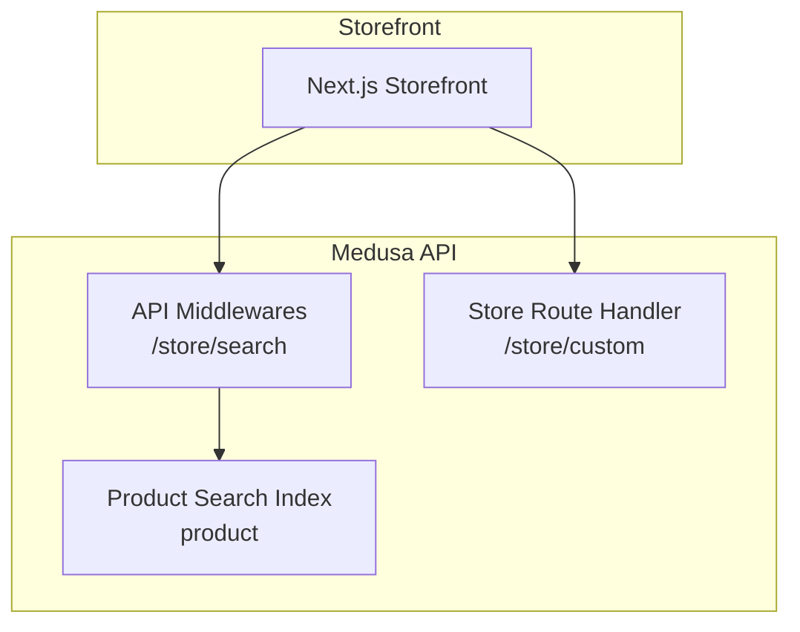
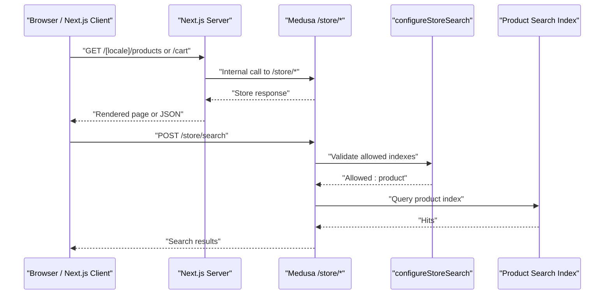
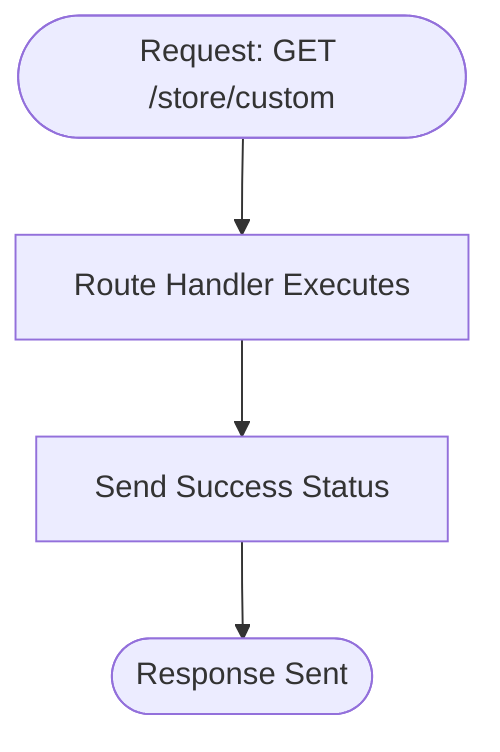
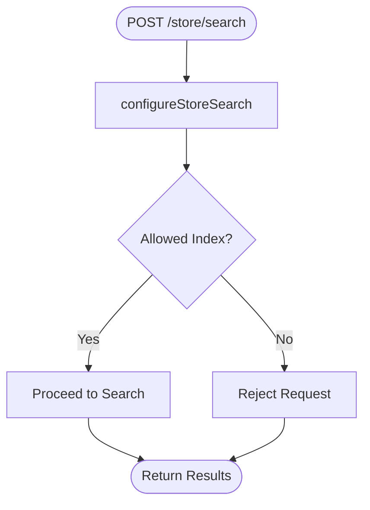
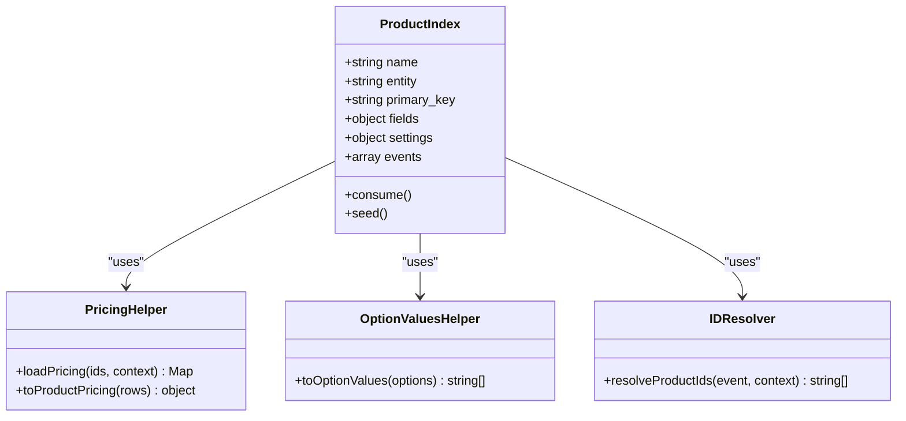
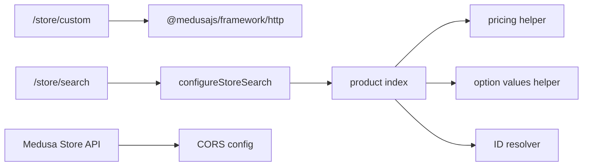

# Store API Routes (/store/*)

<cite>
**Referenced Files in This Document**
- [middlewares.ts](file://apps/medusa/src/api/middlewares.ts)
- [route.ts](file://apps/medusa/src/api/store/custom/route.ts)
- [product.ts](file://apps/medusa/src/search/product.ts)
- [resolve-product-ids.ts](file://apps/medusa/src/search/helpers/resolve-product-ids.ts)
- [pricing.ts](file://apps/medusa/src/search/helpers/pricing.ts)
- [option-values.ts](file://apps/medusa/src/search/helpers/option-values.ts)
- [medusa-config.ts](file://apps/medusa/medusa-config.ts)
- [architecture.md](file://docs/architecture.md)
</cite>

## Table of Contents
1. [Introduction](#introduction)
2. [Project Structure](#project-structure)
3. [Core Components](#core-components)
4. [Architecture Overview](#architecture-overview)
5. [Detailed Component Analysis](#detailed-component-analysis)
6. [Dependency Analysis](#dependency-analysis)
7. [Performance Considerations](#performance-considerations)
8. [Troubleshooting Guide](#troubleshooting-guide)
9. [Conclusion](#conclusion)

## Introduction
This document explains the Store API routes under the `/store/*` namespace, focusing on:
- Public storefront endpoints and CORS configuration
- Cart token authentication patterns for guest and registered customers
- Search endpoint configuration using `configureStoreSearch` middleware
- Allowed indexes for product search functionality
- Request/response patterns, error handling, and security considerations
- Integration with Medusa’s store API and search index
- Performance optimization techniques for high-traffic storefront scenarios

The `/store/*` namespace is primarily consumed by the Next.js storefront (server components and client components). It exposes public endpoints that may rely on cart tokens stored in cookies, while sensitive operations are protected through appropriate authorization mechanisms.

**Section sources**
- [architecture.md:305-334](file://docs/architecture.md#L305-L334)

## Project Structure
The Store API surface relevant to this documentation includes:
- Custom store route handler under `/store/custom`
- Middleware configuration for `/store/search` using `configureStoreSearch`
- Product search index definition and helpers
- Medusa HTTP configuration including CORS settings

**Diagram sources**
- [middlewares.ts:5-19](file://apps/medusa/src/api/middlewares.ts#L5-L19)
- [route.ts:3-8](file://apps/medusa/src/api/store/custom/route.ts#L3-L8)
- [product.ts:150-165](file://apps/medusa/src/search/product.ts#L150-L165)

**Section sources**
- [middlewares.ts:1-19](file://apps/medusa/src/api/middlewares.ts#L1-L19)
- [route.ts:1-9](file://apps/medusa/src/api/store/custom/route.ts#L1-L9)
- [product.ts:1-166](file://apps/medusa/src/search/product.ts#L1-L166)

## Core Components
- Store custom route handler: A minimal GET endpoint under `/store/custom`.
- Store search middleware: Configures allowed search indexes for POST `/store/search`.
- Product search index: Defines searchable fields, filters, facets, and ingestion logic.
- Pricing helper: Computes per-currency price fields for indexing.
- Option values helper: Flattens product options into facet-friendly strings.
- ID resolver: Maps events to affected product IDs for reindexing.
- CORS configuration: Sets allowed origins for store, admin, and auth endpoints.

Key responsibilities:
- Expose safe public endpoints under `/store/*`
- Restrict search to approved indexes
- Provide a consistent request/response contract via Medusa types
- Securely configure CORS for browser-based storefronts

**Section sources**
- [route.ts:1-9](file://apps/medusa/src/api/store/custom/route.ts#L1-L9)
- [middlewares.ts:1-19](file://apps/medusa/src/api/middlewares.ts#L1-L19)
- [product.ts:43-64](file://apps/medusa/src/search/product.ts#L43-L64)
- [pricing.ts:54-80](file://apps/medusa/src/search/helpers/pricing.ts#L54-L80)
- [option-values.ts:11-29](file://apps/medusa/src/search/helpers/option-values.ts#L11-L29)
- [resolve-product-ids.ts:75-141](file://apps/medusa/src/search/helpers/resolve-product-ids.ts#L75-L141)
- [medusa-config.ts:11-17](file://apps/medusa/medusa-config.ts#L11-L17)

## Architecture Overview
The Store API integrates with the storefront and search infrastructure as follows:

**Diagram sources**
- [middlewares.ts:5-19](file://apps/medusa/src/api/middlewares.ts#L5-L19)
- [product.ts:150-165](file://apps/medusa/src/search/product.ts#L150-L165)
- [architecture.md:318-334](file://docs/architecture.md#L318-L334)

## Detailed Component Analysis

### Store Custom Route Handler
- Endpoint: GET `/store/custom`
- Purpose: Placeholder route demonstrating a basic store handler returning a success status.
- Authentication: Public; can be extended with cart token checks if needed.
- Response: Simple success status code.

**Diagram sources**
- [route.ts:3-8](file://apps/medusa/src/api/store/custom/route.ts#L3-L8)

**Section sources**
- [route.ts:1-9](file://apps/medusa/src/api/store/custom/route.ts#L1-L9)

### Store Search Middleware Configuration
- Endpoint: POST `/store/search`
- Middleware: `configureStoreSearch` restricts allowed indexes to `product`.
- Behavior: Ensures only approved search targets are used, preventing arbitrary index access.
- Security: Limits exposure of internal indexes and enforces a whitelist approach.

**Diagram sources**
- [middlewares.ts:5-19](file://apps/medusa/src/api/middlewares.ts#L5-L19)

**Section sources**
- [middlewares.ts:1-19](file://apps/medusa/src/api/middlewares.ts#L1-L19)

### Product Search Index Definition
- Index name: `product`
- Fields include identifiers, text search, categories, labels, option values, and pricing fields.
- Filterable and sortable fields enable faceted search and ordering.
- Ingestion pipeline transforms raw product data into indexed documents.

Key aspects:
- Text search on title and description
- Facets on category, labels, and option values
- Per-currency pricing fields for filtering and sorting
- Event-driven reindexing for product-related changes

**Diagram sources**
- [product.ts:150-165](file://apps/medusa/src/search/product.ts#L150-L165)
- [pricing.ts:148-177](file://apps/medusa/src/search/helpers/pricing.ts#L148-L177)
- [option-values.ts:11-29](file://apps/medusa/src/search/helpers/option-values.ts#L11-L29)
- [resolve-product-ids.ts:75-141](file://apps/medusa/src/search/helpers/resolve-product-ids.ts#L75-L141)

**Section sources**
- [product.ts:1-166](file://apps/medusa/src/search/product.ts#L1-L166)
- [pricing.ts:1-177](file://apps/medusa/src/search/helpers/pricing.ts#L1-L177)
- [option-values.ts:1-30](file://apps/medusa/src/search/helpers/option-values.ts#L1-L30)
- [resolve-product-ids.ts:1-142](file://apps/medusa/src/search/helpers/resolve-product-ids.ts#L1-L142)

### CORS Configuration for Storefront
- Store CORS: Configured via `http.storeCors`, defaults to local development origins.
- Admin CORS: Separate configuration for admin interface.
- Auth CORS: Separate configuration for authentication flows.
- Environment variables allow overriding defaults per environment.

Security considerations:
- Restrict `STORE_CORS` to trusted storefront domains in production.
- Avoid wildcard origins for sensitive endpoints.
- Ensure cookie policies align with cross-origin requirements.

**Section sources**
- [medusa-config.ts:11-17](file://apps/medusa/medusa-config.ts#L11-L17)

### Request/Response Patterns and Authentication
- Public endpoints: Some `/store/*` endpoints are publicly accessible but should be designed to avoid exposing sensitive data.
- Cart token authentication: Guest carts are typically bound to a cart token stored in secure cookies; mutations require idempotency keys.
- Registered customers: Optional phone-based login returns short-lived JWTs in HTTP-only cookies.
- Order tracking: Requires order ID plus exact mobile phone number match.

Patterns:
- Use `X-Idempotency-Key` headers for state-changing requests.
- Validate cart token presence for cart mutations.
- Return standardized error responses for validation failures.

**Section sources**
- [architecture.md:305-334](file://docs/architecture.md#L305-L334)

## Dependency Analysis
The Store API depends on:
- Medusa framework HTTP utilities for middleware and routing
- Search index definitions for product queries
- Pricing and option value helpers for enriched search results
- CORS configuration for cross-origin storefront access

**Diagram sources**
- [middlewares.ts:1-19](file://apps/medusa/src/api/middlewares.ts#L1-L19)
- [product.ts:150-165](file://apps/medusa/src/search/product.ts#L150-L165)
- [pricing.ts:148-177](file://apps/medusa/src/search/helpers/pricing.ts#L148-L177)
- [option-values.ts:11-29](file://apps/medusa/src/search/helpers/option-values.ts#L11-L29)
- [resolve-product-ids.ts:75-141](file://apps/medusa/src/search/helpers/resolve-product-ids.ts#L75-L141)
- [medusa-config.ts:11-17](file://apps/medusa/medusa-config.ts#L11-L17)

**Section sources**
- [middlewares.ts:1-19](file://apps/medusa/src/api/middlewares.ts#L1-L19)
- [product.ts:1-166](file://apps/medusa/src/search/product.ts#L1-L166)
- [pricing.ts:1-177](file://apps/medusa/src/search/helpers/pricing.ts#L1-L177)
- [option-values.ts:1-30](file://apps/medusa/src/search/helpers/option-values.ts#L1-L30)
- [resolve-product-ids.ts:1-142](file://apps/medusa/src/search/helpers/resolve-product-ids.ts#L1-L142)
- [medusa-config.ts:11-17](file://apps/medusa/medusa-config.ts#L11-L17)

## Performance Considerations
Optimization techniques for high-traffic storefront scenarios:
- Caching:
  - Cache read-heavy store endpoints at CDN or application level where appropriate.
  - Use ISR/SSR strategies for pages with frequent updates.
- Search efficiency:
  - Leverage filterable and sortable fields to reduce payload size.
  - Limit returned fields to necessary ones for faster serialization.
- Database and query optimization:
  - Batch reads for related entities during ingestion.
  - Use pagination and cursor-based navigation for large datasets.
- Idempotency and retries:
  - Enforce `X-Idempotency-Key` for mutations to prevent duplicates.
  - Implement exponential backoff for transient errors.
- Rate limiting:
  - Apply rate limits per IP or per user session to protect endpoints.
- CORS tuning:
  - Narrow allowed origins to minimize overhead and improve security.

[No sources needed since this section provides general guidance]

## Troubleshooting Guide
Common issues and resolutions:
- CORS errors from storefront:
  - Verify `STORE_CORS` includes the correct frontend origin(s).
  - Ensure cookies are configured for cross-origin requests when required.
- Search not returning expected results:
  - Confirm `allowed_indexes` includes `product`.
  - Validate that product events trigger reindexing and that pricing/option helpers are functioning.
- Cart mutation failures:
  - Ensure cart token is present in cookies and valid.
  - Check that `X-Idempotency-Key` is provided for mutations.
- Error responses:
  - Standardize error payloads with clear messages and codes.
  - Log contextual information without exposing sensitive data.

**Section sources**
- [medusa-config.ts:11-17](file://apps/medusa/medusa-config.ts#L11-L17)
- [middlewares.ts:5-19](file://apps/medusa/src/api/middlewares.ts#L5-L19)
- [product.ts:150-165](file://apps/medusa/src/search/product.ts#L150-L165)

## Conclusion
The `/store/*` namespace provides a secure, configurable surface for the storefront, with explicit CORS settings and middleware-enforced search restrictions. The product search index offers rich filtering, faceting, and pricing capabilities, while the store route handlers demonstrate a baseline pattern for extending public endpoints. For production, prioritize strict CORS policies, robust error handling, idempotent mutations, and performance optimizations such as caching and efficient search queries.

[No sources needed since this section summarizes without analyzing specific files]