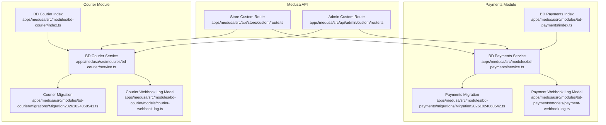
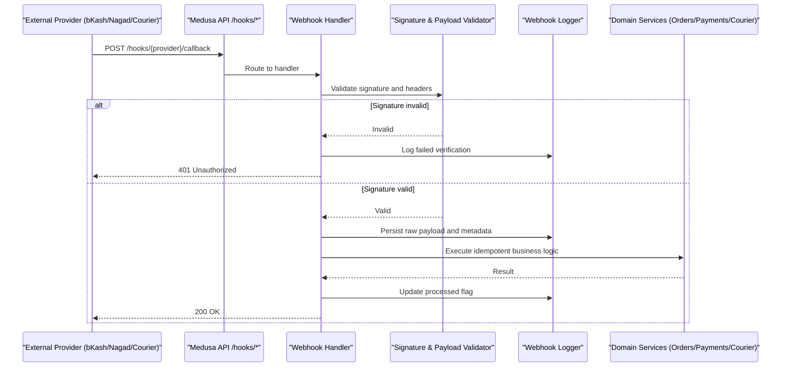
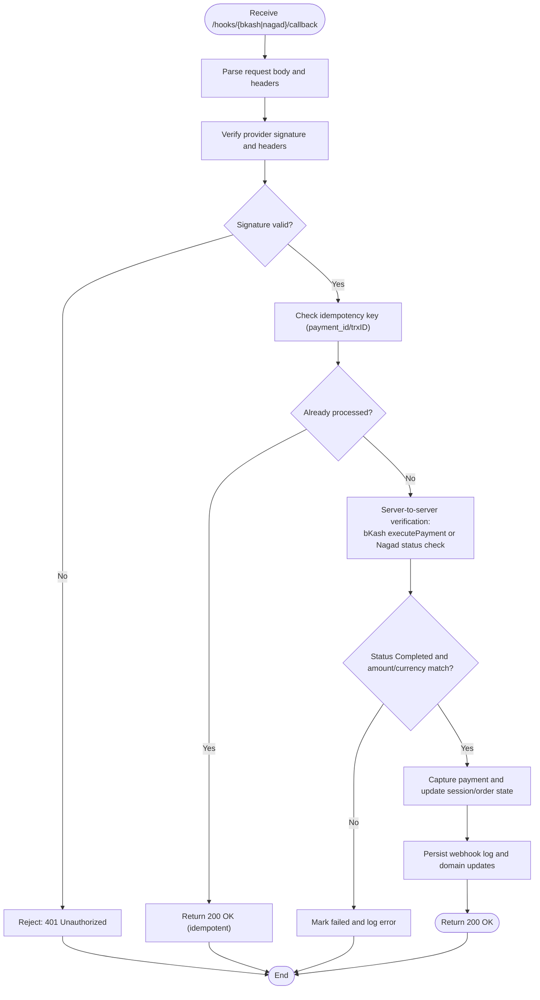
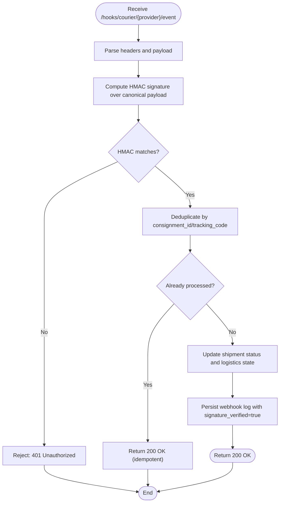
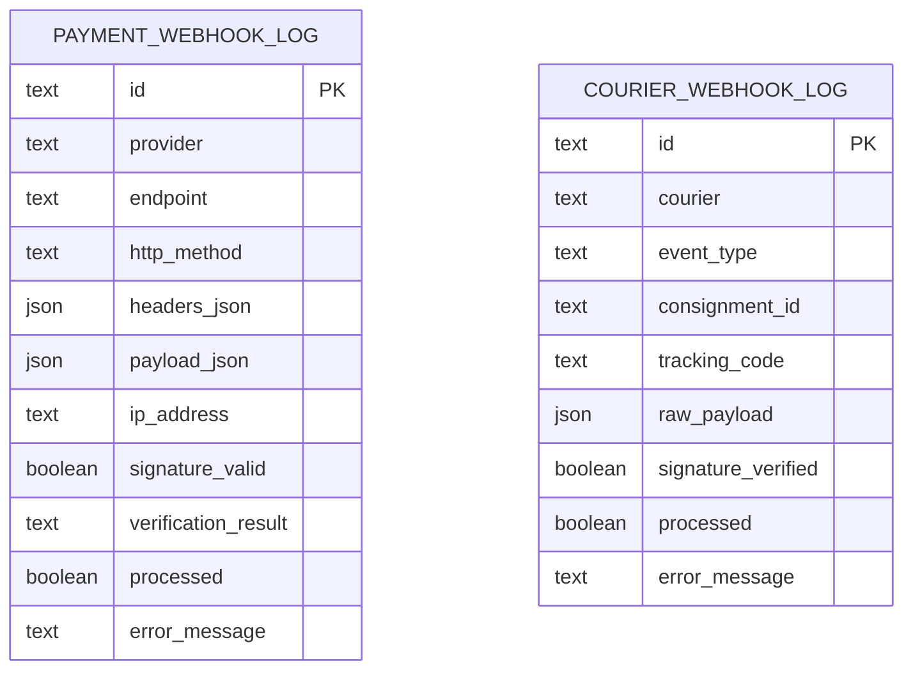
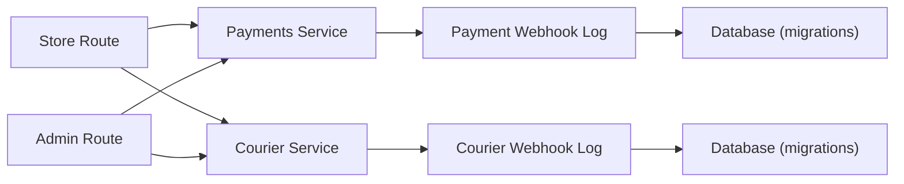

# Webhook Routes (/hooks/*)

<cite>
**Referenced Files in This Document**
- [route.ts](file://apps/medusa/src/api/store/custom/route.ts)
- [route.ts](file://apps/medusa/src/api/admin/custom/route.ts)
- [service.ts](file://apps/medusa/src/modules/bd-payments/service.ts)
- [index.ts](file://apps/medusa/src/modules/bd-payments/index.ts)
- [payment-webhook-log.ts](file://apps/medusa/src/modules/bd-payments/models/payment-webhook-log.ts)
- [Migration20261024060542.ts](file://apps/medusa/src/modules/bd-payments/migrations/Migration20261024060542.ts)
- [service.ts](file://apps/medusa/src/modules/bd-courier/service.ts)
- [index.ts](file://apps/medusa/src/modules/bd-courier/index.ts)
- [courier-webhook-log.ts](file://apps/medusa/src/modules/bd-courier/models/courier-webhook-log.ts)
- [Migration20261024060541.ts](file://apps/medusa/src/modules/bd-courier/migrations/Migration20261024060541.ts)
- [prd.md](file://prd.md)
- [technical-plan.md](file://technical-plan.md)
- [quality-checklist.md](file://quality-checklist.md)
</cite>

## Table of Contents
1. [Introduction](#introduction)
2. [Project Structure](#project-structure)
3. [Core Components](#core-components)
4. [Architecture Overview](#architecture-overview)
5. [Detailed Component Analysis](#detailed-component-analysis)
6. [Dependency Analysis](#dependency-analysis)
7. [Performance Considerations](#performance-considerations)
8. [Troubleshooting Guide](#troubleshooting-guide)
9. [Conclusion](#conclusion)

## Introduction
This document specifies the design and implementation guidance for webhook routes under the `/hooks/*` namespace. It focuses on:
- Payment gateway webhooks for bKash and Nagad, including callback verification and execute checks.
- Courier service webhooks with HMAC signature verification.
- Security validation, signature verification, payload processing, idempotency, error handling, retry strategies, monitoring, and operational best practices.

The repository currently provides:
- Placeholder Medusa API route files under `apps/medusa/src/api/store/custom/route.ts` and `apps/medusa/src/api/admin/custom/route.ts`.
- Module scaffolding for payments (`bd_payments`) and courier (`bd_courier`) with models and migrations for webhook logging.
- Product requirements and technical plan that define the expected behavior for payment callbacks and security constraints.

## Project Structure
The relevant parts of the project structure for webhook routing and persistence are:
- Medusa custom API routes:
  - Store-facing placeholder route: `apps/medusa/src/api/store/custom/route.ts`
  - Admin-facing placeholder route: `apps/medusa/src/api/admin/custom/route.ts`
- Payments module:
  - Service and index: `apps/medusa/src/modules/bd-payments/service.ts`, `apps/medusa/src/modules/bd-payments/index.ts`
  - Webhook log model: `apps/medusa/src/modules/bd-payments/models/payment-webhook-log.ts`
  - Migration: `apps/medusa/src/modules/bd-payments/migrations/Migration20261024060542.ts`
- Courier module:
  - Service and index: `apps/medusa/src/modules/bd-courier/service.ts`, `apps/medusa/src/modules/bd-courier/index.ts`
  - Webhook log model: `apps/medusa/src/modules/bd-courier/models/courier-webhook-log.ts`
  - Migration: `apps/medusa/src/modules/bd-courier/migrations/Migration20261024060541.ts`

**Diagram sources**
- [route.ts:1-9](file://apps/medusa/src/api/store/custom/route.ts#L1-L9)
- [route.ts:1-9](file://apps/medusa/src/api/admin/custom/route.ts#L1-L9)
- [index.ts:1-9](file://apps/medusa/src/modules/bd-payments/index.ts#L1-L9)
- [service.ts:1-11](file://apps/medusa/src/modules/bd-payments/service.ts#L1-L11)
- [payment-webhook-log.ts:1-18](file://apps/medusa/src/modules/bd-payments/models/payment-webhook-log.ts#L1-L18)
- [Migration20261024060542.ts:12-13](file://apps/medusa/src/modules/bd-payments/migrations/Migration20261024060542.ts#L12-L13)
- [index.ts:1-9](file://apps/medusa/src/modules/bd-courier/index.ts#L1-L9)
- [service.ts:1-11](file://apps/medusa/src/modules/bd-courier/service.ts#L1-L11)
- [courier-webhook-log.ts:1-16](file://apps/medusa/src/modules/bd-courier/models/courier-webhook-log.ts#L1-L16)
- [Migration20261024060541.ts:10-13](file://apps/medusa/src/modules/bd-courier/migrations/Migration20261024060541.ts#L10-L13)

**Section sources**
- [route.ts:1-9](file://apps/medusa/src/api/store/custom/route.ts#L1-L9)
- [route.ts:1-9](file://apps/medusa/src/api/admin/custom/route.ts#L1-L9)
- [index.ts:1-9](file://apps/medusa/src/modules/bd-payments/index.ts#L1-L9)
- [service.ts:1-11](file://apps/medusa/src/modules/bd-payments/service.ts#L1-L11)
- [payment-webhook-log.ts:1-18](file://apps/medusa/src/modules/bd-payments/models/payment-webhook-log.ts#L1-L18)
- [Migration20261024060542.ts:12-13](file://apps/medusa/src/modules/bd-payments/migrations/Migration20261024060542.ts#L12-L13)
- [index.ts:1-9](file://apps/medusa/src/modules/bd-courier/index.ts#L1-L9)
- [service.ts:1-11](file://apps/medusa/src/modules/bd-courier/service.ts#L1-L11)
- [courier-webhook-log.ts:1-16](file://apps/medusa/src/modules/bd-courier/models/courier-webhook-log.ts#L1-L16)
- [Migration20261024060541.ts:10-13](file://apps/medusa/src/modules/bd-courier/migrations/Migration20261024060541.ts#L10-L13)

## Core Components
- Store and Admin placeholder routes:
  - Both store and admin custom routes currently return a simple success response. They serve as entry points to extend into webhook handlers under `/hooks/*`.
- Payments module:
  - Provides a Medusa service exposing `PaymentTransaction` and `PaymentWebhookLog` entities.
  - The webhook log model captures provider, endpoint, HTTP method, headers, payload, IP address, signature validity, verification result, processed flag, and error message.
- Courier module:
  - Provides a Medusa service exposing `CourierShipmentLog` and `CourierWebhookLog` entities.
  - The webhook log model captures courier name, event type, consignment ID, tracking code, raw payload, signature verification status, processed flag, and error message.

These components form the foundation for implementing secure webhook endpoints and audit trails.

**Section sources**
- [route.ts:1-9](file://apps/medusa/src/api/store/custom/route.ts#L1-L9)
- [route.ts:1-9](file://apps/medusa/src/api/admin/custom/route.ts#L1-L9)
- [service.ts:1-11](file://apps/medusa/src/modules/bd-payments/service.ts#L1-L11)
- [payment-webhook-log.ts:1-18](file://apps/medusa/src/modules/bd-payments/models/payment-webhook-log.ts#L1-L18)
- [service.ts:1-11](file://apps/medusa/src/modules/bd-courier/service.ts#L1-L11)
- [courier-webhook-log.ts:1-16](file://apps/medusa/src/modules/bd-courier/models/courier-webhook-log.ts#L1-L16)

## Architecture Overview
The webhook architecture centers around Medusa API routes that receive external events from payment gateways and courier services. Incoming requests are validated, signatures verified, payloads persisted, and business logic executed idempotently.

**Diagram sources**
- [prd.md:267-274](file://prd.md#L267-L274)
- [technical-plan.md:535-547](file://technical-plan.md#L535-L547)
- [payment-webhook-log.ts:1-18](file://apps/medusa/src/modules/bd-payments/models/payment-webhook-log.ts#L1-L18)
- [courier-webhook-log.ts:1-16](file://apps/medusa/src/modules/bd-courier/models/courier-webhook-log.ts#L1-L16)

## Detailed Component Analysis

### Payment Gateway Webhooks: bKash and Nagad
Expected behavior per product requirements and technical plan:
- Callback routes `/hooks/bkash/callback` and `/hooks/nagad/callback` must not trust incoming query or body parameters alone.
- Backend must perform server-to-server verification:
  - For bKash: call `executePayment` and verify transaction status `Completed`, currency `BDT`, and exact amount.
  - For Nagad: use merchant private key to sign payload and verify using provider public key during callback verification.
- Idempotency is required to prevent duplicate captures or order creation.

**Diagram sources**
- [prd.md:267-274](file://prd.md#L267-L274)
- [technical-plan.md:535-547](file://technical-plan.md#L535-L547)
- [quality-checklist.md:266-288](file://quality-checklist.md#L266-L288)
- [payment-webhook-log.ts:1-18](file://apps/medusa/src/modules/bd-payments/models/payment-webhook-log.ts#L1-L18)

Implementation guidance:
- Use the payments module service to persist webhook logs and transactions.
- Enforce strict validation of currency and amount before capture.
- Ensure idempotency by checking existing processed records keyed by provider identifiers.

**Section sources**
- [prd.md:267-274](file://prd.md#L267-L274)
- [technical-plan.md:535-547](file://technical-plan.md#L535-L547)
- [quality-checklist.md:266-288](file://quality-checklist.md#L266-L288)
- [service.ts:1-11](file://apps/medusa/src/modules/bd-payments/service.ts#L1-L11)
- [payment-webhook-log.ts:1-18](file://apps/medusa/src/modules/bd-payments/models/payment-webhook-log.ts#L1-L18)

### Courier Webhooks: HMAC Verification
Courier webhooks require HMAC signature verification against a shared secret. The courier module includes a dedicated webhook log model to track verification and processing outcomes.

**Diagram sources**
- [courier-webhook-log.ts:1-16](file://apps/medusa/src/modules/bd-courier/models/courier-webhook-log.ts#L1-L16)
- [service.ts:1-11](file://apps/medusa/src/modules/bd-courier/service.ts#L1-L11)

Implementation guidance:
- Canonicalize payload before computing HMAC (e.g., sorted keys, normalized JSON).
- Compare computed HMAC with the provider-supplied signature using constant-time comparison.
- Record `signature_verified` and `processed` flags in the courier webhook log.

**Section sources**
- [courier-webhook-log.ts:1-16](file://apps/medusa/src/modules/bd-courier/models/courier-webhook-log.ts#L1-L16)
- [service.ts:1-11](file://apps/medusa/src/modules/bd-courier/service.ts#L1-L11)

### Webhook Logging Data Models
Both modules provide structured logging for webhook events to support auditing and troubleshooting.

**Diagram sources**
- [payment-webhook-log.ts:1-18](file://apps/medusa/src/modules/bd-payments/models/payment-webhook-log.ts#L1-L18)
- [courier-webhook-log.ts:1-16](file://apps/medusa/src/modules/bd-courier/models/courier-webhook-log.ts#L1-L16)

**Section sources**
- [payment-webhook-log.ts:1-18](file://apps/medusa/src/modules/bd-payments/models/payment-webhook-log.ts#L1-L18)
- [courier-webhook-log.ts:1-16](file://apps/medusa/src/modules/bd-courier/models/courier-webhook-log.ts#L1-L16)

### Error Handling and Retry Strategy
Recommended strategy:
- Immediate failures (invalid signature, malformed payload): respond with appropriate HTTP status (e.g., 400 or 401) and log details.
- Transient errors (network timeouts, upstream provider issues): acknowledge receipt (202 Accepted) and queue retries with exponential backoff.
- Permanent failures (business rule violations, invalid amounts): mark as processed with error details and notify operators.

Retry considerations:
- Use bounded retry attempts and jitter to avoid thundering herds.
- Track retry counts and last attempt timestamps in webhook logs.
- Provide an admin interface to inspect and reprocess failed webhooks.

[No sources needed since this section provides general guidance]

## Dependency Analysis
The webhook system depends on:
- Medusa API routes for request routing.
- Payments and Courier modules for domain operations and persistence.
- Database tables defined by migrations for webhook logs.

**Diagram sources**
- [route.ts:1-9](file://apps/medusa/src/api/store/custom/route.ts#L1-L9)
- [route.ts:1-9](file://apps/medusa/src/api/admin/custom/route.ts#L1-L9)
- [service.ts:1-11](file://apps/medusa/src/modules/bd-payments/service.ts#L1-L11)
- [service.ts:1-11](file://apps/medusa/src/modules/bd-courier/service.ts#L1-L11)
- [payment-webhook-log.ts:1-18](file://apps/medusa/src/modules/bd-payments/models/payment-webhook-log.ts#L1-L18)
- [courier-webhook-log.ts:1-16](file://apps/medusa/src/modules/bd-courier/models/courier-webhook-log.ts#L1-L16)
- [Migration20261024060542.ts:12-13](file://apps/medusa/src/modules/bd-payments/migrations/Migration20261024060542.ts#L12-L13)
- [Migration20261024060541.ts:10-13](file://apps/medusa/src/modules/bd-courier/migrations/Migration20261024060541.ts#L10-L13)

**Section sources**
- [route.ts:1-9](file://apps/medusa/src/api/store/custom/route.ts#L1-L9)
- [route.ts:1-9](file://apps/medusa/src/api/admin/custom/route.ts#L1-L9)
- [service.ts:1-11](file://apps/medusa/src/modules/bd-payments/service.ts#L1-L11)
- [service.ts:1-11](file://apps/medusa/src/modules/bd-courier/service.ts#L1-L11)
- [payment-webhook-log.ts:1-18](file://apps/medusa/src/modules/bd-payments/models/payment-webhook-log.ts#L1-L18)
- [courier-webhook-log.ts:1-16](file://apps/medusa/src/modules/bd-courier/models/courier-webhook-log.ts#L1-L16)
- [Migration20261024060542.ts:12-13](file://apps/medusa/src/modules/bd-payments/migrations/Migration20261024060542.ts#L12-L13)
- [Migration20261024060541.ts:10-13](file://apps/medusa/src/modules/bd-courier/migrations/Migration20261024060541.ts#L10-L13)

## Performance Considerations
- Keep webhook handlers fast and non-blocking; offload heavy work to background jobs where possible.
- Use idempotency keys to avoid redundant processing and database contention.
- Index webhook logs by provider, consignment_id, and tracking_code for efficient querying.
- Avoid synchronous calls to external providers inside the request path unless necessary; prefer asynchronous verification when feasible.

[No sources needed since this section provides general guidance]

## Troubleshooting Guide
Common issues and resolutions:
- Signature verification failures:
  - Check header normalization and payload canonicalization.
  - Confirm shared secrets and provider public keys are correctly configured.
  - Inspect `signature_valid` or `signature_verified` fields in webhook logs.
- Duplicate processing:
  - Ensure idempotency checks are enforced using provider identifiers (e.g., `payment_id`, `trxID`, `consignment_id`).
  - Review `processed` flags and deduplication logic.
- Business validation failures:
  - Validate currency and amount strictly before capture.
  - Log detailed error messages for downstream analysis.

Operational tips:
- Monitor webhook delivery status via admin dashboards backed by webhook logs.
- Implement alerting for high failure rates or repeated retries.
- Provide manual reprocessing capabilities for failed webhooks.

**Section sources**
- [payment-webhook-log.ts:1-18](file://apps/medusa/src/modules/bd-payments/models/payment-webhook-log.ts#L1-L18)
- [courier-webhook-log.ts:1-16](file://apps/medusa/src/modules/bd-courier/models/courier-webhook-log.ts#L1-L16)
- [quality-checklist.md:266-288](file://quality-checklist.md#L266-L288)

## Conclusion
The `/hooks/*` webhook system is designed to securely process external events from payment gateways and courier services. While the current repository contains placeholder routes and robust logging infrastructure, the next steps involve implementing provider-specific handlers that enforce signature verification, idempotency, and strict business validations. Proper error handling, retry mechanisms, and monitoring will ensure reliable webhook delivery and consistent state management across the platform.

[No sources needed since this section summarizes without analyzing specific files]