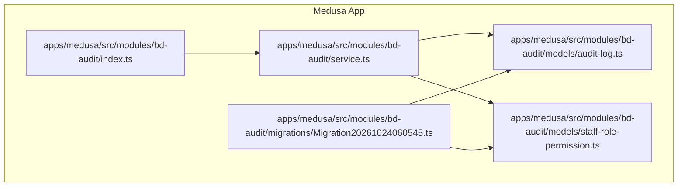
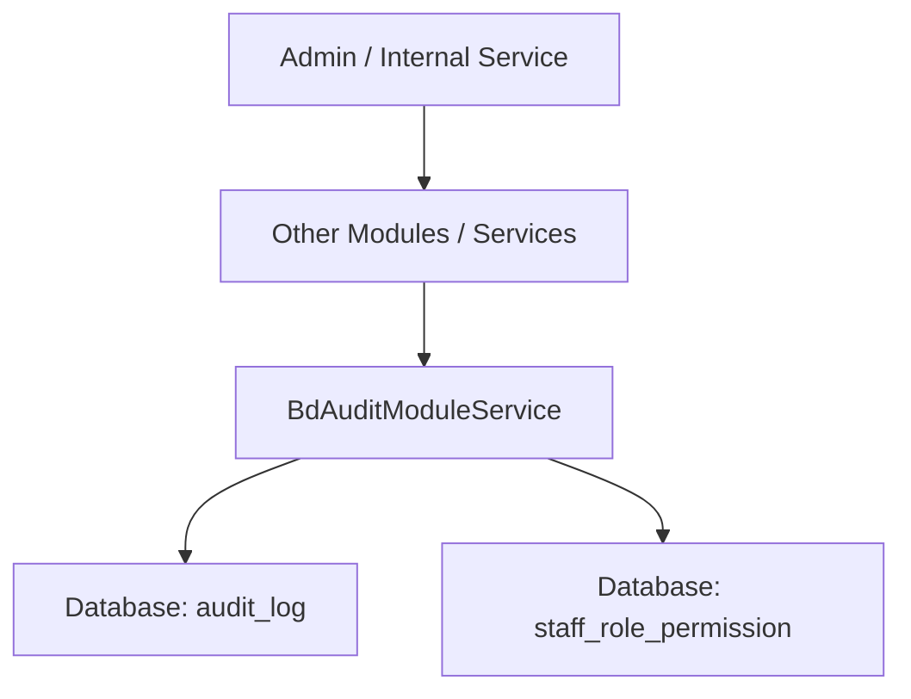
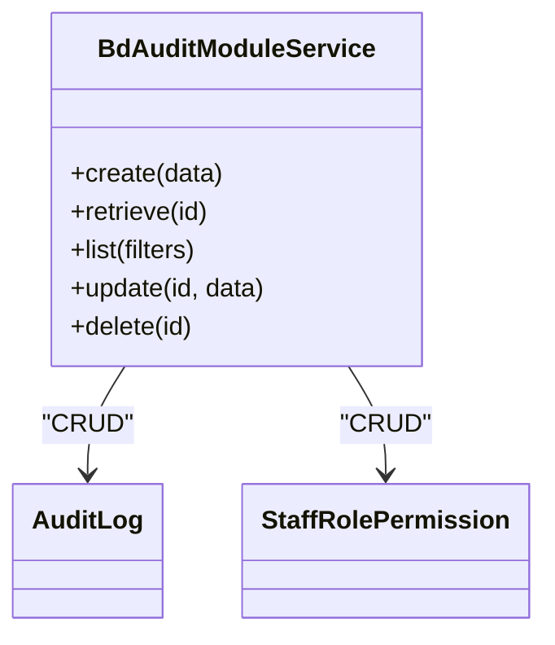
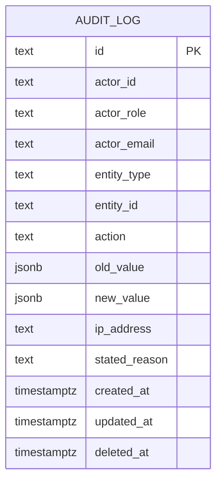
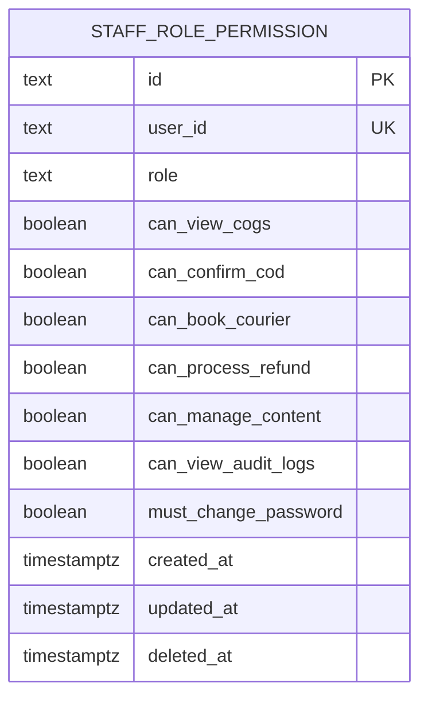
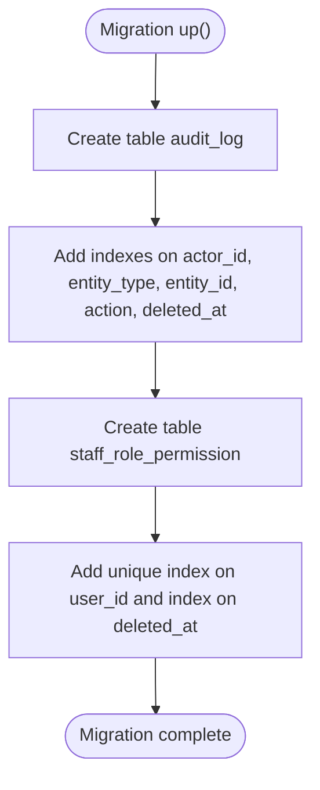
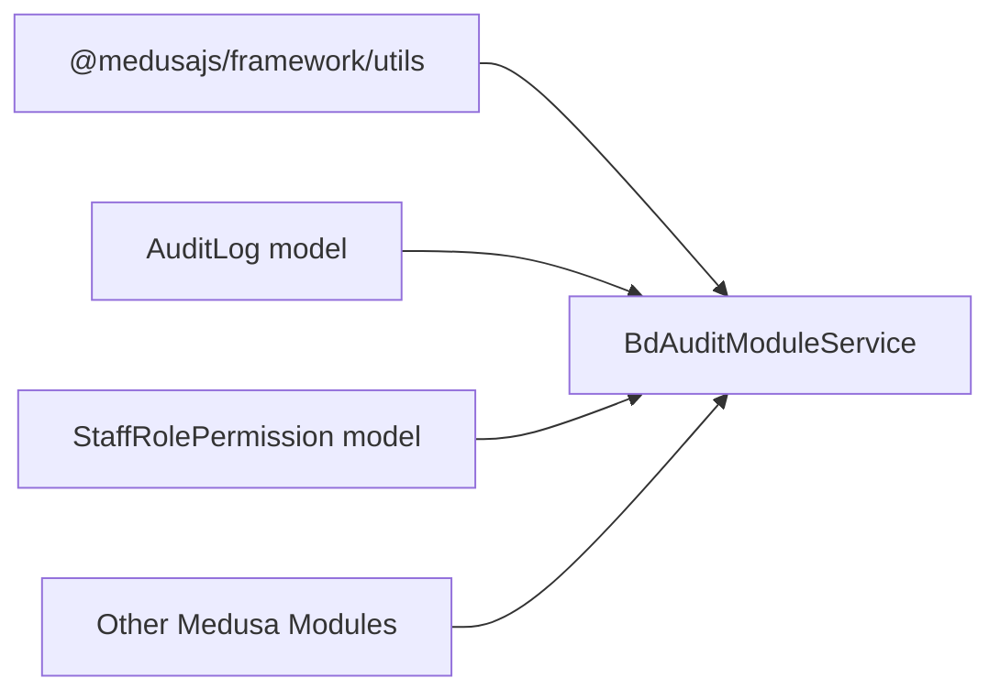

# Audit & Compliance Module

<cite>
**Referenced Files in This Document**   
- [index.ts](file://apps/medusa/src/modules/bd-audit/index.ts)
- [service.ts](file://apps/medusa/src/modules/bd-audit/service.ts)
- [audit-log.ts](file://apps/medusa/src/modules/bd-audit/models/audit-log.ts)
- [staff-role-permission.ts](file://apps/medusa/src/modules/bd-audit/models/staff-role-permission.ts)
- [Migration20261024060545.ts](file://apps/medusa/src/modules/bd-audit/migrations/Migration20261024060545.ts)
- [data-models.md](file://docs/data-models.md)
</cite>

## Table of Contents
1. [Introduction](#introduction)
2. [Project Structure](#project-structure)
3. [Core Components](#core-components)
4. [Architecture Overview](#architecture-overview)
5. [Detailed Component Analysis](#detailed-component-analysis)
6. [Dependency Analysis](#dependency-analysis)
7. [Performance Considerations](#performance-considerations)
8. [Troubleshooting Guide](#troubleshooting-guide)
9. [Conclusion](#conclusion)
10. [Appendices](#appendices)

## Introduction
The bd-audit module provides security and compliance capabilities for the platform by:
- Recording an immutable audit trail of important business actions through AuditLog.
- Enforcing permission-based access control via StaffRolePermission.
- Supporting staff role management, compliance reporting, and operational governance.

This module is implemented as a Medusa v2 module with two core entities and a thin service layer that exposes standard CRUD operations over those entities.

## Project Structure
The bd-audit module follows a feature-based layout under apps/medusa/src/modules/bd-audit:
- index.ts registers the module and exports its name.
- service.ts defines the module service bound to the data models.
- models/ contains entity definitions for audit logging and permissions.
- migrations/ contains database schema migration scripts.

**Diagram sources**
- [index.ts:1-9](file://apps/medusa/src/modules/bd-audit/index.ts#L1-L9)
- [service.ts:1-11](file://apps/medusa/src/modules/bd-audit/service.ts#L1-L11)
- [audit-log.ts:1-43](file://apps/medusa/src/modules/bd-audit/models/audit-log.ts#L1-L43)
- [staff-role-permission.ts:1-17](file://apps/medusa/src/modules/bd-audit/models/staff-role-permission.ts#L1-L17)
- [Migration20261024060545.ts:1-26](file://apps/medusa/src/modules/bd-audit/migrations/Migration20261024060545.ts#L1-L26)

**Section sources**
- [index.ts:1-9](file://apps/medusa/src/modules/bd-audit/index.ts#L1-L9)
- [service.ts:1-11](file://apps/medusa/src/modules/bd-audit/service.ts#L1-L11)

## Core Components
- BdAuditModuleService: Thin service extending MedusaService, exposing methods for AuditLog and StaffRolePermission.
- AuditLog model: Defines the audit trail schema including actor identity, target entity, action type, change snapshots, and contextual metadata.
- StaffRolePermission model: Defines per-user operational roles and fine-grained boolean permissions.

Key responsibilities:
- AuditLog: Capture who did what, when, where, and what changed.
- StaffRolePermission: Control access to sensitive features based on user role and flags.

**Section sources**
- [service.ts:1-11](file://apps/medusa/src/modules/bd-audit/service.ts#L1-L11)
- [audit-log.ts:1-43](file://apps/medusa/src/modules/bd-audit/models/audit-log.ts#L1-L43)
- [staff-role-permission.ts:1-17](file://apps/medusa/src/modules/bd-audit/models/staff-role-permission.ts#L1-L17)

## Architecture Overview
At runtime, other modules or services can use the bd-audit module to:
- Create audit log entries for critical events (e.g., order status transitions, refunds, courier bookings).
- Check or enforce permissions before allowing staff to perform sensitive actions.

**Diagram sources**
- [service.ts:1-11](file://apps/medusa/src/modules/bd-audit/service.ts#L1-L11)
- [audit-log.ts:1-43](file://apps/medusa/src/modules/bd-audit/models/audit-log.ts#L1-L43)
- [staff-role-permission.ts:1-17](file://apps/medusa/src/modules/bd-audit/models/staff-role-permission.ts#L1-L17)

## Detailed Component Analysis

### BdAuditModuleService
- Purpose: Exposes standard CRUD operations for AuditLog and StaffRolePermission.
- Implementation: Extends MedusaService with both models registered.
- Usage pattern: Other modules inject this service to create audit logs and read/update permissions.

**Diagram sources**
- [service.ts:1-11](file://apps/medusa/src/modules/bd-audit/service.ts#L1-L11)

**Section sources**
- [service.ts:1-11](file://apps/medusa/src/modules/bd-audit/service.ts#L1-L11)

### AuditLog Model
- Purpose: Records detailed audit trails for system activities.
- Fields include:
  - Actor identity: actor_id, actor_role, actor_email
  - Target entity: entity_type, entity_id
  - Action: standardized enum of actions
  - Change context: old_value, new_value (JSON), ip_address, stated_reason
- Indexing: actor_id, entity_type, entity_id, action are indexed for efficient querying.

**Diagram sources**
- [audit-log.ts:1-43](file://apps/medusa/src/modules/bd-audit/models/audit-log.ts#L1-L43)
- [Migration20261024060545.ts:5-12](file://apps/medusa/src/modules/bd-audit/migrations/Migration20261024060545.ts#L5-L12)

**Section sources**
- [audit-log.ts:1-43](file://apps/medusa/src/modules/bd-audit/models/audit-log.ts#L1-L43)
- [Migration20261024060545.ts:5-12](file://apps/medusa/src/modules/bd-audit/migrations/Migration20261024060545.ts#L5-L12)

### StaffRolePermission Model
- Purpose: Associates a Medusa User with an operational role and fine-grained permissions.
- Role hierarchy: owner > manager > staff; additional domain roles: call_center, warehouse, finance.
- Permissions include:
  - can_view_cogs
  - can_confirm_cod
  - can_book_courier
  - can_process_refund
  - can_manage_content
  - can_view_audit_logs
  - must_change_password (security flag)

**Diagram sources**
- [staff-role-permission.ts:1-17](file://apps/medusa/src/modules/bd-audit/models/staff-role-permission.ts#L1-L17)
- [Migration20261024060545.ts:14-16](file://apps/medusa/src/modules/bd-audit/migrations/Migration20261024060545.ts#L14-L16)

**Section sources**
- [staff-role-permission.ts:1-17](file://apps/medusa/src/modules/bd-audit/models/staff-role-permission.ts#L1-L17)
- [Migration20261024060545.ts:14-16](file://apps/medusa/src/modules/bd-audit/migrations/Migration20261024060545.ts#L14-L16)

### Database Migration
- Creates audit_log and staff_role_permission tables.
- Adds indexes for performance on frequently filtered columns.
- Ensures soft-delete support via deleted_at timestamps.

**Diagram sources**
- [Migration20261024060545.ts:5-16](file://apps/medusa/src/modules/bd-audit/migrations/Migration20261024060545.ts#L5-L16)

**Section sources**
- [Migration20261024060545.ts:1-26](file://apps/medusa/src/modules/bd-audit/migrations/Migration20261024060545.ts#L1-L26)

## Dependency Analysis
- The module depends on Medusa’s framework utilities for modeling and service scaffolding.
- Other modules should depend on BdAuditModuleService rather than directly on models to maintain encapsulation.

**Diagram sources**
- [service.ts:1-11](file://apps/medusa/src/modules/bd-audit/service.ts#L1-L11)
- [audit-log.ts:1-43](file://apps/medusa/src/modules/bd-audit/models/audit-log.ts#L1-L43)
- [staff-role-permission.ts:1-17](file://apps/medusa/src/modules/bd-audit/models/staff-role-permission.ts#L1-L17)

**Section sources**
- [service.ts:1-11](file://apps/medusa/src/modules/bd-audit/service.ts#L1-L11)

## Performance Considerations
- Indexes: actor_id, entity_type, entity_id, and action are indexed to optimize common queries such as “who changed what” and “what happened to this entity”.
- Soft deletes: deleted_at enables logical deletion while preserving historical records for compliance.
- JSON payloads: old_value/new_value are stored as JSONB; keep payloads concise to avoid large rows.
- Partitioning strategy: For high-volume environments, consider partitioning audit_log by time ranges (e.g., monthly) to improve query performance and retention management.

[No sources needed since this section provides general guidance]

## Troubleshooting Guide
Common issues and resolutions:
- Missing indexes causing slow queries:
  - Verify that audit_log indexes exist as defined in the migration.
- Permission not applied:
  - Ensure StaffRolePermission.user_id matches the Medusa User ID and that required permission flags are set.
- Audit logs not appearing:
  - Confirm that callers invoke the service to create AuditLog entries with valid actor_id, entity_type, and action values.
- Data integrity:
  - Validate that actor_role and entity_type enums match allowed values.
  - Validate that action enums match allowed values.

Operational checks:
- Query recent activity by entity_type and entity_id.
- Filter failed login and account lockout events for security monitoring.
- Use stated_reason to capture human-readable explanations for sensitive changes.

**Section sources**
- [Migration20261024060545.ts:5-16](file://apps/medusa/src/modules/bd-audit/migrations/Migration20261024060545.ts#L5-L16)
- [audit-log.ts:1-43](file://apps/medusa/src/modules/bd-audit/models/audit-log.ts#L1-L43)
- [staff-role-permission.ts:1-17](file://apps/medusa/src/modules/bd-audit/models/staff-role-permission.ts#L1-L17)

## Conclusion
The bd-audit module establishes a robust foundation for security and compliance:
- AuditLog captures comprehensive, searchable, and indexable audit trails.
- StaffRolePermission enforces granular, role-based access control aligned with Bangladesh operational needs.
- With proper usage patterns, it supports audit trail generation, permission-based access control, staff role management, and compliance reporting.

[No sources needed since this section summarizes without analyzing specific files]

## Appendices

### Audit Trail Generation
- When to record:
  - Order lifecycle changes (status_transition).
  - Financial actions (refund_recorded).
  - Inventory changes (restocked, quarantined).
  - Courier operations (consignment_booked, consignment_canceled).
  - Security events (failed_login, account_lockout, password_reset).
- What to include:
  - actor_id, actor_role, actor_email (when available).
  - entity_type, entity_id identifying the affected resource.
  - action from the allowed set.
  - old_value/new_value snapshots for meaningful diffs.
  - ip_address and stated_reason for traceability.

Example implementation outline:
- In a workflow or service method handling a sensitive operation:
  - Build an AuditLog payload with actor context and change deltas.
  - Call BdAuditModuleService.create(AuditLog).
  - Handle errors and ensure consistent transaction boundaries.

**Section sources**
- [audit-log.ts:1-43](file://apps/medusa/src/modules/bd-audit/models/audit-log.ts#L1-L43)
- [service.ts:1-11](file://apps/medusa/src/modules/bd-audit/service.ts#L1-L11)

### Managing Staff Permissions
- Assign roles and flags:
  - Set role to one of owner, manager, staff, call_center, warehouse, finance.
  - Enable only the minimum necessary permissions for each user.
- Enforce at runtime:
  - Before sensitive operations, check corresponding permission flags on StaffRolePermission.
  - Deny access if required flags are false.

Example implementation outline:
- On admin request:
  - Load StaffRolePermission for the current user.
  - Check required permission (e.g., can_process_refund).
  - Proceed or return authorization error.

**Section sources**
- [staff-role-permission.ts:1-17](file://apps/medusa/src/modules/bd-audit/models/staff-role-permission.ts#L1-L17)
- [data-models.md:303-319](file://docs/data-models.md#L303-L319)

### Generating Compliance Reports
- Typical report dimensions:
  - Activity by actor_role and action.
  - Changes to financial or inventory entities.
  - Security events (failed_login, account_lockout, password_reset).
- Suggested queries:
  - Count of actions by entity_type and action within a date range.
  - List of users with sensitive permissions enabled.
  - Timeline of changes for a given entity_id.

Implementation approach:
- Use BdAuditModuleService.list with filters for entity_type, action, actor_role, and date ranges.
- Aggregate results in your reporting service or export pipeline.

**Section sources**
- [audit-log.ts:1-43](file://apps/medusa/src/modules/bd-audit/models/audit-log.ts#L1-L43)
- [service.ts:1-11](file://apps/medusa/src/modules/bd-audit/service.ts#L1-L11)

### Audit Log Retention Policies
Recommended policy:
- Keep all audit logs indefinitely for compliance unless legal constraints require otherwise.
- Archive older partitions (e.g., beyond 12 months) to cold storage.
- Implement soft delete cleanup jobs to remove non-compliance-related noise after retention periods.

Operational steps:
- Partition audit_log by time (monthly or quarterly).
- Run periodic archival jobs to move older partitions.
- Purge archived data according to organizational policy.

[No sources needed since this section provides general guidance]

### Security Best Practices
- Least privilege:
  - Grant only the minimal permissions required for each role.
- Strong authentication:
  - Enforce must_change_password for new accounts until reset.
- Monitoring:
  - Alert on repeated failed_login and account_lockout events.
- Data protection:
  - Avoid storing sensitive PII in old_value/new_value; redact secrets.
- Integrity:
  - Treat audit_log as append-only; do not update existing entries.

**Section sources**
- [staff-role-permission.ts:1-17](file://apps/medusa/src/modules/bd-audit/models/staff-role-permission.ts#L1-L17)
- [audit-log.ts:1-43](file://apps/medusa/src/modules/bd-audit/models/audit-log.ts#L1-L43)