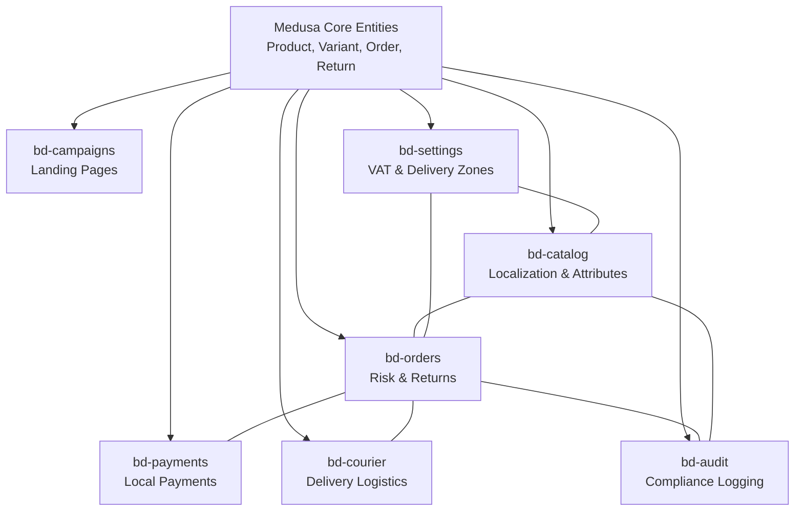
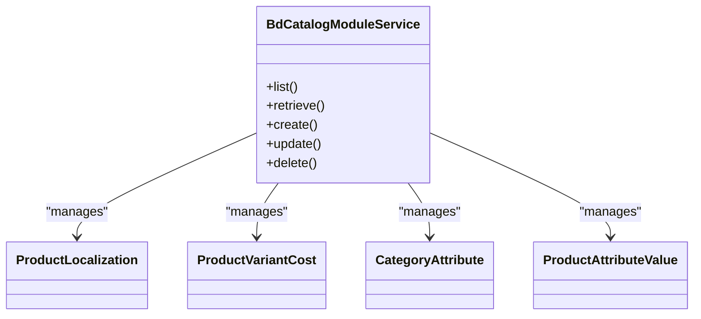
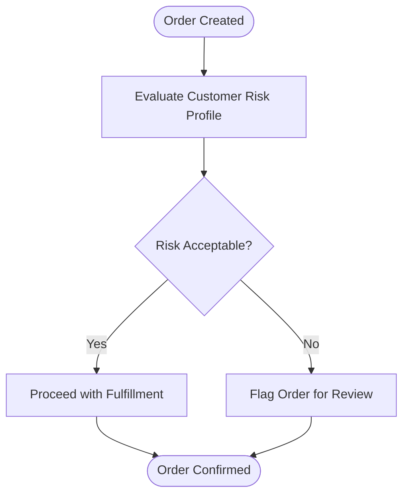
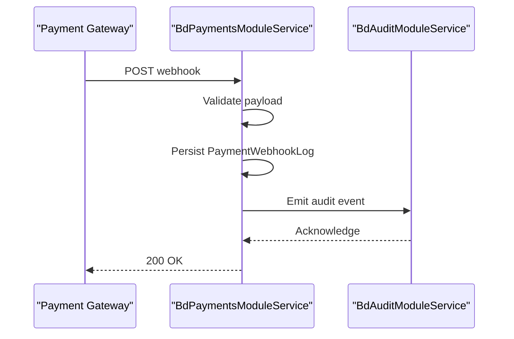
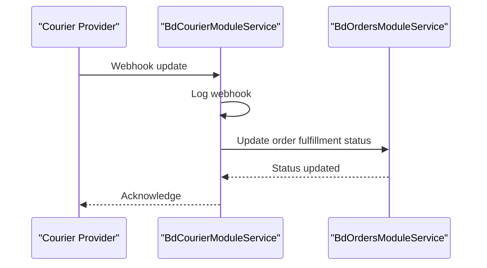
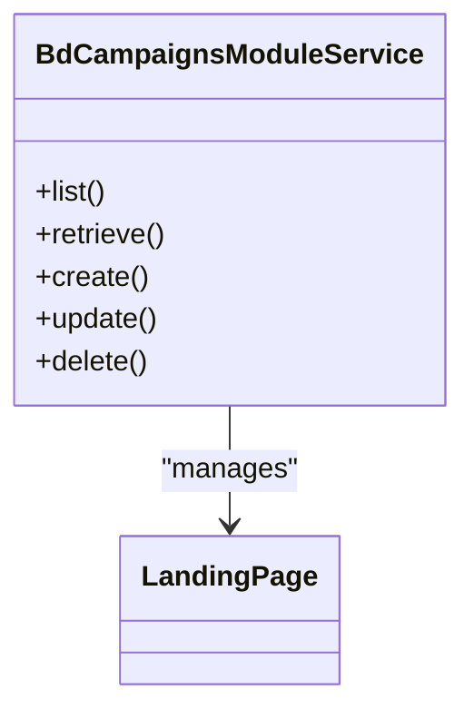
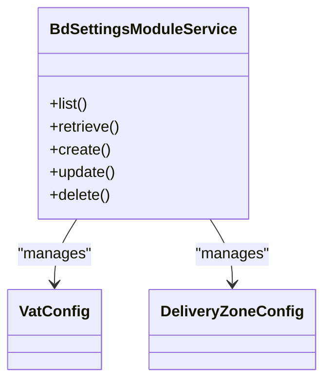
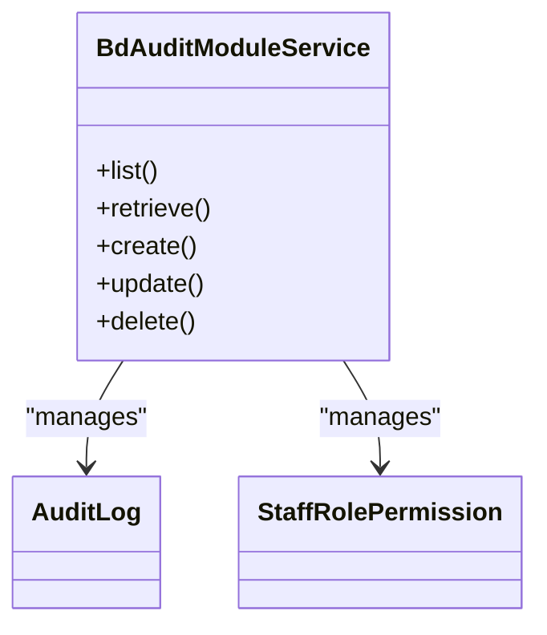
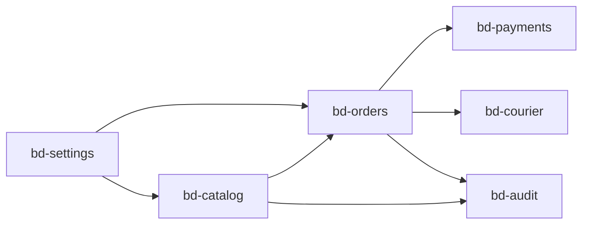

# Bangladesh Custom Modules

<cite>
**Referenced Files in This Document**
- [README.md](file://apps/medusa/src/modules/README.md)
- [index.ts (bd-catalog)](file://apps/medusa/src/modules/bd-catalog/index.ts)
- [service.ts (bd-catalog)](file://apps/medusa/src/modules/bd-catalog/service.ts)
- [product-localization.ts](file://apps/medusa/src/modules/bd-catalog/models/product-localization.ts)
- [product-variant-cost.ts](file://apps/medusa/src/modules/bd-catalog/models/product-variant-cost.ts)
- [category-attribute.ts](file://apps/medusa/src/modules/bd-catalog/models/category-attribute.ts)
- [product-attribute-value.ts](file://apps/medusa/src/modules/bd-catalog/models/product-attribute-value.ts)
- [index.ts (bd-orders)](file://apps/medusa/src/modules/bd-orders/index.ts)
- [service.ts (bd-orders)](file://apps/medusa/src/modules/bd-orders/service.ts)
- [order-bd-details.ts](file://apps/medusa/src/modules/bd-orders/models/order-bd-details.ts)
- [customer-risk-profile.ts](file://apps/medusa/src/modules/bd-orders/models/customer-risk-profile.ts)
- [order-return-request.ts](file://apps/medusa/src/modules/bd-orders/models/order-return-request.ts)
- [index.ts (bd-payments)](file://apps/medusa/src/modules/bd-payments/index.ts)
- [service.ts (bd-payments)](file://apps/medusa/src/modules/bd-payments/service.ts)
- [payment-transaction.ts](file://apps/medusa/src/modules/bd-payments/models/payment-transaction.ts)
- [payment-webhook-log.ts](file://apps/medusa/src/modules/bd-payments/models/payment-webhook-log.ts)
- [index.ts (bd-courier)](file://apps/medusa/src/modules/bd-courier/index.ts)
- [service.ts (bd-courier)](file://apps/medusa/src/modules/bd-courier/service.ts)
- [courier-shipment-log.ts](file://apps/medusa/src/modules/bd-courier/models/courier-shipment-log.ts)
- [courier-webhook-log.ts](file://apps/medusa/src/modules/bd-courier/models/courier-webhook-log.ts)
- [index.ts (bd-campaigns)](file://apps/medusa/src/modules/bd-campaigns/index.ts)
- [service.ts (bd-campaigns)](file://apps/medusa/src/modules/bd-campaigns/service.ts)
- [landing-page.ts](file://apps/medusa/src/modules/bd-campaigns/models/landing-page.ts)
- [index.ts (bd-settings)](file://apps/medusa/src/modules/bd-settings/index.ts)
- [service.ts (bd-settings)](file://apps/medusa/src/modules/bd-settings/service.ts)
- [delivery-zone-config.ts](file://apps/medusa/src/modules/bd-settings/models/delivery-zone-config.ts)
- [vat-config.ts](file://apps/medusa/src/modules/bd-settings/models/vat-config.ts)
- [index.ts (bd-audit)](file://apps/medusa/src/modules/bd-audit/index.ts)
- [service.ts (bd-audit)](file://apps/medusa/src/modules/bd-audit/service.ts)
- [audit-log.ts](file://apps/medusa/src/modules/bd-audit/models/audit-log.ts)
- [staff-role-permission.ts](file://apps/medusa/src/modules/bd-audit/models/staff-role-permission.ts)
- [product-localization.ts (link)](file://apps/medusa/src/links/product-localization.ts)
- [product-variant-cost.ts (link)](file://apps/medusa/src/links/product-variant-cost.ts)
- [order-bd-details.ts (link)](file://apps/medusa/src/links/order-bd-details.ts)
- [order-return-request.ts (link)](file://apps/medusa/src/links/order-return-request.ts)
</cite>

## Table of Contents
1. [Introduction](#introduction)
2. [Project Structure](#project-structure)
3. [Core Components](#core-components)
4. [Architecture Overview](#architecture-overview)
5. [Detailed Component Analysis](#detailed-component-analysis)
6. [Dependency Analysis](#dependency-analysis)
7. [Performance Considerations](#performance-considerations)
8. [Troubleshooting Guide](#troubleshooting-guide)
9. [Conclusion](#conclusion)

## Introduction
This document explains the Bangladesh-specific custom modules that extend Medusa’s core commerce capabilities. The modules cover product catalog enhancements, order risk and returns, local payment methods, courier logistics, campaign landing pages, regional settings (VAT and delivery zones), and compliance audit logging. Each module follows a consistent structure: models, service, migrations, and index exports. Inter-module communication is achieved via Module Links and event-driven patterns, enabling clean data flow across the system.

## Project Structure
The repository organizes each module under apps/medusa/src/modules with a uniform layout:
- models: Data models defining database tables
- service.ts: Service class extending MedusaService to expose business logic
- index.ts: Module definition exporting the module name and service
- migrations: Database migration files generated per module

```mermaid
graph TB
subgraph "Medusa App"
A["apps/medusa/src/modules"]
end
subgraph "Module: bd-catalog"
C1["models/*"]
C2["service.ts"]
C3["index.ts"]
C4["migrations/*"]
end
subgraph "Module: bd-orders"
O1["models/*"]
O2["service.ts"]
O3["index.ts"]
O4["migrations/*"]
end
subgraph "Module: bd-payments"
P1["models/*"]
P2["service.ts"]
P3["index.ts"]
P4["migrations/*"]
end
subgraph "Module: bd-courier"
R1["models/*"]
R2["service.ts"]
R3["index.ts"]
R4["migrations/*"]
end
subgraph "Module: bd-campaigns"
K1["models/*"]
K2["service.ts"]
K3["index.ts"]
K4["migrations/*"]
end
subgraph "Module: bd-settings"
S1["models/*"]
S2["service.ts"]
S3["index.ts"]
S4["migrations/*"]
end
subgraph "Module: bd-audit"
D1["models/*"]
D2["service.ts"]
D3["index.ts"]
D4["migrations/*"]
end
A --> C1
A --> C2
A --> C3
A --> C4
A --> O1
A --> O2
A --> O3
A --> O4
A --> P1
A --> P2
A --> P3
A --> P4
A --> R1
A --> R2
A --> R3
A --> R4
A --> K1
A --> K2
A --> K3
A --> K4
A --> S1
A --> S2
A --> S3
A --> S4
A --> D1
A --> D2
A --> D3
A --> D4
```



**Diagram sources**
- [README.md:1-118](file://apps/medusa/src/modules/README.md#L1-L118)

**Section sources**
- [README.md:1-118](file://apps/medusa/src/modules/README.md#L1-L118)

## Core Components
Each module implements a standard pattern:
- Models: Define entities using the framework’s model API
- Service: Extends MedusaService with the module’s models
- Index: Exports the module constant and registers the service
- Migrations: Generated from models for database schema evolution

Key module entry points and services:
- bd-catalog: Product localization, variant cost, category attributes, attribute values
- bd-orders: Order details, customer risk profiles, return requests
- bd-payments: Payment transactions and webhook logs
- bd-courier: Shipment logs and webhook logs
- bd-campaigns: Landing page content
- bd-settings: VAT configuration and delivery zone configuration
- bd-audit: Audit logs and staff role permissions

**Section sources**
- [index.ts (bd-catalog):1-9](file://apps/medusa/src/modules/bd-catalog/index.ts#L1-L9)
- [service.ts (bd-catalog):1-15](file://apps/medusa/src/modules/bd-catalog/service.ts#L1-L15)
- [index.ts (bd-orders):1-9](file://apps/medusa/src/modules/bd-orders/index.ts#L1-L9)
- [service.ts (bd-orders):1-13](file://apps/medusa/src/modules/bd-orders/service.ts#L1-L13)
- [index.ts (bd-payments):1-9](file://apps/medusa/src/modules/bd-payments/index.ts#L1-L9)
- [service.ts (bd-payments):1-11](file://apps/medusa/src/modules/bd-payments/service.ts#L1-L11)
- [index.ts (bd-courier):1-9](file://apps/medusa/src/modules/bd-courier/index.ts#L1-L9)
- [service.ts (bd-courier):1-11](file://apps/medusa/src/modules/bd-courier/service.ts#L1-L11)
- [index.ts (bd-campaigns):1-9](file://apps/medusa/src/modules/bd-campaigns/index.ts#L1-L9)
- [service.ts (bd-campaigns):1-9](file://apps/medusa/src/modules/bd-campaigns/service.ts#L1-L9)
- [index.ts (bd-settings):1-9](file://apps/medusa/src/modules/bd-settings/index.ts#L1-L9)
- [service.ts (bd-settings):1-11](file://apps/medusa/src/modules/bd-settings/service.ts#L1-L11)
- [index.ts (bd-audit):1-9](file://apps/medusa/src/modules/bd-audit/index.ts#L1-L9)
- [service.ts (bd-audit):1-11](file://apps/medusa/src/modules/bd-audit/service.ts#L1-L11)

## Architecture Overview
The modules integrate with Medusa’s core through:
- Module Links: Declarative relationships between core entities and custom models
- Event-driven flows: Subscribers and workflows reacting to domain events
- Services: Centralized business logic exposed to routes, workflows, and other modules



**Diagram sources**
- [product-localization.ts (link):1-200](file://apps/medusa/src/links/product-localization.ts#L1-L200)
- [product-variant-cost.ts (link):1-200](file://apps/medusa/src/links/product-variant-cost.ts#L1-L200)
- [order-bd-details.ts (link):1-200](file://apps/medusa/src/links/order-bd-details.ts#L1-L200)
- [order-return-request.ts (link):1-200](file://apps/medusa/src/links/order-return-request.ts#L1-L200)

## Detailed Component Analysis

### bd-catalog: Product Attributes and Localization
Purpose:
- Extend product data with localized descriptions and attributes
- Track variant costs and category-level attributes
- Provide services to query and manage catalog metadata

Models:
- ProductLocalization: Localized product fields
- ProductVariantCost: Cost tracking per variant
- CategoryAttribute: Attribute definitions at category level
- ProductAttributeValue: Values assigned to products via categories

Service:
- BdCatalogModuleService extends MedusaService with all catalog models



**Diagram sources**
- [service.ts (bd-catalog):1-15](file://apps/medusa/src/modules/bd-catalog/service.ts#L1-L15)
- [product-localization.ts](file://apps/medusa/src/modules/bd-catalog/models/product-localization.ts)
- [product-variant-cost.ts](file://apps/medusa/src/modules/bd-catalog/models/product-variant-cost.ts)
- [category-attribute.ts](file://apps/medusa/src/modules/bd-catalog/models/category-attribute.ts)
- [product-attribute-value.ts](file://apps/medusa/src/modules/bd-catalog/models/product-attribute-value.ts)

Inter-module links:
- Product localization link connects core Product to ProductLocalization
- Product variant cost link connects core ProductVariant to ProductVariantCost

```mermaid
sequenceDiagram
participant Core as "Medusa Core"
participant Link as "Links"
participant Catalog as "BdCatalogModuleService"
Core->>Link : Resolve relationship
Link-->>Core : Enriched Product/Variant with localization/cost
Core->>Catalog : Query localized attributes
Catalog-->>Core : Localized product data
```

**Diagram sources**
- [product-localization.ts (link):1-200](file://apps/medusa/src/links/product-localization.ts#L1-L200)
- [product-variant-cost.ts (link):1-200](file://apps/medusa/src/links/product-variant-cost.ts#L1-L200)

**Section sources**
- [index.ts (bd-catalog):1-9](file://apps/medusa/src/modules/bd-catalog/index.ts#L1-L9)
- [service.ts (bd-catalog):1-15](file://apps/medusa/src/modules/bd-catalog/service.ts#L1-L15)
- [product-localization.ts (link):1-200](file://apps/medusa/src/links/product-localization.ts#L1-L200)
- [product-variant-cost.ts (link):1-200](file://apps/medusa/src/links/product-variant-cost.ts#L1-L200)

### bd-orders: Risk Profiling and Returns
Purpose:
- Store extended order details specific to Bangladesh operations
- Maintain customer risk profiles for fraud prevention
- Manage return requests and their lifecycle

Models:
- OrderBdDetails: Additional order fields
- CustomerRiskProfile: Risk scoring and flags
- OrderReturnRequest: Return request records

Service:
- BdOrdersModuleService extends MedusaService with order-related models



**Diagram sources**
- [service.ts (bd-orders):1-13](file://apps/medusa/src/modules/bd-orders/service.ts#L1-L13)
- [customer-risk-profile.ts](file://apps/medusa/src/modules/bd-orders/models/customer-risk-profile.ts)
- [order-bd-details.ts](file://apps/medusa/src/modules/bd-orders/models/order-bd-details.ts)

Inter-module links:
- Order BD details link connects core Order to OrderBdDetails
- Order return request link connects core Return to OrderReturnRequest

```mermaid
sequenceDiagram
participant Core as "Medusa Core"
participant Link as "Links"
participant Orders as "BdOrdersModuleService"
Core->>Link : Resolve Order -> OrderBdDetails
Link-->>Core : Enriched Order with BD details
Core->>Orders : Create/Update return request
Orders-->>Core : Return request persisted
```

**Diagram sources**
- [order-bd-details.ts (link):1-200](file://apps/medusa/src/links/order-bd-details.ts#L1-L200)
- [order-return-request.ts (link):1-200](file://apps/medusa/src/links/order-return-request.ts#L1-L200)

**Section sources**
- [index.ts (bd-orders):1-9](file://apps/medusa/src/modules/bd-orders/index.ts#L1-L9)
- [service.ts (bd-orders):1-13](file://apps/medusa/src/modules/bd-orders/service.ts#L1-L13)
- [order-bd-details.ts (link):1-200](file://apps/medusa/src/links/order-bd-details.ts#L1-L200)
- [order-return-request.ts (link):1-200](file://apps/medusa/src/links/order-return-request.ts#L1-L200)

### bd-payments: Local Payment Methods
Purpose:
- Record payment transactions and webhook logs for local gateways
- Support reconciliation and auditability of payment events

Models:
- PaymentTransaction: Transaction records
- PaymentWebhookLog: Webhook payloads and statuses

Service:
- BdPaymentsModuleService extends MedusaService with payment models



**Diagram sources**
- [service.ts (bd-payments):1-11](file://apps/medusa/src/modules/bd-payments/service.ts#L1-L11)
- [payment-transaction.ts](file://apps/medusa/src/modules/bd-payments/models/payment-transaction.ts)
- [payment-webhook-log.ts](file://apps/medusa/src/modules/bd-payments/models/payment-webhook-log.ts)

**Section sources**
- [index.ts (bd-payments):1-9](file://apps/medusa/src/modules/bd-payments/index.ts#L1-L9)
- [service.ts (bd-payments):1-11](file://apps/medusa/src/modules/bd-payments/service.ts#L1-L11)

### bd-courier: Delivery Logistics
Purpose:
- Track shipment logs and webhook events from courier providers
- Integrate with order fulfillment and status updates

Models:
- CourierShipmentLog: Shipment tracking entries
- CourierWebhookLog: Webhook logs from couriers

Service:
- BdCourierModuleService extends MedusaService with courier models



**Diagram sources**
- [service.ts (bd-courier):1-11](file://apps/medusa/src/modules/bd-courier/service.ts#L1-L11)
- [courier-shipment-log.ts](file://apps/medusa/src/modules/bd-courier/models/courier-shipment-log.ts)
- [courier-webhook-log.ts](file://apps/medusa/src/modules/bd-courier/models/courier-webhook-log.ts)

**Section sources**
- [index.ts (bd-courier):1-9](file://apps/medusa/src/modules/bd-courier/index.ts#L1-L9)
- [service.ts (bd-courier):1-11](file://apps/medusa/src/modules/bd-courier/service.ts#L1-L11)

### bd-campaigns: Landing Pages
Purpose:
- Manage marketing campaign landing pages and related content

Models:
- LandingPage: Campaign landing page entities

Service:
- BdCampaignsModuleService extends MedusaService with landing page model



**Diagram sources**
- [service.ts (bd-campaigns):1-9](file://apps/medusa/src/modules/bd-campaigns/service.ts#L1-L9)
- [landing-page.ts](file://apps/medusa/src/modules/bd-campaigns/models/landing-page.ts)

**Section sources**
- [index.ts (bd-campaigns):1-9](file://apps/medusa/src/modules/bd-campaigns/index.ts#L1-L9)
- [service.ts (bd-campaigns):1-9](file://apps/medusa/src/modules/bd-campaigns/service.ts#L1-L9)

### bd-settings: VAT and Delivery Zones
Purpose:
- Configure VAT rules and delivery zones for Bangladesh regions
- Provide centralized settings for commerce operations

Models:
- VatConfig: VAT configuration entities
- DeliveryZoneConfig: Delivery zone definitions

Service:
- BdSettingsModuleService extends MedusaService with settings models



**Diagram sources**
- [service.ts (bd-settings):1-11](file://apps/medusa/src/modules/bd-settings/service.ts#L1-L11)
- [vat-config.ts](file://apps/medusa/src/modules/bd-settings/models/vat-config.ts)
- [delivery-zone-config.ts](file://apps/medusa/src/modules/bd-settings/models/delivery-zone-config.ts)

**Section sources**
- [index.ts (bd-settings):1-9](file://apps/medusa/src/modules/bd-settings/index.ts#L1-L9)
- [service.ts (bd-settings):1-11](file://apps/medusa/src/modules/bd-settings/service.ts#L1-L11)

### bd-audit: Compliance Logging
Purpose:
- Record audit logs for compliance and operational visibility
- Manage staff role permissions for administrative access control

Models:
- AuditLog: Audit trail entries
- StaffRolePermission: Role-based permission records

Service:
- BdAuditModuleService extends MedusaService with audit models



**Diagram sources**
- [service.ts (bd-audit):1-11](file://apps/medusa/src/modules/bd-audit/service.ts#L1-L11)
- [audit-log.ts](file://apps/medusa/src/modules/bd-audit/models/audit-log.ts)
- [staff-role-permission.ts](file://apps/medusa/src/modules/bd-audit/models/staff-role-permission.ts)

**Section sources**
- [index.ts (bd-audit):1-9](file://apps/medusa/src/modules/bd-audit/index.ts#L1-L9)
- [service.ts (bd-audit):1-11](file://apps/medusa/src/modules/bd-audit/service.ts#L1-L11)

## Dependency Analysis
Inter-module dependencies are primarily established through:
- Module Links: Connecting core entities to custom models
- Events: Cross-module notifications for state changes
- Services: Direct calls within workflows or routes



**Diagram sources**
- [product-localization.ts (link):1-200](file://apps/medusa/src/links/product-localization.ts#L1-L200)
- [product-variant-cost.ts (link):1-200](file://apps/medusa/src/links/product-variant-cost.ts#L1-L200)
- [order-bd-details.ts (link):1-200](file://apps/medusa/src/links/order-bd-details.ts#L1-L200)
- [order-return-request.ts (link):1-200](file://apps/medusa/src/links/order-return-request.ts#L1-L200)

**Section sources**
- [product-localization.ts (link):1-200](file://apps/medusa/src/links/product-localization.ts#L1-L200)
- [product-variant-cost.ts (link):1-200](file://apps/medusa/src/links/product-variant-cost.ts#L1-L200)
- [order-bd-details.ts (link):1-200](file://apps/medusa/src/links/order-bd-details.ts#L1-L200)
- [order-return-request.ts (link):1-200](file://apps/medusa/src/links/order-return-request.ts#L1-L200)

## Performance Considerations
- Use MedusaService CRUD methods efficiently; avoid N+1 queries by leveraging built-in relations via links
- Cache frequently accessed settings (VAT, delivery zones) where appropriate
- Batch write operations for webhook logs and audit entries to reduce DB contention
- Keep migrations incremental and test them against representative datasets

[No sources needed since this section provides general guidance]

## Troubleshooting Guide
Common issues and resolutions:
- Migration failures: Ensure models are correctly defined and migrations are regenerated after model changes
- Link resolution errors: Verify that links are registered and core entity IDs match expected formats
- Event subscriber not firing: Confirm subscribers are registered and event names align with Medusa’s event bus
- Permission denials: Review staff role permissions in bd-audit and ensure roles are properly assigned

**Section sources**
- [README.md:78-90](file://apps/medusa/src/modules/README.md#L78-L90)

## Conclusion
The Bangladesh custom modules provide a robust extension layer over Medusa’s core, covering localization, risk management, payments, logistics, campaigns, settings, and auditability. By adhering to the consistent module structure and leveraging Module Links and event-driven patterns, teams can maintain clear boundaries while enabling rich cross-module interactions. Following the patterns outlined here will streamline the creation of new modules and ensure scalability and maintainability.

[No sources needed since this section summarizes without analyzing specific files]