# Campaign Management Module

<cite>
**Referenced Files in This Document**   
- [landing-page.ts](file://apps/medusa/src/modules/bd-campaigns/models/landing-page.ts)
- [service.ts](file://apps/medusa/src/modules/bd-campaigns/service.ts)
- [index.ts](file://apps/medusa/src/modules/bd-campaigns/index.ts)
- [Migration20261024060543.ts](file://apps/medusa/src/modules/bd-campaigns/migrations/Migration20261024060543.ts)
- [order-bd-details.ts](file://apps/medusa/src/modules/bd-orders/models/order-bd-details.ts)
- [technical-plan.md](file://technical-plan.md)
- [ideaproposition.md](file://ideaproposition.md)
- [user-journeys.md](file://user-journeys.md)
- [prompt.md](file://prompt.md)
</cite>

## Table of Contents
1. [Introduction](#introduction)
2. [Project Structure](#project-structure)
3. [Core Components](#core-components)
4. [Architecture Overview](#architecture-overview)
5. [Detailed Component Analysis](#detailed-component-analysis)
6. [Dependency Analysis](#dependency-analysis)
7. [Performance Considerations](#performance-considerations)
8. [Troubleshooting Guide](#troubleshooting-guide)
9. [Conclusion](#conclusion)
10. [Appendices](#appendices)

## Introduction
The bd-campaigns module provides the foundation for marketing campaign landing pages within the Medusa-based commerce platform. At this stage, it defines a canonical `LandingPage` data model and exposes a service layer that can be extended to support campaign operations such as template management, direct checkout integration, and performance tracking. The module is designed to integrate with the existing catalog, cart, checkout, and order systems rather than creating parallel flows.

Key capabilities covered by this documentation include:
- Landing page content structure and metadata
- Service layer entry point for campaign operations
- Planned checkout modes and direct checkout behavior
- Integration points for campaign attribution and performance tracking
- Examples of promotional landing page creation and configuration

## Project Structure
The bd-campaigns module follows the Medusa v2 module layout:
- A model file defines the database schema for landing pages
- A service file extends the framework’s base service class
- An index file registers the module with its service
- A migration file creates and indexes the landing page table

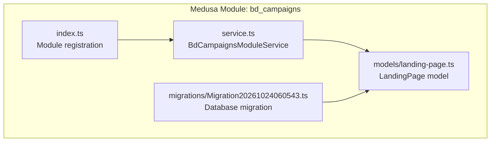

**Diagram sources**
- [index.ts:1-9](file://apps/medusa/src/modules/bd-campaigns/index.ts#L1-L9)
- [service.ts:1-9](file://apps/medusa/src/modules/bd-campaigns/service.ts#L1-L9)
- [landing-page.ts:1-20](file://apps/medusa/src/modules/bd-campaigns/models/landing-page.ts#L1-L20)
- [Migration20261024060543.ts:1-17](file://apps/medusa/src/modules/bd-campaigns/migrations/Migration20261024060543.ts#L1-L17)

**Section sources**
- [index.ts:1-9](file://apps/medusa/src/modules/bd-campaigns/index.ts#L1-L9)
- [service.ts:1-9](file://apps/medusa/src/modules/bd-campaigns/service.ts#L1-L9)
- [landing-page.ts:1-20](file://apps/medusa/src/modules/bd-campaigns/models/landing-page.ts#L1-L20)
- [Migration20261024060543.ts:1-17](file://apps/medusa/src/modules/bd-campaigns/migrations/Migration20261024060543.ts#L1-L17)

## Core Components
This section documents the primary building blocks of the bd-campaigns module.

### Landing Page Model
The `LandingPage` model represents a marketing campaign landing page. It includes:
- Unique slug for routing and identification
- English and Bangla titles
- Active flag for publish control
- Optional featured product reference
- Checkout mode selection
- JSON fields for sections and theme tokens
- SEO fields and Meta Pixel identifier
- Publication timestamp

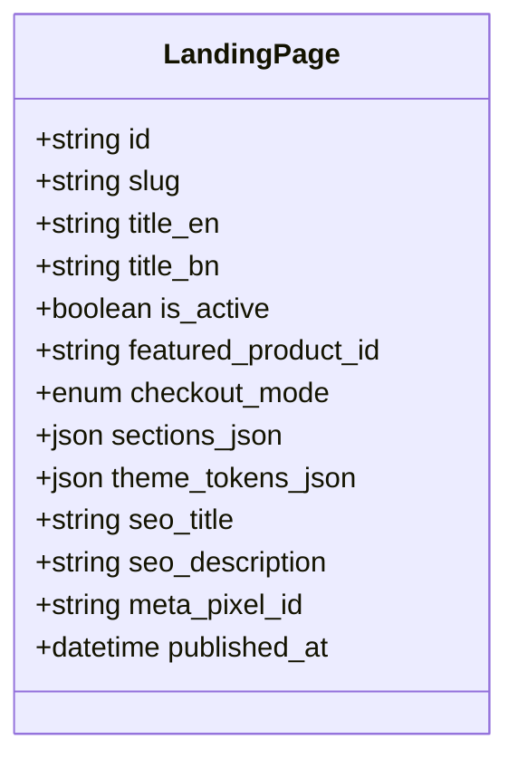

**Diagram sources**
- [landing-page.ts:3-17](file://apps/medusa/src/modules/bd-campaigns/models/landing-page.ts#L3-L17)

**Section sources**
- [landing-page.ts:1-20](file://apps/medusa/src/modules/bd-campaigns/models/landing-page.ts#L1-L20)

### Service Layer
The service class extends the Medusa service base and registers the `LandingPage` model. It currently provides default CRUD capabilities through the framework’s service generator. Future campaign operations should be implemented here.

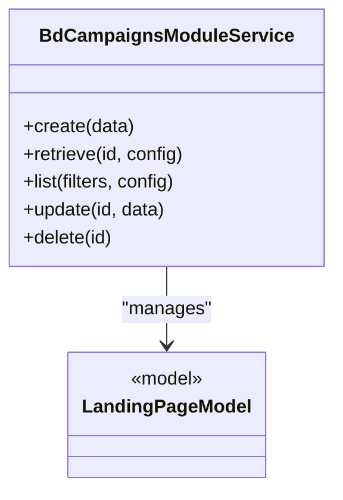

**Diagram sources**
- [service.ts:1-9](file://apps/medusa/src/modules/bd-campaigns/service.ts#L1-L9)
- [landing-page.ts:1-20](file://apps/medusa/src/modules/bd-campaigns/models/landing-page.ts#L1-L20)

**Section sources**
- [service.ts:1-9](file://apps/medusa/src/modules/bd-campaigns/service.ts#L1-L9)

### Module Registration
The module exports a constant name and registers itself with Medusa using the service.

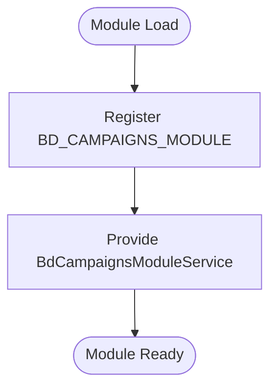

**Diagram sources**
- [index.ts:1-9](file://apps/medusa/src/modules/bd-campaigns/index.ts#L1-L9)

**Section sources**
- [index.ts:1-9](file://apps/medusa/src/modules/bd-campaigns/index.ts#L1-L9)

## Architecture Overview
The current implementation establishes the data contract for landing pages and a service entry point. Higher-level features such as template management, direct checkout integration, and performance tracking are defined by project requirements and prompts but are not yet implemented in code.

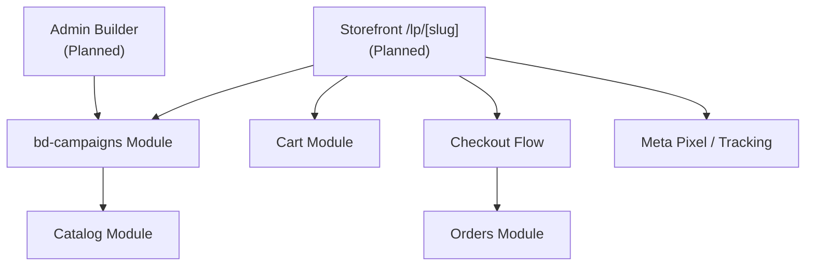

[No sources needed since this diagram shows conceptual workflow, not actual code structure]

## Detailed Component Analysis

### Landing Page Data Model
The `LandingPage` model captures both presentation and operational attributes:
- Routing identity via unique slug
- Multilingual titles for English and Bangla
- Publish state controlled by active flag
- Optional featured product linkage
- Checkout mode options: embedded, modal, redirect
- Sections and theme tokens stored as JSON for flexible layout and styling
- SEO metadata and optional per-page Meta Pixel ID
- Publication timestamp for auditability

The migration ensures:
- Table creation with all fields
- Soft delete support via deleted_at
- Unique constraint on slug scoped to non-deleted rows
- Indexes for slug uniqueness and soft-delete filtering

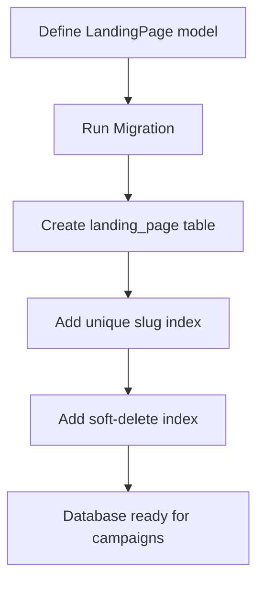

**Diagram sources**
- [landing-page.ts:3-17](file://apps/medusa/src/modules/bd-campaigns/models/landing-page.ts#L3-L17)
- [Migration20261024060543.ts:5-10](file://apps/medusa/src/modules/bd-campaigns/migrations/Migration20261024060543.ts#L5-L10)

**Section sources**
- [landing-page.ts:1-20](file://apps/medusa/src/modules/bd-campaigns/models/landing-page.ts#L1-L20)
- [Migration20261024060543.ts:1-17](file://apps/medusa/src/modules/bd-campaigns/migrations/Migration20261024060543.ts#L1-L17)

### Service Layer Responsibilities
The service currently delegates standard entity operations to the framework. Recommended responsibilities for future expansion include:
- Creating and validating landing pages
- Managing templates and reusable sections
- Validating featured product availability before publishing
- Enforcing checkout mode rules
- Recording campaign attribution when orders are placed
- Exposing analytics events for Meta Pixel tracking

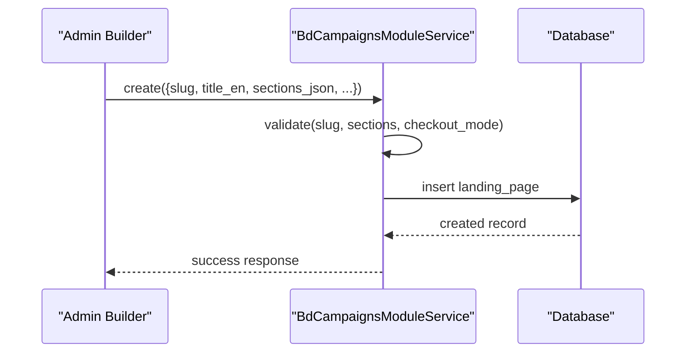

**Diagram sources**
- [service.ts:1-9](file://apps/medusa/src/modules/bd-campaigns/service.ts#L1-L9)
- [landing-page.ts:1-20](file://apps/medusa/src/modules/bd-campaigns/models/landing-page.ts#L1-L20)

**Section sources**
- [service.ts:1-9](file://apps/medusa/src/modules/bd-campaigns/service.ts#L1-L9)

### Direct Checkout Integration
Direct checkout is a planned feature where customers proceed from a landing page directly to checkout without first visiting a product detail page. Requirements specify:
- Entry points from ads or links
- Display of selected product/variant, quantity, offer conditions, delivery charge, and total
- Use of the shared cart system; existing cart items must not be cleared
- Preservation of campaign identifiers and UTM parameters in order details

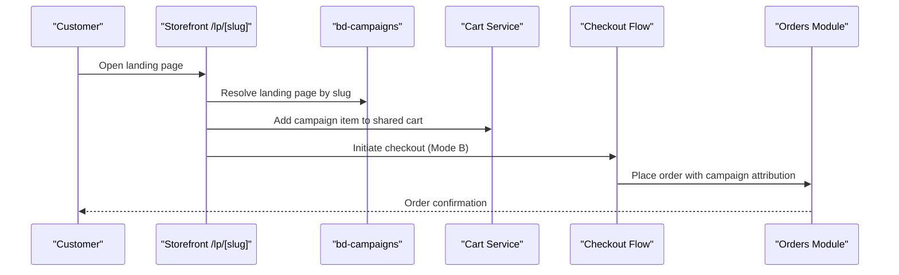

**Diagram sources**
- [user-journeys.md:464-476](file://user-journeys.md#L464-L476)
- [ideaproposition.md:236-243](file://ideaproposition.md#L236-L243)
- [prompt.md:776-785](file://prompt.md#L776-L785)

**Section sources**
- [user-journeys.md:464-476](file://user-journeys.md#L464-L476)
- [ideaproposition.md:236-243](file://ideaproposition.md#L236-L243)
- [prompt.md:776-785](file://prompt.md#L776-L785)

### Campaign Performance Tracking
Tracking is intended to use a single Meta Pixel configured at the operational settings level. Events include:
- ViewContent
- AddToCart
- InitiateCheckout
- Purchase

Per-page Meta Pixel IDs are allowed by the model field, while the broader requirement emphasizes one pixel. Implementation should reconcile these by preferring the global setting unless explicitly overridden.

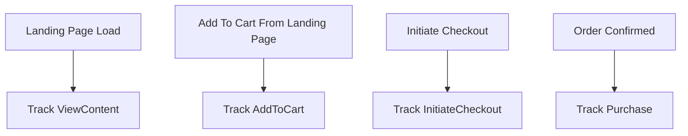

**Diagram sources**
- [landing-page.ts:13-15](file://apps/medusa/src/modules/bd-campaigns/models/landing-page.ts#L13-L15)
- [prompt.md:782-783](file://prompt.md#L782-L783)

**Section sources**
- [landing-page.ts:13-15](file://apps/medusa/src/modules/bd-campaigns/models/landing-page.ts#L13-L15)
- [prompt.md:782-783](file://prompt.md#L782-L783)

### Template Management
Template management is part of the planned admin builder scope:
- Templates and sections only, no free-form JavaScript or CSS
- Preview, publish, unpublish, duplicate, and rollback last published version
- Validation prevents publishing unpublished or out-of-stock products
- Broken product links block publishing

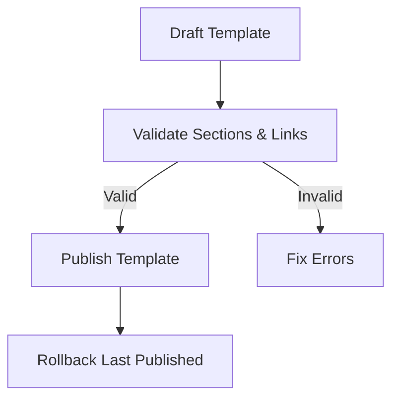

**Diagram sources**
- [prompt.md:778-780](file://prompt.md#L778-L780)

**Section sources**
- [prompt.md:778-780](file://prompt.md#L778-L780)

### Campaign Parameters and Attribution
Campaign parameters should be preserved throughout the funnel:
- Campaign ID
- Landing page ID or slug
- UTM source, medium, and campaign

These values should be attached to order details so marketing performance can be measured against conversions.

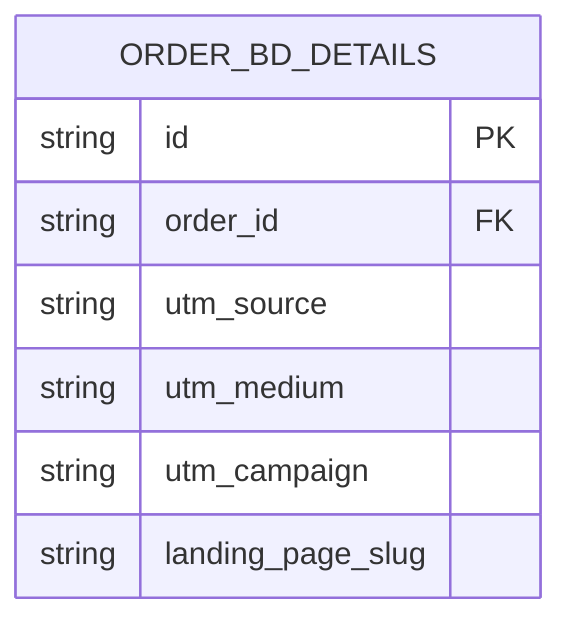

**Diagram sources**
- [order-bd-details.ts:38-38](file://apps/medusa/src/modules/bd-orders/models/order-bd-details.ts#L38-L38)

**Section sources**
- [user-journeys.md:464-468](file://user-journeys.md#L464-L468)
- [order-bd-details.ts:38-38](file://apps/medusa/src/modules/bd-orders/models/order-bd-details.ts#L38-L38)

## Dependency Analysis
The bd-campaigns module currently depends on:
- Medusa framework utilities for models and services
- Database migrations for schema enforcement

Future dependencies will include:
- Catalog module for featured product validation
- Cart and checkout modules for direct checkout flow
- Orders module for attribution persistence
- Analytics integrations for Meta Pixel events

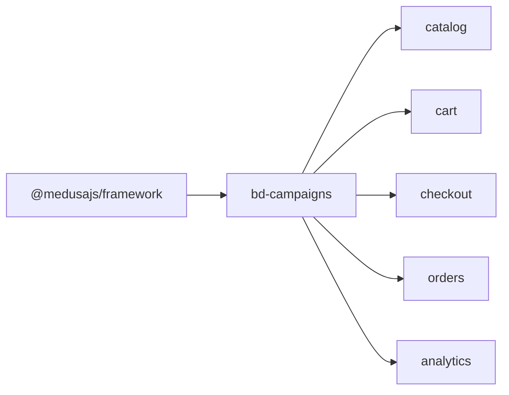

[No sources needed since this diagram shows conceptual dependencies, not actual imports]

**Section sources**
- [landing-page.ts:1-2](file://apps/medusa/src/modules/bd-campaigns/models/landing-page.ts#L1-L2)
- [service.ts:1-2](file://apps/medusa/src/modules/bd-campaigns/service.ts#L1-L2)

## Performance Considerations
- Keep landing page resolution efficient by indexing slugs and soft-delete flags
- Avoid heavy computations during page load; defer analytics tracking to client-side where appropriate
- Ensure direct checkout does not trigger unnecessary cart mutations; preserve existing cart lines
- Cache static template and section definitions where safe
- Monitor Meta Pixel event volume to avoid throttling or redundant calls

[No sources needed since this section provides general guidance]

## Troubleshooting Guide
Common issues and resolutions:
- Duplicate slug errors: ensure slugs are unique across non-deleted records
- Publishing blocked due to invalid product references: validate featured product availability before publish
- Checkout clears existing cart items: verify that direct checkout adds to the shared cart instead of replacing it
- Missing campaign attribution: confirm that campaign ID, landing page slug, and UTM parameters are passed into order details
- Tracking discrepancies: verify single Meta Pixel configuration and event sequence

**Section sources**
- [Migration20261024060543.ts:6-9](file://apps/medusa/src/modules/bd-campaigns/migrations/Migration20261024060543.ts#L6-L9)
- [user-journeys.md:464-468](file://user-journeys.md#L464-L468)
- [prompt.md:778-783](file://prompt.md#L778-L783)

## Conclusion
The bd-campaigns module establishes the foundational data model and service layer for campaign landing pages. While the current code focuses on schema definition and module registration, the surrounding requirements define a comprehensive plan for template management, direct checkout integration, and performance tracking. Extending the service layer to implement these workflows will enable marketers to create promotional landing pages, configure campaign parameters, and measure outcomes through unified checkout and order attribution.

[No sources needed since this section summarizes without analyzing specific files]

## Appendices

### Example: Creating a Promotional Landing Page
Recommended steps:
- Choose a unique slug and set English/Bangla titles
- Select checkout mode based on user experience goals
- Configure sections_json for layout and content
- Optionally set theme_tokens_json for visual consistency
- Link a featured_product_id if applicable
- Set SEO fields and optionally a meta_pixel_id
- Publish after validation passes

**Section sources**
- [landing-page.ts:3-17](file://apps/medusa/src/modules/bd-campaigns/models/landing-page.ts#L3-L17)
- [prompt.md:778-780](file://prompt.md#L778-L780)

### Example: Configuring Campaign Parameters
Recommended steps:
- Capture UTM source, medium, and campaign from the URL
- Attach campaign ID and landing page slug to the cart session
- Persist these values in order_bd_details upon order completion
- Use them for reporting and ROI analysis

**Section sources**
- [user-journeys.md:464-468](file://user-journeys.md#L464-L468)
- [order-bd-details.ts:38-38](file://apps/medusa/src/modules/bd-orders/models/order-bd-details.ts#L38-L38)

### Example: Integrating With Checkout Flows
Recommended steps:
- Resolve the landing page by slug
- Add the campaign item to the shared cart
- Initiate checkout with Mode B if configured
- Preserve existing cart items
- Track relevant Meta Pixel events
- Confirm order with campaign attribution

**Section sources**
- [user-journeys.md:464-476](file://user-journeys.md#L464-L476)
- [ideaproposition.md:236-243](file://ideaproposition.md#L236-L243)
- [prompt.md:776-783](file://prompt.md#L776-L783)