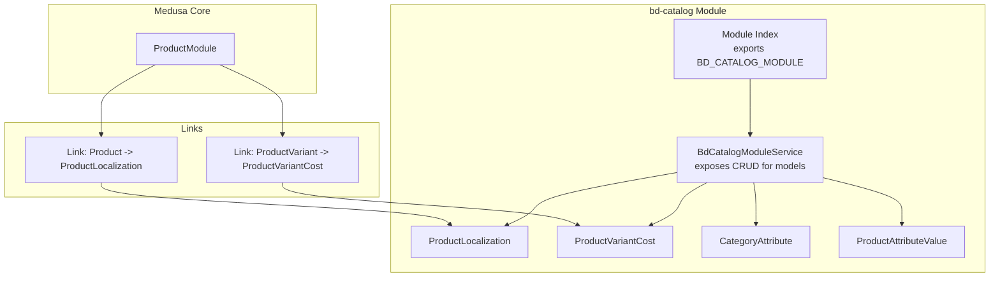
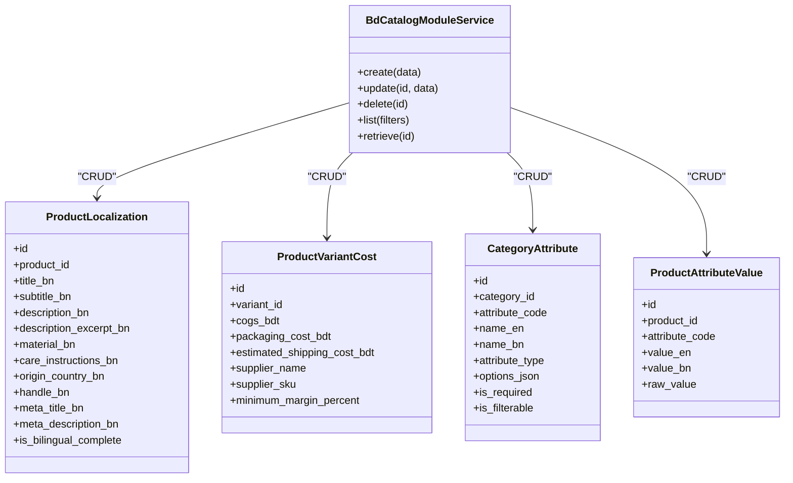
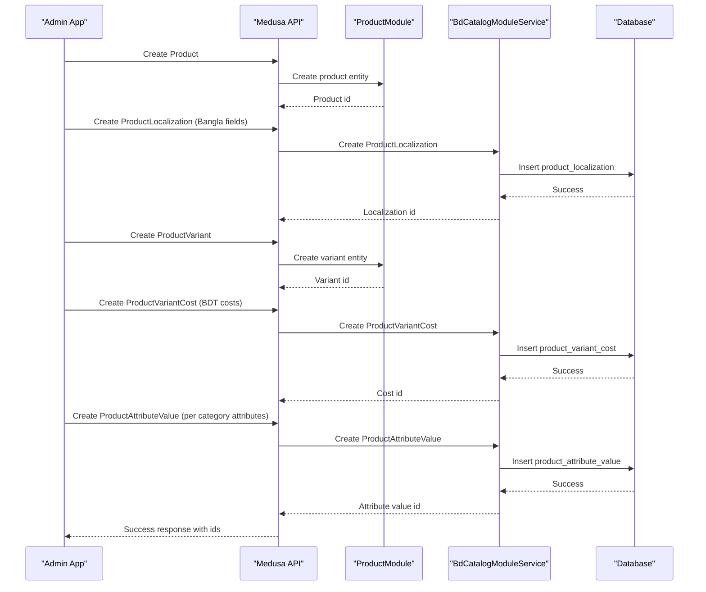
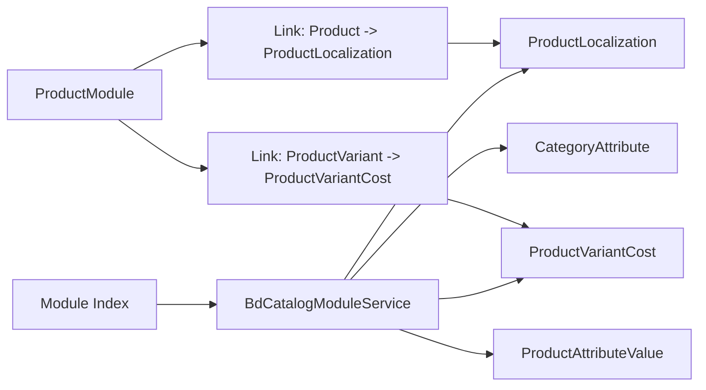

# Catalog Management Module

<cite>
**Referenced Files in This Document**
- [index.ts](file://apps/medusa/src/modules/bd-catalog/index.ts)
- [service.ts](file://apps/medusa/src/modules/bd-catalog/service.ts)
- [product-localization.ts](file://apps/medusa/src/modules/bd-catalog/models/product-localization.ts)
- [product-variant-cost.ts](file://apps/medusa/src/modules/bd-catalog/models/product-variant-cost.ts)
- [category-attribute.ts](file://apps/medusa/src/modules/bd-catalog/models/category-attribute.ts)
- [product-attribute-value.ts](file://apps/medusa/src/modules/bd-catalog/models/product-attribute-value.ts)
- [Migration20261024060539.ts](file://apps/medusa/src/modules/bd-catalog/migrations/Migration20261024060539.ts)
- [product-localization link](file://apps/medusa/src/links/product-localization.ts)
- [product-variant-cost link](file://apps/medusa/src/links/product-variant-cost.ts)
</cite>

## Table of Contents
1. [Introduction](#introduction)
2. [Project Structure](#project-structure)
3. [Core Components](#core-components)
4. [Architecture Overview](#architecture-overview)
5. [Detailed Component Analysis](#detailed-component-analysis)
6. [Dependency Analysis](#dependency-analysis)
7. [Performance Considerations](#performance-considerations)
8. [Troubleshooting Guide](#troubleshooting-guide)
9. [Conclusion](#conclusion)
10. [Appendices](#appendices)

## Introduction
The bd-catalog module extends Medusa’s product catalog with Bangladesh-specific features:
- Multi-language content management for products (Bangla and English).
- Variant-level cost tracking to support pricing strategies, margin calculations, and supplier data.
- Hierarchical category attributes that define reusable attribute schemas per category.
- Dynamic product attribute values tied to categories and products.

This document explains the module architecture, data models, relationships, and business logic, and provides implementation examples for creating localized products, managing variant costs, and extending category structures.

## Project Structure
The bd-catalog module is a Medusa v2 module that registers a service and four domain models. It integrates with Medusa’s Product module via links to associate localization and variant cost data with products and variants.

**Diagram sources**
- [index.ts:1-9](file://apps/medusa/src/modules/bd-catalog/index.ts#L1-L9)
- [service.ts:1-15](file://apps/medusa/src/modules/bd-catalog/service.ts#L1-L15)
- [product-localization link:1-9](file://apps/medusa/src/links/product-localization.ts#L1-L9)
- [product-variant-cost link:1-9](file://apps/medusa/src/links/product-variant-cost.ts#L1-L9)

**Section sources**
- [index.ts:1-9](file://apps/medusa/src/modules/bd-catalog/index.ts#L1-L9)
- [service.ts:1-15](file://apps/medusa/src/modules/bd-catalog/service.ts#L1-L15)
- [product-localization link:1-9](file://apps/medusa/src/links/product-localization.ts#L1-L9)
- [product-variant-cost link:1-9](file://apps/medusa/src/links/product-variant-cost.ts#L1-L9)

## Core Components
- BdCatalogModuleService: A thin service exposing CRUD operations for all four models.
- ProductLocalization: Stores Bangla translations and metadata for products.
- ProductVariantCost: Tracks variant-level costs and margins in BDT.
- CategoryAttribute: Defines reusable attribute schemas per category with multilingual names and options.
- ProductAttributeValue: Stores actual attribute values for products, including Bangla and raw values.

Key responsibilities:
- Localization: Provide fields for titles, descriptions, handles, SEO metadata, and completion flags.
- Variant Costing: Track COGS, packaging, shipping, supplier info, and minimum margin percentage.
- Category Attributes: Define attribute types (select, multiselect, text, boolean), required/filterable flags, and JSON options.
- Attribute Values: Store per-product attribute values with bilingual support and raw value preservation.

**Section sources**
- [service.ts:1-15](file://apps/medusa/src/modules/bd-catalog/service.ts#L1-L15)
- [product-localization.ts:1-20](file://apps/medusa/src/modules/bd-catalog/models/product-localization.ts#L1-L20)
- [product-variant-cost.ts:1-15](file://apps/medusa/src/modules/bd-catalog/models/product-variant-cost.ts#L1-L15)
- [category-attribute.ts:1-16](file://apps/medusa/src/modules/bd-catalog/models/category-attribute.ts#L1-L16)
- [product-attribute-value.ts:1-13](file://apps/medusa/src/modules/bd-catalog/models/product-attribute-value.ts#L1-L13)

## Architecture Overview
The module follows Medusa’s modular design:
- Module registration exports a named module and service.
- Models are defined using the framework’s model DSL.
- Links connect core entities (Product, ProductVariant) to bd-catalog entities.
- Database schema is managed by migrations.

**Diagram sources**
- [service.ts:1-15](file://apps/medusa/src/modules/bd-catalog/service.ts#L1-L15)
- [product-localization.ts:1-20](file://apps/medusa/src/modules/bd-catalog/models/product-localization.ts#L1-L20)
- [product-variant-cost.ts:1-15](file://apps/medusa/src/modules/bd-catalog/models/product-variant-cost.ts#L1-L15)
- [category-attribute.ts:1-16](file://apps/medusa/src/modules/bd-catalog/models/category-attribute.ts#L1-L16)
- [product-attribute-value.ts:1-13](file://apps/medusa/src/modules/bd-catalog/models/product-attribute-value.ts#L1-L13)

## Detailed Component Analysis

### ProductLocalization
Purpose:
- Store Bangla translations and metadata for products.
- Support bilingual completeness tracking.

Data model highlights:
- product_id references the parent product.
- Fields include title_bn, subtitle_bn, description_bn, description_excerpt_bn, material_bn, care_instructions_bn, origin_country_bn (defaulted to Bangla), handle_bn, meta_title_bn, meta_description_bn.
- is_bilingual_complete indicates whether both languages are fully populated.

Relationships:
- Linked to Product via a module link.

Business logic:
- Use this entity to provide localized storefront content.
- Validate completeness based on required fields for your locale strategy.

Implementation example:
- Create a ProductLocalization record when creating or updating a product’s Bangla content.
- Update is_bilingual_complete after ensuring all required fields are present.

**Section sources**
- [product-localization.ts:1-20](file://apps/medusa/src/modules/bd-catalog/models/product-localization.ts#L1-L20)
- [product-localization link:1-9](file://apps/medusa/src/links/product-localization.ts#L1-L9)
- [Migration20261024060539.ts:17-19](file://apps/medusa/src/modules/bd-catalog/migrations/Migration20261024060539.ts#L17-L19)

### ProductVariantCost
Purpose:
- Track variant-level costs and supplier information in BDT.
- Enable margin calculations and procurement workflows.

Data model highlights:
- variant_id uniquely identifies the variant.
- Numeric fields: cogs_bdt, packaging_cost_bdt, estimated_shipping_cost_bdt.
- Supplier details: supplier_name, supplier_sku.
- minimum_margin_percent defines target margin.

Relationships:
- Linked to ProductVariant via a module link.

Business logic:
- Compute total landed cost as sum of COGS, packaging, and shipping.
- Calculate selling price from cost and minimum margin percent.
- Maintain supplier data for procurement and traceability.

Implementation example:
- Create or update ProductVariantCost when setting up variant pricing.
- Use minimum_margin_percent to derive recommended retail prices.

**Section sources**
- [product-variant-cost.ts:1-15](file://apps/medusa/src/modules/bd-catalog/models/product-variant-cost.ts#L1-L15)
- [product-variant-cost link:1-9](file://apps/medusa/src/links/product-variant-cost.ts#L1-L9)
- [Migration20261024060539.ts:21-23](file://apps/medusa/src/modules/bd-catalog/migrations/Migration20261024060539.ts#L21-L23)

### CategoryAttribute
Purpose:
- Define reusable attribute schemas per category with multilingual labels and validation rules.

Data model highlights:
- category_id associates the attribute definition with a category.
- attribute_code is a stable identifier for the attribute.
- name_en and name_bn provide bilingual display names.
- attribute_type supports select, multiselect, text, boolean.
- options_json stores predefined options for select/multiselect.
- is_required and is_filterable control UI behavior and filtering.

Relationships:
- Used by ProductAttributeValue to validate and render attribute inputs.

Business logic:
- Enforce required attributes during product creation/update.
- Render filter facets based on is_filterable and attribute_type.

Implementation example:
- Define CategoryAttribute entries for each category’s attribute schema.
- Use options_json to populate dropdowns for select-type attributes.

**Section sources**
- [category-attribute.ts:1-16](file://apps/medusa/src/modules/bd-catalog/models/category-attribute.ts#L1-L16)
- [Migration20261024060539.ts:7-10](file://apps/medusa/src/modules/bd-catalog/migrations/Migration20261024060539.ts#L7-L10)

### ProductAttributeValue
Purpose:
- Store per-product attribute values with bilingual support and raw value preservation.

Data model highlights:
- product_id ties the value to a specific product.
- attribute_code matches the corresponding CategoryAttribute.
- value_en and value_bn store localized display values.
- raw_value preserves original input for processing.

Relationships:
- Mirrors CategoryAttribute definitions for a given product.

Business logic:
- Validate values against CategoryAttribute constraints.
- Persist raw_value for downstream processing or audit.

Implementation example:
- When creating a product, create ProductAttributeValue records for each defined attribute.
- Populate value_bn for Bangla content where applicable.

**Section sources**
- [product-attribute-value.ts:1-13](file://apps/medusa/src/modules/bd-catalog/models/product-attribute-value.ts#L1-L13)
- [Migration20261024060539.ts:12-15](file://apps/medusa/src/modules/bd-catalog/migrations/Migration20261024060539.ts#L12-L15)

### Data Flow: Creating a Localized Product with Attributes and Variant Costs

**Diagram sources**
- [product-localization.ts:1-20](file://apps/medusa/src/modules/bd-catalog/models/product-localization.ts#L1-L20)
- [product-variant-cost.ts:1-15](file://apps/medusa/src/modules/bd-catalog/models/product-variant-cost.ts#L1-L15)
- [product-attribute-value.ts:1-13](file://apps/medusa/src/modules/bd-catalog/models/product-attribute-value.ts#L1-L13)
- [service.ts:1-15](file://apps/medusa/src/modules/bd-catalog/service.ts#L1-L15)

## Dependency Analysis
- Module index exports BD_CATALOG_MODULE and registers BdCatalogModuleService.
- Service depends on four models and exposes standard CRUD methods via MedusaService.
- Links connect Product and ProductVariant to ProductLocalization and ProductVariantCost respectively.
- Migration ensures database tables exist and indexes are created.

**Diagram sources**
- [index.ts:1-9](file://apps/medusa/src/modules/bd-catalog/index.ts#L1-L9)
- [service.ts:1-15](file://apps/medusa/src/modules/bd-catalog/service.ts#L1-L15)
- [product-localization link:1-9](file://apps/medusa/src/links/product-localization.ts#L1-L9)
- [product-variant-cost link:1-9](file://apps/medusa/src/links/product-variant-cost.ts#L1-L9)

**Section sources**
- [index.ts:1-9](file://apps/medusa/src/modules/bd-catalog/index.ts#L1-L9)
- [service.ts:1-15](file://apps/medusa/src/modules/bd-catalog/service.ts#L1-L15)
- [product-localization link:1-9](file://apps/medusa/src/links/product-localization.ts#L1-L9)
- [product-variant-cost link:1-9](file://apps/medusa/src/links/product-variant-cost.ts#L1-L9)
- [Migration20261024060539.ts:1-37](file://apps/medusa/src/modules/bd-catalog/migrations/Migration20261024060539.ts#L1-L37)

## Performance Considerations
- Indexes:
  - product_localization.product_id for fast lookups by product.
  - product_attribute_value.product_id and attribute_code for efficient queries.
  - category_attribute.category_id and attribute_code for attribute schema retrieval.
  - product_variant_cost.variant_id unique constraint for O(1) access by variant.
- Big numbers:
  - Use numeric fields for monetary values to avoid floating-point precision issues.
- Searchability:
  - Some localization fields are marked searchable; ensure search indexing aligns with query patterns.
- Soft deletes:
  - Tables include deleted_at; queries should filter out soft-deleted rows.

[No sources needed since this section provides general guidance]

## Troubleshooting Guide
Common issues and resolutions:
- Missing localization records:
  - Ensure ProductLocalization is created for each product when adding Bangla content.
  - Verify is_bilingual_complete reflects actual field population.
- Variant cost not found:
  - Confirm ProductVariantCost exists for the variant_id before pricing calculations.
  - Check unique constraint on variant_id if duplicates occur.
- Attribute validation failures:
  - Validate ProductAttributeValue.attribute_code against CategoryAttribute definitions.
  - For select/multiselect, ensure value matches options_json.
- Migration errors:
  - Run migrations to ensure tables and indexes exist.
  - If upgrading, verify migration order and dependencies.

**Section sources**
- [Migration20261024060539.ts:1-37](file://apps/medusa/src/modules/bd-catalog/migrations/Migration20261024060539.ts#L1-L37)
- [product-localization.ts:1-20](file://apps/medusa/src/modules/bd-catalog/models/product-localization.ts#L1-L20)
- [product-variant-cost.ts:1-15](file://apps/medusa/src/modules/bd-catalog/models/product-variant-cost.ts#L1-L15)
- [category-attribute.ts:1-16](file://apps/medusa/src/modules/bd-catalog/models/category-attribute.ts#L1-L16)
- [product-attribute-value.ts:1-13](file://apps/medusa/src/modules/bd-catalog/models/product-attribute-value.ts#L1-L13)

## Conclusion
The bd-catalog module enhances Medusa’s catalog with robust localization, variant costing, and category-driven attributes tailored for Bangladesh markets. By leveraging ProductLocalization, ProductVariantCost, CategoryAttribute, and ProductAttributeValue, teams can manage bilingual content, implement precise pricing strategies, and scale category-based product attributes efficiently.

[No sources needed since this section summarizes without analyzing specific files]

## Appendices

### Implementation Examples

- Create a localized product:
  - Create ProductLocalization with Bangla fields and set is_bilingual_complete after validation.
  - Reference: [product-localization.ts:1-20](file://apps/medusa/src/modules/bd-catalog/models/product-localization.ts#L1-L20)

- Manage variant costs:
  - Create ProductVariantCost with cogs_bdt, packaging_cost_bdt, estimated_shipping_cost_bdt, supplier info, and minimum_margin_percent.
  - Reference: [product-variant-cost.ts:1-15](file://apps/medusa/src/modules/bd-catalog/models/product-variant-cost.ts#L1-L15)

- Extend category structures:
  - Define CategoryAttribute with attribute_type, options_json, and bilingual names.
  - Reference: [category-attribute.ts:1-16](file://apps/medusa/src/modules/bd-catalog/models/category-attribute.ts#L1-L16)

- Assign dynamic attributes to products:
  - Create ProductAttributeValue entries matching CategoryAttribute codes, with value_en/value_bn and raw_value.
  - Reference: [product-attribute-value.ts:1-13](file://apps/medusa/src/modules/bd-catalog/models/product-attribute-value.ts#L1-L13)