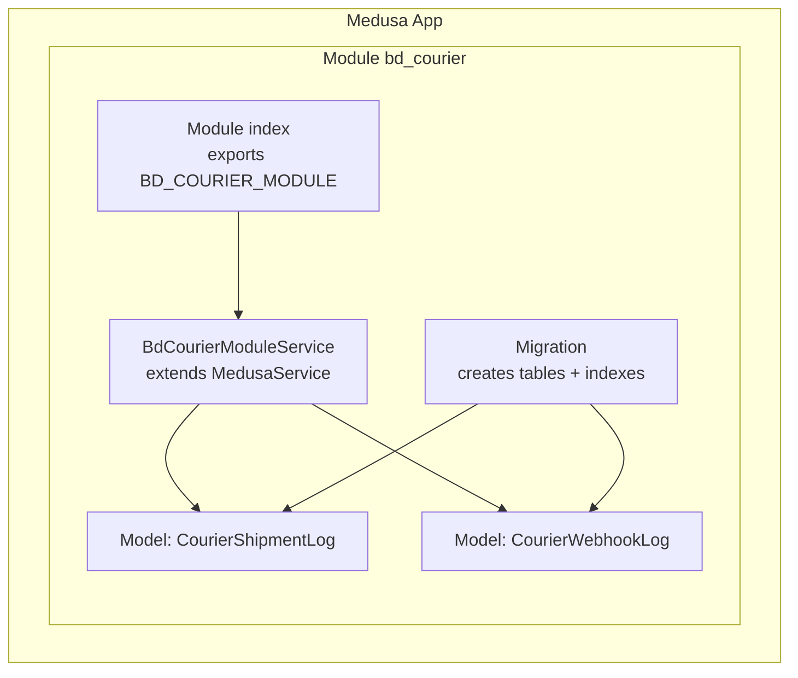
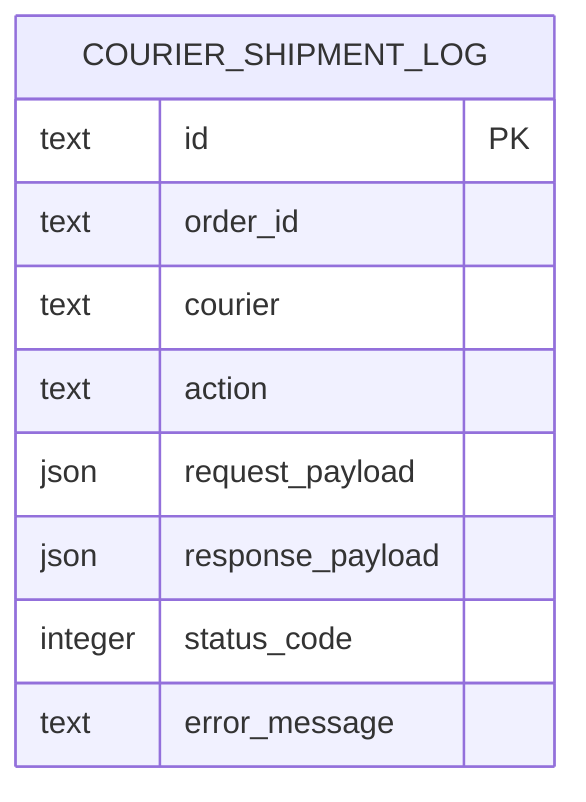
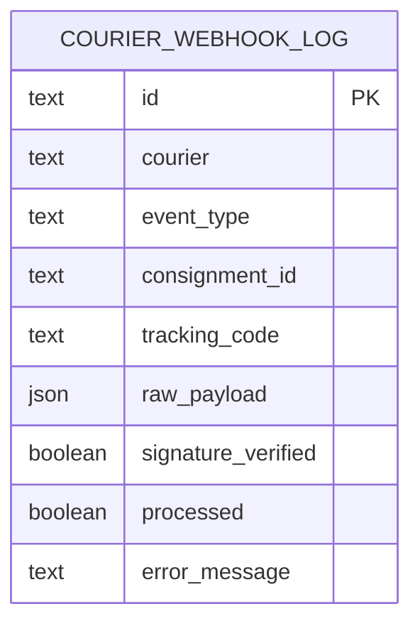
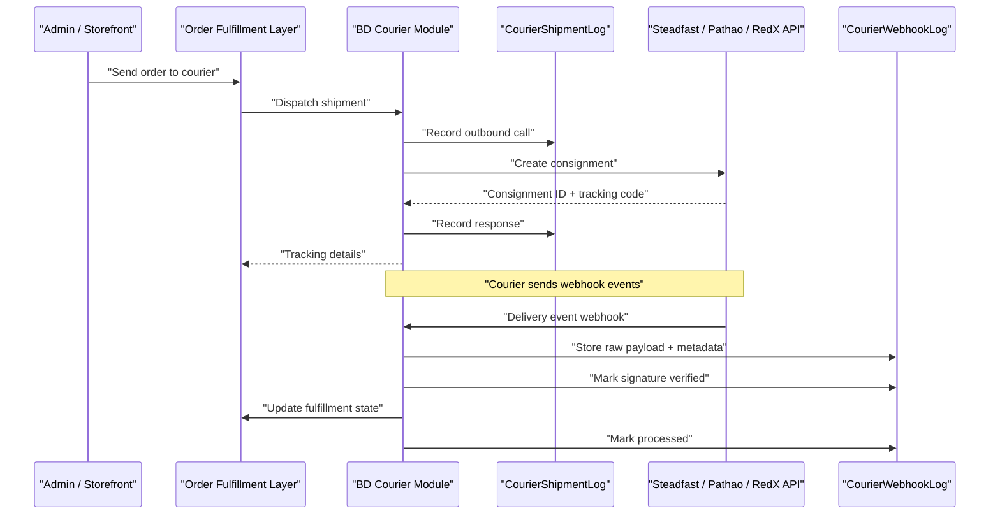
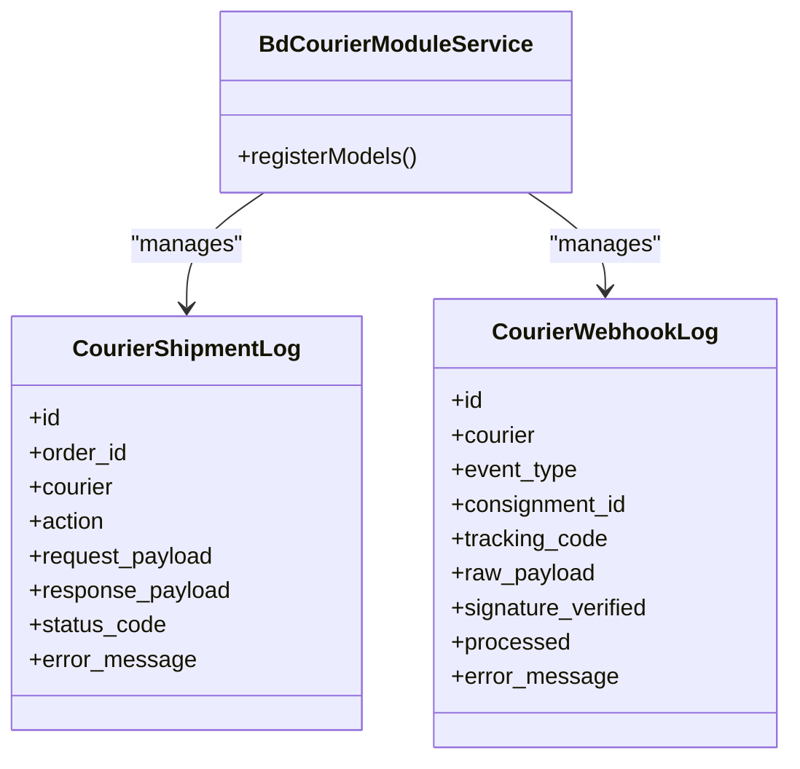
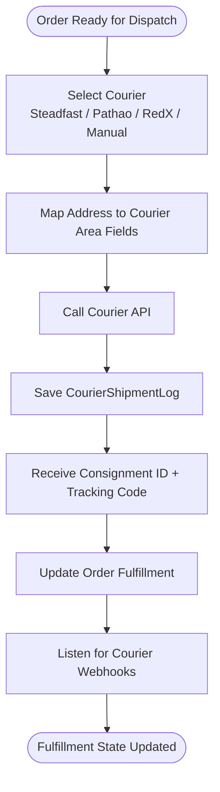
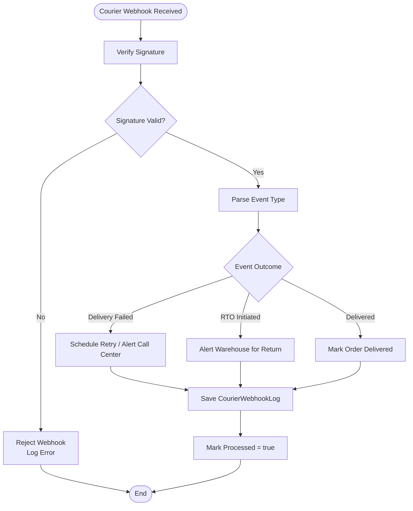
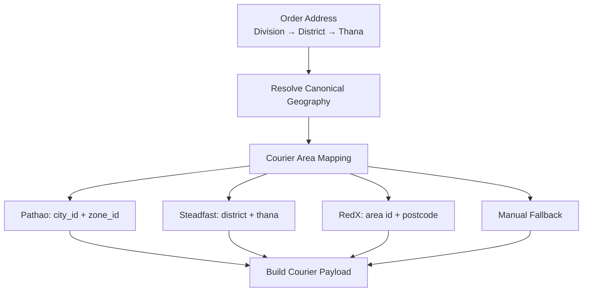
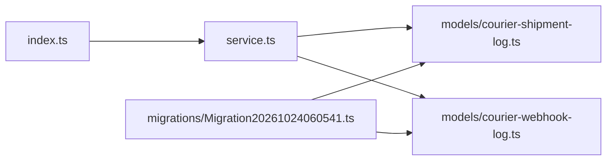

# Courier & Logistics Module

<cite>
**Referenced Files in This Document**
- [index.ts](file://apps/medusa/src/modules/bd-courier/index.ts)
- [service.ts](file://apps/medusa/src/modules/bd-courier/service.ts)
- [courier-shipment-log.ts](file://apps/medusa/src/modules/bd-courier/models/courier-shipment-log.ts)
- [courier-webhook-log.ts](file://apps/medusa/src/modules/bd-courier/models/courier-webhook-log.ts)
- [Migration20261024060541.ts](file://apps/medusa/src/modules/bd-courier/migrations/Migration20261024060541.ts)
- [.snapshot-bd-courier.json](file://apps/medusa/src/modules/bd-courier/migrations/.snapshot-bd-courier.json)
- [technical-plan.md](file://technical-plan.md)
- [architecture.md](file://docs/architecture.md)
- [dfd.md](file://dfd.md)
- [database.md](file://database.md)
</cite>

## Table of Contents
1. [Introduction](#introduction)
2. [Project Structure](#project-structure)
3. [Core Components](#core-components)
4. [Architecture Overview](#architecture-overview)
5. [Detailed Component Analysis](#detailed-component-analysis)
6. [Dependency Analysis](#dependency-analysis)
7. [Performance Considerations](#performance-considerations)
8. [Troubleshooting Guide](#troubleshooting-guide)
9. [Conclusion](#conclusion)
10. [Appendices](#appendices)

## Introduction
The `bd-courier` module is the logistics foundation for delivery operations with Bangladesh courier services such as Steadfast, Pathao, and RedX. At this stage, the module provides:
- A Medusa module entry point and service shell.
- Persistent tracking models for outbound shipment API calls and inbound courier webhooks.
- Database schema definitions and migrations for auditability and operational visibility.

The broader system design documents describe how these models will support automated booking, tracking, webhook processing, COD remittance reconciliation, and manual fallback workflows. The current codebase does not yet implement courier API clients or webhook endpoints; it establishes the data layer and module structure where those integrations will be built.

## Project Structure
The `bd-courier` module follows a standard Medusa module layout:
- Module registration exports a stable module key and binds the module service.
- The service extends the Medusa service base and registers the two core models.
- Models define the database tables for shipment logs and webhook logs.
- A migration creates the tables and indexes.

**Diagram sources**
- [index.ts:1-9](file://apps/medusa/src/modules/bd-courier/index.ts#L1-L9)
- [service.ts:1-11](file://apps/medusa/src/modules/bd-courier/service.ts#L1-L11)
- [courier-shipment-log.ts:1-15](file://apps/medusa/src/modules/bd-courier/models/courier-shipment-log.ts#L1-L15)
- [courier-webhook-log.ts:1-16](file://apps/medusa/src/modules/bd-courier/models/courier-webhook-log.ts#L1-L16)
- [Migration20261024060541.ts:1-23](file://apps/medusa/src/modules/bd-courier/migrations/Migration20261024060541.ts#L1-L23)

**Section sources**
- [index.ts:1-9](file://apps/medusa/src/modules/bd-courier/index.ts#L1-L9)
- [service.ts:1-11](file://apps/medusa/src/modules/bd-courier/service.ts#L1-L11)

## Core Components
This section documents the two primary data entities that form the backbone of courier tracking and webhook processing.

### CourierShipmentLog
`CourierShipmentLog` records outbound interactions with courier APIs when creating, updating, or canceling shipments. It captures:
- The originating order identifier.
- The selected courier provider.
- The action performed (for example, consignment creation, cancellation, or status polling).
- Request and response payloads for auditability.
- HTTP-like status codes and error messages.

This model enables:
- Replaying failed API calls.
- Debugging integration issues per order and per courier.
- Auditing what was sent to each courier at dispatch time.

**Diagram sources**
- [courier-shipment-log.ts:3-12](file://apps/medusa/src/modules/bd-courier/models/courier-shipment-log.ts#L3-L12)
- [Migration20261024060541.ts:6-8](file://apps/medusa/src/modules/bd-courier/migrations/Migration20261024060541.ts#L6-L8)

**Section sources**
- [courier-shipment-log.ts:1-15](file://apps/medusa/src/modules/bd-courier/models/courier-shipment-log.ts#L1-L15)
- [Migration20261024060541.ts:6-8](file://apps/medusa/src/modules/bd-courier/migrations/Migration20261024060541.ts#L6-L8)

### CourierWebhookLog
`CourierWebhookLog` records inbound events from courier providers. It captures:
- The courier provider name.
- The event type (for example, delivery attempts, failures, RTO initiation, or successful delivery).
- Optional consignment and tracking identifiers.
- The raw webhook payload for forensic analysis.
- Whether the signature was verified and whether the event was processed.
- Any error message if processing failed.

This model supports:
- Idempotent webhook handling.
- Signature verification before business logic execution.
- Event-driven updates to order fulfillment states.
- Operational dashboards for delivery performance and exceptions.

**Diagram sources**
- [courier-webhook-log.ts:3-13](file://apps/medusa/src/modules/bd-courier/models/courier-webhook-log.ts#L3-L13)
- [Migration20261024060541.ts:10-13](file://apps/medusa/src/modules/bd-courier/migrations/Migration20261024060541.ts#L10-L13)

**Section sources**
- [courier-webhook-log.ts:1-16](file://apps/medusa/src/modules/bd-courier/models/courier-webhook-log.ts#L1-L16)
- [Migration20261024060541.ts:10-13](file://apps/medusa/src/modules/bd-courier/migrations/Migration20261024060541.ts#L10-L13)

## Architecture Overview
The intended architecture positions `bd-courier` as the integration layer between internal order fulfillment and external courier systems.

**Diagram sources**
- [technical-plan.md:549-577](file://technical-plan.md#L549-L577)
- [dfd.md:298-303](file://dfd.md#L298-L303)
- [courier-shipment-log.ts:3-12](file://apps/medusa/src/modules/bd-courier/models/courier-shipment-log.ts#L3-L12)
- [courier-webhook-log.ts:3-13](file://apps/medusa/src/modules/bd-courier/models/courier-webhook-log.ts#L3-L13)

The broader architecture also defines:
- A four-tier Bangladesh address hierarchy used to map orders to courier-specific area identifiers.
- Delivery zone pricing and free-shipping thresholds.
- Manual courier fallback when APIs are unavailable or when local riders are used.
- Differentiated webhook handling for delivery failure versus return-to-merchant scenarios.

**Section sources**
- [architecture.md:510-544](file://docs/architecture.md#L510-L544)
- [dfd.md:298-303](file://dfd.md#L298-L303)
- [technical-plan.md:549-577](file://technical-plan.md#L549-L577)

## Detailed Component Analysis

### Module Registration and Service Shell
The module exports a stable module key and binds the service class. The service currently acts as a container for the two models through the Medusa service base.

Key responsibilities:
- Provide a consistent module identifier for configuration and dependency injection.
- Register `CourierShipmentLog` and `CourierWebhookLog` so they can be queried and persisted via the Medusa service layer.

**Diagram sources**
- [service.ts:1-11](file://apps/medusa/src/modules/bd-courier/service.ts#L1-L11)
- [courier-shipment-log.ts:3-12](file://apps/medusa/src/modules/bd-courier/models/courier-shipment-log.ts#L3-L12)
- [courier-webhook-log.ts:3-13](file://apps/medusa/src/modules/bd-courier/models/courier-webhook-log.ts#L3-L13)

**Section sources**
- [index.ts:1-9](file://apps/medusa/src/modules/bd-courier/index.ts#L1-L9)
- [service.ts:1-11](file://apps/medusa/src/modules/bd-courier/service.ts#L1-L11)

### Shipment Lifecycle Management
Although the actual courier API client is not implemented yet, the data model supports the full lifecycle described by the project documentation:
- Dispatch booking with a selected courier.
- Persisting request/response payloads for audit.
- Tracking consignment IDs and tracking codes.
- Supporting cancellation and re-booking when parcel details change before dispatch.

**Diagram sources**
- [technical-plan.md:549-577](file://technical-plan.md#L549-L577)
- [dfd.md:298-303](file://dfd.md#L298-L303)
- [courier-shipment-log.ts:3-12](file://apps/medusa/src/modules/bd-courier/models/courier-shipment-log.ts#L3-L12)

**Section sources**
- [technical-plan.md:549-577](file://technical-plan.md#L549-L577)
- [dfd.md:298-303](file://dfd.md#L298-L303)

### Webhook Processing for Delivery Events
The webhook log model includes fields for signature verification and processing status, which aligns with the requirement to distinguish delivery outcomes such as delivery failure and return-to-merchant.

**Diagram sources**
- [courier-webhook-log.ts:3-13](file://apps/medusa/src/modules/bd-courier/models/courier-webhook-log.ts#L3-L13)
- [dfd.md:298-303](file://dfd.md#L298-L303)

**Section sources**
- [courier-webhook-log.ts:1-16](file://apps/medusa/src/modules/bd-courier/models/courier-webhook-log.ts#L1-L16)
- [dfd.md:298-303](file://dfd.md#L298-L303)

### Delivery Zone Optimization and Courier Area Mapping
The system uses administrative geography to map orders to courier-specific area identifiers:
- Pathao requires city and zone identifiers.
- Steadfast and RedX require district and thana names or area identifiers.
- Manual courier is supported as a fallback.

**Diagram sources**
- [architecture.md:510-544](file://docs/architecture.md#L510-L544)
- [database.md:2208-2215](file://database.md#L2208-L2215)

**Section sources**
- [architecture.md:510-544](file://docs/architecture.md#L510-L544)
- [database.md:2208-2215](file://database.md#L2208-L2215)

## Dependency Analysis
At the code level, the module has minimal internal dependencies:
- The module index depends on the service.
- The service depends on the two models.
- The migration creates the underlying tables referenced by the models.

**Diagram sources**
- [index.ts:1-9](file://apps/medusa/src/modules/bd-courier/index.ts#L1-L9)
- [service.ts:1-11](file://apps/medusa/src/modules/bd-courier/service.ts#L1-L11)
- [courier-shipment-log.ts:1-15](file://apps/medusa/src/modules/bd-courier/models/courier-shipment-log.ts#L1-L15)
- [courier-webhook-log.ts:1-16](file://apps/medusa/src/modules/bd-courier/models/courier-webhook-log.ts#L1-L16)
- [Migration20261024060541.ts:1-23](file://apps/medusa/src/modules/bd-courier/migrations/Migration20261024060541.ts#L1-L23)

**Section sources**
- [index.ts:1-9](file://apps/medusa/src/modules/bd-courier/index.ts#L1-L9)
- [service.ts:1-11](file://apps/medusa/src/modules/bd-courier/service.ts#L1-L11)
- [Migration20261024060541.ts:1-23](file://apps/medusa/src/modules/bd-courier/migrations/Migration20261024060541.ts#L1-L23)

## Performance Considerations
- Use the existing indexes on `order_id`, `consignment_id`, and `tracking_code` to optimize lookup queries for shipment history and webhook deduplication.
- Keep webhook payloads compact but retain enough detail for debugging; consider archiving old raw payloads if storage grows significantly.
- Avoid synchronous heavy processing inside webhook handlers; enqueue background jobs for fulfillment state updates and notifications.
- Cache courier area mappings to reduce repeated geographic lookups during high-volume dispatch periods.

[No sources needed since this section provides general guidance]

## Troubleshooting Guide
Common operational checks using the available models:

- Outbound API failures:
  - Inspect `CourierShipmentLog` entries for failed requests.
  - Compare `request_payload` and `response_payload` to identify malformed requests or courier-side errors.
  - Use `status_code` and `error_message` to triage network vs business errors.

- Inbound webhook issues:
  - Check `CourierWebhookLog.signature_verified` to confirm signature validation behavior.
  - Review `raw_payload` to validate event structure.
  - Investigate `processed` and `error_message` to determine why an event was not applied.

- Reconciliation:
  - Correlate `order_id` in shipment logs with fulfillment state changes.
  - Correlate `consignment_id` and `tracking_code` in webhook logs with final delivery outcomes.

**Section sources**
- [courier-shipment-log.ts:3-12](file://apps/medusa/src/modules/bd-courier/models/courier-shipment-log.ts#L3-L12)
- [courier-webhook-log.ts:3-13](file://apps/medusa/src/modules/bd-courier/models/courier-webhook-log.ts#L3-L13)

## Conclusion
The `bd-courier` module currently provides the foundational data structures and module scaffolding required for multi-courier delivery logistics. `CourierShipmentLog` and `CourierWebhookLog` establish the audit trail and event backbone for tracking shipments and processing delivery events. The surrounding architecture documents define the intended integration patterns for Steadfast, Pathao, and RedX, including address mapping, webhook differentiation, and manual fallback. Future implementation should add courier API clients, webhook endpoints, fulfillment state transitions, and operational tooling around these models.

[No sources needed since this section summarizes without analyzing specific files]

## Appendices

### Appendix A: Database Schema Summary
The migration creates two tables with appropriate primary keys and indexes:
- `courier_shipment_log`: tracks outbound courier API calls per order.
- `courier_webhook_log`: tracks inbound courier webhook events.

Indexes include:
- `order_id` on shipment logs.
- `consignment_id` and `tracking_code` on webhook logs.

**Section sources**
- [Migration20261024060541.ts:6-13](file://apps/medusa/src/modules/bd-courier/migrations/Migration20261024060541.ts#L6-L13)
- [.snapshot-bd-courier.json:186-205](file://apps/medusa/src/modules/bd-courier/migrations/.snapshot-bd-courier.json#L186-L205)
- [.snapshot-bd-courier.json:417-445](file://apps/medusa/src/modules/bd-courier/migrations/.snapshot-bd-courier.json#L417-L445)

### Appendix B: Integration Examples

#### Integrating a New Courier Service
Recommended steps:
1. Add the new courier to the courier selection and routing logic alongside Steadfast, Pathao, and RedX.
2. Implement a courier adapter that maps the four-tier address to the courier’s required area identifiers.
3. Create consignment requests and persist them to `CourierShipmentLog`.
4. Handle the courier’s webhook format and persist results to `CourierWebhookLog`.
5. Update fulfillment states based on webhook events.

**Section sources**
- [technical-plan.md:549-577](file://technical-plan.md#L549-L577)
- [database.md:2208-2215](file://database.md#L2208-L2215)

#### Tracking Shipments
To track a shipment:
- Query `CourierShipmentLog` by `order_id` to see all outbound actions.
- Extract the latest consignment ID and tracking code from successful responses.
- Present the tracking link to customers after fulfillment update.

**Section sources**
- [courier-shipment-log.ts:3-12](file://apps/medusa/src/modules/bd-courier/models/courier-shipment-log.ts#L3-L12)

#### Handling Delivery Status Updates Through Webhooks
To handle webhook events:
- Verify the webhook signature before processing.
- Store the raw payload in `CourierWebhookLog`.
- Route the event based on `event_type`.
- For delivery failure, schedule retry or alert customer support.
- For RTO initiation, alert warehouse operations.
- For successful delivery, mark the order delivered.
- Mark the webhook as processed after successful state updates.

**Section sources**
- [courier-webhook-log.ts:3-13](file://apps/medusa/src/modules/bd-courier/models/courier-webhook-log.ts#L3-L13)
- [dfd.md:298-303](file://dfd.md#L298-L303)