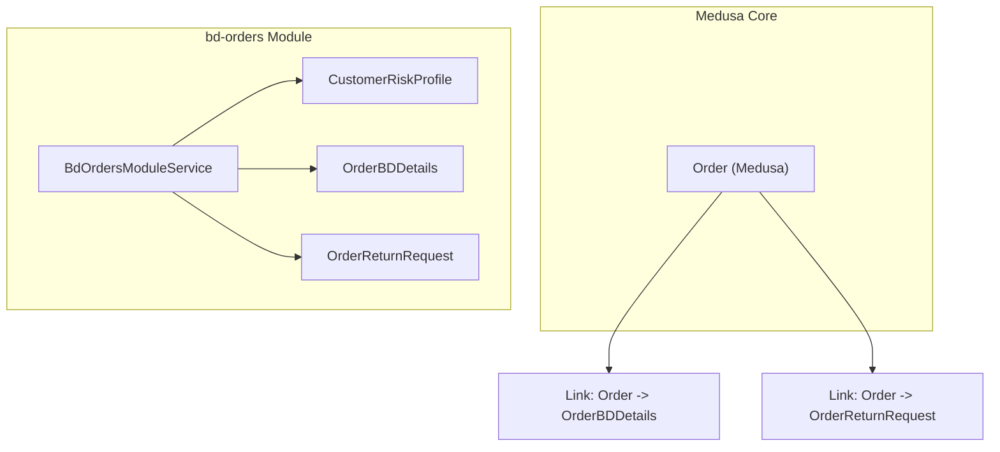
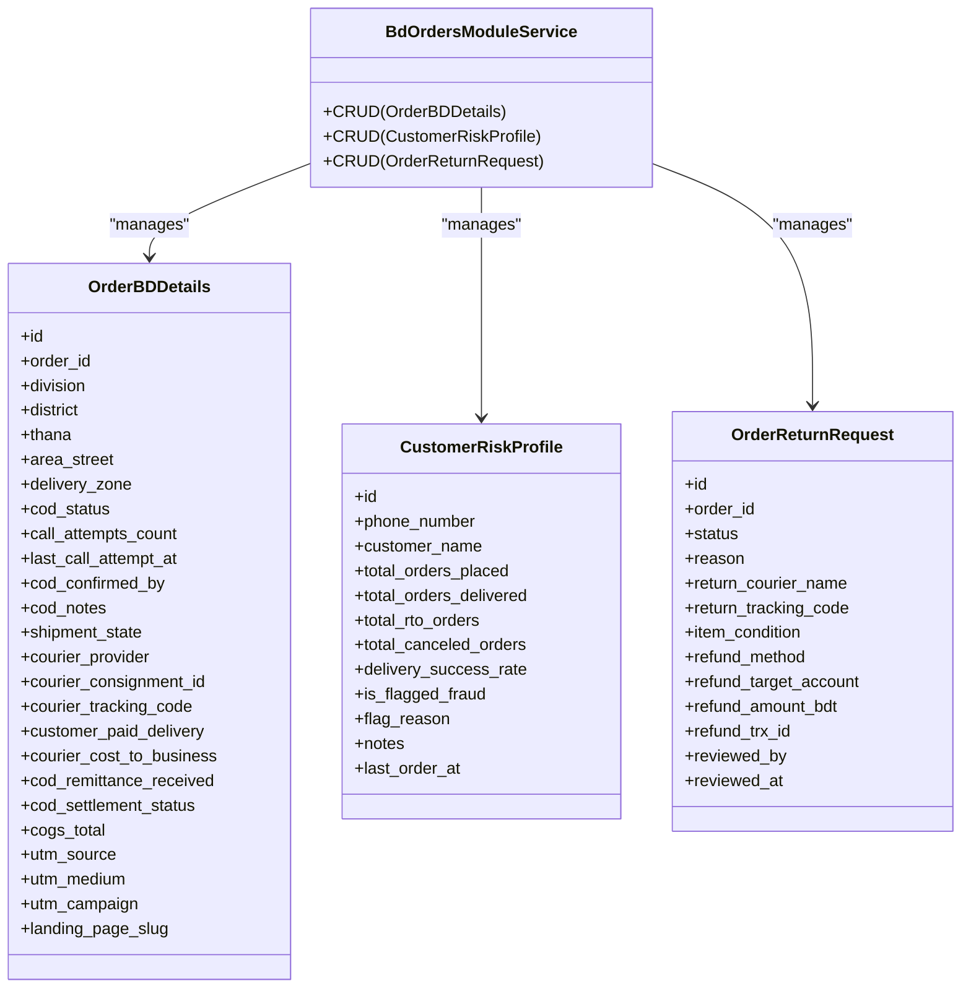
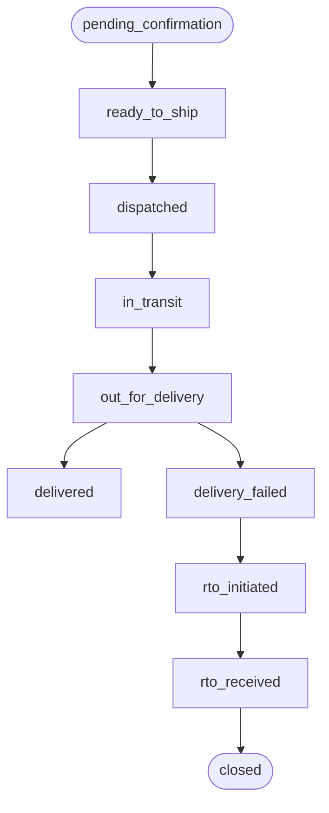
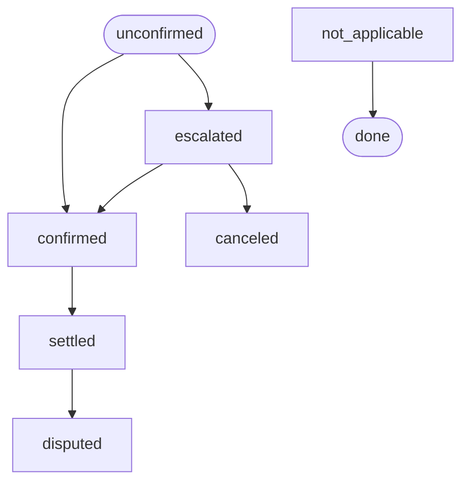
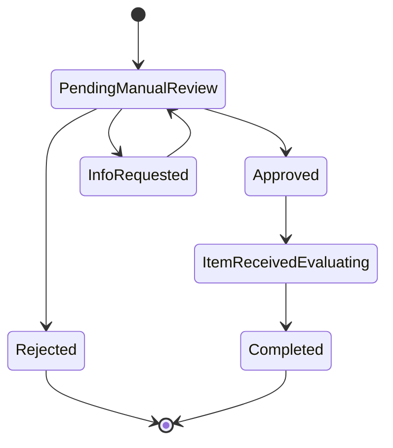
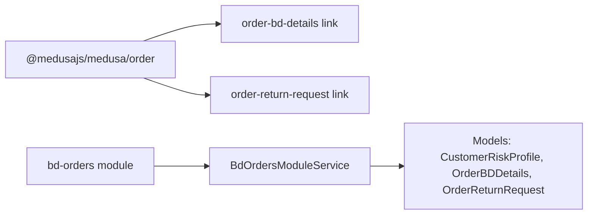

# Order Management Module

<cite>
**Referenced Files in This Document**
- [customer-risk-profile.ts](file://apps/medusa/src/modules/bd-orders/models/customer-risk-profile.ts)
- [order-bd-details.ts](file://apps/medusa/src/modules/bd-orders/models/order-bd-details.ts)
- [order-return-request.ts](file://apps/medusa/src/modules/bd-orders/models/order-return-request.ts)
- [service.ts](file://apps/medusa/src/modules/bd-orders/service.ts)
- [index.ts](file://apps/medusa/src/modules/bd-orders/index.ts)
- [order-bd-details.ts](file://apps/medusa/src/links/order-bd-details.ts)
- [order-return-request.ts](file://apps/medusa/src/links/order-return-request.ts)
- [Migration20261024060540.ts](file://apps/medusa/src/modules/bd-orders/migrations/Migration20261024060540.ts)
</cite>

## Table of Contents
1. [Introduction](#introduction)
2. [Project Structure](#project-structure)
3. [Core Components](#core-components)
4. [Architecture Overview](#architecture-overview)
5. [Detailed Component Analysis](#detailed-component-analysis)
6. [Dependency Analysis](#dependency-analysis)
7. [Performance Considerations](#performance-considerations)
8. [Troubleshooting Guide](#troubleshooting-guide)
9. [Conclusion](#conclusion)
10. [Appendices](#appendices)

## Introduction
This document explains the bd-orders module, which extends Medusa’s order domain with Bangladesh-specific requirements. It focuses on three core entities:
- CustomerRiskProfile: a customer scoring and fraud prevention profile keyed by phone number.
- OrderBDDetails: extended order data for Bangladesh logistics, COD workflows, courier integration, and marketing attribution.
- OrderReturnRequest: a structured return request lifecycle with status tracking, refund methods, and audit fields.

The module provides a service layer that exposes CRUD operations for these entities and links them to Medusa’s core Order entity.

## Project Structure
The bd-orders module is implemented as a Medusa module with models, a service, and links to the core Order module. The migration defines database tables and indexes.

**Diagram sources**
- [index.ts:4-8](file://apps/medusa/src/modules/bd-orders/index.ts#L4-L8)
- [service.ts:6-10](file://apps/medusa/src/modules/bd-orders/service.ts#L6-L10)
- [order-bd-details.ts:5-8](file://apps/medusa/src/links/order-bd-details.ts#L5-L8)
- [order-return-request.ts:5-8](file://apps/medusa/src/links/order-return-request.ts#L5-L8)

**Section sources**
- [index.ts:1-9](file://apps/medusa/src/modules/bd-orders/index.ts#L1-L9)
- [service.ts:1-13](file://apps/medusa/src/modules/bd-orders/service.ts#L1-L13)

## Core Components
- CustomerRiskProfile: Tracks per-customer risk metrics such as total orders placed/delivered/RTO/canceled, delivery success rate, fraud flags, reasons, notes, and last order timestamp.
- OrderBDDetails: Stores Bangladesh-specific order attributes including administrative divisions, delivery zones, COD workflow state, courier provider and tracking, financials (delivery charges, courier cost, remittance, COGS), and marketing UTM fields.
- OrderReturnRequest: Captures return requests with status progression, reason, return courier/tracking, item condition, refund method/target, amount, transaction ID, and review metadata.

These entities are exposed via BdOrdersModuleService, which inherits standard CRUD capabilities from MedusaService.

**Section sources**
- [customer-risk-profile.ts:3-16](file://apps/medusa/src/modules/bd-orders/models/customer-risk-profile.ts#L3-L16)
- [order-bd-details.ts:3-39](file://apps/medusa/src/modules/bd-orders/models/order-bd-details.ts#L3-L39)
- [order-return-request.ts:3-25](file://apps/medusa/src/modules/bd-orders/models/order-return-request.ts#L3-L25)
- [service.ts:6-10](file://apps/medusa/src/modules/bd-orders/service.ts#L6-L10)

## Architecture Overview
The module integrates with Medusa’s Order entity through link files, enabling queries that join Orders with OrderBDDetails and OrderReturnRequest. The service centralizes access to all three models.

**Diagram sources**
- [service.ts:6-10](file://apps/medusa/src/modules/bd-orders/service.ts#L6-L10)
- [order-bd-details.ts:3-39](file://apps/medusa/src/modules/bd-orders/models/order-bd-details.ts#L3-L39)
- [customer-risk-profile.ts:3-16](file://apps/medusa/src/modules/bd-orders/models/customer-risk-profile.ts#L3-L16)
- [order-return-request.ts:3-25](file://apps/medusa/src/modules/bd-orders/models/order-return-request.ts#L3-L25)

## Detailed Component Analysis

### CustomerRiskProfile: Fraud Prevention and Scoring
Purpose
- Maintain a per-phone-number risk profile used for fraud prevention and customer scoring.
- Track historical order outcomes to compute or store delivery success rate and RTO/cancellation counts.
- Provide flagging fields to mark suspicious customers and capture reasons and notes.

Key Fields
- Identity and contact: id, phone_number (unique), customer_name.
- Historical metrics: total_orders_placed, total_orders_delivered, total_rto_orders, total_canceled_orders, delivery_success_rate.
- Risk controls: is_flagged_fraud, flag_reason, notes.
- Recency: last_order_at.

Risk Assessment Algorithm Guidance
- Inputs: total_orders_placed, total_orders_delivered, total_rto_orders, total_canceled_orders, delivery_success_rate, recency (last_order_at).
- Derived signals:
  - RTO ratio = total_rto_orders / total_orders_placed (guard against division by zero).
  - Cancellation ratio = total_canceled_orders / total_orders_placed.
  - Delivery reliability = delivery_success_rate.
  - Recency score based on time since last_order_at.
- Composite score components (example weights; tune per business policy):
  - High RTO ratio increases risk.
  - High cancellation ratio increases risk.
  - Low delivery_success_rate increases risk.
  - Very recent activity without prior history may increase risk.
- Decision:
  - If composite score exceeds threshold, set is_flagged_fraud = true and populate flag_reason.
  - Otherwise, keep is_flagged_fraud = false and optionally update notes with score details.

Implementation Notes
- Use phone_number as the unique key for upserting profiles.
- Update metrics incrementally when orders transition states (e.g., delivered, canceled, RTO).
- Keep delivery_success_rate consistent with actual delivered/placed counts.

Example Workflow
- On order creation: initialize or fetch profile by phone_number.
- On order completion: update totals and recompute delivery_success_rate.
- Periodic job: evaluate risk thresholds and flag/unflag customers.

**Section sources**
- [customer-risk-profile.ts:3-16](file://apps/medusa/src/modules/bd-orders/models/customer-risk-profile.ts#L3-L16)
- [Migration20261024060540.ts:8-10](file://apps/medusa/src/modules/bd-orders/migrations/Migration20261024060540.ts#L8-L10)

### OrderBDDetails: Extended Order Information for BD Market
Purpose
- Enrich Medusa’s Order with Bangladesh-specific logistics, COD management, courier integration, and marketing attribution.

Key Fields
- Location: division, district, thana, area_street.
- Delivery zone: inside_dhaka, dhaka_suburbs, outside_dhaka.
- COD workflow: cod_status, call_attempts_count, last_call_attempt_at, cod_confirmed_by, cod_notes.
- Shipment lifecycle: shipment_state with detailed stages from pending_confirmation to delivered, including RTO flows.
- Courier integration: courier_provider, courier_consignment_id, courier_tracking_code.
- Financials: customer_paid_delivery, courier_cost_to_business, cod_remittance_received, cod_settlement_status, cogs_total.
- Marketing: utm_source, utm_medium, utm_campaign, landing_page_slug.

Shipment State Flow

**Diagram sources**
- [order-bd-details.ts:16-26](file://apps/medusa/src/modules/bd-orders/models/order-bd-details.ts#L16-L26)

COD Status Flow

**Diagram sources**
- [order-bd-details.ts:11-11](file://apps/medusa/src/modules/bd-orders/models/order-bd-details.ts#L11-L11)

Usage Examples
- Create OrderBDDetails when an order is created, populating location, delivery_zone, and initial shipment_state.
- Update COD status after call attempts and confirmation steps.
- Sync courier tracking code and consignment ID upon dispatch.
- Record financials: delivery charge paid by customer, courier cost, remittance received, and COGS.
- Capture marketing attribution via UTM fields and landing page slug.

**Section sources**
- [order-bd-details.ts:3-39](file://apps/medusa/src/modules/bd-orders/models/order-bd-details.ts#L3-L39)
- [Migration20261024060540.ts:12-15](file://apps/medusa/src/modules/bd-orders/migrations/Migration20261024060540.ts#L12-L15)

### OrderReturnRequest: Return Processing Lifecycle
Purpose
- Manage returns with clear status transitions, auditability, and support for local refund methods.

Status Lifecycle

**Diagram sources**
- [order-return-request.ts:6-14](file://apps/medusa/src/modules/bd-orders/models/order-return-request.ts#L6-L14)

Key Fields
- Linkage: order_id.
- Workflow: status, reason, reviewed_by, reviewed_at.
- Logistics: return_courier_name, return_tracking_code, item_condition.
- Refunds: refund_method (bkash, nagad, bank, store_credit), refund_target_account, refund_amount_bdt, refund_trx_id.

Operational Guidance
- On return initiation: create OrderReturnRequest with status pending_manual_review and required reason/refund target.
- During manual review: update status to approved/rejected/info_requested and record reviewer info.
- Upon receiving returned item: move to item_received_evaluating, assess item_condition, then complete with refund processing.
- For refunds: set refund_method, refund_target_account, refund_amount_bdt, and capture refund_trx_id after payment.

**Section sources**
- [order-return-request.ts:3-25](file://apps/medusa/src/modules/bd-orders/models/order-return-request.ts#L3-L25)
- [Migration20261024060540.ts:17-19](file://apps/medusa/src/modules/bd-orders/migrations/Migration20261024060540.ts#L17-L19)

## Dependency Analysis
The module depends on Medusa’s Order module via link files to associate OrderBDDetails and OrderReturnRequest with core Orders. The service composes access to all three models.

**Diagram sources**
- [order-bd-details.ts:1-9](file://apps/medusa/src/links/order-bd-details.ts#L1-L9)
- [order-return-request.ts:1-9](file://apps/medusa/src/links/order-return-request.ts#L1-L9)
- [service.ts:6-10](file://apps/medusa/src/modules/bd-orders/service.ts#L6-L10)

**Section sources**
- [order-bd-details.ts:1-9](file://apps/medusa/src/links/order-bd-details.ts#L1-L9)
- [order-return-request.ts:1-9](file://apps/medusa/src/links/order-return-request.ts#L1-L9)
- [service.ts:1-13](file://apps/medusa/src/modules/bd-orders/service.ts#L1-L13)

## Performance Considerations
- Indexes:
  - Unique index on order_bd_details.order_id ensures fast lookups and prevents duplicates.
  - Index on order_bd_details.courier_tracking_code supports efficient tracking queries.
  - Index on order_return_request.order_id enables quick retrieval of returns per order.
  - Unique index on customer_risk_profile.phone_number ensures one profile per phone.
- Enumerations:
  - Using enums for status fields reduces storage size and improves query performance.
- Numeric precision:
  - Monetary fields use bigNumber types; ensure consistent rounding and precision handling at the application layer.

**Section sources**
- [Migration20261024060540.ts:8-19](file://apps/medusa/src/modules/bd-orders/migrations/Migration20261024060540.ts#L8-L19)

## Troubleshooting Guide
Common Issues and Resolutions
- Duplicate order_bd_details:
  - Symptom: Error when creating multiple details for the same order_id.
  - Resolution: Ensure only one OrderBDDetails per order_id; handle upserts carefully.
- Missing phone_number uniqueness:
  - Symptom: Errors when inserting duplicate customer_risk_profile entries.
  - Resolution: Upsert by phone_number; avoid duplicate inserts.
- Invalid enum values:
  - Symptom: Database constraint violations for cod_status, shipment_state, status, etc.
  - Resolution: Validate inputs against allowed enum values before persistence.
- Tracking code queries slow:
  - Symptom: Slow lookups by courier_tracking_code.
  - Resolution: Verify index exists; avoid full table scans by filtering on indexed columns.

Validation Checklist
- Always validate enums before writes.
- Ensure numeric fields are properly formatted and rounded.
- Confirm foreign relationships via links when querying Orders with related details.

**Section sources**
- [Migration20261024060540.ts:8-19](file://apps/medusa/src/modules/bd-orders/migrations/Migration20261024060540.ts#L8-L19)

## Conclusion
The bd-orders module adds robust Bangladesh-specific capabilities to Medusa’s order system:
- CustomerRiskProfile enables proactive fraud prevention and customer scoring using historical order outcomes.
- OrderBDDetails enriches orders with localized logistics, COD workflows, courier integration, and marketing attribution.
- OrderReturnRequest formalizes return processing with clear status transitions and refund handling.

By leveraging the provided service and links, applications can implement comprehensive order management tailored to the BD market while maintaining clean separation of concerns and scalable data structures.

## Appendices

### API Usage Patterns
- Creating OrderBDDetails:
  - Associate with an existing Order via the link.
  - Populate location, delivery_zone, initial shipment_state, and COD defaults.
- Updating COD Workflow:
  - Increment call_attempts_count and update last_call_attempt_at.
  - Transition cod_status based on call outcomes.
- Managing Returns:
  - Create OrderReturnRequest with reason and refund target.
  - Progress status through manual review, evaluation, and completion.
  - Record refund details upon successful payout.

[No sources needed since this section provides general guidance]