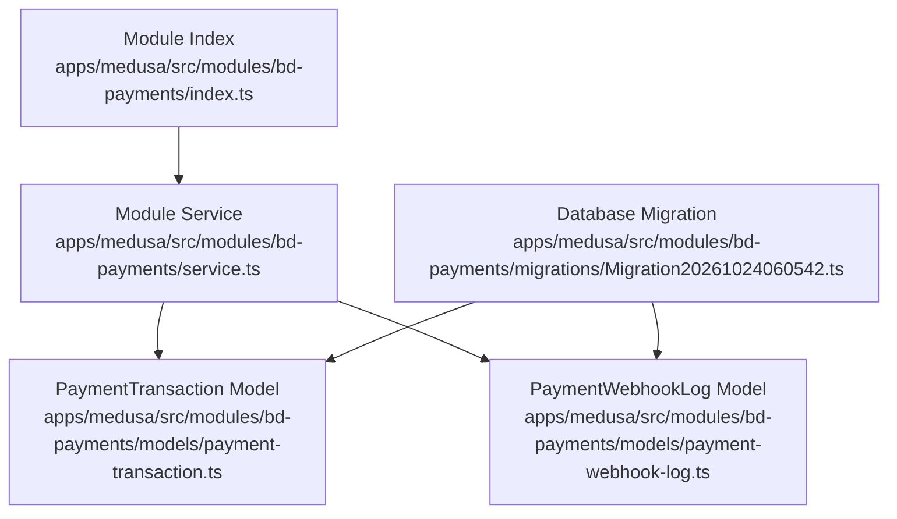
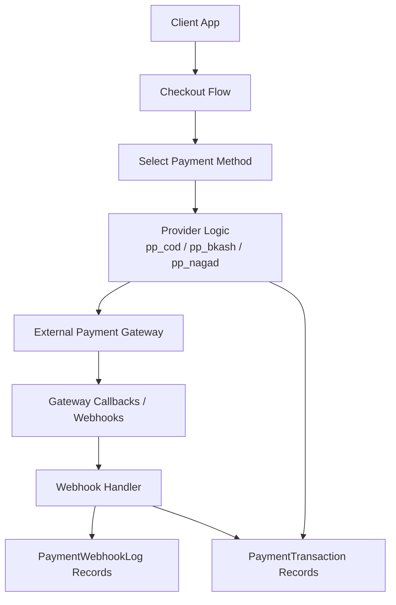
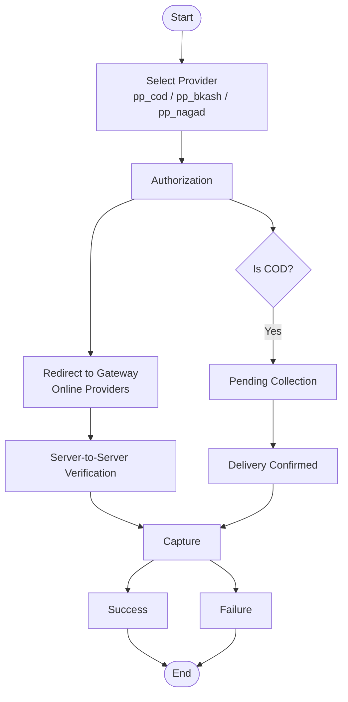
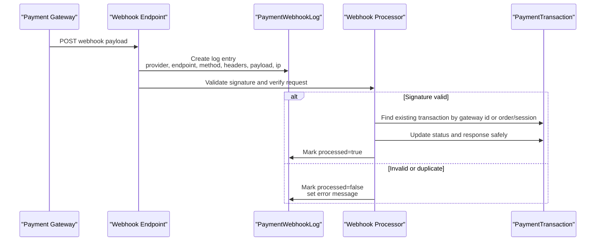
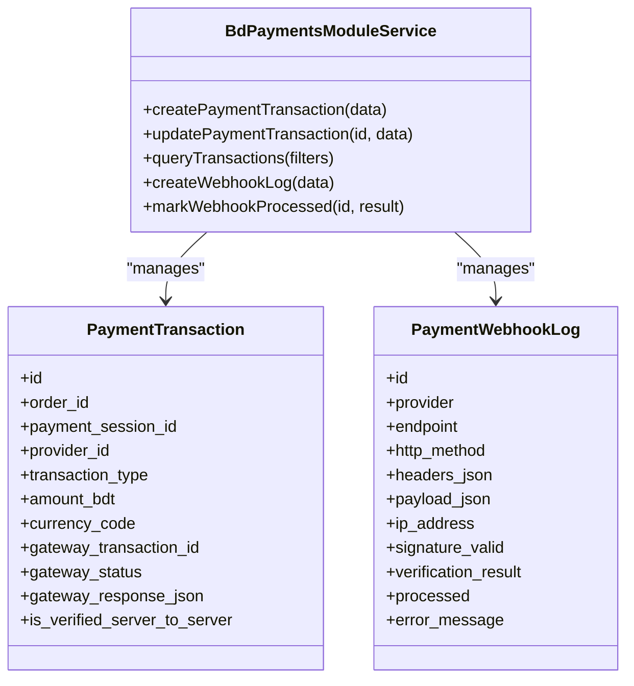
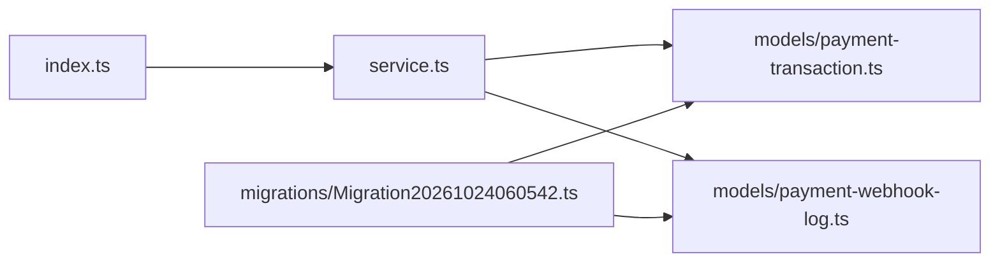

# Payment Processing Module

<cite>
**Referenced Files in This Document**
- [index.ts](file://apps/medusa/src/modules/bd-payments/index.ts)
- [service.ts](file://apps/medusa/src/modules/bd-payments/service.ts)
- [payment-transaction.ts](file://apps/medusa/src/modules/bd-payments/models/payment-transaction.ts)
- [payment-webhook-log.ts](file://apps/medusa/src/modules/bd-payments/models/payment-webhook-log.ts)
- [Migration20261024060542.ts](file://apps/medusa/src/modules/bd-payments/migrations/Migration20261024060542.ts)
- [prd.md](file://prd.md)
- [technical-plan.md](file://technical-plan.md)
</cite>

## Table of Contents
1. [Introduction](#introduction)
2. [Project Structure](#project-structure)
3. [Core Components](#core-components)
4. [Architecture Overview](#architecture-overview)
5. [Detailed Component Analysis](#detailed-component-analysis)
6. [Dependency Analysis](#dependency-analysis)
7. [Performance Considerations](#performance-considerations)
8. [Troubleshooting Guide](#troubleshooting-guide)
9. [Conclusion](#conclusion)
10. [Appendices](#appendices)

## Introduction
This document describes the `bd-payments` module, which provides the foundation for integrating local payment methods such as Cash on Delivery (COD), bKash, and Nagad, while also providing durable storage for payment transactions and webhook events. The module is implemented as a Medusa v2 custom module that exposes a service backed by two core data models: `PaymentTransaction` and `PaymentWebhookLog`.

The current codebase defines provider identifiers for COD, bKash, and Nagad. SSLCommerz and Stripe are not yet represented in the module’s schema or service; they can be added following the extension patterns documented later in this guide.

Key design principles from the project requirements include:
- Direct merchant API integration for bKash and Nagad.
- Server-to-server verification before completing payments.
- Idempotent handling of repeated webhooks or callbacks.
- Separation between payment status and order status.
- No order creation before verified online payment capture.

**Section sources**
- [prd.md:267-274](file://prd.md#L267-L274)

## Project Structure
The `bd-payments` module lives under the Medusa application at `apps/medusa/src/modules/bd-payments`. It follows a standard Medusa module layout:

**Diagram sources**
- [index.ts:1-9](file://apps/medusa/src/modules/bd-payments/index.ts#L1-L9)
- [service.ts:1-11](file://apps/medusa/src/modules/bd-payments/service.ts#L1-L11)
- [payment-transaction.ts:1-18](file://apps/medusa/src/modules/bd-payments/models/payment-transaction.ts#L1-L18)
- [payment-webhook-log.ts:1-18](file://apps/medusa/src/modules/bd-payments/models/payment-webhook-log.ts#L1-L18)
- [Migration20261024060542.ts:1-23](file://apps/medusa/src/modules/bd-payments/migrations/Migration20261024060542.ts#L1-L23)

**Section sources**
- [index.ts:1-9](file://apps/medusa/src/modules/bd-payments/index.ts#L1-L9)
- [service.ts:1-11](file://apps/medusa/src/modules/bd-payments/service.ts#L1-L11)

## Core Components
The module exposes:
- A module registration entry point.
- A module service extending Medusa’s base service.
- Two domain models for transaction tracking and webhook auditing.
- A database migration creating the underlying tables and indexes.

### Module Registration
The module registers itself with Medusa using a stable module name and binds the module service.

**Section sources**
- [index.ts:1-9](file://apps/medusa/src/modules/bd-payments/index.ts#L1-L9)

### Module Service
The service extends `MedusaService` and wires both domain models into the ORM layer. This gives you built-in CRUD operations and query helpers for `PaymentTransaction` and `PaymentWebhookLog`.

**Section sources**
- [service.ts:1-11](file://apps/medusa/src/modules/bd-payments/service.ts#L1-L11)

### PaymentTransaction Model
`PaymentTransaction` records each payment-related action against an order or payment session. It tracks:
- Linking fields: `order_id`, `payment_session_id`.
- Provider identity: `provider_id`.
- Action type: `transaction_type`.
- Financial details: `amount_bdt`, `currency_code`.
- Gateway correlation: `gateway_transaction_id`, `gateway_status`, `gateway_response_json`.
- Verification flag: `is_verified_server_to_server`.

Indexes exist for `order_id`, `payment_session_id`, and `gateway_transaction_id`, making lookup by order, session, or gateway reference efficient.

**Section sources**
- [payment-transaction.ts:1-18](file://apps/medusa/src/modules/bd-payments/models/payment-transaction.ts#L1-L18)
- [Migration20261024060542.ts:5-10](file://apps/medusa/src/modules/bd-payments/migrations/Migration20261024060542.ts#L5-L10)

### PaymentWebhookLog Model
`PaymentWebhookLog` captures raw webhook metadata and processing results:
- Request context: `provider`, `endpoint`, `http_method`, `headers_json`, `payload_json`, `ip_address`.
- Security and validation: `signature_valid`, `verification_result`.
- Processing state: `processed`, `error_message`.

This model supports auditability, debugging, and idempotent webhook processing.

**Section sources**
- [payment-webhook-log.ts:1-18](file://apps/medusa/src/modules/bd-payments/models/payment-webhook-log.ts#L1-L18)
- [Migration20261024060542.ts:12-13](file://apps/medusa/src/modules/bd-payments/migrations/Migration20261024060542.ts#L12-L13)

## Architecture Overview
At a high level, the module sits between your application workflows and external payment providers. It does not implement provider-specific HTTP logic directly; instead, it stores authoritative records of what happened during authorization, capture, refund, and status checks, and it persists webhook payloads for audit and recovery.

**Diagram sources**
- [technical-plan.md:535-547](file://technical-plan.md#L535-L547)
- [payment-transaction.ts:1-18](file://apps/medusa/src/modules/bd-payments/models/payment-transaction.ts#L1-L18)
- [payment-webhook-log.ts:1-18](file://apps/medusa/src/modules/bd-payments/models/payment-webhook-log.ts#L1-L18)

## Detailed Component Analysis

### Payment Transaction Lifecycle
A payment lifecycle typically involves one or more of these actions:
- Authorization: Reserving or initiating payment.
- Capture: Finalizing payment after successful verification.
- Refund: Returning funds.
- Status Query: Checking gateway state without changing outcome.

**Diagram sources**
- [technical-plan.md:535-547](file://technical-plan.md#L535-L547)
- [prd.md:267-274](file://prd.md#L267-L274)
- [payment-transaction.ts:1-18](file://apps/medusa/src/modules/bd-payments/models/payment-transaction.ts#L1-L18)

#### Transaction State Management Rules
- Use `transaction_type` to distinguish authorization, capture, refund, and status queries.
- Store `gateway_status` and `gateway_response_json` to preserve provider responses.
- Set `is_verified_server_to_server` only after trusted server-to-server verification.
- Keep payment status separate from order status.

**Section sources**
- [payment-transaction.ts:1-18](file://apps/medusa/src/modules/bd-payments/models/payment-transaction.ts#L1-L18)
- [prd.md:267-274](file://prd.md#L267-L274)

### Webhook Processing
Webhooks should be recorded first, then validated, then processed idempotently.

**Diagram sources**
- [payment-webhook-log.ts:1-18](file://apps/medusa/src/modules/bd-payments/models/payment-webhook-log.ts#L1-L18)
- [payment-transaction.ts:1-18](file://apps/medusa/src/modules/bd-payments/models/payment-transaction.ts#L1-L18)

#### Webhook Processing Rules
- Always persist incoming webhook metadata before business logic.
- Validate signatures and store verification results.
- Avoid trusting client-side redirect parameters alone.
- Make processing idempotent by checking existing transactions or logs.
- Record errors without crashing the endpoint.

**Section sources**
- [payment-webhook-log.ts:1-18](file://apps/medusa/src/modules/bd-payments/models/payment-webhook-log.ts#L1-L18)
- [prd.md:267-274](file://prd.md#L267-L274)

### Provider Integration Patterns
The technical plan defines provider behaviors:
- COD (`pp_cod`): Immediate authorization with pending collection; capture occurs on delivery confirmation or manual admin action.
- bKash (`pp_bkash`): Tokenized checkout flow with create-payment, redirect, execute-payment, and strict amount/currency verification.
- Nagad (`pp_nagad`): Cryptographic payload signing and merchant callback verification.

**Diagram sources**
- [service.ts:1-11](file://apps/medusa/src/modules/bd-payments/service.ts#L1-L11)
- [payment-transaction.ts:1-18](file://apps/medusa/src/modules/bd-payments/models/payment-transaction.ts#L1-L18)
- [payment-webhook-log.ts:1-18](file://apps/medusa/src/modules/bd-payments/models/payment-webhook-log.ts#L1-L18)

**Section sources**
- [technical-plan.md:535-547](file://technical-plan.md#L535-L547)

### Adding a New Payment Provider
To add a new provider such as SSLCommerz or Stripe:

1. Extend the provider enum
   - Add the new provider identifier to `provider_id` in `PaymentTransaction`.
   - Update the migration to include the new value.

2. Define provider behavior
   - Implement authorization, capture, refund, and status query flows according to the provider’s API.
   - Ensure online providers use server-to-server verification before capture.

3. Persist provider interactions
   - Create `PaymentTransaction` records for each action.
   - Store `gateway_transaction_id`, `gateway_status`, and `gateway_response_json`.
   - Set `is_verified_server_to_server` only after trusted verification.

4. Handle provider webhooks
   - Log incoming requests to `PaymentWebhookLog`.
   - Validate signatures and mark processing results.
   - Update related transactions idempotently.

5. Test edge cases
   - Duplicate webhooks.
   - Partial failures.
   - Amount and currency mismatches.
   - Cancellation and refund scenarios.

**Section sources**
- [payment-transaction.ts:1-18](file://apps/medusa/src/modules/bd-payments/models/payment-transaction.ts#L1-L18)
- [Migration20261024060542.ts:5-10](file://apps/medusa/src/modules/bd-payments/migrations/Migration20261024060542.ts#L5-L10)
- [technical-plan.md:535-547](file://technical-plan.md#L535-L547)

### Handling Payment Webhooks
Recommended implementation steps:
- Receive webhook at a dedicated endpoint.
- Immediately write a `PaymentWebhookLog` record with all request context.
- Validate signature and populate `signature_valid` and `verification_result`.
- Resolve the corresponding `PaymentTransaction` using `gateway_transaction_id`, `order_id`, or `payment_session_id`.
- Apply idempotent updates based on `transaction_type`.
- Mark the webhook log as processed or record an error.

**Section sources**
- [payment-webhook-log.ts:1-18](file://apps/medusa/src/modules/bd-payments/models/payment-webhook-log.ts#L1-L18)
- [payment-transaction.ts:1-18](file://apps/medusa/src/modules/bd-payments/models/payment-transaction.ts#L1-L18)
- [prd.md:267-274](file://prd.md#L267-L274)

### Managing Transaction Lifecycles
Lifecycle guidance:
- On authorization: create a transaction with `authorization`, set initial `gateway_status`, and leave capture pending.
- On capture: create a transaction with `capture`, update previous authorization if needed, and set `is_verified_server_to_server = true`.
- On refund: create a transaction with `refund`, preserving original gateway references.
- On status query: create a transaction with `status_query` to reconcile state without side effects.

**Section sources**
- [payment-transaction.ts:1-18](file://apps/medusa/src/modules/bd-payments/models/payment-transaction.ts#L1-L18)
- [technical-plan.md:535-547](file://technical-plan.md#L535-L547)

## Dependency Analysis
The module has minimal internal dependencies:
- The module index depends on the service.
- The service depends on the two models.
- The migration creates the database tables referenced by the models.

**Diagram sources**
- [index.ts:1-9](file://apps/medusa/src/modules/bd-payments/index.ts#L1-L9)
- [service.ts:1-11](file://apps/medusa/src/modules/bd-payments/service.ts#L1-L11)
- [payment-transaction.ts:1-18](file://apps/medusa/src/modules/bd-payments/models/payment-transaction.ts#L1-L18)
- [payment-webhook-log.ts:1-18](file://apps/medusa/src/modules/bd-payments/models/payment-webhook-log.ts#L1-L18)
- [Migration20261024060542.ts:1-23](file://apps/medusa/src/modules/bd-payments/migrations/Migration20261024060542.ts#L1-L23)

**Section sources**
- [index.ts:1-9](file://apps/medusa/src/modules/bd-payments/index.ts#L1-L9)
- [service.ts:1-11](file://apps/medusa/src/modules/bd-payments/service.ts#L1-L11)
- [Migration20261024060542.ts:1-23](file://apps/medusa/src/modules/bd-payments/migrations/Migration20261024060542.ts#L1-L23)

## Performance Considerations
- Use indexed lookup fields:
  - `order_id`, `payment_session_id`, and `gateway_transaction_id` on `PaymentTransaction`.
  - `deleted_at` indexes support soft-delete queries.
- Keep webhook payloads compact but sufficient for replay and audit.
- Avoid heavy computation inside webhook handlers; delegate to background jobs when necessary.
- Batch updates where possible to reduce database round-trips.
- Monitor large JSON payloads in `gateway_response_json` and `headers_json`/`payload_json`.

[No sources needed since this section provides general guidance]

## Troubleshooting Guide
Common issues and resolutions:
- Duplicate payments caused by repeated webhooks:
  - Ensure idempotent processing using existing transaction records or webhook logs.
- Untrusted payment success:
  - Never rely solely on redirect parameters; perform server-to-server verification.
- Missing provider configuration:
  - Disable unconfigured providers in Admin until credentials are set.
- Incorrect amounts or currencies:
  - Validate exact BDT amounts and currency codes during capture.
- Orphan orders:
  - Do not create orders before verified online payment capture.

**Section sources**
- [prd.md:267-274](file://prd.md#L267-L274)
- [payment-webhook-log.ts:1-18](file://apps/medusa/src/modules/bd-payments/models/payment-webhook-log.ts#L1-L18)
- [payment-transaction.ts:1-18](file://apps/medusa/src/modules/bd-payments/models/payment-transaction.ts#L1-L18)

## Conclusion
The `bd-payments` module provides a solid foundation for managing payment transactions and webhook events across supported providers. While COD, bKash, and Nagad are defined in the schema and planning documents, SSLCommerz and Stripe are not yet present in the module’s code. Extending the module requires updating the provider enum, implementing provider-specific flows, persisting transactions and webhook logs, and enforcing server-to-server verification and idempotency.

[No sources needed since this section summarizes without analyzing specific files]

## Appendices

### Provider Reference Summary
- COD (`pp_cod`): Immediate authorization, pending collection, capture on delivery or admin action.
- bKash (`pp_bkash`): Tokenized checkout with create-payment, redirect, execute-payment, and strict verification.
- Nagad (`pp_nagad`): Signed payload initialization and callback verification.

**Section sources**
- [technical-plan.md:535-547](file://technical-plan.md#L535-L547)