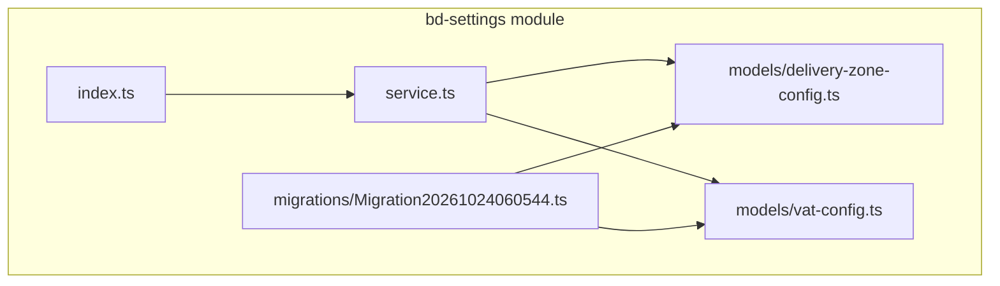
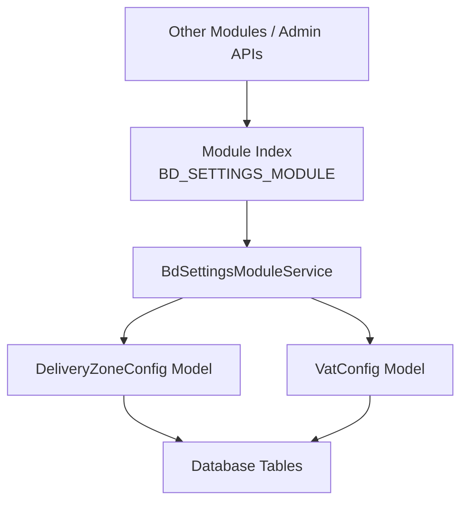
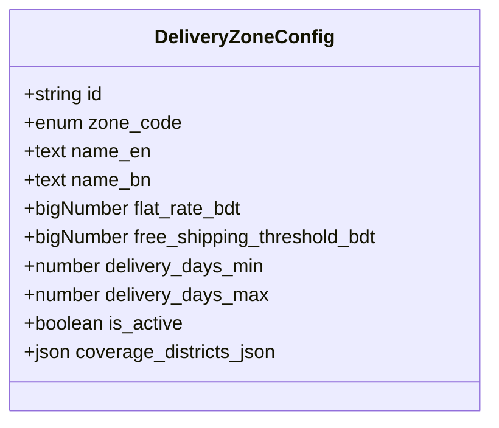
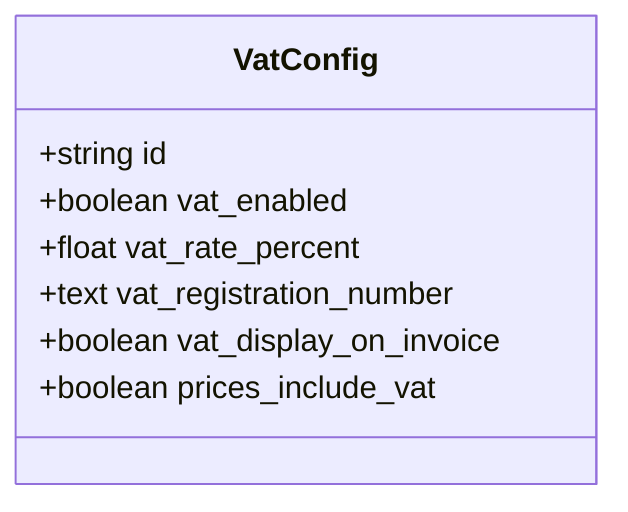
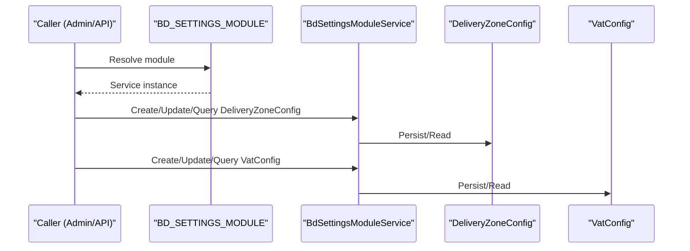
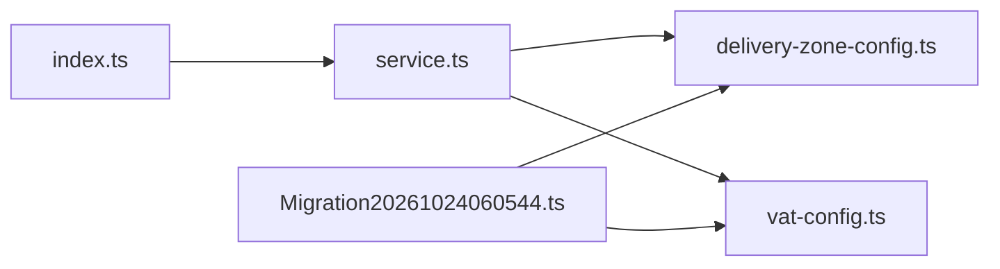

# Settings Management Module

<cite>
**Referenced Files in This Document**
- [index.ts](file://apps/medusa/src/modules/bd-settings/index.ts)
- [service.ts](file://apps/medusa/src/modules/bd-settings/service.ts)
- [delivery-zone-config.ts](file://apps/medusa/src/modules/bd-settings/models/delivery-zone-config.ts)
- [vat-config.ts](file://apps/medusa/src/modules/bd-settings/models/vat-config.ts)
- [Migration20261024060544.ts](file://apps/medusa/src/modules/bd-settings/migrations/Migration20261024060544.ts)
</cite>

## Table of Contents
1. [Introduction](#introduction)
2. [Project Structure](#project-structure)
3. [Core Components](#core-components)
4. [Architecture Overview](#architecture-overview)
5. [Detailed Component Analysis](#detailed-component-analysis)
6. [Dependency Analysis](#dependency-analysis)
7. [Performance Considerations](#performance-considerations)
8. [Troubleshooting Guide](#troubleshooting-guide)
9. [Conclusion](#conclusion)
10. [Appendices](#appendices)

## Introduction
The bd-settings module provides system configuration capabilities for a commerce platform, focusing on two primary areas:
- DeliveryZoneConfig: Defines geographic delivery zones with pricing and delivery time rules.
- VATConfig: Manages tax compliance settings such as VAT enablement, rates, registration number, invoice display, and whether prices include VAT.

This module is implemented as a Medusa v2 module that exposes a service backed by persistent models. It can be consumed by other modules or admin/store APIs to enforce business rules related to shipping and taxation.

## Project Structure
The module resides under apps/medusa/src/modules/bd-settings and follows a standard Medusa module layout:
- index.ts: Module registration and export of the module name constant.
- service.ts: Service class extending MedusaService with model references.
- models/: Data models for delivery zone and VAT configuration.
- migrations/: Database migration script creating tables and indexes.

**Diagram sources**
- [index.ts:1-9](file://apps/medusa/src/modules/bd-settings/index.ts#L1-L9)
- [service.ts:1-11](file://apps/medusa/src/modules/bd-settings/service.ts#L1-L11)
- [delivery-zone-config.ts:1-17](file://apps/medusa/src/modules/bd-settings/models/delivery-zone-config.ts#L1-L17)
- [vat-config.ts:1-13](file://apps/medusa/src/modules/bd-settings/models/vat-config.ts#L1-L13)
- [Migration20261024060544.ts:1-22](file://apps/medusa/src/modules/bd-settings/migrations/Migration20261024060544.ts#L1-L22)

**Section sources**
- [index.ts:1-9](file://apps/medusa/src/modules/bd-settings/index.ts#L1-L9)
- [service.ts:1-11](file://apps/medusa/src/modules/bd-settings/service.ts#L1-L11)

## Core Components
- Module Registration (index.ts): Exports the module name constant BD_SETTINGS_MODULE and registers the BdSettingsModuleService with Medusa.
- Service (service.ts): Extends MedusaService with DeliveryZoneConfig and VatConfig, providing built-in CRUD operations and query helpers.
- Models:
  - DeliveryZoneConfig: Represents delivery zones with codes, localized names, flat rate, free shipping threshold, delivery days range, active flag, and coverage districts JSON.
  - VatConfig: Represents VAT settings including enablement, rate percentage, registration number, invoice display flag, and price inclusion flag.

Key responsibilities:
- Persist and retrieve delivery zone definitions and VAT configuration.
- Provide a consistent API surface for other modules to read and update these settings.

**Section sources**
- [index.ts:1-9](file://apps/medusa/src/modules/bd-settings/index.ts#L1-L9)
- [service.ts:1-11](file://apps/medusa/src/modules/bd-settings/service.ts#L1-L11)
- [delivery-zone-config.ts:1-17](file://apps/medusa/src/modules/bd-settings/models/delivery-zone-config.ts#L1-L17)
- [vat-config.ts:1-13](file://apps/medusa/src/modules/bd-settings/models/vat-config.ts#L1-L13)

## Architecture Overview
At runtime, other modules or API routes can resolve the bd-settings module and call its service methods to manage delivery zones and VAT settings. The service delegates persistence to the underlying ORM via the models defined in this module.

**Diagram sources**
- [index.ts:1-9](file://apps/medusa/src/modules/bd-settings/index.ts#L1-L9)
- [service.ts:1-11](file://apps/medusa/src/modules/bd-settings/service.ts#L1-L11)
- [delivery-zone-config.ts:1-17](file://apps/medusa/src/modules/bd-settings/models/delivery-zone-config.ts#L1-L17)
- [vat-config.ts:1-13](file://apps/medusa/src/modules/bd-settings/models/vat-config.ts#L1-L13)

## Detailed Component Analysis

### Delivery Zone Configuration
Purpose:
- Define geographic delivery areas with associated shipping costs and delivery windows.
- Support localization through English and Bengali names.
- Allow optional district-level coverage details.

Data model highlights:
- Unique zone_code enum values: inside_dhaka, dhaka_suburbs, outside_dhaka.
- Localized names: name_en, name_bn.
- Pricing: flat_rate_bdt, free_shipping_threshold_bdt.
- Delivery window: delivery_days_min, delivery_days_max.
- Active state: is_active.
- Coverage: coverage_districts_json.

Validation and constraints:
- zone_code is constrained to a fixed set of values.
- A unique index ensures only one record per zone_code (excluding soft-deleted rows).
- Numeric fields use bigNumber types for precision; defaults are provided for common scenarios.

Operational guidance:
- Create one record per allowed zone_code.
- Use is_active to toggle availability without deleting historical data.
- Populate coverage_districts_json when you need to restrict deliveries to specific districts.

**Diagram sources**
- [delivery-zone-config.ts:1-17](file://apps/medusa/src/modules/bd-settings/models/delivery-zone-config.ts#L1-L17)
- [Migration20261024060544.ts:5-12](file://apps/medusa/src/modules/bd-settings/migrations/Migration20261024060544.ts#L5-L12)

**Section sources**
- [delivery-zone-config.ts:1-17](file://apps/medusa/src/modules/bd-settings/models/delivery-zone-config.ts#L1-L17)
- [Migration20261024060544.ts:5-12](file://apps/medusa/src/modules/bd-settings/migrations/Migration20261024060544.ts#L5-L12)

### VAT Configuration
Purpose:
- Control global VAT behavior for the platform.
- Store VAT rate and registration information.
- Determine how VAT appears on invoices and whether prices include VAT.

Data model highlights:
- vat_enabled: Master switch for VAT.
- vat_rate_percent: Percentage rate applied when enabled.
- vat_registration_number: Optional regulatory identifier.
- vat_display_on_invoice: Controls visibility on invoices.
- prices_include_vat: Indicates if displayed prices already include VAT.

Operational guidance:
- Enable VAT only when required by jurisdiction.
- Set prices_include_vat consistently with your pricing strategy.
- Keep vat_registration_number updated for compliance reporting.

**Diagram sources**
- [vat-config.ts:1-13](file://apps/medusa/src/modules/bd-settings/models/vat-config.ts#L1-L13)
- [Migration20261024060544.ts:11-12](file://apps/medusa/src/modules/bd-settings/migrations/Migration20261024060544.ts#L11-L12)

**Section sources**
- [vat-config.ts:1-13](file://apps/medusa/src/modules/bd-settings/models/vat-config.ts#L1-L13)
- [Migration20261024060544.ts:11-12](file://apps/medusa/src/modules/bd-settings/migrations/Migration20261024060544.ts#L11-L12)

### Service Layer
Responsibilities:
- Provides standardized CRUD operations for both models.
- Acts as the integration point for other modules to read/write settings.

Usage pattern:
- Resolve the bd-settings module and call service methods to create, update, or query delivery zones and VAT settings.

**Diagram sources**
- [index.ts:1-9](file://apps/medusa/src/modules/bd-settings/index.ts#L1-L9)
- [service.ts:1-11](file://apps/medusa/src/modules/bd-settings/service.ts#L1-L11)

**Section sources**
- [service.ts:1-11](file://apps/medusa/src/modules/bd-settings/service.ts#L1-L11)

## Dependency Analysis
- Module index depends on the service.
- Service depends on both models.
- Migration defines the database schema corresponding to the models.

**Diagram sources**
- [index.ts:1-9](file://apps/medusa/src/modules/bd-settings/index.ts#L1-L9)
- [service.ts:1-11](file://apps/medusa/src/modules/bd-settings/service.ts#L1-L11)
- [delivery-zone-config.ts:1-17](file://apps/medusa/src/modules/bd-settings/models/delivery-zone-config.ts#L1-L17)
- [vat-config.ts:1-13](file://apps/medusa/src/modules/bd-settings/models/vat-config.ts#L1-L13)
- [Migration20261024060544.ts:1-22](file://apps/medusa/src/modules/bd-settings/migrations/Migration20261024060544.ts#L1-L22)

**Section sources**
- [index.ts:1-9](file://apps/medusa/src/modules/bd-settings/index.ts#L1-L9)
- [service.ts:1-11](file://apps/medusa/src/modules/bd-settings/service.ts#L1-L11)
- [Migration20261024060544.ts:1-22](file://apps/medusa/src/modules/bd-settings/migrations/Migration20261024060544.ts#L1-L22)

## Performance Considerations
- Delivery zones are typically few in number; queries should be efficient with proper indexing on zone_code and deleted_at.
- VAT config is a singleton-like setting; cache at application startup if frequently accessed to reduce repeated reads.
- Avoid frequent updates to VAT settings during peak traffic; batch changes during maintenance windows.

[No sources needed since this section provides general guidance]

## Troubleshooting Guide
Common issues and resolutions:
- Duplicate zone_code errors: Ensure only one active record per zone_code exists. The unique index enforces this constraint.
- Invalid zone_code values: Only the predefined enums are accepted; validate inputs before persisting.
- VAT not applied: Verify vat_enabled is true and vat_rate_percent is set appropriately. Check prices_include_vat to ensure correct price display logic.
- Invoice display mismatch: Confirm vat_display_on_invoice aligns with business requirements.

Operational checks:
- Validate that migrations have been applied successfully so tables exist and indexes are created.
- Inspect is_active flags for delivery zones to confirm intended availability.

**Section sources**
- [delivery-zone-config.ts:1-17](file://apps/medusa/src/modules/bd-settings/models/delivery-zone-config.ts#L1-L17)
- [vat-config.ts:1-13](file://apps/medusa/src/modules/bd-settings/models/vat-config.ts#L1-L13)
- [Migration20261024060544.ts:5-12](file://apps/medusa/src/modules/bd-settings/migrations/Migration20261024060544.ts#L5-L12)

## Conclusion
The bd-settings module centralizes critical configuration for delivery zones and VAT compliance. Its simple service layer and well-defined models provide a robust foundation for enforcing shipping and tax business rules across the platform. By following the operational guidance and validation constraints outlined here, administrators can reliably configure and maintain system-wide preferences.

[No sources needed since this section summarizes without analyzing specific files]

## Appendices

### Example Workflows

#### Setting Up Delivery Zones
- Create records for each allowed zone_code (inside_dhaka, dhaka_suburbs, outside_dhaka).
- Set localized names (name_en, name_bn), flat_rate_bdt, free_shipping_threshold_bdt, and delivery_days_min/max.
- Optionally populate coverage_districts_json for district-specific restrictions.
- Toggle is_active to control availability.

**Section sources**
- [delivery-zone-config.ts:1-17](file://apps/medusa/src/modules/bd-settings/models/delivery-zone-config.ts#L1-L17)

#### Configuring VAT Rates
- Enable VAT by setting vat_enabled to true.
- Set vat_rate_percent to the applicable rate.
- Provide vat_registration_number for compliance.
- Configure vat_display_on_invoice and prices_include_vat according to invoicing policy.

**Section sources**
- [vat-config.ts:1-13](file://apps/medusa/src/modules/bd-settings/models/vat-config.ts#L1-L13)

#### Managing System-Wide Preferences
- Use the service to read current VAT and delivery zone configurations.
- Update settings as business rules change, ensuring validation constraints are respected.
- Coordinate changes with deployment cycles to avoid inconsistent states.

**Section sources**
- [service.ts:1-11](file://apps/medusa/src/modules/bd-settings/service.ts#L1-L11)