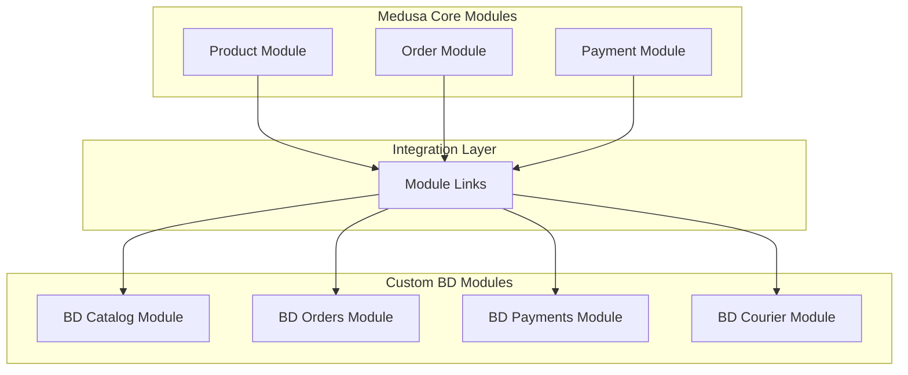
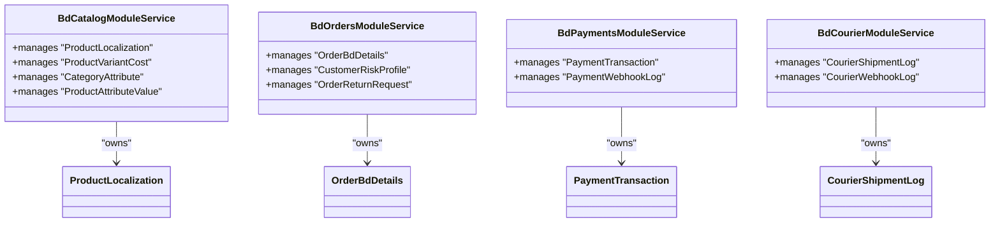
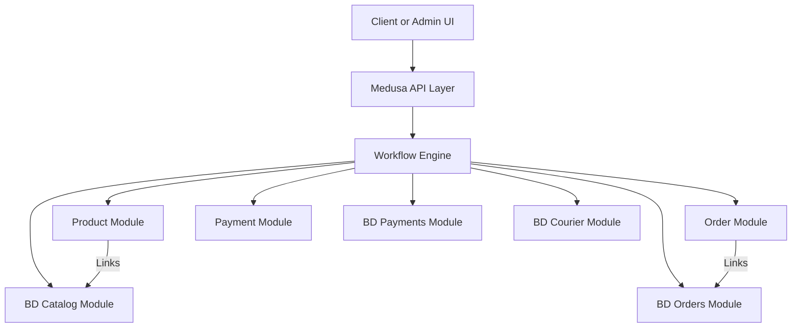
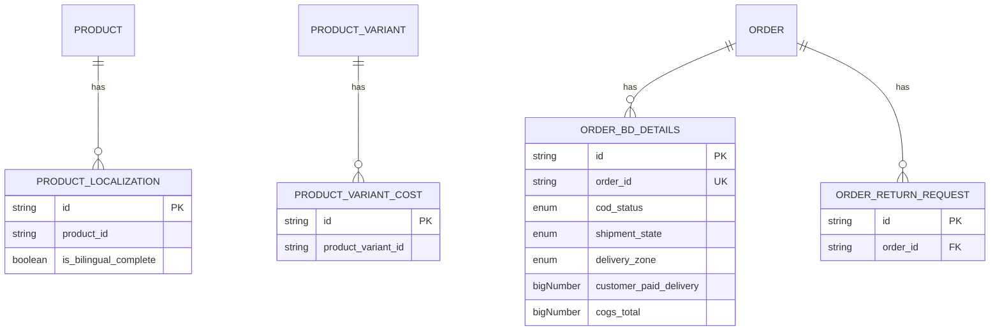
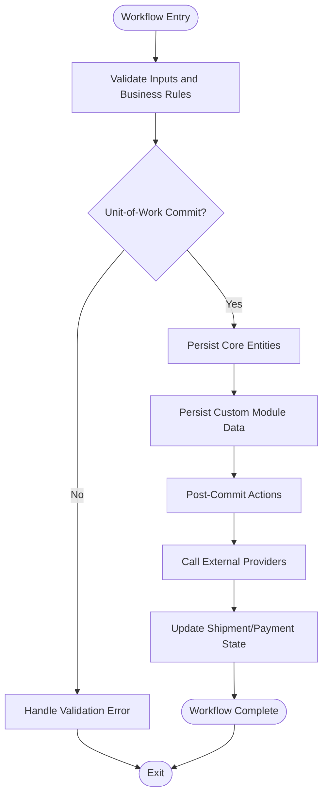
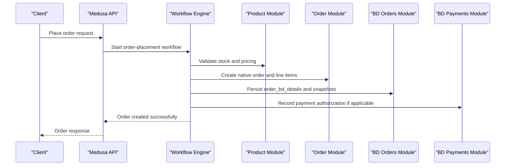
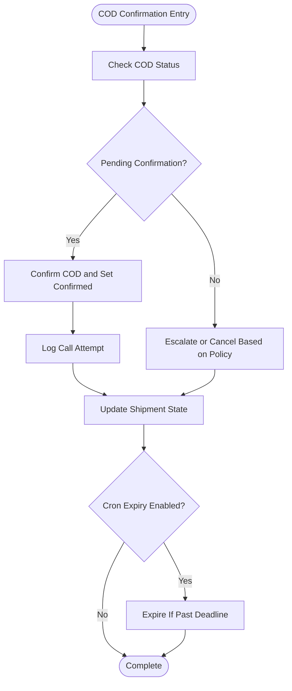
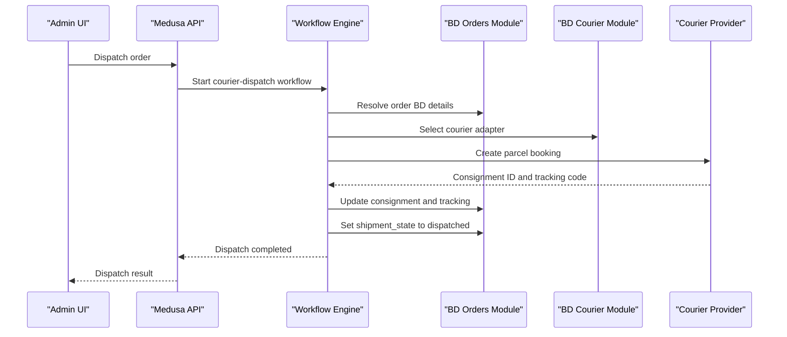
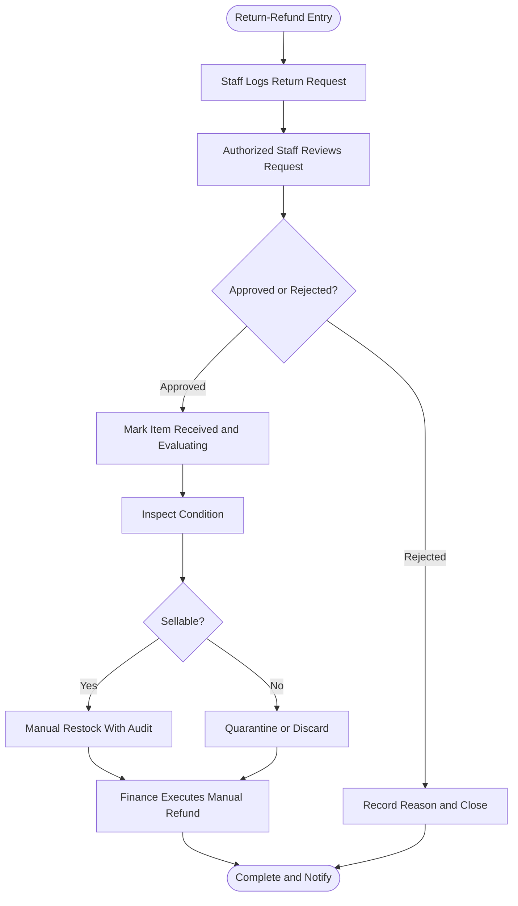
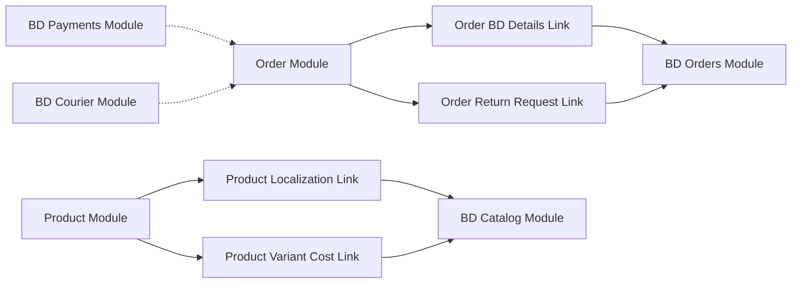

# Commerce Domain Layer

<cite>
**Referenced Files in This Document**
- [apps/medusa/src/modules/bd-catalog/index.ts](file://apps/medusa/src/modules/bd-catalog/index.ts)
- [apps/medusa/src/modules/bd-orders/index.ts](file://apps/medusa/src/modules/bd-orders/index.ts)
- [apps/medusa/src/modules/bd-payments/index.ts](file://apps/medusa/src/modules/bd-payments/index.ts)
- [apps/medusa/src/modules/bd-courier/index.ts](file://apps/medusa/src/modules/bd-courier/index.ts)
- [apps/medusa/src/modules/bd-catalog/service.ts](file://apps/medusa/src/modules/bd-catalog/service.ts)
- [apps/medusa/src/modules/bd-orders/service.ts](file://apps/medusa/src/modules/bd-orders/service.ts)
- [apps/medusa/src/modules/bd-payments/service.ts](file://apps/medusa/src/modules/bd-payments/service.ts)
- [apps/medusa/src/modules/bd-courier/service.ts](file://apps/medusa/src/modules/bd-courier/service.ts)
- [apps/medusa/src/links/order-bd-details.ts](file://apps/medusa/src/links/order-bd-details.ts)
- [apps/medusa/src/links/order-return-request.ts](file://apps/medusa/src/links/order-return-request.ts)
- [apps/medusa/src/links/product-localization.ts](file://apps/medusa/src/links/product-localization.ts)
- [apps/medusa/src/links/product-variant-cost.ts](file://apps/medusa/src/links/product-variant-cost.ts)
- [apps/medusa/src/modules/bd-catalog/models/product-localization.ts](file://apps/medusa/src/modules/bd-catalog/models/product-localization.ts)
- [apps/medusa/src/modules/bd-orders/models/order-bd-details.ts](file://apps/medusa/src/modules/bd-orders/models/order-bd-details.ts)
- [apps/medusa/src/modules/bd-payments/models/payment-transaction.ts](file://apps/medusa/src/modules/bd-payments/models/payment-transaction.ts)
- [apps/medusa/src/modules/bd-courier/models/courier-shipment-log.ts](file://apps/medusa/src/modules/bd-courier/models/courier-shipment-log.ts)
- [database.md](file://database.md)
- [docs/architecture.md](file://docs/architecture.md)
</cite>

## Table of Contents
1. [Introduction](#introduction)
2. [Project Structure](#project-structure)
3. [Core Components](#core-components)
4. [Architecture Overview](#architecture-overview)
5. [Detailed Component Analysis](#detailed-component-analysis)
6. [Dependency Analysis](#dependency-analysis)
7. [Performance Considerations](#performance-considerations)
8. [Troubleshooting Guide](#troubleshooting-guide)
9. [Conclusion](#conclusion)

## Introduction
This document describes the Commerce Domain Layer for the Bangladesh commerce platform, separating Medusa core modules from custom Bangladesh-specific modules. It explains how native commerce capabilities such as product, order, and payment are extended by local modules like bd-catalog, bd-orders, bd-payments, and bd-courier. It also documents the workflow engine boundaries for transactional operations including order-placement, COD confirmation, courier dispatch, and return-refund processes, while preserving domain isolation and data consistency.

The architecture uses:
- Medusa core modules for canonical commerce entities.
- Custom modules for Bangladesh-specific extensions.
- Module Links to connect core entities with custom entities.
- A strict unit-of-work boundary where cross-module calls occur after commit via the workflow engine.

## Project Structure
The relevant implementation lives under `apps/medusa/src`. The key areas are:
- `modules`: Custom Medusa modules (`bd-catalog`, `bd-orders`, `bd-payments`, `bd-courier`).
- `links`: Module Link definitions connecting Medusa core entities to custom entities.
- `workflows`: Workflow orchestration (currently a placeholder directory).
- Documentation files describing workflows, database invariants, and system design.

**Diagram sources**
- [apps/medusa/src/links/product-localization.ts:1-9](file://apps/medusa/src/links/product-localization.ts#L1-L9)
- [apps/medusa/src/links/product-variant-cost.ts:1-9](file://apps/medusa/src/links/product-variant-cost.ts#L1-L9)
- [apps/medusa/src/links/order-bd-details.ts:1-9](file://apps/medusa/src/links/order-bd-details.ts#L1-L9)
- [apps/medusa/src/links/order-return-request.ts:1-9](file://apps/medusa/src/links/order-return-request.ts#L1-L9)

**Section sources**
- [apps/medusa/src/modules/bd-catalog/index.ts:1-9](file://apps/medusa/src/modules/bd-catalog/index.ts#L1-L9)
- [apps/medusa/src/modules/bd-orders/index.ts:1-9](file://apps/medusa/src/modules/bd-orders/index.ts#L1-L9)
- [apps/medusa/src/modules/bd-payments/index.ts:1-9](file://apps/medusa/src/modules/bd-payments/index.ts#L1-L9)
- [apps/medusa/src/modules/bd-courier/index.ts:1-9](file://apps/medusa/src/modules/bd-courier/index.ts#L1-L9)

## Core Components
The custom modules extend Medusa’s commerce domain without replacing it. Each module exposes a service that manages its own models and is registered through Medusa’s module system.

- **BD Catalog**: Extends product data with localization and variant cost information.
- **BD Orders**: Stores Bangladesh-specific order details, risk profiles, and return requests.
- **BD Payments**: Records provider transactions and webhook logs for local gateways.
- **BD Courier**: Tracks shipment logs and webhook events for delivery providers.

**Diagram sources**
- [apps/medusa/src/modules/bd-catalog/service.ts:1-15](file://apps/medusa/src/modules/bd-catalog/service.ts#L1-L15)
- [apps/medusa/src/modules/bd-orders/service.ts:1-13](file://apps/medusa/src/modules/bd-orders/service.ts#L1-L13)
- [apps/medusa/src/modules/bd-payments/service.ts:1-11](file://apps/medusa/src/modules/bd-payments/service.ts#L1-L11)
- [apps/medusa/src/modules/bd-courier/service.ts:1-11](file://apps/medusa/src/modules/bd-courier/service.ts#L1-L11)
- [apps/medusa/src/modules/bd-catalog/models/product-localization.ts:1-20](file://apps/medusa/src/modules/bd-catalog/models/product-localization.ts#L1-L20)
- [apps/medusa/src/modules/bd-orders/models/order-bd-details.ts:1-42](file://apps/medusa/src/modules/bd-orders/models/order-bd-details.ts#L1-L42)
- [apps/medusa/src/modules/bd-payments/models/payment-transaction.ts:1-18](file://apps/medusa/src/modules/bd-payments/models/payment-transaction.ts#L1-L18)
- [apps/medusa/src/modules/bd-courier/models/courier-shipment-log.ts:1-15](file://apps/medusa/src/modules/bd-courier/models/courier-shipment-log.ts#L1-L15)

**Section sources**
- [apps/medusa/src/modules/bd-catalog/service.ts:1-15](file://apps/medusa/src/modules/bd-catalog/service.ts#L1-L15)
- [apps/medusa/src/modules/bd-orders/service.ts:1-13](file://apps/medusa/src/modules/bd-orders/service.ts#L1-L13)
- [apps/medusa/src/modules/bd-payments/service.ts:1-11](file://apps/medusa/src/modules/bd-payments/service.ts#L1-L11)
- [apps/medusa/src/modules/bd-courier/service.ts:1-11](file://apps/medusa/src/modules/bd-courier/service.ts#L1-L11)

## Architecture Overview
The Commerce Domain Layer separates responsibilities clearly:

- **Medusa Core Modules**: Provide canonical product, order, and payment functionality.
- **Custom BD Modules**: Add Bangladesh-specific data and operational state.
- **Module Links**: Define relationships between core entities and custom entities.
- **Workflow Engine**: Orchestrates multi-step, transactional business processes across modules.

**Diagram sources**
- [apps/medusa/src/links/product-localization.ts:1-9](file://apps/medusa/src/links/product-localization.ts#L1-L9)
- [apps/medusa/src/links/order-bd-details.ts:1-9](file://apps/medusa/src/links/order-bd-details.ts#L1-L9)
- [docs/architecture.md:717-737](file://docs/architecture.md#L717-L737)

## Detailed Component Analysis

### Boundary Between Native Commerce and Custom Modules
Native commerce functionality is provided by Medusa core modules:
- Product module for catalog entities.
- Order module for order lifecycle.
- Payment module for payment sessions and providers.

Custom modules extend these domains:
- BD Catalog adds localized product metadata and variant costs.
- BD Orders adds Bangladesh-specific order details, risk profiling, and return requests.
- BD Payments records gateway transactions and webhook logs.
- BD Courier tracks shipments and webhook events.

Module Links explicitly define which core entities relate to which custom entities:
- Product ↔ Product Localization
- Product Variant ↔ Product Variant Cost
- Order ↔ Order BD Details
- Order ↔ Order Return Request

**Diagram sources**
- [apps/medusa/src/links/product-localization.ts:1-9](file://apps/medusa/src/links/product-localization.ts#L1-L9)
- [apps/medusa/src/links/product-variant-cost.ts:1-9](file://apps/medusa/src/links/product-variant-cost.ts#L1-L9)
- [apps/medusa/src/links/order-bd-details.ts:1-9](file://apps/medusa/src/links/order-bd-details.ts#L1-L9)
- [apps/medusa/src/links/order-return-request.ts:1-9](file://apps/medusa/src/links/order-return-request.ts#L1-L9)
- [apps/medusa/src/modules/bd-catalog/models/product-localization.ts:1-20](file://apps/medusa/src/modules/bd-catalog/models/product-localization.ts#L1-L20)
- [apps/medusa/src/modules/bd-orders/models/order-bd-details.ts:1-42](file://apps/medusa/src/modules/bd-orders/models/order-bd-details.ts#L1-L42)

**Section sources**
- [apps/medusa/src/links/product-localization.ts:1-9](file://apps/medusa/src/links/product-localization.ts#L1-L9)
- [apps/medusa/src/links/product-variant-cost.ts:1-9](file://apps/medusa/src/links/product-variant-cost.ts#L1-L9)
- [apps/medusa/src/links/order-bd-details.ts:1-9](file://apps/medusa/src/links/order-bd-details.ts#L1-L9)
- [apps/medusa/src/links/order-return-request.ts:1-9](file://apps/medusa/src/links/order-return-request.ts#L1-L9)

### Workflow Engine Architecture for Transactional Operations
The workflow engine orchestrates complex, multi-module operations while maintaining strict transaction boundaries. Cross-service calls happen after commit, ensuring data consistency and idempotency.

Key operations include:
- Order placement
- COD confirmation
- Courier dispatch
- Return-refund

**Diagram sources**
- [database.md:2088-2109](file://database.md#L2088-L2109)
- [docs/architecture.md:717-737](file://docs/architecture.md#L717-L737)

**Section sources**
- [database.md:2088-2109](file://database.md#L2088-L2109)
- [docs/architecture.md:717-737](file://docs/architecture.md#L717-L737)

### Order Placement Workflow
Order placement validates cart, prices, stock, phone, address codes, and shipping options. It reserves inventory atomically, creates native order entities, and persists Bangladesh-specific order snapshots.

**Diagram sources**
- [database.md:2094-2098](file://database.md#L2094-L2098)
- [apps/medusa/src/modules/bd-orders/models/order-bd-details.ts:1-42](file://apps/medusa/src/modules/bd-orders/models/order-bd-details.ts#L1-L42)
- [apps/medusa/src/modules/bd-payments/models/payment-transaction.ts:1-18](file://apps/medusa/src/modules/bd-payments/models/payment-transaction.ts#L1-L18)

**Section sources**
- [database.md:2094-2098](file://database.md#L2094-L2098)

### COD Confirmation Workflow
COD confirmation updates order BD details, tracks call attempts, and enforces expiration rules.

**Diagram sources**
- [database.md:2097-2099](file://database.md#L2097-L2099)
- [apps/medusa/src/modules/bd-orders/models/order-bd-details.ts:1-42](file://apps/medusa/src/modules/bd-orders/models/order-bd-details.ts#L1-L42)

**Section sources**
- [database.md:2097-2099](file://database.md#L2097-L2099)
- [apps/medusa/src/modules/bd-orders/models/order-bd-details.ts:1-42](file://apps/medusa/src/modules/bd-orders/models/order-bd-details.ts#L1-L42)

### Courier Dispatch Workflow
Courier dispatch resolves an adapter, formats the address and COD remittance amount, calls the courier API, and updates internal state.

**Diagram sources**
- [docs/architecture.md:717-723](file://docs/architecture.md#L717-L723)
- [apps/medusa/src/modules/bd-courier/models/courier-shipment-log.ts:1-15](file://apps/medusa/src/modules/bd-courier/models/courier-shipment-log.ts#L1-L15)

**Section sources**
- [docs/architecture.md:717-723](file://docs/architecture.md#L717-L723)

### Return-Refund Workflow
Return-refund is strictly manual. It includes request logging, approval/rejection, inspection, and refund recording.

**Diagram sources**
- [docs/architecture.md:725-734](file://docs/architecture.md#L725-L734)
- [database.md:2102-2105](file://database.md#L2102-L2105)

**Section sources**
- [docs/architecture.md:725-734](file://docs/architecture.md#L725-L734)
- [database.md:2102-2105](file://database.md#L2102-L2105)

## Dependency Analysis
The dependency graph shows how custom modules depend on Medusa core modules through links and workflow orchestration.

**Diagram sources**
- [apps/medusa/src/links/product-localization.ts:1-9](file://apps/medusa/src/links/product-localization.ts#L1-L9)
- [apps/medusa/src/links/product-variant-cost.ts:1-9](file://apps/medusa/src/links/product-variant-cost.ts#L1-L9)
- [apps/medusa/src/links/order-bd-details.ts:1-9](file://apps/medusa/src/links/order-bd-details.ts#L1-L9)
- [apps/medusa/src/links/order-return-request.ts:1-9](file://apps/medusa/src/links/order-return-request.ts#L1-L9)

**Section sources**
- [apps/medusa/src/links/product-localization.ts:1-9](file://apps/medusa/src/links/product-localization.ts#L1-L9)
- [apps/medusa/src/links/product-variant-cost.ts:1-9](file://apps/medusa/src/links/product-variant-cost.ts#L1-L9)
- [apps/medusa/src/links/order-bd-details.ts:1-9](file://apps/medusa/src/links/order-bd-details.ts#L1-L9)
- [apps/medusa/src/links/order-return-request.ts:1-9](file://apps/medusa/src/links/order-return-request.ts#L1-L9)

## Performance Considerations
- Keep cross-module calls outside database transactions; perform them after commit via the workflow engine.
- Use idempotency keys for order placement and refund recording to prevent duplicates.
- Ensure atomic inventory reservation and consistent snapshotting of prices and taxes.
- Avoid blocking order creation on non-critical side effects like SMS notifications.
- Deduplicate external events using stable identifiers and checksums.

[No sources needed since this section provides general guidance]

## Troubleshooting Guide
Common issues and their resolution strategies:
- Duplicate orders: Verify idempotency keys and checkout uniqueness constraints.
- COD expiry not triggering: Check cron configuration and status transitions.
- Inconsistent COD amounts: Validate that collected COD equals sum of delivered lines.
- Courier event regressions: Enforce deduplication and terminal-state protection.
- Refund inconsistencies: Ensure refund amount does not exceed captured amount and requires approval when required.

**Section sources**
- [database.md:2094-2109](file://database.md#L2094-L2109)

## Conclusion
The Commerce Domain Layer cleanly separates Medusa core modules from Bangladesh-specific custom modules. Module Links provide explicit relationships between canonical entities and local extensions. The workflow engine coordinates transactional operations while enforcing strict unit-of-work boundaries, idempotency, and auditability. This design preserves domain isolation, supports local operational requirements, and maintains data consistency across order placement, COD confirmation, courier dispatch, and return-refund processes.

[No sources needed since this section summarizes without analyzing specific files]