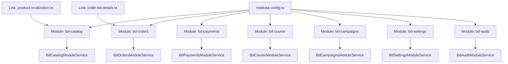
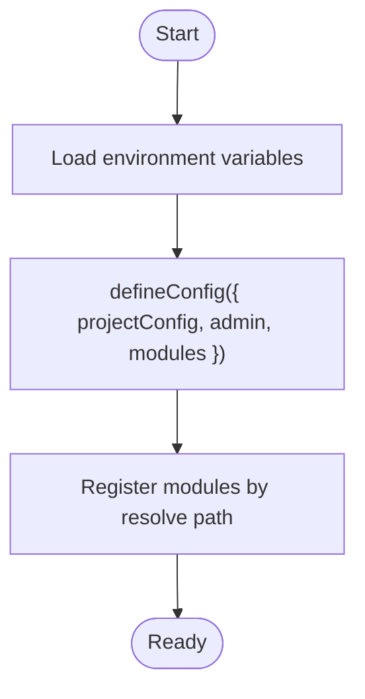
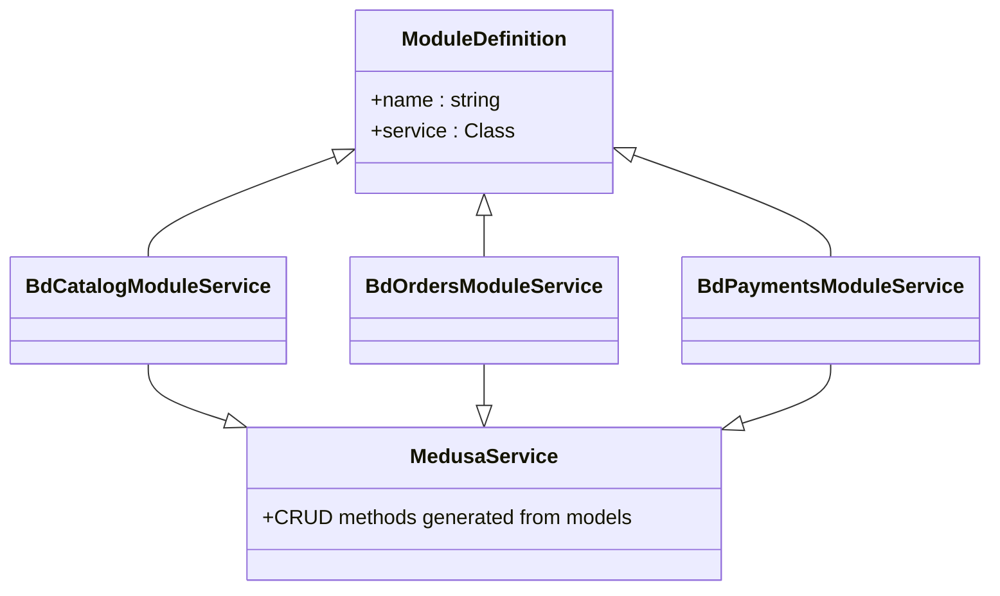
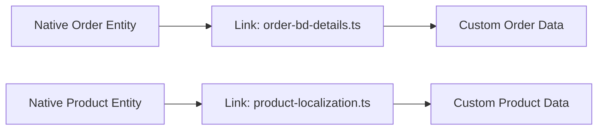
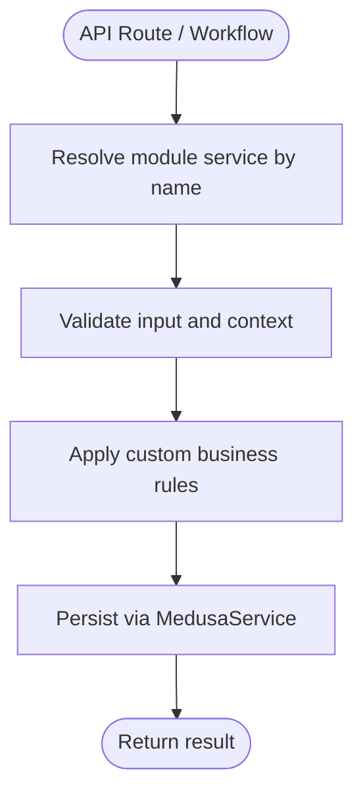
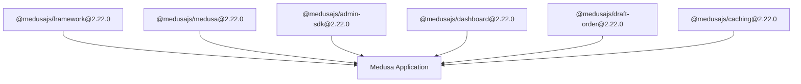

# Core Medusa Modules

<cite>
**Referenced Files in This Document**
- [medusa-config.ts](file://apps/medusa/medusa-config.ts)
- [package.json](file://apps/medusa/package.json)
- [modules README.md](file://apps/medusa/src/modules/README.md)
- [bd-catalog/index.ts](file://apps/medusa/src/modules/bd-catalog/index.ts)
- [bd-catalog/service.ts](file://apps/medusa/src/modules/bd-catalog/service.ts)
- [bd-orders/index.ts](file://apps/medusa/src/modules/bd-orders/index.ts)
- [bd-orders/service.ts](file://apps/medusa/src/modules/bd-orders/service.ts)
- [bd-payments/index.ts](file://apps/medusa/src/modules/bd-payments/index.ts)
- [bd-payments/service.ts](file://apps/medusa/src/modules/bd-payments/service.ts)
- [bd-courier/index.ts](file://apps/medusa/src/modules/bd-courier/index.ts)
- [bd-courier/service.ts](file://apps/medusa/src/modules/bd-courier/service.ts)
- [bd-campaigns/index.ts](file://apps/medusa/src/modules/bd-campaigns/index.ts)
- [bd-campaigns/service.ts](file://apps/medusa/src/modules/bd-campaigns/service.ts)
- [bd-settings/index.ts](file://apps/medusa/src/modules/bd-settings/index.ts)
- [bd-settings/service.ts](file://apps/medusa/src/modules/bd-settings/service.ts)
- [bd-audit/index.ts](file://apps/medusa/src/modules/bd-audit/index.ts)
- [bd-audit/service.ts](file://apps/medusa/src/modules/bd-audit/service.ts)
- [order-bd-details.ts](file://apps/medusa/src/links/order-bd-details.ts)
- [product-localization.ts](file://apps/medusa/src/links/product-localization.ts)
</cite>

## Table of Contents
1. [Introduction](#introduction)
2. [Project Structure](#project-structure)
3. [Core Components](#core-components)
4. [Architecture Overview](#architecture-overview)
5. [Detailed Component Analysis](#detailed-component-analysis)
6. [Dependency Analysis](#dependency-analysis)
7. [Performance Considerations](#performance-considerations)
8. [Troubleshooting Guide](#troubleshooting-guide)
9. [Conclusion](#conclusion)
10. [Appendices](#appendices)

## Introduction
This document explains the core Medusa modules that provide foundational commerce functionality in this project, focusing on how native Medusa modules (such as product, order, and payment capabilities) are integrated and extended through custom modules. It covers module registration in medusa-config.ts, dependency injection patterns, service resolution mechanisms, and best practices for extending core modules while maintaining separation of concerns. It also addresses module versioning, compatibility considerations, and upgrade paths for core dependencies.

## Project Structure
The Medusa application is organized with:
- A configuration file that registers all modules and sets runtime options.
- Custom modules under src/modules, each exposing a service and models.
- Links to integrate custom entities with native Medusa entities.
- Package definitions pinning Medusa framework versions.



**Diagram sources**
- [medusa-config.ts:22-44](file://apps/medusa/medusa-config.ts#L22-L44)
- [bd-catalog/index.ts:4-8](file://apps/medusa/src/modules/bd-catalog/index.ts#L4-L8)
- [bd-orders/index.ts:4-8](file://apps/medusa/src/modules/bd-orders/index.ts#L4-L8)
- [bd-payments/index.ts:4-8](file://apps/medusa/src/modules/bd-payments/index.ts#L4-L8)
- [bd-courier/index.ts:4-8](file://apps/medusa/src/modules/bd-courier/index.ts#L4-L8)
- [bd-campaigns/index.ts:4-8](file://apps/medusa/src/modules/bd-campaigns/index.ts#L4-L8)
- [bd-settings/index.ts:4-8](file://apps/medusa/src/modules/bd-settings/index.ts#L4-L8)
- [bd-audit/index.ts:4-8](file://apps/medusa/src/modules/bd-audit/index.ts#L4-L8)
- [order-bd-details.ts](file://apps/medusa/src/links/order-bd-details.ts)
- [product-localization.ts](file://apps/medusa/src/links/product-localization.ts)

**Section sources**
- [medusa-config.ts:1-46](file://apps/medusa/medusa-config.ts#L1-L46)
- [package.json:25-39](file://apps/medusa/package.json#L25-L39)

## Core Components
This section outlines the custom modules that extend or complement native Medusa commerce capabilities:
- bd-catalog: Extends product catalog data with localization and variant cost attributes.
- bd-orders: Adds order details, customer risk profiles, and return requests.
- bd-payments: Tracks payment transactions and webhook logs.
- bd-courier: Logs shipment events and courier webhooks.
- bd-campaigns: Manages landing pages for campaigns.
- bd-settings: Stores delivery zone and VAT configurations.
- bd-audit: Records audit logs and staff role permissions.

Each module follows a consistent pattern:
- index.ts exports a module name constant and registers the module with its service.
- service.ts defines a service class extending MedusaService with associated models.

```mermaid
classDiagram
class BdCatalogModuleService {
+models : "ProductLocalization, ProductVariantCost, CategoryAttribute, ProductAttributeValue"
}
class BdOrdersModuleService {
+models : "OrderBdDetails, CustomerRiskProfile, OrderReturnRequest"
}
class BdPaymentsModuleService {
+models : "PaymentTransaction, PaymentWebhookLog"
}
class BdCourierModuleService {
+models : "CourierShipmentLog, CourierWebhookLog"
}
class BdCampaignsModuleService {
+models : "LandingPage"
}
class BdSettingsModuleService {
+models : "DeliveryZoneConfig, VatConfig"
}
class BdAuditModuleService {
+models : "AuditLog, StaffRolePermission"
}
```



**Diagram sources**
- [bd-catalog/service.ts:7-12](file://apps/medusa/src/modules/bd-catalog/service.ts#L7-L12)
- [bd-orders/service.ts:6-10](file://apps/medusa/src/modules/bd-orders/service.ts#L6-L10)
- [bd-payments/service.ts:5-8](file://apps/medusa/src/modules/bd-payments/service.ts#L5-L8)
- [bd-courier/service.ts:5-8](file://apps/medusa/src/modules/bd-courier/service.ts#L5-L8)
- [bd-campaigns/service.ts:4-6](file://apps/medusa/src/modules/bd-campaigns/service.ts#L4-L6)
- [bd-settings/service.ts:5-8](file://apps/medusa/src/modules/bd-settings/service.ts#L5-L8)
- [bd-audit/service.ts:5-8](file://apps/medusa/src/modules/bd-audit/service.ts#L5-L8)

**Section sources**
- [bd-catalog/index.ts:1-9](file://apps/medusa/src/modules/bd-catalog/index.ts#L1-L9)
- [bd-catalog/service.ts:1-15](file://apps/medusa/src/modules/bd-catalog/service.ts#L1-L15)
- [bd-orders/index.ts:1-9](file://apps/medusa/src/modules/bd-orders/index.ts#L1-L9)
- [bd-orders/service.ts:1-13](file://apps/medusa/src/modules/bd-orders/service.ts#L1-L13)
- [bd-payments/index.ts:1-9](file://apps/medusa/src/modules/bd-payments/index.ts#L1-L9)
- [bd-payments/service.ts:1-11](file://apps/medusa/src/modules/bd-payments/service.ts#L1-L11)
- [bd-courier/index.ts:1-9](file://apps/medusa/src/modules/bd-courier/index.ts#L1-L9)
- [bd-courier/service.ts:1-11](file://apps/medusa/src/modules/bd-courier/service.ts#L1-L11)
- [bd-campaigns/index.ts:1-9](file://apps/medusa/src/modules/bd-campaigns/index.ts#L1-L9)
- [bd-campaigns/service.ts:1-9](file://apps/medusa/src/modules/bd-campaigns/service.ts#L1-L9)
- [bd-settings/index.ts:1-9](file://apps/medusa/src/modules/bd-settings/index.ts#L1-L9)
- [bd-settings/service.ts:1-11](file://apps/medusa/src/modules/bd-settings/service.ts#L1-L11)
- [bd-audit/index.ts:1-9](file://apps/medusa/src/modules/bd-audit/index.ts#L1-L9)
- [bd-audit/service.ts:1-11](file://apps/medusa/src/modules/bd-audit/service.ts#L1-L11)

## Architecture Overview
At runtime, Medusa loads the configuration, resolves each module path, instantiates services via dependency injection, and exposes them for use across routes, workflows, and links. Custom links connect module entities to native Medusa entities (e.g., orders and products).

```mermaid
sequenceDiagram
participant App as "Medusa App"
participant Config as "medusa-config.ts"
participant Registry as "Module Registry"
participant DI as "Dependency Injector"
participant Service as "Module Services"
participant Links as "Links"
App->>Config : Load defineConfig()
Config-->>Registry : modules array
Registry->>DI : Register modules by resolve path
DI->>Service : Instantiate services (MedusaService subclasses)
Links->>Service : Resolve services to link entities
Service-->>App : Exposed via request scope
```

**Diagram sources**
- [medusa-config.ts:7-45](file://apps/medusa/medusa-config.ts#L7-L45)
- [modules README.md:44-76](file://apps/medusa/src/modules/README.md#L44-L76)
- [order-bd-details.ts](file://apps/medusa/src/links/order-bd-details.ts)
- [product-localization.ts](file://apps/medusa/src/links/product-localization.ts)

## Detailed Component Analysis

### Module Registration and Configuration
- medusa-config.ts uses defineConfig to set project-level settings (databaseUrl, redisUrl, CORS, JWT/cookie secrets).
- The modules array registers each custom module by relative path.
- Environment variables are loaded from both the app root and the medusa app directory.



**Diagram sources**
- [medusa-config.ts:1-18](file://apps/medusa/medusa-config.ts#L1-L18)
- [medusa-config.ts:22-44](file://apps/medusa/medusa-config.ts#L22-L44)

**Section sources**
- [medusa-config.ts:1-46](file://apps/medusa/medusa-config.ts#L1-L46)

### Dependency Injection and Service Resolution
- Each module exports a module name constant and a default Module definition binding the service.
- Services extend MedusaService and declare their models, enabling automatic CRUD operations and ORM integration.
- To use a module’s service elsewhere, resolve it via the module name constant using the request scope.



**Diagram sources**
- [bd-catalog/index.ts:4-8](file://apps/medusa/src/modules/bd-catalog/index.ts#L4-L8)
- [bd-orders/index.ts:4-8](file://apps/medusa/src/modules/bd-orders/index.ts#L4-L8)
- [bd-payments/index.ts:4-8](file://apps/medusa/src/modules/bd-payments/index.ts#L4-L8)
- [bd-catalog/service.ts:7-12](file://apps/medusa/src/modules/bd-catalog/service.ts#L7-L12)
- [bd-orders/service.ts:6-10](file://apps/medusa/src/modules/bd-orders/service.ts#L6-L10)
- [bd-payments/service.ts:5-8](file://apps/medusa/src/modules/bd-payments/service.ts#L5-L8)

**Section sources**
- [modules README.md:44-118](file://apps/medusa/src/modules/README.md#L44-L118)
- [bd-catalog/index.ts:1-9](file://apps/medusa/src/modules/bd-catalog/index.ts#L1-L9)
- [bd-orders/index.ts:1-9](file://apps/medusa/src/modules/bd-orders/index.ts#L1-L9)
- [bd-payments/index.ts:1-9](file://apps/medusa/src/modules/bd-payments/index.ts#L1-L9)

### Integration Patterns with Native Medusa Modules
- Links connect custom entities to native Medusa entities:
  - order-bd-details.ts links order-related custom data to the native order entity.
  - product-localization.ts links product localization data to the native product entity.
- These links allow querying and mutating related data seamlessly within Medusa’s ORM layer.



**Diagram sources**
- [order-bd-details.ts](file://apps/medusa/src/links/order-bd-details.ts)
- [product-localization.ts](file://apps/medusa/src/links/product-localization.ts)

**Section sources**
- [order-bd-details.ts](file://apps/medusa/src/links/order-bd-details.ts)
- [product-localization.ts](file://apps/medusa/src/links/product-localization.ts)

### Extending Core Modules with Custom Business Logic
- Keep business logic inside module services rather than modifying native modules.
- Use links to relate custom entities to native ones without altering core schemas.
- Expose new capabilities via API routes or workflows that resolve module services by name.



[No sources needed since this diagram shows conceptual workflow, not actual code structure]

## Dependency Analysis
The application depends on Medusa framework packages pinned at specific versions, ensuring consistency across components.



**Diagram sources**
- [package.json:25-39](file://apps/medusa/package.json#L25-L39)

**Section sources**
- [package.json:25-39](file://apps/medusa/package.json#L25-L39)

## Performance Considerations
- Prefer batched queries through MedusaService to reduce database round-trips.
- Cache expensive computations where appropriate using @medusajs/caching.
- Avoid heavy synchronous operations in request handlers; offload to background jobs when possible.
- Use indexes on frequently queried fields in custom models to improve performance.

[No sources needed since this section provides general guidance]

## Troubleshooting Guide
Common issues and resolutions:
- Module not found: Ensure the resolve path in medusa-config.ts matches the module directory.
- Service resolution errors: Verify the module name constant matches what you resolve in your code.
- Migration failures: Regenerate migrations after adding or changing models, then run db:migrate.
- CORS issues: Adjust storeCors, adminCors, and authCors in projectConfig.http to match frontend origins.

**Section sources**
- [medusa-config.ts:8-17](file://apps/medusa/medusa-config.ts#L8-L17)
- [modules README.md:78-90](file://apps/medusa/src/modules/README.md#L78-L90)

## Conclusion
This project extends Medusa’s native commerce capabilities through well-structured custom modules. By registering modules in medusa-config.ts, leveraging dependency injection, and using links to integrate with native entities, the system maintains clear separation of concerns and scalability. Version pinning ensures predictable upgrades, while following the documented patterns helps maintain stability during evolution.

[No sources needed since this section summarizes without analyzing specific files]

## Appendices

### Module Versioning and Upgrade Paths
- All Medusa packages are pinned to version 2.22.0, which simplifies compatibility checks and reduces upgrade friction.
- When upgrading:
  - Update package versions together to avoid mismatches.
  - Review changelogs for breaking changes in framework APIs.
  - Regenerate migrations if model schemas change.
  - Run tests to validate behavior across modules.

**Section sources**
- [package.json:25-39](file://apps/medusa/package.json#L25-L39)