# Workflow Engine Architecture

<cite>
**Referenced Files in This Document**
- [README.md](file://apps/medusa/src/workflows/README.md)
- [architecture.md](file://docs/architecture.md)
- [technical-plan.md](file://technical-plan.md)
- [agent.md](file://agent.md)
- [database.md](file://database.md)
- [service.ts](file://apps/medusa/src/modules/bd-orders/service.ts)
- [order-bd-details.ts](file://apps/medusa/src/modules/bd-orders/models/order-bd-details.ts)
- [service.ts](file://apps/medusa/src/modules/bd-payments/service.ts)
- [payment-transaction.ts](file://apps/medusa/src/modules/bd-payments/models/payment-transaction.ts)
- [service.ts](file://apps/medusa/src/modules/bd-courier/service.ts)
- [courier-shipment-log.ts](file://apps/medusa/src/modules/bd-courier/models/courier-shipment-log.ts)
- [service.ts](file://apps/medusa/src/modules/bd-audit/service.ts)
</cite>

## Table of Contents
1. [Introduction](#introduction)
2. [Project Structure](#project-structure)
3. [Core Components](#core-components)
4. [Architecture Overview](#architecture-overview)
5. [Detailed Component Analysis](#detailed-component-analysis)
6. [Dependency Analysis](#dependency-analysis)
7. [Performance Considerations](#performance-considerations)
8. [Troubleshooting Guide](#troubleshooting-guide)
9. [Conclusion](#conclusion)
10. [Appendices](#appendices)

## Introduction
This document explains the workflow engine that orchestrates complex business processes across Medusa core modules and Bangladesh custom modules. It covers workflow composition patterns, step definitions, error handling, transaction management, execution model, state management, retry mechanisms, monitoring, and testing strategies. It also maps how workflows coordinate order lifecycle events such as order placement, COD confirmation, courier dispatch, and return-refund processing.

The system is designed around Medusa v2 Workflows, where multi-step mutations are executed as ordered, idempotent steps with explicit compensation logic. External actions like SMS or courier calls are treated carefully: they are either final non-compensatable operations after database commit, or they are wrapped with idempotency and audit logging so failures do not corrupt core commerce state.

**Section sources**
- [README.md:1-82](file://apps/medusa/src/workflows/README.md#L1-L82)
- [architecture.md:66-74](file://docs/architecture.md#L66-L74)
- [technical-plan.md:59-112](file://technical-plan.md#L59-L112)

## Project Structure
The workflow-related code lives under `apps/medusa/src/workflows`. The repository currently exposes a README describing how to define steps, compose workflows, and execute them from API routes, jobs, or subscribers. Bangladesh-specific domain logic is implemented in custom modules under `apps/medusa/src/modules`, including orders, payments, courier, audit, campaigns, catalog, and settings.

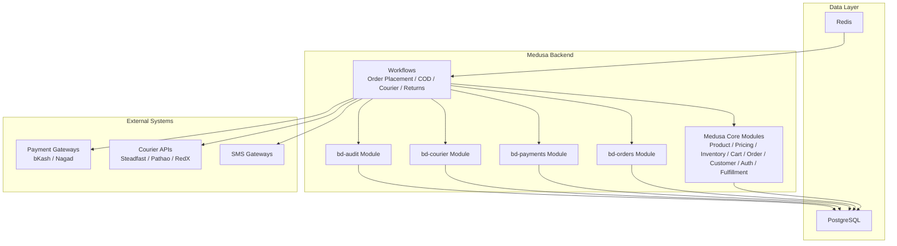

**Diagram sources**
- [technical-plan.md:59-112](file://technical-plan.md#L59-L112)
- [architecture.md:98-124](file://docs/architecture.md#L98-L124)

**Section sources**
- [README.md:1-82](file://apps/medusa/src/workflows/README.md#L1-L82)
- [agent.md:149-177](file://agent.md#L149-L177)
- [technical-plan.md:59-112](file://technical-plan.md#L59-L112)

## Core Components
The workflow engine relies on these core components:

- Workflow definition and execution primitives provided by Medusa Workflows SDK.
- Bangladesh custom modules exposing services for orders, payments, courier, and audit.
- PostgreSQL for durable state and Redis for queues, pub/sub, locking, and caching.
- External integrations for payment gateways, courier APIs, and SMS gateways.

Key responsibilities:
- Workflows orchestrate cross-module state changes using ordered steps.
- Custom modules encapsulate Bangladesh-specific data models and services.
- Audit module records operational decisions and webhook events.
- Payment and courier modules persist provider interactions and outcomes.

**Section sources**
- [README.md:1-82](file://apps/medusa/src/workflows/README.md#L1-L82)
- [service.ts:1-13](file://apps/medusa/src/modules/bd-orders/service.ts#L1-L13)
- [service.ts:1-11](file://apps/medusa/src/modules/bd-payments/service.ts#L1-L11)
- [service.ts:1-11](file://apps/medusa/src/modules/bd-courier/service.ts#L1-L11)
- [service.ts:1-11](file://apps/medusa/src/modules/bd-audit/service.ts#L1-L11)

## Architecture Overview
At a high level, the workflow engine sits between HTTP endpoints (store/admin/hooks), Medusa core modules, and Bangladesh custom modules. Workflows read configuration and context, mutate core and custom tables through Medusa services, call external providers, and emit observable events.

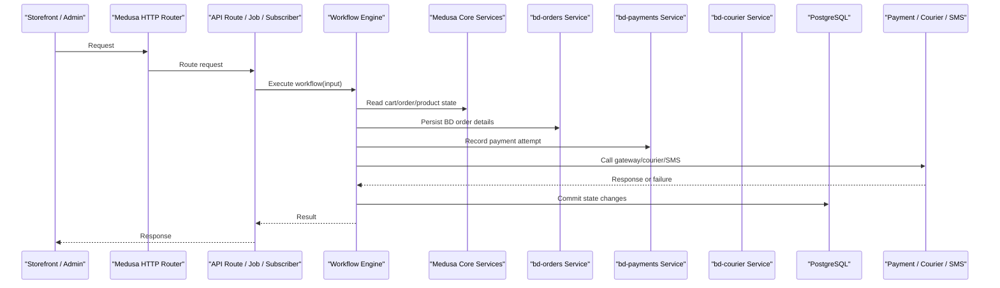

**Diagram sources**
- [technical-plan.md:59-112](file://technical-plan.md#L59-L112)
- [architecture.md:98-124](file://docs/architecture.md#L98-L124)

## Detailed Component Analysis

### Workflow Composition Patterns
Workflows are composed of steps created with the Medusa Workflows SDK. Each step performs an atomic operation and returns a step response. A workflow composes multiple steps into a single transactional unit. Steps can be synchronous or asynchronous, and the engine executes them in order.

Patterns used:
- Step decomposition: split large operations into small, testable steps.
- Input/output typing: strongly type workflow inputs and outputs.
- Execution from handlers: run workflows from API routes, scheduled jobs, or event subscribers.

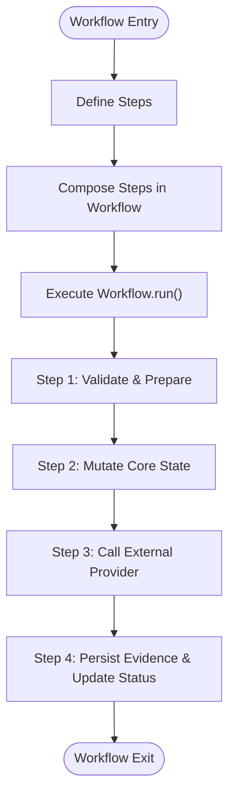

**Diagram sources**
- [README.md:11-53](file://apps/medusa/src/workflows/README.md#L11-L53)

**Section sources**
- [README.md:1-82](file://apps/medusa/src/workflows/README.md#L1-L82)

### Step Definitions and Data Models
Bangladesh custom modules expose services backed by Medusa models. These models represent the additional state required for local operations:

- bd-orders: tracks delivery zones, COD status, shipment state, courier identifiers, and analytics fields.
- bd-payments: records provider transactions, verification flags, and gateway responses.
- bd-courier: logs shipment requests, responses, and errors.
- bd-audit: captures audit trails and staff permissions.

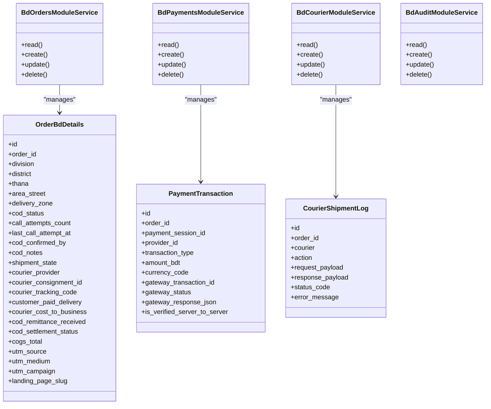

**Diagram sources**
- [service.ts:1-13](file://apps/medusa/src/modules/bd-orders/service.ts#L1-L13)
- [order-bd-details.ts:1-42](file://apps/medusa/src/modules/bd-orders/models/order-bd-details.ts#L1-L42)
- [service.ts:1-11](file://apps/medusa/src/modules/bd-payments/service.ts#L1-L11)
- [payment-transaction.ts:1-18](file://apps/medusa/src/modules/bd-payments/models/payment-transaction.ts#L1-L18)
- [service.ts:1-11](file://apps/medusa/src/modules/bd-courier/service.ts#L1-L11)
- [courier-shipment-log.ts:1-15](file://apps/medusa/src/modules/bd-courier/models/courier-shipment-log.ts#L1-L15)

**Section sources**
- [order-bd-details.ts:1-42](file://apps/medusa/src/modules/bd-orders/models/order-bd-details.ts#L1-L42)
- [payment-transaction.ts:1-18](file://apps/medusa/src/modules/bd-payments/models/payment-transaction.ts#L1-L18)
- [courier-shipment-log.ts:1-15](file://apps/medusa/src/modules/bd-courier/models/courier-shipment-log.ts#L1-L15)
- [service.ts:1-13](file://apps/medusa/src/modules/bd-orders/service.ts#L1-L13)
- [service.ts:1-11](file://apps/medusa/src/modules/bd-payments/service.ts#L1-L11)
- [service.ts:1-11](file://apps/medusa/src/modules/bd-courier/service.ts#L1-L11)
- [service.ts:1-11](file://apps/medusa/src/modules/bd-audit/service.ts#L1-L11)

### Error Handling Strategies
Error handling follows strict principles:
- Idempotent steps: repeated execution does not create inconsistent state.
- Evidence rows: every cross-module mutation records evidence (payment attempts, courier events, webhook logs, audit entries).
- Compensation logic: cancel fulfillment on booking failure; void refund ledger on provider failure; release reservation on COD expiry; reopen return review if native return creation fails.
- No distributed locks across modules: use Medusa’s locking module for workflow-level exclusion.
- Non-compensatable final steps: SMS dispatch occurs only after successful database commit; gateway timeouts are retried without rolling back core state.

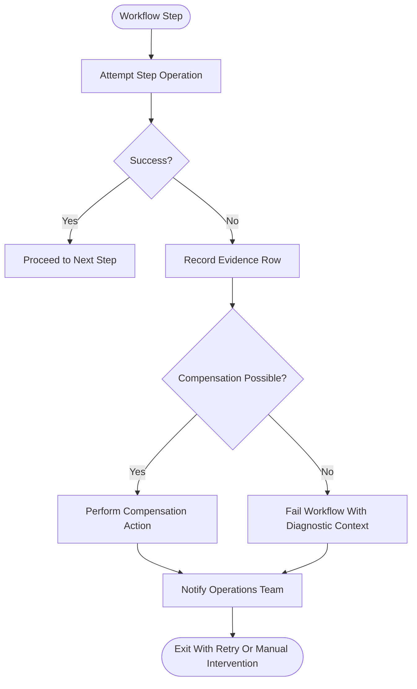

**Diagram sources**
- [database.md:2148-2157](file://database.md#L2148-L2157)
- [architecture.md:66-74](file://docs/architecture.md#L66-L74)

**Section sources**
- [database.md:2148-2157](file://database.md#L2148-L2157)
- [architecture.md:66-74](file://docs/architecture.md#L66-L74)

### Transaction Management
Multi-module writes are not one physical transaction. The workflow engine ensures consistency through:
- Ordered step execution.
- Idempotency keys for external calls.
- Explicit compensation per workflow.
- Writing status through Medusa module services to fire module events.
- Using Redis for workflow queues, pub/sub, rate limiting, and locking.

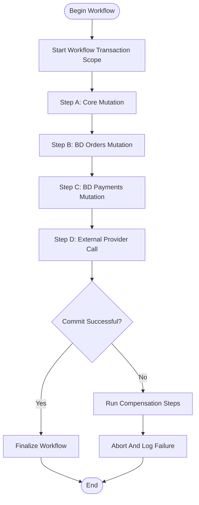

**Diagram sources**
- [database.md:2148-2157](file://database.md#L2148-L2157)
- [technical-plan.md:59-112](file://technical-plan.md#L59-L112)

**Section sources**
- [database.md:2148-2157](file://database.md#L2148-L2157)
- [technical-plan.md:59-112](file://technical-plan.md#L59-L112)

### Workflow Execution Model and State Management
Execution model:
- Workflows are defined in TypeScript files under `src/workflows`.
- They are executed from API routes, scheduled jobs, or subscribers via `workflow.run({ input })`.
- Steps should be deterministic and idempotent.

State management:
- Core commerce state resides in Medusa core modules.
- Bangladesh-specific state is stored in custom module models.
- Shipment and COD states are tracked explicitly in `order_bd_details`.
- Payment verification and provider responses are recorded in `payment_transaction`.
- Courier interactions are logged in `courier_shipment_log`.

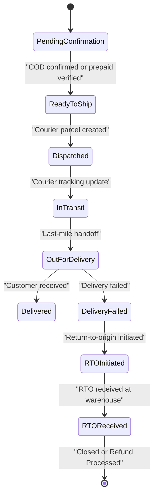

**Diagram sources**
- [order-bd-details.ts:16-26](file://apps/medusa/src/modules/bd-orders/models/order-bd-details.ts#L16-L26)

**Section sources**
- [README.md:55-82](file://apps/medusa/src/workflows/README.md#L55-L82)
- [order-bd-details.ts:1-42](file://apps/medusa/src/modules/bd-orders/models/order-bd-details.ts#L1-L42)

### Retry Mechanisms
Retries apply to:
- External provider calls (payment gateways, courier APIs, SMS gateways).
- Idempotency keys prevent duplicate charges or shipments.
- Failed SMS dispatches are retried without rolling back order state.
- Workflow-level retries rely on Medusa’s queueing and locking infrastructure.

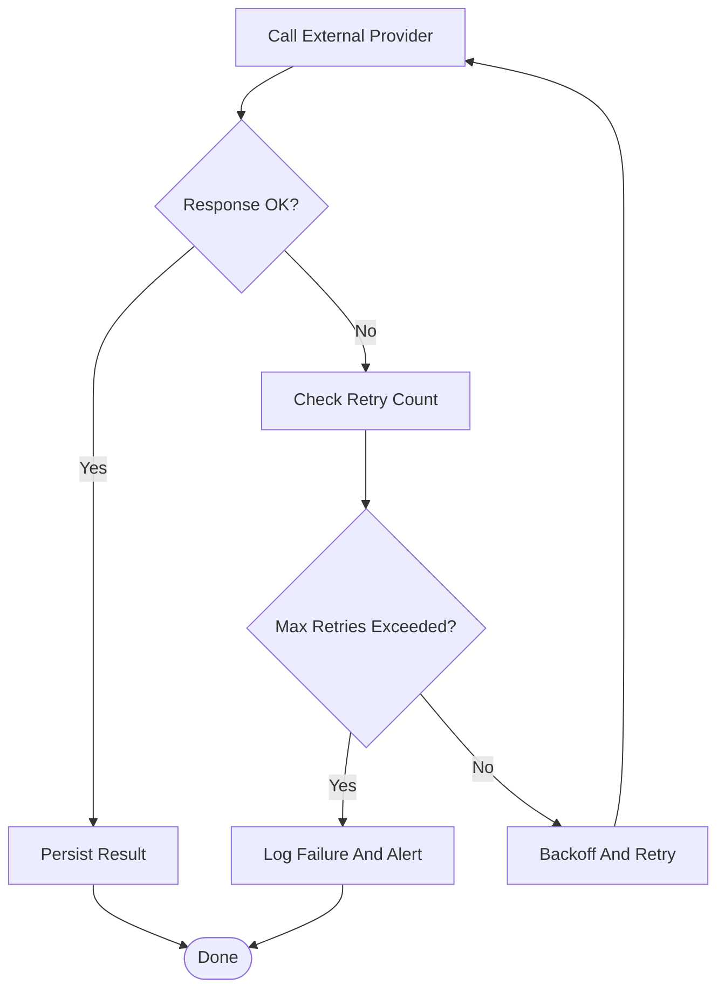

**Diagram sources**
- [database.md:2148-2157](file://database.md#L2148-L2157)
- [architecture.md:545-549](file://docs/architecture.md#L545-L549)

**Section sources**
- [database.md:2148-2157](file://database.md#L2148-L2157)
- [architecture.md:545-549](file://docs/architecture.md#L545-L549)

### Monitoring Approaches
Monitoring focuses on observability and auditability:
- Audit logs capture administrative actions and critical decisions.
- Payment and courier logs record provider interactions and payloads.
- Webhook logs capture incoming callbacks for traceability.
- Workflow execution metrics should be emitted to central observability systems.

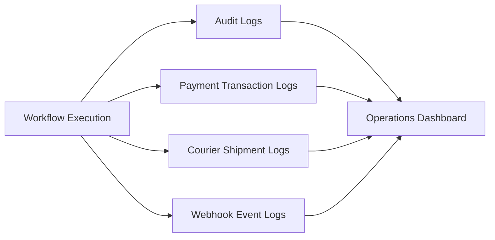

**Diagram sources**
- [service.ts:1-11](file://apps/medusa/src/modules/bd-audit/service.ts#L1-L11)
- [payment-transaction.ts:1-18](file://apps/medusa/src/modules/bd-payments/models/payment-transaction.ts#L1-L18)
- [courier-shipment-log.ts:1-15](file://apps/medusa/src/modules/bd-courier/models/courier-shipment-log.ts#L1-L15)

**Section sources**
- [service.ts:1-11](file://apps/medusa/src/modules/bd-audit/service.ts#L1-L11)
- [payment-transaction.ts:1-18](file://apps/medusa/src/modules/bd-payments/models/payment-transaction.ts#L1-L18)
- [courier-shipment-log.ts:1-15](file://apps/medusa/src/modules/bd-courier/models/courier-shipment-log.ts#L1-L15)

### Common Workflows

#### Order Placement Workflow
Purpose: Create order, validate pricing and inventory, persist BD order details, and prepare for payment or COD confirmation.

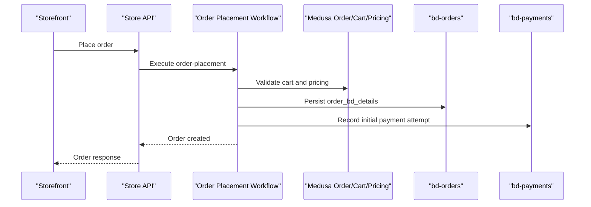

**Diagram sources**
- [technical-plan.md:83-91](file://technical-plan.md#L83-L91)
- [order-bd-details.ts:1-42](file://apps/medusa/src/modules/bd-orders/models/order-bd-details.ts#L1-L42)
- [payment-transaction.ts:1-18](file://apps/medusa/src/modules/bd-payments/models/payment-transaction.ts#L1-L18)

**Section sources**
- [technical-plan.md:83-91](file://technical-plan.md#L83-L91)
- [order-bd-details.ts:1-42](file://apps/medusa/src/modules/bd-orders/models/order-bd-details.ts#L1-L42)
- [payment-transaction.ts:1-18](file://apps/medusa/src/modules/bd-payments/models/payment-transaction.ts#L1-L18)

#### COD Confirmation Workflow
Purpose: Confirm cash-on-delivery orders through call-center or automated confirmation, updating COD status and call attempt metadata.

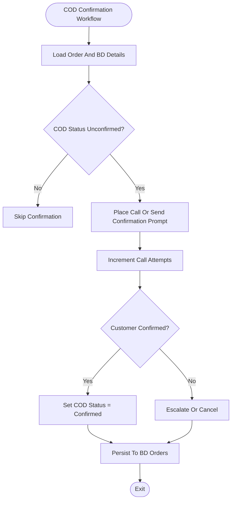

**Diagram sources**
- [order-bd-details.ts:11-15](file://apps/medusa/src/modules/bd-orders/models/order-bd-details.ts#L11-L15)

**Section sources**
- [order-bd-details.ts:1-42](file://apps/medusa/src/modules/bd-orders/models/order-bd-details.ts#L1-L42)

#### Courier Dispatch Workflow
Purpose: Select courier adapter, format address, create parcel, persist consignment and tracking, update shipment state, and send dispatched SMS.

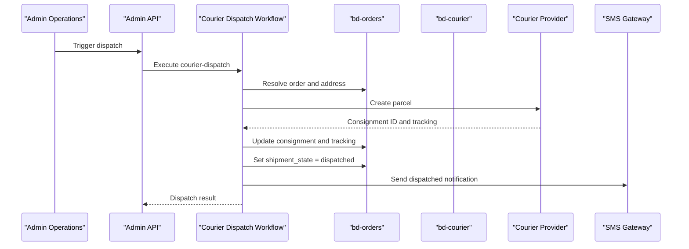

**Diagram sources**
- [architecture.md:717-724](file://docs/architecture.md#L717-L724)
- [order-bd-details.ts:16-29](file://apps/medusa/src/modules/bd-orders/models/order-bd-details.ts#L16-L29)
- [courier-shipment-log.ts:1-15](file://apps/medusa/src/modules/bd-courier/models/courier-shipment-log.ts#L1-L15)

**Section sources**
- [architecture.md:717-724](file://docs/architecture.md#L717-L724)
- [order-bd-details.ts:16-29](file://apps/medusa/src/modules/bd-orders/models/order-bd-details.ts#L16-L29)
- [courier-shipment-log.ts:1-15](file://apps/medusa/src/modules/bd-courier/models/courier-shipment-log.ts#L1-L15)

#### Return-Refund Workflow
Purpose: Handle manual return/refund processes with strict human approvals and condition inspections.

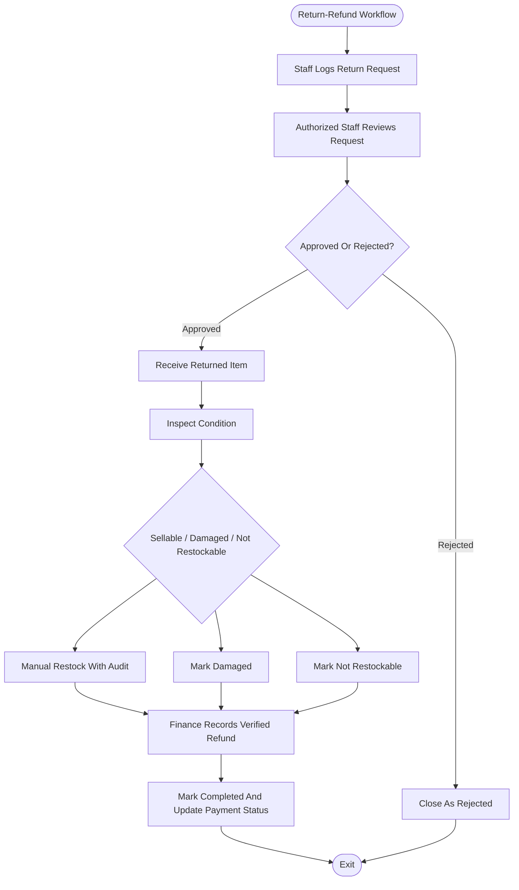

**Diagram sources**
- [architecture.md:725-734](file://docs/architecture.md#L725-L734)
- [prd.md:236-242](file://prd.md#L236-L242)

**Section sources**
- [architecture.md:725-734](file://docs/architecture.md#L725-L734)
- [prd.md:236-242](file://prd.md#L236-L242)

## Dependency Analysis
Workflows depend on:
- Medusa core modules for product, pricing, inventory, cart, order, customer, auth, and fulfillment.
- Bangladesh custom modules for localized order details, payment transactions, courier logs, and audit trails.
- Redis for workflow queues, pub/sub, locking, and caching.
- External providers for payments, couriers, and SMS.

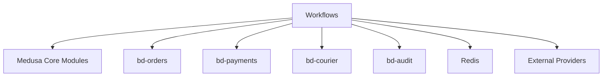

**Diagram sources**
- [technical-plan.md:59-112](file://technical-plan.md#L59-L112)
- [architecture.md:98-124](file://docs/architecture.md#L98-L124)

**Section sources**
- [technical-plan.md:59-112](file://technical-plan.md#L59-L112)
- [architecture.md:98-124](file://docs/architecture.md#L98-L124)

## Performance Considerations
- Keep steps small and idempotent to minimize rollback complexity.
- Use Redis queues for background execution of long-running steps.
- Avoid synchronous external calls inside critical path steps; prefer async steps with retries.
- Batch updates where possible and avoid unnecessary reads.
- Monitor workflow duration and failure rates; alert on anomalies.
- Cache static configuration (e.g., courier fees, VAT rules) in Redis when appropriate.

[No sources needed since this section provides general guidance]

## Troubleshooting Guide
Common issues and resolutions:
- Workflow step failure: check evidence rows in payment, courier, and audit logs; verify idempotency keys; inspect compensation actions.
- COD not confirming: verify call attempt counters and last attempt timestamps; ensure status transitions are correct.
- Courier booking failure: inspect courier shipment logs for request/response payloads and error messages; retry with backoff.
- SMS not delivered: confirm SMS was triggered as final step; check retry queue and gateway logs.

Operational checks:
- Ensure workflow locking is configured to prevent concurrent mutations.
- Verify that all status writes go through Medusa services to trigger events.
- Validate that outbound integrations tolerate duplicates due to at-least-once semantics.

**Section sources**
- [database.md:2148-2157](file://database.md#L2148-L2157)
- [order-bd-details.ts:11-29](file://apps/medusa/src/modules/bd-orders/models/order-bd-details.ts#L11-L29)
- [payment-transaction.ts:1-18](file://apps/medusa/src/modules/bd-payments/models/payment-transaction.ts#L1-L18)
- [courier-shipment-log.ts:1-15](file://apps/medusa/src/modules/bd-courier/models/courier-shipment-log.ts#L1-L15)

## Conclusion
The workflow engine coordinates complex order lifecycle events by composing idempotent steps across Medusa core modules and Bangladesh custom modules. It enforces strong transactional guarantees through ordered execution, evidence logging, and explicit compensation. External integrations are handled with retries and idempotency, while SMS remains a final non-compensatable step after database commitment. The architecture supports reliable COD confirmation, courier dispatch, and manual return-refund processes, with robust monitoring and troubleshooting pathways.

[No sources needed since this section summarizes without analyzing specific files]

## Appendices

### Workflow Testing Strategies
- Unit-test each step independently with mocked services and providers.
- Integration-test workflows against a test database and mock external APIs.
- Use idempotency assertions to ensure repeated executions produce consistent results.
- Simulate provider failures to validate compensation and retry behavior.
- Validate state transitions against expected order and shipment states.

[No sources needed since this section provides general guidance]

### Debugging Techniques
- Enable detailed workflow logs for step entry, exit, and errors.
- Correlate workflow runs with audit log entries and webhook events.
- Inspect Redis queues for stuck or failed jobs.
- Use order and payment IDs to trace full lifecycle across modules.

[No sources needed since this section provides general guidance]