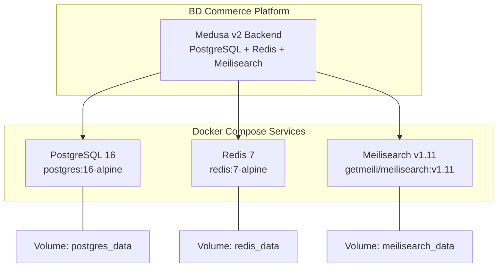
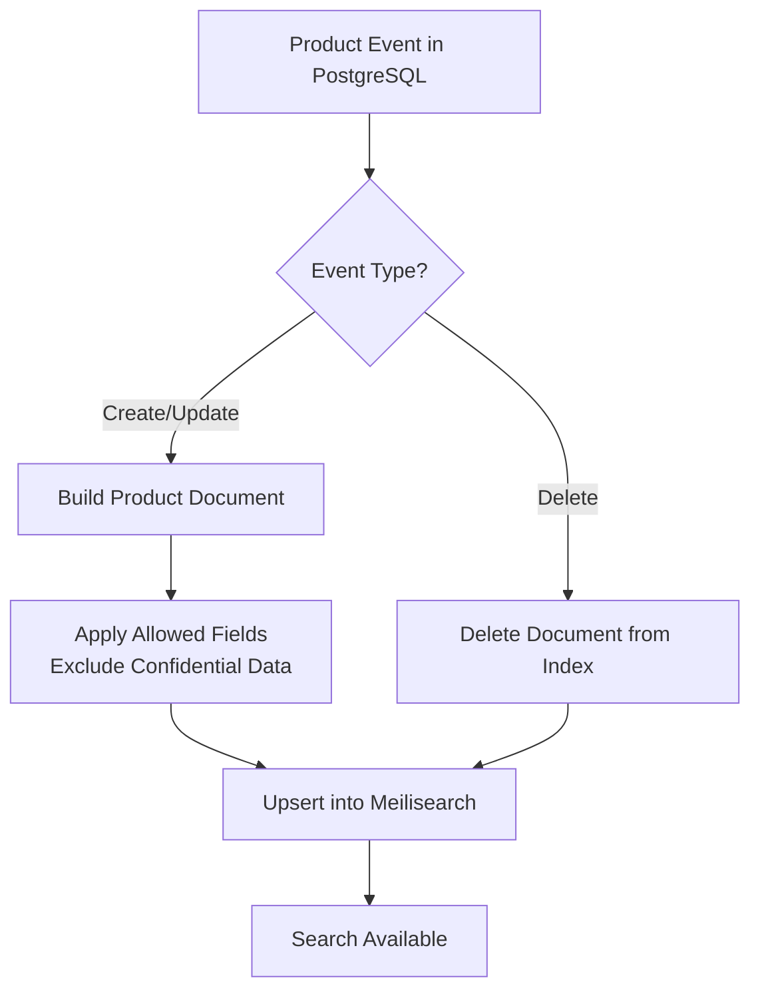
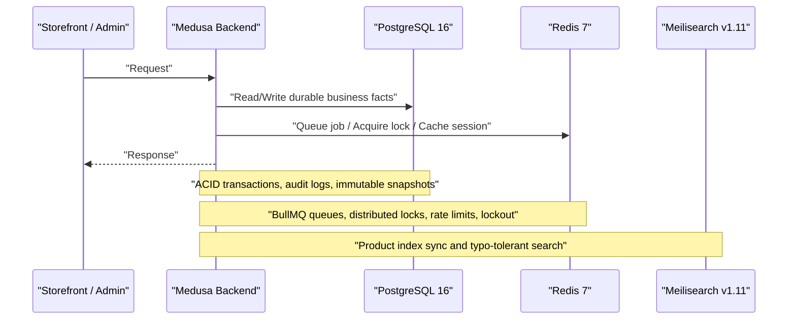
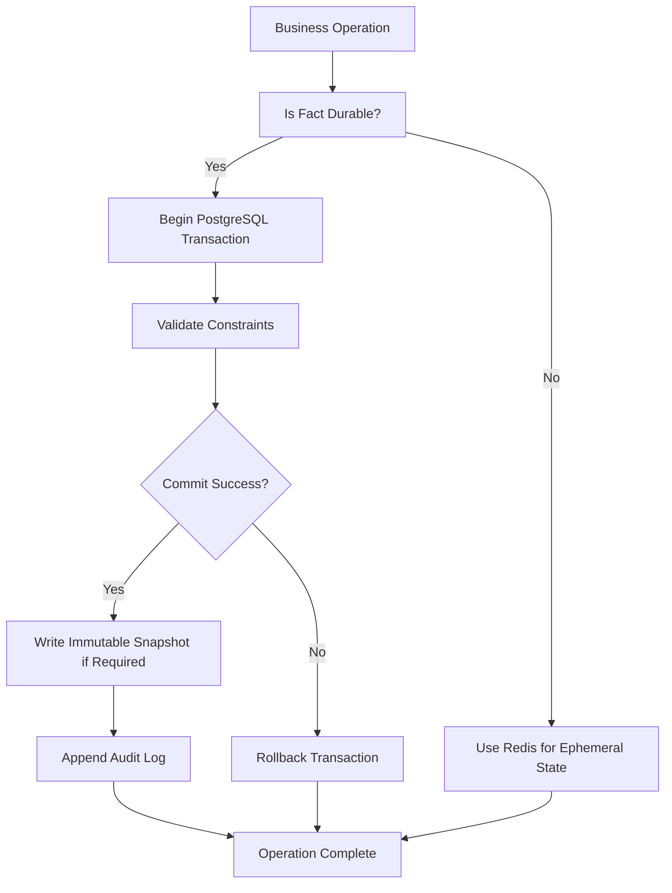
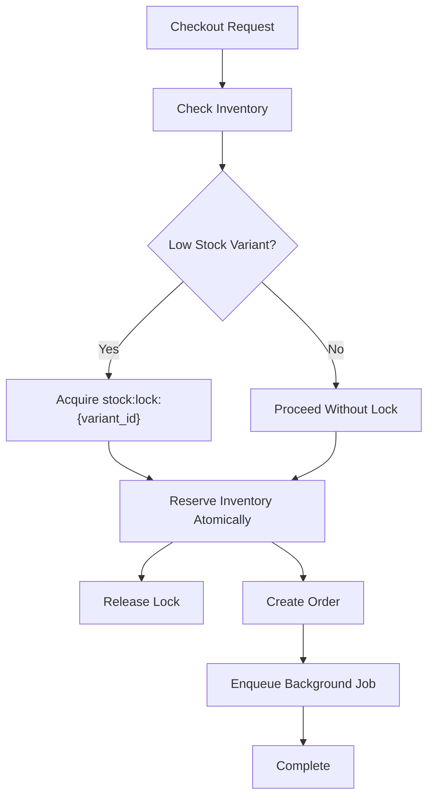
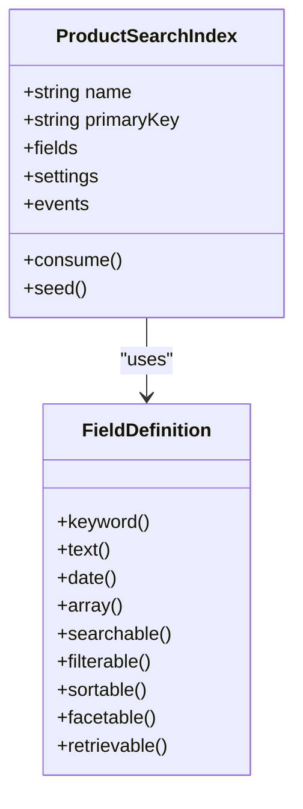
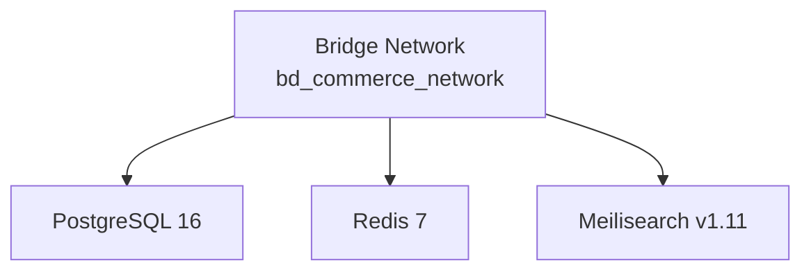
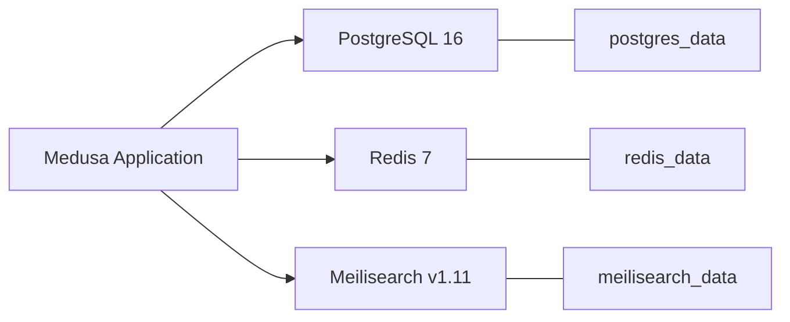

# Data & Infrastructure Layer

<cite>
**Referenced Files in This Document**   
- [docker-compose.yml](file://docker-compose.yml)
- [database.md](file://database.md)
- [apps/medusa/medusa-config.ts](file://apps/medusa/medusa-config.ts)
- [apps/medusa/src/search/product.ts](file://apps/medusa/src/search/product.ts)
- [docs/architecture.md](file://docs/architecture.md)
- [PROJECT_CONTEXT_HANDOFF.md](file://PROJECT_CONTEXT_HANDOFF.md)
</cite>

## Table of Contents
1. [Introduction](#introduction)
2. [Project Structure](#project-structure)
3. [Core Components](#core-components)
4. [Architecture Overview](#architecture-overview)
5. [Detailed Component Analysis](#detailed-component-analysis)
6. [Dependency Analysis](#dependency-analysis)
7. [Performance Considerations](#performance-considerations)
8. [Troubleshooting Guide](#troubleshooting-guide)
9. [Conclusion](#conclusion)
10. [Appendices](#appendices)

## Introduction
This document describes the Data & Infrastructure Layer for the BD Commerce Platform, focusing on PostgreSQL 16 as the primary relational database, Redis 7 as the distributed cache and queue runtime, and Meilisearch v1.11 as the full-text search engine. It explains how these services are deployed with Docker Compose, how Medusa v2 consumes them through environment configuration, and how they support ACID transactions, audit logs, immutable snapshots, workflow queues, distributed locks, session storage, rate limiting, account lockout protection, and Banglish product search. It also provides production-oriented guidance for backup strategies, monitoring approaches, disaster recovery procedures, and scaling considerations.

## Project Structure
The data and infrastructure layer is defined by three containerized services and one application configuration:

| Service | Image / Version | Role in BD Commerce Platform | Persistent Volume | Health Check |
|---|---|---|---|---|
| PostgreSQL | `postgres:16-alpine` | Primary relational store for Medusa core tables, custom BD modules, audit logs, and financial snapshots | `postgres_data` → `/var/lib/postgresql/data` | `pg_isready` |
| Redis | `redis:7-alpine` | Workflow queues (BullMQ), distributed inventory locks, session/cache keys, rate limits, account lockout | `redis_data` → `/data` | `redis-cli ping` |
| Meilisearch | `getmeili/meilisearch:v1.11` | Full-text product index with typo tolerance and Banglish-friendly search behavior | `meilisearch_data` → `/meili_data` | HTTP `/health` |

**Diagram sources**
- [docker-compose.yml:2-20](file://docker-compose.yml#L2-L20)
- [docker-compose.yml:22-44](file://docker-compose.yml#L22-L44)
- [docker-compose.yml:46-64](file://docker-compose.yml#L46-L64)

**Section sources**
- [docker-compose.yml:1-77](file://docker-compose.yml#L1-L77)
- [PROJECT_CONTEXT_HANDOFF.md:149-170](file://PROJECT_CONTEXT_HANDOFF.md#L149-L170)

## Core Components
This section summarizes the three infrastructure components and their responsibilities in the platform.

### PostgreSQL 16 — Relational Store with ACID, Audit Logs, and Immutable Snapshots
PostgreSQL 16 is the authoritative source for all durable business facts:

- **ACID guarantees:** Orders, payments, inventory reservations, refunds, courier bookings, and financial snapshots are written using transactional workflows rather than ad-hoc updates.
- **Audit log:** The `audit_log` table is append-only and hash-chained, providing an immutable record of system changes.
- **Immutable snapshots:** Financial, address, policy, VAT, shipping cost, COGS, and COD collection values are copied at the moment they become legally or operationally relevant and are not recomputed later.
- **Custom module schema:** Custom BD modules extend Medusa core without duplicating native entities, keeping a single writer per fact.
- **Concurrency controls:** Concurrency risks such as concurrent checkout, double order submission, refund approval races, and courier booking races are addressed with unique constraints, advisory locks, and explicit locking rules.

Key design principles include:
- Never duplicate Medusa core models.
- Keep snapshots write-once.
- Represent money consistently: Medusa core uses major units; custom BD tables use paisa with integer checks.
- Use configuration tables for open value sets and enums for closed state machines.
- Minimize PII at write time and mask sensitive fields.

**Section sources**
- [database.md:15-86](file://database.md#L15-L86)
- [database.md:88-124](file://database.md#L88-L124)
- [database.md:172-301](file://database.md#L172-L301)
- [database.md:370-387](file://database.md#L370-L387)
- [database.md:2131-2146](file://database.md#L2131-L2146)

### Redis 7 — Queues, Locks, Sessions, Rate Limits, and Account Lockout
Redis 7 is used for ephemeral, high-throughput operations that must not be treated as durable business facts:

| Redis Pattern | Purpose | Notes |
|---|---|---|
| `bull:medusa-*` | BullMQ workflow queue | Stores jobs for asynchronous processing such as SMS dispatch, notifications, and background sync tasks. |
| `stock:lock:{variant_id}` | Distributed mutex | Protects low-stock variants during concurrent checkout. TTL is short to avoid holding inventory while a customer types. |
| `auth:lockout:{user_email}` | Account lockout | Prevents brute-force login attempts after repeated failures. |
| `ratelimit:{ip}:{endpoint}` | Endpoint abuse protection | Token-bucket style rate limiting for public endpoints. |
| `ratelimit:track:{ip}` | Tracking lookup protection | Limits order tracking lookups to reduce phone privacy exposure. |
| `cart:{cart_id}` | Cart session cache | Reduces database reads for cart payloads. |
| `sms:ratelimit:{order_id}:{event}` | SMS deduplication | Limits outbound SMS per order per event type. |

Important operational rule: no durable business fact may live only in Redis. If Redis fails, the system must recover from PostgreSQL.

**Section sources**
- [docs/architecture.md:402-431](file://docs/architecture.md#L402-L431)
- [database.md:68-76](file://database.md#L68-L76)

### Meilisearch v1.11 — Full-Text Search with Typo Tolerance and Banglish Support
Meilisearch hosts the product search index. The Medusa search index definition:

- Defines searchable, filterable, sortable, facetable, and retrievable fields.
- Includes title, description, handle, thumbnail, category, labels, option values, pricing fields, and metadata needed for storefront search.
- Enables typo tolerance.
- Syncs products from PostgreSQL events such as product creation, update, deletion, variant changes, option changes, tag changes, category changes, and sales channel changes.

Banglish search support is documented at the architecture level as Bengali phonetic synonym handling alongside English queries. The code-level index enables typo tolerance and exposes a controlled set of fields to the search client. Confidential financial fields such as COGS and supplier information are excluded from the public-facing index.

**Diagram sources**
- [apps/medusa/src/search/product.ts:131-165](file://apps/medusa/src/search/product.ts#L131-L165)
- [docs/architecture.md:435-463](file://docs/architecture.md#L435-L463)

**Section sources**
- [apps/medusa/src/search/product.ts:1-166](file://apps/medusa/src/search/product.ts#L1-L166)
- [docs/architecture.md:435-463](file://docs/architecture.md#L435-L463)

## Architecture Overview
The data and infrastructure layer connects the Medusa backend to three external services. Medusa loads environment configuration from `.env` files and reads `DATABASE_URL` and `REDIS_URL`. PostgreSQL stores durable data, Redis handles queues and transient state, and Meilisearch serves fast text search.

**Diagram sources**
- [apps/medusa/medusa-config.ts:7-17](file://apps/medusa/medusa-config.ts#L7-L17)
- [docker-compose.yml:2-64](file://docker-compose.yml#L2-L64)

**Section sources**
- [apps/medusa/medusa-config.ts:1-46](file://apps/medusa/medusa-config.ts#L1-L46)
- [docker-compose.yml:1-77](file://docker-compose.yml#L1-L77)

## Detailed Component Analysis

### PostgreSQL 16 Configuration and Data Integrity
PostgreSQL is configured through Docker Compose with:

- Container image `postgres:16-alpine`.
- Environment variables for user, password, and database name.
- Exposed port configurable via `POSTGRES_PORT`.
- Persistent volume `postgres_data`.
- Health check using `pg_isready`.

At the application level, Medusa reads `DATABASE_URL` from environment configuration. The database design enforces:

- One authoritative writer per fact.
- Append-only audit records.
- Write-once financial and legal snapshots.
- Paisa-based integer money columns in custom tables.
- Strong constraints around orders, returns, courier consignment, refunds, and inventory projections.

**Diagram sources**
- [database.md:77-86](file://database.md#L77-L86)
- [database.md:88-124](file://database.md#L88-L124)
- [database.md:2131-2146](file://database.md#L2131-L2146)

**Section sources**
- [docker-compose.yml:2-20](file://docker-compose.yml#L2-L20)
- [apps/medusa/medusa-config.ts:7-17](file://apps/medusa/medusa-config.ts#L7-L17)
- [database.md:15-86](file://database.md#L15-L86)
- [database.md:88-124](file://database.md#L88-L124)
- [database.md:172-301](file://database.md#L172-L301)
- [database.md:2131-2146](file://database.md#L2131-L2146)

### Redis 7 Usage Patterns
Redis supports several critical patterns:

1. **Workflow queues:** BullMQ uses Redis as its backing store. Jobs are persistent within Redis until consumed.
2. **Distributed locks:** A short-lived lock per variant prevents race conditions when multiple buyers attempt to purchase the last unit.
3. **Session storage:** Cart and session-related data can be cached in Redis to reduce PostgreSQL load.
4. **Rate limiting:** Public endpoints are protected against abuse using per-IP and per-endpoint counters.
5. **Account lockout:** Repeated failed admin login attempts trigger temporary lockout entries keyed by email.

**Diagram sources**
- [docs/architecture.md:402-431](file://docs/architecture.md#L402-L431)
- [database.md:2131-2146](file://database.md#L2131-L2146)

**Section sources**
- [docs/architecture.md:402-431](file://docs/architecture.md#L402-L431)
- [database.md:68-76](file://database.md#L68-L76)

### Meilisearch v1.11 Configuration and Banglish Search
Meilisearch is deployed with:

- Image `getmeili/meilisearch:v1.11`.
- Master key configured via `MEILI_MASTER_KEY`.
- Analytics disabled in development.
- Environment variable `MEILI_ENV`.
- Persistent data volume.
- HTTP health endpoint.

The Medusa product search index defines fields for title, description, handle, thumbnail, categories, labels, option values, and pricing. Typo tolerance is enabled. Banglish search behavior is documented as part of the broader search architecture, including phonetic synonym support for Bengali terms.

**Diagram sources**
- [apps/medusa/src/search/product.ts:43-68](file://apps/medusa/src/search/product.ts#L43-L68)
- [apps/medusa/src/search/product.ts:150-165](file://apps/medusa/src/search/product.ts#L150-L165)

**Section sources**
- [docker-compose.yml:46-64](file://docker-compose.yml#L46-L64)
- [apps/medusa/src/search/product.ts:1-166](file://apps/medusa/src/search/product.ts#L1-L166)
- [docs/architecture.md:435-463](file://docs/architecture.md#L435-L463)

### Infrastructure Deployment with Docker Compose
All three services share a bridge network named `bd_commerce_network`. Each service has:

- A fixed container name.
- Restart policy `unless-stopped`.
- Port mapping exposed through environment variables.
- Persistent volume for durability.
- Health check for orchestration readiness.

**Diagram sources**
- [docker-compose.yml:66-77](file://docker-compose.yml#L66-L77)

**Section sources**
- [docker-compose.yml:1-77](file://docker-compose.yml#L1-L77)
- [PROJECT_CONTEXT_HANDOFF.md:149-170](file://PROJECT_CONTEXT_HANDOFF.md#L149-L170)

### Environment Configuration Management
Environment configuration is loaded by Medusa from root and app-level `.env` files. The backend reads:

- `DATABASE_URL` for PostgreSQL.
- `REDIS_URL` for Redis.
- CORS settings for store, admin, and auth origins.
- JWT and cookie secrets.

The repository documents additional environment variables for Meilisearch, payment gateways, couriers, SMS providers, and cloud storage. In production, secrets should be supplied through a secrets manager or orchestrator secret store rather than plain `.env` files.

**Section sources**
- [apps/medusa/medusa-config.ts:1-17](file://apps/medusa/medusa-config.ts#L1-L17)
- [PROJECT_CONTEXT_HANDOFF.md:183-191](file://PROJECT_CONTEXT_HANDOFF.md#L183-L191)
- [docs/architecture.md:915-985](file://docs/architecture.md#L915-L985)

## Dependency Analysis
The following diagram shows how the application depends on infrastructure services and how those services relate to each other.

**Diagram sources**
- [apps/medusa/medusa-config.ts:7-17](file://apps/medusa/medusa-config.ts#L7-L17)
- [docker-compose.yml:66-77](file://docker-compose.yml#L66-L77)

**Section sources**
- [apps/medusa/medusa-config.ts:1-46](file://apps/medusa/medusa-config.ts#L1-L46)
- [docker-compose.yml:1-77](file://docker-compose.yml#L1-L77)

## Performance Considerations
- **PostgreSQL:** Use transactions for multi-step business operations. Avoid long-running transactions across external HTTP calls. Prefer indexes on frequently filtered columns such as order codes, delivery zone codes, courier codes, and status fields. Keep snapshot tables read-only after write to prevent accidental recomputation.
- **Redis:** Keep lock TTLs short and scoped to the exact atomic operation. Do not hold distributed locks during slow UI interactions. Use Redis for ephemeral state only; always persist durable facts to PostgreSQL.
- **Meilisearch:** Keep indexed fields minimal and exclude confidential financial data. Rely on Medusa’s event-driven indexing rather than polling PostgreSQL.
- **Scaling:** Horizontal scaling of Medusa workers is supported by Redis-backed queues. PostgreSQL and Meilisearch should be scaled vertically or moved to managed services before adding read replicas or sharding.

[No sources needed since this section provides general guidance]

## Troubleshooting Guide
Common issues and recommended diagnostics:

| Symptom | Likely Cause | Diagnostic Action |
|---|---|---|
| Medusa cannot connect to PostgreSQL | Wrong `DATABASE_URL`, wrong credentials, or database not ready | Check `POSTGRES_USER`, `POSTGRES_PASSWORD`, `POSTGRES_DB`; verify `pg_isready` health check. |
| Redis connection fails | Missing or incorrect `REDIS_URL`, missing password, or Redis not healthy | Verify `REDIS_PASSWORD` and `redis-cli ping` health check. |
| Meilisearch search returns errors | Missing master key or wrong URL/port | Verify `MEILI_MASTER_KEY`, `MEILISEARCH_PORT`, and HTTP `/health`. |
| Inventory race condition | Lock acquired too early or held too long | Ensure lock is acquired only at order submission and released immediately after reservation. |
| Duplicate orders | Missing idempotency key or retry without dedupe | Check `checkout_idempotency_key` uniqueness and workflow-level dedupe. |
| Search misses Banglish results | Missing synonyms or wrong index fields | Review Banglish synonym configuration and allowed indexed fields. |

**Section sources**
- [docker-compose.yml:14-18](file://docker-compose.yml#L14-L18)
- [docker-compose.yml:38-42](file://docker-compose.yml#L38-L42)
- [docker-compose.yml:58-62](file://docker-compose.yml#L58-L62)
- [docs/architecture.md:402-431](file://docs/architecture.md#L402-L431)
- [database.md:2131-2146](file://database.md#L2131-L2146)

## Conclusion
The BD Commerce Platform’s Data & Infrastructure Layer centers on PostgreSQL 16 for durable, auditable, and financially accurate data; Redis 7 for queues, locks, sessions, rate limits, and security protections; and Meilisearch v1.11 for fast, typo-tolerant product search. Docker Compose provides a consistent local deployment, while environment configuration drives Medusa’s integration with these services. Production environments should strengthen secrets management, add robust backup and monitoring tooling, define clear disaster recovery procedures, and scale horizontally only where the underlying services support it.

[No sources needed since this section summarizes without analyzing specific files]

## Appendices

### Appendix A: Backup Strategy Recommendations
- **PostgreSQL:** Schedule regular logical backups using `pg_dump` or a managed backup solution. Retain daily incremental backups and weekly full backups. Test restore procedures regularly.
- **Redis:** Treat Redis as cache and queue. Persist data with RDB/AOF if required, but do not treat it as the sole source of truth. Rebuild state from PostgreSQL where possible.
- **Meilisearch:** Back up `meilisearch_data` or rebuild the index from PostgreSQL using the Medusa search seed/consume pipeline.

[No sources needed since this section provides general guidance]

### Appendix B: Monitoring Approaches
- **PostgreSQL:** Monitor connection count, query latency, deadlocks, replication lag, disk usage, and checkpoint activity.
- **Redis:** Monitor memory usage, eviction policy, persistence status, command latency, and queue depth for BullMQ jobs.
- **Meilisearch:** Monitor index size, ingestion latency, search latency, and API error rates.
- **Application:** Track failed database connections, Redis timeouts, Meilisearch sync failures, and audit log growth.

[No sources needed since this section provides general guidance]

### Appendix C: Disaster Recovery Procedures
1. Identify the failure scope: application, PostgreSQL, Redis, Meilisearch, or network.
2. Restore PostgreSQL first if data integrity is at risk.
3. Bring Redis back online to resume queues and caches.
4. Rebuild Meilisearch index from PostgreSQL if search data is inconsistent.
5. Verify audit logs and financial snapshots for consistency.
6. Run reconciliation jobs for projections such as customer risk profiles and delivery success rates.
7. Gradually restore traffic and monitor error rates.

[No sources needed since this section provides general guidance]