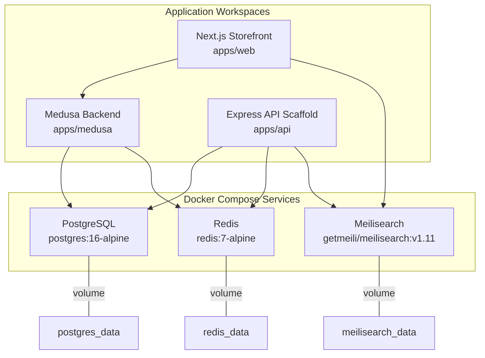
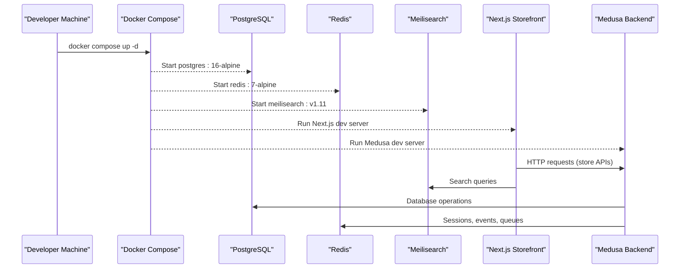
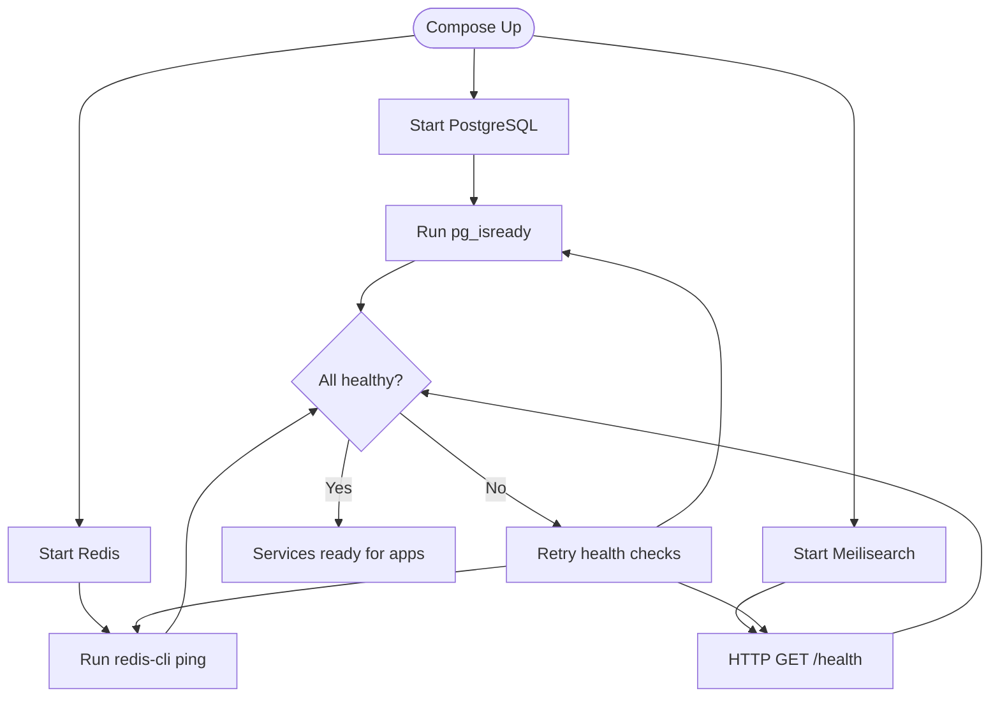
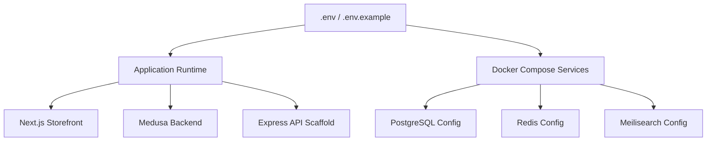
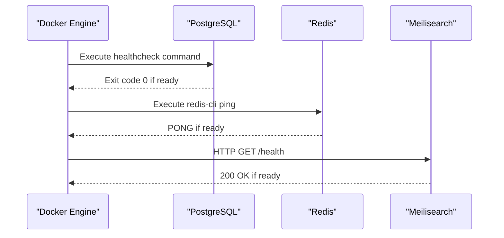
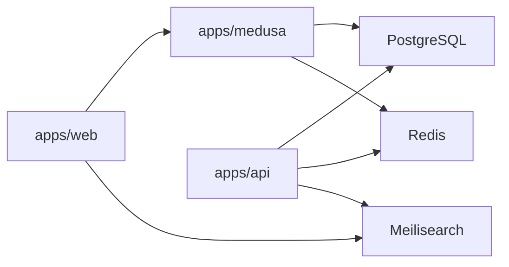

# Infrastructure & Deployment

<cite>
**Referenced Files in This Document**
- [docker-compose.yml](file://docker-compose.yml)
- [.env.example](file://.env.example)
- [.env](file://.env)
- [package.json](file://package.json)
- [apps/medusa/package.json](file://apps/medusa/package.json)
- [apps/web/package.json](file://apps/web/package.json)
- [PROJECT_CONTEXT_HANDOFF.md](file://PROJECT_CONTEXT_HANDOFF.md)
- [docs/architecture-decision-medusa-v2.md](file://docs/architecture-decision-medusa-v2.md)
- [docs/prompt-9-medusa-setup-report.md](file://docs/prompt-9-medusa-setup-report.md)
</cite>

## Table of Contents
1. [Introduction](#introduction)
2. [Project Structure](#project-structure)
3. [Core Components](#core-components)
4. [Architecture Overview](#architecture-overview)
5. [Detailed Component Analysis](#detailed-component-analysis)
6. [Dependency Analysis](#dependency-analysis)
7. [Performance Considerations](#performance-considerations)
8. [Troubleshooting Guide](#troubleshooting-guide)
9. [Conclusion](#conclusion)
10. [Appendices](#appendices)

## Introduction
This document describes the infrastructure deployment architecture for the BD Commerce Platform using Docker Compose. It explains how PostgreSQL, Redis, and Meilisearch are orchestrated, how environment variables are managed, how health checks validate service readiness, and how networking isolates services. It also provides production-oriented guidance for scaling, load balancing, monitoring, security hardening, resource allocation, deployment scripts, rollback procedures, and operational runbooks.

The repository currently uses Docker Compose to manage shared infrastructure services. Application workspaces (`apps/web`, `apps/api`, `apps/medusa`) are Node.js applications that connect to these services via environment-driven configuration.

## Project Structure
At a high level:
- `docker-compose.yml` defines the containerized infrastructure services.
- `.env` and `.env.example` define application and infrastructure configuration.
- Root `package.json` exposes convenience scripts for Docker Compose and workspace tooling.
- `apps/medusa` is the Medusa v2 commerce backend.
- `apps/web` is the Next.js storefront.
- `apps/api` is an existing Express-based API scaffold that will be superseded by Medusa v2.

**Diagram sources**
- [docker-compose.yml:1-77](file://docker-compose.yml#L1-L77)
- [PROJECT_CONTEXT_HANDOFF.md:149-170](file://PROJECT_CONTEXT_HANDOFF.md#L149-L170)

**Section sources**
- [docker-compose.yml:1-77](file://docker-compose.yml#L1-L77)
- [PROJECT_CONTEXT_HANDOFF.md:149-170](file://PROJECT_CONTEXT_HANDOFF.md#L149-L170)

## Core Components
- PostgreSQL: Relational database for orders, products, users, and Medusa core tables.
- Redis: Caching, session storage, event streaming, and distributed locking for Medusa workflows.
- Meilisearch: Fast, typo-tolerant search engine used by the storefront and potentially Medusa integrations.
- Environment Configuration: Centralized in root `.env` with a template `.env.example`.
- Orchestration Scripts: Root npm scripts wrap Docker Compose commands.

Key responsibilities:
- Data persistence through named volumes.
- Service discovery via a shared bridge network.
- Health checks for dependency readiness.
- Environment-driven configuration for ports, credentials, and secrets.

**Section sources**
- [docker-compose.yml:1-77](file://docker-compose.yml#L1-L77)
- [.env.example:1-94](file://.env.example#L1-L94)
- [.env:1-86](file://.env#L1-L86)
- [package.json:10-25](file://package.json#L10-L25)

## Architecture Overview
The current deployment model separates infrastructure from application code:
- Infrastructure services are containerized and exposed on host ports when needed.
- Applications connect to services over the internal Docker network using service names or localhost (development).
- The Medusa backend runs on port 9000; the Next.js storefront runs on port 3000; the legacy API scaffold ran on port 4000.

**Diagram sources**
- [package.json:10-25](file://package.json#L10-L25)
- [apps/medusa/package.json:15-23](file://apps/medusa/package.json#L15-L23)
- [apps/web/package.json:6-10](file://apps/web/package.json#L6-L10)
- [docs/architecture-decision-medusa-v2.md:143-160](file://docs/architecture-decision-medusa-v2.md#L143-L160)

**Section sources**
- [package.json:10-25](file://package.json#L10-L25)
- [apps/medusa/package.json:15-23](file://apps/medusa/package.json#L15-L23)
- [apps/web/package.json:6-10](file://apps/web/package.json#L6-L10)
- [docs/architecture-decision-medusa-v2.md:143-160](file://docs/architecture-decision-medusa-v2.md#L143-L160)

## Detailed Component Analysis

### Docker Compose Services
- PostgreSQL
  - Image: `postgres:16-alpine`
  - Container name: `bd_commerce_postgres`
  - Ports: `${POSTGRES_PORT:-5432}:5432`
  - Volume: `postgres_data:/var/lib/postgresql/data`
  - Health check: `pg_isready` against configured user and database
  - Network: `bd_commerce_network`
- Redis
  - Image: `redis:7-alpine`
  - Container name: `bd_commerce_redis`
  - Command: Conditionally enables password authentication based on `REDIS_PASSWORD`
  - Ports: `${REDIS_PORT:-6379}:6379`
  - Volume: `redis_data:/data`
  - Health check: `redis-cli ping`
  - Network: `bd_commerce_network`
- Meilisearch
  - Image: `getmeili/meilisearch:v1.11`
  - Container name: `bd_commerce_meilisearch`
  - Ports: `${MEILISEARCH_PORT:-7700}:7700`
  - Volume: `meilisearch_data:/meili_data`
  - Health check: HTTP `/health` endpoint
  - Network: `bd_commerce_network`

**Diagram sources**
- [docker-compose.yml:14-64](file://docker-compose.yml#L14-L64)

**Section sources**
- [docker-compose.yml:1-77](file://docker-compose.yml#L1-L77)

### Networking Configuration
- A single bridge network named `bd_commerce_network` connects all services.
- Containers can reach each other via service names within this network.
- Host-facing ports are explicitly mapped for development access.

Operational notes:
- For production, avoid exposing internal service ports directly to the host unless required by ingress controllers or proxies.
- Use internal DNS resolution via service names for inter-service communication.

**Section sources**
- [docker-compose.yml:74-77](file://docker-compose.yml#L74-L77)
- [PROJECT_CONTEXT_HANDOFF.md:149-170](file://PROJECT_CONTEXT_HANDOFF.md#L149-L170)

### Volume Management and Data Persistence
- Named volumes persist data across container restarts:
  - `postgres_data` for PostgreSQL data directory
  - `redis_data` for Redis data directory
  - `meilisearch_data` for Meilisearch index data
- Volumes are defined at the top level of `docker-compose.yml`.

Best practices:
- Back up named volumes before migrations or upgrades.
- Avoid deleting volumes during rollback unless you intentionally want to reset state.

**Section sources**
- [docker-compose.yml:66-72](file://docker-compose.yml#L66-L72)
- [PROJECT_CONTEXT_HANDOFF.md:149-170](file://PROJECT_CONTEXT_HANDOFF.md#L149-L170)

### Environment Variable Configuration Management
Environment variables are centralized in root `.env` and templated in `.env.example`. Key categories include:
- Application runtime and ports
- PostgreSQL connection details and Prisma URLs
- Redis connection URL and password
- Meilisearch host, port, master key, and environment
- Cryptographic keys and authentication secrets
- Payment gateway sandbox credentials and callback URLs

Important behaviors:
- Docker Compose reads environment variables for service configuration and port mapping.
- Application workspaces read environment variables for runtime configuration.
- Secrets should not be committed; use `.gitignore` and secret management tools in production.

**Diagram sources**
- [.env.example:1-94](file://.env.example#L1-L94)
- [.env:1-86](file://.env#L1-L86)
- [docker-compose.yml:6-54](file://docker-compose.yml#L6-L54)

**Section sources**
- [.env.example:1-94](file://.env.example#L1-L94)
- [.env:1-86](file://.env#L1-L86)
- [docker-compose.yml:6-54](file://docker-compose.yml#L6-L54)
- [PROJECT_CONTEXT_HANDOFF.md:183-190](file://PROJECT_CONTEXT_HANDOFF.md#L183-L190)

### Health Check Implementations
- PostgreSQL: Uses `pg_isready` with configurable user and database.
- Redis: Uses `redis-cli ping`.
- Meilisearch: Uses HTTP `/health` endpoint.

These checks ensure dependent services are ready before applications attempt connections.

**Diagram sources**
- [docker-compose.yml:14-64](file://docker-compose.yml#L14-L64)

**Section sources**
- [docker-compose.yml:14-64](file://docker-compose.yml#L14-L64)

### Service Discovery Patterns
- Within Docker networks, services discover each other via service names.
- Development may use `localhost` where containers expose ports to the host.
- Production should prefer internal service names behind a reverse proxy or ingress controller.

**Section sources**
- [docker-compose.yml:74-77](file://docker-compose.yml#L74-L77)
- [PROJECT_CONTEXT_HANDOFF.md:149-170](file://PROJECT_CONTEXT_HANDOFF.md#L149-L170)

### Scaling Considerations
- Stateless services (e.g., Medusa backend, Next.js frontend) can scale horizontally behind a load balancer.
- Stateful services (PostgreSQL, Redis, Meilisearch) require careful planning:
  - PostgreSQL: Use managed databases or clustered setups with replication and failover.
  - Redis: Use Redis Cluster or managed cache services for horizontal scaling.
  - Meilisearch: Use managed search or cluster configurations depending on query volume.

Recommendations:
- Externalize state to managed services in production.
- Use orchestrators (Kubernetes, ECS) for horizontal scaling and rolling updates.
- Configure connection pooling for databases and caches.

[No sources needed since this section provides general guidance]

### Load Balancing Strategies
- Place a reverse proxy or ingress controller in front of application replicas.
- Route traffic to multiple instances of Medusa and Next.js.
- Ensure sticky sessions only if necessary; prefer stateless sessions backed by Redis.

[No sources needed since this section provides general guidance]

### Monitoring Setup
- Add health endpoints for application services.
- Collect logs centrally (e.g., structured JSON logs shipped to a log aggregator).
- Instrument metrics (CPU, memory, request latency, error rates) and export them to a metrics collector.
- Set up alerting thresholds for critical services.

[No sources needed since this section provides general guidance]

### Security Hardening Measures
- Do not expose internal service ports to the public internet.
- Rotate secrets regularly and store them in a secure vault.
- Restrict network policies to allow only required traffic between services.
- Enable TLS termination at the ingress layer.
- Harden container images and run as non-root where possible.

[No sources needed since this section provides general guidance]

### Resource Allocation Policies
- Define CPU and memory limits for containers to prevent resource starvation.
- Tune database connection pools and cache sizes according to workload.
- Monitor resource utilization and adjust limits based on observed usage.

[No sources needed since this section provides general guidance]

### Deployment Scripts
Root npm scripts provide convenient commands for Docker Compose:
- `npm run docker:up`: Start services in detached mode.
- `npm run docker:down`: Stop services.
- `npm run docker:logs`: Stream logs.
- `npm run docker:ps`: List running services.

Workspace scripts:
- Medusa: `dev`, `build`, `start`, `migrate`.
- Web: `dev`, `build`, `start`.

**Section sources**
- [package.json:10-25](file://package.json#L10-L25)
- [apps/medusa/package.json:15-23](file://apps/medusa/package.json#L15-L23)
- [apps/web/package.json:6-10](file://apps/web/package.json#L6-L10)

### Rollback Procedures
- Preserve previous versions of application artifacts and configuration.
- Keep database migration history intact; do not drop volumes unless intentional.
- If a deployment fails:
  - Stop new containers.
  - Revert application code to the last known good version.
  - Re-run migrations only if they were partially applied; otherwise roll back schema changes carefully.
  - Restart services and verify health checks.

[No sources needed since this section provides general guidance]

### Operational Runbooks
- Daily checks:
  - Verify all services are healthy.
  - Review logs for errors and warnings.
  - Confirm disk usage for volumes.
- Weekly tasks:
  - Rotate secrets and update vault entries.
  - Review performance metrics and capacity trends.
- Monthly tasks:
  - Update base images and dependencies.
  - Test disaster recovery procedures.

[No sources needed since this section provides general guidance]

## Dependency Analysis
Service dependencies:
- Medusa depends on PostgreSQL and Redis.
- Next.js storefront depends on Medusa and Meilisearch.
- Legacy API scaffold depends on PostgreSQL, Redis, and Meilisearch.

**Diagram sources**
- [docs/architecture-decision-medusa-v2.md:143-160](file://docs/architecture-decision-medusa-v2.md#L143-L160)
- [PROJECT_CONTEXT_HANDOFF.md:149-170](file://PROJECT_CONTEXT_HANDOFF.md#L149-L170)

**Section sources**
- [docs/architecture-decision-medusa-v2.md:143-160](file://docs/architecture-decision-medusa-v2.md#L143-L160)
- [PROJECT_CONTEXT_HANDOFF.md:149-170](file://PROJECT_CONTEXT_HANDOFF.md#L149-L170)

## Performance Considerations
- Use connection pooling for PostgreSQL and Redis.
- Cache frequently accessed data in Redis.
- Offload search queries to Meilisearch.
- Optimize image sizes and build steps for faster deployments.
- Monitor latency and throughput under load.

[No sources needed since this section provides general guidance]

## Troubleshooting Guide
Common issues and resolutions:
- Services failing health checks:
  - Verify environment variables for credentials and ports.
  - Inspect container logs for startup errors.
- Connection refused:
  - Ensure services are on the same Docker network.
  - Confirm correct hostnames and ports.
- Permission errors accessing volumes:
  - Check volume ownership and permissions.
- Secret mismatches:
  - Align `.env` values with service expectations.

Verification references:
- Docker Compose status and logs via npm scripts.
- Health endpoints for services.

**Section sources**
- [package.json:22-25](file://package.json#L22-L25)
- [docker-compose.yml:14-64](file://docker-compose.yml#L14-L64)

## Conclusion
The BD Commerce Platform uses Docker Compose to orchestrate PostgreSQL, Redis, and Meilisearch, providing a robust foundation for the Medusa backend and Next.js storefront. Environment variables centralize configuration, while health checks and a shared network ensure reliable service discovery and readiness. For production, adopt managed services, implement proper security controls, set up monitoring and alerting, and establish clear deployment and rollback procedures.

[No sources needed since this section summarizes without analyzing specific files]

## Appendices

### Appendix A: Environment Variables Reference
Categories and examples:
- Application: `NODE_ENV`, `API_PORT`, `WEB_PORT`, `PORT`, `NEXT_PUBLIC_API_URL`, `NEXT_PUBLIC_APP_URL`, `CORS_ORIGIN`.
- PostgreSQL: `POSTGRES_USER`, `POSTGRES_PASSWORD`, `POSTGRES_DB`, `POSTGRES_HOST`, `POSTGRES_PORT`, `DATABASE_URL`, `DIRECT_URL`.
- Redis: `REDIS_HOST`, `REDIS_PORT`, `REDIS_PASSWORD`, `REDIS_URL`.
- Meilisearch: `MEILISEARCH_HOST`, `MEILISEARCH_PORT`, `MEILI_MASTER_KEY`, `MEILI_ENV`.
- Authentication & Security: `JWT_SECRET`, `JWT_EXPIRES_IN`, `JWT_REFRESH_SECRET`, `JWT_REFRESH_EXPIRES_IN`, `SESSION_SECRET`, `ENCRYPTION_KEY`, `NEXTAUTH_SECRET`, `NEXTAUTH_URL`.
- Payment Gateways: bKash, Nagad, SSLCommerz sandbox credentials and callbacks.

**Section sources**
- [.env.example:1-94](file://.env.example#L1-L94)
- [.env:1-86](file://.env#L1-L86)
- [PROJECT_CONTEXT_HANDOFF.md:183-190](file://PROJECT_CONTEXT_HANDOFF.md#L183-L190)

### Appendix B: Docker Compose Quick Commands
- Start services: `npm run docker:up`
- Stop services: `npm run docker:down`
- View logs: `npm run docker:logs`
- List services: `npm run docker:ps`

**Section sources**
- [package.json:22-25](file://package.json#L22-L25)

### Appendix C: Medusa and Workspace Scripts
- Medusa development: `npm run dev:medusa`
- Medusa build: `npm run build:medusa`
- Medusa start: `npm run start:medusa`
- Medusa migrations: `npm run medusa:migrate`
- Web development: `npm run dev:web`
- Web build: `npm run build:web`

**Section sources**
- [package.json:10-21](file://package.json#L10-L21)
- [apps/medusa/package.json:15-23](file://apps/medusa/package.json#L15-L23)
- [apps/web/package.json:6-10](file://apps/web/package.json#L6-L10)

### Appendix D: Migration and Setup Notes
- Medusa v2 setup report confirms successful initialization, database migration, and service verification.
- Existing Docker services remain unchanged and healthy during setup.

**Section sources**
- [docs/prompt-9-medusa-setup-report.md:1-64](file://docs/prompt-9-medusa-setup-report.md#L1-L64)