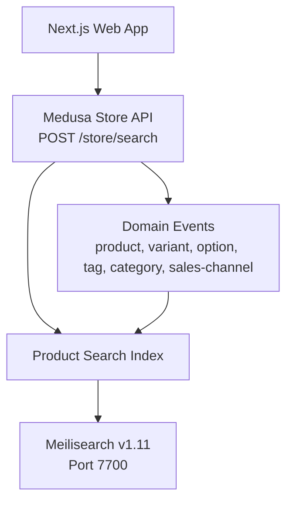
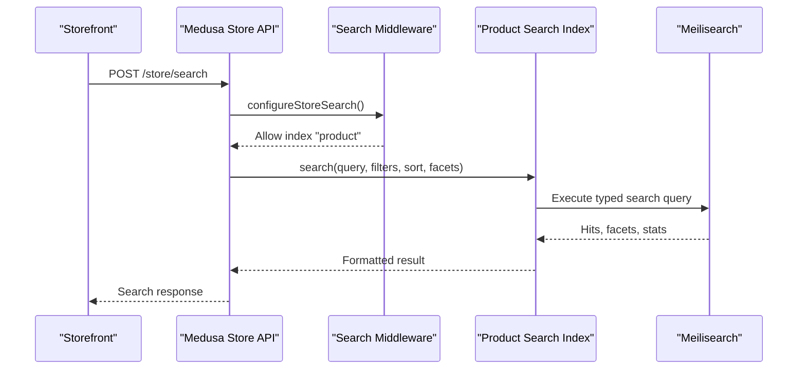
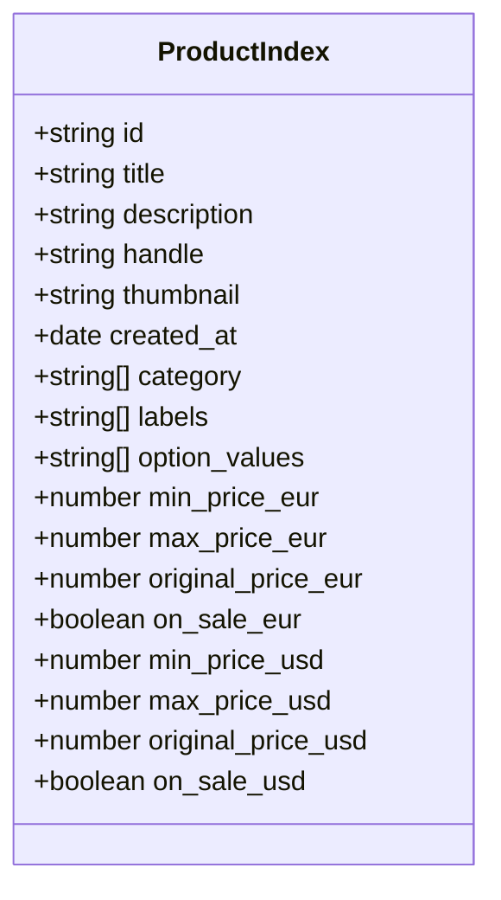
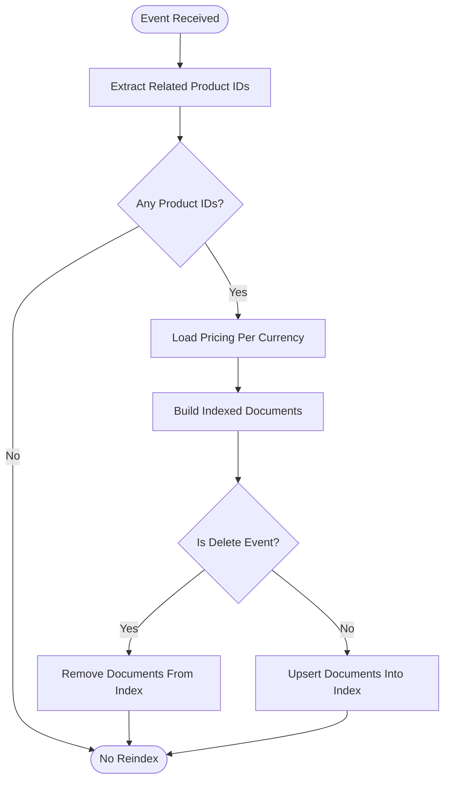
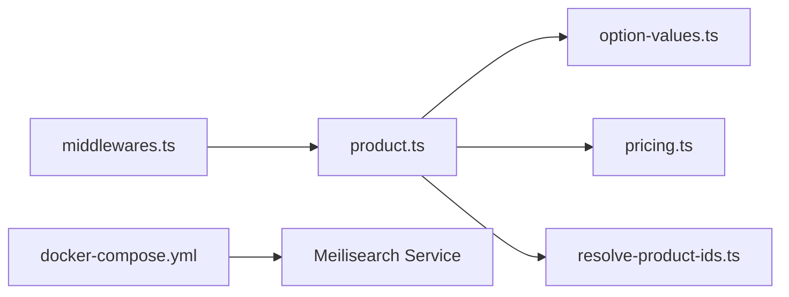

# Meilisearch Engine

<cite>
**Referenced Files in This Document**
- [product.ts](file://apps/medusa/src/search/product.ts)
- [option-values.ts](file://apps/medusa/src/search/helpers/option-values.ts)
- [pricing.ts](file://apps/medusa/src/search/helpers/pricing.ts)
- [resolve-product-ids.ts](file://apps/medusa/src/search/helpers/resolve-product-ids.ts)
- [middlewares.ts](file://apps/medusa/src/api/middlewares.ts)
- [docker-compose.yml](file://docker-compose.yml)
- [architecture.md](file://docs/architecture.md)
- [page.tsx](file://apps/web/src/app/page.tsx)
</cite>

## Table of Contents
1. [Introduction](#introduction)
2. [Project Structure](#project-structure)
3. [Core Components](#core-components)
4. [Architecture Overview](#architecture-overview)
5. [Detailed Component Analysis](#detailed-component-analysis)
6. [Dependency Analysis](#dependency-analysis)
7. [Performance Considerations](#performance-considerations)
8. [Troubleshooting Guide](#troubleshooting-guide)
9. [Conclusion](#conclusion)

## Introduction
This document explains how the project uses Meilisearch v1.11 as the full-text search engine for product discovery, with a focus on Banglish (Bangla-English mixed) content. It covers index configuration, synonym and typo-tolerance strategy, product indexing, faceted navigation, filtering, sorting, API access control, performance tuning, real-time updates, and security considerations.

The implementation is built around Medusa v2’s search integration: a product search index transforms product data into searchable documents, listens to domain events, and exposes a store search endpoint that restricts which indexes can be queried.

## Project Structure
The search-related code lives under the Medusa application:

- `apps/medusa/src/search/product.ts` defines the product search index, fields, settings, event mapping, ingestion, and seeding.
- `apps/medusa/src/search/helpers/` contains helpers for option values, pricing, and resolving affected product IDs.
- `apps/medusa/src/api/middlewares.ts` configures the `/store/search` route to allow only the product index.
- `docker-compose.yml` runs Meilisearch v1.11 on port 7700 with persistent storage.
- `docs/architecture.md` describes the intended Meilisearch architecture, including Banglish synonyms and field protection.
- `apps/web/src/app/page.tsx` advertises Meilisearch v1.11 and sub-50ms catalog search with Banglish support.

**Diagram sources**
- [middlewares.ts:5-19](file://apps/medusa/src/api/middlewares.ts#L5-L19)
- [product.ts:150-165](file://apps/medusa/src/search/product.ts#L150-L165)
- [docker-compose.yml:46-64](file://docker-compose.yml#L46-L64)

**Section sources**
- [product.ts:1-166](file://apps/medusa/src/search/product.ts#L1-L166)
- [middlewares.ts:1-19](file://apps/medusa/src/api/middlewares.ts#L1-L19)
- [docker-compose.yml:46-64](file://docker-compose.yml#L46-L64)
- [architecture.md:435-463](file://docs/architecture.md#L435-L463)
- [page.tsx:1-15](file://apps/web/src/app/page.tsx#L1-L15)

## Core Components
- Product search index definition and schema.
- Event-driven ingestion pipeline.
- Option-value flattening for faceted navigation.
- Multi-currency pricing aggregation.
- Affected product ID resolution across related entities.
- Store search middleware restricting allowed indexes.

Key responsibilities:
- Transform raw product rows into indexed documents.
- Keep index fields filterable, sortable, facetable, or retrievable based on storefront needs.
- Reindex products when related entities change.
- Expose a secure store search endpoint scoped by status and sales channels.

**Section sources**
- [product.ts:43-68](file://apps/medusa/src/search/product.ts#L43-L68)
- [product.ts:105-165](file://apps/medusa/src/search/product.ts#L105-L165)
- [option-values.ts:6-29](file://apps/medusa/src/search/helpers/option-values.ts#L6-L29)
- [pricing.ts:54-80](file://apps/medusa/src/search/helpers/pricing.ts#L54-L80)
- [resolve-product-ids.ts:75-141](file://apps/medusa/src/search/helpers/resolve-product-ids.ts#L75-L141)
- [middlewares.ts:5-19](file://apps/medusa/src/api/middlewares.ts#L5-L19)

## Architecture Overview
The system integrates Meilisearch through Medusa’s search framework:

- The product index declares searchable, filterable, sortable, facetable, and retrievable fields.
- Typo tolerance is enabled at the index level.
- Domain events trigger re-indexing of affected products.
- The store search endpoint allows only the product index and narrows results by published status and sales channels.
- Pricing is aggregated per currency and exposed as filterable/sortable fields.
- Option values are flattened into structured tokens for faceting and searching.

**Diagram sources**
- [middlewares.ts:5-19](file://apps/medusa/src/api/middlewares.ts#L5-L19)
- [product.ts:150-165](file://apps/medusa/src/search/product.ts#L150-L165)

## Detailed Component Analysis

### Product Search Index Schema
The product index defines typed fields for identification, text search, metadata, categories, labels, option values, timestamps, and pricing. Fields are explicitly marked as searchable, filterable, sortable, facetable, or retrievable.

Important design points:
- Title has higher search weight than description.
- Category and labels are arrays used for faceting and filtering.
- Option values are flattened into structured strings for both search and faceting.
- Price fields are generated per supported currency and include min/max price, original price, and sale flags.

**Diagram sources**
- [product.ts:43-68](file://apps/medusa/src/search/product.ts#L43-L68)
- [pricing.ts:54-80](file://apps/medusa/src/search/helpers/pricing.ts#L54-L80)

**Section sources**
- [product.ts:43-68](file://apps/medusa/src/search/product.ts#L43-L68)
- [pricing.ts:54-80](file://apps/medusa/src/search/helpers/pricing.ts#L54-L80)

### Ingestion Pipeline and Real-Time Updates
The ingestion pipeline transforms product rows into indexed documents and maps domain events to affected product IDs.

Ingestion steps:
1. Load pricing for all product IDs in the batch.
2. Convert each row into a document using helper functions.
3. Map events to product IDs via entity-specific logic.
4. Delete documents for soft-deleted products.

Event coverage includes product, variant, option, option value, tag, category, and sales channel changes.

**Diagram sources**
- [product.ts:105-165](file://apps/medusa/src/search/product.ts#L105-L165)
- [resolve-product-ids.ts:75-141](file://apps/medusa/src/search/helpers/resolve-product-ids.ts#L75-L141)
- [pricing.ts:148-176](file://apps/medusa/src/search/helpers/pricing.ts#L148-L176)

**Section sources**
- [product.ts:105-165](file://apps/medusa/src/search/product.ts#L105-L165)
- [resolve-product-ids.ts:1-142](file://apps/medusa/src/search/helpers/resolve-product-ids.ts#L1-L142)
- [pricing.ts:148-176](file://apps/medusa/src/search/helpers/pricing.ts#L148-L176)

### Option Values and Faceted Navigation
Option values are flattened into entries like `"Size:S"` and `"Color:Red"`. This keeps the index simple while allowing the storefront to group facets by option name. Duplicates are removed to avoid inflated facet counts.

Benefits:
- Single field supports both search and faceting.
- Structured tokens make it easy to split by option name on the client side.
- Deduplication improves facet accuracy.

**Section sources**
- [option-values.ts:6-29](file://apps/medusa/src/search/helpers/option-values.ts#L6-L29)

### Pricing Aggregation and Currency Support
Pricing is aggregated per currency to support filtering, sorting, and faceting by price ranges and sale status. For each currency:
- Minimum calculated price across variants.
- Maximum calculated price across variants.
- Original price snapshot.
- Boolean flag indicating whether the cheapest variant is on sale.

If no priced variants exist for a currency, no price fields are written, so the product drops out of that currency’s price filters and sorts.

**Section sources**
- [pricing.ts:54-80](file://apps/medusa/src/search/helpers/pricing.ts#L54-L80)
- [pricing.ts:89-142](file://apps/medusa/src/search/helpers/pricing.ts#L89-L142)
- [pricing.ts:148-176](file://apps/medusa/src/search/helpers/pricing.ts#L148-L176)

### Store Search Endpoint and Access Control
The store search endpoint is protected by middleware that:
- Restricts queries to the `product` index.
- Uses the index’s filterable fields to scope results to published products and allowed sales channels.

This prevents arbitrary index access from public-facing clients.

**Section sources**
- [middlewares.ts:5-19](file://apps/medusa/src/api/middlewares.ts#L5-L19)
- [product.ts:43-68](file://apps/medusa/src/search/product.ts#L43-L68)

### Banglish Typo Tolerance and Synonyms
Banglish support is part of the broader Meilisearch architecture:
- Typo tolerance is enabled at the index level.
- The architecture documentation describes Bengali phonetic synonyms for Banglish queries.
- The web page advertises sub-50ms catalog search with Banglish keywords.

Note: The current product index enables typo tolerance but does not define explicit synonyms in this file. Synonym configuration should be applied at the index level according to the documented Banglish strategy.

**Section sources**
- [product.ts:150-157](file://apps/medusa/src/search/product.ts#L150-L157)
- [architecture.md:435-443](file://docs/architecture.md#L435-L443)
- [page.tsx:10-13](file://apps/web/src/app/page.tsx#L10-L13)

## Dependency Analysis
The product search index depends on several helpers and external services:

- `product.ts` depends on:
  - `helpers/option-values.ts` for option flattening.
  - `helpers/pricing.ts` for multi-currency pricing fields and loading.
  - `helpers/resolve-product-ids.ts` for event-to-product mapping.
- `middlewares.ts` depends on Medusa’s store search configuration.
- `docker-compose.yml` provides the Meilisearch service.

**Diagram sources**
- [product.ts:1-12](file://apps/medusa/src/search/product.ts#L1-L12)
- [middlewares.ts:1-19](file://apps/medusa/src/api/middlewares.ts#L1-L19)
- [docker-compose.yml:46-64](file://docker-compose.yml#L46-L64)

**Section sources**
- [product.ts:1-12](file://apps/medusa/src/search/product.ts#L1-L12)
- [middlewares.ts:1-19](file://apps/medusa/src/api/middlewares.ts#L1-L19)
- [docker-compose.yml:46-64](file://docker-compose.yml#L46-L64)

## Performance Considerations
- Use weighted search fields to prioritize title over description and option values.
- Keep non-search fields as filterable or retrievable only when needed to reduce index size.
- Aggregate pricing per currency to enable efficient range filters and sorts without runtime computation.
- Batch event processing and use graph queries to resolve affected product IDs efficiently.
- Persist Meilisearch data volumes to avoid cold starts and rebuilds.
- Monitor health checks and ensure the Meilisearch container remains healthy.

[No sources needed since this section provides general guidance]

## Troubleshooting Guide
Common issues and resolutions:

- **Search returns unpublished products:**
  - Ensure the store search middleware scopes results by status and sales channels.
  - Verify the index marks `status` and `sales_channel_ids` as filterable.

- **Facets show unexpected duplicates:**
  - Check option value flattening logic and deduplication.
  - Confirm that option titles and values are trimmed and filtered.

- **Price filters do not work for a currency:**
  - Confirm that variants have calculated prices for that currency.
  - Remember that missing price fields drop products out of that currency’s filters.

- **Re-indexing does not trigger after related entity changes:**
  - Verify event names match the configured list.
  - Validate the affected product ID resolver handles the specific entity.

- **Meilisearch is unreachable:**
  - Check Docker Compose service status and port mapping.
  - Review health check configuration and volume persistence.

**Section sources**
- [middlewares.ts:5-19](file://apps/medusa/src/api/middlewares.ts#L5-L19)
- [option-values.ts:6-29](file://apps/medusa/src/search/helpers/option-values.ts#L6-L29)
- [pricing.ts:89-142](file://apps/medusa/src/search/helpers/pricing.ts#L89-L142)
- [product.ts:131-148](file://apps/medusa/src/search/product.ts#L131-L148)
- [docker-compose.yml:46-64](file://docker-compose.yml#L46-L64)

## Conclusion
The Meilisearch integration in this project centers on a well-defined product search index, robust event-driven ingestion, and secure store search access. Typo tolerance is enabled, and the architecture documents Banglish synonym support. Faceted navigation relies on flattened option values, while multi-currency pricing enables precise filtering and sorting. For production hardening, apply explicit Banglish synonyms at the index level, enforce strict API key scoping, and monitor indexing latency and query performance against large catalogs.

[No sources needed since this section summarizes without analyzing specific files]