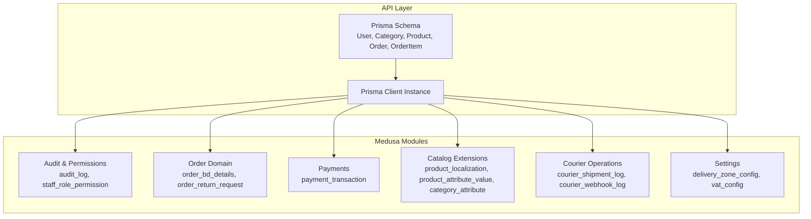
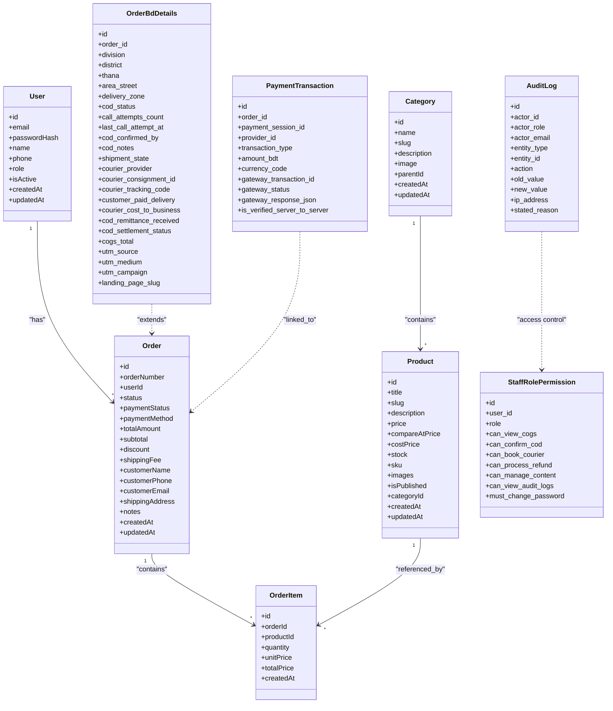

# PostgreSQL Database

<cite>
**Referenced Files in This Document**
- [schema.prisma](file://apps/api/prisma/schema.prisma)
- [prisma.ts](file://apps/api/src/lib/prisma.ts)
- [audit-log.ts](file://apps/medusa/src/modules/bd-audit/models/audit-log.ts)
- [staff-role-permission.ts](file://apps/medusa/src/modules/bd-audit/models/staff-role-permission.ts)
- [order-bd-details.ts](file://apps/medusa/src/modules/bd-orders/models/order-bd-details.ts)
- [order-return-request.ts](file://apps/medusa/src/modules/bd-orders/models/order-return-request.ts)
- [payment-transaction.ts](file://apps/medusa/src/modules/bd-payments/models/payment-transaction.ts)
- [product-localization.ts](file://apps/medusa/src/modules/bd-catalog/models/product-localization.ts)
- [product-attribute-value.ts](file://apps/medusa/src/modules/bd-catalog/models/product-attribute-value.ts)
- [category-attribute.ts](file://apps/medusa/src/modules/bd-catalog/models/category-attribute.ts)
- [courier-shipment-log.ts](file://apps/medusa/src/modules/bd-courier/models/courier-shipment-log.ts)
- [courier-webhook-log.ts](file://apps/medusa/src/modules/bd-courier/models/courier-webhook-log.ts)
- [delivery-zone-config.ts](file://apps/medusa/src/modules/bd-settings/models/delivery-zone-config.ts)
- [vat-config.ts](file://apps/medusa/src/modules/bd-settings/models/vat-config.ts)
- [database.md](file://database.md)
</cite>

## Table of Contents
1. [Introduction](#introduction)
2. [Project Structure](#project-structure)
3. [Core Components](#core-components)
4. [Architecture Overview](#architecture-overview)
5. [Detailed Component Analysis](#detailed-component-analysis)
6. [Dependency Analysis](#dependency-analysis)
7. [Performance Considerations](#performance-considerations)
8. [Troubleshooting Guide](#troubleshooting-guide)
9. [Conclusion](#conclusion)
10. [Appendices](#appendices)

## Introduction
This document describes the PostgreSQL 16 database layer for the BD Commerce Platform. It covers:
- The Prisma ORM schema and Medusa module models that define the relational design.
- Entity relationships, constraints, and indexes across users, catalog, orders, payments, courier operations, settings, and audit trails.
- Audit logging with immutable snapshots and compliance tracking.
- Connection pooling configuration via PrismaClient.
- Transaction management patterns and ACID guarantees for order processing.
- Migration strategies, backup procedures, and performance optimization techniques.
- Security considerations including access controls and audit trail maintenance.
- Examples of complex queries for product search, order aggregation, and inventory management.

## Project Structure
The database layer is defined in two complementary places:
- Prisma schema under the API application defines core entities such as User, Category, Product, Order, and OrderItem.
- Medusa modules define domain-specific tables for audit logs, order details, returns, payments, catalog attributes, courier logs, and settings.



**Diagram sources**
- [schema.prisma:1-152](file://apps/api/prisma/schema.prisma#L1-L152)
- [prisma.ts:1-14](file://apps/api/src/lib/prisma.ts#L1-L14)
- [audit-log.ts:1-43](file://apps/medusa/src/modules/bd-audit/models/audit-log.ts#L1-L43)
- [order-bd-details.ts:1-42](file://apps/medusa/src/modules/bd-orders/models/order-bd-details.ts#L1-L42)
- [payment-transaction.ts:1-18](file://apps/medusa/src/modules/bd-payments/models/payment-transaction.ts#L1-L18)
- [product-localization.ts:1-20](file://apps/medusa/src/modules/bd-catalog/models/product-localization.ts#L1-L20)
- [product-attribute-value.ts:1-13](file://apps/medusa/src/modules/bd-catalog/models/product-attribute-value.ts#L1-L13)
- [category-attribute.ts:1-16](file://apps/medusa/src/modules/bd-catalog/models/category-attribute.ts#L1-L16)
- [courier-shipment-log.ts:1-15](file://apps/medusa/src/modules/bd-courier/models/courier-shipment-log.ts#L1-L15)
- [courier-webhook-log.ts:1-16](file://apps/medusa/src/modules/bd-courier/models/courier-webhook-log.ts#L1-L16)
- [delivery-zone-config.ts:1-17](file://apps/medusa/src/modules/bd-settings/models/delivery-zone-config.ts#L1-L17)
- [vat-config.ts:1-13](file://apps/medusa/src/modules/bd-settings/models/vat-config.ts#L1-L13)

**Section sources**
- [schema.prisma:1-152](file://apps/api/prisma/schema.prisma#L1-L152)
- [prisma.ts:1-14](file://apps/api/src/lib/prisma.ts#L1-L14)

## Core Components
- Users and Roles: Customer, Admin, Seller roles; unique email and phone; active/inactive flag.
- Categories: Hierarchical categories with self-referencing parent-child relationships.
- Products: Pricing fields (price, compareAtPrice, costPrice), SKU uniqueness, stock count, published flag, and category association.
- Orders: Order lifecycle status, payment status/method, totals, customer contact info, JSON shipping address, and order items.
- Order Items: Line-level product references, quantities, unit price, and total price.

Key characteristics:
- All primary keys are generated identifiers.
- Many foreign key relationships enforce referential integrity with explicit delete behaviors.
- Indexes on frequently filtered columns support efficient lookups and reporting.

**Section sources**
- [schema.prisma:14-42](file://apps/api/prisma/schema.prisma#L14-L42)
- [schema.prisma:48-151](file://apps/api/prisma/schema.prisma#L48-L151)

## Architecture Overview
The system uses PostgreSQL as the single source of truth for e-commerce data. Prisma provides a type-safe client to interact with the database from the API layer. Medusa modules extend the platform with domain-specific tables for audit, order operations, payments, catalog localization, courier integrations, and business settings.



**Diagram sources**
- [schema.prisma:48-151](file://apps/api/prisma/schema.prisma#L48-L151)
- [audit-log.ts:1-43](file://apps/medusa/src/modules/bd-audit/models/audit-log.ts#L1-L43)
- [staff-role-permission.ts:1-17](file://apps/medusa/src/modules/bd-audit/models/staff-role-permission.ts#L1-L17)
- [order-bd-details.ts:1-42](file://apps/medusa/src/modules/bd-orders/models/order-bd-details.ts#L1-L42)
- [payment-transaction.ts:1-18](file://apps/medusa/src/modules/bd-payments/models/payment-transaction.ts#L1-L18)

## Detailed Component Analysis

### Prisma Schema Entities and Relationships
- User: Central identity with role-based access; indexed by email and phone for fast authentication and lookup.
- Category: Supports hierarchical taxonomy via parentId/self-reference; indexed by slug and parentId for navigation and filtering.
- Product: Financial fields use Decimal precision; indexed by slug, categoryId, price, and isPublished for search and listing performance.
- Order: Tracks lifecycle and financials; indexed by orderNumber, userId, status, paymentStatus, createdAt for operational queries.
- OrderItem: Links orders to products; indexed by orderId and productId for line-item retrieval and aggregation.

Constraints and integrity:
- Unique constraints on email, phone, slug, sku, and orderNumber prevent duplicates.
- Foreign keys enforce referential integrity with appropriate delete behaviors (SetNull, Restrict, Cascade).

Indexes:
- Explicit indexes optimize common filters and joins.

**Section sources**
- [schema.prisma:48-151](file://apps/api/prisma/schema.prisma#L48-L151)

### Audit Logging and Compliance Tracking
- AuditLog captures actor identity, entity type and id, action taken, old/new JSON snapshots, IP address, and stated reason.
- Indices on actor_id, entity_type, entity_id, and action enable efficient auditing and compliance queries.
- StaffRolePermission defines granular permissions for internal staff, including flags for viewing COGS, confirming COD, booking couriers, processing refunds, managing content, and viewing audit logs.

Immutable snapshots:
- old_value and new_value store JSON snapshots to preserve historical state changes for compliance and dispute resolution.

Access control:
- can_view_audit_logs and related flags gate sensitive operations and visibility.

**Section sources**
- [audit-log.ts:1-43](file://apps/medusa/src/modules/bd-audit/models/audit-log.ts#L1-L43)
- [staff-role-permission.ts:1-17](file://apps/medusa/src/modules/bd-audit/models/staff-role-permission.ts#L1-L17)

### Order Domain Extensions
- OrderBdDetails extends orders with regional delivery information, COD workflow states, courier integration metadata, settlement status, and marketing attribution.
- OrderReturnRequest tracks return lifecycle, reasons, inspection condition, refund method/target, and review metadata.

Operational implications:
- Shipment state and COD status drive fulfillment workflows and reconciliation processes.
- UTM fields and landing page slug support attribution analytics.

**Section sources**
- [order-bd-details.ts:1-42](file://apps/medusa/src/modules/bd-orders/models/order-bd-details.ts#L1-L42)
- [order-return-request.ts:1-28](file://apps/medusa/src/modules/bd-orders/models/order-return-request.ts#L1-L28)

### Payment Transactions
- PaymentTransaction records provider interactions, transaction types (authorization, capture, refund, status_query), gateway responses, and verification flags.
- Indexed fields facilitate tracing and reconciliation per order or session.

Compliance and traceability:
- gateway_response_json preserves raw provider payloads for audits and debugging.

**Section sources**
- [payment-transaction.ts:1-18](file://apps/medusa/src/modules/bd-payments/models/payment-transaction.ts#L1-L18)

### Catalog Localization and Attributes
- ProductLocalization stores Bengali translations and SEO metadata, with searchable text fields for title and description.
- ProductAttributeValue supports flexible attribute values per product, with bilingual storage and raw value preservation.
- CategoryAttribute defines attribute schemas per category, including options and filterability.

Search and UX:
- Searchable fields improve product discovery in local language contexts.

**Section sources**
- [product-localization.ts:1-20](file://apps/medusa/src/modules/bd-catalog/models/product-localization.ts#L1-L20)
- [product-attribute-value.ts:1-13](file://apps/medusa/src/modules/bd-catalog/models/product-attribute-value.ts#L1-L13)
- [category-attribute.ts:1-16](file://apps/medusa/src/modules/bd-catalog/models/category-attribute.ts#L1-L16)

### Courier Integration Logs
- CourierShipmentLog records outbound requests/responses, status codes, and errors for shipment creation and updates.
- CourierWebhookLog captures inbound webhook events, signature verification, processing status, and raw payloads.

Reliability:
- These logs support troubleshooting and reconciliation with courier providers.

**Section sources**
- [courier-shipment-log.ts:1-15](file://apps/medusa/src/modules/bd-courier/models/courier-shipment-log.ts#L1-L15)
- [courier-webhook-log.ts:1-16](file://apps/medusa/src/modules/bd-courier/models/courier-webhook-log.ts#L1-L16)

### Business Settings
- DeliveryZoneConfig defines flat rates, free shipping thresholds, delivery windows, activity flags, and coverage districts.
- VatConfig toggles VAT behavior, rate, registration number, display preferences, and pricing inclusion rules.

Business logic:
- These tables drive shipping calculations, tax computations, and policy enforcement.

**Section sources**
- [delivery-zone-config.ts:1-17](file://apps/medusa/src/modules/bd-settings/models/delivery-zone-config.ts#L1-L17)
- [vat-config.ts:1-13](file://apps/medusa/src/modules/bd-settings/models/vat-config.ts#L1-L13)

## Dependency Analysis
The following diagram shows how the Prisma client connects to the database and how Medusa module models extend the data model.

```mermaid
graph LR
DB["PostgreSQL 16"]
Prisma["Prisma Client"]
Schema["Prisma Schema<br/>User, Category, Product, Order, OrderItem"]
Audit["Audit Models<br/>audit_log, staff_role_permission"]
Orders["Order Models<br/>order_bd_details, order_return_request"]
Payments["Payment Models<br/>payment_transaction"]
Catalog["Catalog Models<br/>product_localization, product_attribute_value, category_attribute"]
Courier["Courier Models<br/>courier_shipment_log, courier_webhook_log"]
Settings["Settings Models<br/>delivery_zone_config, vat_config"]
DB < --> Prisma
Prisma --> Schema
Prisma --> Audit
Prisma --> Orders
Prisma --> Payments
Prisma --> Catalog
Prisma --> Courier
Prisma --> Settings
```

**Diagram sources**
- [schema.prisma:1-152](file://apps/api/prisma/schema.prisma#L1-L152)
- [prisma.ts:1-14](file://apps/api/src/lib/prisma.ts#L1-L14)
- [audit-log.ts:1-43](file://apps/medusa/src/modules/bd-audit/models/audit-log.ts#L1-L43)
- [order-bd-details.ts:1-42](file://apps/medusa/src/modules/bd-orders/models/order-bd-details.ts#L1-L42)
- [payment-transaction.ts:1-18](file://apps/medusa/src/modules/bd-payments/models/payment-transaction.ts#L1-L18)
- [product-localization.ts:1-20](file://apps/medusa/src/modules/bd-catalog/models/product-localization.ts#L1-L20)
- [product-attribute-value.ts:1-13](file://apps/medusa/src/modules/bd-catalog/models/product-attribute-value.ts#L1-L13)
- [category-attribute.ts:1-16](file://apps/medusa/src/modules/bd-catalog/models/category-attribute.ts#L1-L16)
- [courier-shipment-log.ts:1-15](file://apps/medusa/src/modules/bd-courier/models/courier-shipment-log.ts#L1-L15)
- [courier-webhook-log.ts:1-16](file://apps/medusa/src/modules/bd-courier/models/courier-webhook-log.ts#L1-L16)
- [delivery-zone-config.ts:1-17](file://apps/medusa/src/modules/bd-settings/models/delivery-zone-config.ts#L1-L17)
- [vat-config.ts:1-13](file://apps/medusa/src/modules/bd-settings/models/vat-config.ts#L1-L13)

**Section sources**
- [schema.prisma:1-152](file://apps/api/prisma/schema.prisma#L1-L152)
- [prisma.ts:1-14](file://apps/api/src/lib/prisma.ts#L1-L14)

## Performance Considerations
- Indexing strategy:
  - Use existing indexes on email, phone, slug, categoryId, price, isPublished, orderNumber, userId, status, paymentStatus, createdAt, orderId, productId, courier_tracking_code, and other high-cardinality fields.
  - Consider composite indexes for frequent query patterns (e.g., status + createdAt for dashboards).
- Query optimization:
  - Prefer selective WHERE clauses using indexed columns.
  - Avoid SELECT *; project only required fields.
  - Use pagination and limit clauses for large result sets.
- Data types:
  - Decimal fields ensure precise monetary calculations.
  - JSON fields provide flexibility but should be used judiciously to maintain query performance.
- Partitioning and archiving:
  - Consider partitioning large append-only tables like audit_log and courier logs by time ranges.
  - Archive historical data to reduce hot table size.
- Caching:
  - Cache read-heavy catalog and settings data at the application layer where appropriate.

[No sources needed since this section provides general guidance]

## Troubleshooting Guide
Common issues and resolutions:
- Duplicate key violations:
  - Occur when inserting duplicate emails, phones, slugs, SKUs, or order numbers. Validate inputs and leverage unique constraints to fail fast.
- Referential integrity errors:
  - Deleting a referenced row may be blocked by Restrict policies; adjust delete cascades or handle dependent rows explicitly.
- Slow queries:
  - Verify usage of indexes; add missing composite indexes based on query patterns.
  - Analyze execution plans for expensive joins and aggregations.
- Audit log growth:
  - Monitor table sizes; implement retention policies and archival jobs.
- Payment reconciliation discrepancies:
  - Inspect gateway_response_json and transaction_type fields; ensure idempotency keys are enforced.

**Section sources**
- [schema.prisma:48-151](file://apps/api/prisma/schema.prisma#L48-L151)
- [audit-log.ts:1-43](file://apps/medusa/src/modules/bd-audit/models/audit-log.ts#L1-L43)
- [payment-transaction.ts:1-18](file://apps/medusa/src/modules/bd-payments/models/payment-transaction.ts#L1-L18)

## Conclusion
The PostgreSQL database layer for BD Commerce Platform combines a robust Prisma schema with Medusa module extensions to support a comprehensive e-commerce system. The design emphasizes data integrity through constraints and indexes, extensibility via JSON and localized fields, and compliance through detailed audit logs. Operational reliability is reinforced by structured logs for payments and courier integrations, while settings tables centralize business policies. With careful indexing, transaction management, and archival strategies, the system scales effectively for high-volume commerce operations.

[No sources needed since this section summarizes without analyzing specific files]

## Appendices

### Connection Pooling Configuration
- PrismaClient instance is created once and reused globally within the process.
- Logging levels differ between development and production environments.
- For production, configure connection pool parameters via environment variables and Prisma datasource options to match workload requirements.

**Section sources**
- [prisma.ts:1-14](file://apps/api/src/lib/prisma.ts#L1-L14)

### Transaction Management Patterns and ACID Guarantees
- Unit-of-work boundaries: Each listed operation is one database transaction unless marked otherwise. Cross-service calls occur after commit via the workflow engine.
- Concurrency controls:
  - Reserve by unique insert, then act.
  - Use advisory locks and unique constraints to prevent double bookings and race conditions.
- Isolation level: Default READ COMMITTED; SERIALIZABLE reserved for critical reconciliation transactions.

**Section sources**
- [database.md:2088-2146](file://database.md#L2088-L2146)

### Migration Strategies
- Use Prisma migrations to evolve the schema safely.
- Apply migrations in CI/CD pipelines with rollback strategies.
- Back up the database before major schema changes.
- Test migrations against staging replicas to validate performance impact.

[No sources needed since this section provides general guidance]

### Backup Procedures
- Schedule regular full backups and incremental WAL backups.
- Encrypt backups at rest and secure them with strict access controls.
- Test restore procedures regularly to ensure recovery readiness.
- Retain backups according to compliance requirements.

[No sources needed since this section provides general guidance]

### Security Considerations
- Access controls:
  - Enforce role-based permissions via StaffRolePermission flags.
  - Restrict audit log visibility to authorized roles.
- Data protection:
  - Enable encryption at rest on the PostgreSQL server.
  - Use TLS for connections to the database.
- Audit trail maintenance:
  - Retain audit logs for compliance periods.
  - Implement tamper-evident storage and monitoring for sensitive operations.

**Section sources**
- [staff-role-permission.ts:1-17](file://apps/medusa/src/modules/bd-audit/models/staff-role-permission.ts#L1-L17)
- [audit-log.ts:1-43](file://apps/medusa/src/modules/bd-audit/models/audit-log.ts#L1-L43)

### Example Complex Queries

- Product search with localization and attributes:
  - Combine Product, ProductLocalization, and ProductAttributeValue to search by English/Bengali titles and descriptions, filter by category attributes, and sort by price or popularity.
  - Use indexed slug and searchable text fields to optimize performance.

- Order aggregation and reporting:
  - Aggregate totals by status, payment method, date range, and region using Order and OrderItem.
  - Join OrderBdDetails to include delivery zone and COD settlement metrics.

- Inventory management:
  - Track stock levels by Product and compute available quantity considering reservations and pending orders.
  - Use OrderItem quantities and Order statuses to derive real-time availability.

[No sources needed since this section provides conceptual examples]