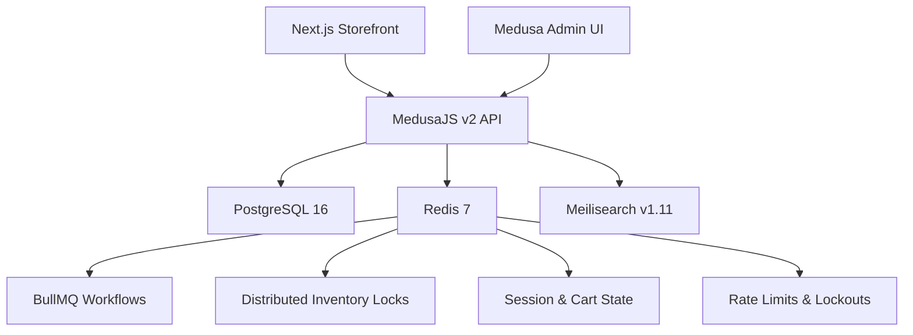
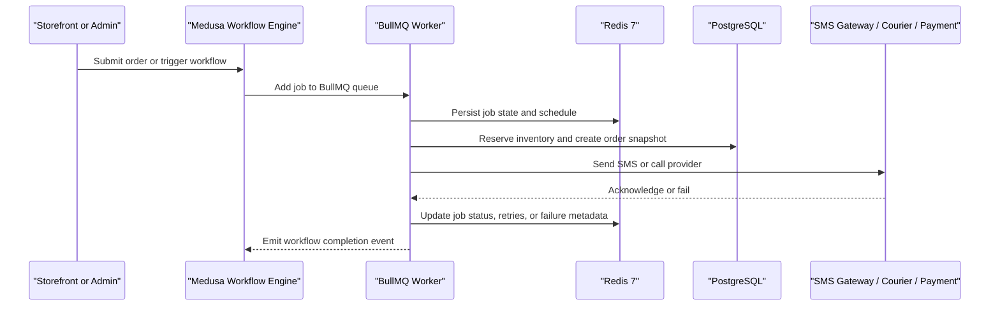
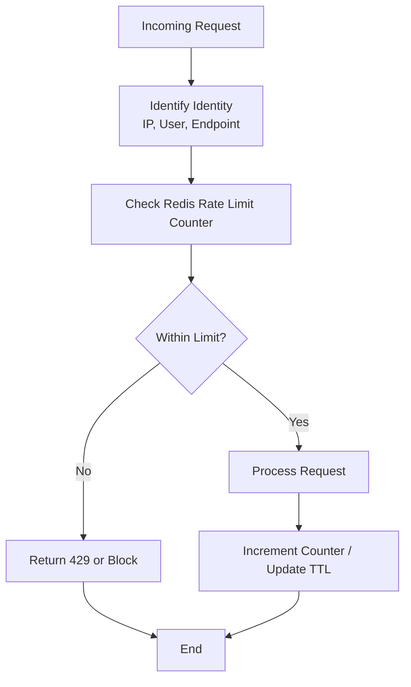
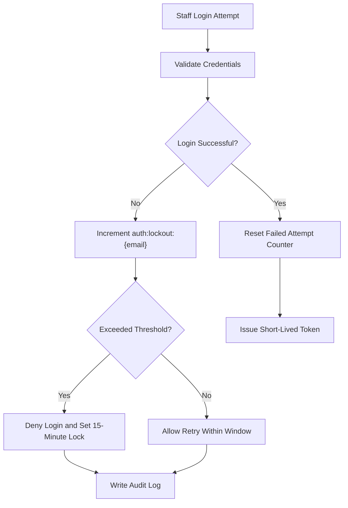
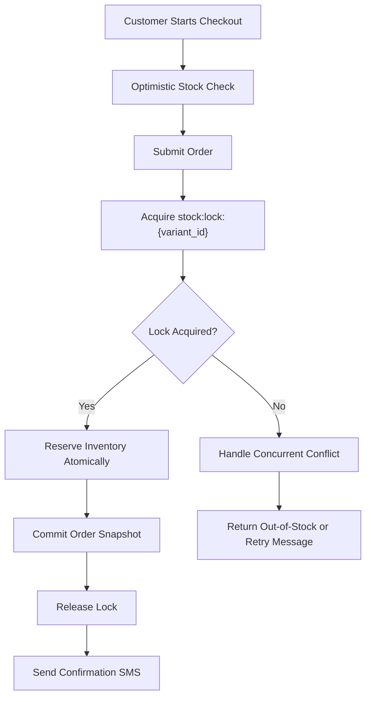

# Redis Cache & Queue

<cite>
**Referenced Files in This Document**
- [docker-compose.yml](file://docker-compose.yml)
- [medusa-config.ts](file://apps/medusa/medusa-config.ts)
- [package.json](file://apps/api/package.json)
- [architecture.md](file://docs/architecture.md)
- [dfd-review.md](file://docs/dfd-review.md)
- [database.md](file://database.md)
- [PROJECT_CONTEXT_HANDOFF.md](file://PROJECT_CONTEXT_HANDOFF.md)
- [agent.md](file://agent.md)
- [final-system-validation.md](file://final-system-validation.md)
</cite>

## Table of Contents
1. [Introduction](#introduction)
2. [Project Structure and Redis Placement](#project-structure-and-redis-placement)
3. [Redis 7 Infrastructure and High Availability](#redis-7-infrastructure-and-high-availability)
4. [BullMQ Integration for Workflow Orchestration](#bullmq-integration-for-workflow-orchestration)
5. [Cache, Session, and Rate Limiting Design](#cache-session-and-rate-limiting-design)
6. [Account Lockout and Security Controls](#account-lockout-and-security-controls)
7. [Distributed Locking for Inventory Management](#distributed-locking-for-inventory-management)
8. [Cache Invalidation and Memory Optimization](#cache-invalidation-and-memory-optimization)
9. [Monitoring, Observability, and Reliability](#monitoring-observability-and-reliability)
10. [Data Persistence, Disaster Recovery, and Production Hardening](#data-persistence-disaster-recovery-and-production-hardening)
11. [Operational Troubleshooting Guide](#operational-troubleshooting-guide)
12. [Conclusion](#conclusion)

## Introduction
This document explains how the platform uses Redis 7 as a combined cache, distributed queue, session store, rate limiter, security state store, and distributed locking backend. It also documents the planned BullMQ integration for Medusa workflow orchestration, including job scheduling, retry behavior, error handling, inventory protection, and production operations such as high availability, persistence, and disaster recovery.

The repository currently contains:
- A Redis 7 container with optional password authentication.
- Medusa configuration that reads `REDIS_URL`.
- Dependencies on `ioredis` and `bullmq` at the workspace level.
- Architectural documentation describing Redis key patterns, BullMQ queues, account lockout, rate limiting, distributed inventory locks, SMS deduplication, and workflow reliability.

This guide is intended for engineers implementing or operating these features, as well as reviewers validating production readiness.

## Project Structure and Redis Placement
Redis is part of the infrastructure layer alongside PostgreSQL and Meilisearch. The Medusa backend consumes Redis through its configuration, while the broader architecture describes where Redis is used for workflows, sessions, rate limits, locks, and audit-related operational state.

**Diagram sources**
- [docker-compose.yml:22-44](file://docker-compose.yml#L22-L44)
- [medusa-config.ts:7-18](file://apps/medusa/medusa-config.ts#L7-L18)
- [architecture.md:112-118](file://docs/architecture.md#L112-L118)

**Section sources**
- [docker-compose.yml:22-44](file://docker-compose.yml#L22-L44)
- [medusa-config.ts:7-18](file://apps/medusa/medusa-config.ts#L7-L18)
- [architecture.md:112-118](file://docs/architecture.md#L112-L118)

## Redis 7 Infrastructure and High Availability
### Current Deployment
- Image: `redis:7-alpine`.
- Container name: `bd_commerce_redis`.
- Port: `6379`.
- Optional password: enabled when `REDIS_PASSWORD` is set; otherwise runs without authentication.
- Healthcheck: `redis-cli ping`.
- Volume: `redis_data` mounted at `/data`.
- Network: `bd_commerce_network`.

### High Availability Considerations
The current Docker Compose file defines a single Redis instance. For production high availability, consider:
- Running Redis in Sentinel mode or using a managed Redis service.
- Configuring multiple replicas and automatic failover.
- Isolating Redis from other services by network policy.
- Enforcing TLS between application containers and Redis.
- Separating workload types (queues, cache, locks) across logical channels or dedicated instances if traffic grows significantly.

### Environment Configuration
- Medusa reads `REDIS_URL` from environment variables.
- The repository’s handoff documentation confirms Redis is reserved for cache tagging, session management, and BullMQ worker queues.

**Section sources**
- [docker-compose.yml:22-44](file://docker-compose.yml#L22-L44)
- [medusa-config.ts:7-18](file://apps/medusa/medusa-config.ts#L7-L18)
- [PROJECT_CONTEXT_HANDOFF.md:88](file://PROJECT_CONTEXT_HANDOFF.md#L88)
- [PROJECT_CONTEXT_HANDOFF.md:159-164](file://PROJECT_CONTEXT_HANDOFF.md#L159-L164)

## BullMQ Integration for Workflow Orchestration
### Planned Architecture
The architecture designates `bull:medusa-*` as persistent BullMQ keys for Medusa Workflows. The workspace dependency lock includes `bullmq`, which depends on `ioredis`. The implementation plan references asynchronous BullMQ-based dispatchers for SMS and related background work.

**Diagram sources**
- [architecture.md:406-414](file://docs/architecture.md#L406-L414)
- [final-system-validation.md:146-147](file://final-system-validation.md#L146-L147)

### Job Scheduling
- Use BullMQ jobs for non-blocking steps after database commitment.
- Schedule recurring tasks, such as COD expiry checks, through scheduled workflows documented in the architecture.
- Keep job payloads small and idempotent; use unique job identifiers tied to orders or carts.

### Retry Mechanisms
- Configure exponential backoff for transient failures such as gateway timeouts.
- Separate transient errors from permanent business errors:
  - Transient: retry with backoff.
  - Permanent: mark job failed, alert operators, and allow manual replay.
- Track retry counts and last error in job metadata stored in Redis.

### Error Handling Patterns
- Do not treat SMS or external provider failures as reasons to roll back committed orders.
- Log failures to an audit or operation log table.
- Provide admin visibility into failed jobs and enable safe reprocessing.
- Ensure compensation logic exists for multi-step workflows before irreversible actions.

**Section sources**
- [architecture.md:406-414](file://docs/architecture.md#L406-L414)
- [final-system-validation.md:146-147](file://final-system-validation.md#L146-L147)
- [package.json:16-23](file://apps/api/package.json#L16-L23)

## Cache, Session, and Rate Limiting Design
### Redis Key Registry
| Key Pattern | TTL | Role | Purpose |
|---|---:|---|---|
| `bull:medusa-*` | Persistent | Workflow Queue | BullMQ job queue for Medusa Workflows |
| `stock:lock:{variant_id}` | 30s | Distributed Mutex | Atomic lock during concurrent checkout |
| `auth:lockout:{user_email}` | 15 min | Security | Staff account lockout after 5 failed logins |
| `ratelimit:{ip}:{endpoint}` | 60s | Token Bucket | Endpoint abuse protection |
| `ratelimit:track:{ip}` | 60s | Phone Privacy | Rate limit on order tracking lookups |
| `cart:{cart_id}` | 24h | Session Cache | Cached cart payload to reduce DB reads |
| `sms:ratelimit:{order_id}:{event}` | 1h | Deduplication | Max 3 SMS per order per event type |

### Session Storage
- The architecture treats `cart:{cart_id}` as a cached cart payload with a 24-hour TTL.
- Medusa’s auth and session behavior should be aligned with this pattern: short-lived tokens, server-side session invalidation on sensitive changes, and Redis-backed session storage where applicable.

### Rate Limiting Strategies
- Use token-bucket or sliding-window counters per IP or per authenticated user.
- Apply stricter limits on sensitive endpoints such as order creation and staff authentication.
- Combine IP-level rate limiting with account-level lockout for brute-force protection.

**Diagram sources**
- [architecture.md:423-431](file://docs/architecture.md#L423-L431)

**Section sources**
- [architecture.md:406-431](file://docs/architecture.md#L406-L431)

## Account Lockout and Security Controls
### Account-Level Lockout
- Redis key `auth:lockout:{user_email}` tracks consecutive failed login attempts per staff account.
- After five consecutive failed attempts, the account is locked for 15 minutes across all IPs.
- Failed attempts and lockout triggers are recorded in the audit log and flagged to administrators.

### Session Invalidation
- Changing a staff password or modifying roles/permissions invalidates active JWT or refresh session tokens stored in Redis.
- This prevents attackers from continuing to use previously issued tokens after credentials change.

**Diagram sources**
- [architecture.md:375-380](file://docs/architecture.md#L375-L380)

**Section sources**
- [architecture.md:375-380](file://docs/architecture.md#L375-L380)

## Distributed Locking for Inventory Management
### Purpose
Distributed locks prevent overselling when multiple checkouts attempt to reserve the same low-stock variant simultaneously.

### Lock Scope and Timing
- The lock key is `stock:lock:{variant_id}` with a 30-second TTL.
- The lock must be acquired only at the instant of order submission, not during address entry or long-running checkout flows.
- Address validation should be optimistic; actual stock reservation occurs atomically during order placement.

**Diagram sources**
- [architecture.md:409-421](file://docs/architecture.md#L409-L421)
- [dfd-review.md:89-94](file://docs/dfd-review.md#L89-L94)

### Concurrency Rules
- Never use a two-step “check then insert” pattern for inventory.
- Prefer atomic decrement or unique-insert reservation inside a transaction.
- Keep lock duration minimal to avoid blocking unrelated operations.

**Section sources**
- [architecture.md:409-421](file://docs/architecture.md#L409-L421)
- [dfd-review.md:89-94](file://docs/dfd-review.md#L89-L94)
- [database.md:2131-2146](file://database.md#L2131-L2146)

## Cache Invalidation and Memory Optimization
### Cache Invalidation Strategies
- Invalidate or update cart cache when items are added, removed, or when pricing/discounts change.
- Invalidate search indexes when product data changes, ensuring Meilisearch stays consistent.
- Invalidate staff sessions when passwords or permissions change.
- Use short TTLs for volatile state and longer TTLs for stable reference data.

### Memory Optimization Techniques
- Use compact serialization formats for large payloads.
- Avoid storing full objects in Redis when IDs plus lightweight summaries are sufficient.
- Set explicit TTLs on all keys to prevent unbounded growth.
- Monitor Redis memory usage and configure eviction policies appropriate for cache vs. queue vs. lock workloads.
- Separate logical namespaces using key prefixes and, if needed, separate databases or channels.

### Monitoring Approaches
- Track Redis memory, connected clients, commands per second, hit/miss ratios, and latency.
- Alert on memory saturation, slow commands, and unexpected key growth.
- Correlate queue depth, job failure rates, and lock contention with application performance.

[No sources needed since this section provides general guidance]

## Data Persistence, Disaster Recovery, and Production Hardening
### Current Persistence
- The Docker Compose configuration mounts `redis_data:/data`.
- By default, Redis may run with append-only file or RDB persistence depending on image defaults and runtime flags.
- The repository does not explicitly define Redis persistence flags in the compose command beyond optional password authentication.

### Recommended Production Configuration
- Enable append-only file (AOF) for durability with fsync strategies tuned for performance and safety.
- Optionally enable RDB snapshots for point-in-time recovery.
- Back up Redis data volumes regularly.
- Test restore procedures in staging before deploying to production.
- Use managed Redis services with built-in backups, replication, and failover when possible.

### Disaster Recovery Procedures
1. Detect failure via healthchecks and monitoring alerts.
2. If using Sentinel or managed failover, promote replica automatically.
3. Restore latest backup if data loss occurred.
4. Verify queue integrity: ensure no duplicate processing of critical jobs.
5. Reconcile inventory and order states against PostgreSQL.
6. Resume workers and monitor queue backlog.

**Section sources**
- [docker-compose.yml:22-44](file://docker-compose.yml#L22-L44)
- [PROJECT_CONTEXT_HANDOFF.md:159-164](file://PROJECT_CONTEXT_HANDOFF.md#L159-L164)

## Operational Troubleshooting Guide
### Common Issues
- **Redis connection failures:** Verify `REDIS_URL`, port exposure, password configuration, and network connectivity.
- **Queue stalls:** Check BullMQ worker processes, Redis memory pressure, and job failure logs.
- **Inventory oversell risk:** Confirm locks are acquired only at order submission and released promptly.
- **Account lockout false positives:** Review failed login spikes and potential automated attacks.
- **Rate limit misconfiguration:** Validate per-endpoint thresholds and window sizes.

### Diagnostic Steps
- Inspect Redis keys matching known patterns: queues, locks, rate limits, sessions.
- Check Redis memory and eviction behavior.
- Review audit logs for lockout events and failed operations.
- Validate workflow execution and job retry history.
- Compare Redis state with PostgreSQL order and inventory records.

**Section sources**
- [architecture.md:375-431](file://docs/architecture.md#L375-L431)
- [agent.md:75](file://agent.md#L75)

## Conclusion
The platform positions Redis 7 as the central coordination layer for caching, sessions, rate limiting, security state, distributed inventory locks, and BullMQ-backed workflow queues. The current repository provides strong architectural definitions and infrastructure scaffolding, but concrete Redis client implementations for cache, session, rate limiting, and BullMQ workers should be implemented carefully to match the documented key patterns, lock scopes, and reliability guarantees.

For production readiness, prioritize:
- Secure Redis access with authentication and TLS.
- Robust BullMQ worker lifecycle, retry policies, and observability.
- Minimal lock durations and strict inventory reservation semantics.
- Clear cache invalidation rules and memory controls.
- Tested persistence, backup, and disaster recovery procedures.