# Layer Architecture & Component Boundaries

<cite>
**Referenced Files in This Document**   
- [medusa-config.ts](file://apps/medusa/medusa-config.ts)
- [middlewares.ts](file://apps/medusa/src/api/middlewares.ts)
- [store-custom-route.ts](file://apps/medusa/src/api/store/custom/route.ts)
- [admin-custom-route.ts](file://apps/medusa/src/api/admin/custom/route.ts)
- [web-package.json](file://apps/web/package.json)
- [docker-compose.yml](file://docker-compose.yml)
- [architecture.md](file://docs/architecture.md)
- [technical-plan.md](file://technical-plan.md)
- [project-context-handoff.md](file://PROJECT_CONTEXT_HANDOFF.md)
</cite>

## Table of Contents
1. [Introduction](#introduction)
2. [Project Structure](#project-structure)
3. [Core Components](#core-components)
4. [Architecture Overview](#architecture-overview)
5. [Detailed Component Analysis](#detailed-component-analysis)
6. [Dependency Analysis](#dependency-analysis)
7. [Performance Considerations](#performance-considerations)
8. [Troubleshooting Guide](#troubleshooting-guide)
9. [Conclusion](#conclusion)

## Introduction
This document explains the layered architecture and component boundaries of the BD Commerce Platform. It focuses on how the system is organized into four primary layers:

- **Presentation Layer:** Next.js storefront at port 3000 with bilingual routing, plus Medusa Admin UI embedded at port 9000/app.
- **API Gateway & Router Layer:** MedusaJS v2 HTTP router exposing `/store/*`, `/admin/*`, `/hooks/*`, and `/api/*` route namespaces.
- **Commerce Domain Layer:** Medusa core modules combined with Bangladesh-specific custom modules, coordinated by a workflow engine.
- **Data & Infrastructure Layer:** PostgreSQL for relational data, Redis for workflows and caching, and Meilisearch for search indexing.

The goal is to make the architectural boundaries, inter-layer communication patterns, and end-to-end data flows clear for both technical and non-technical readers.

## Project Structure
The repository follows a monorepo layout with three main application areas:

| Area | Purpose | Key Evidence |
|---|---|---|
| `apps/web` | Next.js storefront running on port 3000 | Scripts use `next dev -p 3000` and `next start -p 3000` |
| `apps/medusa` | MedusaJS v2 backend, custom modules, API routes, and embedded admin UI | Module registration, CORS configuration, and API route scaffolding |
| `docker-compose.yml` | Local infrastructure services for PostgreSQL, Redis, and Meilisearch | Container images, ports, volumes, and healthchecks |

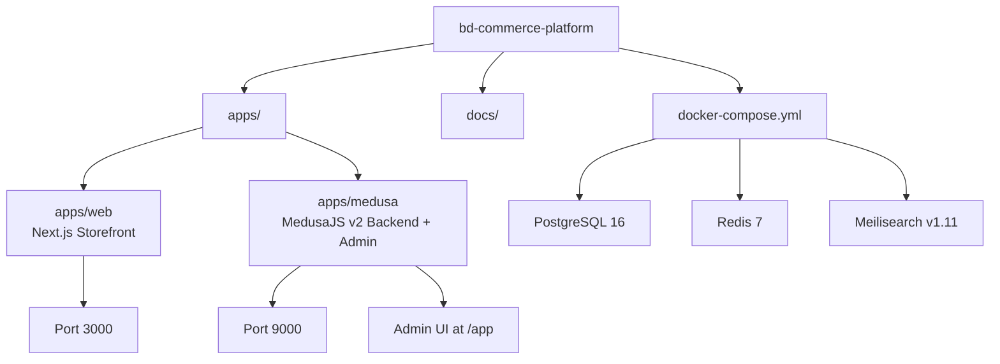

**Diagram sources**
- [web-package.json:6-10](file://apps/web/package.json#L6-L10)
- [medusa-config.ts:7-45](file://apps/medusa/medusa-config.ts#L7-L45)
- [docker-compose.yml:1-77](file://docker-compose.yml#L1-L77)

**Section sources**
- [web-package.json:1-28](file://apps/web/package.json#L1-L28)
- [medusa-config.ts:1-46](file://apps/medusa/medusa-config.ts#L1-L46)
- [docker-compose.yml:1-77](file://docker-compose.yml#L1-L77)

## Core Components
The platform’s runtime is composed of five major components:

1. **Next.js Storefront (`apps/web`)**  
   - Runs on port 3000.
   - Uses Next.js App Router, React 19, Tailwind CSS, and TypeScript.
   - Designed for SSR/ISR catalog pages, cart state, checkout, campaign landing pages, and bilingual routing.

2. **MedusaJS Backend (`apps/medusa`)**  
   - Loads environment variables from root and app directories.
   - Configures database URL, Redis URL, CORS origins, JWT secret, and cookie secret.
   - Registers Bangladesh custom modules such as `bd-catalog`, `bd-orders`, `bd-courier`, `bd-payments`, `bd-campaigns`, `bd-settings`, and `bd-audit`.

3. **Embedded Medusa Admin UI**  
   - Enabled via `admin.disable = false`.
   - Served under the same backend host, typically accessed at port 9000/app.
   - Provides native commerce screens plus custom Bangladeshi operational routes.

4. **API Route Layer**  
   - File-based route handlers under `src/api`.
   - Supports `/store/*`, `/admin/*`, and `/hooks/*` namespaces.
   - Includes middleware configuration for store search and route-level middlewares.

5. **Infrastructure Services**  
   - PostgreSQL 16 for relational persistence.
   - Redis 7 for workflows, queues, rate limiting, and distributed locks.
   - Meilisearch v1.11 for full-text product search.

**Section sources**
- [web-package.json:1-28](file://apps/web/package.json#L1-L28)
- [medusa-config.ts:1-46](file://apps/medusa/medusa-config.ts#L1-L46)
- [middlewares.ts:1-20](file://apps/medusa/src/api/middlewares.ts#L1-L20)
- [docker-compose.yml:1-77](file://docker-compose.yml#L1-L77)

## Architecture Overview
At a high level, the BD Commerce Platform implements a layered architecture where each layer has a clear responsibility and communicates through well-defined interfaces.

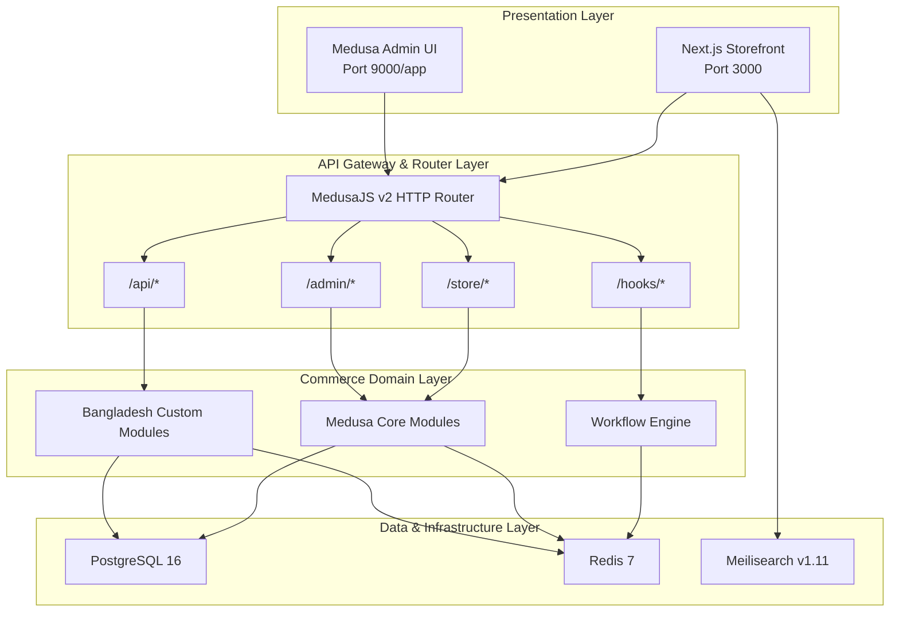

**Diagram sources**
- [architecture.md:77-124](file://docs/architecture.md#L77-L124)
- [technical-plan.md:59-111](file://technical-plan.md#L59-L111)
- [medusa-config.ts:7-45](file://apps/medusa/medusa-config.ts#L7-L45)
- [docker-compose.yml:1-77](file://docker-compose.yml#L1-L77)

### Layer Responsibilities

| Layer | Responsibility | Boundary Rule |
|---|---|---|
| Presentation Layer | Renders storefront pages, handles user interaction, manages cart state, and serves admin UI. | Does not directly access PostgreSQL or external payment/courier APIs. Communicates through Medusa REST APIs. |
| API Gateway & Router Layer | Routes requests to appropriate handlers, applies CORS, authentication, rate limits, and search configuration. | Exposes stable route namespaces; internal business logic lives in domain modules. |
| Commerce Domain Layer | Encapsulates commerce rules, Bangladesh-specific extensions, and transactional workflows. | Core Medusa modules are extended, not replaced. Bangladesh modules communicate via Medusa services and links. |
| Data & Infrastructure Layer | Persists relational data, provides caching/queues, and indexes searchable content. | Accessed only through Medusa services or module services; direct client access is restricted. |

**Section sources**
- [architecture.md:77-124](file://docs/architecture.md#L77-L124)
- [technical-plan.md:59-111](file://technical-plan.md#L59-L111)

## Detailed Component Analysis

### Presentation Layer: Next.js Storefront and Medusa Admin UI

#### Next.js Storefront
- The storefront package defines development and production scripts that bind to port 3000.
- According to the architecture documentation, the storefront uses Next.js App Router with server-side rendering, incremental static regeneration, client-side cart state, and bilingual routing under `[locale]`.
- The storefront communicates with Medusa using `@medusajs/js-sdk`, either from server components or browser clients.

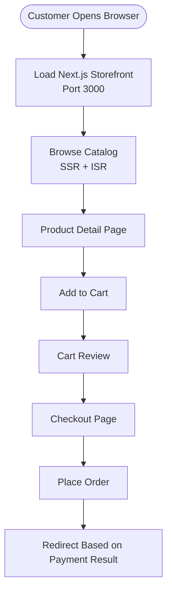

**Diagram sources**
- [web-package.json:6-10](file://apps/web/package.json#L6-L10)
- [architecture.md:738-756](file://docs/architecture.md#L738-L756)
- [architecture.md:318-334](file://docs/architecture.md#L318-L334)

#### Medusa Admin UI
- The Medusa backend enables the embedded admin UI.
- The admin UI runs under the backend host, typically at port 9000/app.
- It provides native commerce screens plus custom Bangladeshi operational routes such as COD queue, manual order creation, courier manifest, returns, content management, reports, audit logs, and settings.

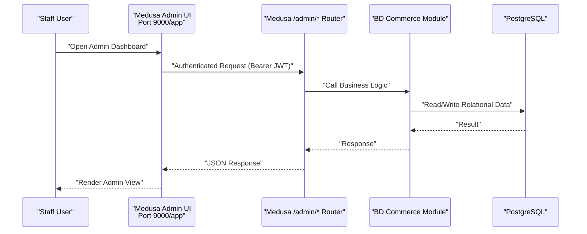

**Diagram sources**
- [medusa-config.ts:19-21](file://apps/medusa/medusa-config.ts#L19-L21)
- [architecture.md:766-800](file://docs/architecture.md#L766-L800)

**Section sources**
- [web-package.json:1-28](file://apps/web/package.json#L1-L28)
- [medusa-config.ts:19-21](file://apps/medusa/medusa-config.ts#L19-L21)
- [architecture.md:738-800](file://docs/architecture.md#L738-L800)

### API Gateway & Router Layer: MedusaJS v2 HTTP Router

The API gateway layer is responsible for request routing, CORS configuration, search configuration, and exposing route namespaces.

| Namespace | Consumer | Purpose | Security Model |
|---|---|---|---|
| `/store/*` | Next.js storefront | Public storefront API including products, carts, orders, and custom endpoints | Public or cart-token scoped; CORS-restricted |
| `/admin/*` | Medusa Admin UI | Protected administrative operations | Bearer JWT and RBAC |
| `/hooks/*` | External providers | Payment and courier webhooks | Signature/HMAC verification and zero-trust validation |
| `/api/*` | Internal or custom endpoints | Bangladesh-specific storefront endpoints | Internal or controlled access |

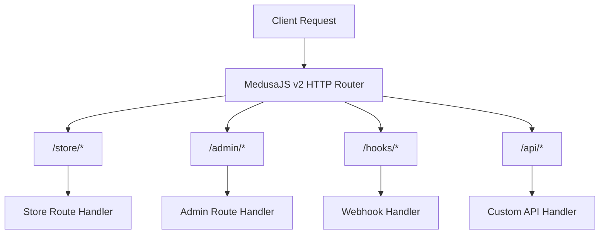

**Diagram sources**
- [architecture.md:91-96](file://docs/architecture.md#L91-L96)
- [architecture.md:305-316](file://docs/architecture.md#L305-L316)
- [technical-plan.md:76-81](file://technical-plan.md#L76-L81)

#### Middleware and Search Configuration
The current middleware configuration demonstrates how Medusa v2 applies route-level middlewares. In this codebase, the store search endpoint is configured with allowed indexes, which aligns with the documented search architecture that restricts public search to safe fields.

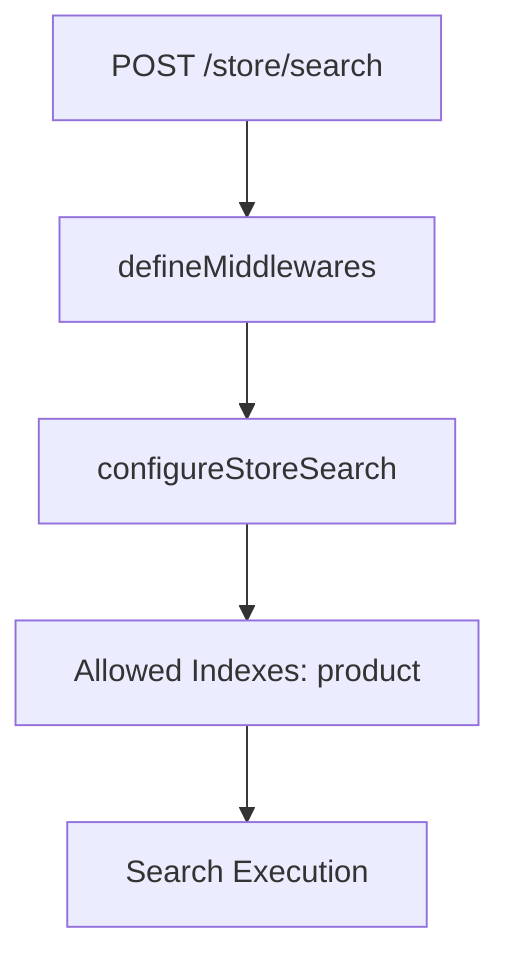

**Diagram sources**
- [middlewares.ts:1-20](file://apps/medusa/src/api/middlewares.ts#L1-L20)
- [architecture.md:435-463](file://docs/architecture.md#L435-L463)

**Section sources**
- [architecture.md:91-96](file://docs/architecture.md#L91-L96)
- [architecture.md:305-334](file://docs/architecture.md#L305-L334)
- [middlewares.ts:1-20](file://apps/medusa/src/api/middlewares.ts#L1-L20)
- [store-custom-route.ts:1-9](file://apps/medusa/src/api/store/custom/route.ts#L1-L9)
- [admin-custom-route.ts:1-9](file://apps/medusa/src/api/admin/custom/route.ts#L1-L9)

### Commerce Domain Layer: Medusa Core Modules vs Bangladesh Custom Modules

The commerce domain layer separates generic commerce capabilities from Bangladesh-specific operational requirements.

#### Medusa Core Modules
Core modules provide foundational commerce primitives:

- Product, pricing, inventory, cart, order, customer, auth, and fulfillment.
- These modules are extended rather than replaced.
- They persist relational data through Medusa’s DML and MikroORM integration.

#### Bangladesh Custom Modules
Bangladesh-specific modules encapsulate local market needs:

| Module | Responsibility |
|---|---|
| `bd-catalog` | Product localization, category attributes, attribute values |
| `bd-orders` | Order extension, risk profile, return review, COD lifecycle |
| `bd-payments` | COD, bKash, Nagad payment providers |
| `bd-courier` | Courier adapters and webhook mapping |
| `bd-campaigns` | Landing page model and builder logic |
| `bd-settings` | Delivery zones, VAT configuration, SMS keys |
| `bd-audit` | Audit logging service and subscribers |

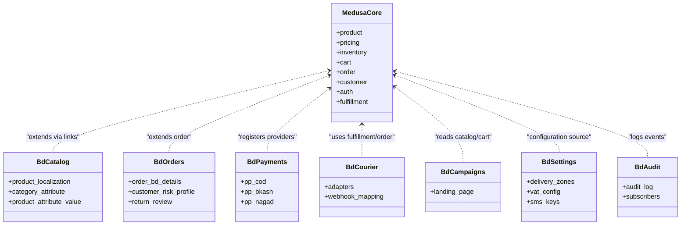

**Diagram sources**
- [architecture.md:227-302](file://docs/architecture.md#L227-L302)
- [architecture.md:569-688](file://docs/architecture.md#L569-L688)
- [medusa-config.ts:22-44](file://apps/medusa/medusa-config.ts#L22-L44)

#### Workflow Engine
Workflows coordinate multi-step, transactional processes:

- `order-placement`: Validates cart, reserves inventory, creates order snapshot, captures payment, writes BD details, updates risk profile, clears cart, dispatches SMS.
- `cod-confirmation`: Confirms unconfirmed COD orders, logs staff action, transitions shipment state, sends SMS.
- `courier-dispatch`: Resolves courier adapter, books parcel, persists tracking, updates shipment state, sends dispatched SMS.
- `return-refund`: Strictly manual review and recording flow with independent return status.

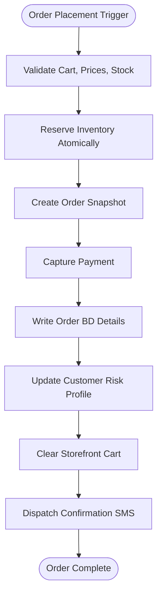

**Diagram sources**
- [architecture.md:696-735](file://docs/architecture.md#L696-L735)

**Section sources**
- [architecture.md:227-302](file://docs/architecture.md#L227-L302)
- [architecture.md:569-735](file://docs/architecture.md#L569-L735)
- [medusa-config.ts:22-44](file://apps/medusa/medusa-config.ts#L22-L44)

### Data & Infrastructure Layer: PostgreSQL, Redis, Meilisearch

The data and infrastructure layer provides persistence, caching, queuing, and search capabilities.

| Service | Role | Ports | Persistence |
|---|---|---:|---|
| PostgreSQL 16 | Primary relational database for Medusa core and Bangladesh custom models | 5432 | `postgres_data` volume |
| Redis 7 | Workflows, event bus, distributed locks, rate limits, session storage | 6379 | `redis_data` volume |
| Meilisearch v1.11 | Full-text product search with Banglish support | 7700 | `meilisearch_data` volume |

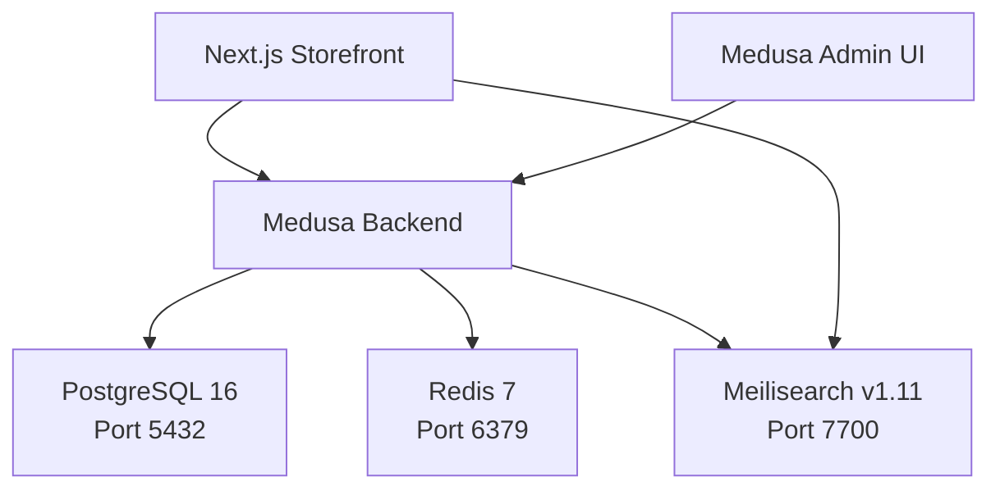

**Diagram sources**
- [docker-compose.yml:1-77](file://docker-compose.yml#L1-L77)
- [architecture.md:112-118](file://docs/architecture.md#L112-L118)
- [project-context-handoff.md:149-171](file://PROJECT_CONTEXT_HANDOFF.md#L149-L171)

**Section sources**
- [docker-compose.yml:1-77](file://docker-compose.yml#L1-L77)
- [architecture.md:112-118](file://docs/architecture.md#L112-L118)
- [project-context-handoff.md:149-171](file://PROJECT_CONTEXT_HANDOFF.md#L149-L171)

## Dependency Analysis

### Inter-Layer Dependencies
The platform enforces strict layering:

- Presentation depends on API Gateway.
- API Gateway depends on Commerce Domain.
- Commerce Domain depends on Data & Infrastructure.
- External integrations are invoked from domain workflows and hooks, never directly from presentation.

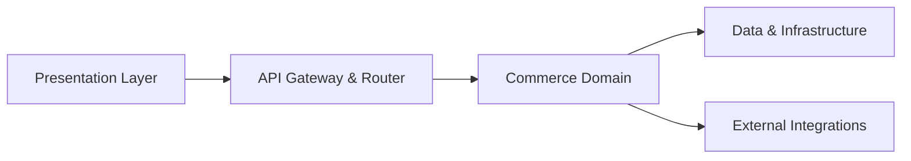

**Diagram sources**
- [architecture.md:77-124](file://docs/architecture.md#L77-L124)
- [technical-plan.md:59-111](file://technical-plan.md#L59-L111)

### Module Registration and Runtime Configuration
The Medusa configuration file shows how Bangladesh modules are registered and how runtime configuration is loaded.

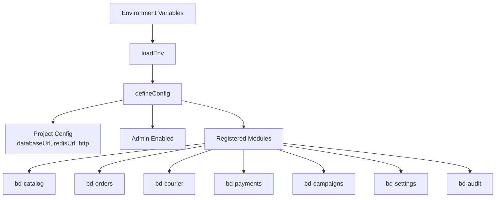

**Diagram sources**
- [medusa-config.ts:1-46](file://apps/medusa/medusa-config.ts#L1-L46)

**Section sources**
- [architecture.md:77-124](file://docs/architecture.md#L77-L124)
- [technical-plan.md:59-111](file://technical-plan.md#L59-L111)
- [medusa-config.ts:1-46](file://apps/medusa/medusa-config.ts#L1-L46)

## Performance Considerations
Performance characteristics are shaped by the chosen technologies and their responsibilities:

- **PostgreSQL** provides ACID guarantees for orders, payments, inventory, and audit logs. Monetary values are stored as bigint paisa to avoid floating-point precision issues.
- **Redis** supports workflow queues, distributed inventory locks, rate limiting, account lockouts, and session/cache storage.
- **Meilisearch** delivers fast, typo-tolerant search for English and Banglish queries while excluding confidential financial fields from public indexes.
- **Next.js SSR/ISR** reduces initial load time for catalog and policy pages while preserving real-time cart and checkout behavior.
- **Workflows** ensure reliable multi-step operations without leaving systems in inconsistent states.

[No sources needed since this section provides general guidance]

## Troubleshooting Guide

### Common Layer Issues

| Symptom | Likely Layer | Diagnostic Focus |
|---|---|---|
| Storefront cannot connect to backend | Presentation/API Gateway | CORS configuration, backend port, `STORE_CORS`, `ADMIN_CORS`, `AUTH_CORS` |
| Admin UI not loading | Presentation/API Gateway | Admin enabled flag, port 9000, JWT secrets |
| Search returns no results | API Gateway/Data | Meilisearch container health, allowed indexes, sync workflow |
| Orders placed but inventory not reserved | Commerce Domain/Data | Workflow execution, Redis locks, PostgreSQL transactions |
| Webhooks fail signature validation | API Gateway/Domain | Provider signature verification, zero-trust validation |
| Database connection fails | Data & Infrastructure | PostgreSQL container, `DATABASE_URL`, healthcheck |
| Workflows stuck or slow | Data & Infrastructure | Redis availability, BullMQ queue, memory/CPU pressure |

### Configuration Checklist
- Verify `DATABASE_URL` points to PostgreSQL.
- Verify `REDIS_URL` points to Redis.
- Verify CORS origins include Next.js storefront and Medusa Admin UI.
- Verify JWT and cookie secrets are set securely.
- Verify Meilisearch master key and port exposure.

**Section sources**
- [medusa-config.ts:7-18](file://apps/medusa/medusa-config.ts#L7-L18)
- [docker-compose.yml:1-77](file://docker-compose.yml#L1-L77)
- [architecture.md:305-334](file://docs/architecture.md#L305-L334)

## Conclusion
The BD Commerce Platform implements a clean, extensible layered architecture:

- The **Presentation Layer** separates customer-facing storefront and administrative UI concerns.
- The **API Gateway & Router Layer** centralizes routing, security, and cross-cutting concerns.
- The **Commerce Domain Layer** preserves Medusa core capabilities while isolating Bangladesh-specific logic in modular, testable units.
- The **Data & Infrastructure Layer** provides reliable persistence, caching, and search capabilities.

This separation makes it easier to evolve storefront technology, add new Bangladesh modules, integrate additional payment or courier providers, and scale infrastructure independently.

[No sources needed since this section summarizes without analyzing specific files]