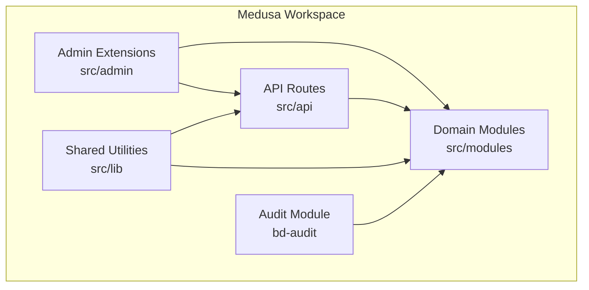
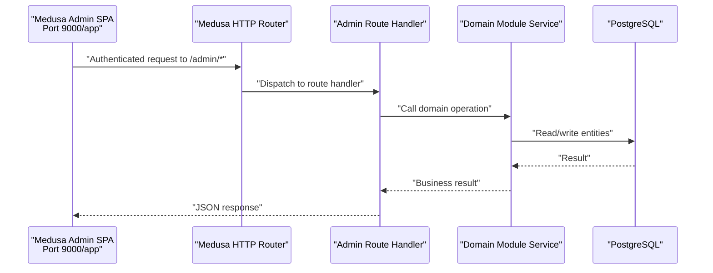
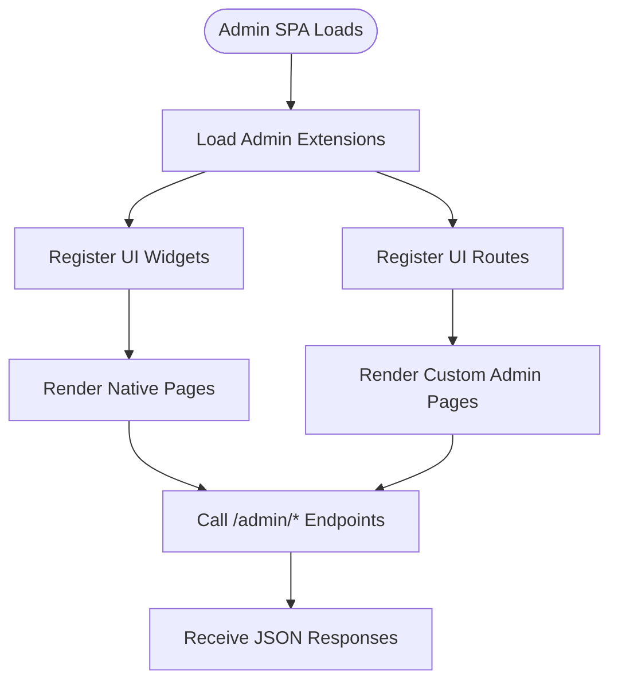
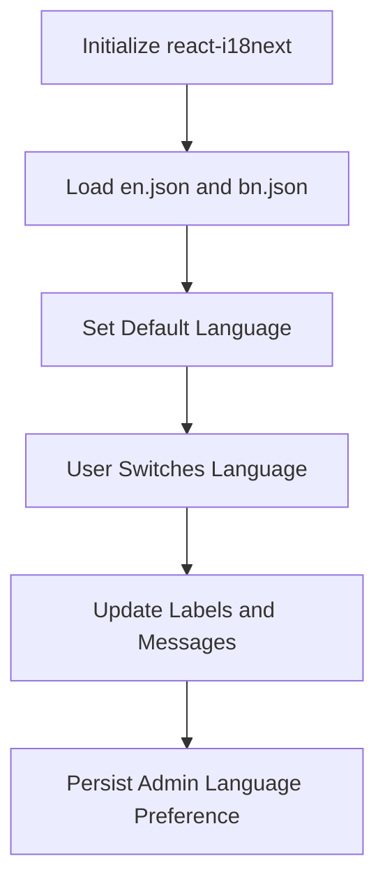
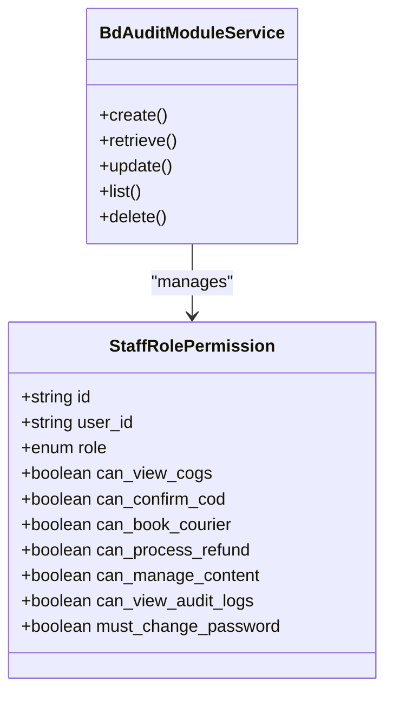
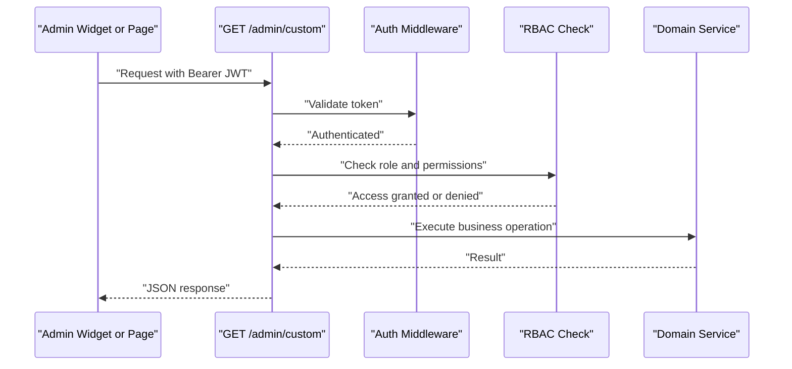
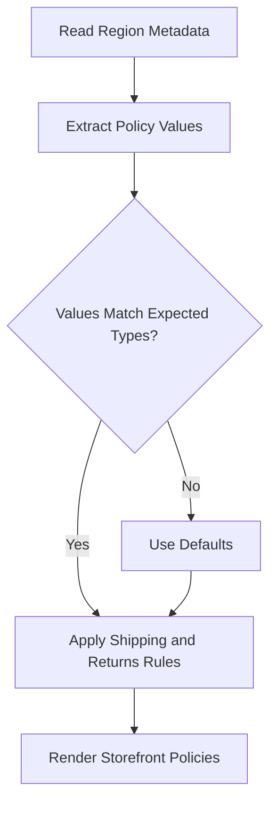
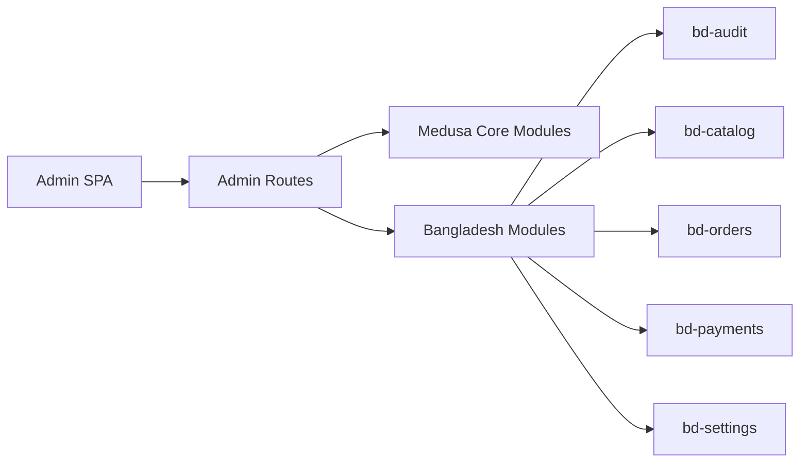

# Admin Interface (Medusa Admin)

<cite>
**Referenced Files in This Document**
- [architecture-decision-medusa-v2.md](file://docs/architecture-decision-medusa-v2.md)
- [architecture.md](file://docs/architecture.md)
- [medusa-admin-reference-audit.md](file://docs/medusa-admin-reference-audit.md)
- [data-models.md](file://docs/data-models.md)
- [user-journeys.md](file://user-journeys.md)
- [agent.md](file://agent.md)
- [technical-plan.md](file://technical-plan.md)
- [ideaproposition.md](file://ideaproposition.md)
- [admin README.md](file://apps/medusa/src/admin/README.md)
- [admin i18n index.ts](file://apps/medusa/src/admin/i18n/index.ts)
- [admin i18n README.md](file://apps/medusa/src/admin/i18n/README.md)
- [admin custom route.ts](file://apps/medusa/src/api/admin/custom/route.ts)
- [region store policies.ts](file://apps/medusa/src/lib/region-store-policies.ts)
- [bd-audit service.ts](file://apps/medusa/src/modules/bd-audit/service.ts)
- [staff-role-permission model.ts](file://apps/medusa/src/modules/bd-audit/models/staff-role-permission.ts)
- [audit-log model.ts](file://apps/medusa/src/modules/bd-audit/models/audit-log.ts)
</cite>

## Table of Contents
1. [Introduction](#introduction)
2. [Project Structure](#project-structure)
3. [Core Components](#core-components)
4. [Architecture Overview](#architecture-overview)
5. [Detailed Component Analysis](#detailed-component-analysis)
6. [Dependency Analysis](#dependency-analysis)
7. [Performance Considerations](#performance-considerations)
8. [Troubleshooting Guide](#troubleshooting-guide)
9. [Conclusion](#conclusion)
10. [Appendices](#appendices)

## Introduction
This document explains the Medusa Admin interface running at `port 9000/app` for this Bangladesh commerce platform. It covers:
- The embedded React single-page application architecture provided by Medusa v2.
- Custom admin extensions, including UI widgets and routes.
- Staff role-based access control through the `bd-audit` module.
- Internationalization setup for Bangla and English admin interfaces.
- Custom API routes for administrative operations.
- Region-specific store policies used by the storefront and settings.
- Security, audit logging, and operational control over catalog, orders, payments, and system configuration.

The goal is to help developers, administrators, and operators understand how the admin panel fits into the broader commerce engine and how to extend it safely.

## Project Structure
The Medusa workspace under `apps/medusa` contains:
- `src/admin`: Official Medusa Admin extension points for widgets, routes, and translations.
- `src/api`: HTTP route handlers, including protected `/admin/*` endpoints.
- `src/lib`: Shared utilities such as region store policy types and defaults.
- `src/modules`: Domain modules, including `bd-audit`, which models staff permissions and audit logs.

**Diagram sources**
- [admin README.md:1-33](file://apps/medusa/src/admin/README.md#L1-L33)
- [admin custom route.ts:1-9](file://apps/medusa/src/api/admin/custom/route.ts#L1-L9)
- [region store policies.ts:1-25](file://apps/medusa/src/lib/region-store-policies.ts#L1-L25)
- [bd-audit service.ts:1-11](file://apps/medusa/src/modules/bd-audit/service.ts#L1-L11)

**Section sources**
- [architecture.md:77-124](file://docs/architecture.md#L77-L124)
- [agent.md:149-222](file://agent.md#L149-L222)

## Core Components
The admin interface is built on Medusa’s embedded SPA and extended through official mechanisms:
- **Embedded Admin SPA**: Medusa v2 ships the admin directly with the backend bundle, using Vite and React, styled with `@medusajs/ui`.
- **Admin Extensions**: Widgets inject UI into native pages; routes add new admin screens.
- **Custom API Routes**: Protected endpoints under `/admin/*` expose administrative operations.
- **Region Store Policies**: Types and defaults define shipping, returns, and handling behavior per region.
- **Staff Roles and Audit Logging**: The `bd-audit` module defines fine-grained permission flags and immutable audit records.

Key responsibilities:
- Admin SPA provides the base UX and navigation.
- Extensions customize product, order, and settings views.
- API routes implement business logic and enforce authorization.
- Audit module records sensitive actions and security events.

**Section sources**
- [architecture-decision-medusa-v2.md:19-24](file://docs/architecture-decision-medusa-v2.md#L19-L24)
- [medusa-admin-reference-audit.md:253-264](file://docs/medusa-admin-reference-audit.md#L253-L264)
- [admin README.md:1-33](file://apps/medusa/src/admin/README.md#L1-L33)
- [admin custom route.ts:1-9](file://apps/medusa/src/api/admin/custom/route.ts#L1-L9)
- [region store policies.ts:1-25](file://apps/medusa/src/lib/region-store-policies.ts#L1-L25)
- [bd-audit service.ts:1-11](file://apps/medusa/src/modules/bd-audit/service.ts#L1-L11)

## Architecture Overview
At runtime, the Medusa server exposes:
- Public storefront APIs under `/store/*`.
- Protected admin APIs under `/admin/*`.
- Webhook endpoints under `/hooks/*`.
- Custom storefront endpoints under `/api/*`.

The Medusa Admin SPA at `port 9000/app` communicates with these endpoints using Bearer JWT authentication. Custom admin routes and widgets call admin APIs to perform catalog, order, payment, and configuration operations.

**Diagram sources**
- [architecture.md:77-124](file://docs/architecture.md#L77-L124)
- [admin custom route.ts:1-9](file://apps/medusa/src/api/admin/custom/route.ts#L1-L9)

**Section sources**
- [architecture.md:77-124](file://docs/architecture.md#L77-L124)
- [architecture-decision-medusa-v2.md:19-24](file://docs/architecture-decision-medusa-v2.md#L19-L24)

## Detailed Component Analysis

### Embedded React SPA and Admin Extension Model
Medusa v2 embeds the admin SPA directly in the backend bundle. It uses:
- Vite + React for development and build.
- `@medusajs/ui` for consistent enterprise-grade UI primitives.
- Official extension points:
  - UI Widgets: Inject components into existing entity pages.
  - UI Routes: Add new admin pages under `/app/*`.

Practical customization examples:
- Add a widget to show Bangla fields or cost margins on product details.
- Create a dedicated COD confirmation queue page under `/app/cod-queue`.
- Extend order detail views with courier booking or return status widgets.

**Diagram sources**
- [admin README.md:1-33](file://apps/medusa/src/admin/README.md#L1-L33)
- [architecture-decision-medusa-v2.md:19-24](file://docs/architecture-decision-medusa-v2.md#L19-L24)

**Section sources**
- [admin README.md:1-33](file://apps/medusa/src/admin/README.md#L1-L33)
- [technical-plan.md:305-380](file://technical-plan.md#L305-L380)

### Internationalization Setup for Bangla and English Admin Interfaces
The admin translation system uses `react-i18next`. The repository includes:
- A placeholder translation export at `src/admin/i18n/index.ts`.
- Documentation describing where to place language JSON files and how to export them.

Implementation guidance:
- Place language JSON files under `src/admin/i18n/json/`, for example `en.json` and `bn.json`.
- Export languages from `src/admin/i18n/index.ts`.
- Use the `useTranslation` hook inside admin widgets and routes.

Important rules:
- Do not translate identifiers such as SKUs, order IDs, phone numbers, or prices.
- Keep interface labels, buttons, validation messages, statuses, and empty states localized.
- Preserve user state when switching languages within the same screen.

**Diagram sources**
- [admin i18n README.md:1-58](file://apps/medusa/src/admin/i18n/README.md#L1-L58)
- [admin i18n index.ts:1-1](file://apps/medusa/src/admin/i18n/index.ts#L1-L1)

**Section sources**
- [admin i18n README.md:1-58](file://apps/medusa/src/admin/i18n/README.md#L1-L58)
- [admin i18n index.ts:1-1](file://apps/medusa/src/admin/i18n/index.ts#L1-L1)
- [ideaproposition.md:189-215](file://ideaproposition.md#L189-L215)
- [user-journeys.md:1171-1182](file://user-journeys.md#L1171-L1182)

### Staff Role-Based Access Control
The `bd-audit` module defines a `StaffRolePermission` model that extends Medusa staff accounts with fine-grained operational flags:
- Roles include owner, manager, staff, call_center, warehouse, and finance.
- Permission flags cover COGS visibility, COD confirmation, courier booking, refund processing, content management, audit log viewing, and forced password change on first login.

Operational implications:
- Screen-level gating should check relevant permission flags before rendering sensitive controls.
- API-level checks must enforce permissions server-side.
- Changing roles should invalidate active sessions immediately.

**Diagram sources**
- [staff-role-permission model.ts:1-17](file://apps/medusa/src/modules/bd-audit/models/staff-role-permission.ts#L1-L17)
- [bd-audit service.ts:1-11](file://apps/medusa/src/modules/bd-audit/service.ts#L1-L11)

**Section sources**
- [data-models.md:303-319](file://docs/data-models.md#L303-L319)
- [staff-role-permission model.ts:1-17](file://apps/medusa/src/modules/bd-audit/models/staff-role-permission.ts#L1-L17)
- [bd-audit service.ts:1-11](file://apps/medusa/src/modules/bd-audit/service.ts#L1-L11)
- [user-journeys.md:958-976](file://user-journeys.md#L958-L976)

### Custom API Routes for Administrative Operations
Protected admin routes live under `src/api/admin/*`. The repository includes a minimal example route returning an HTTP success response. In practice, admin routes should:
- Authenticate requests using Bearer JWT.
- Enforce RBAC based on staff roles and permission flags.
- Perform domain operations via module services.
- Record audit entries for sensitive mutations.

**Diagram sources**
- [admin custom route.ts:1-9](file://apps/medusa/src/api/admin/custom/route.ts#L1-L9)
- [architecture.md:77-124](file://docs/architecture.md#L77-L124)

**Section sources**
- [admin custom route.ts:1-9](file://apps/medusa/src/api/admin/custom/route.ts#L1-L9)
- [architecture.md:77-124](file://docs/architecture.md#L77-L124)

### Region-Specific Store Policies
Region store policies define shipping, returns, and handling parameters per region. The repository provides:
- A typed structure for policy values.
- Default values for return windows, free returns, shipping rate, and handling/transit day ranges.

These policies are intended to be stored in region metadata so merchants can configure them through Settings → Regions → Metadata. The storefront renders shipping and returns pages based on these keys.

**Diagram sources**
- [region store policies.ts:1-25](file://apps/medusa/src/lib/region-store-policies.ts#L1-L25)

**Section sources**
- [region store policies.ts:1-25](file://apps/medusa/src/lib/region-store-policies.ts#L1-L25)

### Operational Control Over Commerce Engine Modules
The admin interface provides operational control across several domains:
- Catalog management: Products, variants, categories, attributes, localization, and costs.
- Order processing: Orders, COD confirmation, risk profiles, returns, and manual order creation.
- Payment handling: Payment providers, transaction logs, webhook logs, and refund recording.
- System configuration: Delivery zones, VAT settings, SMS gateways, Meta Pixel, and other operational settings.

These capabilities are implemented through:
- Custom admin routes for specialized workflows.
- UI widgets injected into native entity pages.
- Domain modules exposing services for CRUD and complex operations.
- Audit logging for compliance and traceability.

**Section sources**
- [architecture.md:128-223](file://docs/architecture.md#L128-L223)
- [technical-plan.md:305-380](file://technical-plan.md#L305-L380)
- [agent.md:149-222](file://agent.md#L149-L222)

## Dependency Analysis
The admin interface depends on:
- Medusa core modules for commerce primitives.
- Custom Bangladesh modules for local operations.
- Audit module for permissions and logging.
- API routes for secure communication between the SPA and backend services.

**Diagram sources**
- [architecture.md:77-124](file://docs/architecture.md#L77-L124)
- [agent.md:149-222](file://agent.md#L149-L222)

**Section sources**
- [architecture.md:77-124](file://docs/architecture.md#L77-L124)
- [agent.md:149-222](file://agent.md#L149-L222)

## Performance Considerations
- Prefer server-side filtering, pagination, and field selection in admin API responses to reduce payload size.
- Cache read-heavy configuration data, such as region policies and delivery zones, where safe.
- Avoid heavy client-side computations in widgets; delegate to backend services or workflows.
- Use Medusa Workflows for multi-step operations to ensure consistency and avoid partial state.
- Keep admin UI lightweight by loading only necessary widgets and routes.

[No sources needed since this section provides general guidance]

## Troubleshooting Guide
Common issues and resolutions:
- Missing translations: Ensure language JSON files exist and are exported from `src/admin/i18n/index.ts`. Verify that keys used in widgets match the translation files.
- Unauthorized access: Confirm that staff roles and permission flags are correctly assigned and that API routes enforce RBAC.
- Session invalidation after role changes: Ensure session tokens are invalidated when permissions change.
- Audit gaps: Verify that sensitive mutations record audit entries with actor, entity type, action, and changed values.
- Region policy errors: Validate that region metadata contains expected keys and types; fall back to defaults if missing.

Security-related acceptance criteria:
- Staff without specific permissions cannot access restricted screens or APIs.
- Failed login attempts trigger lockout and audit logging.
- Passwords are never exposed in readable form in responses or logs.

**Section sources**
- [admin i18n README.md:1-58](file://apps/medusa/src/admin/i18n/README.md#L1-L58)
- [user-journeys.md:958-976](file://user-journeys.md#L958-L976)
- [audit-log model.ts:1-43](file://apps/medusa/src/modules/bd-audit/models/audit-log.ts#L1-L43)

## Conclusion
The Medusa Admin interface at `port 9000/app` provides a clean, extensible, and secure administrative experience. By leveraging embedded SPA capabilities, official extension points, custom API routes, and the `bd-audit` module, the platform supports:
- Bangla and English admin interfaces.
- Fine-grained staff permissions.
- Region-specific store policies.
- Operational control over catalog, orders, payments, and configuration.
- Comprehensive audit logging and security controls.

Future work should focus on completing translation exports, implementing full RBAC enforcement in all admin routes, and expanding audit coverage for all sensitive operations.

[No sources needed since this section summarizes without analyzing specific files]

## Appendices

### Practical Examples Summary
- Admin UI customization:
  - Add widgets to product and order detail pages.
  - Create dedicated admin routes for COD queues, courier manifests, returns, and reports.
- Staff permission management:
  - Assign roles and permission flags per staff member.
  - Enforce permissions both in UI and API layers.
- Integration with commerce modules:
  - Use domain services for catalog, orders, payments, and settings.
  - Record audit entries for critical mutations.

[No sources needed since this section provides general guidance]