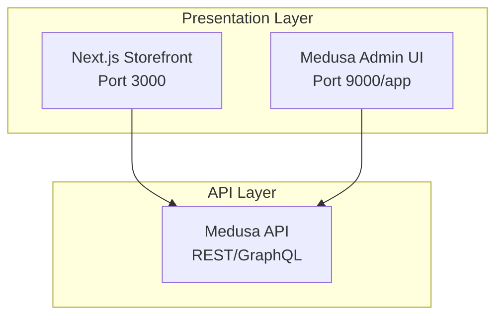
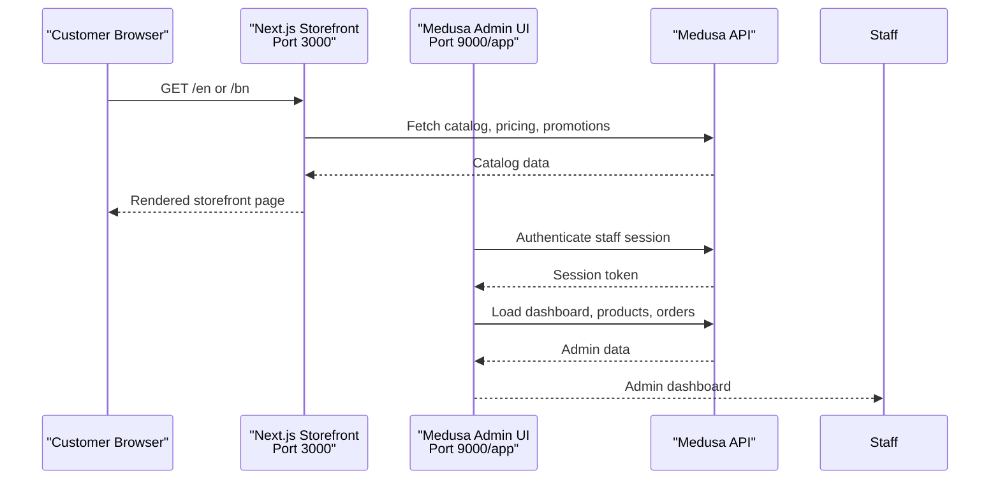
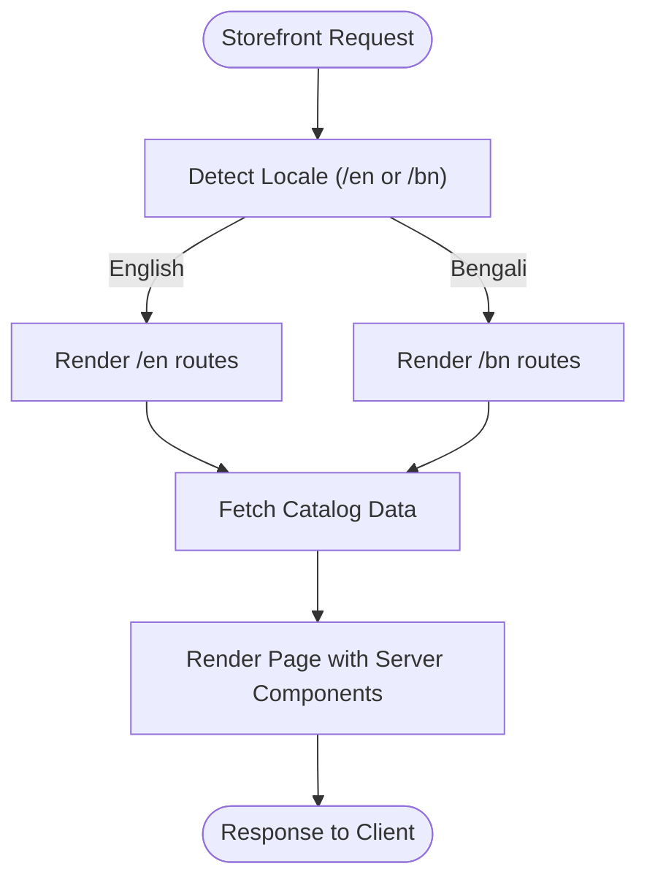
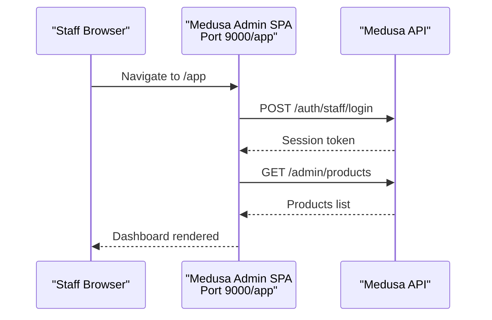
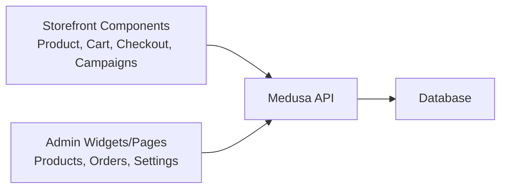
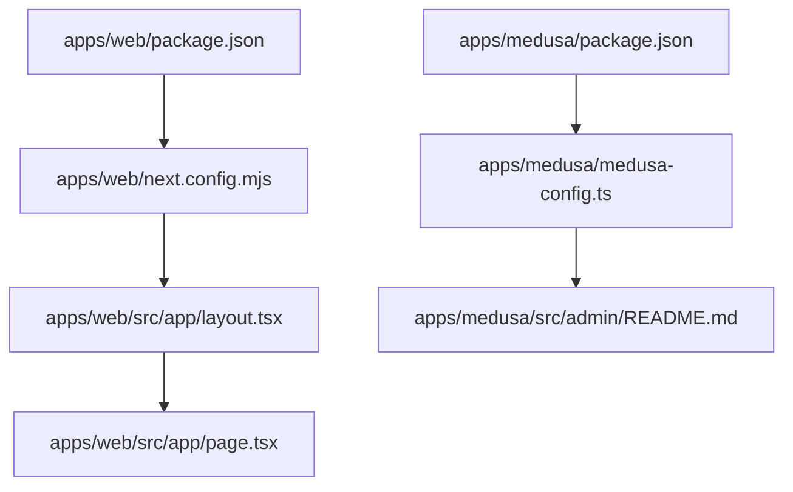

# Presentation Layer (Storefront & Admin)

<cite>
**Referenced Files in This Document**
- [apps/web/package.json](file://apps/web/package.json)
- [apps/web/next.config.mjs](file://apps/web/next.config.mjs)
- [apps/web/src/app/layout.tsx](file://apps/web/src/app/layout.tsx)
- [apps/web/src/app/page.tsx](file://apps/web/src/app/page.tsx)
- [apps/medusa/package.json](file://apps/medusa/package.json)
- [apps/medusa/medusa-config.ts](file://apps/medusa/medusa-config.ts)
- [apps/medusa/src/admin/README.md](file://apps/medusa/src/admin/README.md)
- [apps/medusa/src/admin/i18n/index.ts](file://apps/medusa/src/admin/i18n/index.ts)
</cite>

## Table of Contents
1. [Introduction](#introduction)
2. [Project Structure](#project-structure)
3. [Core Components](#core-components)
4. [Architecture Overview](#architecture-overview)
5. [Detailed Component Analysis](#detailed-component-analysis)
6. [Dependency Analysis](#dependency-analysis)
7. [Performance Considerations](#performance-considerations)
8. [Troubleshooting Guide](#troubleshooting-guide)
9. [Conclusion](#conclusion)

## Introduction
This document describes the Presentation Layer of the BD Commerce Platform, focusing on two distinct user interfaces:
- Next.js 15 Storefront at port 3000 using the App Router and Server Components.
- Medusa Admin UI at port 9000 under /app, running as an embedded React SPA.

The storefront is intended for customers, while the admin interface is for staff and merchants. Both layers communicate with the API layer through HTTP APIs exposed by Medusa and any custom endpoints. The documentation explains component boundaries, authentication flows, internationalization setup, route structures, responsive design considerations for Bangladesh mobile-first users, and accessibility compliance.

## Project Structure
The presentation layer consists of two applications:
- apps/web: Next.js 15 storefront application.
- apps/medusa: Medusa backend that includes the Admin UI SPA.

**Diagram sources**
- [apps/web/package.json:6-10](file://apps/web/package.json#L6-L10)
- [apps/medusa/package.json:15-19](file://apps/medusa/package.json#L15-L19)

**Section sources**
- [apps/web/package.json:1-28](file://apps/web/package.json#L1-L28)
- [apps/medusa/package.json:1-61](file://apps/medusa/package.json#L1-L61)

## Core Components
- Next.js Storefront
  - Root layout defines global metadata and base HTML structure.
  - Default page demonstrates a landing view built with Tailwind CSS.
  - Configuration enables strict mode and remote image patterns.
- Medusa Admin UI
  - Admin is enabled and runs at port 9000.
  - CORS settings allow both storefront and admin origins.
  - Admin extension points are documented for widgets and pages.

Key responsibilities:
- Storefront renders customer-facing pages and routes to catalog, cart, checkout, and campaign landing pages.
- Admin provides merchant operations such as product management, orders, campaigns, and settings.

**Section sources**
- [apps/web/src/app/layout.tsx:1-22](file://apps/web/src/app/layout.tsx#L1-L22)
- [apps/web/src/app/page.tsx:1-81](file://apps/web/src/app/page.tsx#L1-L81)
- [apps/web/next.config.mjs:1-15](file://apps/web/next.config.mjs#L1-L15)
- [apps/medusa/medusa-config.ts:1-46](file://apps/medusa/medusa-config.ts#L1-L46)
- [apps/medusa/src/admin/README.md:1-33](file://apps/medusa/src/admin/README.md#L1-L33)

## Architecture Overview
The presentation layer separates customer and staff experiences into two independent frontends:
- Storefront (Next.js): Serves public routes, SEO-friendly content via Server Components, and client-side interactivity where needed.
- Admin (Medusa SPA): Provides operational dashboards and custom widgets/pages for staff.

Both frontends call Medusa’s API endpoints. CORS configuration ensures cross-origin requests from localhost:3000 (storefront) and localhost:9000 (admin).

**Diagram sources**
- [apps/web/package.json:6-10](file://apps/web/package.json#L6-L10)
- [apps/medusa/package.json:15-19](file://apps/medusa/package.json#L15-L19)
- [apps/medusa/medusa-config.ts:11-17](file://apps/medusa/medusa-config.ts#L11-L17)

## Detailed Component Analysis

### Storefront: Next.js 15 App Router
Responsibilities:
- Provide root layout with metadata and base HTML attributes.
- Serve default landing page showcasing infrastructure and features.
- Configure Next.js behavior including strict mode and remote images.

Route structure guidance:
- Use App Router directories to implement bilingual routing:
  - /en for English
  - /bn for Bengali
- Implement dynamic segments for campaign landing pages:
  - /campaigns/[slug]
- Keep shared layouts and components in app-level folders.

Internationalization setup:
- Set html lang attribute per locale.
- Maintain separate locale folders under app/en and app/bn.
- Use server-side logic to detect and redirect based on Accept-Language or cookie preferences.

Responsive design for Bangladesh mobile-first users:
- Use Tailwind utility classes for mobile-first breakpoints.
- Optimize images for low bandwidth environments.
- Minimize JavaScript payloads for slower networks.

Accessibility compliance:
- Ensure semantic HTML elements.
- Provide alt text for images and descriptive labels for controls.
- Maintain sufficient color contrast and keyboard navigation.

**Diagram sources**
- [apps/web/src/app/layout.tsx:1-22](file://apps/web/src/app/layout.tsx#L1-L22)
- [apps/web/src/app/page.tsx:1-81](file://apps/web/src/app/page.tsx#L1-L81)
- [apps/web/next.config.mjs:1-15](file://apps/web/next.config.mjs#L1-L15)

**Section sources**
- [apps/web/src/app/layout.tsx:1-22](file://apps/web/src/app/layout.tsx#L1-L22)
- [apps/web/src/app/page.tsx:1-81](file://apps/web/src/app/page.tsx#L1-L81)
- [apps/web/next.config.mjs:1-15](file://apps/web/next.config.mjs#L1-L15)

### Admin: Medusa Admin UI
Responsibilities:
- Provide merchant-facing dashboard and operational tools.
- Support custom widgets and pages via Medusa Admin SDK.
- Run as an embedded React SPA under /app.

Authentication flow for staff:
- Staff authenticate against Medusa’s auth endpoints.
- Admin UI receives session tokens and uses them for subsequent API calls.
- CORS allows admin origin to interact with the API.

Extension patterns:
- Create widgets to inject UI into existing admin pages.
- Define widget configuration zones to control placement.
- Extend routes and pages for custom admin functionality.

**Diagram sources**
- [apps/medusa/package.json:15-19](file://apps/medusa/package.json#L15-L19)
- [apps/medusa/medusa-config.ts:11-17](file://apps/medusa/medusa-config.ts#L11-L17)
- [apps/medusa/src/admin/README.md:1-33](file://apps/medusa/src/admin/README.md#L1-L33)

**Section sources**
- [apps/medusa/package.json:15-19](file://apps/medusa/package.json#L15-L19)
- [apps/medusa/medusa-config.ts:11-17](file://apps/medusa/medusa-config.ts#L11-L17)
- [apps/medusa/src/admin/README.md:1-33](file://apps/medusa/src/admin/README.md#L1-L33)

### Component Boundaries Between Storefront and Admin
- Storefront owns customer experience:
  - Public routes, product browsing, cart, checkout, and campaign landing pages.
  - Uses Server Components for performance and SEO.
- Admin owns merchant experience:
  - Operational dashboards, inventory, orders, campaigns, and settings.
  - Extensible via widgets and custom pages.
- Shared concerns:
  - Authentication tokens are not shared between storefront and admin.
  - Both layers consume the same API layer but with different roles and permissions.

[No diagram sources since this diagram shows conceptual boundaries without mapping to specific files]

## Dependency Analysis
- Storefront depends on:
  - Next.js runtime and App Router.
  - Tailwind CSS for styling.
  - Medusa API for catalog, pricing, and promotions.
- Admin depends on:
  - Medusa framework and Admin SDK.
  - React ecosystem for SPA rendering.
  - Medusa API for administrative operations.

**Diagram sources**
- [apps/web/package.json:1-28](file://apps/web/package.json#L1-L28)
- [apps/web/next.config.mjs:1-15](file://apps/web/next.config.mjs#L1-L15)
- [apps/web/src/app/layout.tsx:1-22](file://apps/web/src/app/layout.tsx#L1-L22)
- [apps/web/src/app/page.tsx:1-81](file://apps/web/src/app/page.tsx#L1-L81)
- [apps/medusa/package.json:1-61](file://apps/medusa/package.json#L1-L61)
- [apps/medusa/medusa-config.ts:1-46](file://apps/medusa/medusa-config.ts#L1-L46)
- [apps/medusa/src/admin/README.md:1-33](file://apps/medusa/src/admin/README.md#L1-L33)

**Section sources**
- [apps/web/package.json:1-28](file://apps/web/package.json#L1-L28)
- [apps/web/next.config.mjs:1-15](file://apps/web/next.config.mjs#L1-L15)
- [apps/web/src/app/layout.tsx:1-22](file://apps/web/src/app/layout.tsx#L1-L22)
- [apps/web/src/app/page.tsx:1-81](file://apps/web/src/app/page.tsx#L1-L81)
- [apps/medusa/package.json:1-61](file://apps/medusa/package.json#L1-L61)
- [apps/medusa/medusa-config.ts:1-46](file://apps/medusa/medusa-config.ts#L1-L46)
- [apps/medusa/src/admin/README.md:1-33](file://apps/medusa/src/admin/README.md#L1-L33)

## Performance Considerations
- Storefront
  - Prefer Server Components for initial page loads to reduce client bundle size.
  - Use Next.js Image optimization and configure remote patterns carefully.
  - Enable strict mode for better development-time checks.
- Admin
  - Leverage Medusa Admin SDK to minimize unnecessary re-renders.
  - Cache frequently accessed admin data where appropriate.
- Network
  - Compress responses and use CDN for static assets.
  - Optimize images and fonts for mobile networks common in Bangladesh.

[No sources needed since this section provides general guidance]

## Troubleshooting Guide
Common issues and resolutions:
- CORS errors between storefront and API
  - Verify storeCors and authCors include http://localhost:3000.
- Admin cannot access API
  - Verify adminCors includes http://localhost:9000.
- Admin extensions not loading
  - Ensure widget configuration follows Medusa Admin SDK patterns.
- Internationalization not applied
  - Confirm html lang attribute matches current locale.
  - Validate locale-specific route directories exist.

**Section sources**
- [apps/medusa/medusa-config.ts:11-17](file://apps/medusa/medusa-config.ts#L11-L17)
- [apps/medusa/src/admin/README.md:1-33](file://apps/medusa/src/admin/README.md#L1-L33)
- [apps/web/src/app/layout.tsx:14-19](file://apps/web/src/app/layout.tsx#L14-L19)

## Conclusion
The Presentation Layer cleanly separates customer and staff experiences:
- Next.js Storefront delivers fast, SEO-friendly pages with bilingual support and responsive design tailored for Bangladesh users.
- Medusa Admin UI provides a robust, extensible dashboard for operational tasks.
Both layers communicate with the API layer through well-defined HTTP endpoints, with CORS configured to support local development across ports 3000 and 9000. Following the outlined patterns for routing, internationalization, and admin extensions will ensure maintainability and scalability.

[No sources needed since this section summarizes without analyzing specific files]