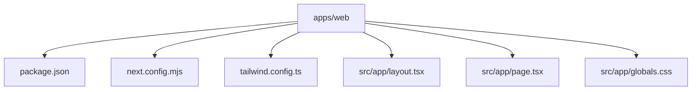
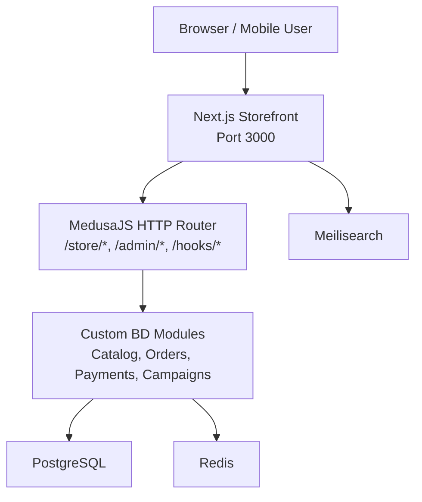
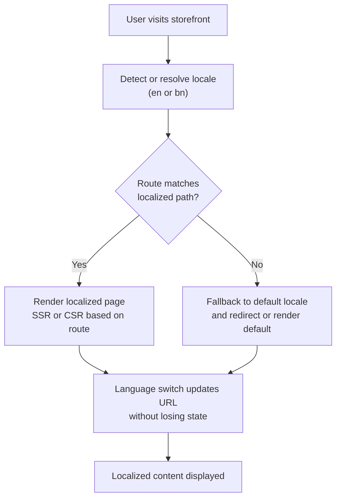
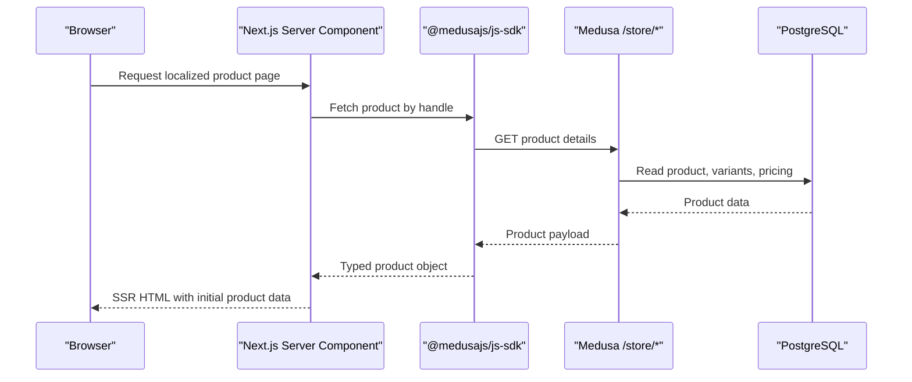
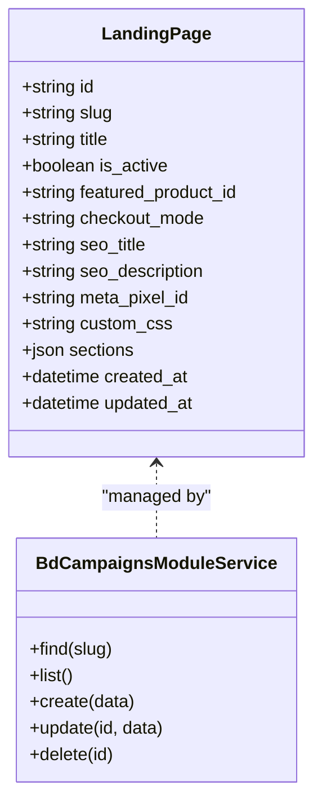
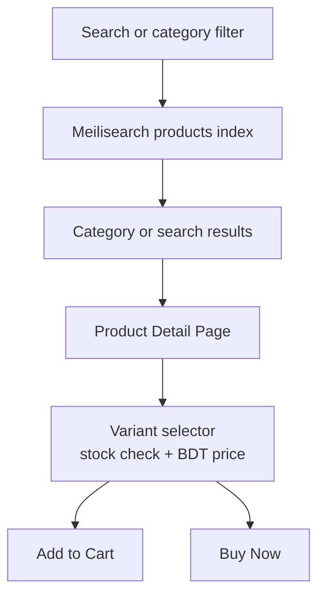
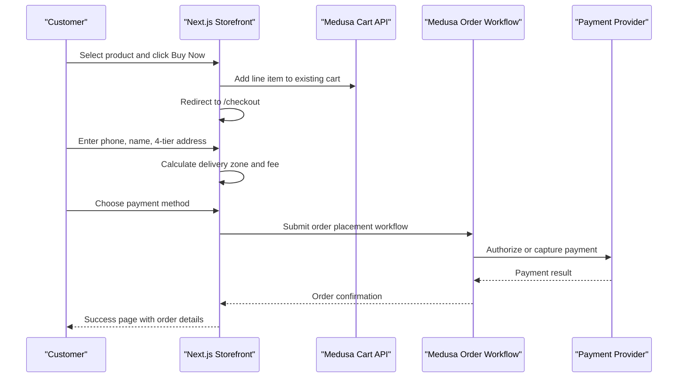
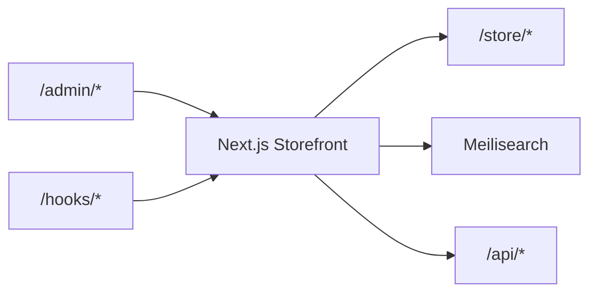
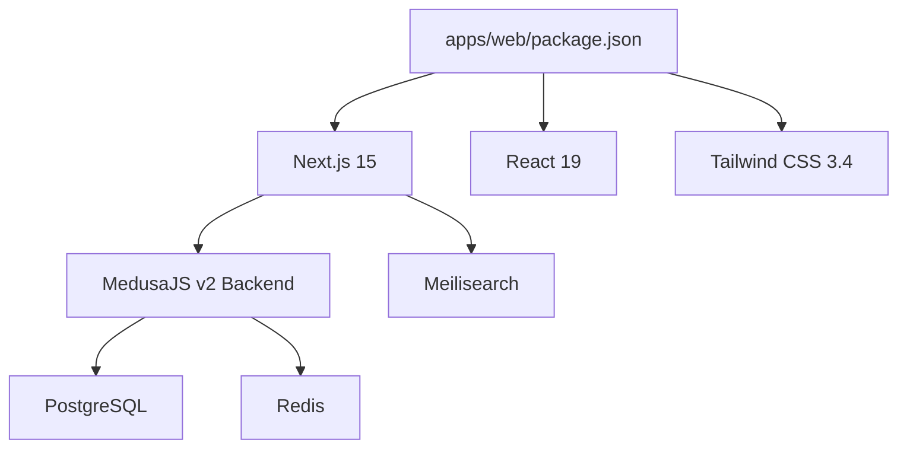

# Storefront Application (Next.js)

<cite>
**Referenced Files in This Document**   
- [apps/web/package.json](file://apps/web/package.json)
- [apps/web/next.config.mjs](file://apps/web/next.config.mjs)
- [apps/web/tailwind.config.ts](file://apps/web/tailwind.config.ts)
- [apps/web/src/app/layout.tsx](file://apps/web/src/app/layout.tsx)
- [apps/web/src/app/page.tsx](file://apps/web/src/app/page.tsx)
- [apps/web/src/app/globals.css](file://apps/web/src/app/globals.css)
- [apps/medusa/src/modules/bd-campaigns/service.ts](file://apps/medusa/src/modules/bd-campaigns/service.ts)
- [technical-plan.md](file://technical-plan.md)
- [docs/architecture.md](file://docs/architecture.md)
- [prd.md](file://prd.md)
- [ideaproposition.md](file://ideaproposition.md)
</cite>

## Table of Contents
1. [Introduction](#introduction)
2. [Project Structure](#project-structure)
3. [Core Components](#core-components)
4. [Architecture Overview](#architecture-overview)
5. [Detailed Component Analysis](#detailed-component-analysis)
6. [Dependency Analysis](#dependency-analysis)
7. [Performance Considerations](#performance-considerations)
8. [Troubleshooting Guide](#troubleshooting-guide)
9. [Conclusion](#conclusion)
10. [Appendices](#appendices)

## Introduction
This document explains the Next.js storefront application for the Bangladesh-focused single-vendor e-commerce platform. It covers the current App Router setup, planned bilingual routing for Bangla and English, Server Components strategy, campaign landing page builder integration with Medusa, product browsing interfaces, checkout flow, internationalization approach, responsive design using Tailwind CSS, accessibility and SEO considerations, and how the storefront communicates with the API Gateway layer for product data, cart management, and order processing.

The repository currently contains a minimal Next.js 15 storefront under `apps/web`, while the full architectural blueprint for bilingual routes, campaign landing pages, catalog browsing, and checkout is defined in the project’s technical plan and architecture documentation.

## Project Structure
The storefront lives in `apps/web`. At this stage, it provides:
- A Next.js 15 App Router root layout with metadata and global styles.
- A simple homepage that describes the platform infrastructure.
- Tailwind CSS configuration with a brand color palette.
- Basic Next.js configuration allowing remote images.

**Diagram sources**
- [apps/web/package.json:1-28](file://apps/web/package.json#L1-L28)
- [apps/web/next.config.mjs:1-15](file://apps/web/next.config.mjs#L1-L15)
- [apps/web/tailwind.config.ts:1-31](file://apps/web/tailwind.config.ts#L1-L31)
- [apps/web/src/app/layout.tsx:1-22](file://apps/web/src/app/layout.tsx#L1-L22)
- [apps/web/src/app/page.tsx:1-81](file://apps/web/src/app/page.tsx#L1-L81)
- [apps/web/src/app/globals.css:1-22](file://apps/web/src/app/globals.css#L1-L22)

**Section sources**
- [apps/web/package.json:1-28](file://apps/web/package.json#L1-L28)
- [apps/web/next.config.mjs:1-15](file://apps/web/next.config.mjs#L1-L15)
- [apps/web/tailwind.config.ts:1-31](file://apps/web/tailwind.config.ts#L1-L31)
- [apps/web/src/app/layout.tsx:1-22](file://apps/web/src/app/layout.tsx#L1-L22)
- [apps/web/src/app/page.tsx:1-81](file://apps/web/src/app/page.tsx#L1-L81)
- [apps/web/src/app/globals.css:1-22](file://apps/web/src/app/globals.css#L1-L22)

## Core Components
### Root Layout and Metadata
The root layout defines:
- Site-wide metadata including title and description.
- Global CSS import.
- An `<html>` element with an English language attribute.
- A body wrapper with minimum height, antialiasing, and brand-colored selection styling.

This is the foundation for all future pages, including localized routes and shared UI chrome such as header, navigation, footer, and language switcher.

**Section sources**
- [apps/web/src/app/layout.tsx:1-22](file://apps/web/src/app/layout.tsx#L1-L22)
- [apps/web/src/app/globals.css:1-22](file://apps/web/src/app/globals.css#L1-L22)

### Homepage
The current homepage is a static server-rendered component that presents:
- Infrastructure service cards for PostgreSQL, Redis, Meilisearch, Node.js backend, and Next.js frontend.
- Architectural highlights tailored to Bangladesh commerce.
- A simple footer indicating ports for the web and API apps.

It demonstrates mobile-first responsive grid layouts using Tailwind classes.

**Section sources**
- [apps/web/src/app/page.tsx:1-81](file://apps/web/src/app/page.tsx#L1-L81)

### Styling and Design Tokens
Tailwind configuration extends the theme with a custom `brand` color scale. The global stylesheet:
- Imports Tailwind base, components, and utilities.
- Defines CSS variables for light and dark mode backgrounds and foreground colors.
- Sets a system font stack suitable for general use.

This supports a mobile-first, accessible design system that can be extended with additional tokens for Bangla typography and brand elements.

**Section sources**
- [apps/web/tailwind.config.ts:1-31](file://apps/web/tailwind.config.ts#L1-L31)
- [apps/web/src/app/globals.css:1-22](file://apps/web/src/app/globals.css#L1-L22)

### Next.js Configuration
The Next.js configuration enables React Strict Mode and allows remote image loading from HTTPS origins. This is important for product images hosted on external CDNs or cloud storage.

**Section sources**
- [apps/web/next.config.mjs:1-15](file://apps/web/next.config.mjs#L1-L15)

## Architecture Overview
The storefront is part of a larger monorepo where:
- `apps/web` runs the Next.js App Router storefront.
- `apps/medusa` hosts the headless commerce backend with custom Bangladesh modules.
- Documentation defines the intended bilingual route structure, campaign landing pages, catalog browsing, and checkout flows.

**Diagram sources**
- [docs/architecture.md:77-124](file://docs/architecture.md#L77-L124)
- [technical-plan.md:59-112](file://technical-plan.md#L59-L112)

**Section sources**
- [docs/architecture.md:77-124](file://docs/architecture.md#L77-L124)
- [technical-plan.md:59-112](file://technical-plan.md#L59-L112)

## Detailed Component Analysis

### App Router and Bilingual Routing System
The current codebase has a single root layout and a default homepage. The planned bilingual routing uses a dynamic locale segment so that Bangla and English content are served under `/bn` and `/en`.

Planned route structure:
- `/[locale]` — Localized homepage.
- `/[locale]/products/[handle]` — Product detail page.
- `/[locale]/categories/[handle]` — Category listing.
- `/[locale]/cart` — Shopping cart.
- `/[locale]/checkout` — One-page Bangladesh checkout.
- `/[locale]/lp/[slug]` — Campaign landing page.
- `/[locale]/track-order` — Guest order tracking.
- `/[locale]/pages/[slug]` — Policy and CMS pages.

Bilingual requirements include:
- Visible language switch in the storefront header.
- Switching language keeps users on the same page and preserves useful state.
- Default language for first-time visitors is English.
- Guest language preference is stored in the browser; registered users can sync preferences.
- Admin users have a separate language preference.

**Diagram sources**
- [technical-plan.md:394-434](file://technical-plan.md#L394-L434)
- [docs/architecture.md:128-163](file://docs/architecture.md#L128-L163)
- [prd.md:357-368](file://prd.md#L357-L368)
- [ideaproposition.md:189-206](file://ideaproposition.md#L189-L206)

**Section sources**
- [technical-plan.md:394-434](file://technical-plan.md#L394-L434)
- [docs/architecture.md:128-163](file://docs/architecture.md#L128-L163)
- [prd.md:357-368](file://prd.md#L357-L368)
- [ideaproposition.md:189-206](file://ideaproposition.md#L189-L206)

### Server Components Implementation Strategy
The architecture specifies a mixed rendering strategy:
- SSR + ISR for content-heavy pages like homepage, PDP, categories, and campaign landing pages.
- CSR for interactive pages like cart and checkout.
- Real-time behavior for tracking and rate-limited endpoints.

This aligns with Next.js App Router best practices:
- Server Components fetch product data through the Medusa SDK on the server.
- Client Components handle user interactions such as adding items to cart, selecting variants, and submitting checkout forms.
- ISR revalidates frequently updated catalog content at controlled intervals.

**Diagram sources**
- [docs/architecture.md:318-334](file://docs/architecture.md#L318-L334)
- [docs/architecture.md:738-751](file://docs/architecture.md#L738-L751)

**Section sources**
- [docs/architecture.md:318-334](file://docs/architecture.md#L318-L334)
- [docs/architecture.md:738-751](file://docs/architecture.md#L738-L751)

### Campaign Landing Page Builder
The campaign landing page builder is implemented as a Medusa custom module. The model stores:
- Unique slug and title.
- Active/inactive status.
- Optional featured product reference.
- Checkout mode: embedded, modal, or redirect.
- SEO fields and optional Meta Pixel override.
- Custom CSS.
- Structured JSON sections such as hero, gallery, reviews, accordion, and embedded checkout.

The storefront renders these sections dynamically and binds the embedded checkout to the visitor’s unified Medusa cart.

**Diagram sources**
- [technical-plan.md:254-274](file://technical-plan.md#L254-L274)
- [apps/medusa/src/modules/bd-campaigns/service.ts:1-8](file://apps/medusa/src/modules/bd-campaigns/service.ts#L1-L8)

**Section sources**
- [technical-plan.md:254-274](file://technical-plan.md#L254-L274)
- [apps/medusa/src/modules/bd-campaigns/service.ts:1-8](file://apps/medusa/src/modules/bd-campaigns/service.ts#L1-L8)

### Product Browsing Interfaces
Product browsing includes:
- Category listings with dynamic attribute filtering.
- Product detail pages with variant selection, stock checks, and BDT pricing.
- Instant search via Meilisearch with Banglish support.

The storefront uses:
- SSR + ISR for fast initial load and cached catalog data.
- Client-side variant selectors with URL state reflection.
- Delivery charge previews based on selected zone.

**Diagram sources**
- [technical-plan.md:436-441](file://technical-plan.md#L436-L441)
- [docs/architecture.md:435-463](file://docs/architecture.md#L435-L463)

**Section sources**
- [technical-plan.md:436-441](file://technical-plan.md#L436-L441)
- [docs/architecture.md:435-463](file://docs/architecture.md#L435-L463)

### Checkout Flow Integration with Medusa
The checkout flow is designed for Bangladesh users:
- Phone-first identity without mandatory registration.
- Four-tier address model: division, district, thana, street.
- Delivery zone calculation with flat rates.
- Payment options: COD, bKash, Nagad.
- Unified cart with deterministic “Add to Cart” and “Buy Now” behaviors.

**Diagram sources**
- [technical-plan.md:442-498](file://technical-plan.md#L442-L498)
- [docs/architecture.md:738-756](file://docs/architecture.md#L738-L756)

**Section sources**
- [technical-plan.md:442-498](file://technical-plan.md#L442-L498)
- [docs/architecture.md:738-756](file://docs/architecture.md#L738-L756)

### Internationalization Setup with i18n
Internationalization is specified across multiple documents:
- Bilingual storefront and admin panel.
- Visible language switch preserving page state.
- Default English locale for first-time visitors.
- Browser-level guest preference and account-synced preference.
- Separate admin language preference.

Implementation guidance:
- Use Next.js App Router dynamic segments for `/[locale]`.
- Keep identifiers such as SKUs, order IDs, and prices untranslated.
- Provide localized labels, headings, and messages.
- Support Bangla typography alongside English fonts.

**Section sources**
- [technical-plan.md:45-50](file://technical-plan.md#L45-L50)
- [prd.md:357-368](file://prd.md#L357-L368)
- [ideaproposition.md:189-206](file://ideaproposition.md#L189-L206)

### Responsive Design Patterns for Bangladesh Mobile-First Users
The current homepage demonstrates responsive patterns:
- Single-column grids on small screens.
- Multi-column grids on medium and large screens.
- Flexible spacing and typography scaling.
- Brand color usage for emphasis.

Future storefront pages should follow similar patterns:
- Mobile-first Tailwind breakpoints.
- Touch-friendly buttons and inputs.
- Sticky action bars for mobile product pages.
- Accessible contrast and readable Bangla text sizes.

**Section sources**
- [apps/web/src/app/page.tsx:17-79](file://apps/web/src/app/page.tsx#L17-L79)
- [apps/web/tailwind.config.ts:9-25](file://apps/web/tailwind.config.ts#L9-L25)

### Performance Optimizations
Key performance strategies include:
- SSR + ISR for catalog and landing pages.
- CSR for interactive cart and checkout.
- Remote image optimization via Next.js Image component.
- Meilisearch for instant search with public search-only keys.
- Rate limiting and distributed locks for high-concurrency scenarios.

**Section sources**
- [docs/architecture.md:738-751](file://docs/architecture.md#L738-L751)
- [docs/architecture.md:402-432](file://docs/architecture.md#L402-L432)
- [apps/web/next.config.mjs:1-15](file://apps/web/next.config.mjs#L1-L15)

### Accessibility Compliance
Accessibility recommendations:
- Semantic HTML structure in layouts and pages.
- Keyboard-navigable controls for variant selection and checkout.
- Sufficient color contrast for brand colors and text.
- Screen-reader-friendly labels for form fields and buttons.
- Bangla text rendered with appropriate font families and sizing.

These practices complement the existing Tailwind-based design system and will be essential when implementing localized routes and interactive components.

[No sources needed since this section provides general guidance]

### SEO Considerations for E-commerce
SEO priorities:
- Meaningful page titles and descriptions per locale.
- Localized metadata for homepage, product pages, and campaign landing pages.
- Clean URLs with locale prefixes.
- Structured data for products, offers, and breadcrumbs.
- Fast initial page loads via SSR and optimized images.

The current root layout already sets site-wide metadata, which can be extended per route.

**Section sources**
- [apps/web/src/app/layout.tsx:4-7](file://apps/web/src/app/layout.tsx#L4-L7)

### Storefront Communication with API Gateway Layer
The storefront communicates with the Medusa API Gateway layer through:
- Server-side calls using `@medusajs/js-sdk` for SSR data fetching.
- Client-side calls for cart mutations and checkout submission.
- Public search-only access to Meilisearch for instant search.

Access control rules:
- `/store/*` is public but rate-limited and cart-token aware.
- `/admin/*` requires JWT and RBAC.
- `/hooks/*` validates provider signatures.
- `/api/*` is internal to Next.js.

**Diagram sources**
- [docs/architecture.md:305-334](file://docs/architecture.md#L305-L334)

**Section sources**
- [docs/architecture.md:305-334](file://docs/architecture.md#L305-L334)

## Dependency Analysis
The storefront currently depends on:
- Next.js 15.
- React 19.
- Tailwind CSS 3.4.
- Lucide icons.

The broader system depends on:
- MedusaJS v2 backend.
- PostgreSQL, Redis, and Meilisearch.
- Custom Bangladesh modules for catalog localization, orders, payments, campaigns, settings, audit logs, SMS, invoices, and reports.

**Diagram sources**
- [apps/web/package.json:12-25](file://apps/web/package.json#L12-L25)
- [docs/architecture.md:51-64](file://docs/architecture.md#L51-L64)

**Section sources**
- [apps/web/package.json:12-25](file://apps/web/package.json#L12-L25)
- [docs/architecture.md:51-64](file://docs/architecture.md#L51-L64)

## Performance Considerations
Recommended optimizations for the storefront:
- Prefer Server Components for data-heavy pages.
- Use ISR for catalog and landing pages with appropriate revalidation intervals.
- Defer client-side interactivity to Client Components.
- Optimize images and enable CDN caching.
- Minimize bundle size by tree-shaking unused components.
- Implement rate limiting and idempotency for critical mutations.

[No sources needed since this section provides general guidance]

## Troubleshooting Guide
Common issues and resolutions:
- **Bilingual routing not working:** Ensure the `[locale]` directory exists and route files are placed under the correct localized paths. Verify that the language switch updates the URL without reloading unnecessary state.
- **Images failing to load:** Confirm that remote image hostnames are allowed in `next.config.mjs`.
- **Checkout errors:** Validate phone numbers, address fields, and payment provider responses. Check rate limits and idempotency headers.
- **Search returning incomplete results:** Verify Meilisearch index fields and public search key permissions.
- **Localization mismatch:** Ensure only labels are translated; do not mutate SKUs, order IDs, or prices.

**Section sources**
- [apps/web/next.config.mjs:4-11](file://apps/web/next.config.mjs#L4-L11)
- [technical-plan.md:436-498](file://technical-plan.md#L436-L498)
- [docs/architecture.md:423-432](file://docs/architecture.md#L423-L432)

## Conclusion
The Next.js storefront is currently a minimal App Router application with a root layout, homepage, Tailwind configuration, and basic Next.js settings. The full vision for a production-ready Bangladesh e-commerce storefront includes:
- Bilingual routing under `/bn` and `/en`.
- Server Components for catalog and landing pages.
- Client Components for cart and checkout.
- Campaign landing page builder integrated with Medusa.
- Product browsing with instant search and localized content.
- A streamlined one-page checkout aligned with local logistics and payment expectations.
- Responsive, accessible, and SEO-aware design using Tailwind CSS.
- Clear communication boundaries with the Medusa API Gateway layer.

As development proceeds, the existing files should be extended to implement the documented route structure, internationalization, and commerce integrations while maintaining the mobile-first, Bangladesh-focused principles outlined in the technical plan and architecture documents.

[No sources needed since this section summarizes without analyzing specific files]

## Appendices

### Appendix A: Planned Route Map
- `/[locale]` — Localized homepage.
- `/[locale]/products/[handle]` — Product detail page.
- `/[locale]/categories/[handle]` — Category listing.
- `/[locale]/cart` — Shopping cart.
- `/[locale]/checkout` — One-page checkout.
- `/[locale]/lp/[slug]` — Campaign landing page.
- `/[locale]/track-order` — Order tracking.
- `/[locale]/pages/[slug]` — Policy and CMS pages.

**Section sources**
- [technical-plan.md:394-434](file://technical-plan.md#L394-L434)
- [docs/architecture.md:128-163](file://docs/architecture.md#L128-L163)

### Appendix B: Rendering Strategy Summary
- SSR + ISR for content pages.
- CSR for interactive pages.
- Real-time for tracking and rate-limited endpoints.

**Section sources**
- [docs/architecture.md:738-751](file://docs/architecture.md#L738-L751)