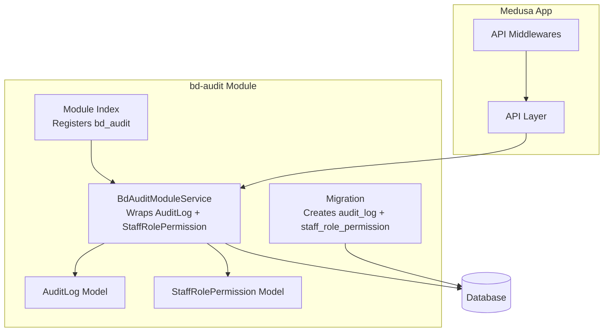
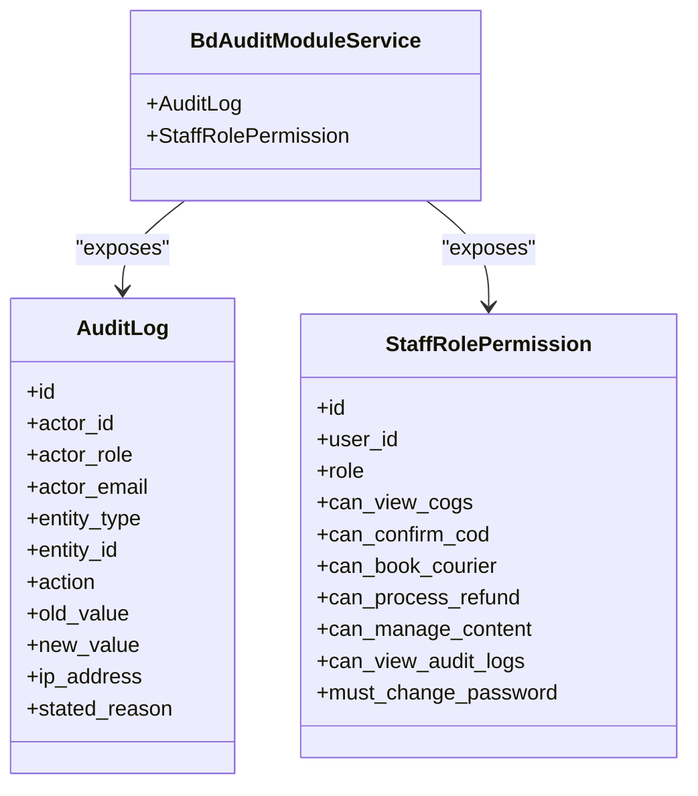
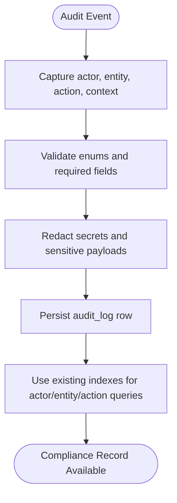
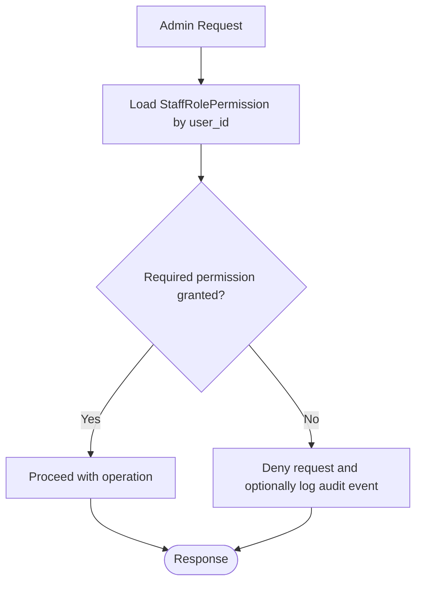
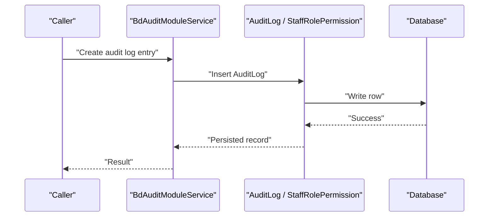
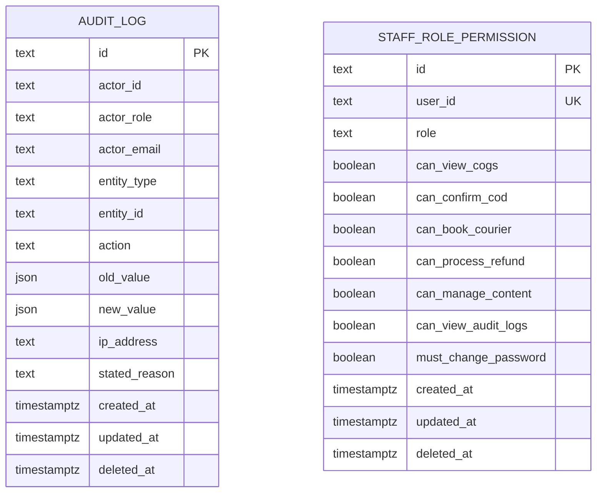
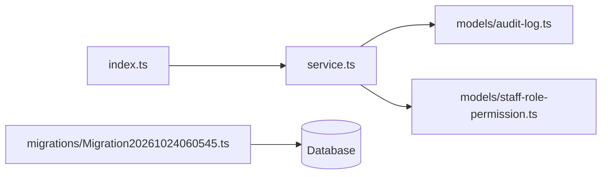

# Audit & Compliance Module (bd-audit)

<cite>
**Referenced Files in This Document**
- [audit-log.ts](file://apps/medusa/src/modules/bd-audit/models/audit-log.ts)
- [staff-role-permission.ts](file://apps/medusa/src/modules/bd-audit/models/staff-role-permission.ts)
- [service.ts](file://apps/medusa/src/modules/bd-audit/service.ts)
- [index.ts](file://apps/medusa/src/modules/bd-audit/index.ts)
- [Migration20261024060545.ts](file://apps/medusa/src/modules/bd-audit/migrations/Migration20261024060545.ts)
- [.snapshot-bd-audit.json](file://apps/medusa/src/modules/bd-audit/migrations/.snapshot-bd-audit.json)
- [middlewares.ts](file://apps/medusa/src/api/middlewares.ts)
- [database.md](file://database.md)
</cite>

## Table of Contents
1. [Introduction](#introduction)
2. [Project Structure](#project-structure)
3. [Core Components](#core-components)
4. [Architecture Overview](#architecture-overview)
5. [Detailed Component Analysis](#detailed-component-analysis)
6. [Dependency Analysis](#dependency-analysis)
7. [Performance Considerations](#performance-considerations)
8. [Troubleshooting Guide](#troubleshooting-guide)
9. [Conclusion](#conclusion)

## Introduction
The bd-audit module provides the data model foundation for security logging and staff access control within the Medusa application. It defines:
- An audit log entity for recording user actions, system events, and compliance-relevant changes.
- A staff role permission entity for managing per-user operational permissions.
- A Medusa service that exposes these models through the standard Medusa service layer.
- Database migrations that create the underlying tables and indexes.

At this point, the module is a data and service layer rather than a fully implemented middleware-based audit capture or permission enforcement system. Other parts of the repository define broader architecture and database policies, including append-only audit log expectations and secret handling rules.

## Project Structure
The bd-audit module lives under `apps/medusa/src/modules/bd-audit` and follows a compact Medusa module layout:
- `models/audit-log.ts`: Defines the audit log schema.
- `models/staff-role-permission.ts`: Defines the staff role permission schema.
- `service.ts`: Exposes a Medusa service wrapping both models.
- `index.ts`: Registers the module with the Medusa framework.
- `migrations/Migration20261024060545.ts`: Creates the `audit_log` and `staff_role_permission` tables and their indexes.
- `migrations/.snapshot-bd-audit.json`: Snapshot of the resulting database schema.

**Diagram sources**
- [index.ts:1-9](file://apps/medusa/src/modules/bd-audit/index.ts#L1-L9)
- [service.ts:1-11](file://apps/medusa/src/modules/bd-audit/service.ts#L1-L11)
- [audit-log.ts:1-43](file://apps/medusa/src/modules/bd-audit/models/audit-log.ts#L1-L43)
- [staff-role-permission.ts:1-17](file://apps/medusa/src/modules/bd-audit/models/staff-role-permission.ts#L1-L17)
- [Migration20261024060545.ts:1-26](file://apps/medusa/src/modules/bd-audit/migrations/Migration20261024060545.ts#L1-L26)

**Section sources**
- [index.ts:1-9](file://apps/medusa/src/modules/bd-audit/index.ts#L1-L9)
- [service.ts:1-11](file://apps/medusa/src/modules/bd-audit/service.ts#L1-L11)
- [Migration20261024060545.ts:1-26](file://apps/medusa/src/modules/bd-audit/migrations/Migration20261024060545.ts#L1-L26)

## Core Components
This section summarizes the two primary data models and the module service.

### AuditLog Data Model
The audit log captures:
- Actor identity and role.
- Target entity type and identifier.
- Action performed.
- Optional before/after snapshots.
- IP address and stated reason.
- Standard timestamps and soft-delete support via migration metadata.

Key fields include actor identifiers, an enumerated actor role, enumerated entity types covering products, inventory, orders, returns, couriers, staff users, settings, content pages, and authentication/security events, and an enumerated action set covering creation, updates, deletions, status transitions, financial operations, stock operations, consignment operations, and authentication-related security events.

**Section sources**
- [audit-log.ts:1-43](file://apps/medusa/src/modules/bd-audit/models/audit-log.ts#L1-L43)
- [Migration20261024060545.ts:5-12](file://apps/medusa/src/modules/bd-audit/migrations/Migration20261024060545.ts#L5-L12)

### StaffRolePermission Data Model
The staff role permission model stores:
- A unique user reference.
- A role from a fixed set of business roles.
- Boolean flags for specific operational permissions such as viewing cost-of-goods, confirming cash-on-delivery, booking courier services, processing refunds, managing content, and viewing audit logs.
- A password policy flag requiring initial password change.

This model is suitable for fine-grained permission checks around admin workflows and sensitive operations.

**Section sources**
- [staff-role-permission.ts:1-17](file://apps/medusa/src/modules/bd-audit/models/staff-role-permission.ts#L1-L17)
- [Migration20261024060545.ts:14-16](file://apps/medusa/src/modules/bd-audit/migrations/Migration20261024060545.ts#L14-L16)

### BdAuditModuleService
The service extends the Medusa service base and registers both `AuditLog` and `StaffRolePermission`. This gives other modules and routes access to standard CRUD-style interactions through the Medusa service layer.

Current implementation does not add custom methods; it primarily acts as a gateway to the underlying models.

**Section sources**
- [service.ts:1-11](file://apps/medusa/src/modules/bd-audit/service.ts#L1-L11)

### Module Registration
The module exports a constant identifying the module name and registers the service with the Medusa framework. This allows other modules to resolve `bd_audit` and use its service.

**Section sources**
- [index.ts:1-9](file://apps/medusa/src/modules/bd-audit/index.ts#L1-L9)

## Architecture Overview
The current bd-audit module is best understood as a foundational data and service layer:

**Diagram sources**
- [service.ts:5-8](file://apps/medusa/src/modules/bd-audit/service.ts#L5-L8)
- [audit-log.ts:3-40](file://apps/medusa/src/modules/bd-audit/models/audit-log.ts#L3-L40)
- [staff-role-permission.ts:3-14](file://apps/medusa/src/modules/bd-audit/models/staff-role-permission.ts#L3-L14)

## Detailed Component Analysis

### Audit Log Schema and Indexing
The audit log schema includes indexed columns for actor identity, entity type, entity identifier, and action. The migration also creates additional database-level indexes for performance and soft-delete filtering.

Important characteristics:
- Actor identification supports internal user IDs and optional email addresses.
- Entity typing covers commerce, logistics, administrative, and security domains.
- Actions cover normal CRUD, state transitions, financial adjustments, inventory movements, courier lifecycle events, and authentication security events.
- JSON fields allow capturing old and new values for compliance-sensitive changes.
- IP address and stated reason support traceability and justification for sensitive operations.

**Diagram sources**
- [audit-log.ts:3-40](file://apps/medusa/src/modules/bd-audit/models/audit-log.ts#L3-L40)
- [Migration20261024060545.ts:7-12](file://apps/medusa/src/modules/bd-audit/migrations/Migration20261024060545.ts#L7-L12)

**Section sources**
- [audit-log.ts:1-43](file://apps/medusa/src/modules/bd-audit/models/audit-log.ts#L1-L43)
- [Migration20261024060545.ts:5-12](file://apps/medusa/src/modules/bd-audit/migrations/Migration20261024060545.ts#L5-L12)

### Staff Role Permission Schema and Access Control Surface
The staff role permission model provides a clear surface for permission checking:
- Role enumeration supports owner, manager, staff, call center, warehouse, and finance.
- Boolean flags map directly to common operational controls such as COGS visibility, COD confirmation, courier booking, refund processing, content management, and audit log visibility.
- The `must_change_password` flag supports onboarding and security hygiene.

A typical permission check would:
1. Resolve the authenticated staff user.
2. Load their `StaffRolePermission` record.
3. Evaluate the required boolean flag or role requirement.
4. Allow or deny the operation.

**Diagram sources**
- [staff-role-permission.ts:3-14](file://apps/medusa/src/modules/bd-audit/models/staff-role-permission.ts#L3-L14)

**Section sources**
- [staff-role-permission.ts:1-17](file://apps/medusa/src/modules/bd-audit/models/staff-role-permission.ts#L1-L17)

### Service Layer Responsibilities
The service currently wraps both models without adding domain logic. This is appropriate for a minimal module but leaves room for future enhancements such as:
- Dedicated audit logging helpers.
- Permission-checking utilities.
- Role-based query filters.
- Compliance report builders.

**Diagram sources**
- [service.ts:5-8](file://apps/medusa/src/modules/bd-audit/service.ts#L5-L8)
- [audit-log.ts:3-40](file://apps/medusa/src/modules/bd-audit/models/audit-log.ts#L3-L40)

**Section sources**
- [service.ts:1-11](file://apps/medusa/src/modules/bd-audit/service.ts#L1-L11)

### Migration and Database Schema
The migration creates:
- `audit_log` table with enumerated constraints for actor role, entity type, and action.
- Indexes for actor ID, entity type, entity ID, action, and deleted-at filtering.
- `staff_role_permission` table with enumerated role and default boolean flags.
- Unique index on `user_id` for one permission record per staff user.
- Deleted-at indexes for soft-delete behavior.

**Diagram sources**
- [Migration20261024060545.ts:5-16](file://apps/medusa/src/modules/bd-audit/migrations/Migration20261024060545.ts#L5-L16)
- [.snapshot-bd-audit.json:501-586](file://apps/medusa/src/modules/bd-audit/migrations/.snapshot-bd-audit.json#L501-L586)

**Section sources**
- [Migration20261024060545.ts:1-26](file://apps/medusa/src/modules/bd-audit/migrations/Migration20261024060545.ts#L1-L26)
- [.snapshot-bd-audit.json:501-586](file://apps/medusa/src/modules/bd-audit/migrations/.snapshot-bd-audit.json#L501-L586)

## Dependency Analysis
The bd-audit module has minimal internal dependencies:
- The module index depends on the service.
- The service depends on the two models.
- The migration depends on the Medusa migration framework.
- External integration points are not yet implemented inside the module itself.

**Diagram sources**
- [index.ts:1-9](file://apps/medusa/src/modules/bd-audit/index.ts#L1-L9)
- [service.ts:1-11](file://apps/medusa/src/modules/bd-audit/service.ts#L1-L11)
- [audit-log.ts:1-43](file://apps/medusa/src/modules/bd-audit/models/audit-log.ts#L1-L43)
- [staff-role-permission.ts:1-17](file://apps/medusa/src/modules/bd-audit/models/staff-role-permission.ts#L1-L17)
- [Migration20261024060545.ts:1-26](file://apps/medusa/src/modules/bd-audit/migrations/Migration20261024060545.ts#L1-L26)

**Section sources**
- [index.ts:1-9](file://apps/medusa/src/modules/bd-audit/index.ts#L1-L9)
- [service.ts:1-11](file://apps/medusa/src/modules/bd-audit/service.ts#L1-L11)

## Performance Considerations
High-volume audit logging requires careful design because every write adds storage, indexing, and query overhead.

Recommended considerations:
- Use the existing indexes on actor ID, entity type, entity ID, and action to optimize common audit queries.
- Avoid storing large JSON payloads in `old_value` and `new_value`; instead, store references to immutable snapshots when possible.
- Partition or archive historical audit records if retention grows beyond practical query ranges.
- Apply soft-delete patterns consistently where supported by the rest of the system.
- Ensure audit writers do not block critical user-facing operations; consider asynchronous or background job pipelines for non-critical audit entries.
- Follow the repository’s broader secret-handling policy so audit logs never contain tokens, passwords, or payment credentials.

The repository’s broader documentation describes an append-only expectation for audit logs and secret redaction rules, which should guide how audit writers handle writes and what data is allowed into `old_value`, `new_value`, and related fields.

**Section sources**
- [Migration20261024060545.ts:7-12](file://apps/medusa/src/modules/bd-audit/migrations/Migration20261024060545.ts#L7-L12)
- [database.md:1919-1960](file://database.md#L1919-L1960)

## Troubleshooting Guide

### Common Issues
- **Missing audit records:** Verify that the caller resolves the correct actor identity and calls the audit writer with valid enum values for entity type and action.
- **Permission denied errors:** Confirm that the staff user has a `StaffRolePermission` record and that the required boolean flag is enabled.
- **Slow audit queries:** Check whether queries use indexed columns such as actor ID, entity type, entity ID, or action.
- **Schema mismatch after deployment:** Ensure the migration `Migration20261024060545` has been applied successfully.

### Debugging Steps
1. Inspect the `audit_log` table using actor ID, entity type, and action filters.
2. Inspect the `staff_role_permission` table using the affected user ID.
3. Compare the expected enum values against the schema-defined sets.
4. Review application logs around the failing request to determine whether the error occurs during permission evaluation or audit persistence.

**Section sources**
- [audit-log.ts:3-40](file://apps/medusa/src/modules/bd-audit/models/audit-log.ts#L3-L40)
- [staff-role-permission.ts:3-14](file://apps/medusa/src/modules/bd-audit/models/staff-role-permission.ts#L3-L14)
- [Migration20261024060545.ts:5-16](file://apps/medusa/src/modules/bd-audit/migrations/Migration20261024060545.ts#L5-L16)

## Conclusion
The bd-audit module establishes the core data structures needed for compliance-oriented auditing and staff permission management:
- `AuditLog` provides a structured, enumerated, and indexed schema for tracking actors, entities, actions, and contextual details.
- `StaffRolePermission` provides a per-user permission surface aligned with operational roles.
- `BdAuditModuleService` exposes these models through the Medusa service layer.
- The migration defines the database schema, constraints, and indexes.

To reach full compliance readiness, the module should be extended with:
- Middleware-based audit capture for user actions and system events.
- Explicit permission-checking utilities for admin routes and sensitive operations.
- Role-based access control enforcement.
- Automated compliance reporting endpoints.
- Clear data retention and privacy safeguards for sensitive audit data.

Until those extensions are added, the module remains a strong foundation for building audit trails and access control across the platform.