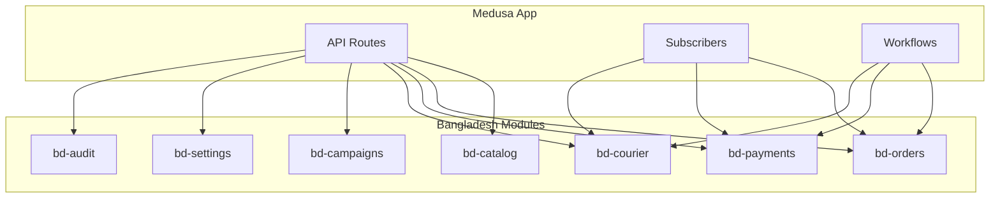
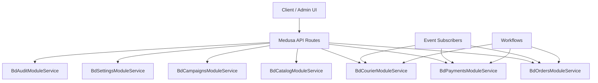
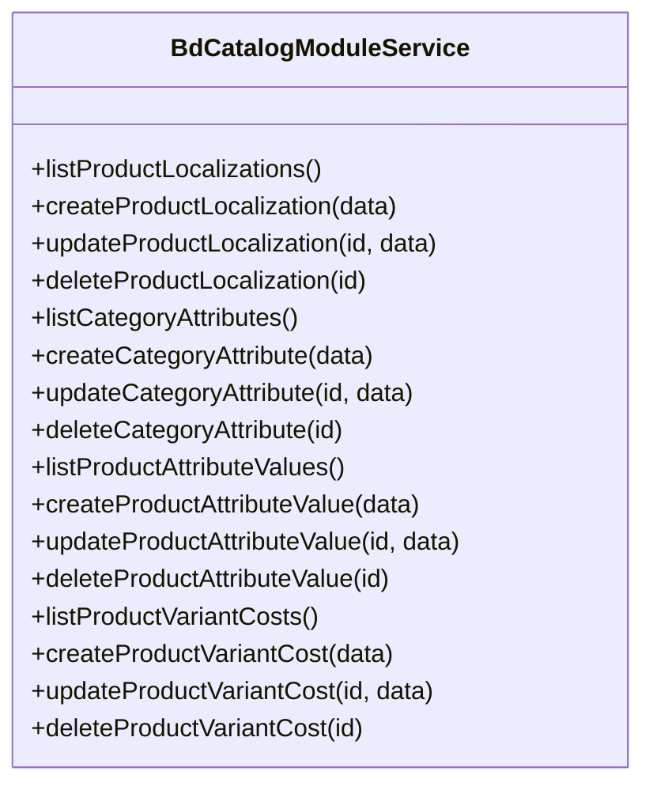
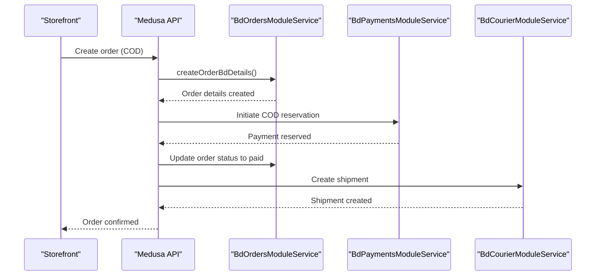
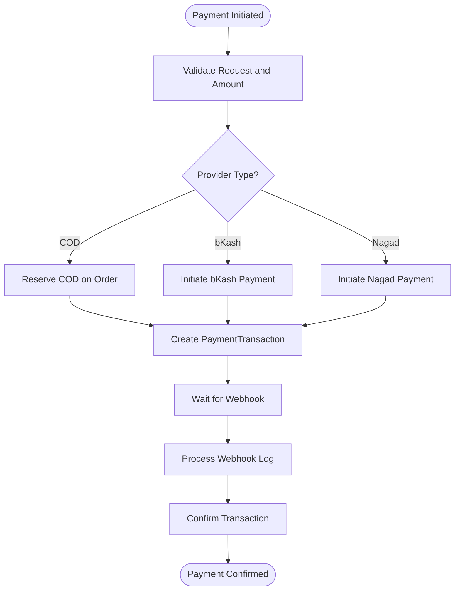
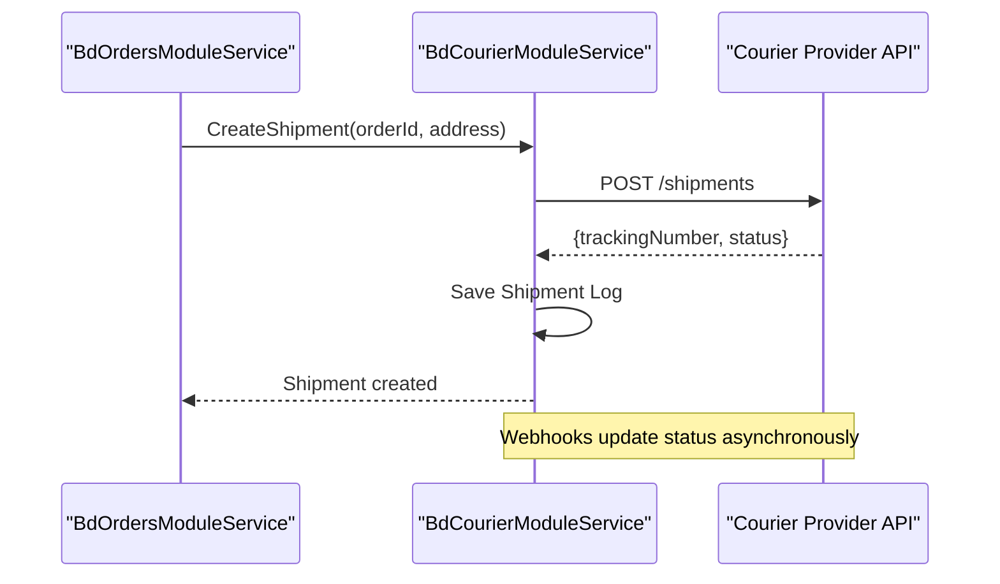
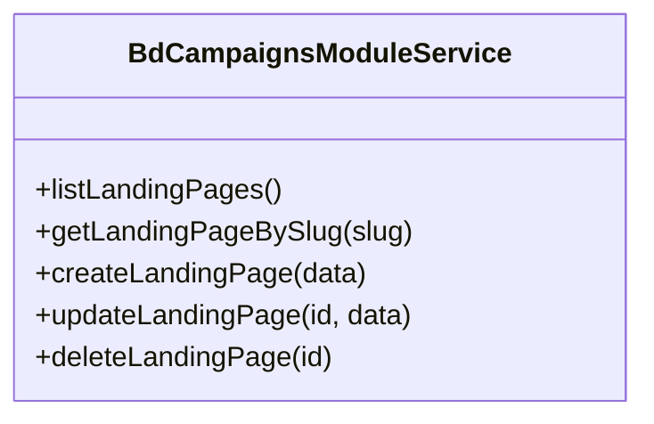
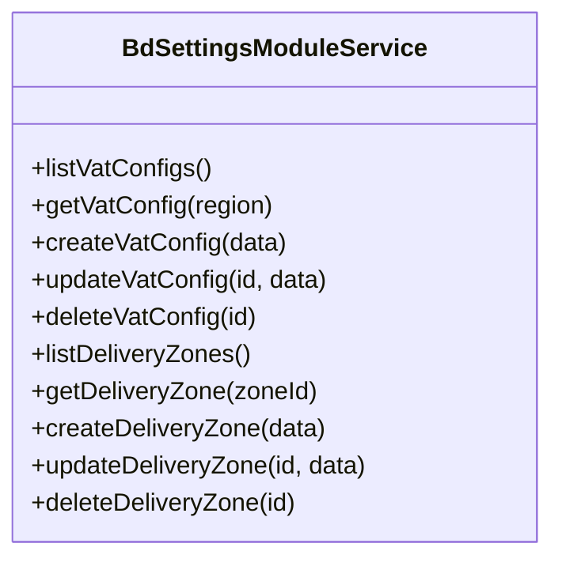
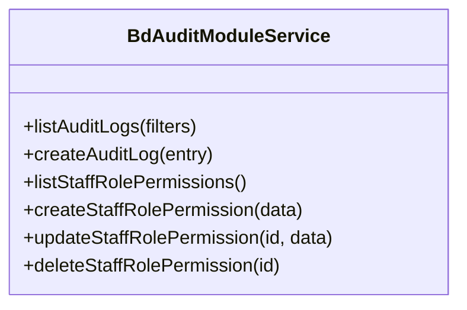
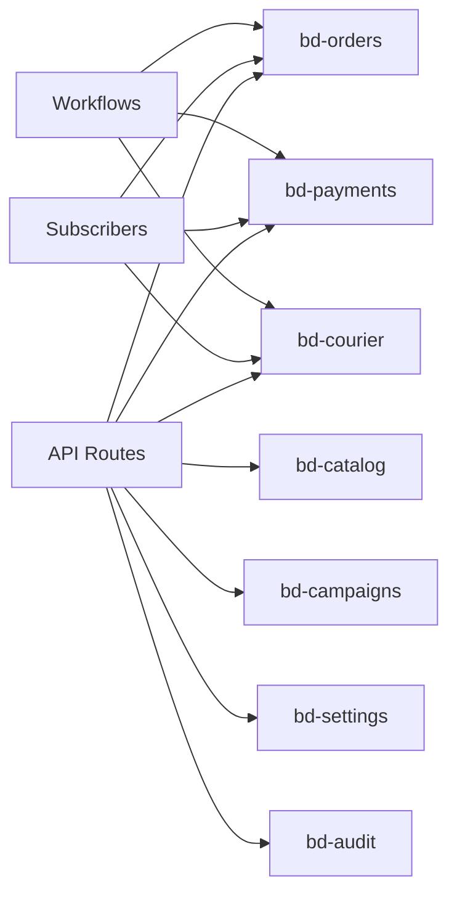

# Bangladesh Custom Modules

<cite>
**Referenced Files in This Document**
- [modules README](file://apps/medusa/src/modules/README.md)
- [bd-catalog index.ts](file://apps/medusa/src/modules/bd-catalog/index.ts)
- [bd-catalog service.ts](file://apps/medusa/src/modules/bd-catalog/service.ts)
- [bd-orders index.ts](file://apps/medusa/src/modules/bd-orders/index.ts)
- [bd-orders service.ts](file://apps/medusa/src/modules/bd-orders/service.ts)
- [bd-payments index.ts](file://apps/medusa/src/modules/bd-payments/index.ts)
- [bd-payments service.ts](file://apps/medusa/src/modules/bd-payments/service.ts)
- [bd-courier index.ts](file://apps/medusa/src/modules/bd-courier/index.ts)
- [bd-courier service.ts](file://apps/medusa/src/modules/bd-courier/service.ts)
- [bd-campaigns index.ts](file://apps/medusa/src/modules/bd-campaigns/index.ts)
- [bd-campaigns service.ts](file://apps/medusa/src/modules/bd-campaigns/service.ts)
- [bd-settings index.ts](file://apps/medusa/src/modules/bd-settings/index.ts)
- [bd-settings service.ts](file://apps/medusa/src/modules/bd-settings/service.ts)
- [bd-audit index.ts](file://apps/medusa/src/modules/bd-audit/index.ts)
- [bd-audit service.ts](file://apps/medusa/src/modules/bd-audit/service.ts)
</cite>

## Table of Contents
1. [Introduction](#introduction)
2. [Project Structure](#project-structure)
3. [Core Components](#core-components)
4. [Architecture Overview](#architecture-overview)
5. [Detailed Component Analysis](#detailed-component-analysis)
6. [Dependency Analysis](#dependency-analysis)
7. [Performance Considerations](#performance-considerations)
8. [Troubleshooting Guide](#troubleshooting-guide)
9. [Conclusion](#conclusion)

## Introduction
This document describes the Bangladesh custom modules that extend Medusa for local market needs. The modules provide product localization and attributes, a localized order lifecycle with COD settlement support, payment orchestration for COD and local wallets, courier adapters for delivery providers, a landing page engine, financial reconciliation helpers, SMS gateway abstraction, VAT and zone configuration, security audit logging, CMS capabilities, and invoice generation. Each module follows the Medusa module pattern: a data model layer, a service layer exposing domain methods, and an index file registering the module.

The repository currently exposes module registration and service scaffolding for each module. Data models define the persistence schema; services wrap those models using MedusaService to expose CRUD and domain operations. API routes, subscribers, workflows, and admin integrations are implemented as needed by consuming these services.

## Project Structure
All Bangladesh modules live under apps/medusa/src/modules. Each module folder contains:
- migrations: database migration artifacts
- models: entity definitions
- index.ts: module registration exporting the service
- service.ts: service class extending MedusaService with the module’s entities

[No sources needed since this diagram shows conceptual workflow, not actual code structure]

**Section sources**
- [modules README:1-118](file://apps/medusa/src/modules/README.md#L1-L118)

## Core Components
Each module provides:
- Ownership boundary: a single service class encapsulating domain logic and data access for its entities.
- Data models: entities persisted via Medusa’s ORM.
- Service methods: generated CRUD plus any custom domain methods added later.
- Module registration: index.ts exports a named constant and registers the service.

Key module constants and services:
- bd-catalog: BD_CATALOG_MODULE, BdCatalogModuleService
- bd-orders: BD_ORDERS_MODULE, BdOrdersModuleService
- bd-payments: BD_PAYMENTS_MODULE, BdPaymentsModuleService
- bd-courier: BD_COURIER_MODULE, BdCourierModuleService
- bd-campaigns: BD_CAMPAIGNS_MODULE, BdCampaignsModuleService
- bd-settings: BD_SETTINGS_MODULE, BdSettingsModuleService
- bd-audit: BD_AUDIT_MODULE, BdAuditModuleService

These modules can be resolved from the container using their constants and used in API routes, subscribers, or workflows.

**Section sources**
- [bd-catalog index.ts:1-9](file://apps/medusa/src/modules/bd-catalog/index.ts#L1-L9)
- [bd-catalog service.ts:1-15](file://apps/medusa/src/modules/bd-catalog/service.ts#L1-L15)
- [bd-orders index.ts:1-9](file://apps/medusa/src/modules/bd-orders/index.ts#L1-L9)
- [bd-orders service.ts:1-13](file://apps/medusa/src/modules/bd-orders/service.ts#L1-L13)
- [bd-payments index.ts:1-9](file://apps/medusa/src/modules/bd-payments/index.ts#L1-L9)
- [bd-payments service.ts:1-11](file://apps/medusa/src/modules/bd-payments/service.ts#L1-L11)
- [bd-courier index.ts:1-9](file://apps/medusa/src/modules/bd-courier/index.ts#L1-L9)
- [bd-courier service.ts:1-11](file://apps/medusa/src/modules/bd-courier/service.ts#L1-L11)
- [bd-campaigns index.ts:1-9](file://apps/medusa/src/modules/bd-campaigns/index.ts#L1-L9)
- [bd-campaigns service.ts:1-9](file://apps/medusa/src/modules/bd-campaigns/service.ts#L1-L9)
- [bd-settings index.ts:1-9](file://apps/medusa/src/modules/bd-settings/index.ts#L1-L9)
- [bd-settings service.ts:1-11](file://apps/medusa/src/modules/bd-settings/service.ts#L1-L11)
- [bd-audit index.ts:1-9](file://apps/medusa/src/modules/bd-audit/index.ts#L1-L9)
- [bd-audit service.ts:1-11](file://apps/medusa/src/modules/bd-audit/service.ts#L1-L11)

## Architecture Overview
The Bangladesh modules form a cohesive set of domain capabilities layered on top of Medusa core. They do not directly depend on each other at the module registration level; instead, they are consumed by higher layers (API routes, subscribers, workflows). This keeps coupling low and boundaries clear.

[No sources needed since this diagram shows conceptual workflow, not actual code structure]

## Detailed Component Analysis

### bd-catalog: Product Localization and Attributes
Ownership boundary
- Owns product localization metadata and category-driven attribute definitions.
- Provides service methods to manage product-localization records, variant cost entries, category attributes, and attribute values.

Data models
- ProductLocalization: associates localized content with products.
- ProductVariantCost: tracks per-variant cost information.
- CategoryAttribute: defines attribute schemas per category.
- ProductAttributeValue: stores concrete attribute values for products.

Service methods
- Exposes standard CRUD through MedusaService for all four entities.
- Domain-specific methods can be added to enforce validation rules and relationships between attributes and values.

Integration points
- Consumed by catalog search and storefront rendering to resolve localized titles, descriptions, and attributes.
- Can be linked to Medusa’s Product and ProductVariant entities via links or workflows.

Security considerations
- Attribute definitions should be validated against allowed types and options.
- Avoid exposing internal IDs without authorization checks in public endpoints.

Implementation patterns
- Use MedusaService to generate base CRUD; add custom methods for attribute resolution and localization fallbacks.

**Diagram sources**
- [bd-catalog service.ts:1-15](file://apps/medusa/src/modules/bd-catalog/service.ts#L1-L15)

**Section sources**
- [bd-catalog index.ts:1-9](file://apps/medusa/src/modules/bd-catalog/index.ts#L1-L9)
- [bd-catalog service.ts:1-15](file://apps/medusa/src/modules/bd-catalog/service.ts#L1-L15)

### bd-orders: Localized Order Lifecycle and COD Settlement
Ownership boundary
- Owns order-related extensions for Bangladesh: detailed fields, risk profiles, and return requests.
- Coordinates with payments and couriers during fulfillment and settlement.

Data models
- OrderBdDetails: extended order details for local requirements.
- CustomerRiskProfile: risk scoring and flags for orders/customers.
- OrderReturnRequest: standardized return request lifecycle.

Service methods
- CRUD over the three entities.
- Potential domain methods for risk assessment, return processing, and settlement status updates.

Integration points
- Subscribers listen to order events to update risk profiles and trigger settlement flows.
- Workflows orchestrate COD settlement and hand off to couriers after payment confirmation.

Security considerations
- Risk profile updates must be restricted to trusted processes.
- Return requests require authorization and idempotent handling.

Implementation patterns
- Use event subscribers to react to order state changes and persist audit trails.
- Implement idempotency keys for settlement operations.

**Diagram sources**
- [bd-orders service.ts:1-13](file://apps/medusa/src/modules/bd-orders/service.ts#L1-L13)
- [bd-payments service.ts:1-11](file://apps/medusa/src/modules/bd-payments/service.ts#L1-L11)
- [bd-courier service.ts:1-11](file://apps/medusa/src/modules/bd-courier/service.ts#L1-L11)

**Section sources**
- [bd-orders index.ts:1-9](file://apps/medusa/src/modules/bd-orders/index.ts#L1-L9)
- [bd-orders service.ts:1-13](file://apps/medusa/src/modules/bd-orders/service.ts#L1-L13)

### bd-payments: COD, bKash, Nagad Providers
Ownership boundary
- Owns payment transaction records and webhook logs.
- Abstracts provider-specific logic behind a unified interface.

Data models
- PaymentTransaction: captures provider, amount, currency, status, and references to orders.
- PaymentWebhookLog: stores raw and processed webhook payloads for auditing and replay.

Service methods
- CRUD over transactions and webhook logs.
- Provider methods for initiating payments, confirming, capturing, and refunding.
- Webhook handlers to reconcile provider callbacks.

Integration points
- Consumed by order workflows to transition order states upon payment confirmation.
- Subscribers process webhooks and update transaction statuses.

Security considerations
- Validate webhook signatures and timestamps.
- Enforce idempotency for webhook processing.
- Never log sensitive payment secrets.

Implementation patterns
- Strategy pattern for multiple providers (COD, bKash, Nagad).
- Outbox pattern for reliable webhook processing.

**Diagram sources**
- [bd-payments service.ts:1-11](file://apps/medusa/src/modules/bd-payments/service.ts#L1-L11)

**Section sources**
- [bd-payments index.ts:1-9](file://apps/medusa/src/modules/bd-payments/index.ts#L1-L9)
- [bd-payments service.ts:1-11](file://apps/medusa/src/modules/bd-payments/service.ts#L1-L11)

### bd-courier: Steadfast, Pathao, RedX Adapters
Ownership boundary
- Owns shipment logs and webhook logs for courier providers.
- Encapsulates provider-specific APIs behind a common adapter interface.

Data models
- CourierShipmentLog: tracks shipments, tracking numbers, and statuses.
- CourierWebhookLog: persists webhook events from courier systems.

Service methods
- CRUD over shipment and webhook logs.
- Adapter methods to create shipments, track deliveries, and handle webhooks.

Integration points
- Triggered by order workflows after payment confirmation.
- Subscribers update order fulfillment status based on courier webhooks.

Security considerations
- Sanitize external payloads.
- Rate-limit webhook ingestion and implement retry/backoff.

Implementation patterns
- Adapter pattern for multiple courier providers.
- Event-driven updates to keep orders in sync with courier states.

**Diagram sources**
- [bd-courier service.ts:1-11](file://apps/medusa/src/modules/bd-courier/service.ts#L1-L11)

**Section sources**
- [bd-courier index.ts:1-9](file://apps/medusa/src/modules/bd-courier/index.ts#L1-L9)
- [bd-courier service.ts:1-11](file://apps/medusa/src/modules/bd-courier/service.ts#L1-L11)

### bd-campaigns: Landing Page Engine
Ownership boundary
- Owns landing page content and routing metadata.
- Serves campaign pages for marketing and promotions.

Data models
- LandingPage: represents a campaign landing page with URL slugs, content, and visibility controls.

Service methods
- CRUD over landing pages.
- Methods to resolve active landing pages by slug or campaign context.

Integration points
- API routes render landing pages for store or admin.
- Can integrate with analytics and SEO metadata.

Security considerations
- Validate slugs and content to prevent injection.
- Restrict creation/editing to authorized staff.

Implementation patterns
- Simple content management with versioning and scheduling.

**Diagram sources**
- [bd-campaigns service.ts:1-9](file://apps/medusa/src/modules/bd-campaigns/service.ts#L1-L9)

**Section sources**
- [bd-campaigns index.ts:1-9](file://apps/medusa/src/modules/bd-campaigns/index.ts#L1-L9)
- [bd-campaigns service.ts:1-9](file://apps/medusa/src/modules/bd-campaigns/service.ts#L1-L9)

### bd-settings: VAT and Zone Configuration
Ownership boundary
- Owns system-wide settings for VAT and delivery zones.
- Provides configuration lookup for pricing and shipping calculations.

Data models
- VatConfig: tax rates, thresholds, and applicability rules.
- DeliveryZoneConfig: geographic zones, fees, and service availability.

Service methods
- CRUD over VAT and zone configurations.
- Lookup methods to compute VAT and delivery eligibility.

Integration points
- Used by pricing engines and shipping calculators.
- Admin-only endpoints for configuration management.

Security considerations
- Protect configuration endpoints with role-based access control.
- Validate numeric ranges and ensure consistent rounding.

Implementation patterns
- Singleton-like configuration retrieval with caching hints.

**Diagram sources**
- [bd-settings service.ts:1-11](file://apps/medusa/src/modules/bd-settings/service.ts#L1-L11)

**Section sources**
- [bd-settings index.ts:1-9](file://apps/medusa/src/modules/bd-settings/index.ts#L1-L9)
- [bd-settings service.ts:1-11](file://apps/medusa/src/modules/bd-settings/service.ts#L1-L11)

### bd-audit: Security Logging
Ownership boundary
- Owns audit logs and staff role-permission mappings.
- Provides tamper-evident records of administrative actions.

Data models
- AuditLog: records actor, action, resource, and outcome.
- StaffRolePermission: maps roles to permissions.

Service methods
- CRUD over audit logs and role-permissions.
- Methods to write audit entries and query filtered logs.

Integration points
- Subscribers and workflows emit audit entries for critical operations.
- Admin UI displays logs for compliance and troubleshooting.

Security considerations
- Immutable append-only logs.
- Restrict deletion and modification to privileged roles.

Implementation patterns
- Centralized audit writer invoked from protected operations.

**Diagram sources**
- [bd-audit service.ts:1-11](file://apps/medusa/src/modules/bd-audit/service.ts#L1-L11)

**Section sources**
- [bd-audit index.ts:1-9](file://apps/medusa/src/modules/bd-audit/index.ts#L1-L9)
- [bd-audit service.ts:1-11](file://apps/medusa/src/modules/bd-audit/service.ts#L1-L11)

## Dependency Analysis
Modules are decoupled at the registration level and interact via Medusa’s dependency injection. Consumers (API routes, subscribers, workflows) resolve services by name and coordinate cross-module operations.

[No sources needed since this diagram shows conceptual workflow, not actual code structure]

**Section sources**
- [modules README:92-118](file://apps/medusa/src/modules/README.md#L92-L118)

## Performance Considerations
- Prefer batch operations when updating related entities (e.g., bulk attribute values).
- Cache frequently read settings (VAT, zones) where appropriate.
- Paginate list endpoints for large datasets (attributes, logs).
- Use background jobs for heavy tasks like PDF generation and webhook retries.
- Index foreign keys in data models to optimize joins across modules.

[No sources needed since this section provides general guidance]

## Troubleshooting Guide
Common issues and resolutions:
- Module not found: Ensure the module is registered in Medusa config and the correct constant is used to resolve the service.
- Webhook failures: Inspect PaymentWebhookLog and CourierWebhookLog for payload errors; validate signatures and timestamps.
- Settlement mismatches: Verify PaymentTransaction status transitions and idempotency keys.
- Attribute resolution errors: Check CategoryAttribute definitions and ProductAttributeValue consistency.
- Audit gaps: Confirm that audit entries are emitted from all protected operations.

Operational tips:
- Use filters when querying AuditLog to isolate recent incidents.
- Reconcile payment and order states periodically using scheduled jobs.
- Monitor webhook queues and backpressure mechanisms.

**Section sources**
- [bd-payments service.ts:1-11](file://apps/medusa/src/modules/bd-payments/service.ts#L1-L11)
- [bd-courier service.ts:1-11](file://apps/medusa/src/modules/bd-courier/service.ts#L1-L11)
- [bd-audit service.ts:1-11](file://apps/medusa/src/modules/bd-audit/service.ts#L1-L11)

## Conclusion
The Bangladesh custom modules provide a robust foundation for local commerce requirements atop Medusa. They encapsulate product localization, order lifecycle enhancements, payment orchestration, courier integration, campaign management, settings, and audit logging. By adhering to clear ownership boundaries, leveraging Medusa’s service layer, and integrating through well-defined consumers, the system remains modular, secure, and extensible. Future work should focus on adding domain-specific methods, comprehensive API routes, and robust subscriber/workflow implementations to fully operationalize these modules.