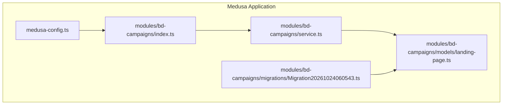
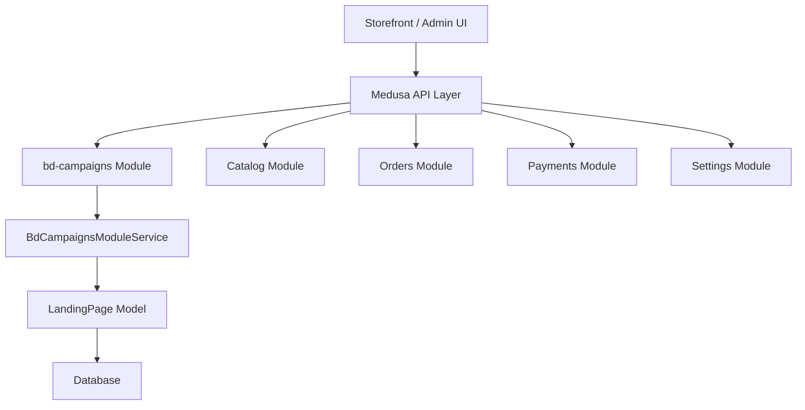
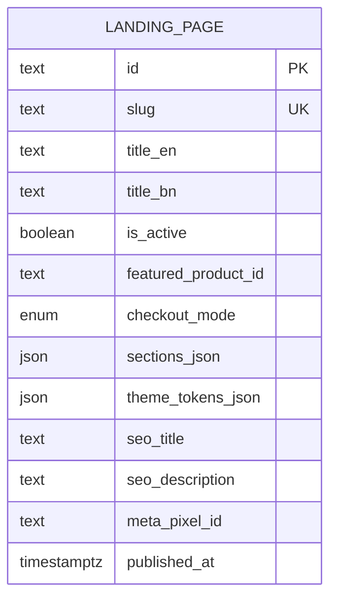
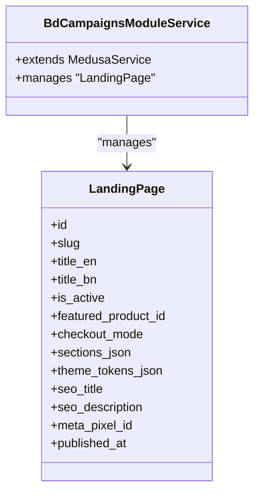
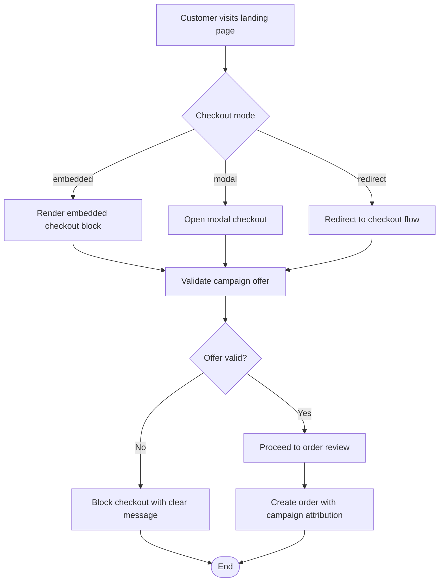
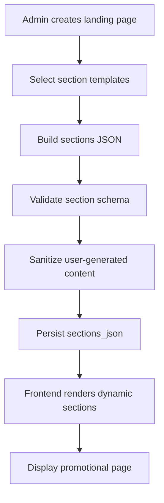
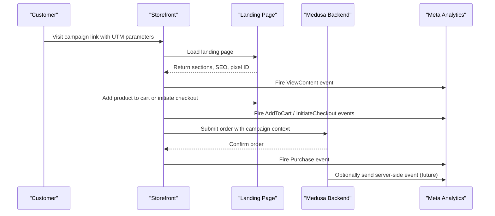
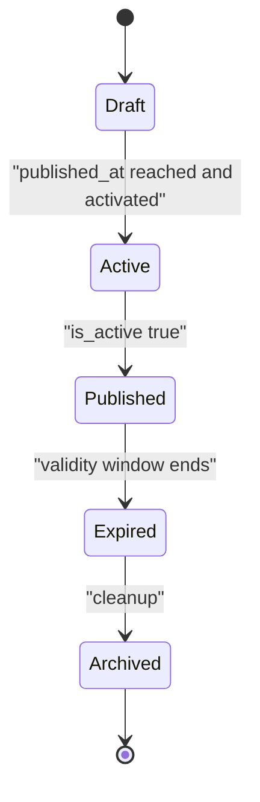
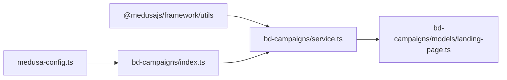

# Campaign Management Module (bd-campaigns)

<cite>
**Referenced Files in This Document**   
- [service.ts](file://apps/medusa/src/modules/bd-campaigns/service.ts)
- [landing-page.ts](file://apps/medusa/src/modules/bd-campaigns/models/landing-page.ts)
- [index.ts](file://apps/medusa/src/modules/bd-campaigns/index.ts)
- [Migration20261024060543.ts](file://apps/medusa/src/modules/bd-campaigns/migrations/Migration20261024060543.ts)
- [medusa-config.ts](file://apps/medusa/medusa-config.ts)
- [data-models.md](file://docs/data-models.md)
- [prd.md](file://prd.md)
- [user-journeys.md](file://user-journeys.md)
- [technical-plan.md](file://technical-plan.md)
</cite>

## Table of Contents
1. [Introduction](#introduction)
2. [Project Structure](#project-structure)
3. [Core Components](#core-components)
4. [Architecture Overview](#architecture-overview)
5. [Detailed Component Analysis](#detailed-component-analysis)
6. [Dependency Analysis](#dependency-analysis)
7. [Performance Considerations](#performance-considerations)
8. [Troubleshooting Guide](#troubleshooting-guide)
9. [Conclusion](#conclusion)
10. [Appendices](#appendices)

## Introduction
The `bd-campaigns` module provides the backend foundation for marketing campaign landing pages within the Medusa-based commerce platform. It defines a `LandingPage` data model, registers a Medusa module service, and integrates with the broader system through Medusa’s module configuration. The current implementation is intentionally minimal: it exposes CRUD capabilities over landing pages while leaving storefront rendering, checkout integration, analytics tracking, scheduling, A/B testing, and conversion tracking to higher layers such as the storefront application, workflows, jobs, and external integrations.

The module’s design aligns with the product requirements that campaign pages must reuse the existing catalog, inventory, pricing, cart, and order systems, support multiple checkout entry modes, preserve campaign attribution data, and avoid stale or invalid promotional pricing at checkout.

## Project Structure
The `bd-campaigns` module follows a standard Medusa module layout:

- `models/landing-page.ts`: Defines the database schema for campaign landing pages.
- `service.ts`: Declares the module service extending Medusa’s base service factory.
- `index.ts`: Registers the module under the name `bd_campaigns`.
- `migrations/Migration20261024060543.ts`: Creates the `landing_page` table and constraints.
- `medusa-config.ts`: Includes the module in the Medusa project configuration.

**Diagram sources**
- [medusa-config.ts:22-44](file://apps/medusa/medusa-config.ts#L22-L44)
- [index.ts:1-9](file://apps/medusa/src/modules/bd-campaigns/index.ts#L1-L9)
- [service.ts:1-9](file://apps/medusa/src/modules/bd-campaigns/service.ts#L1-L9)
- [landing-page.ts:1-20](file://apps/medusa/src/modules/bd-campaigns/models/landing-page.ts#L1-L20)
- [Migration20261024060543.ts:7](file://apps/medusa/src/modules/bd-campaigns/migrations/Migration20261024060543.ts#L7)

**Section sources**
- [index.ts:1-9](file://apps/medusa/src/modules/bd-campaigns/index.ts#L1-L9)
- [service.ts:1-9](file://apps/medusa/src/modules/bd-campaigns/service.ts#L1-L9)
- [landing-page.ts:1-20](file://apps/medusa/src/modules/bd-campaigns/models/landing-page.ts#L1-L20)
- [medusa-config.ts:22-44](file://apps/medusa/medusa-config.ts#L22-L44)

## Core Components
The core of the module consists of three files:

| File | Responsibility | Current State |
|---|---|---|
| `models/landing-page.ts` | Defines the `LandingPage` entity with fields for slug, titles, activation state, featured product, checkout mode, sections, theme tokens, SEO metadata, Meta Pixel ID, and publication timestamp. | Implemented. |
| `service.ts` | Exposes a Medusa service class that manages `LandingPage` records using the framework’s service factory. | Implemented as a thin wrapper. |
| `index.ts` | Registers the module under the constant `BD_CAMPAIGNS_MODULE` and wires the service into Medusa. | Implemented. |

The module does not yet implement custom business methods for campaign creation, landing page generation, direct checkout integration, performance tracking, scheduling, A/B testing, or conversion tracking. Those behaviors are expected to be implemented by additional services, workflows, API routes, storefront components, and integrations.

**Section sources**
- [landing-page.ts:1-20](file://apps/medusa/src/modules/bd-campaigns/models/landing-page.ts#L1-L20)
- [service.ts:1-9](file://apps/medusa/src/modules/bd-campaigns/service.ts#L1-L9)
- [index.ts:1-9](file://apps/medusa/src/modules/bd-campaigns/index.ts#L1-L9)

## Architecture Overview
At this stage, `bd-campaigns` is a data and service layer component inside the Medusa application. It is registered as a module and can be consumed by other modules, admin interfaces, store APIs, and storefront code.

**Diagram sources**
- [medusa-config.ts:22-44](file://apps/medusa/medusa-config.ts#L22-L44)
- [index.ts:1-9](file://apps/medusa/src/modules/bd-campaigns/index.ts#L1-L9)
- [service.ts:1-9](file://apps/medusa/src/modules/bd-campaigns/service.ts#L1-L9)
- [landing-page.ts:1-20](file://apps/medusa/src/modules/bd-campaigns/models/landing-page.ts#L1-L20)

The architecture supports future expansion:

- Storefront or admin UI can create and manage landing pages through Medusa APIs.
- Checkout flows can read `featured_product_id`, `checkout_mode`, and validation rules from the landing page.
- Analytics and attribution can attach campaign identifiers and UTM parameters to orders.
- External integrations such as Meta Pixel or Conversions API can be wired around these entities.

**Section sources**
- [medusa-config.ts:22-44](file://apps/medusa/medusa-config.ts#L22-L44)
- [data-models.md:280-302](file://docs/data-models.md#L280-L302)

## Detailed Component Analysis

### LandingPage Data Model
The `LandingPage` model represents a marketing campaign landing page. Its fields cover identity, visibility, content structure, presentation, SEO, analytics, and lifecycle control.

| Field | Type and Constraints | Purpose |
|---|---|---|
| `id` | Primary key identifier | Unique record reference. |
| `slug` | Text, unique | URL-safe path segment for the landing page. |
| `title_en` | Text | English title for the campaign page. |
| `title_bn` | Nullable text | Bengali title for localized campaigns. |
| `is_active` | Boolean, default true | Controls whether the campaign is active. |
| `featured_product_id` | Nullable text | Links the landing page to a main promotional product. |
| `checkout_mode` | Enum: `embedded`, `modal`, `redirect`, default `embedded` | Controls how checkout is presented from the landing page. |
| `sections_json` | JSON | Stores block layout structure such as hero, bundle, reviews, and other promotional sections. |
| `theme_tokens_json` | Nullable JSON | Stores controlled design tokens such as primary color and fonts. |
| `seo_title` | Nullable text | Page meta title for search engines. |
| `seo_description` | Nullable text | Page meta description for search engines. |
| `meta_pixel_id` | Nullable text | Optional campaign-specific Meta Pixel identifier. |
| `published_at` | Nullable datetime | Publication timestamp for scheduled publishing. |

**Diagram sources**
- [landing-page.ts:3-17](file://apps/medusa/src/modules/bd-campaigns/models/landing-page.ts#L3-L17)
- [Migration20261024060543.ts:7](file://apps/medusa/src/modules/bd-campaigns/migrations/Migration20261024060543.ts#L7)

Relationships and usage patterns:

- **Products**: The `featured_product_id` field links a landing page to a product. In the current implementation, this is stored as text rather than a typed foreign key, so referential integrity is enforced at the application level.
- **Promotions**: No explicit promotion entity exists in this module. Promotional behavior should be derived from live product pricing, discount logic, and checkout validation rather than hard-coded prices on the landing page.
- **Analytics**: The `meta_pixel_id` field allows per-campaign pixel configuration, while global pixel configuration and event tracking are described in the broader analytics documentation.
- **SEO**: `seo_title` and `seo_description` provide metadata for search engine optimization.
- **Lifecycle**: `is_active` and `published_at` support basic activation and scheduling semantics.

**Section sources**
- [landing-page.ts:1-20](file://apps/medusa/src/modules/bd-campaigns/models/landing-page.ts#L1-L20)
- [Migration20261024060543.ts:7](file://apps/medusa/src/modules/bd-campaigns/migrations/Migration20261024060543.ts#L7)
- [data-models.md:280-302](file://docs/data-models.md#L280-L302)

### Module Registration and Service
The module index exports a constant `BD_CAMPAIGNS_MODULE` and registers the module with Medusa. The service extends the framework’s service factory and declares `LandingPage` as its managed entity.

**Diagram sources**
- [service.ts:1-9](file://apps/medusa/src/modules/bd-campaigns/service.ts#L1-L9)
- [landing-page.ts:1-20](file://apps/medusa/src/modules/bd-campaigns/models/landing-page.ts#L1-L20)

Current limitations:

- The service currently relies on the generated Medusa service methods rather than custom business logic.
- There are no explicit methods for campaign creation workflows, landing page generation, direct checkout integration, performance tracking, scheduling, A/B testing, or conversion tracking.
- Future enhancements should add domain-specific methods while preserving transactional safety and validation.

**Section sources**
- [index.ts:1-9](file://apps/medusa/src/modules/bd-campaigns/index.ts#L1-L9)
- [service.ts:1-9](file://apps/medusa/src/modules/bd-campaigns/service.ts#L1-L9)

### Checkout Entry Modes
The `checkout_mode` field supports three modes:

| Mode | Behavior |
|---|---|
| `embedded` | Checkout content is embedded directly on the landing page. |
| `modal` | Checkout opens in a modal overlay. |
| `redirect` | Checkout navigates to a dedicated checkout flow. |

These modes map to the product requirement for two confirmed checkout entry paths:

- **Mode A — Product-first**: Landing page → product detail page → shared cart/checkout.
- **Mode B — Direct checkout**: Landing page → combined checkout/order review → confirmation.

**Diagram sources**
- [landing-page.ts:10](file://apps/medusa/src/modules/bd-campaigns/models/landing-page.ts#L10)
- [prd.md:145-152](file://prd.md#L145-L152)
- [user-journeys.md:472-518](file://user-journeys.md#L472-L518)

Important behavioral rules:

- Campaign checkout uses the shared cart and must preserve existing items.
- Expired, unpublished, sold-out, or invalid offers must be blocked at checkout.
- Campaign ID, landing-page ID, and UTM parameters should be attached to the resulting order where available.
- Campaign purchases must use the same underlying product, inventory, order, and payment records as normal storefront purchases.

**Section sources**
- [landing-page.ts:10](file://apps/medusa/src/modules/bd-campaigns/models/landing-page.ts#L10)
- [prd.md:145-152](file://prd.md#L145-L152)
- [user-journeys.md:444-518](file://user-journeys.md#L444-L518)

### Template System and Dynamic Content Rendering
The `sections_json` field stores the block layout structure for promotional pages. This supports a template-driven approach where sections such as hero, bundle, reviews, and call-to-action blocks can be composed without hardcoding HTML.

Recommended implementation pattern:

- Admin creates or edits a landing page and selects section templates.
- Section definitions are persisted as JSON.
- Frontend renders sections dynamically based on the JSON structure.
- Validation ensures only allowed section types and properties are accepted.
- Dangerous content is sanitized before storage and rendering.

This diagram is conceptual and describes recommended behavior rather than existing code.

**Section sources**
- [landing-page.ts:11](file://apps/medusa/src/modules/bd-campaigns/models/landing-page.ts#L11)
- [data-models.md:294-295](file://docs/data-models.md#L294-L295)

### SEO Optimization Features
SEO fields include `seo_title` and `seo_description`. These should be used by the storefront to generate page metadata, open graph tags, and structured data where appropriate.

Recommendations:

- Use `title_en` as a fallback when `seo_title` is empty.
- Use `seo_description` for meta descriptions.
- Generate canonical URLs from `slug`.
- Avoid duplicate SEO metadata across campaign pages.
- Respect privacy and consent policies before enabling analytics pixels.

**Section sources**
- [landing-page.ts:13-15](file://apps/medusa/src/modules/bd-campaigns/models/landing-page.ts#L13-L15)
- [data-models.md:296-298](file://docs/data-models.md#L296-L298)

### Analytics Integration and Conversion Tracking
The `meta_pixel_id` field enables optional per-campaign Meta Pixel configuration. Broader analytics guidance is documented in the product requirements and technical plan.

Key concepts:

- Centralized Meta Pixel configuration serves the storefront and published landing pages.
- Standard events such as ViewContent, AddToCart, InitiateCheckout, and Purchase should be tracked.
- Campaign ID, landing-page ID, and UTM parameters are preserved with orders for attribution reporting.
- Server-side Conversions API is planned as a later phase after privacy and consent review.
- Reporting must distinguish between store-verified metrics and Meta-attributed metrics.

**Diagram sources**
- [landing-page.ts:15](file://apps/medusa/src/modules/bd-campaigns/models/landing-page.ts#L15)
- [prd.md:158-165](file://prd.md#L158-L165)
- [user-journeys.md:1093-1111](file://user-journeys.md#L1093-L1111)
- [technical-plan.md:597-628](file://technical-plan.md#L597-L628)

**Section sources**
- [landing-page.ts:15](file://apps/medusa/src/modules/bd-campaigns/models/landing-page.ts#L15)
- [prd.md:158-165](file://prd.md#L158-L165)
- [user-journeys.md:1093-1111](file://user-journeys.md#L1093-L1111)
- [technical-plan.md:597-628](file://technical-plan.md#L597-L628)

### Campaign Scheduling
Scheduling is represented by `is_active` and `published_at`. While the current service does not implement automated scheduling logic, these fields support:

- Manual activation via `is_active`.
- Scheduled publication via `published_at`.
- Frontend or background jobs filtering published and active campaigns.

Recommended implementation pattern:

- Background job checks for campaigns where `published_at` is in the past and `is_active` is false, then activates them.
- Another job deactivates campaigns whose validity window has passed.
- Storefront queries only published and active landing pages.

This diagram is conceptual and describes recommended behavior rather than existing code.

**Section sources**
- [landing-page.ts:8](file://apps/medusa/src/modules/bd-campaigns/models/landing-page.ts#L8)
- [landing-page.ts:16](file://apps/medusa/src/modules/bd-campaigns/models/landing-page.ts#L16)

### A/B Testing Support
A/B testing is not explicitly modeled in the current `LandingPage` schema. Recommended approaches include:

- Storing variant configurations in `sections_json` or a separate experiment table.
- Assigning visitors to variants using deterministic hashing or session-based routing.
- Recording exposure and conversion events per variant.
- Aggregating results in analytics reports.

This section is conceptual and does not analyze specific source files.

### Conversion Tracking
Conversion tracking should tie customer actions to campaign attribution:

- Capture UTM parameters and campaign identifiers at page load.
- Attach them to cart and order metadata.
- Fire standard analytics events at key funnel steps.
- Ensure deduplication between client-side and server-side events if both are used.

**Section sources**
- [user-journeys.md:1101-1111](file://user-journeys.md#L1101-L1111)
- [technical-plan.md:597-628](file://technical-plan.md#L597-L628)

## Dependency Analysis
The `bd-campaigns` module depends on Medusa’s framework utilities and is included in the Medusa configuration alongside other custom modules.

**Diagram sources**
- [service.ts:1-2](file://apps/medusa/src/modules/bd-campaigns/service.ts#L1-L2)
- [index.ts:1-9](file://apps/medusa/src/modules/bd-campaigns/index.ts#L1-L9)
- [medusa-config.ts:22-44](file://apps/medusa/medusa-config.ts#L22-L44)

Coupling and cohesion observations:

- The module is cohesive around landing page data management.
- Coupling to other domains is currently indirect; product relationships are represented by an ID field rather than a formal link.
- Adding stronger domain boundaries would improve testability and maintainability.

Potential risks:

- Using text IDs for product references requires careful application-level validation.
- Extending the service with complex business logic should avoid tightly coupling it to storefront rendering concerns.
- External analytics integrations should be isolated behind adapters or workflows.

**Section sources**
- [service.ts:1-9](file://apps/medusa/src/modules/bd-campaigns/service.ts#L1-L9)
- [index.ts:1-9](file://apps/medusa/src/modules/bd-campaigns/index.ts#L1-L9)
- [medusa-config.ts:22-44](file://apps/medusa/medusa-config.ts#L22-L44)

## Performance Considerations
High-traffic campaign pages require careful attention to caching, rendering, and analytics overhead.

Recommendations:

- Cache landing page metadata and sections where safe.
- Avoid expensive product lookups during initial render unless required.
- Defer analytics script loading until necessary.
- Use server-side rendering or static generation for predictable performance.
- Monitor database query patterns for landing page retrieval.
- Avoid storing large unstructured payloads without limits.
- Implement rate limiting and request validation for admin and API endpoints.

[No sources needed since this section provides general guidance]

## Troubleshooting Guide
Common issues and resolution strategies:

| Issue | Likely Cause | Resolution |
|---|---|---|
| Landing page not visible | `is_active` is false or `published_at` is in the future | Verify activation and publication fields. |
| Invalid product reference | `featured_product_id` points to a non-existent product | Validate product existence before saving. |
| Checkout shows stale price | Prices were cached or hardcoded instead of reading live catalog | Read prices from the catalog and validate at checkout. |
| Analytics events missing | Pixel ID not configured or consent not granted | Configure pixel ID and verify privacy settings. |
| Duplicate orders | Missing idempotency handling in checkout submission | Enforce idempotency keys and server-side validation. |
| Campaign attribution lost | UTM or campaign context not attached to order | Capture and persist campaign metadata throughout checkout. |

Security considerations:

- Sanitize user-generated content in `sections_json` before storage and rendering.
- Validate all inputs, especially JSON structures and product IDs.
- Restrict access to campaign editing to authorized staff.
- Avoid executing arbitrary code from stored content.
- Review privacy requirements before enabling analytics pixels or server-side tracking.

**Section sources**
- [landing-page.ts:11](file://apps/medusa/src/modules/bd-campaigns/models/landing-page.ts#L11)
- [prd.md:145-152](file://prd.md#L145-L152)
- [user-journeys.md:1093-1111](file://user-journeys.md#L1093-L1111)

## Conclusion
The `bd-campaigns` module currently provides a solid foundation for campaign landing pages by defining the `LandingPage` entity, registering a Medusa service, and integrating into the Medusa configuration. It supports essential fields for content structure, presentation, SEO, analytics, and lifecycle control. However, most advanced functionality—such as campaign creation workflows, landing page generation, direct checkout integration, performance tracking, scheduling, A/B testing, and conversion tracking—is not yet implemented in the module’s service layer.

Future work should focus on:

- Adding domain-specific service methods for campaign lifecycle management.
- Implementing robust validation and sanitization for user-generated content.
- Integrating with catalog, cart, and order systems according to the confirmed checkout requirements.
- Building analytics pipelines that preserve campaign attribution while respecting privacy.
- Introducing scheduling, A/B testing, and conversion tracking in a secure and measurable way.

[No sources needed since this section summarizes without analyzing specific files]

## Appendices

### Module Configuration Reference
The module is enabled in the Medusa configuration under the modules array.

**Section sources**
- [medusa-config.ts:22-44](file://apps/medusa/medusa-config.ts#L22-L44)

### Data Model Reference
The `LandingPage` entity is documented in the project’s data models documentation.

**Section sources**
- [data-models.md:280-302](file://docs/data-models.md#L280-L302)